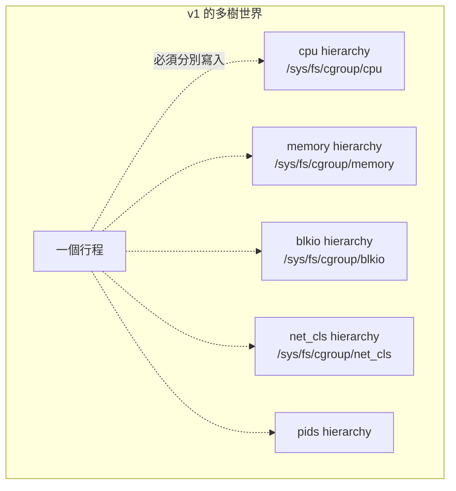
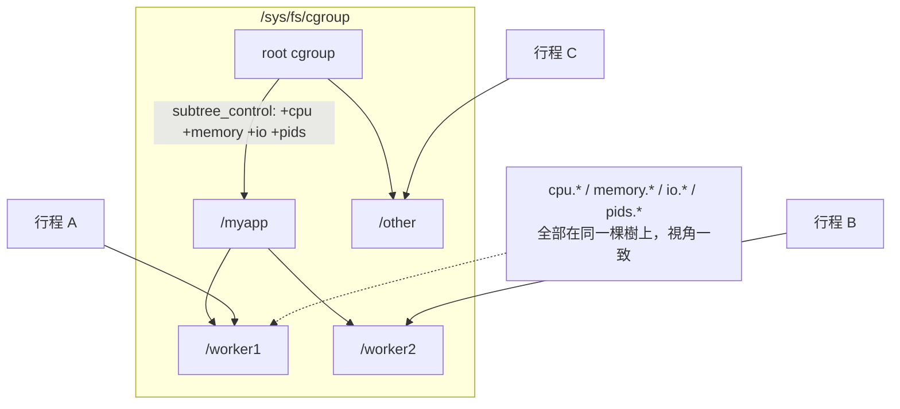

# 3.4 2016 年 Cgroups-v2 的統一階層革命

## 為什麼 v1 在雲原生時代會崩潰

讓我們把 v1 的問題講得非常具體，因為這是理解 v2 設計的最好方式。

### 問題一：控制器與 hierarchy 的綁定

v1 的架構規則是：**一個控制器（controller）只能存在於一個 hierarchy 中。** 而一個 hierarchy 掛載一個偽檔案系統目錄。



**後果**：一個行程想同時受 CPU 與 I/O 控制，管理員必須把它寫入**五棵不同的樹**。這個操作不是原子的，期間可能出現狀態不一致。

### 問題二：無法做一致的記帳

這是對雲端最致命的一點。雲端廠商要回答一個簡單的問題：

> 「這個租戶的這個應用程式，在這個小時內，總共用了多少 CPU 秒、多少 GB 記憶體、多少 GB 磁碟 I/O？」

在 v1 中，`cpuacct` 在 CPU 樹，`memory` 在記憶體樹，`blkio` 在 blkio 樹。要做這個加總，你必須：

1. 從三棵樹分別取樣。
2. 用「路徑名稱」作為關聯鍵把它們對起來。
3. 處理取樣之間的時間偏移（CPU 統計在 4.0 版本後才有原子性保證）。

而且——**cgroup 路徑名稱在 v1 中不穩定**。同一個容器重啟後可能被分到不同的路徑（尤其是用 `--cgroup-parent` 或 `--cid` 混用時），這讓以路徑為鍵的記帳系統極度脆弱。

### 問題三：執行緒與行程的粒度混亂

v1 允許**執行緒**（thread）與**行程**（process）分屬不同的 cgroup：

```bash
# v1：thread 級別的 cgroup
echo $TID > /sys/fs/cgroup/cpu/thread_group/cgroup.procs
```

Lennart Poettering（systemd 與 cgroups 的主要推動者）對此有非常明確的批評：

> 這是一個被嚴重濫用的功能。它允許把一個行程的所有執行緒拆散到不同 cgroup，造成**無法理解的資源競爭**：當同一個行程的執行緒在不同 cgroup 中被限制時，行程內部的鎖等待會形成複雜的相互等待，甚至近似死鎖。

v2 直接取消了 thread 級別的 cgroup（只保留 `cgroup.threads` 供 threaded cgroup 使用），粒度回到**行程**。

### 問題四：無法動態改變控制器歸屬

在 v1 中，決定「這個檔案系統的 I/O 要不要被 blkio 控制」是在**掛載時**就決定並寫入 superblock 的。這意味著：

- 掛載後不能改變。
- 一個已存在的檔案系統不能從 v1 遷移到 v2。

這對「混合 v1/v2 環境」的遷移是嚴重障礙。

## v2 的設計決策

cgroups v2 由 **Tejun Heo** 主導開發，2014 年開始（在 v1 的 "dummy hierarchy" 中開始建構），2016 年 3 月隨 Linux 4.5 合併。

### 決策一：單一統一 hierarchy

**所有控制器都在同一棵樹上。** 一個行程只屬於一個 cgroup 路徑，所有控制器的視角一致。



**帶來的能力**：

1. **一致的記帳**：`cpu.stat`、`memory.stat`、`io.stat` 描述的是同一批行程。
2. **一致的資源治理**：一個容器的 CPU 配額、記憶體上限、I/O 限速都掛在同一個路徑下。
3. **動態啟用控制器**：透過 `cgroup.subtree_control` 隨時開關，不需要重新掛載。

### 決策二：No Internal Process Constraint

這是 v2 最核心也最容易被忽略的規則：

> **若一個 cgroup 有啟用了控制器的子 cgroup，則它自己不能直接含有行程。**

推導過程：

- 假設 cgroup A 直接含有行程 T，且 A 也有子 cgroup B。
- 若 A 上啟用了 `cpu` controller，而 B 上也啟用了 `cpu`，那麼 T 受到 A 的限制，而 B 的行程受到 B 的限制——這沒有矛盾。
- 但問題在於 `memory` controller：記憶體限制是**遞迴**的（子 cgroup 的用量計入父 cgroup）。若 A 含有 T 且 A 限制 512MB，B 也含有行程，B 的用量又計入 A。此時 A 的限制對 T 與 B 的合計生效，但 A 自己的限制也生效於 T——這在語意上是合理的，但**一旦有人把 B 的行程再移回 A，就會出現限制被重複計算**。
- 更根本的問題：**控制器在某個 cgroup 上啟用時，該 cgroup 的限制不作用於自己，只作用於其子 cgroup**。這保證了限制只作用在葉子節點，不會有重複。

實務上的效果：

```bash
# root cgroup 含有 init 行程與所有 systemd 建立的服務
# 當你啟用 +cpu 後，root 必須沒有行程 → systemd 會把行程移進子 cgroup
echo "+cpu" > /sys/fs/cgroup/cgroup.subtree_control
```

**這就是為什麼 systemd 是 cgroups v2 的關鍵推動者**：沒有 systemd 來管理行程的 cgroup 歸屬，v2 的統一 hierarchy 幾乎無法在真實系統上使用。Linux 與 systemd 的共生關係，在 cgroups v2 上展現得最為明顯。

### 決策三：以檔案系統單位（v2 的 I/O）

v2 的 `io` controller 不再以 blkio 的裝置層級模型為基礎（v1 的 `blkio` 是直接操作 block device 的請求層），而是採用 **BFQ / ionice 風格**的檔案系統層級模型：

```
io.max
# 寫法：<device> rbps=<bytes> wbps=<bytes> riops=<n> wiops=<n>
# 例如
echo "8:0 rbps=104857600 wbps=104857600" > /sys/fs/cgroup/myapp/io.max
```

**這個改變極其重要**，因為它解決了 v1 的一個惡名昭彰的問題：

> **v1 的 blkio 限制作用在 block device 的請求層，因此對「檔案是否在 page cache 中」完全不敏感。** 檔案已經在 page cache 裡的讀取，根本不會產生 blkio 請求，因此**不受任何限制**。這意味著 v1 的 I/O 限制可以被 cache hit 輕易繞過——對雲端計費與公平性是致命的。

v2 的檔案系統層級模型把 I/O 限制放在 VFS 的 bio 層面，直接對「應用程式發出的讀寫請求」計數，因此**cache hit 與 miss 都會被正確記帳**（cache hit 仍會產生 bio，只是走 memcopy 路徑）。

### 決策四：檔案描述符式的限制（v2 新增）

v2 新增了 **`memory.oom.group`**、`pids.max`、`pids.peak`、`memory.peak`、`memory.swap.max` 等，以及最重要的：

- **`cpu.uclamp.min` / `cpu.uclamp.max`**（Linux 5.11，2021）：用 uclamp 精確表達「這個 cgroup 的最小/最大 CPU 容量需求」。
- **`cpu.max.burst`**（Linux 5.14，2021）：允許短時間的配額超支（例如啟動時的 burst）。
- **`memory.high`**：超過此值時觸發**壓力式回收**（ reclaim 變得更激進）但不觸發 OOM——這是區分「軟壓力」與「硬限制」的關鍵。

### 決策五：PSI（Pressure Stall Information）

**PSI（Linux 4.20，2018 年 12 月）** 是 cgroups v2 時代最常被低估的新功能。它提供「** stall（停滯）**」資訊：

```
/proc/pressure/cpu    # 某些任務因 CPU 資源不足而停滯的時間佔比
/pro/pressure/memory  # 因記憶體不足而停滯
/pro/pressure/io      # 因 I/O 不足而停滯
```

格式：

```
some avg10=0.00 avg60=0.00 avg300=0.00 total=0
full avg10=0.00 avg60=0.00 avg300=0.00 total=0
```

- `some`：至少部分任務停滯的時間比例。
- `full`：**所有**非 idle 任務都停滯的時間比例。

`full` 是最有價值的指標：它直接對應「我現在的延遲劣化，是因為資源不足」。這在第 8 章的可觀測性討論中會再次出現（PSI 與 eBPF 追蹤是互補的）。

PSI 也能在 cgroup 層級使用：

```bash
cat /sys/fs/cgroup/myapp/cpu.pressure
cat /sys/fs/cgroup/myapp/memory.pressure
cat /sys/fs/cgroup/myapp/io.pressure
```

### 決策六：介面的重設計

v2 把控制介面從「一個限制一個檔案」重組成「一個控制器一個檔案群」：

```
memory.max          # 硬上限
memory.high         # 壓力閾值
memory.low          # 保護下限（避免被回收）
memory.min          # 硬保護下限
memory.current      # 當前用量
memory.peak         # 歷史峰值
memory.stat         # 詳細統計
memory.events       # 事件計數（low/high/max/oom 觸發次數）
memory.pressure     # PSI
memory.numa_stat    # NUMA 統計
memory.reclaim      # 主動回收
memory.swap.max / .current / .events
memory.oom.group
```

`memory.low` / `memory.min` 是一個重要的新增能力：

- `memory.low`：**保護**這個 cgroup 的記憶體不被其他 cgroup 回收。
- `memory.min`：**硬性保護**，即使在全域壓力下也不會被回收（需要與 `memory.low` 的全域計算配合）。

這讓「重要的服務」與「批次的服務」可以在同一台機器上共存，而不互相傷害——這是共享集群資源排程的基礎。

## 遷移路徑

v1 與 v2 可以共存於同一系統（掛載在不同路徑），但**不能共用控制器**：一個控制器一旦在 v2 的統一 hierarchy 中啟用，就不能在 v1 中使用。

```bash
# 檢查目前狀態
cat /sys/fs/cgroup/cgroup.controllers
# 顯示 "cpuset cpu io memory hugetlb pids rdma misc"

cat /proc/self/cgroup
# 0::/user.slice/user-1000.slice/...
# 0::/ 表示在 v2 的統一 hierarchy 中的路徑
```

**Fedora 31（2019 年 10 月）** 是第一個預設使用 cgroup v2 的大型發行版。

## v1 與 v2 的完整對照

| 面向 | v1 | v2 |
|---|---|---|
| hierarchy 數量 | 每控制器一棵 | 單一統一樹 |
| 一致記帳 | 需跨樹對齊，脆弱 | 天然一致 |
| 執行緒粒度 | 支援 thread 級別（被濫用） | 移除，僅行程 |
| I/O 限制層級 | block device 請求層（可被 cache 繞過） | 檔案系統 bio 層 |
| 控制器啟用 | 掛載時決定 | 執行時 `subtree_control` |
| 軟/硬限制 | 軟限、硬限、swap 限分散 | `min` / `low` / `high` / `max` 四級 |
| 壓力指標 | 無 | PSI（cpu/memory/io/irq） |
| 寫入緩衝 | 需 `sync_file_range` 才保證一致 | 直接寫入即時生效 |

## 為什麼這對雲原生至關重要

Kubernetes 的資源模型就是直接建構在 cgroups v2 之上的：

```yaml
resources:
  limits:
    cpu: "2"
    memory: 512Mi
    ephemeral-storage: 2Gi
  requests:
    cpu: "500m"
    memory: 256Mi
```

- `limits.cpu` → `cpu.max`（quota + period）
- `limits.memory` → `memory.max`
- `requests` → `cpu.weight`（相對權重）與排程器的依據

而 **QoS 類別**（Guaranteed、Burstable、BestEffort）正是 v2 的 `cpu.max`（有無配額）與 `cpu.weight`（權重）組合的語意映射。

在 v1 時代，同一個容器的 CPU 統計在 `cpu,cpuacct` 樹、記憶體統計在 `memory` 樹，做一個「資源用量報表」需要跨越多棵樹。**v2 的統一 hierarchy 讓叢集級的資源治理與計費變得可行**，這是 v2 能在 2016 年後迅速被雲原生生態系全面採用的根本原因。

## 實作：手動建立一個 v2 資源受限環境

```bash
#!/bin/bash
# 建立一個 cgroup v2 沙箱
set -e

CG=/sys/fs/cgroup/demo
mkdir -p "$CG"

# 啟用控制器（必須在建立子 cgroup 之前）
echo "+cpu +memory +io +pids" > /sys/fs/cgroup/cgroup.subtree_control

# 限制：2 個 CPU 的配額
echo "200000 100000" > "$CG/cpu.max"

# 限制：512MB 記憶體硬上限，400MB 壓力閾值
echo "512M" > "$CG/memory.max"
echo "400M" > "$CG/memory.high"

# 限制：256 個行程
echo "256" > "$CG/pids.max"

# 啟動行程並加入
sleep 1000 &
PID=$!
echo "$PID" > "$CG/cgroup.procs"

# 觀察
watch -n1 "cat $CG/memory.current; cat $CG/cpu.stat; cat $CG/memory.events"
```

`memory.events` 是一個非常實用的診斷工具：

```bash
cat /sys/fs/cgroup/demo/memory.events
# low 0
# high 12      ← 觸發過 12 次高壓回收
# max 3        ← 有 3 次觸及硬上限
# oom 0
# oom_kill 0
```

`high` 遠大於 `max` 但 `oom` 為 0，是「記憶體壓力高但還沒死」的典型訊號；`oom_kill > 0` 則表示已經有行程被殺。

## 小結

1. v1 的多 hierarchy 設計無法做一致記帳、容易被 cache 繞過 I/O 限制、允許被濫用的執行緒粒度——這些在雲原生規模下都是致命的。
2. v2（Linux 4.5，2016）的三個關鍵決策：單一統一 hierarchy、No Internal Process Constraint、以檔案系統單位做 I/O 限制。
3. v2 新增了 `memory.min`/`low`/`high`/`max` 的四級保護，以及 PSI 壓力指標。
4. **systemd 是 v2 能否落地的前提**：沒有 systemd 管理行程歸屬，統一 hierarchy 無法在真實系統上運作。
5. Kubernetes 的 QoS 類別、資源配額、節點資源治理，全部直接映射到 cgroups v2 的檔案介面。

第二部還差一章。我們已經有了「看不見」（namespaces）與「用不完」（cgroups）兩塊拼圖。下一章要看的是：**如何把這些原語組裝成一個可攜式的、可交付的軟體單元？** 也就是 Docker 與 OCI 的故事。
