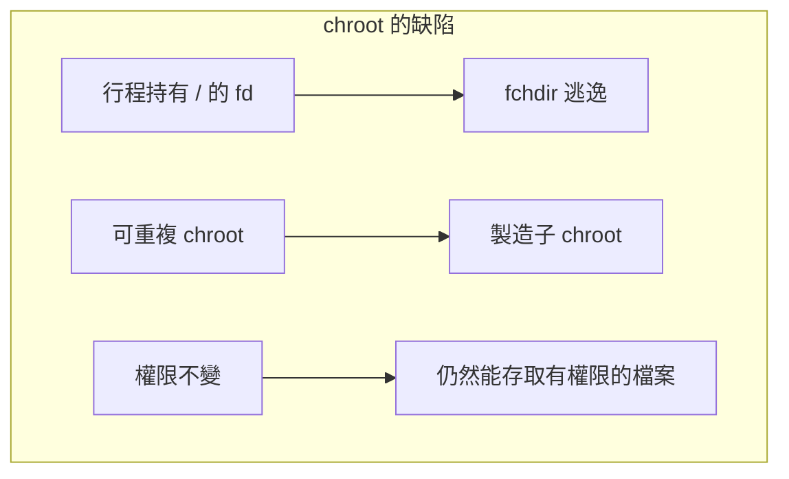
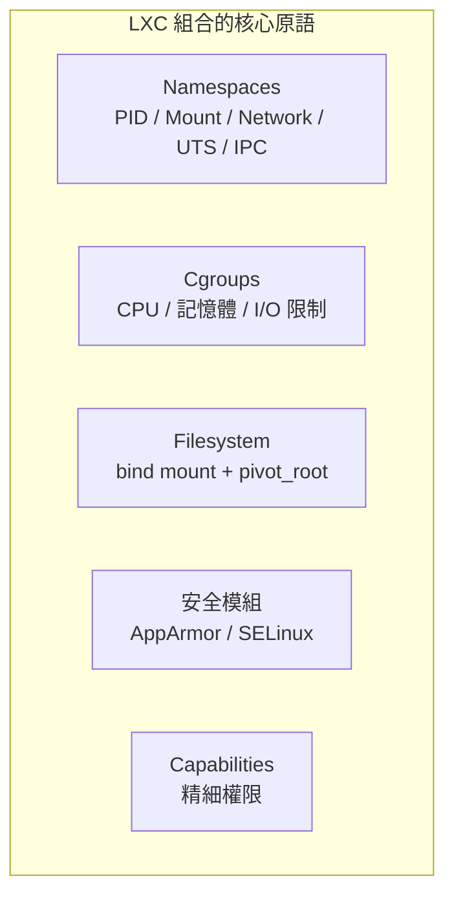
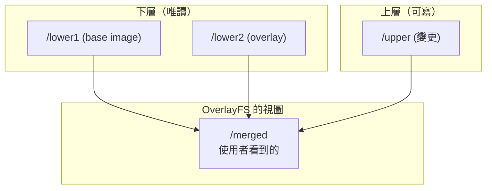
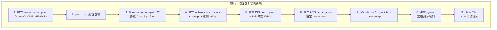

# 4.1 從 chroot 到 LXC 的容器前史

## 容器不是新概念

「容器」的想法幾乎和 Unix 同齡。1979 年 BSD 出現 `chroot`（change root），它提供了最原始的隔離：一個行程可以把根目錄改成某個子目錄，看不到外面的檔案。

`chroot` 的語意非常簡單：

```c
int chroot(const char *path);
```

呼叫後，行程的根目錄變成 `path`。之後所有相對路徑解析都以新根為起點。

**但 `chroot` 不是安全機制**，這是 Unix 社群很早就認識到的事實。原因有三：

1. **行程仍持有舊根的 fd**。若行程在 `chroot` 之前就 `open("/")`，那個 fd 仍然有效，`fchdir()` 就能回去。
2. **行程可以再次 `chroot(".")`**，在自己的家目錄裡造出新的子 chroot，製造無限的「根」。
3. **權限沒有改變**。chroot 內的行程仍是同樣的 uid，擁有同樣的檔案權限。



BSD 提供的加強是 **`jail(2)`**（FreeBSD 為主）：不只改根，還能限制行程不能建立新的 jail、不能使用 `chroot` 逃逸、不能存取 jail 外的資源。FreeBSD jail 的隔離強度遠高於 chroot，但它是一整套機制，而不是單一原語。

## 其他操作系統的「容器」嘗試

| 系統 | 機制 | 年份 | 結果 |
|---|---|---|---|
| Solaris | Zone | 2004 | 成功，廣泛用於 SPARC/solaris 伺服器 |
| FreeBSD | Jail | 2005– | 成功 |
| Linux | **VServer** | 2003 | 社群推廣，主流核心未採用 |
| Linux | **OpenVZ** | 2005 | 廣泛用於虛擬主機，但非上游核心 |
| Linux | **LXC** | 2008 | 主流核心採用，容器時代的開路先鋒 |

### Linux VServer 與 OpenVZ：先行者

- **Linux VServer**（2003，Christian G. Benvenuti）：以「每個虛擬環境一個 root 私有」的觀念，提供 UID 隔離、檔案系統隔離等。它把「容器」一詞帶入 Linux 社群，但也製造了術語混淆。
- **OpenVZ**（2005，Parallels）：**不是**在核心內，而是用核心 patch 加上使用者空間工具，提供「每個容器一個 root 私有」的完整容器。它是 VirtualBox 與之後的 Parallels Cloud 的技術基礎。OpenVZ 體現了一條不同的路線：**放棄上游核心，維護自己的核心分支**。這條路線在企業裡可行（Virtualization 只需要一部份市場），但無法成為通用方案。

**這段歷史很重要**：Linux 上的容器從來不是「一個」設計，而是多條平行演化的路線。最終勝出的，是那些**只用上游核心既有原語、不需要核心 patch** 的設計。

## LXC（2008）：第一個「主流核心原生」的容器

**LXC（Linux Containers）** 由 IBM 的 Serge Hallyn 推動，2008 年進入核心（Ubuntu 8.10 是第一個包含它的發行版）。它是第一個**完全建立在核心原生原語之上**的容器系統。

LXC 用到的核心機制，正是第 3 章介紹的那些：



LXC 的設定檔（`/etc/lxc/lxc.conf`）看起來像這樣：

```
lxc.rootfs = /var/lib/lxc/mycontainer/rootfs
lxc.utsname = mycontainer
lxc.network.type = veth

lxc.cgroup2.cpuset.cpus = 0-3
lxc.cgroup2.memory.max = 512M
lxc.cgroup2.cpu.max = 200000 100000
```

**LXC 的歷史意義在於它證明了兩件事**：

1. 上游核心的原語（namespaces + cgroups + pivot_root）**足以**組裝出實用的容器。
2. 容器**不需要 hypervisor**，啟動時間可以從虛擬機的數十秒降到數百毫秒。

但 LXC 沒有大規模流行。原因很明確：

| 問題 | 說明 |
|---|---|
| **沒有交付模型** | LXC 只給你「執行環境」，沒有「打包與分發」的機制 |
| **設定檔耦合主機** | 網路、掛載點等設定寫死在設定檔裡，無法攜帶 |
| **工具鏈割裂** | 沒有一個統一的「建置 → 打包 → 執行 → 分發」流程 |
| **名詞混亂** | 容器有太多種（systemd-nspawn、OpenVZ、LXC、Docker…），開發者不知該選哪個 |

> 這就是 **Docker 存在的理由**。Docker 不是第一個容器技術，它是第一個把容器變成**「可攜式的軟體交付單元」**的技術。

## `systemd-nspawn`：另一條路線

systemd 自己的容器實作 `systemd-nspawn`（2010 年 systemd 引入）走的是另一條路：以 systemd 為基礎，一個「容器」其實是一個 systemd 的 scope 或 service。

```bash
systemd-nspawn -D /var/lib/machines/myvm --boot
```

它與 LXC 用同樣的核心原語，但整合了 systemd 的服務管理、journal 日誌、以及 `machinectl` 命令。

**這條路線在 2020 年之後重新變得重要**：systemd 的 `systemd-nspawn` 與 `Podman` 的整合，以及「以 systemd 為叢集控制面」的新浪潮（例如 AWS Bottlerocket 的部分設計、Flatcar、Nomad 的部分用法）。

## 一個關鍵的技術缺口：UnionFS 之前的檔案系統問題

到 LXC 時代為止，「容器」的檔案系統視角是靠 **bind mount** 拼湊的：

```
/var/lib/lxc/mycontainer/rootfs/         ← bind mount 主機的 /usr
/var/lib/lxc/mycontainer/rootfs/lib     ← bind mount 主機的 /lib
/var/lib/lxc/mycontainer/rootfs/etc     ← 自己的 tmpfs
...
```

這方法能用，但有嚴重的問題：

1. **沒有分層**。要為容器加一個套件，就必須複製整個目錄樹（數 GB）。
2. **寫入會污染主機**。bind mount 是唯讀或共享寫入，寫入會影響主機。
3. **刪除會出錯**。刪除一個 bind mount 的目錄在某些情況下會刪掉主機的檔案。

**解法是 UnionFS（又稱 OverlayFS）**：把多個「下層」（lower）目錄疊成一個「上層」（upper）的視圖。



OverlayFS 的引入是容器分發能夠規模化的關鍵：它讓「在上一次映像的基礎上加一層」的成本是 $O(\text{變更量})$ 而不是 $O(\text{完整大小})$ 。

OverlayFS 進入上游核心的歷史：Ubuntu 曾在 2011 年提交名為 "aufs" 的 out-of-tree 支援（因為 aufs 的 GPL 授權與核心不相容）。後來社群壓力下，核心社群接受了一個 in-tree 的替代實作 **overlayfs**，於 **Linux 3.18（2014 年 12 月）** 合併。此後 Docker 也從 aufs 轉向 overlayfs（Docker 1.6，2014 年 6 月）。

## 從 2008 到 2013：等待「那個瞬間」

2008 到 2013 年之間，核心原語已經齊備：

- namespaces ✅（2002–2013）
- cgroups ✅（2007–2016）
- pivot_root ✅（2002，rootless 支援 2011）
- OverlayFS ✅（2014，稍晚）
- capabilities ✅（2001–2003）
- seccomp ✅（2003，seccomp-bpf 2016）

**那麼為什麼容器沒有在 2013 年之前就爆發？**

因為**缺的不是原語，而是「使用者體驗」與「商業模式」**。

2013 年前後發生了三件事：

1. **雲端computing 的成熟**：AWS 提供 API 讓人按需求開機、在分鐘級別內取得資源。生產環境的變更需要「可重現的環境」。
2. **開發者痛點的轉移**：2010 年前後，應用開發的主要痛點從「寫程式」變成「管理依賴與環境」——"works on my machine"。
3. **Docker Hub 的商業模式**（2014 年 3 月推出 Docker Registry）：容器映像的分享從「ftp 上傳 tar 檔」變成「一條命令」。

**這是一個重要的系統史觀察：技術的成熟不等於變革的發生。** 容器所需的每一個原語，在 2013 年前都已經存在好幾年。改變一切的是**把原語組裝成一個開發者會使用的產品**。

## 讓我們把「容器是原語的組合」具體化

一個最小的容器執行（概念上）需要：



**這九個步驟，每一個都是核心原語的一次呼叫。** Docker 與 OCI 的貢獻，是把這九個步驟**標準化描述成一個 JSON 檔案**。

## 從 chroot 到容器：隔離強度的量化

| 機制 | 隔離維度 | 逃逸難度 | 開銷 |
|---|---|---|---|
| `chroot` | 檔案系統根 | ★☆☆☆☆ | 幾乎為零 |
| `chroot` + `chroot(".")` 防護 | 檔案系統根 | ★★☆☆☆ | 幾乎為零 |
| LXC（namespaces + cgroups） | 行程 / 檔案 / 網路 / PID | ★★★★☆ | 數 MB |
| Docker | 同上 + 能力模型 + seccomp + LSM | ★★★★☆ | 數 MB |
| gVisor | 使用者空間核心 | ★★★★★☆ | 數十 MB |
| Kata Containers | 輕量 hypervisor | ★★★★★☆ | 數百 MB |
| 完整虛擬機 | 硬體級 | ★★★★★★ | 數 GB |

注意最後一行：**容器用「共享核心」換取了「接近虛擬機的隔離強度」，這在傳統安全模型下是不可能的。** 這是 Linux 這三十年最重要的一次安全性進步——把 hypervisor 的保證，用 OS 原語重新實現了一遍。

## 小結

1. `chroot`（1979）提供最原始的隔離，但因 fd 逃逸、可重複 chroot、權限不變三大缺陷而從不是安全機制。
2. LXC（2008）證明了「上游核心原語足以組裝實用容器」，但缺乏交付模型與工具鏈，未能普及。
3. OverlayFS（上游核心 3.18，2014）解決了「分層檔案系統」，是容器映像能規模化分發的關鍵。
4. **所有核心原語在 2013 年前都已就緒**；爆發的催化劑是產品化（Docker 與 Docker Hub 的商業模式），而非技術突破。
5. 真正的安全隔離必須多層疊加：namespaces（看不見）+ cgroups（用不完）+ capabilities（做不了）+ seccomp（不許做）+ LSM（不准做）。

下一章，我們進入 Docker 本身。
