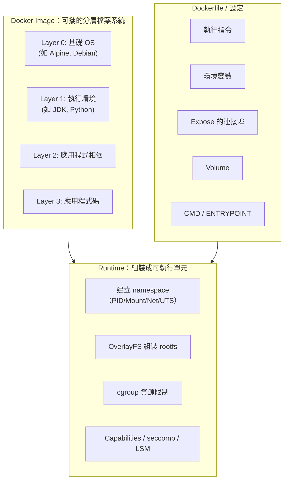
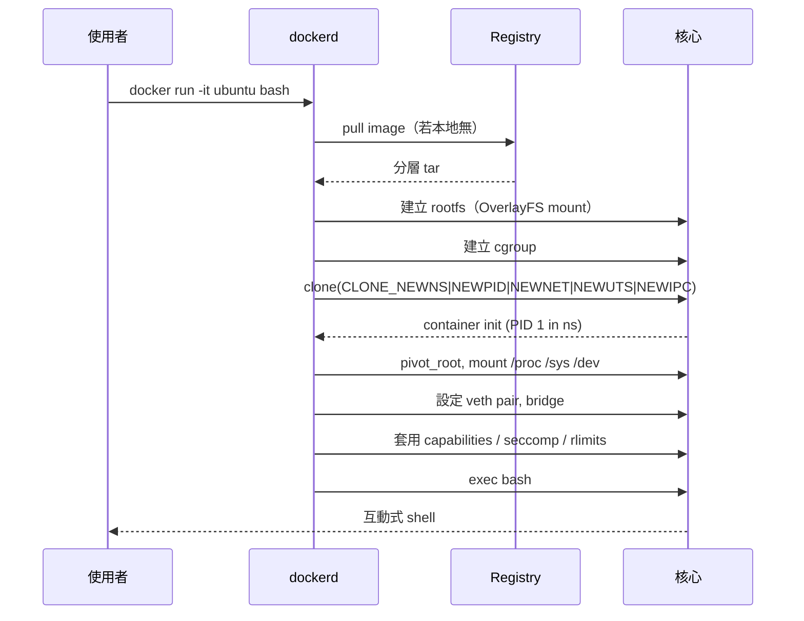
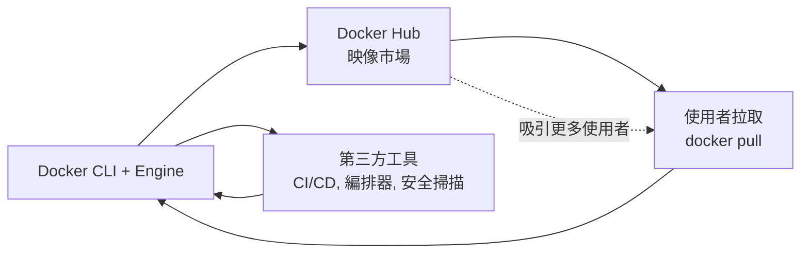
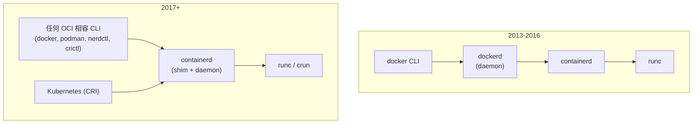

# 4.2 2013 年 Docker 發布與 Build once, run anywhere

## Docker 1.0 之前：從 libcontainer 開始

Docker 的故事有兩個起點。

**起點一：libcontainer（2013 年）**。Docker 的核心工程師 Will Jessup 認為「容器應該是一個可獨立使用的函式庫」，於是創作了 `libcontainer`，把第 4.1 節那九個步驟封裝成一個 C 函式庫。**這個決定後來演化成了 OCI 的 `runc` 專案**（Docker 自己後來也放棄了內建的 container 執行器，改用 `runc`）。

**起點二：Docker 0.9（2013 年 9 月）**。這是 Docker 第一次把 `libcontainer` 整合進 Docker 引擎，也是「Docker 就是容器」的印象真正確立的版本。在此之前，Docker 需要一個外部的 `docker-lxc` 之類的程式來執行容器。

## Docker 的核心創新

Docker 沒有發明任何新的核心原語。它的創新是**組裝與包裝**：



**三個要素**：

| 要素 | 解決的問題 | 對應的核心原語 |
|---|---|---|
| **Image（分層檔案系統）** | 「環境怎麼被打包與攜帶」 | OverlayFS / 分層 tar |
| **Buildfile（建置描述）** | 「環境怎麼被重現」 | 建置指令序列 |
| **Runtime（執行描述）** | 「怎麼在受限環境中啟動」 | namespaces + cgroups + capabilities + seccomp |

## Dockerfile：把「環境」變成程式碼

Dockerfile 是整個革命中最不起眼、卻最重要的部分。它把「如何建構一個執行環境」變成了**一段可版本控制、可審查、可重現的程式碼**。

```dockerfile
# 1. 基礎映像
FROM golang:1.22-alpine AS builder

# 2. 依賴層（利用 build cache）
WORKDIR /src
COPY go.mod go.sum ./
RUN go mod download

# 3. 建置層
COPY . .
RUN CGO_ENABLED=0 go build -o /out/myapp ./cmd/myapp

# 4. 執行層（最小化）
FROM alpine:3.20
RUN apk add --no-cache ca-certificates
COPY --from=builder /out/myapp /usr/local/bin/myapp
USER 1000:1000
EXPOSE 8080
ENTRYPOINT ["/usr/local/bin/myapp"]
```

### 為什麼分層的順序決定了 build cache 的效率

Docker 的建置過程中，每一條 `RUN`、`COPY`、`ADD` 指令都產生一個新的映像層。**建置器會對每一層計算內容雜湊，若某一層的輸入未變，該層的結果就從快取中重用。**


這解釋了 Dockerfile 撰寫的兩條鐵律：

1. **把變動頻繁的 COPY 放在最後。** 上面把 `go.mod` 與原始碼分開 COPY，就是為了讓相依下載這一層可以快取。
2. **把「會變動的」與「不會變動的」合併到同一層是不行的**——一旦某層失效，其後所有層都失效。

### 多階段建置（Multi-stage Build）

`FROM ... AS builder` 與 `COPY --from=builder` 讓最終映像可以只包含執行期真正需要的東西：

- 建置階段的 Go 編譯器（數百 MB）留在 builder 層，**不進入**最終映像。
- 最終映像只有一個靜態連結的執行檔與 Alpine 基礎。

這是「容器映像最小化」的關鍵實踐，也是後來 distroless、scratch 映像的先聲。

### 對比傳統的基礎設施管理

| 面向 | 傳統（VM + Puppet/Ansible） | 容器（Dockerfile） |
|---|---|---|
| 環境描述 | 散落在多處（安裝腳本、wiki、人的記憶） | 單一檔案，與程式碼一起版本控制 |
| 「環境可重現」 | 難；要重建 VM 映像 | 容易；`docker build` 就是完整過程 |
| 交付單位 | VM 映像（數 GB） | 容器映像（數十～數百 MB） |
| 交付速度 | 數十秒～數分鐘 | 數秒（層快取命中時數百毫秒） |
| 從開發到生產的一致性 | 需要 IaC 工具鏈 | 同一個映像 |

## Docker Engine 的架構（2013–2014）

早期 Docker 的架構：

```
docker CLI
    │  (REST API over unix socket)
    ▼
docker daemon (dockerd)
    ├── 容器管理：建立/停止/刪除
    ├── 網路管理：建立 bridge/veth
    ├── 儲存管理：overlay mount、volume
    ├── registry client：pull/push
    └── exec：執行命令
```

Container 的執行流程：



## 「Build once, run anywhere」的真正含義

這句話常被當成行銷語言，但它背後有非常具體的技術含義。

**「Build once」** 意味著：映像是**不可變的（immutable）**。一旦建置完成，它就是一個以內容雜湊（digest）標識的物件。

```bash
$ docker images --digests
REPOSITORY   TAG      DIGEST
myapp        v1.0     sha256:3a5b2c...    ← 內容雜湊
```

**「Run anywhere」** 意味著：執行環境只依賴**核心提供的原語**，不依賴特定的主機狀態。

這與虛擬機的「run anywhere」有本質差異：

| 面向 | VM | 容器 |
|---|---|---|
| 可攜性來源 | 模擬整個硬體 | 共享核心，只帶使用者空間 |
| 依賴 | hypervisor | 核心版本必須相容 |
| 隔離強度 | 硬體級 | OS 級（共享核心） |
| 啟動時間 | 數十秒 | 數百毫秒 |
| 映像大小 | 數 GB | 數十 MB |

**這個取捨是整個雲原生時代的基礎。** 雲端廠商（AWS ECS、GKE、Azure AKS）幾乎全部採用容器，正是因為「共享核心 + 快速啟動 + 小映像」這三點，直接對應了「按分鐘計費的雲端資源」這個商業模式。

## 2014 年：Docker Hub 與商業模式

2014 年 3 月，Docker 推出 Docker Hub 與 Docker Registry，容器映像的分發從「ftp 上傳 tar」變成：

```bash
docker pull redis:7
```

**這一步的意義不亞於技術本身。** 它把容器從「一個技術機制」變成「一個有網路效應的生態系」：



網路效應是雙向的：使用者越多 → 映像越豐富 → 工具支援越好 → 使用者更多。

## Docker 的歷史教訓：壟斷與分裂

Docker 的成功也帶來了三個值得記錄的教訓。

### 教訓一：Docker Engine 與 Docker Hub 的耦合傷害了生態

「Docker Hub」是映像的公共註冊表，「Docker Engine」是執行引擎。長期以來，人們把兩者混為一談，導致：

- 當 Docker 公司改變 Docker Hub 的商業條款（2021 年起對私有映像限流收費），大量企業被綁架。
- 生態系分裂出多個替代 registry（Quay、GitHub Container Registry、Harbor）。

**教訓**：把「執行引擎」（開源、免費、可以做任何事）與「分發平台」（商業）分開，才不會讓使用者被綁架。這正是 OCI 標準化的核心動機之一。

### 教訓二：版本號與破壞性變更

Docker 1.0（2014 年 6 月）之後，Docker 仍經歷了幾次大規模的介面變更（volume 掛載語法、Swarm 模式的變化、BuildKit 的引入）。每次變更都造成遷移成本。

**教訓**：一個被廣泛依賴的執行引擎，其介面變更的成本是全生態系承擔的。這推動了生態系對「標準化介面」的強烈需求。

### 教訓三：runc 的拆分

Docker 最初把容器執行邏輯寫在 daemon 裡（`docker-containerd` → 後來的 `libcontainer`）。這造成：

- 「執行容器」的能力被鎖在 Docker daemon 裡，其他工具（Podman、Kubernetes 的 containerd、OpenShift 的 CRI-O）都要各自重寫或依賴 Docker。
- Docker daemon 成為一個**特權的單點**：誰能控制它，誰就能在主機上執行任何程式。

**解法**：把執行器獨立成 `runc`，並定義標準化的介面。這正是 2015 年 OCI 的起點。

## 生態系的第一波分裂：rkt 與 appc

2014 年，CoreOS 的團隊（正是 Linux 與 systemd 的核心貢獻者）發起了 **rkt** 與 **appc**（App Container）：

| 面向 | Docker | rkt |
|---|---|---|
| 執行模型 | 常駐 daemon（dockerd） | 每個容器一個行程，無 daemon |
| 映像格式 | Docker Registry API v2 | appc 自己的格式 |
| 設定 | Docker daemon 的 flags | 容器內的 `config.json` |
| 安全模型 | 預設部分隔離 | 預設較嚴格（user namespace 等） |

**CoreOS 的論點很有代表性**：

> Docker daemon 是主機上的**特權 root daemon**。任何能與它對話的程式，都可以取得主機的完整控制權。這在多租戶的雲環境中是不可接受的。rkt 採用「無 daemon」的模型，每個容器由一個受限的使用者行程執行。

這場競爭最終以 **2016 年 CoreOS 併入 Red Hat、rkt 專案被棄用**收場。但它留下了兩樣東西：

1. **`runc` 的成功**：Docker 團隊把 `libcontainer` 獨立成 `runc` 專案（2015 年 7 月釋出 0.0.1），並捐給 OCI。
2. **Kubernetes 支援多種 runtime 的設計**：CRI（Container Runtime Interface）抽象的存在，讓 Docker、containerd、CRI-O 可以並行共存。

> 這是一個值得反覆咀嚼的生態系現象：**被市場淘汰的專案，往往貢獻了最關鍵的基礎設施。** rkt 的「無 daemon」設計，最終被 `containerd`（常駐但與 K8s 整合更緊密）與 `crun`（Rust 實作、更小更快）吸收。

## 2016–2020：從 Docker 到 OCI 的轉移

Docker 公司在 2017 年做了幾個關鍵決定：

- 把 `runc` 與 `containerd` 捐給 CNCF（Cloud Native Computing Foundation）。
- 在 Kubernetes 中，把 `dockershim` 設為**預設但不保證長期存在**的 runtime。
- 2017 年 12 月，`containerd` 1.0 發布，標誌著它成為獨立於 Docker 的成熟 runtime。

Kubernetes 1.24（2022 年 5 月）**正式移除了 `dockershim`**。此時大多數叢集早已改用 `containerd` 或 `CRI-O`。



**Docker 沒有消失**——它仍然是命令列工具的首選，只是不再是叢集中的執行引擎。這個「引擎與工具分離」的過程，是 OCI 標準化成功的證明。

## 核心觀點回顧：Docker 到底做了什麼

讓我們把 Docker 的貢獻拆解為「原語」與「非原語」兩部分：

**Docker 沒有發明任何核心原語。** 它沒有貢獻 namespaces、cgroups、OverlayFS、capabilities 或 seccomp。

**Docker 的貢獻是三個非原語的東西**：

1. **一個組合語意**（container = namespaces + cgroups + rootfs + capabilities），把它變成一個「一條命令就能跑」的產品。
2. **一個交付模型**（分層映像 + Dockerfile），把環境變成可攜、可版本控制、可重現的產物。
3. **一個經濟模型**（公共 registry + 免費個人版 + 企業版），創造了網路效應。

**這三樣東西，全部是「上層抽象」的創造，而它們的可行性完全來自核心原語的成熟。** 這正是第 0 章的論點：Linux 的獨創基因是原語，而生態系的創新發生在原語之上。

下一章，我們看 OCI 如何把這些抽象**標準化**，從而讓整個雲原生生態系不必綁定在單一實作上。
