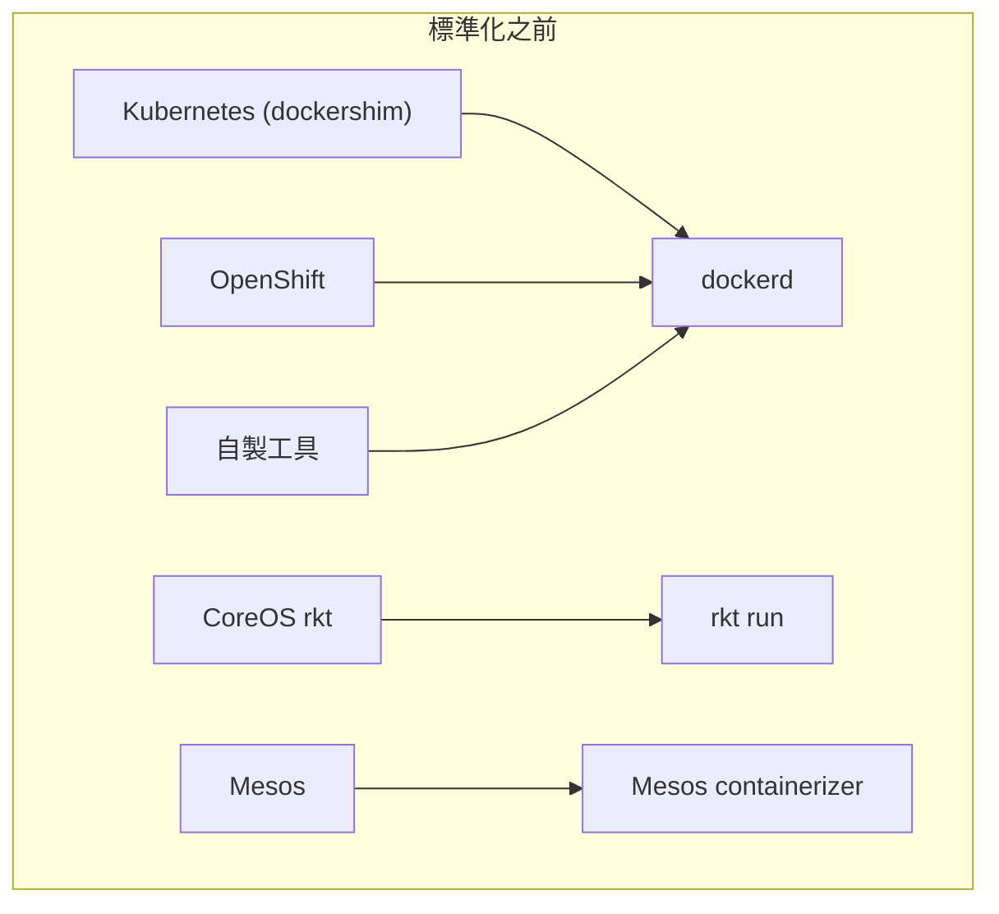
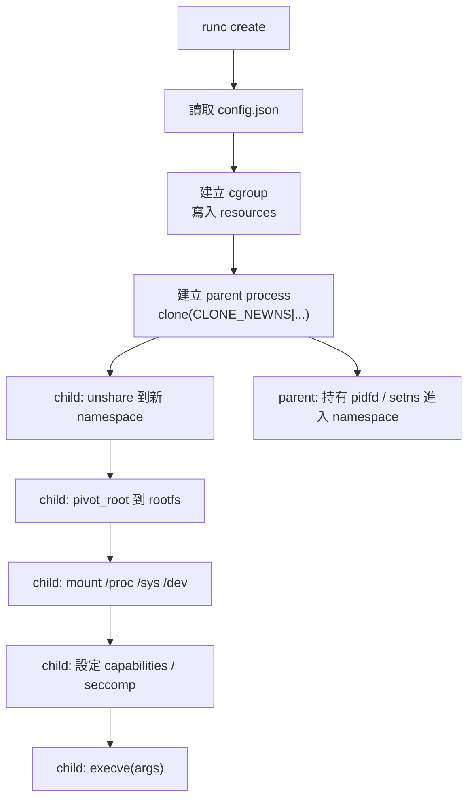
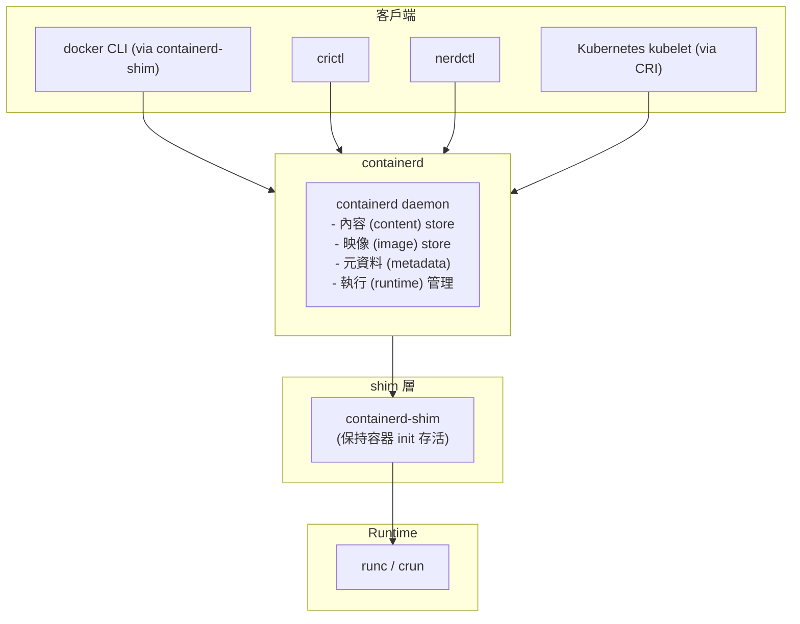
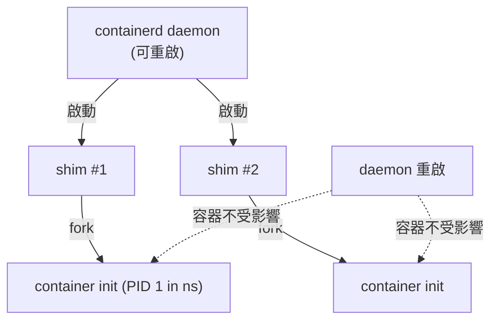
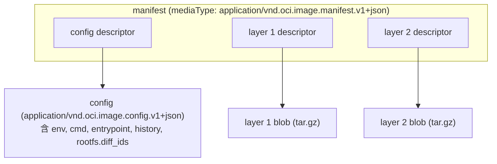

# 4.3 2015 年 OCI 標準化與 containerd 與 runc 的分工

## 為什麼需要標準

2015 年之前的容器生態是這樣的：



問題在於：**每個工具與每個容器執行環境之間的整合，都是 N × M 的一對一整合。** 而且每一種整合的設定格式都不一樣（volume 掛載語法、網路模式、資源限制的傳遞方式）。

2015 年，Docker、CoreOS、Red Hat 等共同成立了 **OCI（Open Container Initiative）**。核心任務只有一件：

> **定義容器映像與容器執行環境的標準介面，讓任何執行器都能執行任何映像。**

## OCI 的三份規格

依據 OCI 的官方紀錄，三份規格的演進如下：

| 規格 | 內容 | 演進 |
|---|---|---|
| **Runtime Spec** | 如何執行一個容器（`config.json` + `runc` 介面） | 2015 年 7 月 `runc` 0.0.1 |
| **Image Spec** | 映像的檔案格式（manifest + config + layers） | 2016 年 3 月從 Runtime 專案分出獨立；2017 年 7 月 19 日 v1.0.0 |
| **Distribution Spec** | 映像分發的 API 協定（推/拉/搜尋） | 2018 年 3 月從 Registry API v2.1 提案衍生；2021 年 4 月 26 日 v1.0.0 |

### OCI Runtime Spec：`config.json`

一份 OCI runtime 設定檔的結構（節錄）：

```json
{
  "ociVersion": "1.0.2-dev",
  "process": {
    "terminal": true,
    "user": { "uid": 0, "gid": 0 },
    "args": ["/bin/sh"],
    "env": ["PATH=/usr/local/sbin:/usr/local/bin:/usr/sbin:/usr/bin:/sbin:/bin"],
    "cwd": "/",
    "capabilities": {
      "bounding": ["CAP_CHOWN","CAP_DAC_OVERRIDE","CAP_FSETID","CAP_FOWNER","CAP_SETGID","CAP_SETUID","CAP_SETPCAP","CAP_NET_BIND_SERVICE","CAP_KILL","CAP_AUDIT_WRITE"],
      "effective": ["CAP_CHOWN","CAP_DAC_OVERRIDE","CAP_FSETID","CAP_FOWNER","CAP_SETGID","CAP_SETUID","CAP_SETPCAP","CAP_NET_BIND_SERVICE","CAP_KILL","CAP_AUDIT_WRITE"],
      "permitted": ["..."],
      "inheritable": []
    },
    "rlimits": [
      { "type": "RLIMIT_NOFILE", "hard": 1024, "soft": 1024 }
    ],
    "noNewPrivileges": true
  },
  "root": {
    "path": "rootfs",
    "readonly": true
  },
  "hostname": "mycontainer",
  "mounts": [
    { "destination": "/proc", "type": "proc", "source": "proc" },
    { "destination": "/dev", "type": "tmpfs", "source": "tmpfs",
      "options": ["nosuid","strictatime","mode=755","size=65536k"] },
    { "destination": "/dev/pts", "type": "devpts", "source": "devpts",
      "options": ["nosuid","noexec","newinstance","ptmxmode=0666","mode=0620"] },
    { "destination": "/dev/shm", "type": "tmpfs", "source": "shm",
      "options": ["nosuid","noexec","nodev"] },
    { "destination": "/dev/mqueue", "type": "mqueue", "source": "mqueue",
      "options": ["nosuid","noexec","nodev"] },
    { "destination": "/sys", "type": "sysfs", "source": "sysfs",
      "options": ["nosuid","noexec","nodev","ro"] },
    { "destination": "/sys/fs/cgroup", "type": "cgroup", "source": "cgroup",
      "options": ["nosuid","noexec","nodev","relatime","ro"] }
  ],
  "linux": {
    "resources": {
      "devices": [ { "allow": false, "access": "rwm" } ],
      "memory": { "limit": 536870912 },
      "cpu": { "shares": 1024, "quota": 200000, "period": 100000 }
    },
    "namespaces": [
      { "type": "pid" },
      { "type": "network" },
      { "type": "ipc" },
      { "type": "uts" },
      { "type": "mount" }
    ],
    "maskedPaths": [ "/proc/acpi", "/proc/kcore", "/proc/keys", "/proc/latency_stats",
                     "/proc/timer_list", "/proc/timer_stats", "/proc/sched_debug",
                     "/proc/scsi", "/sys/firmware" ],
    "readonlyPaths": [ "/proc/bus", "/proc/fs", "/proc/irq", "/proc/sys", "/proc/sysrq-trigger" ]
  }
}
```

**請注意這份檔案的內容**：它幾乎就是第 3 章與第 4.1 節所討論的所有原語的一份**清單式描述**。

- `namespaces` → 第 3.1 節的八種命名空間
- `resources.memory/cpu` → 第 3.3 節的 cgroups
- `capabilities` → 第 9.1 節的權限模型
- `maskedPaths` / `readonlyPaths` → 第 9.2 節的檔案系統保護
- `mounts` → 第 3.2 節的 mount namespace
- `noNewPrivileges` → 第 9.1 節的 setuid 保護

**OCI Runtime Spec 本質上是一份「Linux 隔離原語的宣告式描述語言」。** 這是整個容器生態系最重要的文件之一——它把「隔離」從各家的實作細節，升級為一份公開的、可攜的規格。

## `runc`：參考實作

`runc` 是 OCI Runtime Spec 的參考實作，同時也是 Docker 的實際底層執行器。

`runc` 的工作流程：



`runc` 的兩個關鍵設計：

1. **parent 與 child 的分工**：parent 留在宿主命名空間，持有對容器的控制權（信號轉發、`exec` 進入容器執行 `runc exec`）；child 進入所有隔離環境。這個分工正是第 3.2 節「PID 1 必須是一個真正的 init」的實踐。
2. **`runc exec`**：透過 `setns()` 進入容器的既有命名空間執行命令，而不是啟動新行程。這是 `docker exec`、`kubectl exec` 的底層機制。

其他 OCI runtime 實作：

| 實作 | 語言 | 特點 |
|---|---|---|
| `runc` | Go | 參考實作，功能最全 |
| `crun` | C | 更小、更快（啟動時間約為 runc 的一半） |
| `youki` | Rust | Rust 實作，注重安全預設 |
| `runsc`（gVisor） | Go | 使用者空間核心，提供更強隔離 |
| Kata `containerd-shim-kata` | Rust + hypervisor | 輕量 hypervisor |

## `containerd`：daemon，但更貼近叢集

`containerd` 是 CNCF 的畢業專案，設計目標是「Docker daemon 的精簡版」：專注於容器的生命週期管理。

`containerd` 的架構：



### shim 層：一個精巧的設計

`containerd` 的每個容器都有一個 **shim** 行程。它的作用是：

- **在 containerd daemon 重啟時保持容器存活。** daemon 崩潰或被重啟，所有容器仍然活著——因為真正的容器 init 行程是 shim 的子行程。
- **作為容器 init 與 daemon 之間的中介**，處理 stdin/stdout 轉發與訊號。



**這個設計解決了一個真實的問題。** 在早期 Docker 架構中，`dockerd` 崩潰意味著所有容器需要被殺掉（daemon 是容器的父行程）。shim 把「容器的存活」與「daemon 的存活」解耦了。

> 這是一個「機制決定策略」的漂亮例子：核心提供的 `PR_SET_CHILD_SUBREAPER`、`pidfd` 等原語，使得「讓一個中間行程成為容器的監護者」變得安全可靠。

## OCI Image Spec：映像的標準格式

### 兩層結構



- **manifest**：描述這個映像由哪些 blob 組成。
- **config**：描述映像的執行設定（環境變數、入口點、使用者、歷史）以及 rootfs 的層（`diff_ids`）。
- **layers**：實際的檔案系統層，每層是一個 gzip 壓縮的 tar。

**內容可定址（content-addressable）** 是關鍵設計：每個 blob 以其 SHA-256 雜湊作為識別碼。

```
sha256:3a5b2c9d8e7f...   ← layer blob 的 digest
```

這帶來三個好處：

1. **內容完整性**：digest 就是校驗碼，自動驗證。
2. **去重**：相同內容的層在 registry 中只存一份。
3. **可攜性**：任何符合 spec 的 registry 都能提供這些 blob。

### 映像清單與多架構支援

`manifest list`（index）允許一個 tag 對應多個架構的 manifest：

```json
{
  "manifests": [
    { "digest": "sha256:aaa...", "platform": { "architecture": "amd64", "os": "linux" } },
    { "digest": "sha256:bbb...", "platform": { "architecture": "arm64", "os": "linux" } }
  ]
}
```

client 端依據自身平台挑選。**這是 2015 年時還不存在、但如今是雲原生部署基本要求的特性。** 它的出現也意味著容器不再是「x86 only」——配合 `qemu-user` 靜態模擬，ARM 上可以直接執行 ARM 映像。

## OCI Distribution Spec：Registry API

定義「推」「拉」「查詢」的標準協定：

| 端點 | 用途 |
|---|---|
| `GET /v2/` | 版本檢查（API v2 的起點） |
| `GET /v2/<name>/manifests/<ref>` | 取 manifest |
| `GET /v2/<name>/blobs/<digest>` | 取 blob |
| `POST /v2/<name>/blobs/uploads/` | 開始上傳 |
| `PUT /v2/<name>/manifests/<ref>` | 放上 manifest |

**所有 OCI 相容的 registry（Docker Hub、GHCR、Quay、Harbor、GitLab Registry、EKS 的 ECR、GCR/Artifact Registry、Azure ACR）都實作這個協定。** 這是雲原生世界裡少數真正成功的標準化努力。

## 為什麼標準化成功了？

把 OCI 的成功與 Linux 核心的成功對照，會發現相同的模式：

| 面向 | Linux 核心 | OCI |
|---|---|---|
| 一個實作 | 官方核心 | `runc`（還有 crun、youki） |
| 多個實作 | 數百種發行版 | containerd、CRI-O、Docker、Podman… |
| 介面 | 系統呼叫 ABI | OCI Runtime/Image/Distribution Spec |
| 擴充性 | 模組、驅動 | CRI、CNI、CSI（Kubernetes 側） |
| 治理 | Linus → 維護者團隊 | Linux Foundation |

**關鍵在於「一個精簡的參考實作 + 一份公開規格」。** `runc` 只有一萬多行程式碼，做的事非常明確（讀 JSON、設定隔離、exec），因此任何人想寫一個替代品（`crun`、`youki`）都不需要重造輪子。

**這個模式值得學習：**

> **要讓一個生態系標準化，最有效的方法不是開會制定規格，而是：(1) 寫一個精簡、乾淨、可審查的參考實作；(2) 把它的行為寫成規格；(3) 讓規格與實作都由一個中立組織保管。**

OCI 正是這樣做的：Docker 貢獻 `libcontainer`（→ `runc`），Docker 與 CoreOS 共同推動規範化，而最終的 OCI 基金會由 Linux Foundation 保管——**包括 Docker 公司自己無法單方面修改規格**。

## 對 Kubernetes 的影響：CRI 的出現

Kubernetes 在 2016 年（1.5/1.6）引入了 **CRI（Container Runtime Interface）**，把「如何執行容器」抽象成一個 gRPC 介面：

```mermaid
graph LR
    K8S["kubelet"] -->|CRI (gRPC)| C["container runtime<br/>containerd / CRI-O"]
    C -->|OCI Runtime Spec| R["runc / crun"]
    K8S -.->|dockershim (已於 1.24 移除)| D["dockerd"]
```

CRI 的介面大致是：

```protobuf
service RuntimeService {
    rpc PullImage(...) returns (PullImageResponse);
    rpc CreateContainer(...) returns (CreateContainerResponse);
    rpc StartContainer(...) returns (StartContainerResponse);
    rpc StopContainer(...) returns (StopContainerResponse);
    rpc RemoveContainer(...) returns (RemoveContainerResponse);
    rpc ListContainers(...) returns (ListContainersResponse);
    ...
}
```

**CRI 讓 Kubernetes 與容器執行器解耦。** 這帶來兩個巨大的好處：

1. **Kubelet 不再需要 Docker 的 API。** 早期 Kubernetes 直接依賴 Docker 的 API 與 `docker run` 的格式，這造成大量耦合問題（Docker 改格式就壞掉）。
2. **CRI-O 成為最主流的 runtime**（OpenShift 預設、kubeadm 預設、`kind` 預設）。

## Kubernetes 的 CRD 模式的類比

有趣的是，OCI Image Spec 的設計與 Kubernetes 的 CRD 模式**幾乎同構**：

| 面向 | OCI Image Spec | Kubernetes CRD |
|---|---|---|
| 擴充方式 | manifest list（多架構） | 自訂資源（`CustomResourceDefinition`） |
| 結構 | JSON schema | OpenAPI v3 schema |
| 版本 | `ociVersion` | `apiVersion` |
| 驗證 | registry 驗證 blob digest | API server 驗證 schema |

**這說明「宣告式的、可擴充的 schema」是 2010 年代後期整個雲原生生態系共通的設計美學。** 下一章（第 5 章）會看到 Kubernetes 本身如何把這個美學推展到極致。

## 生態系現況（2026 年）

| 領域 | 生態系現況 |
|---|---|
| 容器格式 | OCI Image Spec 已完全取代 Docker Image Format；Docker 映像與 OCI 映像在格式上已合併 |
| 執行器 | `runc` 仍是最普及的；`crun` 在輕量環境受青睞；Kata/gVisor 在多租戶安全場景成長 |
| Runtime | `containerd` 是事實標準（k8s 預設）；CRI-O 是 OpenShift 預設 |
| 分發 | Docker Hub、GHCR、Quay、Harbor、雲廠商 registry，全數 OCI 相容 |
| 命令列 | `docker` 仍是最廣泛使用；`podman`（daemonless）、`nerdctl` 是替代品 |

**Docker 的命令列工具在使用量上幾乎沒有下降。** 這印證了一個重要事實：**標準化沒有削弱工具的影響力，反而鞏固了它。** 當底層格式變成開放標準，使用者對命令列工具的依賴就不再受限於單一公司的商業決策。

## 小結

1. OCI（2015 年 6 月成立）定義了三份規格：Runtime、Image、Distribution，對應「怎麼執行」「怎麼打包」「怎麼分發」。
2. OCI Runtime Spec 的 `config.json` 本質上是一份 **Linux 隔離原語的宣告式描述**——它把第 3 章的所有內容標準化。
3. `runc`（Go，參考實作）、`crun`（C）、`youki`（Rust）證明了規格的可實現性；`containerd` + shim 架構解決了「daemon 崩潰帶走容器」的問題。
4. 影像格式的內容可定址（SHA-256 digest）帶來完整性、去重與可攜性；manifest list 支援多架構。
5. **標準化成功的模式**：精簡的參考實作 + 公開規格 + 中立治理。這與 Linux 核心的成功模式一致。
6. OCI 的影響延伸到 Kubernetes 的 CRI，使叢集與容器執行器解耦，並最終導致 `dockershim` 在 Kubernetes 1.24 被移除。

第二部結束。我們已經有了完整的「單機容器」故事：原語（第 3 章）→ 組裝（第 4 章）。第三部要問的是：**幾百台機器、幾萬個容器，要怎麼管理？**
