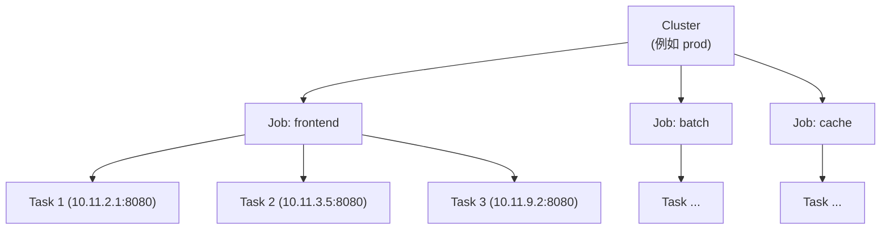
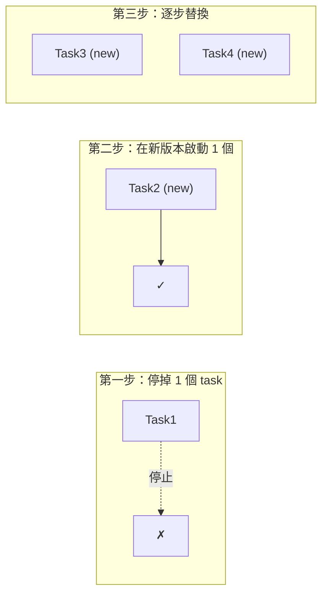
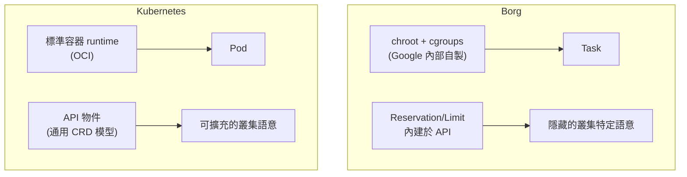
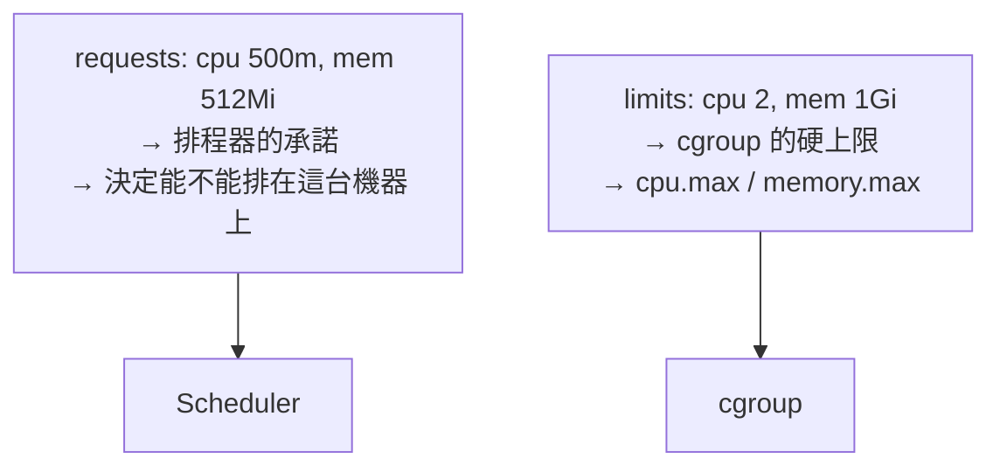
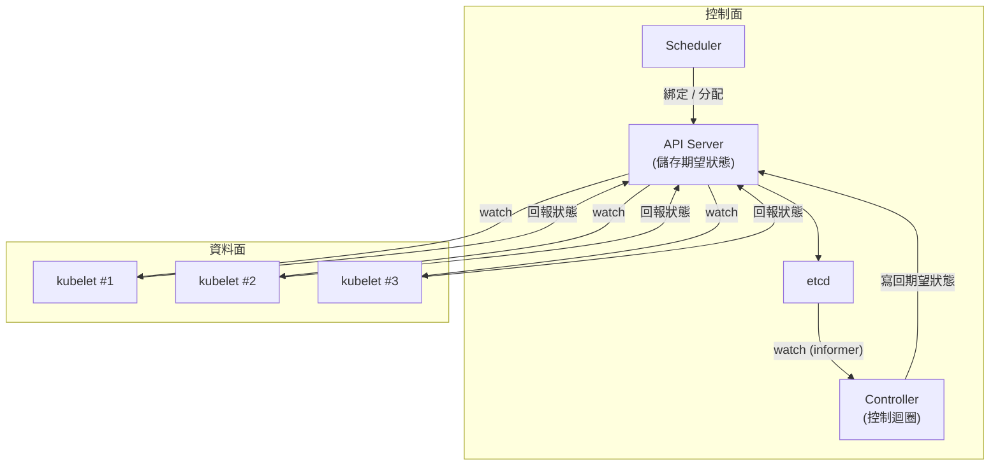

# 5.1 2014 年 Borg 的經驗與 Kubernetes 的誕生

## 問題：從一台機器到一萬台機器

Google 公開的集群規模讓整個業界震驚：Google 內部運行的** Borg **叢集管理系統，管理的叢集規模達到：

- 數千個應用程式（application）
- 數萬台機器
- 每台機器執行數十個任務

用 Borg 的論文（2015 年 OSDI 論文《Large-scale cluster management at Google with Borg》）的說法：

> 一個 Borg 叢集有數千個應用程式、數萬台機器，包含數百萬個容器任務、幾百 TB 的儲存空間。

**這種規模帶來的核心挑戰不是「排程一個任務」，而是「管理一個不斷變動的、會壞掉的、不一致的狀態機系統」。**

具體來說，傳統的做法（例如 script + cron + SSH）在這個規模下會在幾個方面崩潰：

| 問題 | 傳統做法的失效 |
|---|---|
| 節點故障 | 數千台機器，每週都有機器壞；人工介入不可行 |
| 版本異質 | 機器不可能同時升級；必須支援「新舊版本並存」 |
| 任務遷移 | 排程要能在數秒內把數千個任務搬走 |
| 資源利用率 | 應用程式之間的資源搶奪造成互相影響 |
| 服務發現 | 數萬個任務，各自的 IP 與 port |

**Borg 的核心洞見：叢集管理系統的第一性問題不是「排程」，而是「在不可靠的硬體上維持一個一致的期望狀態」。**

## Borg 的核心機制

### 1. 兩層的叢集管理

Borg 把叢集切成**叢集（cluster）** → **作業（job）** → **任務（task）** 三層：



### 2. 兩層的資源模型：Reservation 與 Limit

這是 Borg 最著名的設計：

- **Reservation（保留）**：排程器**預留**一組資源給一個 job。資源一旦預留，**即使該 job 沒有用完，其他 job 也不能用**。
- **Limit（上限）**：job 實際使用的硬性上限。

```bash
# Borg 的 task 設定範例
{
  "user": "alice",
  "resources": {
    "cpu": 1,              # limit
    "memory": 1024,        # limit
    "reserved_cpus": 1,    # reservation
    "reserved_memory": 1024
  }
}
```

**為什麼需要 reservation？** 因為在一個共享的叢集裡，如果沒有保留機制，一個貪婪的 job 可以瞬間吃掉所有資源，把其他 job 饿死。**Reservation 是硬體資源的靜態分割，讓排程變得可預測。**

**為什麼 limit 可以小於 reservation？** 這是 Borg 最精巧的一點：

> 一個 job 的**任務數量**可以隨時調整（scale），但**每個任務的資源保留量是固定的**。
>
> 例如：job 保留 10 個 CPU，現在只跑 2 個任務（每個保留 1 個 CPU）。剩下 8 個 CPU 的保留量仍然掛著，所以 job 可以隨時擴展到 10 個任務，而不需要跟排程器重新協商。

這就是 Borg 能做到「秒級遷移」的原因：**調度決策只需要改變任務的分佈，不需要改變資源保留。**

### 3. 滾動升級（Rolling Update）

Borg 的升級策略：



**Borg 讓升級成為一個「宣告式的期望狀態」的表達**：不是「把版本改成 v2」，而是「讓 50% 的 task 是 v2」。排程器負責讓實際狀態逐漸靠近。

### 4. 兩種排程模式

- **Packs**：把同一應用程式的多個 task 打包到同一台機器上（提升 cache 命中率與網路效率）。
- **Spread**：把同一應用程式的 task 分散到不同機器上（提升可用性）。

兩者互相衝突，因此 Borg 支援**跨 pack 的多個 mode**。這個「同一應用程式在不同機器上的分佈策略」問題，後來在 Kubernetes 中以 `podAntiAffinity` / `topologySpreadConstraints` 的形式重現。

### 5. 效能與隔離

Borg 的 task 執行在一個特殊的 **Chroot 環境**中（早期版本甚至不是真正的 container，而是 chroot + cgroups）。Borg 論文說得很直白：

> 「Chroot 不足以提供良好的安全性。事後看來，我們應該使用 container 或 sandboxing 技術。」

> 這是一句極其誠實的技術史陳述。**Borg 早於 Docker 兩年，而它自己承認那套隔離機制是不夠的。** Linux 社群正是從 Borg 這類內部系統的經驗中，學習到需要一套更好、更通用的隔離原語。

## Kubernetes 的誕生

2014 年 3 月，Google 開源了 Kubernetes（源自 Google 內部專案 **Borg** 的重新構思，加上 Google 內部另一個專案 **Omega** 的部分經驗）。首個版本是 0.1。

Kubernetes 1.0 在 **2015 年 7 月**發布。

**核心差異：Kubernetes 從一開始就以「容器」為一等公民。**



| 面向 | Borg | Kubernetes |
|---|---|---|
| 隔離 | Google 內部的 chroot/cgroups | 標準 OCI 容器（任何 runtime） |
| API | 內部 RPC | RESTful + JSON + OpenAPI |
| 擴充 | 改 Borg 本身 | CRD + Operator（不需改 K8s） |
| 排程器 | 內建 | 可替換（kube-scheduler, 雲廠商自製） |
| 網路 | Borg 內建（IP 管理） | CNI 插件（CNI 介面） |
| 儲存 | Borg 內建（GFS） | CSI 插件（CSI 介面） |
| 服務發現 | Borg 內建 | CoreDNS + Service |

**最重要的兩點**：

1. **Kubernetes 把叢集管理的所有原語都做成了「可插拔的介面」**（CRI、CNI、CSI、CSI、Dynamic Admission、Scheduling Framework）。這讓雲廠商可以替換任何一層，而不必 fork Kubernetes。
2. **Kubernetes 用宣告式的資源模型取代了 Borg 的命令式排程**——這是第 5.2 節的主題。

## 從 Borg 繼承的四個關鍵設計

### 1. Reservation 演化成兩層資源需求

Kubernetes 的資源模型直接對應 Borg：

```yaml
resources:
  requests:      # ← Borg 的 reservation（排程依據）
    cpu: 500m
    memory: 512Mi
  limits:        # ← Borg 的 limit（執行期硬上限）
    cpu: "2"
    memory: 1Gi
```

**`requests` 用於排程決策，`limits` 用於執行期強制。** 這是 Kubernetes 最容易被誤解、卻也最關鍵的設計之一。

排程器保證「你的 pod 排上去之後，機器至少能給你 `requests` 的量」；而 `limits` 才是 cgroup 的實際硬上限（`cpu.max`、`memory.max`）。



> 這個區分解決了 Borg 的 reservation 問題，並且更精細：Borg 的 reservation 是「任務數 × 每任務保留量」，Kubernetes 的 `requests` 是「每個 pod 的保底量」。

### 2. 滾動升級 → Deployment 的 maxUnavailable / maxSurge

```yaml
spec:
  strategy:
    type: RollingUpdate
    rollingUpdate:
      maxSurge: 1        # 最多可以多出幾個 pod
      maxUnavailable: 0  # 最多可以少幾個 pod（0 = 零停機）
```

`maxUnavailable: 0` + `maxSurge: 1` 是真正的零停機滾動升級：新版本先起來一個，確認健康後再殺掉舊版本。

### 3. Packs / Spread → 拓撲約束

```yaml
spec:
  affinity:
    podAntiAffinity:
      requiredDuringSchedulingIgnoredDuringExecution:
        - labelSelector:
            matchExpressions:
              - key: app
                operator: In
                values: ["frontend"]
          topologyKey: kubernetes.io/hostname
```

### 4. 任務遷移 → PDB 與 eviction

Borg 讓排程器能快速遷移任務。Kubernetes 面對的是同一個問題，但要處理「使用者主動刪除 pod」的情境，因此提供 **PodDisruptionBudget（PDB）**：

```yaml
apiVersion: policy/v1
kind: PodDisruptionBudget
metadata:
  name: frontend-pdb
spec:
  minAvailable: 2      # 節點維護時，至少要保留 2 個可用
  selector:
    matchLabels:
      app: frontend
```

當叢集要執行節點疏散（node drain）時，會檢查 PDB，確保不會讓可用副本數低於 `minAvailable`。**這是 Borg 的「資源不會被一次抽乾」原則在 Kubernetes 中的表達。**

## 雲原生時代的新問題：控制面的規模

Borg 服務的是 Google 內部，是一個**封閉、受控、單一組織**的環境。Kubernetes 面對的是開放、多租戶、多組織的環境。這帶來了幾個全新的問題：

| 問題 | 解決機制 |
|---|---|
| API server 不能成為瓶頸 | 資料面與控制面分離（aggregation layer、CRD） |
| etcd 的寫入放大 | 事件驅動的快取（controller 的 informer）+ 資源配額 |
| 多租戶的資源隔離 | Namespace + ResourceQuota + LimitRange + PriorityClass |
| 插件的穩定性 | 版本化的介面（CRI/CNI/CSI）+ 廣泛支援矩陣 |
| 叢集本身的升級 | 滾動升級 + `PodDisruptionBudget` + `maxUnavailable` |

**「控制面與資料面分離」是 Borg 時代沒有的概念**，它源自 Kubernetes 的一個核心設計：任何物件的「期望狀態」與「實際狀態」的協調，都由一個**獨立的控制器行程**完成，而不是由 API server 同步完成。



**這個架構的好處是：** API server 慢或掛掉時，已經在執行的容器完全不受影響。資料面是自持的。

**代價是：** 狀態是「最終一致」的。在第 5.2 節我們會看到，這帶來 Kubernetes 最著名的設計哲學——**宣告式與控制迴圈**。

## 從 Borg 到 Kubernetes：五年後的回顧

2015 年有人質疑：Google 為什麼不把 Borg 直接開源？

Google 的工程師 Joe Beda 在 Hacker News 上給出了一個經典回答（大意）：

> Borg 是**為 Google 的內部環境而深度客製化的**。它假設了幾百名 Google 工程師會用它、假設了特定的硬體、假設了特定的部署流程。開源它會產生數千個 pull request 要求修改，而這些修改對 Google 內部沒有一點用處。

**Borg 是 Google 內部的「特殊-purpose 工具」，Kubernetes 是「general-purpose 平台」。** 這個區分是理解整個雲原生歷史的關鍵：

- 通用化需要拋棄很多內部捷徑（reservation 簡化成 requests/limits、內建網路外化成 CNI、內建儲存外化成 CSI）。
- 拋棄捷徑的代價是**複雜度轉移到了生態系**：現在有 CNI 插件、CSI 插件、Ingress 控制器、Service Mesh……這些東西在 Borg 時代都是內建的。

> **把一個專用系統變成通用平台，收益是生態系，代價是使用者要自己組裝。** 這是所有平台化的通用法則。

## 小結

1. Borg 教給了業界四個關鍵設計：Reservation/Limit 雙層資源模型、滾動升級、Packs/Spread、以及「叢集管理的第一性問題是維持一致的期望狀態」。
2. Borg 的隔離機制（chroot + cgroups）不足，Kubernetes 從一開始就以標準容器為基礎。
3. Kubernetes 相對 Borg 的兩大演進：所有叢集功能外化成可插拔介面（CRI/CNI/CSI），以及引入控制面與資料面分離。
4. `requests` 對應 reservation（排程依據），`limits` 對應 limit（執行期硬上限）——這是 Kubernetes 資源模型的關鍵區分。
5. Kubernetes 的複雜度是「通用化的代價」：曾經在 Borg 內建的網路、儲存、服務發現，如今都需要插件組裝。

下一章，我們進入 Kubernetes 的設計核心：**宣告式狀態與控制迴圈**。
