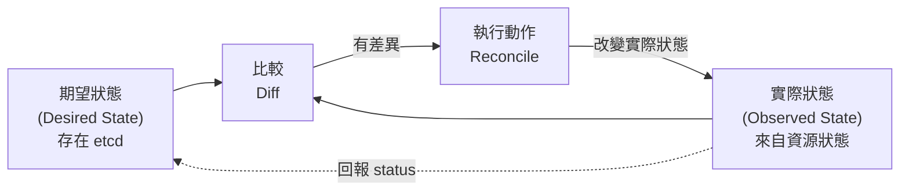
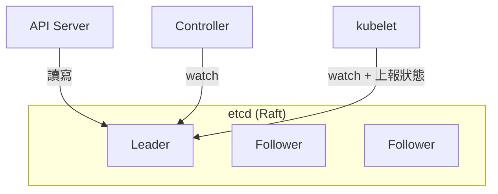
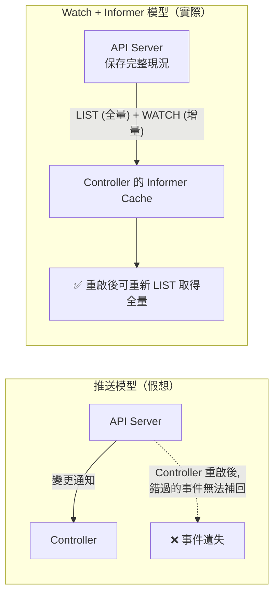
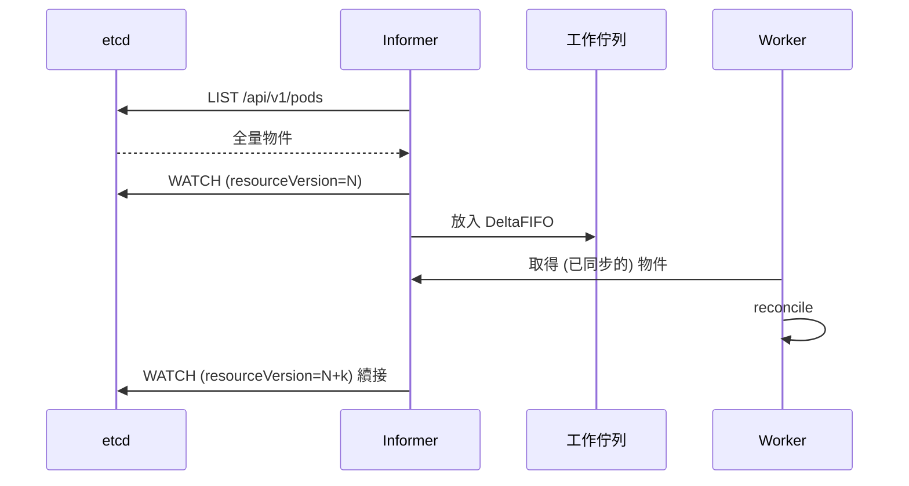
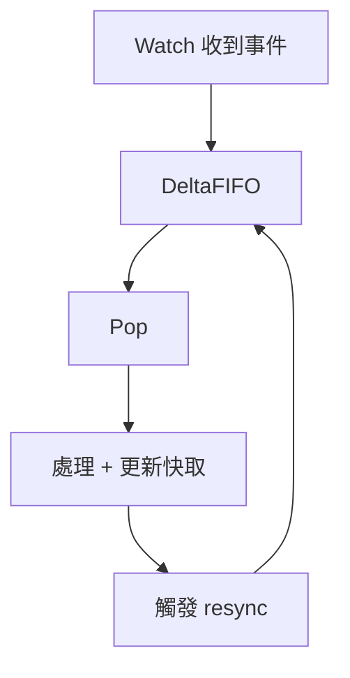
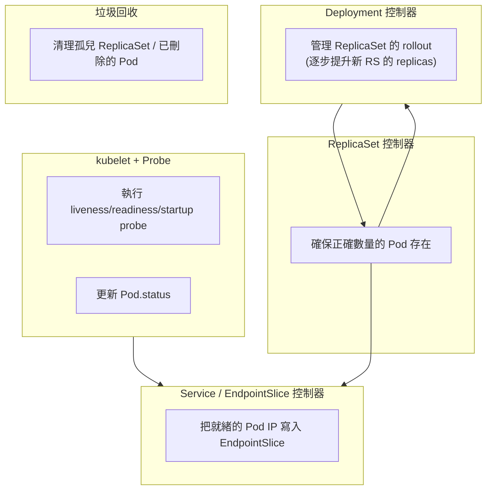
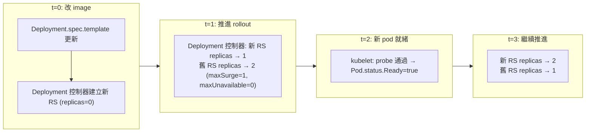
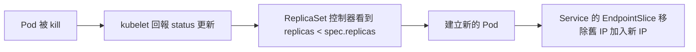

# 5.2 宣告式狀態與控制迴圈

## 指令式 vs 宣告式：兩種思維

要理解 Kubernetes 的設計哲學，先要理解兩種控制模型的根本差異。

### 指令式（Imperative）：「去做 X」

```bash
# 指令式的叢集管理
ssh node-03 "docker run -d --name myapp nginx"
ssh node-07 "docker start myapp"
```

思維是：**你直接下命令，系統去執行。**

問題在於大型系統中：

- **狀態可能不同步**：你在 node-03 上下達的命令可能失敗（節點當時離線），但你不知道。
- **必須追蹤「現在到底做了什麼」**：所有操作都需要記錄在外部。
- **無法冪等（idempotent）**：重複執行 `docker run` 會報錯，而不是「確保它是這個狀態」。
- **恢復困難**：節點壞了之後，你得重新下所有命令。

### 宣告式（Declarative）：「我要 X 這個狀態」

```yaml
apiVersion: apps/v1
kind: Deployment
metadata:
  name: frontend
spec:
  replicas: 3
  selector:
    matchLabels:
      app: frontend
  template:
    metadata:
      labels:
        app: frontend
    spec:
      containers:
        - name: nginx
          image: nginx:1.25
          ports:
            - containerPort: 80
```

思維是：**你描述終點，系統負責讓現況趨近終點。**

| 面向 | 指令式 | 宣告式 |
|---|---|---|
| 描述什麼 | 動作序列 | 終點狀態 |
| 冪等性 | 通常不冪等 | 天然冪等 |
| 狀態追蹤 | 需要外部記錄 | 系統自身持有期望狀態與實際狀態 |
| 失敗處理 | 需要應對每個失敗點 | 重試直到成功 |
| 擴展性 | 隨物件數量線性劣化 | 幾乎不隨數量劣化 |

## 控制迴圈（Reconciliation Loop）

Kubernetes 的核心機制是一個不斷運行的迴圈：



**每個控制器（Controller）都是這個迴圈的一個實例。**

以 `Deployment` 控制器為例：

```python
# Deployment 控制器（概念化）
def reconcile(deployment):
    desired_replicas = deployment.spec.replicas
    actual_pods = list_pods_matching(deployment.spec.selector)

    # 1. 數量不足 → 建立
    if len(actual_pods) < desired_replicas:
        create_pods(deployment, desired_replicas - len(actual_pods))

    # 2. 數量過多 → 刪除（依策略選擇）
    elif len(actual_pods) > desired_replicas:
        delete_pods(select_oldest(actual_pods))

    # 3. 更新 Deployment 的 status
    deployment.status.replicas = len(actual_pods)
    deployment.status.available_replicas = count_ready(actual_pods)
    write_status(deployment)
```

### 為什麼控制迴圈比指令式更健壯

**因為「重試」變成了預設行為。** 在控制迴圈模型裡：

- 節點離線 → 實際狀態改變 → 迴圈偵測到差異 → 重新排程 → 狀態恢復。
- API server 暫時不可用 → 迴圈讀不到 → 記錄錯誤 → 下一次重試。
- 有人手動刪了一個 pod → 迴圈發現數量不足 → 補回來。

**這就是為什麼 Kubernetes 能處理「不斷變動的、會壞掉的系統」。** 這也是序章中說的「把瓶頸重新框定」的又一個例子：**Borg 假設硬體會壞，必須處理遷移；Kubernetes 把「壞掉」變成狀態機的正常輸入。**

### 冪等性是關鍵性質

控制迴圈的每一個動作都必須是**冪等**的：重複執行同一動作，結果與執行一次相同。

- `create_pods` → 如果 pod 已存在（用 ownerReference + name 生成），要能辨識並跳過。
- `delete_pods` → 對不存在的 pod 呼叫刪除應該是 no-op。
- `update_status` → 重複寫入相同的 status 是安全的。

這個性質讓整個系統**可以安全地重試任何步驟**，而重試是分散式系統唯一可靠的行為。

## etcd：期望狀態的儲存

Kubernetes 把所有物件存在 **etcd**（一個 Raft 實作的分散式 KV 儲存）中。



**etcd 的角色是「唯一事實來源（single source of truth）」。** 但要注意：

- etcd 存的是**物件規格與狀態**，不是「事件」。
- Controller 透過 **watch** 監聽變更，而不是被「通知」。

## watch vs 通知：為什麼要用 watch

一個可能的設計是：API server 在物件變更時「推送通知」給 controller。Kubernetes 採取了不同做法：**controller 自己持有事件歷史（informer cache），用 watch 增量更新。**



**這是分散式系統中一個極其重要的模式**：不要依賴「恰好送達的通知」，而要依賴「可以重新取得的現況」。

Informer 的工作流程：

1. **LIST**：取得當前全部物件，建立本地快取。
2. **WATCH**：訂閱後續變更， incremental 更新快取。
3. 處理器從快取取出物件並執行 reconcile。



**關鍵細節**：WATCH 連線若中斷，client 會用最後看到的 `resourceVersion` 重新發起 WATCH；若該版本已被 etcd 壓縮掉，client 必須重新做一次全量 LIST。這個「LIST + WATCH 續接」的機制，讓 controller 在任何時刻重啟都能恢復到正確狀態。

### `resourceVersion` 與樂觀併發控制

etcd 的每次修改都會產生一個全域遞增的 `resourceVersion`。K8s 用它做樂觀併發控制：

```yaml
metadata:
  resourceVersion: "12345"
```

更新時若 `resourceVersion` 不符，API server 拒絕更新（`409 Conflict`），要求 client 重試。這讓「多個 controller 同時修改同一物件」變得安全。

## Level-based 觸發 vs Edge-based 觸發

這是理解控制迴圈的另一個重要區分。

| 面向 | Level-based（基於水位） | Edge-based（基於邊沿） |
|---|---|---|
| 觸發條件 | 物件的**當前狀態**不滿足期望 | 收到了某個**變更事件** |
| 遺失事件 | **無影響**（下次檢查會發現） | **可能永久遺失** |
| 需要追蹤 | 只需要「實際狀態」 | 需要「事件序列」 |

Kubernetes 明確選擇 **level-based**。這是 Kubernetes 設計文件中反覆出現的原則：

> 「The API server is level-based. Controllers should be level-based too... Reconcilers should re-sync periodically and act on the observed state, not on the events.」

**理由是可靠性。** Edge-based 需要處理「事件遺失」這個難題；level-based 只要能取得當前狀態，就能確定性地做出正確決策。

**這個選擇有可觀測的後果**：`kubectl get` 顯示的狀態永遠是「當前實際情況」，而不是「最後一次事件」。使用者不需要知道事件流，就能判斷系統狀態。

> 值得對照的是第 1 章的 `epoll` ET 模式——那是一個 edge-based 的機制，要求使用者「讀到 `EAGAIN`」。而在控制面這種「可靠性優先」的場景，level-based 是唯一合理的選擇。**同一個核心，不同的抽象層，會做出完全不同的取捨。**

## 工作佇列與速率限制

Controller 的處理是**非同步且可能丟棄事件**的：



- **DeltaFIFO**：保存「事件的差異」。
- **RateLimitingQueue**：當處理失敗時，用指數退避重試。
- **Resync**：定期（預設約 10 小時，但實際上有 jitter）強制全量重新同步，以修正任何遺漏。

**「處理失敗時丟棄事件」聽起來很糟糕，但這正是 level-based 的精髓**：丟棄一個事件是安全的，因為下一個 resync 或任何其他事件的到來，都會觸發一次全量比較。**冪等 + level-based = 可以放心丟棄事件。**

## 一個完整的例子：Deployment 的控制迴圈

讓我們把 Deployment 的幾個控制迴圈串起來：



**Deployment 的滾動升級是三個控制迴圈的組合**：

1. **Deployment 控制器**：建立新 ReplicaSet，逐步降低舊 ReplicaSet 的 `replicas`。
2. **ReplicaSet 控制器**：確保每個 RS 有正確數量的 Pod。
3. **kubelet 的 readiness probe**：決定 Pod 是否「就緒」。

三個迴圈各自獨立、互不知情，卻共同產生了正確的行為：



**關鍵在於：Deployment 控制器不需要知道 Pod 什麼時候就緒。** 它只需要看到 `status.availableReplicas` 這個彙總數字，就能決定要不要繼續推進。**每一層只關心自己那一層的實際狀態。**

## 自癒（Self-healing）

控制迴圈帶來的第一個使用者可感知行為是**自癒**：



同樣的機制處理：

- **節點宕機**：節點心跳超時 → Node 標記 `NotReady` → 該節點上的 Pod 被「驅逐」（ eviction）→ 排程器在其他節點重建。
- **探針失敗**：liveness probe 失敗 → kubelet 殺掉容器 → Pod 重啟。
- **應用程式崩潰**：容器退出 → kubelet 依 restartPolicy 重啟。

**這四種不同的「故障」，用同一個控制迴圈模型處理，這是宣告式架構最大的價值。**

## 控制器的冪等與「邊界」

一個設計良好的控制器，必須清楚知道**什麼是它負責的，什麼不是**。

Kubernetes 的邊界規則（Ownership）：

- **OwnerReferences**：子物件指向父物件，父物件刪除時子物件被垃圾回收。
- **Controller 職責**：每個物件在同一時間只有**一個**負責的控制器（`controller` flag 在 OwnerReference 中）。
- **Finalizers**：允許控制器在物件刪除前執行清理邏輯。

這套機制解決了一個實際問題：**多個控制器不該同時對同一個物件的不同欄位寫入**，因為那會造成 lost update。

## 一個完整的範例：手寫一個控制器

為了理解控制迴圈，最好的方式是寫一個。假設我們要實作一個「Pod 記憶體用量超過限制就標記」的控制器：

```python
# 概念化的 operator（對應 Kubebuilder 生成的程式碼）
class MemoryGuardReconciler:
    def __init__(self, client, cache, recorder):
        self.client = client
        self.cache = cache      # informer cache
        self.recorder = recorder

    def reconcile(self, req):
        # 1. 從 cache 取得物件（不直接打 API server！）
        pod = self.cache.get(Pod, req.name)
        if pod is None:
            return          # 已被刪除，level-based：什麼都不用做

        # 2. 判斷是否需要動作
        limit = parse_memory(pod.spec.containers[0].resources.limits.memory)
        usage = get_memory_usage(pod)   # 從 metrics 或 cgroup 讀取

        if usage is None or usage < limit * 0.9:
            # 3a. 不需要動作 → level-based：直接返回
            #     記得把 observedGeneration 更新到最新
            if pod.status.guard_state != "OK":
                patch_status(pod, guard_state="OK")
            return

        # 3b. 需要動作
        #     冪等：把 annotation 設成確定的值，重複執行結果相同
        if pod.metadata.annotations.get("guard/memory-warning") != "true":
            patch_annotation(pod, "guard/memory-warning", "true")
            self.recorder.event(pod, "Warning", "MemoryHigh",
                                f"usage {usage} exceeds 90% of limit {limit}")

        # 4. 記錄觀察到的 generation（level-based 的重要慣例）
        patch_status(pod, observed_generation=pod.metadata.generation)
```

**這個範例展示了控制迴圈的四個要點**：

1. **從 cache 讀，不直接打 API server**（避免 API server 過載）。
2. **Level-based**：比較「當前狀態」與「期望狀態」，而不是「回應事件」。
3. **冪等的動作**：設定 annotation 而不是 append，避免重複執行造成膨脹。
4. **記錄 `observedGeneration`**：讓使用者知道「你看到的 status 是對哪一版 spec 計算的」。

## K8s 的複雜度代價

控制迴圈的優雅是有代價的。

**代價一：最終一致帶來的困惑。**

```bash
$ kubectl scale deployment frontend --replicas=10
$ kubectl get pods
NAME      READY   STATUS    RESTARTS   AGE
frontend-xxx  1/1   Running   0          5s
# 等等，還要多久？
```

使用者經常抱怨「Kubernetes 太慢」。但這個「慢」是**刻意的**：控制器是異步的，且為了避免共振（thundering herd）有速率限制。

**代價二：偵錯的複雜度。**

當一個 pod 沒有被建立，問題可能在：
- Deployment 控制器（replicas 不對）
- ReplicaSet 控制器
- Scheduler（沒有合適的節點）
- kubelet（節點上的問題）
- Service Account 或 RBAC（權限不足）
- Admission webhook（拒絕）

**K8s 的問題往往不是「怎麼讓它做對」，而是「怎麼知道它卡在哪一步」。** 這正是第 8 章 eBPF 可觀測性要解決的問題。

**代價三：控制器之間的隱式耦合。**

當你把 20 個控制器放在一起，它們會互相影響（資源競爭、webhook 順序、API server 負載）。**Kubernetes 的穩定性問題，很大程度上是控制器的穩定性問題。**

## 小結

1. 宣告式（描述終點）比指令式（描述動作）更適合大規模系統，因為它天然冪等、可以重試、狀態由系統持有。
2. 控制迴圈的核心是 **level-based**：比較期望狀態與實際狀態，差距就是需要執行的動作。
3. **Level-based 的選擇**讓「丟失事件」變得無害——這是可靠性設計的關鍵取捨。
4. `LIST + WATCH` + informer cache 的組合，讓控制器在重啟後能恢復，並避免打爆 API server。
5. `resourceVersion` 提供樂觀併發控制；`ownerReferences` 與 `finalizers` 定義控制器之間的邊界。
6. Kubernetes 的「慢」與「難以偵錯」，是宣告式架構的必然代價——也正是 eBPF 可觀測性的商業機會。

下一章，我們把 Kubernetes 的物件模型拆開看：Pod、Service、Ingress、CRD 各自解決什麼問題，以及它們如何構成一個可擴充的分散式控制面。
