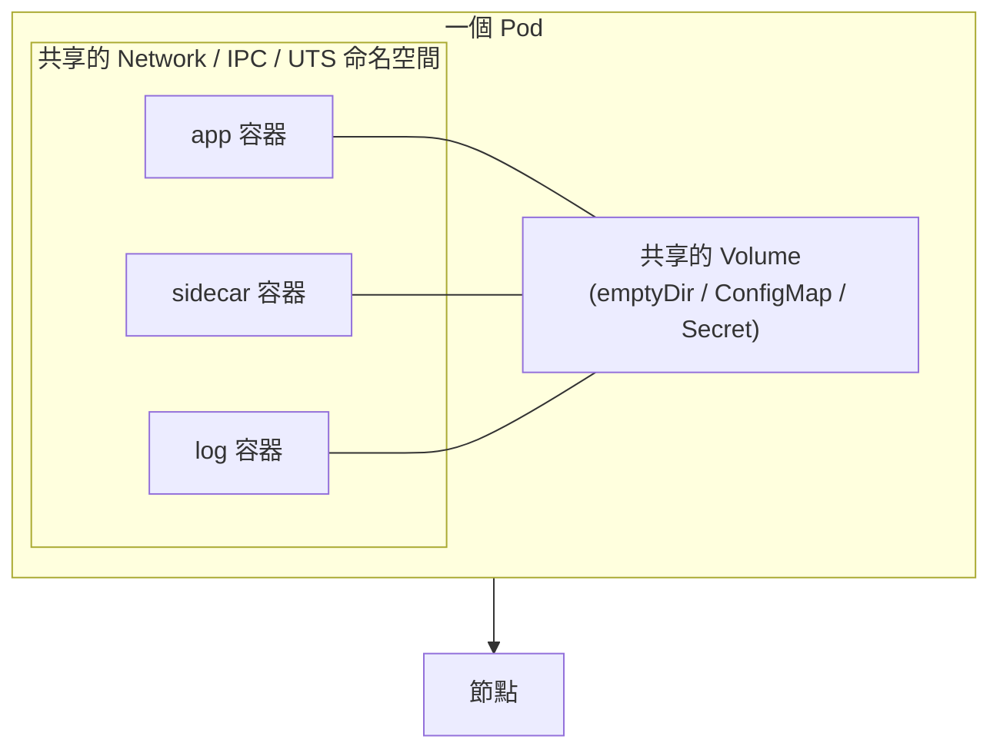
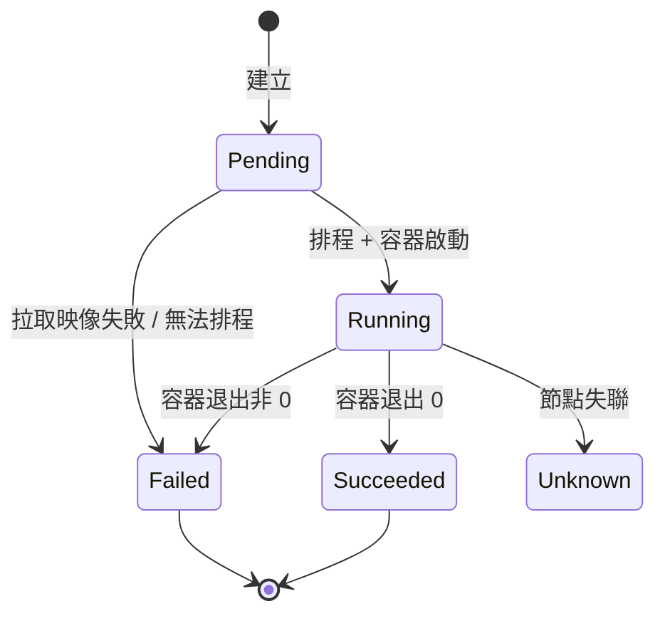
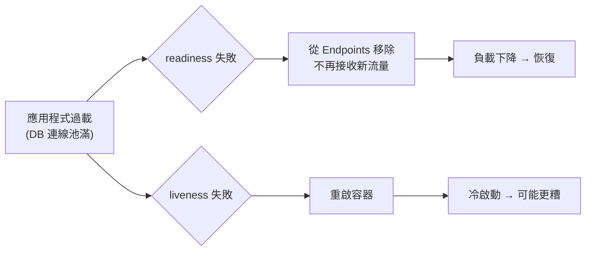
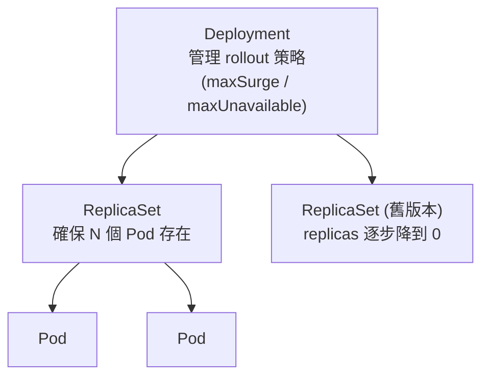
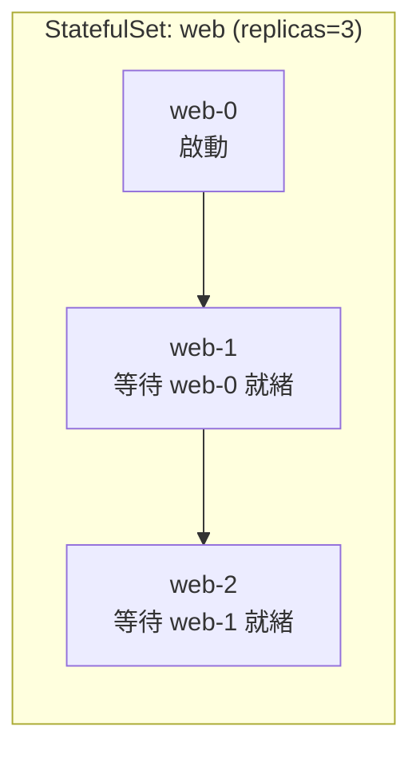
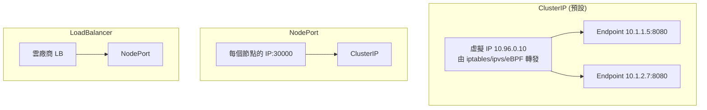
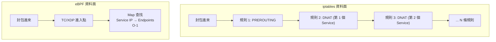
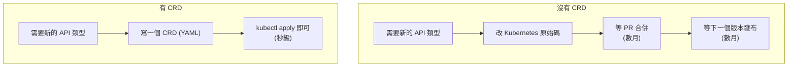
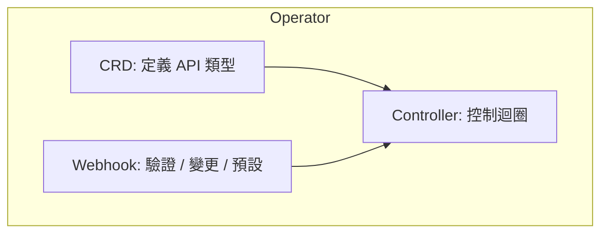
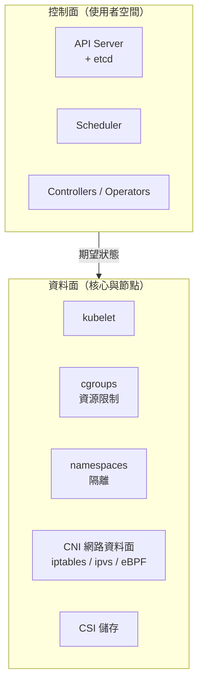

# 5.3 Pod、Service、Ingress 與 CRD 的擴充模型

## Pod：K8s 的最小排程單元

### 為什麼需要 Pod 這個抽象

容器解決了「隔離與交付」，但直接排程「容器」有個問題：**一個應用程式通常需要多個容器緊密協同**。

典型例子：一個 Web 應用需要

- 主程式容器
- sidecar 代理（service mesh）
- 日誌收集器
- 憑證注入器（Istio / Vault agent）

如果這些是獨立的容器，它們需要：

- 共享同一個網路命名空間（才能用 `localhost` 溝通）—— 但獨立容器做不到。
- 共享 volume 來傳遞資料。
- 一起被排程到同一台機器（否則 `localhost` 通訊會跨越網路）。
- 一起被管理（一起升級、一起重啟）。

**Pod 就是這個「一起」的抽象。**



> 這裡有一個極其漂亮的因果鏈：
> **namespaces 提供共享機制 → Pod 的共享網路命名空間需求 → Pod 抽象 → 排程單元變成「應用程式群組」而非「單一容器」。**
>
> 也就是說，第 3 章的隔離原語，**同時也是聚合原語**。隔離與共享是一體兩面的。

### Pod 的生命週期



**注意 Pod 是「不可變」的**（除了少數欄位）：Pod 建立後，`spec` 的幾乎所有部分都不能改。要改就刪掉重建。

**這是一個源自「資料庫與操作系統」的設計**——把「宣告」與「執行」分離。Scheduler 只需要處理「Pending 的 Pod 要放哪裡」，不需要考慮「已執行的 Pod 要怎麼遷移」。

**Pod 生命週期的所有階段，都是控制迴圈的輸入。**

### 三種探針

| 探針 | 用途 | 失敗後 |
|---|---|---|
| `startupProbe` | 啟動緩慢的應用（初始化很久） | 成功前不執行其他探針 |
| `livenessProbe` | 「還活著嗎？」 | **重啟容器** |
| `readinessProbe` | 「能服務嗎？」 | **從 Service 的 Endpoint 移除**（不重啟） |

**liveness 與 readiness 的區分是一個極其重要的設計。**



**把 liveness 設得過於敏感，是 Kubernetes 最經典的 Production Outage 原因之一**（「liveness probe 太嚴格，把資料庫的暫時壓力變成了全面重啟風暴」）。

## Deployment / ReplicaSet / StatefulSet

### 三層的職責分離



- **ReplicaSet**：保證「有 N 個符合標籤選擇器的 Pod 存在」。
- **Deployment**：管理多個 ReplicaSet 之間的切換（版本更新、回滾）。
- **StatefulSet**（2015 年引入，1.5 beta）：為「有狀」應用提供保證。

### StatefulSet 的三個保證

StatefulSet 解決了「有狀服務在容器化環境中的身份問題」：

1. **穩定的網路識別**：Pod 名稱為 `web-0`、`web-1`、`web-2`，DNS 直接解析 `web-0.web.default.svc`。
2. **穩定的儲存**：每個 Pod 對應一個獨立的 PersistentVolumeClaim（`web-0` → `pvc-web-0`）。
3. **有序的部署與擴縮**：`web-0` 先啟動、`web-1` 再啟動；擴縮時從最大編號開始縮。



**為什麼需要 StatefulSet？** 因為容器是「可拋棄的（disposable）」，但資料庫、Kafka、ZooKeeper 不是。把「有狀」服務跑在容器上，需要核心原語之外的**排序與身份保證**。

### DaemonSet 與 Job / CronJob

- **DaemonSet**：每個節點（或符合條件的節點）跑一份。典型用途：log collector、metrics agent、網路代理。**在每台機器上都需要，且隨叢集規模自動擴展——這正是第 8 章 eBPF 代理的典型部署形式。**
- **Job**：跑到完成為止（重試到 `backoffLimit`）。
- **CronJob**：定時執行 Job。

**Job 的控制器需要處理「至少執行一次」與冪等的配合**——這是批次處理的經典難題。

## Service：穩定的虛擬 IP 與服務發現

### Service 的問題

在容器世界裡，Pod 的 IP 是**不穩定**的：

- Pod 重啟 → 新 IP。
- 擴縮容 → IP 集合變化。
- 節點故障 → IP 消失。

但應用程式之間需要「穩定的地址」來互相找到對方。

### 三種 Service 類型



| 類型 | 提供什麼 | 誰來實作 |
|---|---|---|
| **ClusterIP** | 叢集內虛擬 IP | kube-proxy 或 CNI |
| **NodePort** | 每個節點的固定 port | kube-proxy |
| **LoadBalancer** | 外部雲負載平衡器 | 雲廠商控制器 + kube-proxy |
| **ExternalName** | DNS CNAME 別名 | CoreDNS |

### kube-proxy：三種資料面實作

Service 的「負載平衡」需要資料面支援。三種實作：

| 實作 | 機制 | 特點 |
|---|---|---|
| **iptables** | 核心的 netfilter 規則鏈 | 通用，但規則數 $O(n)$ ，匹配是線性鏈 |
| **IPVS** | 核心的 IP 虛擬伺服器 | $O(1)$ 查找，但需要模組 |
| **eBPF / IPVS-BPF** | 核心中的 eBPF 程式 | 效能最好，可繞過 netfilter 限制 |

**這裡出現了一個關鍵的擴展瓶頸**：

> iptables 是**規則鏈**。每個 Service 對應一條規則，每個 Endpoints 變動都要更新規則。當叢集有數千個 Service 時，iptables 的規則數會膨脹到數萬條，而 netfilter 的規則匹配是**線性鏈式**的——每次封包處理都要走過整條鏈。

**這正是第 8 章要處理的問題**（eBPF 資料面）。Cilium、Calico 等專案的核心賣點，就是用 eBPF 把 Service 的負載平衡做成一個 $O(1)$ 的 hash 查找。



## EndpointSlice：把「數千個 Endpoints」變成可管理的結構

舊的 `Endpoints` 物件把一個 Service 的所有後端 IP 放在**同一個物件**裡。當一個 Service 有 5,000 個 Pod（常見於 headless service 或大型 StatefulSet），這個物件會：

- 超過 etcd 的 1.5MB 限制。
- 任何一個 Pod 的變動都導致整個物件重寫（寫入放大）。

**EndpointSlice**（Kubernetes 1.16 起 GA，2019）把 Endpoints 切成固定大小（預設 100）的分片：

```yaml
apiVersion: discovery.k8s.io/v1
kind: EndpointSlice
metadata:
  name: frontend-abc12
  labels:
    kubernetes.io/service-name: frontend
addressType: IPv4
ports:
  - name: http
    port: 8080
endpoints:
  - addresses: ["10.1.1.5"]
    conditions:
      ready: true
      serving: true
    nodeName: node-01
```

**EndpointSlice 是 K8s API 設計演進的一個縮影**：從「一個物件裝所有東西」走向「分片 + 標籤索引」。這與 etcd 的「避免大 value」原則一致。

## Ingress：把 HTTP 路由標準化

Ingress 提供「從叢集外部進入」的 L7 路由抽象：

```yaml
apiVersion: networking.k8s.io/v1
kind: Ingress
metadata:
  name: web
  annotations:
    nginx.ingress.kubernetes.io/rewrite-target: /
spec:
  ingressClassName: nginx
  rules:
    - host: shop.example.com
      http:
        paths:
          - path: /api
            pathType: Prefix
            backend:
              service:
                name: api
                port:
                  number: 8080
          - path: /
            pathType: Prefix
            backend:
              service:
                name: frontend
                port:
                  number: 80
```

**Ingress 的歷史意義**：它是 Kubernetes 早期**最重要的擴充性實驗**。Ingress 讓「外部負載平衡器」變成可插拔的（`ingressClassName`），證明了 CRD/插件模型可行。

**但 Ingress 也暴露了 K8s API 的侷限**：

1. **只有路徑匹配**（host + path），無法表達複雜的 L7 路由（header、method、權重）。
2. **不同控制器功能差異巨大**（Nginx、Traefik、Envoy Gateway 支援的功能不同）。

因此社群發展出 **Gateway API**（2021 起）：一套更完整、更具可攜性的 L7 建模（GatewayClass / Gateway / HTTPRoute / TLSRoute）。

## CRD：把 Kubernetes 變成可擴充的平台

### 問題：核心 API 無法承載所有需求

Kubernetes 內建物件只有二十幾種。但社群需要：

- 資料庫（`PostgresCluster`、`RedisCluster`）
- 訊息佇列（`Kafka`）
- 機器學習（`TrainingJob`、`InferenceService`）
- 服務網格（`VirtualService`、`DestinationRule`）
- 證書（`Certificate`）
- GitOps（`Application`、`ApplicationSet`）

**在 CRD 之前，唯一的擴充方式是改 Kubernetes 原始碼並發 PR。** 這正是 Borg 時代的問題（Joe Beda 的評論）。

### CRD 解決了什麼



**CRD 把「新增 API 類型」從「改平台」降級為「加外掛」。** 這是 Kubernetes 最重要的擴充性機制，也是「雲原生」這個詞能成立的技術前提。

### CRD 的宣告

```yaml
apiVersion: apiextensions.k8s.io/v1
kind: CustomResourceDefinition
metadata:
  name: databases.example.com
spec:
  group: example.com
  scope: Namespaced
  names:
    plural: databases
    singular: database
    kind: Database
  versions:
    - name: v1alpha1
      served: true
      storage: true
      subresources:
        status: {}     # 啟用 status 子資源
      schema:
        openAPIV3Schema:
          type: object
          properties:
            spec:
              type: object
              required: ["engine", "size"]
              properties:
                engine:
                  type: string
                  enum: ["postgres", "mysql"]
                size:
                  type: string
                  pattern: '^[0-9]+(Mi|Gi)$'
            status:
              type: object
              properties:
                phase:
                  type: string
                endpoint:
                  type: string
```

**這份 YAML 裡的每一個欄位都是有意義的設計**：

- `openAPIV3Schema` → 提供結構化驗證、預設值、欄位剪裁（pruning）、版本轉換。
- `subresources.status: {}` → 把 `status` 與 `spec` 分開。**這是第 5.2 節「控制迴圈」模型的基礎**：控制器更新 status，使用者更新 spec，兩者不互相覆蓋。
- `scope: Namespaced` → 可以用 Kubernetes 原生的 namespace 做多租戶隔離。
- `served` / `storage` → 支援多版本 API 與版本轉換。

**注意 `openAPIV3Schema` 這個名字——它就是 OpenAPI v3。** 這個選擇讓 CRD 能與 OpenAPI 生態系（client generation、文件、驗證工具）直接整合。

### CRD 與控制器的組合：Operator

**CRD 只是資料結構；Operator 才是控制器。**



一個 Operator 通常包含三部分：

1. **CRD**：API 類型的定義。
2. **Controller**：把 `spec` 變成 `status` 的控制迴圈。
3. **Webhook**（Admission）：在物件被接受前攔截（驗證欄位、設定預設值、注入 sidecar）。

**Operator 模式把「領域專家封裝成 Kubernetes 控制器」的流程標準化。** 這就是為什麼 Operator SDK、Kubebuilder、Helm Operator 等工具鏈如此發達。

**Kubebuilder 生成的 Controller 骨架（概念化）**：

```go
func (r *DatabaseReconciler) Reconcile(ctx context.Context, req ctrl.Request) (ctrl.Result, error) {
    db := &examplev1.Database{}
    if err := r.Get(ctx, req.NamespacedName, db); err != nil {
        return ctrl.Result{}, client.IgnoreNotFound(err)
    }

    // 觀察子資源（StatefulSet / Secret / Service）
    sts := &appsv1.StatefulSet{}
    err := r.Get(ctx, client.ObjectKey{Namespace: db.Namespace, Name: db.Name + "-sts"}, sts)
    if apierrors.IsNotFound(err) {
        // 需要建立
        if err := r.createStatefulSet(ctx, db); err != nil {
            return ctrl.Result{}, err
        }
        return ctrl.Result{RequeueAfter: 5 * time.Second}, nil
    }

    // 比較 spec（期望）與 status（實際）
    if db.Spec.Size != sts.Spec.Template.Spec.Resources.Requests["storage"] {
        if err := r.updateStatefulSet(ctx, db, sts); err != nil {
            return ctrl.Result{}, err
        }
    }

    // 更新 status
    db.Status.Phase = "Ready"
    db.Status.ObservedGeneration = db.Generation
    return ctrl.Result{}, r.Status().Update(ctx, db)
}
```

**`ObservedGeneration` 再次出現**——它是 level-based 控制器的通用慣例：讓使用者知道 status 是對哪一版 spec 計算的。

## 自訂資源帶來的一致性

Kubernetes 的物件模型有幾個橫跨所有類型的共同特性：

| 特性 | 說明 |
|---|---|
| `metadata.name` | 物件唯一識別 |
| `metadata.namespace` | 租戶隔離邊界 |
| `metadata.labels` | 選擇器（label selector）匹配 |
| `metadata.annotations` | 非選擇性的 metadata |
| `metadata.generation` | spec 變更時遞增 |
| `metadata.resourceVersion` | 樂觀併發控制 |
| `metadata.ownerReferences` | 父子關係與垃圾回收 |
| `metadata.finalizers` | 刪除前的清理鉤子 |
| `status` 子資源 | 與 spec 分離的實際狀態 |
| `spec` / `status` | 期望 / 實際 |

**這套模型是 Kubernetes 真正的「平台抽象」。** 它比任何單一功能（排程、服務發現）都更重要——因為它讓**數千種不同領域的資源**（透過 CRD）都能獲得同一套生命週期管理、同一套 RBAC、同一套資源配額、同一套可觀測性。

## 一個總結：從控制面到資料面的對應



**這正是本書要說明的核心故事：Kubernetes 把控制面（宣告式、通用、慢）與資料面（具體、核心原生、快）分開了。**

- 控制面是純粹的使用者空間邏輯，用 etcd 與 API 表達一切。
- 資料面下沉到核心原語：cgroups 做資源、namespaces 做隔離、eBPF 做網路。

**Kubernetes 之所以能支撐雲端，是因為它把「叢集管理」的複雜度限制在控制面，而讓核心保持簡單。** 這是第 3 章到第 4 章的「原語 + 生態系」模式在叢集層級的重演。

## 小結

1. **Pod 的存在理由是「共享」**：多容器需要共享網路/IPC 命名空間與 volume，因此 Pod 成為排程單元。隔離原語同時也是聚合原語。
2. 三種探針中，liveness（重啟）與 readiness（移出 Endpoints）的區分極其重要，設定過度敏感是經典的 Production Outage 成因。
3. `Endpoints` → `EndpointSlice`（1.16 GA）反映 K8s API 從「大物件」走向「分片 + 索引」的演進。
4. Service 的資料面擴展瓶頸在 iptables 的線性規則鏈——這正是 eBPF 資料面（第 8.1 節）的切入點。
5. **CRD 把「新增 API 類型」從改平台降級為加外掛**，是 Kubernetes 最重要的擴充性機制；Operator = CRD + Controller + Webhook。
6. 統一的物件模型（metadata / spec / status / ownerReferences / finalizers）才是 Kubernetes 真正的平台抽象。

第三部還差一章：**控制面之外的資料面**。容器網路與儲存如何在數千個 Pod 的規模下，與 Linux 網路堆疊和儲存子系統咬合？
