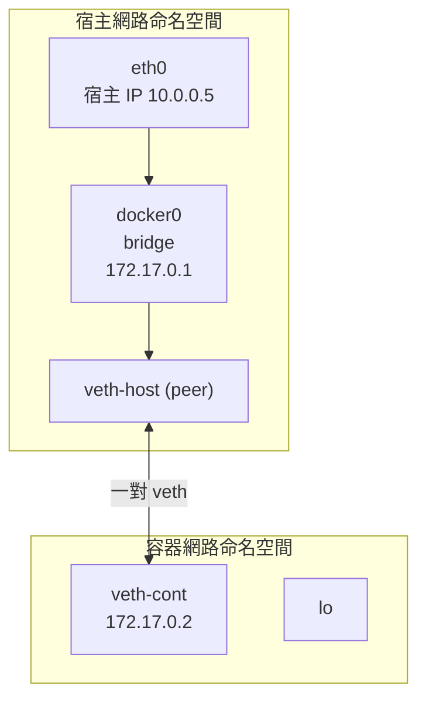
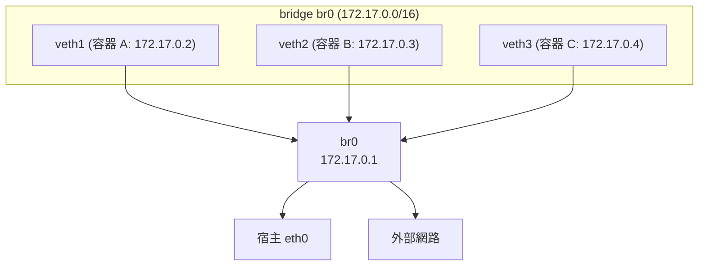
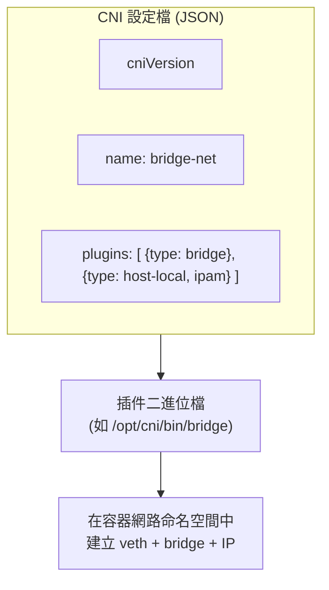
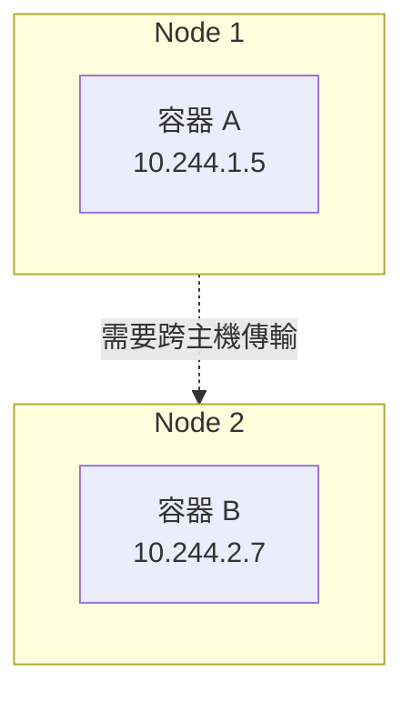
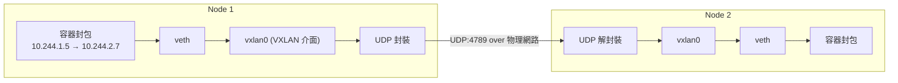
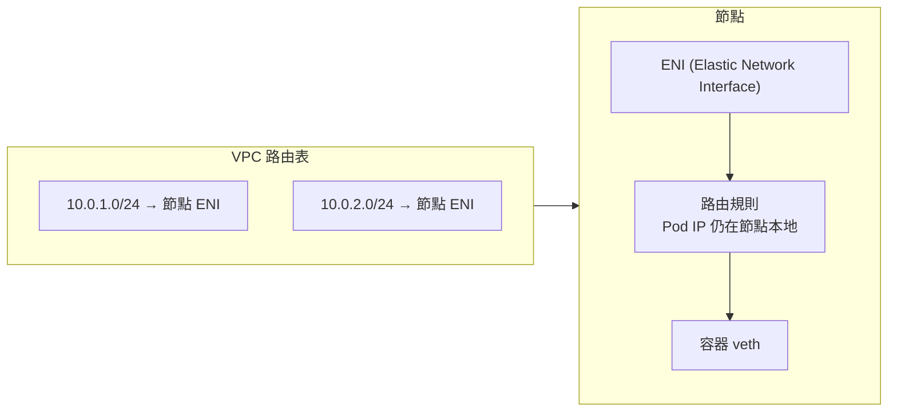
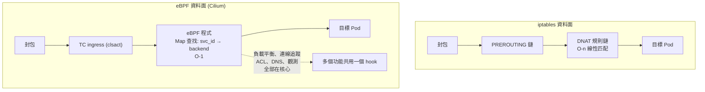
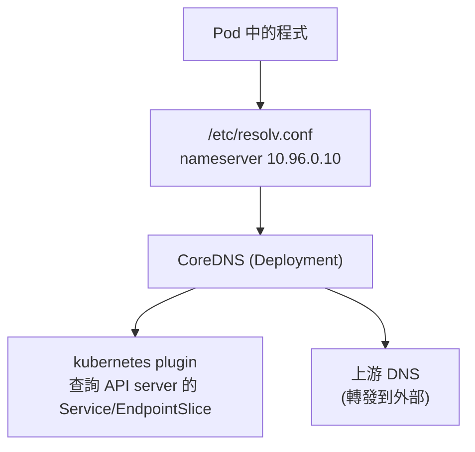
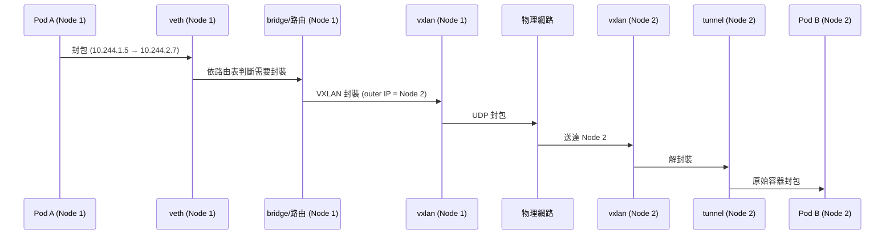

# 6.1 CNI 與容器網路的模型

## 容器網路的難題

在虛擬機網路中，每台 VM 是一台「機器」，有自己的 IP、自己的路由表、自己的防火牆規則。

在容器網路中，**數千個容器共享同一個網路堆疊核心**。這帶來四個難題：

1. **位址空間**：每個容器需要自己的 IP 空間，但主機只有一個。
2. **隔離**：容器不能看到或使用彼此的網路資源。
3. **跨節點**：容器在節點 A，服務在節點 B，要能互通。
4. **名字解析**：需要把「服務名」解析到容器 IP。

而 Linux 的網路堆疊**從來沒有考慮過「同一個主機上有成千上萬個獨立的網路堆疊」**。

## Network Namespace：容器網路的基礎

第 3 章介紹過 Network namespace 的基本語意：

- 每個網路命名空間有自己的：網路介面、路由表、socket 集合、`conntrack` 表、防火牆規則、ARP 表格、IPv6 設定…
- 新命名空間只有一個 `lo`（預設 down）。
- **實體網路介面同一時間只能存在於一個命名空間**。

這給了容器網路一個絕妙的起點：**容器 = 一個網路命名空間**。



## veth：成對的虛擬網路介面

`veth`（Virtual Ethernet）是 Linux 的一種網路裝置。**建立 veth 會同時建立一對介面，一端在這個命名空間，另一端在另一個。**

```bash
# 在宿主建立 veth pair，把一端移進容器
ip link add veth0 type veth peer name veth1
ip link set veth1 netns <container_pid>
ip addr add 172.17.0.2/16 dev veth1 netns <container_pid>
ip link set veth1 up netns <container_pid>
```

veth 的重要性質：

- **成對**：資料從一端進，從另一端出。
- **可跨命名空間**：這是它能做「容器橋接」的關鍵。
- **完全沒有驅動程式**：`veth` 由核心的 `drivers/net/veth.c` 實作，是純軟體的。

**veth 的出現（Linux 2.6.22，2007）與網路命名空間的成熟幾乎同步**，兩者搭配才使容器網路可行。

## Bridge：把容器接到一個 L2 網段

`bridge` 是核心的虛擬二層交換器（`drivers/net/bridge/`）。把 veth 的宿主端接上 bridge，就得到了一個經典的容器網路拓撲：



### 容器出網的 NAT

容器預設無法被外部主動連線（因為位址不可路由），這是好事。容器**出網**需要 NAT：

```bash
# 在宿主（透過 iptables）
iptables -t nat -A POSTROUTING -s 172.17.0.0/16 ! -o br0 -j MASQUERADE
```

`MASQUERADE` 會把來源 IP 改成宿主的外發介面 IP，並記錄映射（由 `conntrack` 表維護）。**這就是第 3 章「Network namespace 隔離防火牆規則」的必然結果**——容器的 `conntrack` 表是獨立的，但 NAT 必須在宿主做。

### 舊式 bridge 網路的四個問題

Docker 0.x 的預設 `--net=bridge` 模式有已知缺陷：

1. **每個容器一個 veth + 一個 bridge 條目**：數千個容器時，bridge 的 FDB（轉發資料庫）與 iptables 規則會膨脹。
2. **外部連線需要 `-p` 埠映射**：容器 IP 不可路由，所以要 `-p 8080:80` 做 DNAT。**這導致每個服務的 port 必須是唯一且已知的**——這對動態服務編排是個噩夢。
3. **跨節點不通**：veth 只在本地。
4. **`docker0` 是一個全局的、共享的 bridge**：多個網路互相干擾。

## CNI：把網路變成可插拔的

**CNI（Container Network Interface）** 是 CNCF 下的網路插件介面，由 CoreOS 提出，2015 年起流行。它的設計極度精簡——**CNI 只是一組「設定檔 + 執行檔」的規範**。

CNI 插件的介面：

```
CNI_COMMAND=ADD     設定網路
CNI_COMMAND=DEL     刪除網路
CNI_VERSION=0.4.0   介面版本

CNI_CONTAINERID=...  容器 ID
CNI_NETNS=/proc/1234/ns/net   容器網路命名空間路徑
CNI_IFNAME=eth0     要建立的介面名稱
CNI_ARGS=...        額外參數（IPAM 設定等）
CNI_PATH=...        插件搜尋路徑
```

**一個標準的 CNI 插件要做的事**：



CNI 設定檔範例：

```json
{
  "cniVersion": "1.0.0",
  "name": "mynet",
  "plugins": [
    {
      "type": "bridge",
      "bridge": "cni0",
      "isGateway": true,
      "ipMasq": true
    },
    {
      "type": "portmap",
      "capabilities": { "portMappings": true }
    },
    {
      "type": "firewall",
      "backend": "iptables"
    },
    {
      "type": "tuning"
    }
  ]
}
```

**CNI 的關鍵設計**：

1. **純宣告式的設定檔**：JSON 描述網路，插件二進位檔執行。
2. **鏈式插件（chained plugins）**：多個插件依序執行，各自負責一個層面。
3. **IPAM 外掛**：位址管理是獨立的一環（`host-local`、`dhcp`、`whereabouts`）。
4. **無常駐程式**：CNI 是短命的命令式執行（CNI_PLUGIN...）。這與 Docker 早期「常駐網路管理程式」的設計形成對比。

**CNI 的一個重要限制（以及它的解法）**：CNI 插件只負責**建立**網路連接，不負責跨節點的路由。這部分由 overlay 網路插件處理。

## Overlay 網路：跨節點的容器網路

### 問題：容器在節點 A，服務在節點 B



容器 IP（`10.244.x.x`）在物理網路上不可路由。要讓它跨節點工作，有三種策略：

### 策略一：VXLAN / Geneve 封裝

**最主流的方案。** 在原始封包外再包一層：



**VXLAN 的封裝格式**：

```
Ethernet Header (outer)  ← 目的 MAC: vtep 的 MAC
IP Header (outer)        ← 目的 IP: 目標 node 的 IP, UDP dest port 4789
VXLAN Header (8 bytes)   ← VNI (24 bits) — 標記是哪個「虛擬網路」
Original Ethernet Frame   ← 原始的容器封包（內層 MAC/IP）
```

**VXLAN 的優點**：只需要在節點之間建立一個 UDP 通道，幾乎所有物理網路都能承載。

**代價**：**每個封包增加約 50 bytes 的開銷**（外層 Ethernet 14 + IP 20 + UDP 8 + VXLAN 8）。

以 10 Gbps 的線速計算，這個開銷會顯著影響小封包的每秒封包數 (PPS)。

### 策略二：IP-in-IP / GRE

- **IP-in-IP**（RFC 2003）：更簡單，但沒有 multicast 支援。
- **GRE**（RFC 2784 / 2890）：更小的開銷（外層 IP 20 bytes + GRE 4 bytes），但某些網路設備不支援。

### 策略三：路由到 Pod IP（雲廠商的做法）

AWS EKS 的 VPC CNI、GKE 的 GKE-NETWORK 讓 Pod 直接使用 VPC 的 IP 位址：



**沒有封裝開銷**，因為 Pod IP 本身就在 VPC 的路由表裡。

**代價**：

- **每個節點的 IP 數量有限**（VPC 每個 ENI 通常 10-15 個 IP）。這就是為什麼需要多 ENI 或 CNI 插件池。
- 依賴雲廠商的特定設定。

**這裡出現了一個有趣的張力**：

| 方案 | 效能 | 可攜性 | 複雜度 |
|---|---|---|---|
| VXLAN overlay | 中（有封裝開銷） | 高 | 低 |
| 雲廠商 VPC CNI | 高（無封裝） | 低（綁定雲） | 中 |
| eBPF 資料面 | 高（可繞過 iptables） | 中 | 中 |

**效能 vs 可攜性的取捨，是整個雲原生網路的中心議題。**

## Service 的網路實現：kube-proxy

回到第 5.3 節的問題：Service 的虛擬 IP 需要被轉發到某個後端 Pod。

### iptables 模式

```bash
# 概念性的規則結構
-A KUBE-SERVICES -d 10.96.0.10/32 -p tcp --dport 80 -j KUBE-SVC-XXXX
-A KUBE-SVC-XXXX -m statistic --mode random --probability 0.333 -j KUBE-SEP-AAA
-A KUBE-SVC-XXXX -m statistic --mode random --probability 0.500 -j KUBE-SEP-BBB
-A KUBE-SVC-XXXX -j KUBE-SEP-CCC
-A KUBE-SEP-AAA -p tcp -j DNAT --to-destination 10.244.1.5:8080
```

**這是隨機（random）負載平衡**，透過 `statistic` 模組的機率匹配實現。

**問題**（第 5.3 節已提過，此處量化）：

- 規則總數 $R = O(S \times E)$ ，其中 $S$ = Service 數， $E$ = 每個 Service 的平均 Endpoints 數。
- 封包處理時，netfilter 走**線性規則鏈**，每條規則都要做匹配。
- 叢集有 5,000 個 Service、平均 10 個 Endpoints → 約 50,000 條規則。每個封包平均走過半條鏈 → 25,000 次匹配。

**這在 10 Gbps 的流量下是災難性的。** 每秒 1 百萬封包 × 25,000 次匹配 = $2.5 \times 10^{10}$ 次匹配/秒。

### IPVS 模式

IPVS 是核心中的 IP 虛擬伺服器，維護自己的 hash 表：

```bash
ipvsadm -A -u frontend -s sh  # sh = source hashing
ipvsadm -A -u backend1 -m -w 1  # -m = 輪詢
```

**查找是 $O(1)$ **，不受 Service 數量影響。但 IPVS 有一些限制（需要模組、`/proc` 介面不同、與某些工具不相容）。

### eBPF 模式（現代方案）

Cilium 等專案的核心創新：**在 TC/XDP 掛載點執行 eBPF 程式，用一個 Map 做 $O(1)$ 查找。**



**eBPF 資料面的優勢**：

1. ** $O(1)$ 查找**。
2. **繞過 netfilter**（部分情況下），省掉整個 iptables 鏈。
3. **多功能共用一個 hook**：負載平衡、ACL、連線追蹤、DNS、分散式追蹤、服務網格——全部在同一個 eBPF 程式裡完成，避免反覆穿越核心堆疊。
4. **可程式化**：使用者可以寫自己的網路策略。

**這是第 8 章的核心內容**，也是「Linux 的原語如何被生態系重新組合」的典範。

## DNS：名字到 IP 的解析

Kubernetes 的 DNS 架構：



**CoreDNS 的 `kubernetes` plugin** 會 watch Service 與 EndpointSlice 物件，回答三類問題：

| 查詢 | 範例 | 來源 |
|---|---|---|
| **服務的 ClusterIP** | `myapp.default.svc.cluster.local` | Service 物件 |
| **服務的所有後端 IP**（headless） | `myapp.default.svc.cluster.local` | EndpointSlice |
| **特定 Pod IP**（headless） | `pod-1.myapp.default.svc.cluster.local` | EndpointSlice |

**Headless Service**（`clusterIP: None`）是一個特別值得注意的設計：它不做負載平衡，直接回傳所有後端 IP。這是 StatefulSet 需要「穩定 DNS 名稱」的基礎。

## NetworkPolicy：網路層的存取控制

```yaml
apiVersion: networking.k8s.io/v1
kind: NetworkPolicy
metadata:
  name: allow-frontend-to-db
spec:
  podSelector:
    matchLabels:
      app: db
  policyTypes: ["Ingress"]
  ingress:
    - from:
        - podSelector:
            matchLabels:
              app: frontend
      ports:
        - protocol: TCP
          port: 5432
```

**NetworkPolicy 的實現完全取決於 CNI 插件。** 這是 CNI 生態的一個重要問題：

- `kube-proxy` 的 iptables 模式**不支援** NetworkPolicy。
- 支援 NetworkPolicy 需要 CNI 插件自己實作（如 Calico 的 Felix、Cilium 的 eBPF 實作）。

**這是一個典型的「可插拔介面」帶來的後果**：介面定義了意圖，具體行為由插件決定，導致「同一份 YAML 在不同叢集行為不同」。Cilium 在 eBPF 層實作 NetworkPolicy 是一個重要差異化能力。

## 跨節點的完整路徑

讓我們追蹤一個「Pod A 在 Node 1 呼叫 Node 2 上的 Service」的完整封包路徑：



**注意這條路徑中的核心原語**：

- `veth` — 成對虛擬介面
- Network namespace — 獨立的路由表
- `vxlan` — 核心的虛擬 Ethernet 裝置（`drivers/net/vxlan.c`）
- 路由表 — 核心的 FIB
- NAT/conntrack — netfilter

**每一個都是核心原語。** CNI 插件的價值，就是把它們以正確的組合方式組裝起來。

## 小結

1. Network namespace 提供每個容器獨立的網路堆疊；veth 提供跨命名空間的連接；bridge 提供 L2 聚合。
2. CNI 把網路設定抽象成「JSON 設定檔 + 短命插件程式」的組合，允許任意實作替換（Bridge、Flannel、Calico、Cilium）。
3. 跨節點有三條路線：VXLAN/GRE 封裝（可攜、有開銷）、雲廠商 VPC CNI（高效、綁定雲）、eBPF 資料面（高效、可程式化）。
4. Service 的資料面瓶頸在 iptables 的線性規則鏈（ $O(n)$ ），IPVS 與 eBPF 用 hash 表降到 $O(1)$ ——這是第 8.1 節的伏筆。
5. NetworkPolicy 的實際行為取決於 CNI 插件，這是「可插拔介面」的雙面刃。
6. CoreDNS 透過 watch Service 與 EndpointSlice 提供 DNS，是控制面與資料面咬合的一個精巧範例。

下一節，我們深入 overlay 網路與 eBPF 資料面的效能戰爭。
