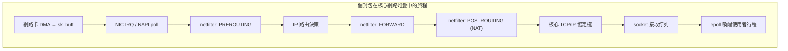
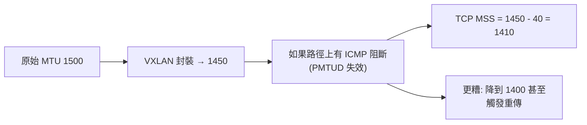
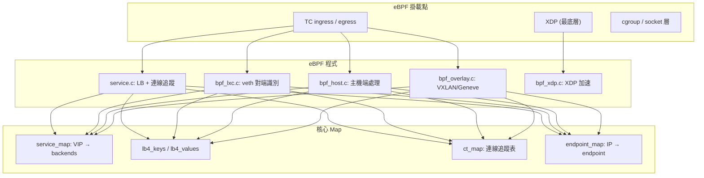
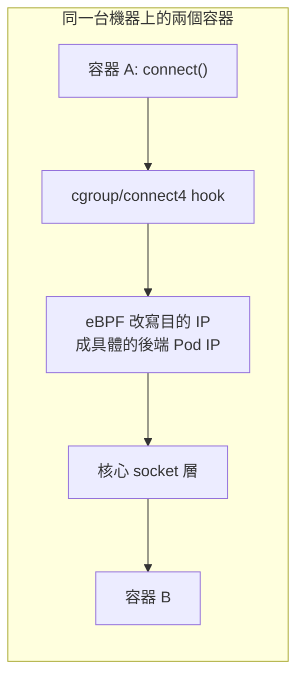
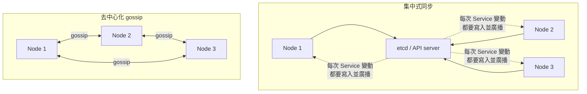
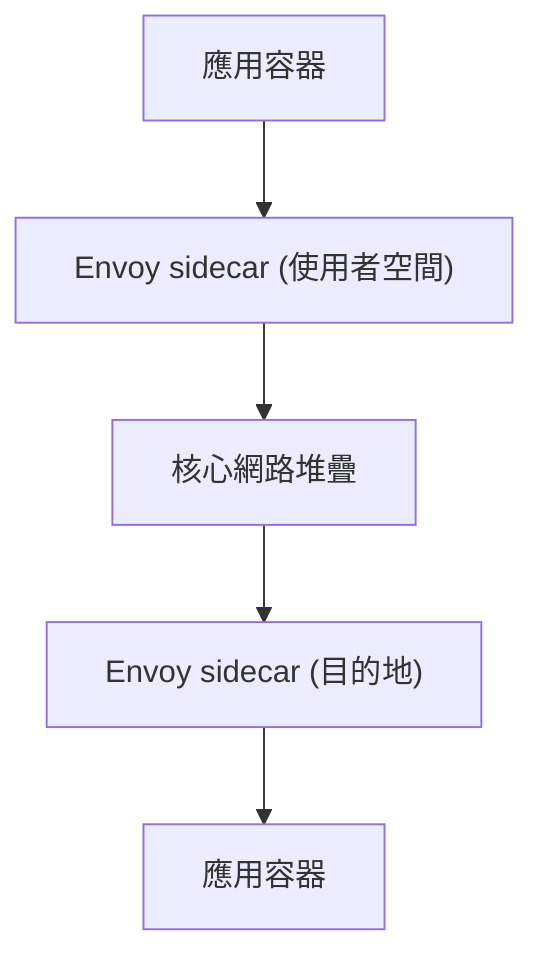
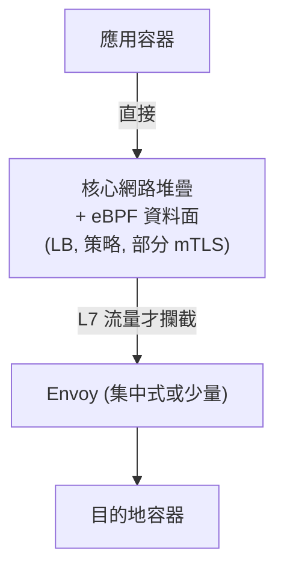
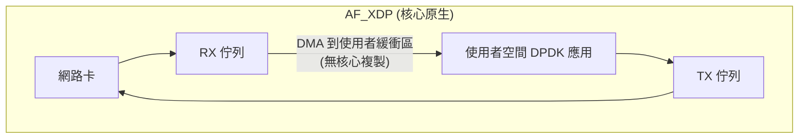
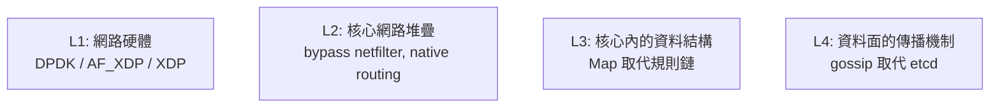

# 6.2 Overlay 網路與 eBPF 資料面的效能戰爭

## 效能戰爭的戰場在哪裡

在 10 Gbps 網路上，核心網路處理面臨的四個主要開銷：



每一段都有成本：

| 階段 | 成本來源 | 量級 |
|---|---|---|
| IRQ / NAPI | 中斷處理、softirq | 每數百 MB/s 一次 IRQ |
| netfilter 鏈 | 每條規則的匹配 | 數十 ns × 規則數 |
| 路由決策 | FIB 查找 | 約 100 ns（有了 route cache 後更低） |
| NAT / conntrack | 連線表查找 + 更新 | 約 200-500 ns |
| 協定棧 | TCP 狀態機、checksum | 數 μs |
| 喚醒使用者 | context switch | 1-5 μs |

**優化的目標很清楚**：減少 netfilter 規則鏈的長度、減少不必要的封包複製、減少跨核心的 cache 失效、把能批次處理的東西批次處理。

## Overlay 的封裝開銷：量化

VXLAN 每個封包增加 50 bytes：

```
外層 Ethernet (14) + IPv4 (20) + UDP (8) + VXLAN (8) = 50 bytes
```

以 1500 bytes 的 MTU 為基準，payload 從 1460 降到 1410 bytes，**約 3.4% 的頻寬損失**。

但對 **PPS（每秒封包數）** 的影響更顯著。以 64 bytes 的小封包（大量 RPC 與資料庫流量）為例：

| 項目 | 無封裝 | VXLAN |
|---|---|---|
| 封包總長 | 64 bytes | 114 bytes |
| 線速 10 Gbps 的 PPS | 14.88 Mpps | 8.76 Mpps |
| 損失 | — | **41%** |

**在小封包為主的雲原生環境（服務間呼叫、gRPC、Envoy sidecar），41% 的 PPS 損失是災難性的。**

這就是為什麼雲廠商要投入 VPC CNI（無封裝），以及為什麼 eBPF 資料面如此受重視。

## MTU 的連鎖效應

封裝還會造成一個更隱蔽的問題：**MTU 下降導致 TCP 效能損失。**



TCP 的效能與 MSS 有直接關係。在一個 RTT 為 1 ms 的資料中心網路中，MSS 從 1460 降到 1410（3.4%）意味著：

- 每個 RTT 能傳送的資料量減少 3.4%。
- 帶寬延遲積 (BDP) 的利用率下降。
- 加上重傳風險，整體吞吐可能下降 5-10%。

**教訓：網路的效能優化必須從端到端的角度看，不能只看單一元件。** 這正是第 8 章「可觀測性」能派上用場的地方——你需要看到重傳率才能發現這類問題。

## eBPF 資料面：Cilium 的做法

Cilium（2017 年由 tgraf 首發，後來由 Isovalent 維護）是第一個把**核心網路資料面完整重寫在 eBPF 上**的專案。

### 架構



### 關鍵技術 1：從 netfilter 轉移到 TC

傳統 iptables 資料面：

```
封包 → netfilter PREROUTING → 路由 → FORWARD → POSTROUTING → 核心 TCP/IP
```

eBPF 資料面：

```
封包 → TC egress (clsact) → [bpf 程序] → 直接送到 veth
```

**封包不再進入核心的 IP 處理路徑，而是被 eBPF 程式直接導向目的地。** 這稱為 **"bypass"（繞過）** 或 **"native routing"**。

好處：

- 沒有 iptables 規則鏈（ $O(1)$ 而非 $O(n)$ ）。
- 沒有 netfilter 的 conntrack 開銷（Cilium 用 eBPF 自己的 CT 表，更精簡）。
- **繞過了核心的路由與 IP 處理**，省掉整段路徑。

### 關鍵技術 2：Socket 層的 LB（sockmap / sock_ops）

Cilium 的一個精妙之處：對「本機容器之間」的通訊，把負載平衡放在 **socket 層**（`cgroup/connect4`、`cgroup/sock4`）。



**結果：同機流量完全不需要經過網路堆疊**（不繞 loopback、不產生封包、不做 NAT）。這讓同機的服務間呼叫延遲從數十 μs 降到數 μs。

**這是「把邏輯放在正確的抽象層」的典型案例**：同機通訊不需要繞道網路協定棧。

### 關鍵技術 3：XDP 加速

Cilium 與其他 XDP 方案在**最底層**處理封包：

- 在收到封包時就判斷是否需要處理。
- 不需要的封包直接回應 XDP_DROP（例如不是本機的、且沒有對應規則的流量）——**完全不進入核心的其餘部分**。

**XDP 的位置極其關鍵**，這是第 8.1 節的核心內容。

### 關鍵技術 4：Service 負載平衡的一致性雜湊

eBPF 資料面的 LB 不只是 round-robin，而是多樣的演算法：

| 演算法 | 用途 |
|---|---|
| Random | 預設 |
| Maglev | 一致性雜湊，連線不會因後端變動而重新分配 |
| Round Robin | 測試用 |

**Maglev**（Google 2016 年的論文）是現代負載平衡的重要演算法，它用完美的交錯陣列（perfect interleaving）達到 $O(1)$ 查找與最小化的連線中斷。

## Overlay 在 eBPF 下的最佳化

Cilium 的 overlay 實作（`bpf_overlay.c`）做了幾個關鍵最佳化：

1. **直接在 eBPF 中做 VXLAN 封裝**：不呼叫核心的 `vxlan` 驅動程式，省掉一次核心路徑。
2. **分散式 service map**：不同節點的 Service 後端資訊透過叢集內的 gossip 協定（如 `cilium-envoy` 或 QUIC）同步，**不經過 API server**。

第 2 點很重要。傳統 overlay（Flannel、Weave）的節點間同步走 etcd 或 API server：



**集中式同步的問題**：

- 每次 Service 變動都要寫 etcd（etcd 的寫入是叢集的瓶頸）。
- 傳播延遲（數百毫秒到數秒），影響資料面正確性（流量可能被打到不存在的後端）。
- etcd 的負載隨叢集規模與變動頻率線性增長。

**gossip 的優勢**：最終一致但傳播快（毫秒級），且沒有單點。

## 效能數據的解讀

Cilium 與其他方案在典型基準測試中的差異（概念性，實際數字依賴硬體與配置）：

| 場景 | iptables (kube-proxy) | eBPF (Cilium) |
|---|---|---|
| 單核 Service LB 吞吐 | 基準 | 顯著較高（少 netfilter 路徑） |
| Service 變動的收敛時間 | 秒級（etcd + 規則更新） | 毫秒級（gossip + Map 更新） |
| 節點數 100+ 時的規則數 | $O(10^5)$ 條 iptables 規則 | Map 項數，與規則無關 |
| 同機容器間延遲 | 繞 loopback 網路路徑 | socket 層直接重定向 |
| 觀測能力 | 需 conntrack/nft 工具 | 內建 Hubble 的 flow log |

**這裡要注意一個重要的方法論提醒**：**效能數字高度依賴工作負載。** 在高 PPS、小封包的場景，eBPF 的優勢最明顯；在大封包的場景（例如物件儲存），差異會縮小。**任何「某某技術快 X 倍」的宣稱，都必須問：什麼工作負載？什麼核心版本？什麼硬體？**

## Service Mesh：把資料面再抽象一層

當 eBPF 資料面成熟後，出現了一個有趣的演進：**把 L7 流量管理也下沉到核心**。

傳統的 service mesh（Istio、Linkerd）架構：



每個封包都要經過**兩次使用者空間代理**，意味著：

- 2 次額外的封包複製（核心 → Envoy → 核心）。
- 2 次上下文切換。
- 2 個 sidecar 的記憶體與 CPU。

**這對延遲的影響在 0.5-2 ms 之間**——對微服務架構來說是顯著的。

### eBPF 與 sidecar 的混合模式

Cilium 的做法是**部分下沉**：

- **L3/L4 處理**（負載平衡、路由、mTLS 的部分、網路策略）：完全在 eBPF 中。
- **L7 處理**（HTTP 路由、gRPC 攔截、重試）：仍需要 Envoy，但可以作為 **"L7 proxy"** 而非 per-pod sidecar。



**更激進的方向：完全在核心中實作 L7**。Cilium 社群有基於 eBPF 的 HTTP 代理實驗，也有基於 **Tetragon** 等工具的 eBPF-based L7 過濾實作。

**但這裡有一個深層的張力**：

> eBPF 程式必須通過 verifier 的靜態分析，因此**不能有迴圈上界不明、不能有任意大小的棧、不能呼叫大部分核心函式**。而完整的 HTTP/2 解析器幾乎必然違反這些限制。

**因此，「把 L7 邏輯下沉到核心」在可預期未來是受限的。** 這是一個「原語的能力邊界決定上層可能性」的具體案例。

### eBPF 的替代方案：使用者和核心的共同加速

另一條路是 **AF_XDP**（Linux 4.8，2016）：讓使用者空間的應用程式**直接從網路卡的收發佇列讀寫封包**，完全繞過核心網路堆疊。



**AF_XDP 與 eBPF XDP 是互補的**：

| | eBPF XDP | AF_XDP |
|---|---|---|
| 執行的位置 | 核心 | 使用者空間 |
| 程式語言 | 受限的 BPF 指令集 | 完整的 C/Rust/Go |
| 能否做複雜邏輯 | 受 verifier 限制 | 無限制 |
| 開銷 | 極低（JIT 後接近原生） | 低（但有一次映射查找） |
| 適用 | 過濾、負載平衡、統計 | 完整的使用者空間網路堆疊 |

**Cilium 也提供 AF_XDP 模式**（需要支援 AF_XDP 的網路卡，如 Intel 的 `ice`、`ixgbe`）。

## 效能優化的系統性方法

讓我們退一步，看這個領域的「方法論」。Cilium 的效能設計貫穿四個層次：



**每一層都在減少某種「集中式瓶頸」或「線性掃描」。** 這與第 1 章 `epoll` 的故事是同一個模式：把 $O(n)$ 變成 $O(1)$ ，把集中式變成分散式。

## 效能 vs 複雜度的取捨

必須承認 eBPF 資料面有真實的成本：

| 成本 | 說明 |
|---|---|
| **除錯困難** | eBPF 程式崩潰會讓核心 `panic`（早期）或行程被殺。需要 `bpftool`、BTF、原始碼級別的追蹤。 |
| **對核心版本敏感** | CO-RE（Compile Once, Run Everywhere）技術大幅緩解，但仍有門檻。 |
| **BTF 的必要性** | 需要 `CONFIG_DEBUG_INFO_BTF`，很多發行版預設開啟，但某些精簡環境沒有。 |
| **心智負擔** | 網路問題的排查需要理解 eBPF、per-CPU map、map 同步等概念。 |

**這是一個典型的「用可觀測性換效能」的交換。** 第 8.2 節會看到，eBPF 的觀測能力（追蹤系統呼叫、函式延遲、I/O）也是它的重要賣點之一——**同一個機制，同時提供了效能與可見性**。

## 小結

1. Overlay 的封裝開銷在 1500 MTU 下約 3.4% 頻寬，但在 64 bytes 小封包下高達 41% 的 PPS 損失——雲原生以小封包為主，因此這是首要瓶頸。
2. 封裝還會透過 MTU/MSS 連鎖效應影響 TCP 吞吐，說明網路優化必須是端到端的。
3. eBPF 資料面（Cilium）用四個層次的最佳化：XDP/TC hook、繞過 netfilter、Map 取代規則鏈、gossip 取代 etcd 傳播。
4. Socket 層的 LB 讓同機容器通訊完全繞過網路堆疊，是「把邏輯放在正確抽象層」的典範。
5. **eBPF 無法承載完整 L7 邏輯**（verifier 限制），這是核心原語的能力邊界，也是 sidecar 仍存在的技術理由。
6. eBPF XDP 與 AF_XDP 是互補的：前者受限但極快，後者自由但成本略高。

第三部最後一章，處理另一個咬合問題：**儲存**。
