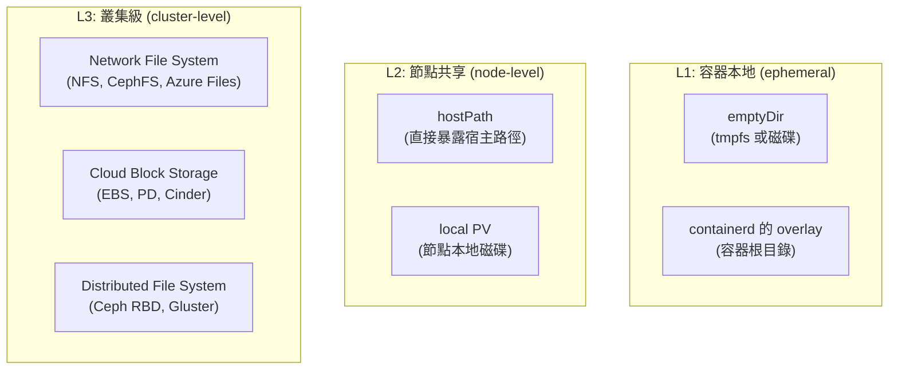
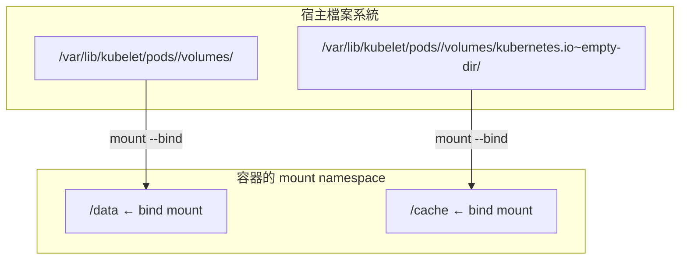
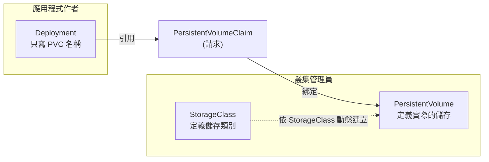
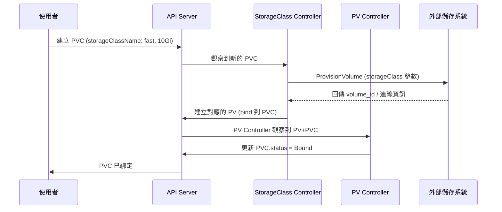
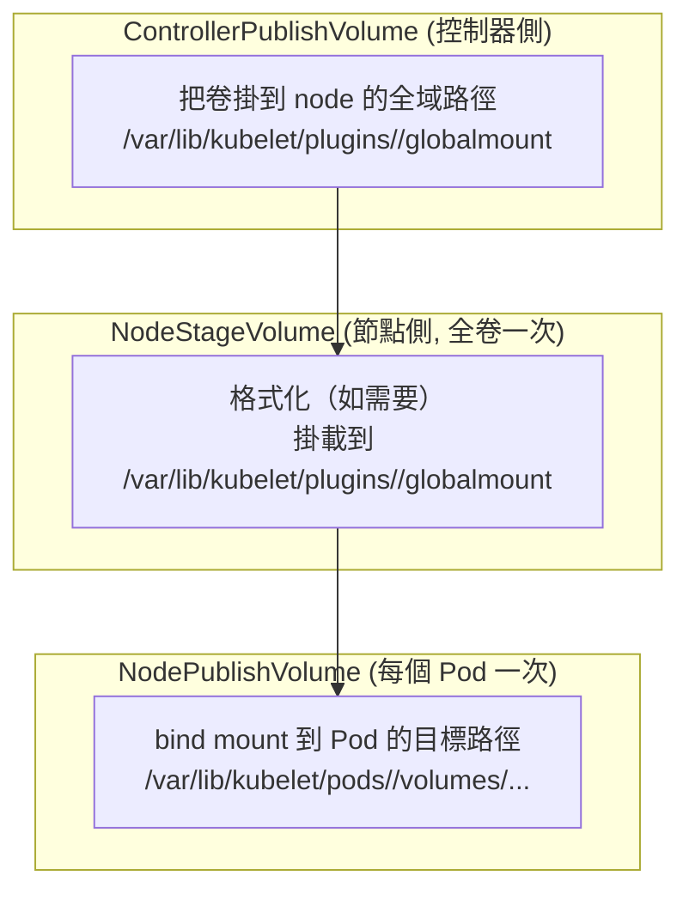
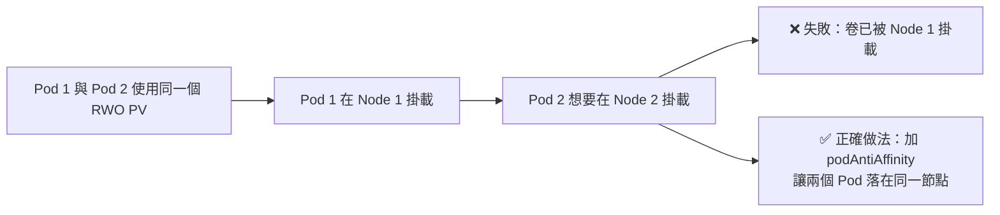
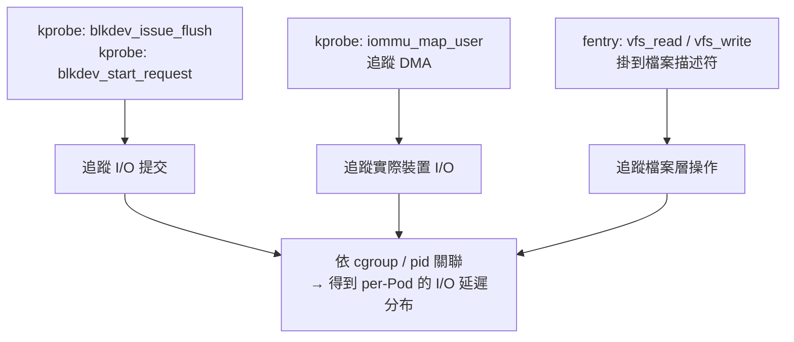
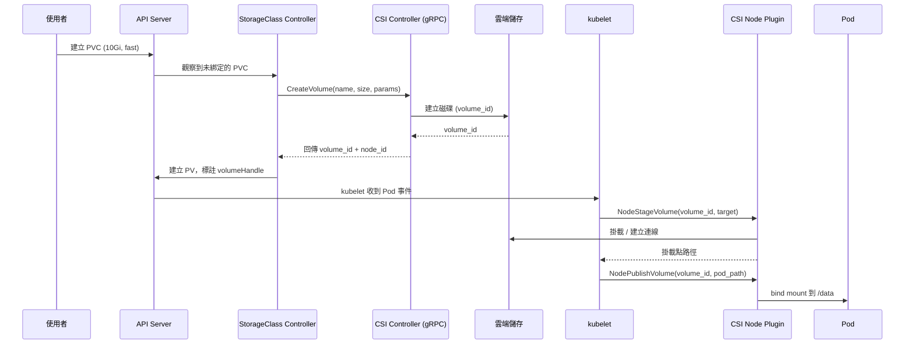

# 6.3 CSI 與容器儲存的抽象邊界

## 儲存問題的特殊性

網路問題與儲存問題有本質差異：

| 面向 | 網路 | 儲存 |
|---|---|---|
| 狀態 | 無狀（每次請求獨立） | **有狀**（資料必須持久） |
| 隔離 | 可以用命名空間虛擬化 | **命名空間無法虛擬化磁碟** |
| 共享 | 天然可共享 | 共享寫入需要一致性 |
| 生命週期 | 隨容器 | **必須比容器長** |

**核心問題**：容器的生命週期是短暫的（秒到小時），但資料的生命週期是長久的（年）。而 Docker 的 OverlayFS 是**隨容器一起銷毀**的。

因此容器儲存需要一個「容器之外」的持久層。

## 儲存的三個層次



### emptyDir：`/tmp` 的容器化版本

```yaml
volumes:
  - name: cache
    emptyDir: {}
  - name: shm
    emptyDir:
      medium: Memory
      sizeLimit: 512Mi
```

`emptyDir` 的行為：

- Pod 被建立時，在節點上分配一個目錄（或 tmpfs）。
- **Pod 的所有容器共享這個目錄**。
- Pod 被刪除時，目錄被刪除。
- 若 Pod 被重新調度到其他節點，**資料不會跟著走**（除非 Pod 沒有被刪除，只是節點故障）。

`emptyDir` 是在 node 級別的臨時空間。它的實作依賴 **tmpfs** 與 **bind mount** 兩個核心原語。

## Volume 的核心機制：bind mount 與 mount 命名空間

所有 Kubernetes volume 的實作，最底層都是**在容器的 mount namespace 中做一次 `mount()` 系統呼叫**。



**這裡有一個重要的技術細節**：bind mount 是**核心級別的掛載點共享**。

- 容器內對 `/data` 的寫入，實際寫到宿主的 `/var/lib/kubelet/...`。
- 兩邊看到的是**同一個 inode**，不是副本。

**這就是為什麼 volume 可以被多個容器（甚至多個 Pod，在同節點時）共享。**

### 關鍵限制：bind mount 不能跨命名空間「穿透」到 Pod 之外

有個著名的 K8s 陷阱：**Pod 內的 `subPath` 或 volume mount 不能指向容器根目錄之外的路徑**。核心的 mount namespace 設計上，容器內的 `/` 是一個新的根，bind mount 只能相對於新根解析。

**這個限制源於 `pivot_root` 的語意**：一旦根被替換，舊根就不可達了。

## PersistentVolume 與 PersistentVolumeClaim

### 為什麼需要兩個物件

這是一個漂亮的設計，解決了「誰該關心儲存細節」的問題：



- **PV（PersistentVolume）**：叢集中的一塊儲存資源（管理員建立）。
- **PVC（PersistentVolumeClaim）**：對儲存的「請求」（使用者建立）。
- **StorageClass**：儲存的「類別」（如 `standard` = SSD、`slow` = HDD、`nfs`）。

**這個分離的核心價值是「職責分離」**：

- 應用程式只需要說「我要 10Gi 的 `fast` 儲存」，不需要知道它是本地 NVMe、網路儲存還是雲端磁碟。
- 管理員可以在不修改任何應用程式的情況下，改變背後的實作（這就是「StorageClass 抽象」的力量）。

### PVC 的生命週期與 StorageClass 的動態供應



**這整個流程是「宣告式 + 控制迴圈」的完美體現**：

- 使用者宣告「我要什麼」（10Gi，fast）。
- 系統決定「怎麼滿足」（由 StorageClass 的 provisioner 決定）。
- 過程中任何一步失敗，控制迴圈會重試。

## CSI：Container Storage Interface

**CSI（Container Storage Interface）** 是 CNCF 的儲存插件介面，2018 年 GA。

**CSI 解決的問題**：在 CSI 之前，每個儲存系統要整合到 Kubernetes，都需要**改 Kubernetes 原始碼**（寫一個 in-tree 的 volume plugin）。這與 CRD 出現前的狀況一模一樣。

CSI 把介面定義為一組 **gRPC 服務**：

```protobuf
service Identity {
    rpc GetPluginInfo(...)
    rpc GetPluginCapabilities(...)
    rpc Probe(...)
}

service Controller {
    rpc CreateVolume(...)      // 建立儲存卷（類似 ProvisionVolume）
    rpc DeleteVolume(...)      // 刪除
    rpc ControllerPublishVolume(...)   // 把卷掛到某個 node
    rpc ControllerUnpublishVolume(...)
    rpc ValidateVolumeCapabilities(...)
    rpc ListVolumes(...)
    rpc ControllerGetCapabilities(...)
}

service Node {
    rpc NodeStageVolume(...)       // 在 node 上做初始設定（格式化、掛載）
    rpc NodeUnstageVolume(...)
    rpc NodePublishVolume(...)      // 把卷掛到目標路徑（bind mount）
    rpc NodeUnpublishVolume(...)
    rpc NodeGetVolumeStats(...)     // 用量統計
    rpc NodeExpandVolume(...)       # 線上擴容
    rpc NodeGetCapabilities(...)
}
```

**三個階段的掛載流程**（這是 CSI 最重要的設計）：



**為什麼要分三段？** 因為「把一個網路儲存掛到節點上」（`NodeStageVolume`）是**昂貴**的操作（連線、可能的格式化、可能的認證），而「把它 bind mount 到某個 Pod」（`NodePublishVolume`）是**廉價**的。

**分離這兩者，讓多個 Pod 共用一個已掛載的卷時，只需付出一次昂貴成本。** 這是一個非常典型的「把昂貴操作與廉價操作分離」的效能設計。

## 儲存類別的驅動因素

| 需求 | 儲存技術 | Kubernetes 對應 |
|---|---|---|
| **低延遲、高 IOPS** | 本地 NVMe | `local` PV (Kubernetes 1.10+) |
| **持久 block** | 雲端磁碟 | CSI 驅動（EBS CSI driver 等） |
| **共享檔案** | NFS / Azure Files / EFS | CSI driver |
| **分散式檔案** | CephFS / GlusterFS | CSI driver |
| **物件儲存** | S3 / GCS | s3 CSI driver (mount 為檔案系統) |
| **快取** | tmpfs / 記憶體 | `emptyDir.medium: Memory` |
| **儲存類 QoS** | SSD / HDD 分級 | StorageClass + `volumeBindingMode: WaitForFirstConsumer` |

### `WaitForFirstConsumer`：一個精巧的排程整合

```yaml
apiVersion: storage.k8s.io/v1
kind: StorageClass
metadata:
  name: fast
provisioner: example.csi.example.com
volumeBindingMode: WaitForFirstConsumer
```

預設（`Immediate`）會在 PVC 建立時立刻配置儲存。`WaitForFirstConsumer` 則等到**有 Pod 真的要用它、且被排程到某個節點之後**，才在那個節點上配置儲存。

**這解決了拓撲問題**：如果儲存是本地磁盤，就必須在 Pod 被排到的那台機器上配置。`WaitForFirstConsumer` 讓排程器與儲存 provisioner 正確協作。

**這是「宣告式系統中處理跨資源約束」的通用模式**——Kubernetes 裡還有類似的例子（`PersistentVolume` 的 `selected-node` annotation）。

## 資料一致性的難題

多個 Pod 同時掛載同一個卷時，一致性由**底層儲存系統**決定：

| 儲存類型 | 讀寫一致性 | 說明 |
|---|---|---|
| RWO (ReadWriteOnce) | 單節點 | 只能由一個節點掛載寫入 |
| ROX (ReadOnlyMany) | 多節點唯讀 | |
| RWX (ReadWriteMany) | 多節點讀寫 | 需要支援 POSIX 鎖的共享檔案系統 |
| RWOP (ReadWriteOncePod) | 單 Pod | Kubernetes 1.22+ |

**RWO 的語意經常造成 Kubernetes 的排程問題**：



**StorageClass 的 `volumeBindingMode: WaitForFirstConsumer` 加上 `podAntiAffinity` 是解決這個問題的標準組合。**

## 從 Docker Volume 到 CSI

Docker 的 volume 模型其實已經相當成熟：

```yaml
volumes:
  - mydata:/var/lib/data
volumes:
  mydata:
    driver: local
    driver_opts:
      type: nfs
      o: addr=10.0.0.1,rw,nolock,soft,timeo=600,nfsvers=4
      device: ":/exported/path"
```

**Docker 的 volume 插件介面（早期）就是 CSI 的前身。** 2016 年 Docker、Cloud Foundry、Mesosphere 共同推動了 CSI 的設計。Kubernetes 1.9（2017）透過 `external-provisioner` 支援了 out-of-tree 儲存驅動的測試版，1.13（2018）GA。

**注意 out-of-tree 這個詞**——在 CSI 之前，Kubernetes 的儲存驅動全部是 in-tree 的（編譯進核心的 Go 程式碼，數萬行，與 API 綁死，難以升級）。CSI 把它們全部移到外掛。

## 有狀應用程式在容器中的挑戰

即使有 PV/PVC/CSI，把有狀服務跑在 Kubernetes 上仍有挑戰：

1. **啟動順序**：ZooKeeper 集群必須依序啟動。
   - 解法：StatefulSet 的有序啟動 + `initContainer` 等待。

2. **資料遷移**：從 StatefulSet 遷移到另一個儲存後端時，需要一致的停機或雙寫。

3. **備份**：需要應用層級的一致性（資料庫的 flush），單靠檔案系統快照不夠。
   - 解法：VolumeSnapshot (CSI 快照) + 應用層的 hooks（Prestop）。

4. **擴充的重新平衡**：CephFS 需要 `fs.rebalance`；HDFS 需要 balancing。

**這些問題沒有「核心原語」可以解決——它們是分散式系統問題。** 但 Kubernetes 提供了**組合它們的框架**（initContainer、Lifecycle hooks、Operator），而 Operator 正是把領域知識寫成控制迴圈的地方。

## 與 eBPF 的交會：儲存的可觀測性

第 8 章會談到 eBPF 的 I/O 追蹤。讓我們先預告它在儲存領域的價值：

**傳統的儲存診斷問題**：

- 「為什麼這個 Pod 的磁碟 I/O 這麼慢？」
- 「這是網路儲存的延遲，還是應用程式的問題？」
- 「哪個 Pod 在同一個 node 上搶 I/O？」

**傳統工具的困難**：

- `iostat` 給的是全機器的彙總，無法歸因到 Pod。
- `strace` 太昂貴。
- `/proc/<pid>/io` 給的是累計值，不是時間序列。

**eBPF 的做法**：



**cgroup v2 的 `io.stat` 提供 per-cgroup 的 I/O 統計**，配合 eBPF 的時間戳追蹤，可以得到「每個 Pod 的 I/O 延遲直方圖」——這是傳統工具做不到的。

## 一個完整的儲存請求生命週期

把本章串起來：



**這個流程中有 6 個不同的元件、4 次跨網路呼叫，且必須冪等**（任何一步可以重試）。**這就是「宣告式 + 控制迴圈」在儲存領域的應用。**

## 小結

1. 儲存與網路的最根本差異是**生命週期**：容器是短命的，資料是長久的。
2. 所有 volume 最終都落到核心的 **bind mount + mount namespace** 上——這是第 3.2 節原語的直接應用。
3. **PV / PVC / StorageClass** 的三層分離實現了職責分離：應用程式宣告需求，管理員決定實作。
4. **CSI** 把儲存驅動從 Kubernetes 原始碼中移出，成為 gRPC 外掛；它的三階段掛載（ControllerPublish → NodeStage → NodePublish）把昂貴操作與廉價操作分離。
5. `WaitForFirstConsumer` 讓排程器與儲存 provisioner 正確協作，處理拓撲約束。
6. 一致性問題（RWO 的排程衝突）需要 `podAntiAffinity` 配合，不能單靠儲存層解決。
7. eBPF 在儲存領域的價值是**per-Pod 的 I/O 延遲歸因**，這是傳統 `iostat` 做不到的。

第三部結束。接下來是本書最「現代」的部分：**eBPF**——Linux 內核的可程式化能力。
