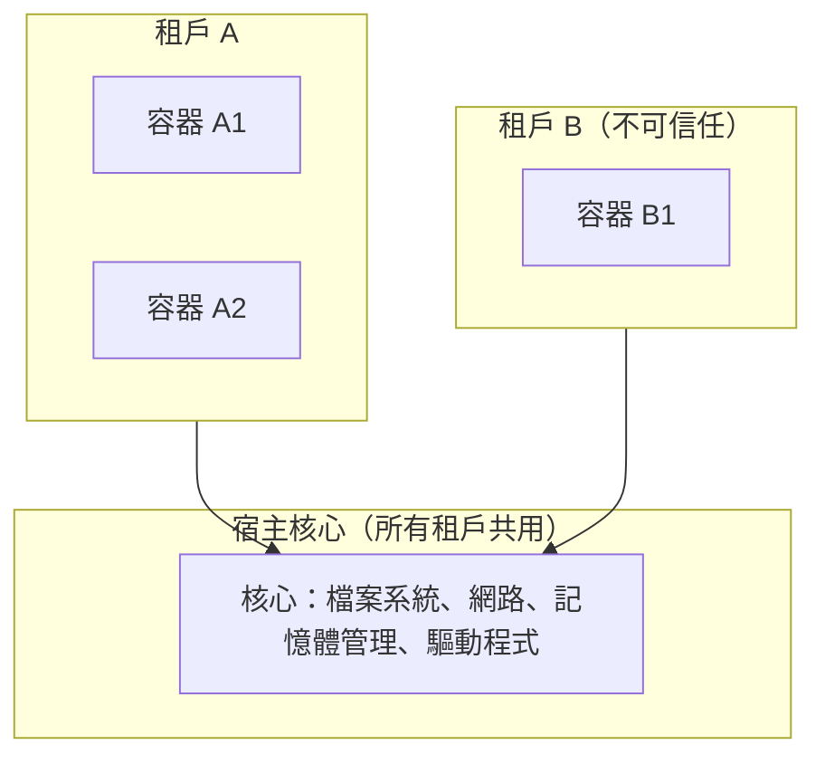
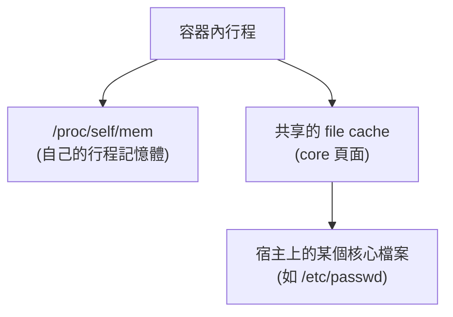
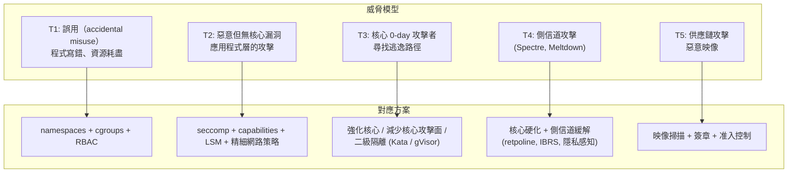
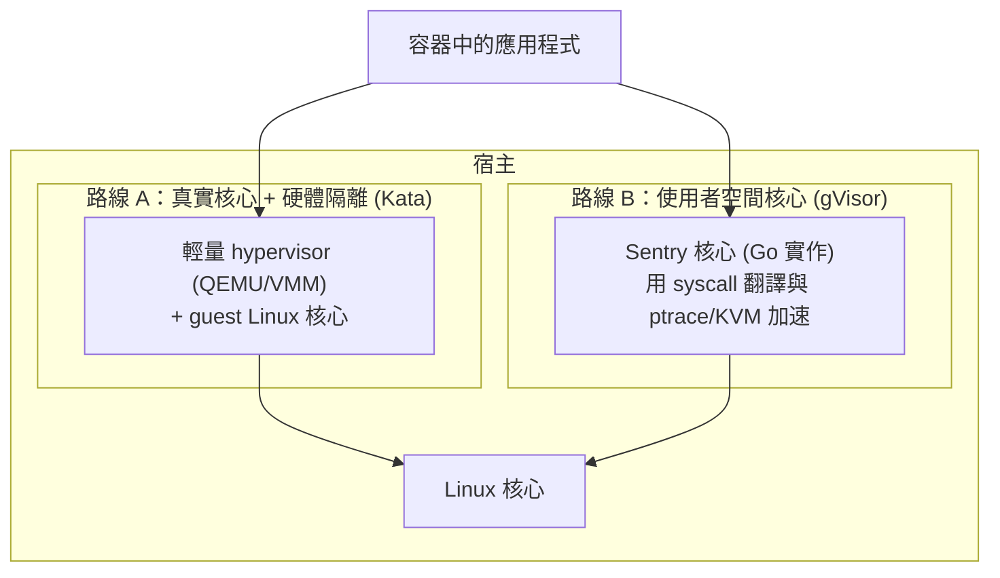
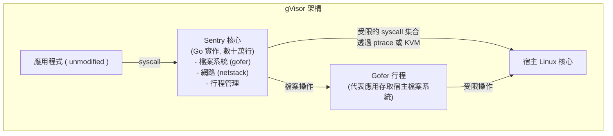
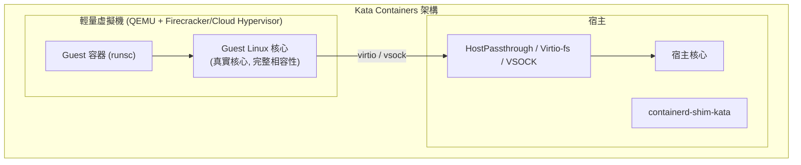
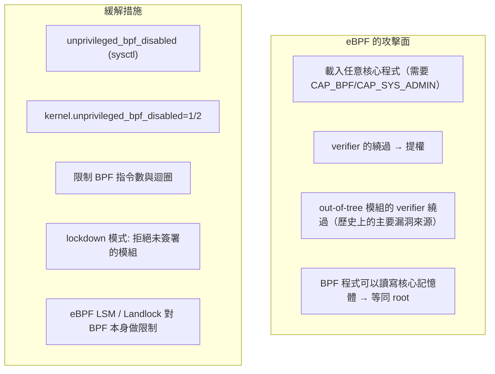
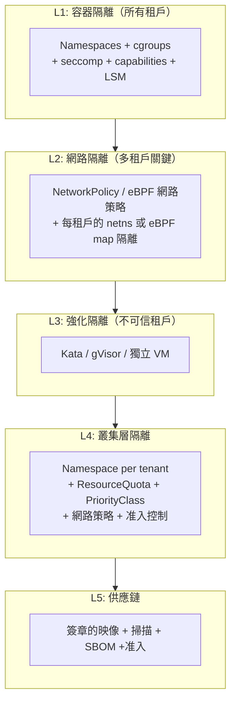

# 6.4 多租戶隔離與 Kata Containers 與 gVisor

## 共用核心的結構性問題

容器在 Linux 上共享**同一個核心**。這意味著：

**安全模型的推論**：一旦核心中的任何一個漏洞被利用，攻擊者就獲得了**宿主機的完全控制權**。

> 容器不是安全邊界（security boundary）。它是一個**資源隔離邊界**。

這句話是整個容器安全討論的核心。歷史上有過把它說得更樂觀的時期（「containers are secure because they are isolated」），但隨著 CVE 的累積，業界共識已經明確。

### 核心漏洞的嚴重性：歷史上的案例

| 年份 | 案例 | 影響 |
|---|---|---|
| 2016 | **Dirty COW** (CVE-2016-5195) | 容器可讀寫宿主 `/proc` 內的記憶體 → **容器逃逸**，可取得宿主 root |
| 2017 | **Dirty Pipe** (CVE-2017-1000114) | 可覆寫唯讀檔案內容 → 容器逃逸 |
| 2019 | **SVD** (CVE-2019-5736) | 透過 `runc` 的 execve 覆寫宿主核心 → **Docker/K8s 逃逸**，轟動一時 |
| 2022 | **Dirty Pipe 2** (CVE-2022-0847) | 資料頁面覆寫 → 提權 |
| 2024 | **io_uring 相關漏洞** | 大量核心漏洞（見第 2.3 節） |

Dirty COW 尤其值得細說，因為它完美展示了**「容器隔離的邊界在哪裡」**：

COW（Copy-On-Write）頁面在寫入時才複製。Dirty COW 讓攻擊者能**在複製發生之前修改共享頁面**，因此能改到**其他行程正在使用的核心檔案**（如核心的 `.text` 段），從而提權到宿主 root。

**結論**：namespaces + cgroups 能防禦的是「**故意的、程式邏輯層面的越權**」，防禦不了「**核心本身的實作漏洞**」。

## 威脅模型的分層

在設計隔離方案前，必須先明確威脅模型：

**沒有單一方案能覆蓋所有威脅。** 這是理解本章的關鍵：Kata 與 gVisor 解決的是 **T3**。

## 二級隔離的兩條路線

## gVisor：用戶空間核心

**gVisor**（2018 年起，由 Google 開源）的思路：

> **在容器與宿主核心之間插入一個「中介核心」（interposition kernel）。**

### Sentry 的設計

- **完整的應用程式相容性**：應用程式不需要修改，只是看到「syscall 比較少」的世界。
- **更小的核心攻擊面**：Sentry 只實作約 200 個 syscall（宿主核心有 300+），而且不暴露 `/proc`、`/sys` 的完整內容。
- **沙箱化的 syscall**：即使 Sentry 有漏洞，攻擊者也在 Sentry 內，而 Sentry 與宿主核心之間的介面被嚴格限制。

### 兩種 syscall 攔截機制

| 模式 | 機制 | 效能 |
|---|---|---|
| **ptrace** | `PTRACE_SYSCALL`，每次 syscall 兩次陷入 | 慢（10-100 μs / syscall） |
| **KVM / gVisor's KVM platform** | 硬體虛擬化輔助的 syscall 攔截 | 快得多（接近原生） |

**KVM 模式的原理**：應用程式在 KVM guest 中執行，但**不是**跑完整的 guest 核心——而是由宿主上的 Sentry 直接攔截 syscall。這消除了 ptrace 的成本。

### 弱點

- **I/O 密集型工作負載效能損失明顯**（尤其在 ptrace 模式）。gVisor 官方建議網路密集型應用使用 KVM 模式。
- **相容性**：某些系統呼叫（`io_uring`、某些 `ioctl`、特定 `/proc` 讀取）不支援或行為不同。
- **gVisor 本身就是一個複雜的、需要持續更新的核心**——它把「維護核心」的成本轉移給了 gVisor 專案。

## Kata Containers：真實的虛擬機，但很輕

**Kata Containers**（2017 年起，由 Intel 與 Hyper.sh 發起，後由 OpenAnolis 維護）的思路：

> **既然容器缺乏硬體隔離，那就給它硬體隔離——但要做得比傳統 VM 輕得多。**

### 為什麼它比傳統 VM 輕

| 面向 | 傳統 VM | Kata |
|---|---|---|
| 開機 | 數十秒（載入 BIOS、裝置驅動、initrd、userspace） | **< 1 秒**（kata-agent 直接在 guest 核心中啟動應用） |
| 記憶體 | 數 GB（完整 OS + 服務） | **數十 MB**（精簡的 guest image） |
| 磁碟映像 | 數 GB | 幾十 MB |
| 隔離 | 硬體級 | 硬體級（同樣是 VM） |

**Kata 的關鍵設計**：

1. **精簡的 guest image**：只包含一個極小的 init 系統與 `kata-agent`，不跑 systemd、不跑完整發行版。
2. **kata-agent 直接 `execve`** 應用程式，不經過傳統的 init 流程。
3. **Virtio-fs**：共享檔案系統，不需要把磁碟映像格式化與複製。
4. **VSOCK**：guest 與 host 的高效 IPC 通道。

### 效能代價

即使 Kata 很快，VM 的邊界仍然要付成本：

- **每次 syscall 需要 hypervisor 介入**（特別是 vCPU 與 hypervisor 之間的切換）。
- **I/O 需要在 guest 與 host 之間翻譯**（virtio 的轉換成本）。
- **記憶體需要二級頁表**（EPT）的翻譯成本。

**量級上的經驗值**：Kata 的 syscall 成本大約是真實核心的 1.5–3 倍（視操作而定）。對於 I/O 密集的應用（例如大量小檔案操作），這個差距會被放大。

## 新時代的威脅：eBPF 帶來的新問題

這裡出現了一個值得深思的張力。**eBPF 是本書第四部的主角，它也是一個安全風險的來源。**

**關鍵的權限問題**：

- 傳統上，載入 eBPF 程式需要 `CAP_SYS_ADMIN`（root）。
- 但 5.8 之後的 Linux 加入了 `CAP_BPF` 與 `CAP_PERFMON`，讓**非 root 使用者**可以載入部分 eBPF 程式（受限的追蹤用途）。
- 這開了一個新的攻擊面：**verifier 的繞過漏洞會從「無害的觀察者」升級為「root」**。

**因此**：

- `kernel.unprivileged_bpf_disabled=1` 是許多生產環境的標準設定。
- `kernel.unprivileged_bpf_disabled=2` 更嚴格：連 `CAP_BPF` 也不能用（完全禁止非 root 使用 eBPF）。
- Ubuntu、Debian、RHEL 都預設或建議啟用這些設定。

**但這裡有個尖銳的矛盾**：

> eBPF 是現代可觀測性與網路安全的基礎設施。而 eBPF 也是核心最大的攻擊面之一。**雲原生環境中，用 eBPF 做可觀測性的工具（如 Pixie、Datadog 的 eBPF agent、Parca、Pyroscope）與限制 eBPF 的安全政策，正在互相拉扯。**

**這個張力沒有簡單的答案**，它是當前整個產業最開放的辯論之一。也是第 9 章「最小權限防線」與第 10 章「未來挑戰」的重要素材。

## 多層隔離的實際架構

典型的生產環境會做分層：

**注意 L2（網路隔離）的重要性被嚴重低估。** 在多租戶 Kubernetes 叢集中，**網路是最大的共享面**：數千個 Pod 共享同一個核心網路堆疊、同一個 conntrack 表、同一個 bridge。

**著名的「容器逃逸到網路」案例**：

- **CVE-2019-11246**（Kubernetes `kube-proxy` iptables 模式）：精心構造的流量可以造成 iptables 規則的順序錯亂，導致**跨 Pod 的流量劫持**。
- **CVE-2020-8558**（Kubernetes `kube-proxy` 舊版 `localhost` 處理）：叢集內的 Pod 可以直接連到 kube-proxy 的 10250 埠（kubelet API），繞過 NetworkPolicy。

**這兩個 CVE 說明一件事**：在多租戶環境中，**即使容器本身沒有逃逸，網路層的隔離缺陷也足以造成嚴重的越權。**

這是 Cilium 等 eBPF 網路方案的核心價值主張：**把網路策略從「iptables 規則鏈」升級到「核心中的程式化 Map 查找」，同時消除規則鏈的線性匹配與順序錯亂風險。**

## 效能與隔離的量化取捨

讓我們用一個簡化的模型來看取捨。

假設租戶數 $T$ ，每租戶 $P$ 個 Pod，總 Pod 數 $N = T \times P$ 。

| 方案 | 每 Pod 的核心記憶體 | 隔離強度 | 啟動時間 |
|---|---|---|---|
| 純容器（共享核心） | $\sim$ 1-3 MB | ★★★☆☆ | < 100 ms |
| gVisor（ptrace） | $\sim$ 30-50 MB | ★★★★☆ | 100-500 ms |
| gVisor（KVM） | $\sim$ 30-50 MB | ★★★★☆ | 200-800 ms |
| Kata Containers | $\sim$ 50-100 MB | ★★★★★☆ | 500-2000 ms |
| 完整 VM | $\sim$ 512 MB - 2 GB | ★★★★★★ | 5-30 s |

**在 1,000 個 Pod 的叢集上，記憶體差異是 1 GB 對 100 GB**。這就是為什麼「所有負載都用 VM」在雲端不可行，而「所有負載都只用容器」在多租戶高安全場景不足。

**現代的實務策略是混搭**：

- 絕大多數「半信任」負載：純容器。
- 不可信或多租戶敏感負載：gVisor 或 Kata。
- 需要完整相容性與最強隔離：VM（由 Kata 或雲廠商提供）。

**這是「原語可組合性」在安全領域的應用**：同一批核心原語，依威脅模型的不同，可以組裝出不同強度的隔離。

## 判斷準則：什麼時候需要二級隔離？

一個實用的決策矩陣：

| 情境 | 建議 |
|---|---|
| 單一組織內部、員工開發環境 | 純容器 |
| SaaS 多租戶、租戶間不共享任何資料 | 純容器 + 嚴格 NetworkPolicy + 強化核心 |
| SaaS 多租戶、租戶間有潛在攻擊動機 | **gVisor 或 Kata** |
| 處理 PII / PHI / 支付等法規資料 | Kata 或專用 VM + 加密磁碟 |
| 需要載入未受信任的第三方驅動/模組 | 專用 VM（不可能安全地共用核心） |
| 執行 AI 模型推論（多租戶共用 GPU） | 容器 + GPU 隔離（MPS/MIG）+ cgroups |

**最後一列值得特別注意**：AI 推論的多租戶場景（第 10 章會詳細討論）在 2024-2026 年成為容器隔離的新壓力來源——因為**模型權重本身是敏感的 IP**，而且共享 GPU 帶來新的側信道（記憶體存取模式推斷）。

## 小結

1. **容器不是安全邊界，而是資源隔離邊界。** Dirty COW、Dirty Pipe、SVD 等 CVE 反覆證明了這一點。
2. 威脅模型必須分層；namespaces + cgroups + seccomp + LSM 處理 T1/T2，二級隔離處理 T3。
3. **gVisor** 用使用者空間的 Sentry 核心做中介，核心攻擊面小，但有 syscall 與 I/O 效能成本；**Kata** 提供真實的硬體隔離，透過精簡 guest image 達到 < 1 秒啟動。
4. **網路是多租戶環境最大的共享面**——`kube-proxy` 的 CVE 顯示，網路層缺陷可造成跨租戶越權，即使容器本身沒有逃逸。
5. **eBPF 是雙刃劍**：它是可觀測性與網路安全的基礎，也是核心最大的攻擊面之一；`unprivileged_bpf_disabled` 等設定反映了這個張力。
6. 現代實務是**分層混搭**：依威脅模型選擇隔離強度，而不是一律使用最重的方案。

第三部完成。第四部，我們進入 Linux 二十多年來最具顛覆性的機制：**eBPF**。
