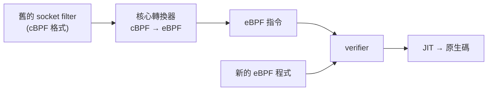
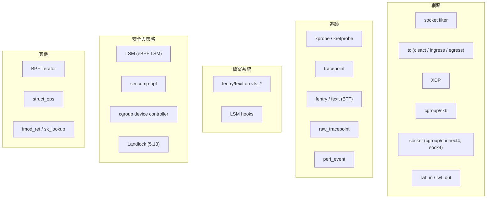
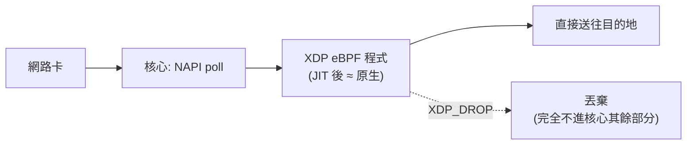
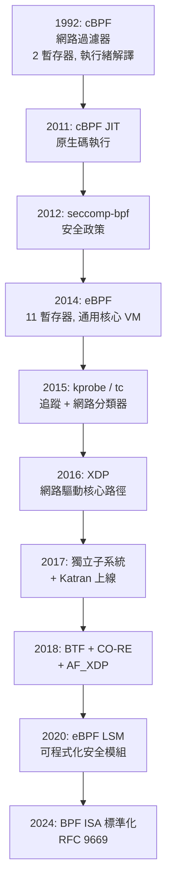

# 7.1 1992 年 BPF 的起源與 2014 年 eBPF 的轉身

## 1992 年：Berkeley Packet Filter

故事要從 1992 年說起。Steven McCanne 在 Berkeley 撰寫論文：

> McCanne, S. & Jacobson, V. (1992). *A Flexible, High-Performance Packet Filter for UNIX*. Proceedings of the 1992 ACM SIGCOMM.

**背景是 BSD 的傳統封包過濾機制太慢。** 傳統做法是：

1. 把封包從核心複製到使用者空間。
2. 在使用者空間用 `BPF`（一個緊湊的過濾語言）編譯出過濾器。
3. 把過濾器載回核心。
4. 核心對每個封包執行過濾器。

問題在於**步驟 1**：每個封包都要複製到使用者空間，光是這一次複製就足以讓 10 Mbit/s 的處理器跑不滿。McCanne 的核心洞見是：

> **既然過濾器要在核心中執行，為什麼不讓它「待在」核心裡，直接用一個小的、可稽核的指令集表達，而不經過使用者空間？**

這就是 BPF（Berkeley Packet Filter）的設計：**一套在核心中執行的虛擬機，有自己的指令集、自己的暫存器模型、自己的編譯器**。

### cBPF 的指令集

cBPF 使用 **2 個 32-bit 暫存器（A、X）** 與一個 **M[16] 記憶體陣列**（指向封包資料的 16 個 32-bit 槽位）。

```
ldh [12]      ; 載入乙太網封包的 ether_type (offset 12)
jeq #0x800, drop, next   ; 若是 IPv4 (0x0800) 則跳到 drop
ldb [23]      ; 載入 IP 標頭的 protocol 欄位 (offset 23)
jeq #6, accept  ; 若是 TCP (6) 則接受
drop: ret #0
accept: ret #0xffffffff
```

### cBPF 的三個關鍵設計（這些都被 eBPF 繼承）

1. **一套受限的指令集**：只有載入、跳轉、算術、返回。**沒有任意記憶體存取**——這讓核心可以安全地執行它。
2. **一個有界的執行模型**：核心在執行前就知道程式的最壞情況（多少指令、多少跳轉），因此不會被程式拖死。
3. **可稽核**：程式很小（數百位元組），人可以讀懂並確認它安全。

**這三點正是 eBPF 的安全模型基礎。** 二十二年後，eBPF 只是把這套思路擴展到一個大得多的指令集與整個核心。

## cBPF 在 Linux 的歲月

Linux 在 2.2 系列（1999）引入了 cBPF 與 `socket(2)` 的 `SO_ATTACH_FILTER`（這是第 2.1 節提到的 BSD 衍生介面）。

Linux 社群對 cBPF 的兩項重要改良：

### 2011 年 4 月：cBPF 的核心內 JIT

在 cBPF 之前，核心要用**解譯器**執行過濾器：逐條指令解譯、分支預測失敗、cache 失效。

**JIT（Just-In-Time）編譯**把過濴器編譯成原生機器碼，直接執行。Linux 2.6.39（2011 年 4 月）合併了 `net: filter: Just In Time compiler`。

效果：在 x86 上可以達到接近原生的速度。

### 2012 年 1 月：seccomp-bpf

**這是 cBPF 第一次離開網路領域。**

`seccomp`（第 9 章會詳述）原本只能用「一個整數常數」比較 syscall 參數，能力有限。`seccomp-bpf`（2012 年 1 月）允許用 BPF 程式表達**任意複雜的 syscall 過濾政策**：

```
// 概念性：允許 read/write/exit，拒絕 ptrace
if (nr == __NR_read || nr == __NR_write || nr == __NR_exit_group)
    return ALLOW;
return KILL;
```

**這是一個重要的先例**：證明了「BPF 語言可以用來表達安全政策」，並且可以用在小巧、可用形式化方法驗證的程式上。

**但 cBPF 的侷限很快暴露**：

| 限制 | 問題 |
|---|---|
| 只有 2 個暫存器 | 幾乎無法寫複雜邏輯 |
| 沒有 subroutine | 所有邏輯必須展開 |
| 沒有 64-bit 運算 | 難以處理現代的位址 |
| 綁定 socket filter | 只能用在 socket 上 |
| 記憶體存取受限 | 不能做通用追蹤 |

**cBPF 的指令集太小了，無法承載 eBPF 的野心。**

## 2014 年：eBPF 的轉身

### 關鍵人物

- **Alexei Starovoitov**（Facebook）：提出 eBPF 的核心設計，做了 verifier 與 JIT 的關鍵工作。
- **Daniel Borkmann**（Red Hat）：推動 eBPF 在追蹤領域的應用。
- **David S. Miller**（Linux 網路堆疊維護者）：**2014 年 3 月**接受了 eBPF 對舊 BPF 解譯器的重寫。

### eBPF 的指令集擴充

| 面向 | cBPF | eBPF |
|---|---|---|
| 暫存器 | 2 × 32-bit | **11 × 64-bit**（`r0`–`r10`） |
| 記憶體 | M[16] 固定陣列 | 512 bytes 堆疊 + context + Map |
| Subroutine | 無 | 有（BPF-to-BPF call） |
| Tail call | 無 | 有（最多 33 層） |
| 64-bit 運算 | 無 | 有 |
| 原子操作 | 無 | 有（`BPF_XADD`、`BPF_FETCH` 等） |

### 2014 年 3 月：David S. Miller 接受重寫

這一步的意義在於 **eBPF 是由 Linux 網路堆疊的核心維護者親手接受並整合進核心的**，而不是一個外來提案。這保證了它從一開始就是「核心的一部分」，而不是「附加在核心上的外來物」。

**Linux 3.18（2014 年 12 月）** 發布，包含了 eBPF 虛擬機。

### 核心的相容性策略：cBPF → eBPF 轉換

這是一個非常聰明的設計：**核心內部把舊的 cBPF 程式自動轉換成 eBPF 指令**，然後用同一個 eBPF 執行引擎執行。



**結果**：所有既有的 socket filter（tcpdump 的 BPF 過濾器、iptables 的 `-m u32`、大量商用防火牆）**完全不需要修改**，卻自動獲得 JIT 的加速。

**這是「一個原語的演進不應破壞既有使用者」的典範。** 對比一下：很多技術演進會直接廢棄舊介面，把成本轉嫁給生態系。

## eBPF 的重新定位

**這是整個故事中最關鍵的轉折。**

原始的 BPF 是一種「**特定用途的封包過濾語言**」。eBPF 把自己重新定位為：

> **一種通用的、在核心中安全執行的小型程式語言。**

「e」原本的意思是 "extended"，但隨著用途從網路擴展到整個核心，Linux 社群逐漸把 "eBPF" 當作一個**偽首字母縮寫（pseudo-acronym）**來使用。

**這個重新定位帶來的三個後果**：

### 後果一：從「一個掛載點」到「數十個掛載點」



**這個清單還在增長。** 每一個新的掛載點，都是把「核心的某個機制」開放給可程式化處理。

### 後果二：從「過濾封包」到「任何類型的觀測與控制」

eBPF 程式的**觸發方式**從「每個封包」擴展到：

| 類型 | 觸發方式 |
|---|---|
| 網路 | 每個封包（XDP、tc）、每個 socket 事件 |
| 追蹤 | 每次函式進入/返回（kprobe、fentry） |
| Tracepoint | 核心的靜態追蹤點 |
| 排程 | 每次行程切換（`sched_switch`） |
| 檔案 | 每次 VFS 操作 |
| LSM | 每次安全決策 |
| 計時器 | 使用者空間設定的週期 |

### 後果三：從「單一使用者」到「多領域共用」

2017 年 11 月，**eBPF 成為 Linux 核心的獨立子系統**（有自己的 `bpf/` 目錄與維護者團隊）。

理由很直接：**當數十個不同領域都在提交 eBPF 相關的補丁時，把它放在 `net/` 或 `kernel/` 下面會造成維護上的混亂。** 獨立子系統讓補丁管理與程式碼審查有明確的歸屬。

**這是「生態系規模成長後，組織結構必須跟著調整」的典型案例。** 對比一下 Linux 的其他子系統演化：`net/`、`fs/`、`mm/`、`security/` 都是同樣的模式。

## eBPF 的安全模型：為什麼不用沙箱

Wikipedia 對 eBPF 安全模型的描述非常精確，值得完整引用其要點：

> Safety is provided through an in-kernel verifier which performs static code analysis and rejects programs which crash, hang or otherwise interfere with the kernel negatively.
>
> This validation model differs from sandboxed environments, where the execution environment is restricted and the runtime has no insight about the program.

**關鍵對比**：

| 面向 | 沙箱模型 | eBPF 的驗證模型 |
|---|---|---|
| 機制 | 限制程式可訪問的資源 | 靜態分析，證明程式**不可能**造成傷害 |
| 核心的認知 | 核心不知道程式在做什麼，靠硬體強制 | 核心**完全理解**程式的行為 |
| 失敗模式 | 程式越權 → 被沙箱擋下 | 程式危險 → 載入時就被拒絕 |
| 開銷 | 每次執行都有隔離成本（頁表、VM exit） | **接近零**（JIT 後就是原生碼） |
| 適用範圍 | 可以跑任意複雜的程式 | 只能跑受限子集 |

**這是 eBPF 效能優勢的根源，也是它的能力上限的根源。**

用一個類比：

> **沙箱像是給程式一間「有監視器的牢房」——它可以做任何事，但被看著。**
> **eBPF 的驗證器像是「先證明這個程式在數學上不可能越界，然後才讓它在核心中自由奔跑」。**

後者的效能好得多，但後者只能接受那些「能被證明安全」的程式。

## 為什麼「在核心中執行」是關鍵

讓我們量化「核心 vs 使用者空間」的差異。

一個典型的封包處理路徑（使用者空間代理）：


**每次封包的成本**：

1. **一次核心 → 使用者空間的 context switch**（約 1-5 μs，含 TLB 與 cache 污染）
2. **至少兩次封包複製**（核心 sk_buff → 使用者緩衝區 → 核心 sk_buff）
3. **一次使用者空間 → 核心的 context switch**

以 10 Gbps、64 bytes 小封包（14.88 Mpps）計算：

$$
C_{ctxswitch} = 14.88 \times 10^6 \times 2 \times 3\mu s = 89 \text{ CPU-秒/秒}
$$

**需要 89 顆 CPU 核心**才能讓單一使用者空間代理跑滿 10 Gbps 的小封包流。這就是為什麼：

- 高效能負載平衡器（Facebook 的 Katran、Cloudflare）都自己寫核心模組或用 eBPF。
- Nginx 用 `sendfile`（第 2.1 節）——也是為了消除一次往返。
- eBPF/XDP 成為雲原生網路的關鍵技術。

**eBPF 的 XDP 掛載點把這個成本降到接近零**：



**一次 context switch 都沒有，一次複製都沒有。**

## eBPF 的時間軸

| 日期 | 事件 |
|---|---|
| 1992 | McCanne 的 cBPF 論文 |
| 1999 | Linux 2.2 引入 cBPF |
| 2011.04 | cBPF 的核心內 JIT 合併 |
| 2012.01 | **seccomp-bpf**：BPF 第一次離開網路領域 |
| 2014.03 | David S. Miller 接受 eBPF 重寫 |
| 2014.12 | **Linux 3.18**：eBPF 虛擬機發布 |
| 2015.03 | **kprobe 掛載**（第一個追蹤用例）；tc 層基礎設施 |
| 2015.08 | **LLVM 3.7** 合併 eBPF 編譯後端 |
| 2015.09 | **bcc** 發布（Brendan Gregg 的工具集） |
| 2016.07 | **XDP** 合併（網路驅動的核心接收路徑） |
| 2016.08 | **Cilium** 發布 |
| 2017.05 | **Meta 的 Katran** L4 負載平衡器上線（處理 facebook.com 全部流量） |
| 2017.11 | **eBPF 成為獨立核心子系統** |
| 2017.09 | **bpftool** 併入核心 |
| 2018.01 | **AF_XDP** 發布（零拷貝的使用者空間封包處理） |
| 2018.10 | **bpftrace** 發布（「DTrace 2.0 for Linux」） |
| 2018.11 | **BTF** 合併（比 DWARF 小約 100 倍的型別元資料格式） |
| 2019.12 | Brendan Gregg 的《BPF Performance Tools》880 頁問世 |
| 2020.03 | **eBPF LSM** 上游（可程式化的 Linux Security Module） |
| 2020.09 | **GCC** 的 eBPF 編譯後端合併 |
| 2021.08 | **eBPF Foundation** 成立（Meta、Google、Isovalent、Microsoft、Netflix） |
| 2022.07 | Microsoft 的 **eBPF for Windows** 發布 |
| 2024.10 | **BPF ISA 發布為 IETF RFC 9669** |

**這份時間軸本身就是一部「Linux 如何一步步開放自身」的歷史。**

## eBPF 的產業採用

根據 Wikipedia 收錄的 eBPF 生產環境採用者（節錄）：

| 公司 | 用途 |
|---|---|
| **Meta** | Katran L4 負載平衡器（處理 facebook.com 全部流量） |
| **Google** | GKE 的 DataPlane V2、BPF LSM 取代 audit |
| **Cloudflare** | 負載平衡、DDoS 防護、安全執行 |
| **Netflix** | 叢集級網路可觀測性與效能診斷 |
| **Dropbox / Yahoo / Walmart / LinkedIn / Alibaba / Datadog / Trip.com / Sky / IKEA / Capital One** | Kubernetes Pod 負載平衡、網路、安全 |
| **Shopify** | 透過 Falco 做入侵偵測 |
| **Apple** | Kubernetes Pod 安全 |
| **Android** | NAT46 與流量監控 |
| **Microsoft** | 把 eBPF 移植到 Windows 核心 |

**注意名單裡的成分**：幾乎全是大型雲端與網路公司。這不是巧合——**eBPF 的價值只在於「需要同時處理高流量與複雜策略」的場景才會兌現**。在一般企業內部機器上，`strace` 加上 `perf` 可能就夠了。

## Brendan Gregg 的評價

Brendan Gregg（`perf`、`bcc`、`bpftrace`、`DTrace` 的作者）給了 eBPF 一個著名的稱號：

> **"superpowers for Linux"**

Linus Torvalds 的評價更為精準（2018 年）：

> "BPF has actually been really useful, and the real power of it is how it allows people to do specialized code that isn't enabled until asked for."

**這句話點出了 eBPF 的核心價值主張**：

> **不是「核心現在能做更多事」，而是「核心能在你需要的時候才開啟那個特定能力」。**

這個「按需啟用」的特性解決了一個核心設計的兩難：

- **把所有可能的 hook 都做成核心功能** → 核心膨脹、維護負擔、攻擊面增加，而且大多數人用不到。
- **做成核心模組** → 需要重新編譯、安裝、載入，且模組與核心版本耦合，攻擊面巨大（模組有完整核心權限）。

eBPF 是第三條路：**在核心內、以受限語言、按需啟用**。

## 從 cBPF 到 eBPF：22 年的三個轉身



每一個轉身都是**擴張了可程式化的邊界，同時保持安全模型不變**。這是本章最核心的觀察。

下一節，我們拆開 eBPF 的內部構造：掛載點、Map、JIT 管線。
