# 7.2 Hook 點、Maps 與 JIT 編譯管線

## eBPF 程式的三個部分

一個可載入的 eBPF 程式由三部分組成：

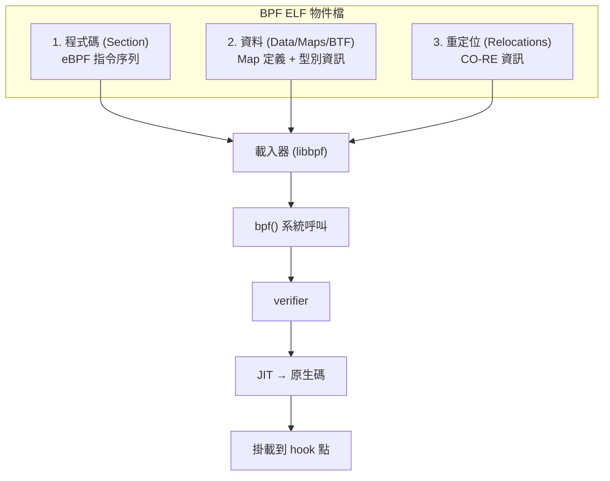

讓我們逐一拆解。

## 一、掛載點（Hook Points）

### 掛載的 API

```c
// 1. 載入程式
int bpf(int cmd, union bpf_attr *attr, unsigned int size);
// cmd = BPF_PROG_LOAD

// 2. 掛載到 hook 點
int bpf(int cmd, union bpf_attr *attr, unsigned int size);
// cmd = BPF_PROG_ATTACH
```

### 掛載點的組織

核心把掛載點組織成 **link（關聯）** 的形式：

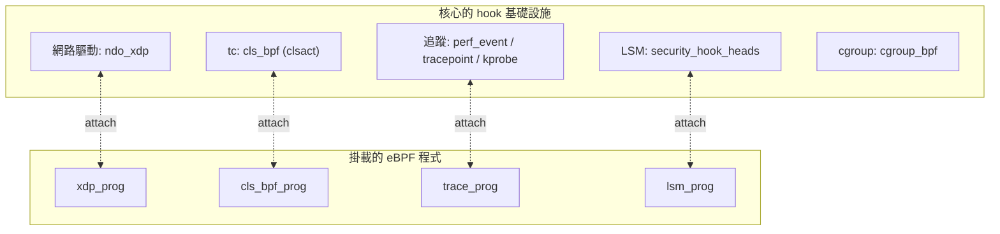

### `bpf_link` 與生命週期管理

**這是 eBPF 一個非常精巧的設計。** 在早期，掛載關係是隱式的：程式透過「在 hook 點上找一個空的槽位」來掛載，之後要靠持有 fd 來維持。新設計（Linux 5.7+）引入了明確的 **link 物件**：

```c
// 建立一個 link
int bpf_link_create(int prog_fd, int target_fd, enum bpf_attach_type type, ...);
```

`bpf_link` 的好處：

1. **明確的生命週期**：關閉 link fd 就解除掛載。
2. **原子更新**：可以建立新 link 再刪除舊的，實現無縫的程式更新（這對第 8.1 節的 XDP 熱更新至關重要）。
3. **可透過 `pin` 持久化**：釘選到 bpffs，重啟後可以重新 attach。


**「原子切換程式」是 eBPF 的一個殺手級應用**：XDP 程式可以在不中斷流量、不重啟應用程式的情況下更新。這是傳統 iptables 規則做不到的（iptables 的更新是「加新規則、刪舊規則」的非原子序列，中間有不一致的視窗）。

### 追蹤類掛載點的細節

| 掛載類型 | 說明 | 典型用途 |
|---|---|---|
| `kprobe` / `kretprobe` | 掛到核心函式的入口/返回 | 追蹤任意函式 |
| `fentry` / `fexit` | BTF 化的入口/返回（Linux 5.5+） | **可被 BPF-to-BPF 呼叫**，開銷更低 |
| `tracepoint` | 核心的靜態追蹤點 | 穩定的、有結構化參數的追蹤 |
| `raw_tracepoint` | 最原始的追蹤點 | 最高效能，參數需自行解析 |
| `perf_event` | 硬體效能計數器 | 統計 |
| `uprobe` / `uretprobe` | **使用者空間**的函式 | 追蹤應用程式 |

**`fentry`/`fexit` 相對於 `kprobe` 的優勢**：

`kprobe` 的問題是：核心函式的**原型（prototype）** 不一定可靠，`kprobe` 只能傳回原始參數（透過 pt_regs 讀取），而且**無法被其他 BPF 程式呼叫**（因此不能做 inline 化的追蹤鏈）。

`fentry` 透過 BTF 取得可靠的原型，參數以型別化的方式傳入，而且：

- **BPF-to-BPF call**：被追蹤的函式可以直接呼叫另一個 BPF 函式 → 零開銷的 inline。
- **可以使用「被追蹤函式」的 BTF 資訊**（型別、列舉值）。
- **verifier 可以做更精確的檢查**。

**這是 Linux 5.5（2020）的一個重要演進**，讓 BPF 追蹤從「能用」變成「好用」。

### `uprobe`：追蹤使用者空間

`uprobe` 讓 eBPF 可以掛到**應用程式**的函式上（透過 `/proc/<pid>/root` 路徑解析 symbol）。

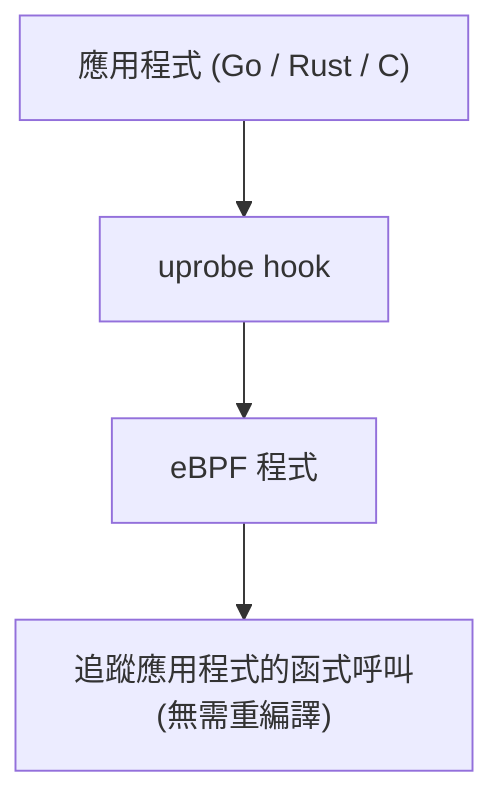

**uprobe 讓「不需要應用程式配合的觀測」成為可能。** 對比之下：

- 傳統的做法需要應用程式插桩（instrumentation）→ 需要重新編譯、重新部署。
- `uprobe`/`uretprobe` 只需要知道 symbol 名稱。

**這是「可觀測性的一大躍遷」**：你可以觀測一個閉源商業應用程式（只要有 symbol table）。

## 二、Maps：核心與使用者空間的狀態交換

### Map 的定位

**Map 是 eBPF 架構中最關鍵的抽象。** 它解決了三個問題：

1. **程式與使用者空間交換資料**（例如追蹤結果）。
2. **多個 eBPF 程式之間共享狀態**（例如多個 tc 程式共用一個 conntrack 表）。
3. **持久化狀態**（例如路由表、負載平衡的後端清單）。

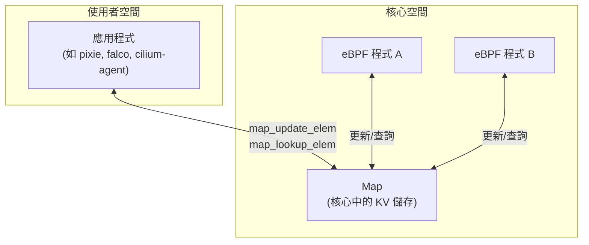

### Map 的類型

| 類型 | 用途 | 特性 |
|---|---|---|
| `BPF_MAP_TYPE_HASH` | 通用 hash 表 | 最常用 |
| `BPF_MAP_TYPE_ARRAY` | 固定大小陣列 | 快速，索引直接 |
| `BPF_MAP_TYPE_PERCPU_HASH` | **每 CPU 一份**的 hash | 免鎖，寫入極快 |
| `BPF_MAP_TYPE_PERCPU_ARRAY` | 每 CPU 一份的陣列 | 免鎖 |
| `BPF_MAP_TYPE_LRU_HASH` | LRU 淘汰的 hash | 快取 |
| `BPF_MAP_TYPE_LRU_PERCPU_HASH` | LRU + per-CPU | 快取的主力 |
| `BPF_MAP_TYPE_PERF_EVENT_ARRAY` | 效能事件輸出 | 對應 `perf_event_open` |
| `BPF_MAP_TYPE_PERF_BUFFER` | 效能事件緩衝 | 使用者空間 mmap 讀取 |
| `BPF_MAP_TYPE_RINGBUF` | **環形緩衝區**（Linux 5.8+） | 高效的資料流輸出 |
| `BPF_MAP_TYPE_STACK_TRACE` | 核心呼叫堆疊 | 追蹤 |
| `BPF_MAP_TYPE_CGROUP_STORAGE` | cgroup 關聯的儲存 | 容器感知 |
| `BPF_MAP_TYPE_BLOOM_FILTER` | 過濾器 | 快速集合成員測試 |
| `BPF_MAP_TYPE_CPUMAP` / `DEVMAP` / `XSKMAP` | CPU / 裝置 / AF_XDP 映射 | AF_XDP 資料面 |

### per-CPU Map：理解 eBPF 效能的關鍵

**這是 eBPF 最被低估的設計之一。**

在多核系統上，如果多個 CPU 同時更新同一個 hash map 條目，就需要鎖。而**讀取**也需要鎖（即使只需要讀，也要防止被撕裂）。

**per-CPU Map 的解法**：每個 CPU 有自己的一份 map。

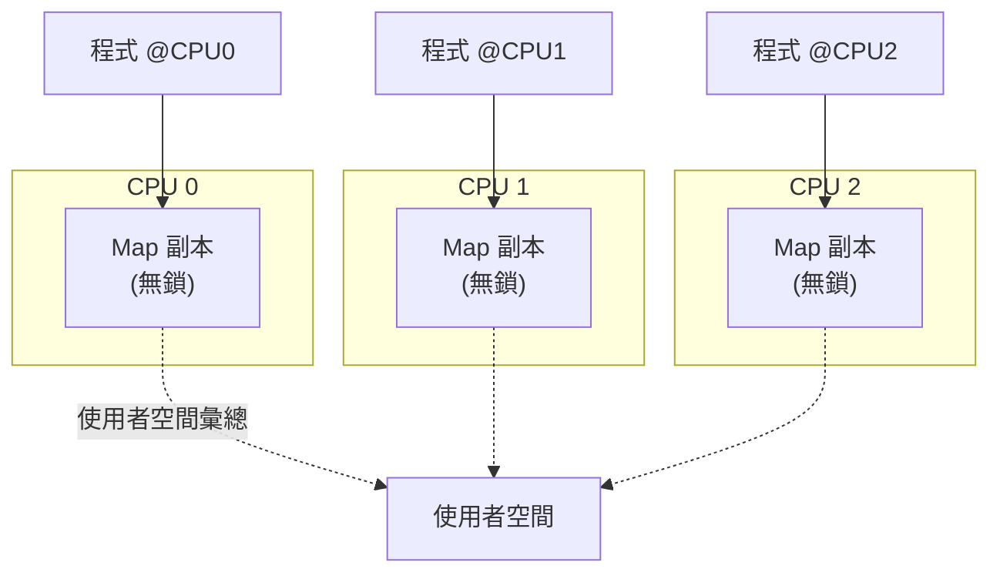

**好處**：

- **寫入完全無鎖**：不需要原子操作或 spinlock。
- **讀取完全無鎖**：不需要 RCU 的讀側成本。
- **沒有 cache line 乒乓（false sharing）**。

**代價**：每個 CPU 有獨立的資料，所以：

1. **全域計數需要彙總**（使用者空間定期把所有 CPU 的值加起來）。這對延遲統計（如第 8.2 節的延遲直方圖）是可接受的。
2. **資料量是 $N_{cpu}$ 倍**。
3. **需要 `bpf_map_lookup_elem` 的 per-CPU 變體**（`BPF_F_*` flag）。

**這個設計的深層洞察**：在多核系統上，**「避免共享」比「高效共享」更容易也更安全**。per-CPU 結構把複雜度從「每次操作」移到「每個元素」。

### Ring Buffer 取代 Perf Buffer

這是 Linux 5.8（2020）的一個重要改進。

**舊的 `PERF_BUFFER`**：

```c
// 使用者空間
struct perf_buffer *pb = perf_buffer__new(fd, page_cnt, sample_cb, ...);
// 使用者空間透過 mmap 的 ring 讀取
```

問題：

- **每個 CPU 一個 ring**，使用者空間要輪詢所有的 ring。
- **資料在核心與使用者空間之間來回「彈」**：使用者空間填滿一個 ring 後，核心會喚醒它；核心填滿後，使用者空間要靠 `epoll` 被喚醒。
- **資料被「推」到核心**（`perf_event_output` 把資料複製到 per-CPU ring）。

**新的 `RINGBUF`**：

```c
// 使用者空間
struct ring_buffer *rb = ring_buffer__new(fd, sample_cb, ...);
// 直接 mmap 同一個 ring，跨所有 CPU 共用
```

優點：

- **單一 ring，跨 CPU 共用**。
- **核心只寫，使用者空間只讀**，不需要同步。
- **使用者空間可以主動輪詢**（不需要被喚醒），對低延遲需求更好。

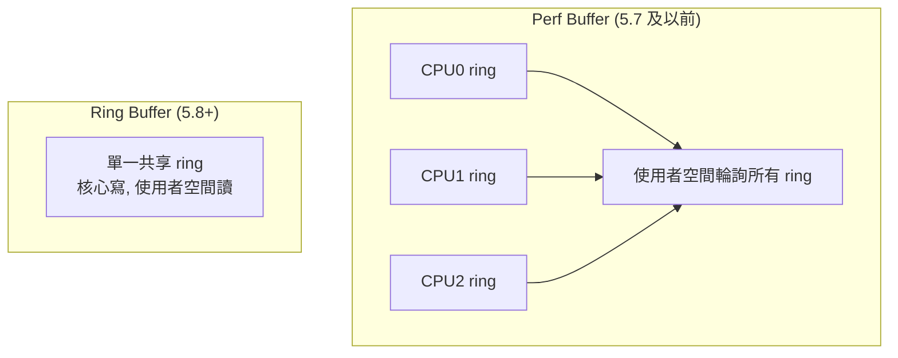

**這個改進的重要性在於**：它把 eBPF 的資料傳輸成本降低了數個數量級，使「每秒數百萬事件」的追蹤成為可能。

### BPF-to-BPF Call

Linux 4.16（2018）之前，eBPF 程式中的函式必須被編譯器 inline，否則會產生重複的程式碼副本。4.16 + LLVM 6.0 之後，BPF-to-BPF call 讓你可以自然地寫函式。

**好處**：

1. 減少程式碼大小（對 I-cache 友善）。
2. 讓 `fentry`/`fexit` 掛載的函式可以被 inline 呼叫 → **零開銷的追蹤鏈**。
3. **讓「可重用的 eBPF 函式庫」成為可能**（例如 libbpf 的 `bpf_core_read.h`、Cilium 的共用 helper）。

### Tail Call

**Tail call** 是一種「替換當前程式」的呼叫：

```c
// 跳到 prog_array 中的另一個程式
bpf_tail_call(ctx, &prog_array, index);
```

特性：

- **最多 33 層**（防止無限遞迴）。
- **共用同一個 stack frame**（512 bytes 限制不變）。
- **執行完就返回**（不像普通呼叫那樣會回到呼叫者）。

**用途**：

1. **把複雜邏輯拆成多個小程式**（繞開 verifier 的複雜度限制）。
2. **在不中斷的情況下熱更新**：把新的程式放進 `prog_array`，新流量自動走新程式。

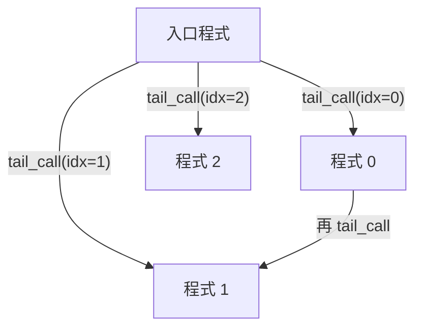

**Tail call 的策略性用法**：當某個 IP 需要特殊處理（例如被封鎖的客戶），可以用 tail call 跳到專門的處理程式，而主程式完全不變。**這讓「資料面策略的更新」不需要重新載入整個程式。**

## 三、JIT 編譯管線

### 完整的載入流程

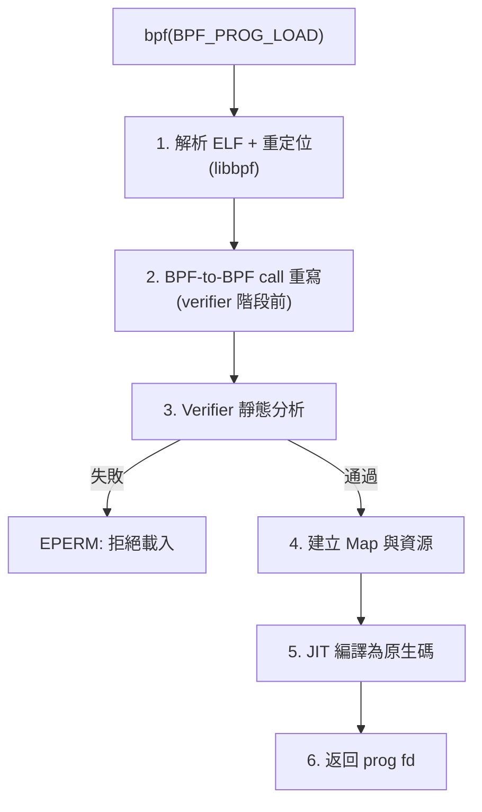

### 為什麼一定要 JIT？

**JIT 的三個理由**：

1. **效能**：JIT 後的程式就是原生碼，開銷接近零。解譯器模式會有 3-10 倍的開銷。
2. **安全**：JIT 讓核心可以對生成的原生碼做**控制流完整性（CFI）**保護（開啟 `CONFIG_CFI_CLANG` 時），並且可以避免某些 verifier 難以靜態分析的模式。
3. **普遍性**：JIT 到原生碼意味著**核心不需要知道程式的語義**，只需要執行它。

**歷史上這三個理由的權重不同**：

- cBPF JIT（2011）的理由是**效能**。
- eBPF 的理由**主要是安全**。

LWN 有一篇著名的分析指出：eBPF 的 verifier 之所以能這麼強（能拒絕幾乎所有危險程式），部分原因就是**最終執行的是原生碼**——這讓 verifier 可以做更多「保守但正確」的假設。

### JIT 的架構

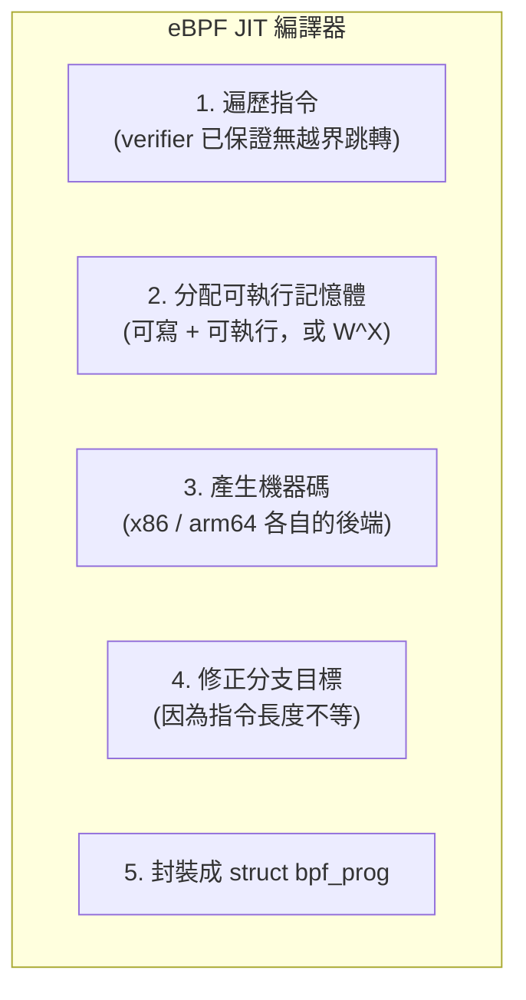

**JIT 的難點之一：指令長度不對等。**

BPF 指令是固定 64-bit，但 x86 的機器碼長度是可變的（1-15 bytes）。因此分支目標的位址必須在**所有指令都編譯完之後**才知道。

核心的解法：


這需要兩次遍歷，是 JIT 效能的開銷來源之一。

### `bpf_jit_disasm`：診斷工具

核心提供了 `bpf_jit_disasm` 來反汇编 JIT 產生的原生碼：

```bash
$ bpftool prog show id 42
$ bpftool prog dump xlated id 42
# 42: (bpf_prog_type=2) socket filter 1234 jited
# 42: (bpf_prog_type=2) socket filter 1234 jited:1
```

**這個工具是理解 eBPF 效能的關鍵**——你可以直接看到 verifier 優化後的程式長什麼樣、有哪些指令被消除。

### Verifier 的優化

Verifier 不只是「檢查」，它還會**優化**程式：

- **死程式消除（DCE）**：移除永遠不會執行到的路徑。
- **常數傳播**：把已知常數代入。
- **狀態合併**：把等價的分支狀態合併，減少 explored paths。
- **指令數降低**：優化後的程式更短，JIT 更快，執行更快。

**這是 verifier 從「安全檢查器」進化成「優化器」的結果**——這也解釋了為什麼 verifier 的複雜度會隨時間爆炸式成長。

## 四、CO-RE：Compile Once, Run Everywhere

### 問題

eBPF 程式需要存取核心的資料結構（例如 `struct task_struct` 的欄位）。但：

- 核心結構在版本間會變動。
- 不同發行版的設定不同（`CONFIG_*`），導致結構大小不同。
- 欄位可能不存在。

**沒有 CO-RE 的話**，eBPF 工具需要為每個核心版本重新編譯（使用 vmlinux BTF 或 kernel headers）。這正是 `bcc` 的做法（用當前核心的 headers 即時編譯）——方便，但**要求工具與核心版本嚴格匹配**。

### BTF：BPF Type Format

**BTF 於 2018 年 11 月合併進核心**（Linux 4.18）。

Wikipedia 的描述：

> BTF has been added to the Linux kernel as an efficient meta data format which is approximately **100x smaller** in size than DWARF.

BTF 描述核心中每個型別的：

- 名稱
- 大小
- 成員欄位的名稱、型別、**位元組偏移**
- 陣列長度、union、enum 值、typedef 鏈

**BTF 的核心應用是 CO-RE 重定位。**

### CO-RE 重定位的流程

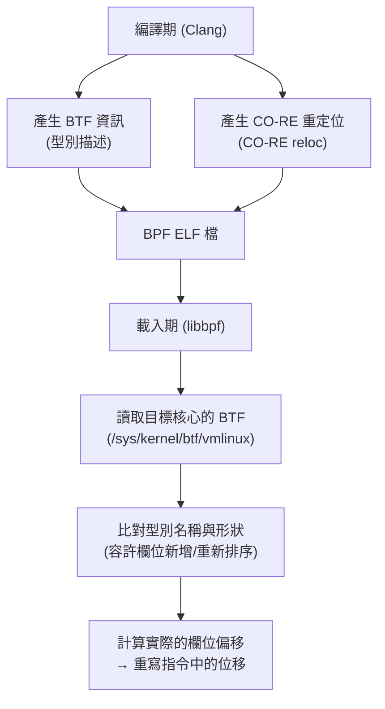

**關鍵在於「按名稱重新定位，而非按偏移」。**

編譯時，Clang 產生的是「我要讀 `task_struct` 的 `pid` 欄位」的**重定位記錄**，而不是「讀取位移 1234」。載入時，libbpf 拿目標核心的 BTF，找到 `task_struct.pid` 的實際偏移，然後把指令中的位移改寫。

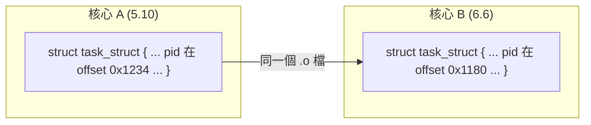

**這個能力的意義**：

1. **同一個二進位可以在不同核心版本上執行**。
2. **不需要核心 headers 就能編譯**（只需 BTF）。
3. **CI/CD 友善**：不需要為每個發行版建置。

**CO-RE 是 eBPF 從「玩具」變成「生產級基礎設施」的關鍵技術之一。** 沒有它，每個 eBPF 工具的部署都會變成噩夢。

### BTF 與 `bpf_core_read()` 的關係

CO-RE 不只支援結構體欄位，也支援**巢狀的欄位存取路徑**：

```c
// 讀取 task 的父行程的 comm
char comm[16];
bpf_core_read_str(&comm, sizeof(comm), &task->real_parent->comm);
```

這在核心結構複雜多變時特別有用。

## 完整的一個 eBPF 程式

讓我們把所有部分拼起來，看一個完整的追蹤程式：

```c
// SPDX-License-Identifier: GPL-2.0
#include "vmlinux.h"   // 從 BTF 生成的型別定義
#include <bpf/bpf_helpers.h>
#include <bpf/bpf_core_read.h>
#include <bpf/bpf_tracing.h>

// Map 型別定義
struct event {
    __u32 pid;
    __u32 tgid;
    char  comm[16];
    __u64 timestamp;
};

struct {
    __uint(type, BPF_MAP_TYPE_RINGBUF);
    __uint(max_entries, 1 << 24);   // 16 MB
} events SEC(".maps");

// kprobe 掛載點：追蹤 vfs_write
SEC("kprobe/vfs_write")
int BPF_KPROBE(handle_vfs_write, struct file *file,
              const char __user *buf, size_t count, loff_t *pos)
{
    struct event *e = bpf_ringbuf_reserve(&events, sizeof(*e), 0);
    if (!e) return 0;

    e->pid  = bpf_get_current_pid_tgid() >> 32;
    e->tgid = bpf_get_current_pid_tgid() & 0xFFFFFFFF;
    e->timestamp = bpf_ktime_get_ns();
    bpf_core_read_str(&e->comm, sizeof(e->comm), &file->f_path.dentry->d_name.name);

    bpf_ringbuf_submit(e, 0);
    return 0;
}

char LICENSE[] SEC("license") = "GPL";
```

**這段程式用到了本章介紹的所有機制**：

| 元素 | 對應機制 |
|---|---|
| `SEC("kprobe/vfs_write")` | 掛載點宣告 |
| `BPF_KPROBE` | 追蹤類程式的 helper 巨集（處理 pt_regs） |
| `BPF_MAP_TYPE_RINGBUF` | Map 類型 |
| `bpf_ringbuf_reserve` / `submit` | Ring buffer 輸出 |
| `bpf_get_current_pid_tgid` | Helper 函式 |
| `bpf_core_read_str` | **CO-RE** 讀取 |
| `vmlinux.h` | BTF 生成的型別 |
| `LICENSE = "GPL"` | **GPL 授權才能使用GPL 專有的 helper** |

**最後一點很重要且常被忽略**：eBPF 程式宣告 `GPL` 授權，才能使用 `bpf_probe_read` 等「GPL-only」helper。這是核心用來**勸阻專有程式使用 eBPF** 的機制（與核心的 GPL 授權策略一致）。

## 小結

1. eBPF 程式 = 指令碼 + Map 定義 + BTF/CO-RE 重定位，透過 `bpf()` 系統呼叫載入。
2. **掛載點**已經擴張到網路、追蹤、檔案系統、LSM、安全政策各個領域；`bpf_link` 提供原子更新與明確的生命週期。
3. **Map** 是核心與使用者空間、多個程式之間的共享狀態機制；**per-CPU Map 用「避免共享」換取免鎖**，是 eBPF 效能的基礎；**Ring Buffer（5.8+）** 讓高事件率的資料傳輸可行。
4. **JIT** 讓程式以原生碼執行，開銷接近零，同時讓 verifier 能做更保守但正確的假設。
5. **CO-RE + BTF** 讓同一個二進位在不同核心版本上執行——這是 eBPF 生態能規模化的技術前提。
6. `bpf_core_read()` 與 BTF 的關係，讓「對核心內部結構的存取」變得可攜且安全。

下一節，我們深入 verifier——**整個 eBPF 安全模型的樞紐**。
