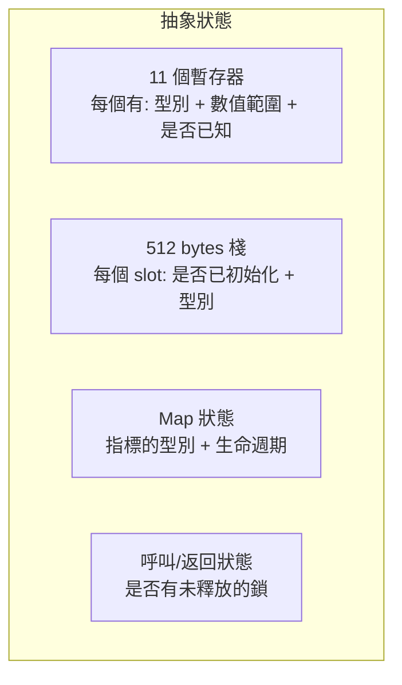
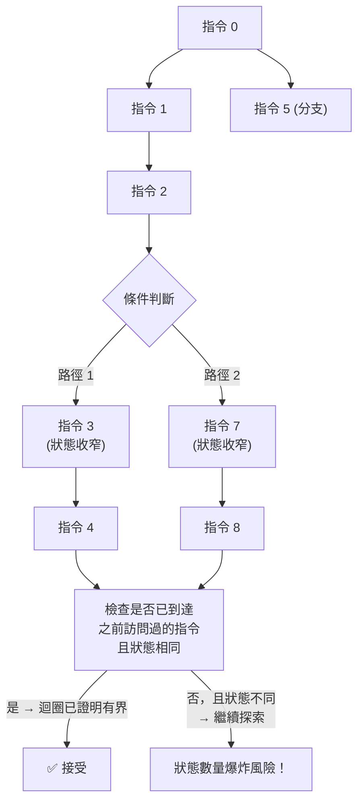
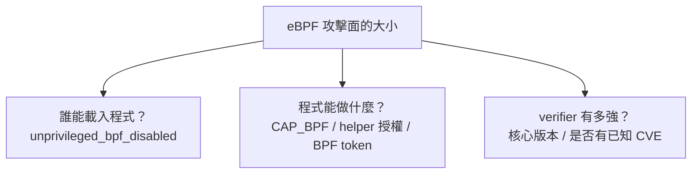

# 7.3 Verifier 的靜態分析與安全邊界

## verifier 的職責

**如果說 eBPF 是一個「在核心中安全執行程式」的機制，那麼 verifier 就是那個「安全」的守門人。**

Wikipedia 的定義：

> The eBPF verifier is a core component of eBPF, and its main responsibility is to ensure that an eBPF program is safe to execute. It performs a static analysis of the eBPF bytecode to guarantee its safety.

核心的問題是：**核心必須能夠確定性地判斷「這個程式在所有可能的執行路徑下，都不會傷害核心」。** 這是一個靜態分析問題，不是執行時問題。

### verifier 檢查什麼

根據 Wikipedia 列出的規則（並非完整清單）：

| 檢查 | 原因 |
|---|---|
| **程式必須在合理時間內終止** | 防止無限迴圈或無限遞迴拖死核心 |
| **不得讀取任意記憶體** | 防止洩漏敏感資訊（核心位址、金鑰） |
| **網路程式不得存取封包邊界外的記憶體** | 相鄰記憶體可能含敏感資訊 |
| **不得死鎖** | 持有的 spinlock 必須釋放，且同時只能持有一把 |
| **不得讀取未初始化的記憶體** | 防止資訊洩漏 |

**注意「不得讀取任意記憶體」這一條的深遠影響**：它意味著一個 eBPF 程式**不能直接解參考任意的核心指標**。它只能用受限的 helper 函式（`bpf_probe_read`、`bpf_probe_read_kernel` 等）來讀取，而這些 helper 本身是被 verifier 逐個核准的。

## 抽象解釋（Abstract Interpretation）

### 為什麼需要抽象解釋

verifier 不能真的執行程式（那既慢又不安全）。它必須**在執行前，模擬程式在所有可能路徑下的行為**。

這正是**抽象解釋（Abstract Interpretation）** 這門計算機科學的經典技術：

> **用一個「抽象的」數值域（例如「可能是 0 到 10 之間的任一值」）來代表具體程式的所有可能狀態，然後在抽象域上做過度近似（over-approximation）的運算。**

**關鍵性質**：如果抽象解釋在某個點發現「壞狀態」，那麼**所有具體執行也必然是壞的**（不會有 false negative）。反過來，抽象域可能比真實情況更保守（false positive，程式被拒絕但其實安全）。

### verifier 的狀態模型

verifier 對每個指令 maintains 一個**抽象狀態**：



**「數值範圍」（range）** 是 verifier 的核心追蹤資訊。例如：

```c
r1 = 0;              // r1 的範圍是 [0, 0]，且已知為常數
r2 = r1 + 100;       // r2 的範圍是 [100, 100]
r3 = unknown;        // r3 的範圍是 [0, UINT64_MAX]，未知
if (r1 > 50) {      // 分支 1: r1 的範圍收窄為 [0, 50]
    r4 = r1;         //   → r4 的範圍是 [0, 50]
} else {
    r4 = r3;         // 分支 2: r4 的範圍是 [0, UINT64_MAX]
}
```

**分支的範圍收窄（range narrowing）** 是 verifier 最重要的能力之一。它讓許多「看起來危險」的程式其實可以被證明安全。

### 遍歷策略：深度優先 + 狀態剪枝



**問題：狀態爆炸。**

一個有 $n$ 個分支的程式，最壞情況下有 $2^n$ 條路徑。verifier 必須有策略來控制爆炸：

1. **狀態合併（state pruning）**：如果到達某個指令時的抽象狀態與之前某個已接受狀態「相容」（例如之前的範圍是當前的子集），就剪枝。因為既然更大範圍的狀態已被接受，這個更小的狀態必然也安全。
2. **指令數上限（`BPF_COMPLEXITY_LIMIT_INSNS`，預設 1,000,000）**。
3. **迴圈處理**：2019 年之前，verifier 要求迴圈必須有「可以證明最多執行一次」的形式。**Linux 5.3（2019）引入了 bounded loops**，允許有明確上界的迴圈。

**狀態合併是 verifier 最複雜也最關鍵的機制。** 它的正確性依賴「相容性」的精確定義——這也是 verifier bug 的主要來源。

## verifier 的歷史性教訓：繞過漏洞

**eBPF verifier 的繞過漏洞，是 Linux 歷史上被研究得最透徹的安全漏洞類別。** 這不是巧合，而是架構的必然：

- 核心需要執行的邏輯越複雜，驗證它就越難。
- verifier 佔核心程式碼的比例不斷成長（從數千行到數萬行）。
- 任何 verifier 的 bug 都等同於「任意核心程式碼執行」的漏洞。

歷史上著名的案例（時間序）：

| 年份 | 事件 |
|---|---|
| 2015-2017 | 大量 verifier 繞過 CVE 被發現（多數透過 out-of-tree 模組） |
| 2017 | **CVE-2017-16942**：一個經典的 verifier 邏輯錯誤，允許非特權使用者提權 |
| 2019 | **CVE-2019-18620**：`bpf_verifier` 中的 out-of-bounds 存取 |
| 2021 | **CVE-2021-33200**：verifier 的狀態處理邏輯錯誤 |
| 2022 | **CVE-2022-23222**：verifier 中的 stack 存取檢查不完整（影響 5.15–5.16） |
| 2023 | 多個 verifier 與 out-of-tree 模組的漏洞 |

**這裡有個關鍵的觀察**：

> **在 2021 年之前，絕大多數 verifier 繞過漏洞是在 out-of-tree 模組（特別是 BCC 的 `bpf_probe_write_kernel`）中被發現的，而不是在核心內建的 eBPF 子系統中。**

原因：BCC 的 `bpf_probe_write_kernel` helper 提供了「任意核心記憶體寫入」的能力，因此 verifier 的任何一個小漏洞都直接變成提權。**這個 helper 在 5.5（2020）被移除，隨後 verifier 繞過漏洞的數量急劇下降。**

**這是一個非常重要的工程教訓**：

> **當一個機制（verifier）的複雜度持續上升時，應該優先「減少它需要驗證的能力」，而不是「讓它驗證得更強」。** 移除 `bpf_probe_write_kernel` 這一個 helper，消除了一整類漏洞，比修補數十個 verifier bug 更有成效。

**另一個重要觀察**：2021 年之後，Linux 開始為 verifier 繞過漏洞設立專門的 **$100,000 賞金計畫**（由 Pwn2Own 與内核.org 合作），並禁止未經審查的 out-of-tree 模組使用 verifier。**漏洞賞金 + 流程限制** 是應對這種「架構性複雜度」的務實手段。

## verifier 的資源限制

| 限制 | 目的 |
|---|---|
| **指令數上限**（1,000,000） | 防止 path explosion 導致核心 CPU 耗盡 |
| **狀態數上限** | 防止記憶體耗盡 |
| **迴圈次數上限** | 防止無限迴圈 |
| **call 深度上限**（8） | 防止遞迴 |
| **tail call 深度上限**（33） | 防止 tail call 遞迴 |
| **stack 大小固定**（512 bytes） | 防止 stack 溢出 |
| **每個指令最多 1M 條路徑** | 防止複雜度攻擊 |

**這些限制本身也是攻擊面**：一個惡意的載入者可以提交「讓 verifier 花掉大量 CPU」的程序，造成**載入時的 DoS**（但不能提權）。因此 Linux 加入了 `CAP_BPF` 權限來限制誰能載入 eBPF 程式。

## `bpf_prog_load` 的權限模型

載入 eBPF 程式需要什麼權限？

| Linux 版本 | 需求 |
|---|---|
| 早期 | `CAP_SYS_ADMIN`（等同 root） |
| 5.8+ | 引入 `CAP_BPF` + `CAP_PERFMON`（可非 root） |
| 5.13+ | 引入 `CAP_NET_ADMIN`（網路類程式）、`CAP_PERFMON`（追蹤類） |
| 5.17+ | 引入 `BPF token`（可以細緻地授權特定 Map 與 helper） |

**`CAP_BPF` 的引入是一個雙刃劍**：

- 好處：允許**非 root 使用者**做追蹤（效能分析工具的受眾大幅擴展）。
- 壞處：**擴大了 verifier 繞過漏洞的影響面**——從「root 才能提權」變成「普通使用者也能提權」。

**產業的回應**（如第 6.4 節所述）：

```bash
# 禁止非特權使用者載入 eBPF
sysctl kernel.unprivileged_bpf_disabled=1

# 更嚴格：連 CAP_BPF 也不允許
sysctl kernel.unprivileged_bpf_disabled=2
```

Ubuntu、Debian、RHEL 都預設啟用 `=1`。**Google 內部甚至在 2023 年的一篇公開文章中宣布，全面禁用非特權 eBPF。**

**BPF token（Linux 5.17，2022）** 試圖解決這個問題：它提供一種「能力授予」機制，讓管理員可以把**特定 Map 的讀寫權限**或**特定 helper 的使用權**授予非特權行程，而不需要給予完整的 `CAP_BPF`。

## 抽象解釋的數學基礎

讓我們把 verifier 的核心概念寫得更精確一點。

### 具體語義與抽象語義

- **具體語義**：程式的實際行為。狀態是 $(r_0, \ldots, r_{10}, \text{stack}, \text{maps})$ 的具體賦值。
- **抽象語義**：用一個**區間**（區間域）、**凸多面體**（polyhedral domain）、或**格**（lattice）來過度近似具體語義。

verifier 使用的是**區間抽象（interval abstraction）**：

$$
\llbracket r \rrbracket = [l, u] \quad \text{where } l \le r \le u
$$

加上**型別資訊**（taint tracking）與**已知常數**的標記。

### 轉移函數的過度近似

對於指令 $r_1 = r_2 + r_3$ ，若：

$$
\llbracket r_2 \rrbracket = [l_2, u_2], \quad \llbracket r_3 \rrbracket = [l_3, u_3]
$$

則：

$$
\llbracket r_1 \rrbracket = [l_2 + l_3, u_2 + u_3]
$$

**這可能溢出**（uint64 的加法是模 $2^{64}$ 的）。因此 verifier 必須額外追蹤「是否可能溢出」，這是 eBPF verifier 特有的複雜性。

### 網格與合併準則

**狀態合併（pruning）的正確性**依賴網格的性質：

> 若狀態 $s_1 \sqsubseteq s_2$ （ $s_1$ 比 $s_2$ 更「窄」，即 $s_1$ 描述的情況是 $s_2$ 的子集），且 $s_2$ 已被接受為安全，則 $s_1$ 也必然安全。

**這個「安全性的單調性」（safety monotonicity）是整個 verifier 理論的基石。**

**但真實世界的 verifier 並不完全滿足這個條件。** 例如：

- 「持有 spinlock 的狀態」不是「越窄越安全」——持有鎖的狀態更危險。
- 「已知為 0 的 pointer」vs「可能是 NULL 的 pointer」——前者更安全。

**這些非單調性是 verifier bug 的溫床。** 這也是為什麼 verifier 的實作與其理論之間存在落差——真實的 Linux verifier 是一個巨大的手工優化程式碼庫，包含許多年累積的「特例處理」。

## 靜態驗證 vs 沙箱：量化比較

讓我們把兩種安全模型的成本放在一起比較：

| 面向 | eBPF verifier | 沙箱（gVisor / VM） |
|---|---|---|
| 每次呼叫開銷 | **~10 ns**（JIT 後的原生碼） | ~1-2 μs（VM exit / ptrace） |
| 記憶體隔離 | 靠 verifier 保證，不靠硬體 | 靠硬體頁表 |
| 可執行的邏輯複雜度 | **受限**（無迴圈上限、有界 stack、無任意記憶體存取） | **無限制** |
| 攻擊面 | verifier 本身 | 沙箱核心 + 介面 |
| 副作用 | 直接作用於真實核心狀態 | 只能透過介面 |

**這個對比說明了 eBPF 的兩面性**：

- **效能是壓倒性的優勢**——這就是為什麼資料面與追蹤都用 eBPF。
- **能力上限是真實的約束**——這就是為什麼第 6.2 節說的「完整 L7 邏輯無法下沉到 eBPF」。

## 實務建議：如何寫出能被驗證的 eBPF 程式

從大量實務經驗中總結出的準則：

### 1. 永遠先檢查回傳值

```c
// ❌ 錯誤：可能回傳 NULL
struct key *k = bpf_map_lookup_elem(&map, &key);
return k->value;

// ✅ 正確
struct key *k = bpf_map_lookup_elem(&map, &key);
if (!k) return 0;      // verifier 要求這個 null check
return k->value;
```

**verifier 不會假設 `bpf_map_lookup_elem` 回傳非 NULL**（因為 Map 的內容可以在任何時候被改變）。

### 2. 迴圈必須有明確的上界

```c
// ❌ 錯誤：上限未知
for (i = 0; i < 10; i++) { ... }   // 常數 10 沒問題

// 實際上常數上界可以。
// 但變數上界不行：
for (i = 0; i < n; i++) { ... }    // n 未知 → 錯誤

// ✅ 正確：先證明 n 的上界
if (n > 100) n = 100;
for (i = 0; i < n; i++) { ... }
```

Linux 5.3+ 的 bounded loop 讓變數上界也可以（前提是 verifier 能證明）。

### 3. 檢查所有 helper 的錯誤路徑

```c
long ret = bpf_probe_read_kernel(&buf, sizeof buf, ptr);
if (ret < 0) return ret;   // 必須處理
```

### 4. stack 使用要謹慎

512 bytes 的 stack 很容易用完（每個區域變數 8 bytes，但結構體可能很大）。

**解法**：把大結構體放到 Map（per-CPU array）裡，或用 `bpf_probe_read` 逐步讀取。

### 5. 避免使用 verifier 不友善的 pattern

```c
// ❌ 指數變數的 pointer arithmetic
ptr = ptr + i * 8;   // verifier 難以證明邊界

// ✅ 使用 helper
bpf_probe_read_kernel(&val, sizeof val, (void *)(base + offset));
```

### 6. 用 `bpf_loop()` helper（Linux 5.17+）

```c
bpf_loop(100, callback_fn, &ctx, 0);
```

核心提供受控的迴圈輔助函式，繞開了迴圈驗證的複雜性。

### 7. 使用 `bpf_iter` 與 `bpf_for_each` 輔助宏

```c
struct task_struct *task;
bpf_for_each(task, &task_list) {
    // 迭代
}
```

## 驗證一個實際的安全邊界

讓我們回到第 6.4 節的問題：**eBPF 是不是核心最大的攻擊面？**

**答案取決於三個設定**：



**在「unprivileged_bpf_disabled=2 + 只允許特定 helper + 定期更新核心」的設定下**，eBPF 的風險是可控的。

**在「允許任何非特權使用者載入完整功能程式」的設定下**，風險很高。

**這是一個典型的「安全取決於部署配置」的系統**——和許多有核心安全機制（`seccomp`、`LSM`）的系統一樣。**Linux 社群反覆強調的核心議題是：「安全不是預設值，而是配置。」**

## verifier 的未來：更多能力，更少限制

Linux 開發者社群一直在推動「讓 verifier 支援更多程式，同時不放棄安全」：

| 方向 | 說明 |
|---|---|
| **BPF-to-BPF call 的 verifier** | 讓被呼叫的函式也能被驗證（已實現） |
| **迴圈展開** | 有界迴圈（5.3+） |
| **全域變數 / 靜態資料** | 讓程式可以有 read-only 的全域狀態 |
| **BTF 化的 function 簽章** | 更精確的原型檢查 |
| **BPF token** | 細緻的 Map/helper 授權 |
| **eBPF LSM** | 把安全決策本身變成可程式化的（5.7+） |

**每一項擴展都在重新平衡「能力」與「安全」的天平。** 這個平衡是動態的、持續的，而且**永遠不會完全穩定**——這是 eBPF 目前的現實，也是 Linux 社群正在處理的問題。

## 小結

1. **verifier 是 eBPF 安全的唯一保證**——它用抽象解釋靜態證明程式在所有路徑下都安全。
2. **區間抽象 + 範圍收窄 + 狀態合併**是核心技術；安全性的單調性是理論基石，但真實實作存在非單調性，這是 bug 的溫床。
3. **資源限制**（指令數、迴圈、stack、call 深度）既保護核心不被拖死，也構成攻擊面（DoS）。
4. **最重要的工程教訓**：當 verifier 複雜度上升時，應該「減少需要驗證的能力」而非「強化驗證」。移除 `bpf_probe_write_kernel` 比修補數十個 bug 更有效。
5. **權限模型是關鍵變數**：`CAP_BPF` 的引入擴大了受眾，也擴大了漏洞影響面；`unprivileged_bpf_disabled` 是關鍵的部署設定。
6. **eBPF 的能力邊界是真實的**：它無法承載複雜的 L7 邏輯、動態語言、無界迴圈、任意記憶體存取。

第四部的原理章結束。下一章，我們看 eBPF 在三個實際領域的應用：**網路資料面、執行期可觀測性、執行期安全**。
