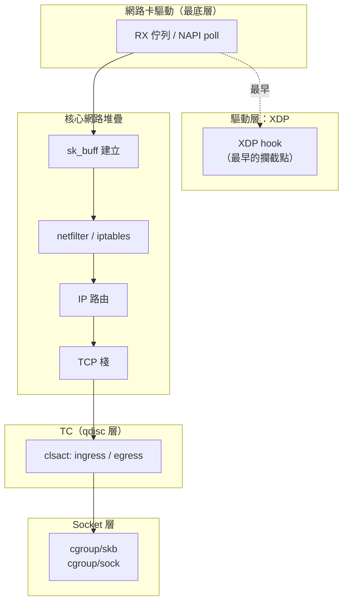
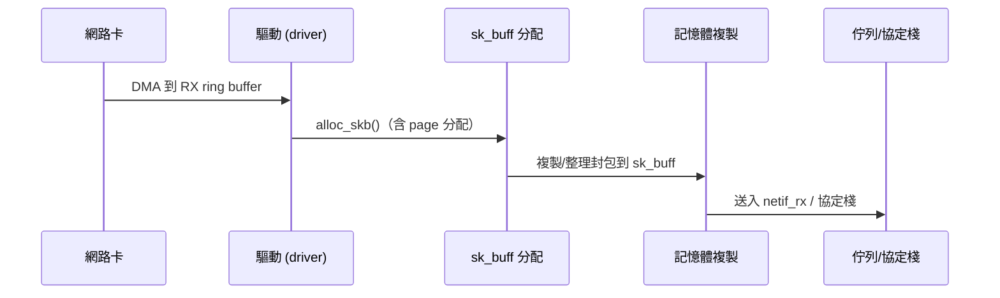
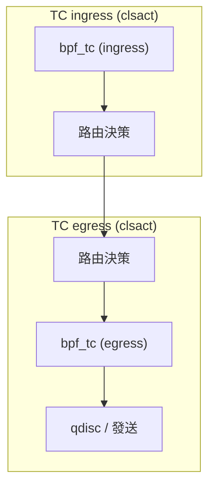
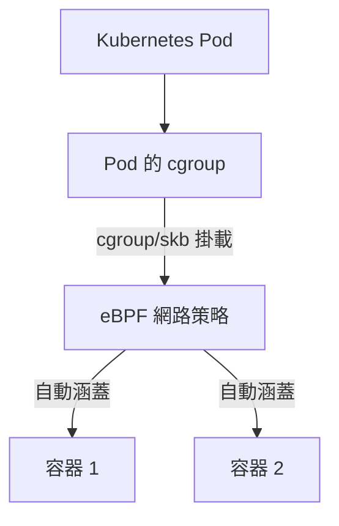
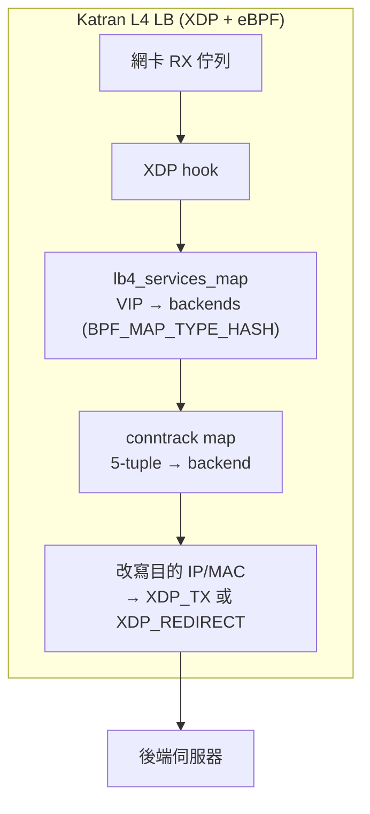

# 8.1 XDP 與 TC 的可程式化資料面

## 三個掛載點的層次

eBPF 在網路資料面上有三個主要的掛載點，它們對應封包在核心中的三個不同位置：



| 掛載點 | 位置 | 資料結構 | 成本 |
|---|---|---|---|
| **XDP** | 驅動的 RX 路徑，**在 `sk_buff` 分配之前** | `xdp_md`（原始頁引用） | **最低** |
| **TC**（`clsact`） | qdisc 層，**在 `sk_buff` 存在之後** | `sk_buff` | 中 |
| **cgroup/skb** | socket 層 | `sk_buff` | 中 |

### 為什麼 XDP 的位置是「最早的」

傳統封包接收路徑：



**`alloc_skb()` 與記憶體整理是封包接收的主要 CPU 開銷。**

XDP 的做法：**在驅動收到封包、但還沒建立 `sk_buff` 之前**，就把封包的原始頁指標交給 eBPF 程式：

```c
struct xdp_md {
    __u32 data;          // 封包資料的起點（指標）
    __u32 data_end;      // 封包資料的終點
    __u32 data_meta;     // metadata
    __u32 ingress_ifindex;
    __u32 rx_queue_index;
};
```

**注意：沒有 `sk_buff`、沒有封包複製、沒有 IP 頭解析**。只有原始位元組與一個範圍。eBPF 程式自己解析封包頭。

### XDP 的四種返回值

```c
// XDP 程式的返回值決定封包的命運
XDP_PASS      // 送到核心的正常路徑（繼續處理）
XDP_DROP      // 丟棄（零成本，連 sk_buff 都不會被建立）
XDP_TX        // 從收到它的同一個介面發回去（反射）
XDP_REDIRECT  // 送到另一個介面（包括 CPU，via cpumap）
XDP_ABORTED   // 異常，丟棄並計數
```

**`XDP_DROP` 是 DDoS 防護的殺手級武器**：

> 一個以 XDP_DROP 為主的過濾器，在 10 Gbps 線速小封包下，可以在單核上丟棄約 14.88 Mpps。**這是「核心旁路」級別的效能，但它是核心原生功能。**

**`XDP_TX` 與 `XDP_REDIRECT` 使 XDP 成為負載平衡器的理想掛載點**（第 6.2 節 Cilium 的做法）。

### 驅動支援：XDP 的現實約束

XDP 需要驅動的配合（在 RX 路徑插入 hook）。2024 年主流驅動幾乎都支援：`mlx5`、`i40e`、`ice`、`ixgbe`、`virtio_net`、`bond`……

**但 XDP 有「generic（通用）模式」作為 fallback**：當驅動不支援時，核心在 `sk_buff` 已經建立之後模擬 XDP。**代價是效能下降到接近 TC 層級**——沒有省掉 `alloc_skb`。

**這是一個重要的部署知識**：宣稱「我們用 XDP」時，必須確認是 native XDP 還是 generic XDP：

```bash
# 查看掛載的 XDP 程式模式
ip link show dev eth0
# prog/xdp id 42  ← native
# prog/xdp id 42 (generic)  ← 通用模式，效能受限
```

## XDP 實戰：一個最小的 DDoS 過濾器

用 C 寫一個丟棄特定來源 IP 的 XDP 程式：

```c
#include <linux/bpf.h>
#include <bpf/bpf_helpers.h>
#include <bpf/bpf_endian.h>

struct {
    __uint(type, BPF_MAP_TYPE_HASH);
    __uint(max_entries, 65536);
    __type(key, __be32);
    __type(value, __u64);
} blacklist SEC(".maps");

SEC("xdp")
int xdp_drop_malicious(struct xdp_md *ctx)
{
    void *data     = (void *)(long)ctx->data;
    void *data_end = (void *)(long)ctx->data_end;

    // 1. 解析乙太網頭
    struct ethhdr *eth = data;
    if ((void *)(eth + 1) > data_end)
        return XDP_PASS;

    if (eth->h_proto != bpf_htons(ETH_P_IP))
        return XDP_PASS;

    // 2. 解析 IPv4 頭
    struct iphdr *ip = (void *)(eth + 1);
    if ((void *)(ip + 1) > data_end)
        return XDP_PASS;

    // 3. 查黑名單
    __u64 *blocked = bpf_map_lookup_elem(&blacklist, &ip->saddr);
    if (blocked) {
        __sync_fetch_and_add(blocked, 1);   // 統計
        return XDP_DROP;                     // 在 sk_buff 之前丟棄！
    }
    return XDP_PASS;
}

char LICENSE[] SEC("license") = "GPL";
```

**這段程式展示了 XDP 的幾個關鍵特徵**：

1. **手動邊界檢查**：`if ((void *)(eth + 1) > data_end) return XDP_PASS;` —— 這是 verifier 強制的（第 7.3 節的「不得存取封包邊界外記憶體」）。
2. **`XDP_PASS` 作為預設**：過濾器只攔截它認識的，其他全部放行。
3. **`__sync_fetch_and_add`**：對 map 值做原子累加（統計被丟棄的封包數）。
4. **`bpf_htons`**：位元組序轉換（網路是大端）。

### 使用者空間側：載入與管理

```c
#include <bpf/libbpf.h>

int main(void)
{
    struct xdp_program *prog = xdp_program__open_file("filter.bpf.o",
                                                       "xdp", NULL);
    // 掛載到 eth0（native 模式）
    int err = xdp_program__attach(prog, ifindex("eth0"), XDP_MODE_NATIVE, 0);

    // 黑名單：把 1.2.3.4 加入
    __be32 ip = inet_addr("1.2.3.4");
    __u64 zero = 0;
    int map_fd = bpf_map__fd(xdp_program__find_map(prog, "blacklist"));
    bpf_map_update_elem(map_fd, &ip, &zero, BPF_NOEXIST);

    // 讀取統計
    __u64 count;
    bpf_map_lookup_elem(map_fd, &ip, &count);
    printf("blocked %llu packets from 1.2.3.4\n", count);

    // 卸載
    xdp_program__detach(prog, ifindex("eth0"), XDP_MODE_NATIVE, 0);
}
```

## TC 掛載點：sk_buff 層的資料面

XDP 太底層（看不到 `sk_buff` 的語意），TC 則是「有 `sk_buff` 但還沒進協定棧」的位置：



### TC 相對 XDP 的優勢

1. **可以看到 `sk_buff` 的語意**：`skb->mark`、`skb->tc_index`、QoS 資訊。
2. **可以存取 `skb` 的 helper**：`bpf_skb_load_bytes`、`bpf_redirect`、`bpf_clone_redirect`。
3. **可以用 `skb` 的元資料**：cgroup 關聯、socket 關聯。
4. **egress 處理**：XDP 只有 ingress（TX 側的 XDP 是另一套 `xdp_devmap`）。

### TC 相對 XDP 的劣勢

1. **必須先付出 `alloc_skb` 的成本**。
2. **不能做到 `XDP_DROP` 的零成本丟棄**（`sk_buff` 已經建立）。
3. **與 qdisc 互動的語意較複雜**。

**實務上的分工**：

| 場景 | 選擇 |
|---|---|
| DDoS 過濾、極高效能 | XDP |
| 負載平衡（需要 sk_buff 語意） | XDP + TC 混合 |
| 網路策略、流量分類、加密 | TC |
| 容器 / Pod 級別的策略 | TC（掛在 veth 上）或 cgroup/skb |
| Service 負載平衡 | TC 或 XDP（Cilium 用 TC + socket 層） |

## cgroup 層的掛載點：容器感知的網路控制

**cgroup skb/sock 類掛載點讓 eBPF 具備「容器感知」能力**——這正是雲原生場景最需要的：

```c
SEC("cgroup_skb/ingress")
int cgroup_ingress(struct __sk_buff *skb)
{
    // bpf_get_current_cgroup_id() 取得目前 cgroup
    __u64 cgid = bpf_get_current_cgroup_id();
    // 依 cgroup 做策略
}
```

**掛載在 cgroup 上，程式自動只對「該 cgroup 的所有行程」生效**。這與 Kubernetes 的 Pod 模型完美契合：



**Cilium 的 NetworkPolicy 就掛在這一層**：策略隨 Pod 建立/刪除自動掛載/卸載，不需要每次都修改全域規則表（對比 iptables 每次變動要重寫規則鏈）。

## XDPRedirect 與 cpumap：跨 CPU 的封包轉發

**`XDP_REDIRECT` 的三個去向**：

1. **`devmap`**：轉發到另一個網路介面（一跳的 XDP 轉發器）。
2. **`cpumap`**：把封包**重定向到另一個 CPU** 處理（Linux 4.12+）。
3. **`xskmap`**：送到 **AF_XDP socket**（使用者空間零拷貝）。

### cpumap 的意義

現代網卡有多個 RX 佇列（RSS），每個佇列由不同 CPU 處理。但流量分配不均時，某些 CPU 空閒、某些過載。

**cpumap 讓 eBPF 程式動態決定「這個封包交給哪個 CPU」**：

```c
SEC("xdp")
int xdp_loadbalance(struct xdp_md *ctx)
{
    __u32 cpu = hash_of_packet(ctx) % num_cpus;
    return bpf_redirect_map(&cpumap, cpu, 0);
}
```

**核心會把封包放到目標 CPU 的 IPI 佇列**，目標 CPU 的 kworker 收到後繼續處理。**這是一個「在核心中做 CPU 級負載平衡」的原語**，在 2016 年之前不存在。

## Google 的 GKE Dataplane V2

2021 年，Google 宣布 GKE 的 **Dataplane V2**，把 Kubernetes 網路資料面從 iptables 改為 eBPF：

> （Google Cloud Blog, "New GKE Dataplane V2 increases security and visibility for containers", 2021-05）

它的三大賣點：

1. **效能**：Service 的負載平衡從 $O(n)$ 規則鏈變成 $O(1)$ map 查找。
2. **安全**：NetworkPolicy 用 eBPF 實作，規則隨 Pod 生命週期原子更新。
3. **可見性**：每個封包的處理結果（允許/拒絕）可以直接匯出為日誌（NetworkPolicy Logging）。

**GKE 的選擇是整個產業的縮影**：當 iptables 的規則鏈在萬級 Service 規模下崩潰時，「核心可程式化」成為唯一的出路。

## Meta 的 Katran：eBPF 負載平衡的教科書案例

**Katran**（Meta/Facebook，2017 年 5 月上線）是 eBPF 在生產環境最大規模的應用之一。Wikipedia 的紀錄：

> Meta's layer 4 load-balancer, Katran, went live. **Every packet towards facebook.com since then has been processed by eBPF & XDP.**

Katran 的架構：



**Katran 的三個技術亮點**：

1. **Maglev 一致性雜湊**：後端變動時，只有少數連線被重新分配。
2. **DSR（Direct Server Return）**：後端直接回應給客戶端，LB 不在回程路徑上——**回程流量完全不經過 LB**，吞吐翻倍。
3. **XDP_TX / XDP_REDIRECT**：用 eBPF 做封包改寫與轉發，**零 sk_buff 成本**。

**Katran 的意義超出技術本身**：它證明了「在核心中寫一個完整的 L4 負載平衡器」在生產環境是可行的，而且是**史上最大流量等級**的可行。

## 效能數據的系統性比較

不同資料面技術的典型開銷（以 10 Gbps、1500 bytes 封包為基準，概念性數字）：

| 技術 | 每封包 CPU 開銷 | 吞吐極限 | 特點 |
|---|---|---|---|
| 傳統核心棧（無過濾） | 基準 | 高 | — |
| + iptables 規則鏈（100 條） | +數百 ns / 規則數 | 下降 | 線性規則匹配 |
| + conntrack | +200–500 ns | 下降 | 每連線一次查表 |
| TC + eBPF（簡單規則） | +100–200 ns | 接近傳統棧 | sk_buff 已建立 |
| **XDP + eBPF（丟棄）** | **+30–50 ns** | **線速** | 無 sk_buff |
| XDP + eBPF（轉發） | +50–150 ns | 接近線速 | 加上改寫 |
| AF_XDP（使用者空間） | +200–500 ns | 高 | 一次映射查找 |
| DPDK（完全旁路） | 最低 | 線速 | 放棄核心棧 |

> 這些數字是**概念性量級**，實際值隨核心版本、硬體、封包大小劇烈變化。用於理解相對關係，不可作為絕對指標。

## eBPF 資料面的極限

必須誠實地指出 eBPF 資料面的能力上限：

### 1. Tail call 深度上限（33 層）

複雜的資料面邏輯（完整的 TCP 狀態機、IPsec）可能超過 33 層 tail call。

### 2. 無法處理需要「有狀態連線追蹤 + 加密」的完整堆疊

kTLS 是核心功能（4.13+），eBPF 可以在 kTLS 之上做策略，但**不能在 eBPF 中實作 TLS 本身**（verifier 拒絕大型加密循環與堆疊需求）。

### 3. 無法取代 DPDK 的所有場景

需要**線速 + 完全自訂協定棧**的場景（5G UPF、專用交換機），DPDK/AF_XDP 仍然不可替代——因為 eBPF 依然要付 NAPI、IRQ、核心排程的成本。

### 4. 程式更新的一致性

多個 CPU 同時執行舊版與新版程式是**常態**（原子替換意味著先後完成）。需要程式設計上容忍「短暫的雙版本並存」。

## 小結

1. **XDP 在 `sk_buff` 之前攔截**，是核心中最早的封包處理點，`XDP_DROP` 可達線速丟棄。
2. **TC 提供 sk_buff 層的語意**，適合策略與分類；XDP 與 TC 互補，不是替代。
3. **cgroup 掛載點讓 eBPF 天生容器感知**，與 K8s Pod 模型契合——Cilium NetworkPolicy 的基礎。
4. **`XDP_REDIRECT` + cpumap + devmap + xskmap** 構成核心內的轉發原語族，讓 eBPF 可以組裝完整的 L4 負載平衡器（Katran 是教科書案例）。
5. **GKE Dataplane V2 的選擇標誌著產業共識**：iptables 規則鏈在萬級 Service 規模下崩潰，核心可程式化是唯一出路。
6. eBPF 資料面的上限：33 層 tail call、無法實作 TLS/完整狀態機、NAPI 成本仍在。極致效能場景仍屬於 DPDK。

下一節，我們看 eBPF 的第二個戰場：**可觀測性**。
