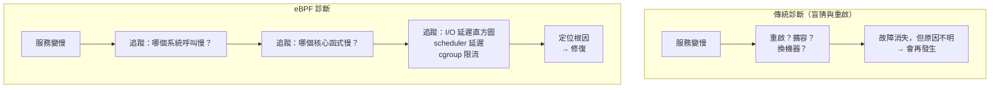
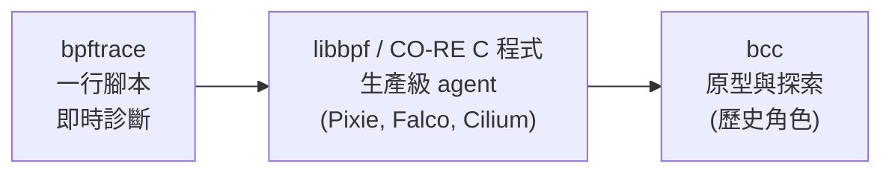
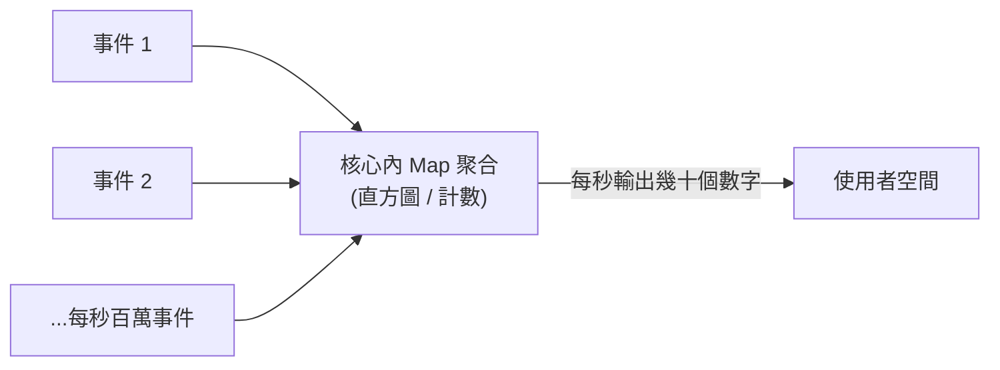
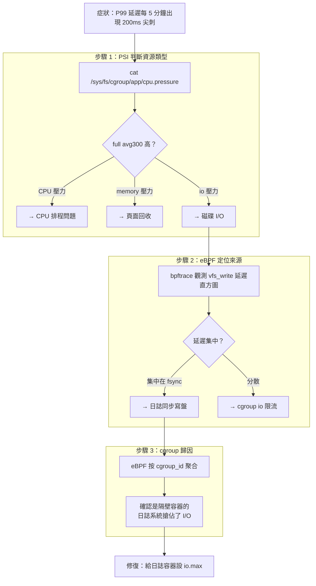

# 8.2 執行期追蹤與低開銷可觀測性

## 可觀測性的三根支柱與 eBPF 的位置

在雲原生時代，「系統出了什麼問題」的診斷依賴三種資訊：

| 支柱 | 典型工具 | 局限 |
|---|---|---|
| **指標（Metrics）** | Prometheus / cAdvisor | 聚合資料，丟失了細節與因果 |
| **日誌（Logs）** | ELK / Loki | 只有應用程式「說出來的」 |
| **追蹤（Traces）** | OpenTelemetry / Jaeger | 只涵蓋有插桩的程式碼路徑 |

**三者共同的盲區：核心。** 當你的服務延遲飆高，指標只告訴你「延遲高了」，日誌只告訴你「應用程式沒有報錯」，追蹤只告訴你「這段呼叫鏈慢」。**但「為什麼慢」的答案可能在核心裡**：頁面回收、TCP 重傳、cgroup 限流、scheduler 競爭、I/O 排程器……

**eBPF 填補的正是這個盲區**：以接近零的開銷，觀察核心與使用者空間的任何函式、任何系統呼叫、任何事件。



## 為什麼傳統追蹤工具不夠

在 eBPF 之前的工具光譜：

| 工具 | 開銷 | 覆蓋範圍 | 問題 |
|---|---|---|---|
| `strace` | **極高**（每 syscall 兩次 ptrace 陷入，數十倍變慢） | syscall | 生產環境禁用 |
| `perf` | 低 | PMU + tracepoints + kprobes | 資料在後處理時才可讀 |
| `ftrace` | 低 | 核心函式 | 介面原始，難做聚合 |
| SystemTap | 中 | 核心 | 需要編譯核心模組（DWARF + headers），部署困難 |
| DTrace | 低 | 核心 | 從未在 Linux 主線落地 |
| `blktrace` | 中 | 塊裝置 | 只看 I/O |

**SystemTap 的失敗特別有教育意義**：它有強大的語言與生態，但「需要為每個核心版本編譯核心模組」這一件事，就讓它在容器化、多發行版、大規模叢集的環境中無法落地。**eBPF 的 CO-RE（第 7.2 節）正是為了解決這個問題而生的。**

## eBPF 追蹤的技術基礎

### 1. kprobe / fentry：核心函式級追蹤

```c
SEC("kprobe/tcp_retransmit_skb")
int BPF_KPROBE(on_retransmit, struct sock *sk, struct sk_buff *skb)
{
    __u32 pid = bpf_get_current_pid_tgid() >> 32;
    __u16 dport = bpf_ntohs(sk->__sk_common.skc_dport);
    bpf_printk("pid=%u retransmit to port %u\n", pid, dport);
    return 0;
}
```

**開銷量級**：kprobe 約 100–200 ns；`fentry`（Linux 5.5+，BTF 化）約 20–50 ns。

**`fentry` 為什麼更快**：kprobe 需要斷點指令（int3）+ 陷入處理 + 暫存器快照（`pt_regs`）；`fentry` 用的是核心已經內建於函式入口的 `nop` 跳板（`__fentry__`），只需 patch 一條指令。

### 2. tracepoint：穩定的靜態追蹤點

核心在關鍵路徑上埋了數千個 tracepoint（`/sys/kernel/debug/tracing/events/`）：

```bash
$ ls /sys/kernel/tracing/events/
bpf  sched  net  syscalls  irq  mm  filemap  kmem  cgroup  ...
$ ls /sys/kernel/tracing/events/sched/
sched_switch  sched_wakeup  sched_migrate_task  sched_process_exec  ...
```

**tracepoint 的價值是穩定性承諾**：核心開發者承諾 tracepoint 的參數格式跨版本不變（而 kprobe 掛的函式簽名隨時可能變）。

**搭配 BTF/CO-RE**：tracepoint 參數可以直接用結構體讀取，編譯期就有型別安全。

### 3. uprobe：使用者空間函式追蹤

```c
SEC("uprobe//usr/bin/myapp:handle_request")
int BPF_UPROBE(on_request, void *req)
{
    // 觀測閉源或未插桩的應用程式
}
```

**這是第 7.2 節提過的殺手級能力**：不需要重新編譯、不需要插桩，直接觀測生產環境中的任意行程。

### 4. PMU：硬體計數器

`perf_event` 掛載讓 eBPF 可以在硬體事件（cache miss、branch miss、cycle）上觸發：

```c
SEC("perf_event")
int on_cache_miss(struct bpf_perf_event_data *ctx)
{
    // 每次發生指定數量的 cache miss 就執行
}
```

**應用**：精準定位「哪一行程式碼造成 cache miss」——這是純軟體追蹤做不到的。

## 經典工具：bcc、bpftrace 與 Brendan Gregg

### 2015 年 9 月：bcc

Wikipedia 記錄：

> Brendan Gregg announced a collection of new eBPF-based tracing tools as the bcc project, providing a front-end for eBPF to make it easier to write programs.

bcc 的貢獻是**把 eBPF 追蹤從「寫 C + 載入器程式」變成「寫一段 Python + 一段 C」**：

```python
#!/usr/bin/env python3
from bcc import BPF

b = BPF(text="""
#include <uapi/linux/ptrace.h>
int count_syscalls(void *ctx) {
    u32 pid = bpf_get_current_pid_tgid() >> 32;
    u64 *count = syscounts.lookup(&pid);
    if (count) __sync_fetch_and_add(count, 1);
    return 0;
}
""")

b.attach_kprobe(event="__x64_sys_read", fn_name="count_syscalls")
# ...
```

**但 bcc 的代價**：它在執行時呼叫 LLVM 編譯 BPF 程式，需要目標機器上有核心 headers 與 LLVM——**這在容器化環境中很難滿足**，也正是 CO-RE 要解決的問題。

### 2018 年 10 月：bpftrace

Wikipedia：

> The new bpftrace tool has been announced by Brendan Gregg as **DTrace 2.0 for Linux**.

bpftrace 用一個**單行腳本語言**（類似 awk / DTrace）做追蹤：

```bash
# 統計每個行程的 syscall 次數（one-liner）
bpftrace -e 'tracepoint:raw_syscalls:sys_enter { @[comm] = count(); }'

# I/O 延遲直方圖
bpftrace -e 'kprobe:vfs_read { @start[tid] = nsecs; }
             kretprobe:vfs_read /@start[tid]/ {
               @latency_us = hist((nsecs - @start[tid]) / 1000);
               delete(@start[tid]); }'

# 觀測 TCP 重傳
bpftrace -e 'kprobe:tcp_retransmit_skb { @[comm] = count(); }'
```

**bpftrace 的意義**：它把「系統級診斷」的門檻從「會寫 C、會編譯 BPF」降到「會寫一行 awk 風格腳本」。Netflix、Meta 等公司的 SRE 日常大量使用。

### 三個層次的工具光譜



**2024 年的共識**：探索用 bpftrace，部署用 libbpf/CO-RE；bcc 已是過渡技術（但仍有大量存量腳本）。

## 核心觀測模式與其理論

### 模式一：延遲直方圖（Latency Histogram）

**最常見也最有價值的模式**：測量「事件開始到結束」的時間，累積成直方圖。

```c
struct {
    __uint(type, BPF_MAP_TYPE_HASH);
    __type(key, __u32);          // tid
    __type(value, __u64);        // 起始時間
} start SEC(".maps");

struct {
    __uint(type, BPF_MAP_TYPE_LRU_HASH);
    __type(key, __u64);          // 延遲桶的 log2 上界
    __type(value, __u64);        // 計數
} latency SEC(".maps");

SEC("kprobe/vfs_read")
int enter_read(void *ctx)
{
    __u64 t = bpf_ktime_get_ns();
    __u32 tid = bpf_get_current_pid_tgid();
    bpf_map_update_elem(&start, &tid, &t, BPF_ANY);
    return 0;
}

SEC("kretprobe/vfs_read")
int exit_read(void *ctx)
{
    __u32 tid = bpf_get_current_pid_tgid();
    __u64 *t0 = bpf_map_lookup_elem(&start, &tid);
    if (!t0) return 0;

    __u64 lat = bpf_ktime_get_ns() - *t0;
    bpf_map_delete_elem(&start, &tid);

    __u64 bucket = bpf_log2l(lat);          // 對數分桶
    __u64 *c = bpf_map_lookup_elem(&latency, &bucket);
    if (c) __sync_fetch_and_add(c, 1);
    return 0;
}
```

**為什麼用對數分桶**：延遲分布跨越多個數量級（μs 到秒），線性桶需要天文數字的桶數。對數桶（每桶是前一桶的 2 倍）用 30 個桶就能覆蓋 1 ns 到 1 s。

**這是 HDR histogram 思想的 eBPF 實現**，且統計在核心中完成——**只有彙總後的幾十個數字被送到使用者空間**，而不是每個事件的原始記錄。這是把資料壓縮放在「離資料最近的地方」。

### 模式二：火焰圖（Flame Graph）

**Brendan Gregg 發明的視覺化**：把呼叫堆疊聚合後畫成火焰形狀，寬度代表 CPU 佔比。

```bash
# 用 bcc 的 profile 工具採樣堆疊
/usr/share/bcc/tools/profile -df 30 > out.stacks
# 火焰圖生成
flamegraph.pl out.stacks > flame.svg
```

**eBPF 讓火焰圖覆蓋了三個傳統做不到的維度**：

1. **off-CPU 火焰圖**：行程「在睡覺」的時間去哪了（等待鎖、I/O、排程）。傳統 perf 只看 on-CPU。
2. **含核心棧的火焰圖**：使用者棧與核心棧拼接，看到 syscall 內部的開銷。
3. **cgroup 維度的火焰圖**：按容器聚合。

### 模式三： PSI 與 eBPF 的互補

第 3.4 節介紹過 PSI（Pressure Stall Information）。它的角色與 eBPF 追蹤是**互補**的：

| 問題 | PSI 回答 | eBPF 回答 |
|---|---|---|
| 系統在等什麼？ | ✅（CPU/記憶體/I/O 壓力的時間比例） | ✅（具體等在哪個函式） |
| 誰在等？ | ❌ | ✅（per-cgroup / per-pid） |
| 為什麼等？ | ❌ | ✅（呼叫鏈、持有者） |
| 持續開銷 | **≈ 0**（核心計數器） | 小但非零 |

**最佳實務**：PSI 做常駐的「壓力感知」（觸發告警與 autoscaler），eBPF 做「壓力發生時的深度診斷」。Netflix 的做法正是如此（Wikipedia 引述：Netflix uses eBPF for fleet-wide network observability and performance diagnosis）。

### 模式四：持續性能剖析（Continuous Profiling）

2020 年代的新範式：**常駐地、以低開銷採樣整個叢集的 CPU 堆疊**。

- **Parca / Pyroscope / Grafana Phlare**：用 eBPF（或 perf_event）每秒採樣 100 次，聚合為 flame graph，存進時序資料庫。
- **Elastic Universal Profiling**（Wikipedia 引述：Elastic_NV uses eBPF for code profiling）。

**與傳統 APM 的差異**：

| 面向 | APM（插桩） | 持續性能剖析（eBPF） |
|---|---|---|
| 部署 | 每個服務加 SDK | 一個 DaemonSet（如 eBPF agent） |
| 覆蓋 | 只有插桩的路徑 | **全部**（含第三方庫、核心） |
| 開銷 | 1–10%（插桩 + 序列化） | < 1%（採樣 + 核心內聚合） |
| 能回答 | 「哪個請求慢」 | 「CPU 時間花在哪一行」 |

**兩者是互補的**：APM 追蹤請求生命週期，profiling 找出計算熱點。

## 追蹤的開銷控制

「低開銷」不是免費的，需要主動設計：

### 1. 核心內預聚合



**原則：讓資料在核心中被壓縮到最後一刻。** 每秒 100 萬個事件的原始記錄若全送到使用者空間，光是序列化就會壓垮系統。

### 2. 採樣（Sampling）

```c
SEC("kprobe/tcp_retransmit_skb")
int on_retransmit(void *ctx)
{
    __u64 t = bpf_ktime_get_ns();
    // 每 1000 次採樣一次
    if (t % 1000 != 0) return 0;
    // ...記錄...
}
```

**採樣率與統計信度的關係**：對於延遲分布，1% 採樣仍能給出可信的 P50/P95；對於罕見事件（如特定錯誤路徑），必須全量記錄。

### 3. Ring buffer 的背壓

第 7.2 節的 `RINGBUF` 支援保留/提交語意：當使用者空間消費不及時，`bpf_ringbuf_reserve` 回傳 NULL，eBPF 程式**主動丟棄事件**而不是拖垮核心。

### 4. 按 cgroup / 按行程過濾

```c
__u64 cgid = bpf_get_current_cgroup_id();
if (cgid != target_cgid) return 0;   // 只追蹤目標容器
```

**在共享的生產主機上，這是「觀測干擾」控制的第一道防線**：只追蹤需要診斷的容器，其他流量的開銷為零。

## 實戰案例：定位「服務偶發延遲尖刺」

一個完整的診斷流程，展示多種工具的組合：



**每一步都有明確的量化證據，沒有一處是猜測。** 這就是「讓線上診斷不再靠盲猜或重啟」的具體含義。

## eBPF 可觀測性的生產化工具

| 工具 | 用途 | 廠商/專案 |
|---|---|---|
| **Pixie** | 自動化、無插桩的叢集可觀測性 | New Relic 收購 |
| **Falco** | 執行期威脅偵測（Sysdig 的 eBPF 版） | CNCF |
| **Cilium Hubble** | 網路流量的可觀測性 | Isovalent/Cisco |
| **Parca / Pyroscope** | 持續性能剖析 | Grafana |
| **Tetragon** | 以 eBPF 為基礎的安全可觀測與執行 | Isovalent |
| **bpftrace / bcc** | 手工診斷 | 社群 |
| **Datadog / Dynatrace / New Relic agents** | 商業可觀測平台 | 商業 |

**生態的結構值得注意**：eBPF 可觀測性工具幾乎全部以 **DaemonSet** 形式部署在每個節點上（第 5.3 節的 DaemonSet），共享節點的核心但彼此隔離（每個有自己的 maps 與程式）。

## 側信道與安全的再省思

Wikipedia 提到一個嚴肅的問題：

> Due to the ease of programmability, eBPF has been used as a tool for implementing microarchitectural timing side-channel attacks such as Spectre against vulnerable microprocessors.

**一個 eBPF 追蹤程式，本質上是一個「讀取核心內部狀態」的工具。** 這在診斷時是優勢，在攻擊時是武器：

- 透過計時側信道推斷核心位址（KASLR 破解）。
- 觀測其他 cgroup 的活動（跨租戶資訊洩漏）。

**核心的緩解**（Wikipedia）：

> While unprivileged eBPF implements mitigations against Spectre v1, v2, and v4 for x86-64, **unprivileged use has ultimately been disabled by the kernel community by default**.

**「預設禁用非特權 eBPF」的決定，等於宣告：eBPF 追蹤是特權操作。** 這對可觀測性工具的部署模型有直接影響——它們必須以特權容器（privileged DaemonSet）執行，而這本身就是一個安全審查的痛點（特權容器 = 廣大的攻擊面）。

**這是可觀測性與安全性的持續張力，與第 6.4 節的主題完全一致。**

## 小結

1. eBPF 填補了指標/日誌/追蹤三支柱共同的核心盲區，讓「為什麼慢」有量化答案。
2. `fentry`（5.5+）比 `kprobe` 快一個數量級；tracepoint 提供穩定契約；`uprobe` 讓未插桩應用可被觀測。
3. 工具光譜：bpftrace（探索）→ libbpf CO-RE（生產部署）；bcc 是歷史過渡。
4. **核心內預聚合**是低開銷的關鍵原則——資料在被送出前先被壓縮為直方圖/計數。
5. PSI（常駐、零開銷）與 eBPF（深度、按需）是互補的診斷層次。
6. 持續性能剖析（Continuous Profiling）是 2020 年代的新範式，把「找 CPU 熱點」變成常駐能力。
7. eBPF 追蹤是特權操作（核心預設禁用非特權使用），可觀測性與安全性的張力是真實的。

下一節：eBPF 的第三個應用戰場——**執行期安全**。
