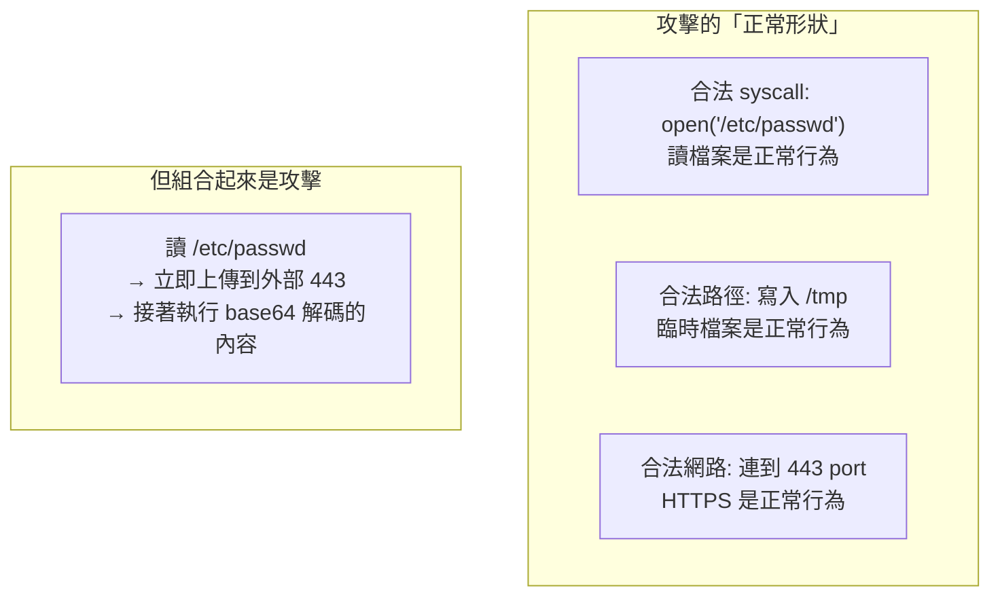
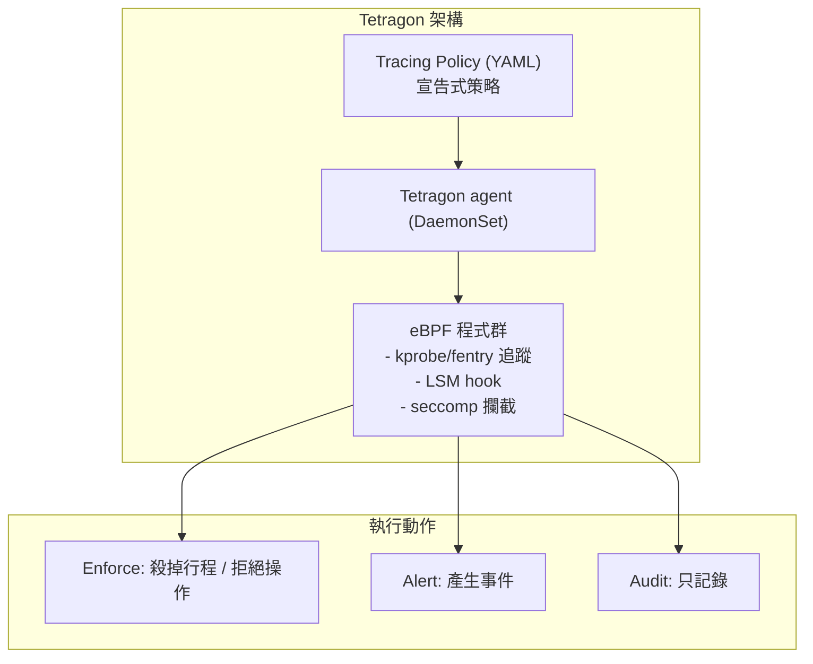
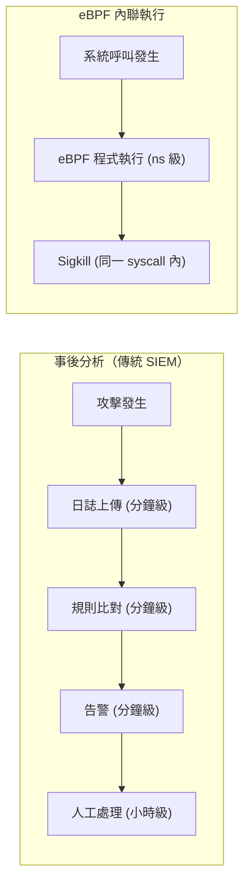
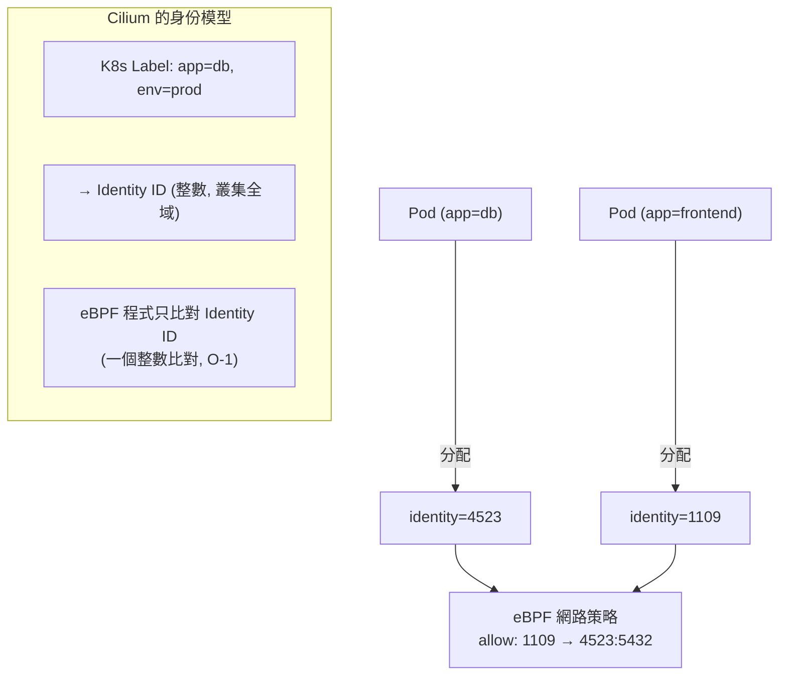
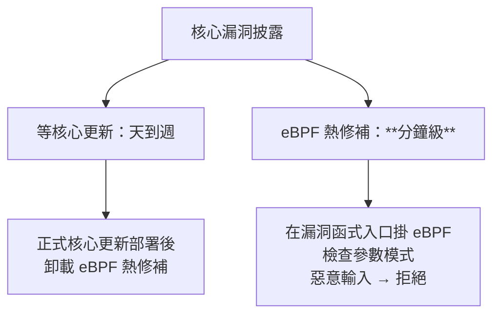
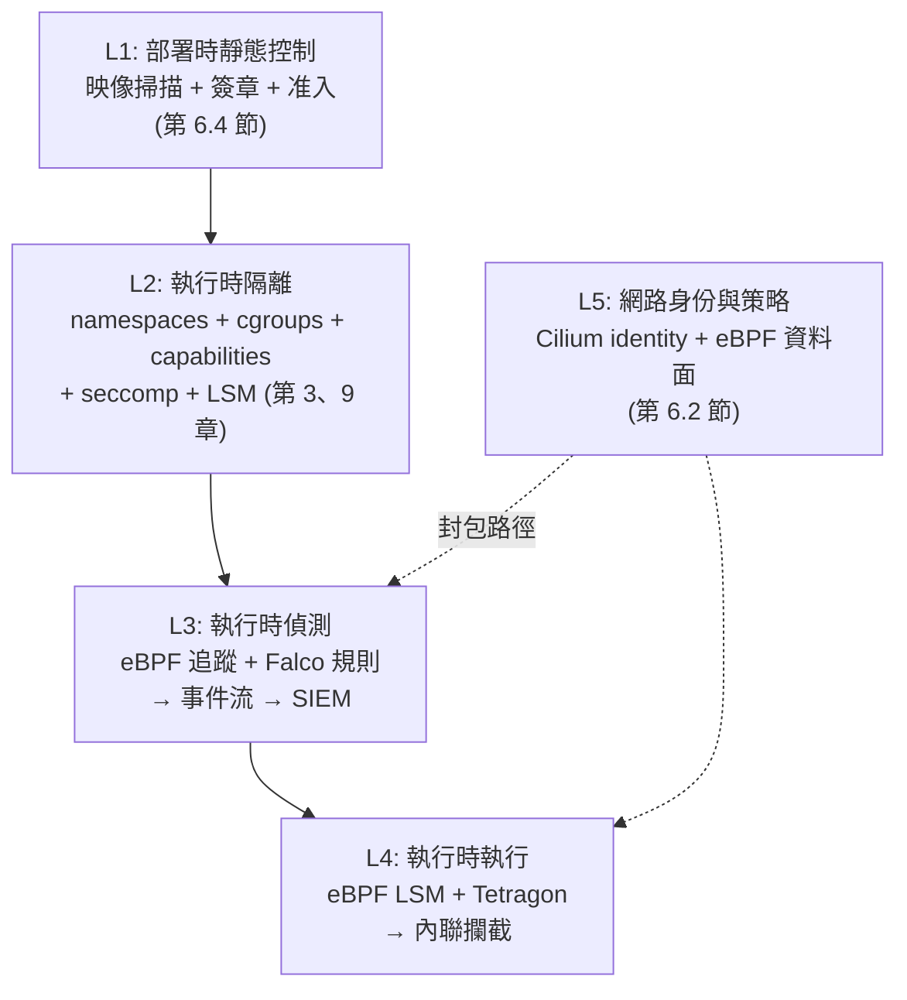
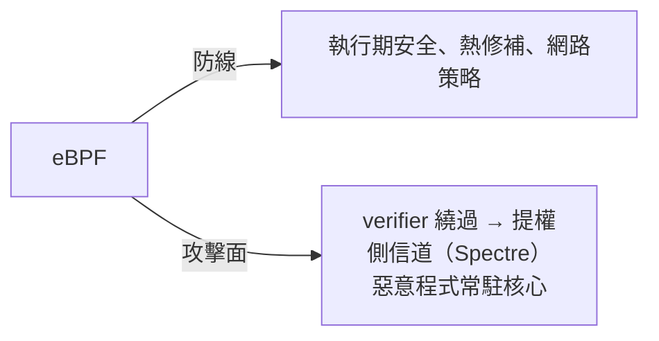

# 8.3 執行期安全與可程式化防線

## 靜態防線的極限

第 9 章會詳細介紹 Linux 的「靜態」安全機制（seccomp、capabilities、LSM）。它們的共同特徵是：**在部署時定義規則，執行時機械地執行。**

| 靜態防線 | 規則形態 | 問題 |
|---|---|---|
| seccomp | syscall 白名單 | 粒度是「系統呼叫」，無法看語意 |
| AppArmor / SELinux | 路徑與標籤的規則 | 靜態路徑在容器環境中漂移 |
| NetworkPolicy | IP/port 條目 | 無法看 L7 語意 |
| capabilities | 能力位元 | 過粗（例如 CAP_NET_ADMIN 涵蓋太廣） |

**共同的困境**：真實的攻擊有「正常行為的形狀」——攻擊者會用合法的 syscall、合法的路徑、合法的連接埠來執行惡意邏輯。**靜態規則看到的是語法，看不到語意。**



**這種「行為序列」的攻擊，需要執行期的、有狀態的、可程式化的偵測。** 這就是 eBPF 執行期安全的定位。

## eBPF LSM：把安全決策變成程式

### 2020 年 3 月：BPF LSM 上游

Wikipedia：

> Google upstreamed BPF LSM support into the Linux kernel, enabling programmable Linux Security Modules (LSMs) through eBPF.

**背景**：LSM（Linux Security Module）是核心在關鍵安全決策點上呼叫的 hook 集合（第 9 章詳述）：開檔案前、`mmap` 前、訊號發送前、行程建立前……**SELinux 與 AppArmor 都是把策略寫死在 LSM hook 上的實作。**

**BPF LSM 的革命性**：它讓 LSM hook 上的策略**變成可載入的 eBPF 程式**：

```c
SEC("lsm/file_open")
int BPF_PROG(check_file_open, struct file *file, char **pathname, int ret)
{
    __u64 cgid = bpf_get_current_cgroup_id();

    // 容器 cgroup 只能開啟自己 overlayfs 內的檔案
    if (is_container_cgroup(cgid)) {
        char path[64];
        bpf_probe_read_str(path, sizeof(path), *pathname);
        if (!starts_with(path, "/var/lib/kubelet/"))
            return -EPERM;    // 拒絕開啟
    }
    return ret;
}
```

**與 SELinux 的關鍵差異**：

| 面向 | SELinux | eBPF LSM |
|---|---|---|
| 規則形式 | 標籤 + 規則資料庫 | **程式**（可以做任意邏輯） |
| 決策依據 | 靜態標籤比對 | 執行期狀態（時間、歷史、cgroup、行程關係） |
| 更新 | 重載策略（數秒，全域影響） | 原子替換單個 hook（瞬時，局部影響） |
| 撰寫者 | 安全工程師（學 SELinux 語言） | 工程師（會 C 即可） |
| 狀態 | 無狀態（每次決策獨立） | **有狀態**（可以用 map 記錄歷史） |

**「有狀態」是最關鍵的差異**：SELinux 的每次決策都是無狀態的比對；eBPF LSM 程式可以用 map 記住「這個行程 5 秒前打開了 /etc/shadow」，然後在它下一步要建立 socket 時拒絕。**行為序列的防禦，只有在有狀態時才可能。**

### Google 的實際用途

Wikipedia 引述：

> Google uses eBPF in GKE, developed and uses **BPF LSM to replace audit** and it uses eBPF for networking.

**「用 eBPF LSM 取代 audit」**是一個深遠的選擇：

- 傳統 audit 子系統（`auditd`）記錄固定格式的事件，開銷不可調，難以按容器過濾。
- eBPF LSM 可以**自訂記錄什麼、怎麼過濾、以什麼格式輸出**，且按 cgroup 過濾是原生的。

## Tetragon：eBPF 安全執行的代表作

**Tetragon**（Isovalent，2021 年起）代表了「eBPF 執行期安全」的完整形態：



**Tracing Policy 的宣告形式**：

```yaml
apiVersion: cilium.io/v1alpha1
kind: TracingPolicy
metadata:
  name: "block-write-to-critical"
spec:
  kprobes:
    - call: "security_file_permission"
      syscall: false
      args:
        - index: 0
          type: "file"
      selectors:
        - matchArgs:
            - index: 0
              operator: "prefix"
              value: "/etc/shadow"
          matchCapabilities:
            - type: "effective"
              isNamespaceCapability: true
          matchActions:
            - action: Sigkill    # 直接殺掉違規行程
```

**注意這份 YAML 的每一層都在表達「語意」而不是「語法」**：

- `prefix: "/etc/shadow"`：不僅是路徑，還有前綴語意。
- `matchCapabilities`：**依據行程目前持有的 capability** 判斷——這是執行期狀態。
- `Sigkill`：不是「記錄事件」，而是**即時執行防禦動作**。

### 執行的時效性

**這是 eBPF 安全與「事後日誌分析」的根本區別**：



**在 B2 到 B3 之間，攻擊者的那個系統呼叫根本還沒有返回。** 惡意行為在「造成傷害之前」被攔截。

## 網路安全：從規則到身份

### 傳統網路安全：IP 位址是身份

```bash
# iptables 思維
iptables -A INPUT -s 10.0.3.5 -p tcp --dport 5432 -j ACCEPT
```

**問題：IP 位址在容器環境中是短暫的。** Pod 重啟就換 IP，網路策略立刻過時。

### Cilium 的做法：身份跟著標籤走



**Cilium 的安全模型**（官方文件的核心主張）：

> Cilium 的 eBPF 程式在封包抵達時，把來源 IP 解析為一個 **identity**（由 IP→identity map 查找），然後用 identity 做策略比對。

**這個設計的美妙之處**：

1. **策略與 Pod 的動態性解耦**：Pod 遷移、擴縮容，策略完全不用改。
2. **策略比對是 O(1)**：identity 是一個整數，比對是 hash 查找。
3. **身份可以跨越節點**：identity 在叢集範圍全域唯一。

### L7 感知的安全策略

Cilium 也支援 L7 策略（HTTP 路徑、gRPC 方法）：

```yaml
apiVersion: cilium.io/v2
kind: CiliumNetworkPolicy
spec:
  endpointSelector:
    matchLabels:
      app: api
  ingress:
    - fromEndpoints:
        - matchLabels:
            app: frontend
      toPorts:
        - ports:
            - port: "8080"
              protocol: TCP
          rules:
            http:
              - method: "GET"
                path: "/api/v1/orders.*"
```

**L7 檢查由 Envoy 代理執行**（如第 6.2 節所述，L7 邏輯無法完全放進 eBPF），但**決策結果回寫給 eBPF**，由 eBPF 執行允許/拒絕。**這是「eBPF 做快速路徑 + Envoy 做慢速路徑」的分工。**

## Falco 與入侵偵測

**Falco**（Sysdig → CNCF）是另一個重要的 eBPF 安全工具。Wikipedia 引述：

> Shopify uses eBPF through Falco for intrusion detection
> Apple uses eBPF for Kubernetes Pod security（透過 Falco）

Falco 的模型是「**規則 + 系統呼叫事件流**」：

```yaml
# Falco 規則範例
- rule: Write below etc
  desc: 在 /etc 下寫入（除了白名單行程）
  condition:
    evt.type in (open, openat, openat2)
    and fd.name startswith /etc/
    and not proc.name in (ansible, yum, rpm)
  output: "敏感目錄寫入 (user=%user.name command=%proc.cmdline)"
  priority: WARNING
```

**Falco 與 Tetragon 的分工**：

| 面向 | Falco | Tetragon |
|---|---|---|
| 姿態 | **偵測**（檢測 + 告警） | **執行**（檢測 + 攔截） |
| 規則語言 | 自有 DSL（Falco 規則） | K8s TracingPolicy |
| 延遲 | 事件流（秒級） | 內聯（ns 級） |
| 風險 | 低（只讀） | 高（在核心中做執行決策） |

**生產環境的常見組合**：Falco 做廣覆蓋的偵測 + Tetragon（或自訂 eBPF LSM）對已知高風險場景做內聯攔截。

## Cloudflare 的案例：用 eBPF 做核心熱修補

Wikipedia 引述 Cloudflare 的部落格：

> **"Live-patching security vulnerabilities inside the Linux kernel with eBPF Linux Security Module"**（2022-06）

**這是一個令人矚目的用法**：當核心漏洞被披露、但核心更新尚未部署時，Cloudflare 用 **eBPF LSM 程式在漏洞利用路徑上設置攔截**，作為**臨時的熱修補（hot patch）**。



**這展示了 eBPF 作為「核心可程式化層」的極端價值**：它讓「核心安全」的響應時間從「週」縮短到「分鐘」。**這是第 7.1 節 Linus 那句話的完美體現**——「讓人們在需要的時候才啟用特定的程式碼」。

**同時它也揭示了風險**：在核心漏洞路徑上執行自訂程式，本身就是一次高風險操作（如果 eBPF 程式有 bug，後果可能是核心 panic）。**Cloudflare 的案例是在嚴格的內部審查下執行的。**

## 執行期安全的防禦縱深

把本章與前面章節的機制串起來，一個現代 Linux 主機的安全層次：



**每一層的開銷與風險不同**：

| 層 | 開銷 | 風險 | 建議覆蓋率 |
|---|---|---|---|
| L1 靜態 | 部署時一次 | 低 | 100% |
| L2 隔離 | 近乎零 | 低 | 100% |
| L3 偵測 | 低（核心內聚合） | 中 | 100% |
| L4 執行 | 低 | **高**（核心內執行決策） | **高風險工作負載** |
| L5 網路 | 低 | 中 | 100% |

**L4 是唯一需要「選擇性部署」的層**：因為它把「執行決策」放進了核心，任何 bug 都可能是核心 panic。**務實的做法**：對已知高風險的 syscall 路徑（如寫入關鍵目錄、載入核心模組）啟用執行，其餘只偵測。

## eBPF 安全的對立面：eBPF 作為攻擊面

必須與第 6.4、7.3 節的討論呼應：**eBPF 同時是防線與攻擊面。**



**「惡意 eBPF 程式常駐核心」是一個新型威脅**：

- eBPF 程式可以**持久化**（pin 到 bpffs），重啟後自動載入。
- 它在核心中執行，`ps` 看不到、檔案系統掃描找不到。
- 它可以 hook 系統呼叫，**欺騙其他安全工具的觀測**。

**防禦措施**：

1. `bpftool prog list` 定期稽核已載入的程式。
2. `lockdown` 模式限制非簽署程式的載入。
3. 對生產主機的 `bpf()` 系統呼叫用 seccomp 禁用（除了明確需要的 agent）。
4. 監控 bpffs 的 pin 事件。

**這個「安全工具自身成為攻擊面」的迴圈，是現代系統安全的結構性主題。** eBPF 只是最新的例子（之前的例子：auditd、rootkit 掃描器本身被 rootkit 攻擊）。

## 小結

1. 靜態防線（seccomp/LSM/NetworkPolicy）看語法不看語意；真實攻擊有「正常行為的形狀」，需要執行期有狀態偵測。
2. **eBPF LSM（2020）讓安全決策本身可程式化**：與 SELinux 的關鍵差異是「有狀態」與「可做任意邏輯」。
3. **Tetragon 代表內聯執行的極致**：在系統呼叫返回之前完成檢測與攔截（`Sigkill`）；Falco 則代表廣覆蓋的偵測姿態。兩者互補。
4. **Cilium 的身份模型**（label → identity → O(1) 比對）解決了「IP 短暫性」問題，是網路安全在雲原生的正確抽象。
5. **Cloudflare 的核心熱修補案例**展示了 eBPF 作為核心可程式化層的極端價值：核心安全響應從「週」縮到「分鐘」。
6. 防禦縱深需要分層：靜態控制（部署時）→ 隔離（執行時）→ 偵測（低風險）→ 執行（高風險、選擇性）。
7. **eBPF 同時是防線與攻擊面**：惡意程式可常駐核心並欺騙觀測。`unprivileged_bpf_disabled`、`lockdown`、定期稽核是必要的配置。

第四部完成。第五部，我們看那些「小而強大」卻經常被忽略的機制——它們是 Linux 獨創基因中最容易被低估的部分。
