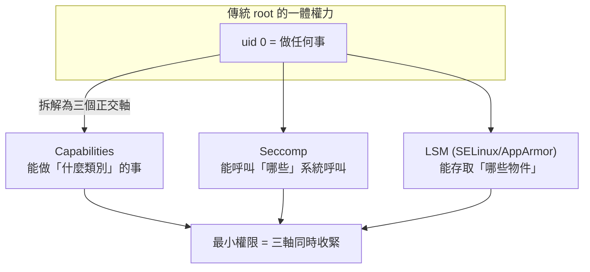
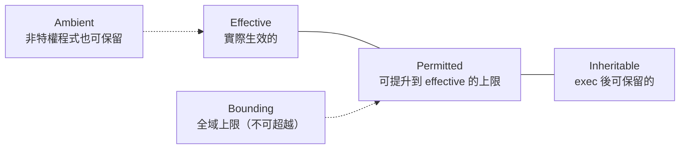
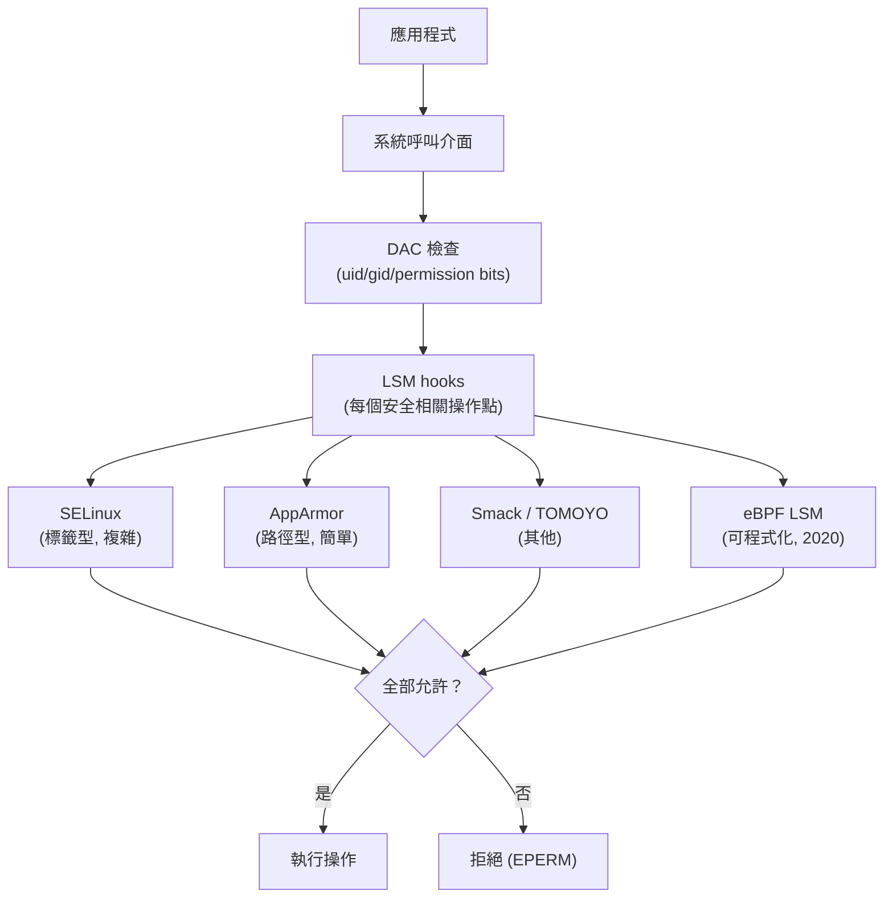
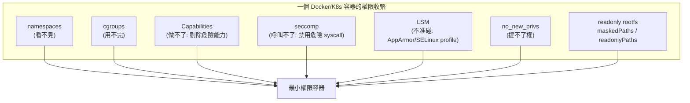
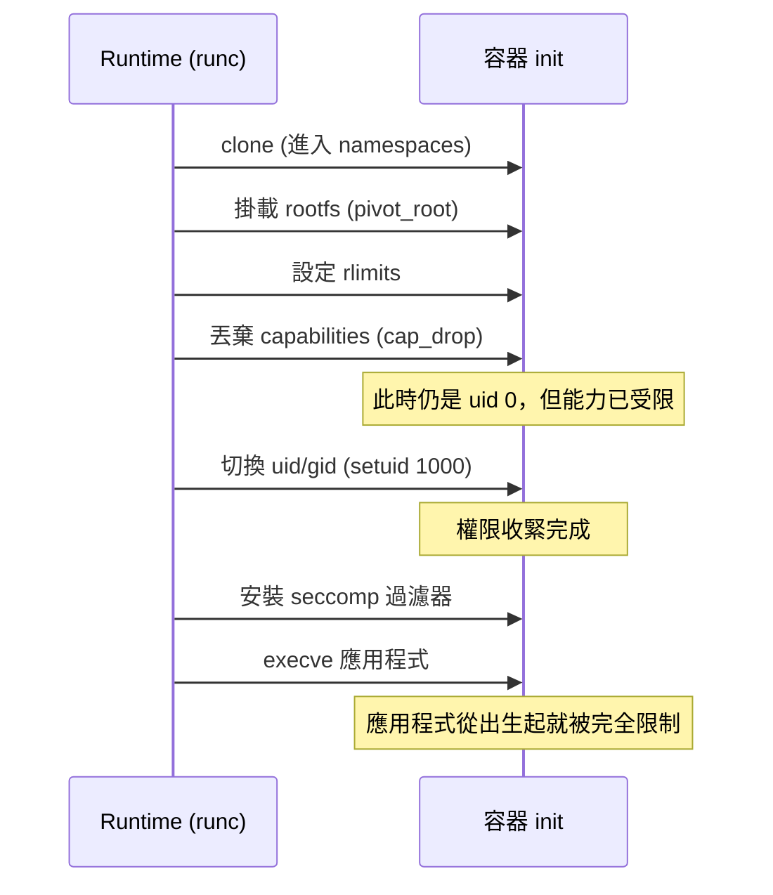
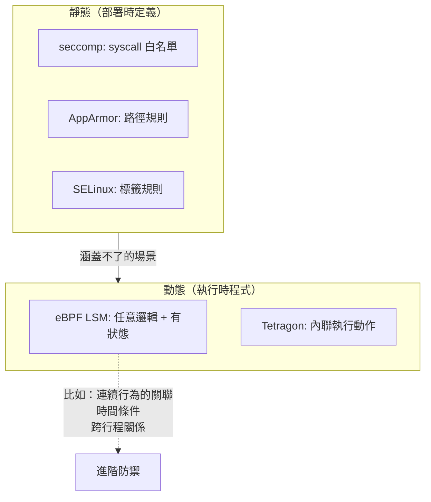

# 9.1 seccomp、Capabilities 與 LSM 的最小權限防線

## 最小權限原則

**Principle of Least Privilege**（Saltzer & Schroeder, 1975，《The Protection of Information in Computer Systems》）：

> 每個行程與使用者，應該只擁有完成其工作所**必需的最小**權限集合。

在 Unix 的傳統模型中，這個原則的實現極其粗糙：**權限只有一個軸——uid 0（root）與否**。root 可以做任何事，非 root 幾乎什麼都不能做。而介於兩者之間的需求（「這個行程需要綁定 80 port，但不需要改變檔案系統」）只能靠 setuid binary、suid 腳本這類危險的補丁。

**Linux 用三個正交的機制把「root 的能力」拆解開來**：



**三個軸回答三個不同的問題**：

| 機制 | 問的問題 | 粒度 |
|---|---|---|
| Capabilities | 「你被**允許**做哪類操作嗎？」 | 40 餘種能力 |
| Seccomp | 「你可以**發起**這個系統呼叫嗎？」 | 每個 syscall（可帶參數條件） |
| LSM | 「這個**物件**（檔案/行程/埠）允許你操作嗎？」 | 標籤與規則 |

## Capabilities：拆解 root 的權力

### 歷史

- POSIX 1003.1e 草案（1990 年代）定義了 capabilities 概念，但該標準最終未完成。
- Linux 2.2（1999）開始引入 capabilities；**2.6.18 前後（2006）的 `file capabilities`** 讓能力可以附加到執行檔上（取代部分 setuid 用途）。

### 能力的兩端模型

每個行程有五個能力集合（capability sets）：



**這個五集合模型解決了傳統 Unix 的一個難題**：`setuid` 程式在切換 uid 時如何保留/放棄特定能力。五個集合讓「能力如何隨 `execve` 演化」有了精確的規則。

### 常用的能力

| 能力 | 允許的操作 |
|---|---|
| `CAP_NET_BIND_SERVICE` | 綁定 1024 以下埠 |
| `CAP_NET_ADMIN` | 網路設定（路由、防火牆、介面） |
| `CAP_DAC_OVERRIDE` | 繞過檔案權限檢查 |
| `CAP_SYS_ADMIN` | **「萬能能力」**：mount、namespace 操作、許多管理操作 |
| `CAP_CHOWN` | 改變檔案擁有者 |
| `CAP_KILL` | 發送訊號 |
| `CAP_SYS_PTRACE` | `ptrace` 其他行程 |
| `CAP_BPF`（5.8+） | 載入 eBPF 程式 |
| `CAP_PERFMON`（5.8+） | 效能追蹤 |

**注意 `CAP_SYS_ADMIN` 的問題**：它是一個「大口袋」——mount、pivot_root、namespace、cgroup、設備管理……全部在內。**對容器而言，`CAP_SYS_ADMIN` 幾乎等於逃逸能力**（它可以 `mount` 宿主檔案系統、建立 namespace、操作 cgroup）。

**這就是為什麼 Docker 的預設能力集刻意剔除 `CAP_SYS_ADMIN`**：

```bash
# Docker 預設保留的能力（約 14 種）
CAP_CHOWN, CAP_DAC_OVERRIDE, CAP_FSETID, CAP_FOWNER,
CAP_MKNOD, CAP_NET_RAW, CAP_SETGID, CAP_SETUID,
CAP_SETFCAP, CAP_SETPCAP, CAP_NET_BIND_SERVICE,
CAP_SYS_CHROOT, CAP_KILL, CAP_AUDIT_WRITE

# 預設剔除的（節選）
CAP_SYS_ADMIN, CAP_SYS_MODULE, CAP_SYS_RAWIO,
CAP_SYS_PTRACE, CAP_SYS_BOOT, CAP_SYS_TIME, ...
```

### `no_new_privs`：封鎖提權的入口

Linux 3.5（2012）加入的 **`PR_SET_NO_NEW_PRIVS`**：

```c
prctl(PR_SET_NO_NEW_PRIVS, 1, 0, 0, 0);
```

設定後，**該行程（及其子行程）永遠無法透過 `execve` 獲得比現在更多的權限**——setuid binary 無效、file capabilities 無效。

**這是 seccomp 的前置條件**：因為 seccomp 過濾器是由非特權行程自己安裝的，若沒有 `no_new_privs`，惡意行程可以先設一個寬鬆的過濾器、再 exec 一個 setuid 程式繞過。**`no_new_privs` 讓「自我設限」變成安全的。**

> 這是一個精巧的設計：**讓不可信任的行程自己給自己戴上鐐銬，並保證鐐銬無法被脫下。** OCI 的 `config.json` 中就有 `"noNewPrivileges": true`（第 4.3 節的範例中可以看到）。

## Seccomp：系統呼叫白名單

### 兩代 seccomp

**第一代（seccomp strict，Linux 2.6.12，2005）**：

```c
prctl(PR_SET_SECCOMP, SECCOMP_MODE_STRICT);
```

語意極端：**只允許 `read`、`write`、`_exit`、`sigreturn`，其他一律 SIGKILL。** 過於嚴格，幾乎無人使用。

**第二代（seccomp-bpf，Linux 3.5，2012；由第 7.1 節所述的 cBPF 驅動）**：

```c
struct sock_filter filter[] = {
    // 載入 syscall 編號
    BPF_STMT(BPF_LD | BPF_W | BPF_ABS, offsetof(struct seccomp_data, nr)),
    // 若是 read/write/exit 則允許
    BPF_JUMP(BPF_JMP | BPF_JEQ | BPF_K, __NR_read,  0, 1),
    BPF_STMT(BPF_RET | BPF_K, SECCOMP_RET_ALLOW),
    BPF_JUMP(BPF_JMP | BPF_JEQ | BPF_K, __NR_write, 0, 1),
    BPF_STMT(BPF_RET | BPF_K, SECCOMP_RET_ALLOW),
    // 其他：殺掉行程
    BPF_STMT(BPF_RET | BPF_K, SECCOMP_RET_KILL_PROCESS),
};
struct sock_fprog prog = { .len = ..., .filter = filter };
prctl(PR_SET_NO_NEW_PRIVS, 1, 0, 0, 0);
prctl(PR_SET_SECCOMP, SECCOMP_MODE_FILTER, &prog);
```

**seccomp-bpf 的五種返回動作**：

| 動作 | 效果 |
|---|---|
| `SECCOMP_RET_ALLOW` | 正常執行 |
| `SECCOMP_RET_ERRNO` | 返回指定 errno（讓程式「以為」失敗了） |
| `SECCOMP_RET_KILL_THREAD` / `_PROCESS` | 殺掉 |
| `SECCOMP_RET_TRAP` | 發 SIGSYS 訊號 |
| `SECCOMP_RET_TRACE` | 通知偵錯器/管理者 |
| `SECCOMP_RET_LOG` | 允許但記錄 |

**`SECCOMP_RET_ERRNO` 的巧思**：與其殺掉行程，不如「假裝系統呼叫失敗」——應用程式會以為功能不可用，行為可控且可診斷。**這比「殺」更適合防禦未知 bug。**

### seccomp 在容器中的角色

**Docker 的預設 seccomp profile** 禁用了約 44 個危險 syscall（大約占全部 300+ 的 15%），包括：

- `kexec_load` / `kexec_fileload`（替換核心）
- `open_by_handle_at`（歷史上的容器逃逸路徑）
- `init_module` / `finit_module`（載入核心模組）
- `bpf`（**防止容器內載入 eBPF**——第 6.4 節的攻擊面）
- `io_uring_setup` / `io_uring_enter`（**2023 年後加入**，第 2.3 節所述的攻擊面）

**這份清單本身就是一部「容器逃逸史」**：每一個被禁用的 syscall，背後幾乎都有一個真實的 CVE。

### seccomp 的侷限

| 侷限 | 說明 |
|---|---|
| 只看 syscall 與參數 | 無法看語意（「打開哪個檔案」可以過濾，但「打開後做什麼」不行） |
| cBPF 的表達力有限 | 沒有迴圈、沒有 map（eBPF LSM 正是為此而生） |
| 無狀態 | 無法表達「先做了 A 就不能做 B」 |
| 一次性安裝 | 裝上後**不可移除、只可加嚴**（一個行程最多 500 層過濾器，全為加嚴） |

**「只可加嚴、不可放寬」** 這個性質是刻意的：它保證即使行程被攻破，攻擊者也無法放寬自己的限制。

## LSM：Linux Security Module

### 架構

LSM 是核心在**安全相關物件操作的關鍵點**上安裝的 hook 集合：



**與 DAC 的關係**：LSM 是在 DAC（自主存取控制，即傳統的 uid/permission bits）**之上**的額外檢查。**兩者都必須允許**，操作才會執行。

### SELinux vs AppArmor

| 面向 | SELinux | AppArmor |
|---|---|---|
| 來源 | NSA（2003 年併入核心 2.6） | Immunix/SUSE（2005 年併入） |
| 模型 | 標籤（type enforcement） | 路徑（profile） |
| 識別物件 | inode 上的 security label | 路徑名稱 |
| 複雜度 | 極高（完整策略語言） | 中（profile 語法簡單） |
| 採用 | RHEL/Fedora/Android | Ubuntu/openSUSE |
| 容器支援 | `container-selinux` | `docker-default` AppArmor profile |

**AppArmor 的容器支援更普及**（Docker/K8s 預設），因為「路徑型」策略對容器來說更直觀。**SELinux 更嚴格**（inode 級標籤不受 rename/bind mount 影響），但代價是整個系統都要打標籤。

### AppArmor 的容器 profile 範例（節選）

```
#include <tunables/global>

profile docker-default flags=(attach,mediate_deleted) {
  #include <abstractions/base>

  # 拒絕掛載
  deny mount,
  deny pivot_root,

  # 允許讀取大部分路徑，寫入受限
  file,
  deny /proc/*/mounts rw,
  deny /sys/firmware/** rw,

  # 網路
  network inet stream,
  network inet dgram,

  # capability
  capability,
  deny capability sys_admin,
  deny capability sys_module,
}
```

## 三者的組合：容器的預設防線

把三者疊加，構成現代容器的「靜態防線」：



**每一層的開銷都是近零的**（能力位元檢查、BPF 過濾器、標籤比對），因此**可以全部同時啟用**。這與第 6.4 節的二級隔離（gVisor/Kata，開銷顯著）形成對比：**靜態防線是「免費的縱深」，應該永遠全開。**

## 被低估的細節：時間與執行順序

最小權限的實作有一個常被忽略的維度：**權限在生命週期中的收緊順序**。



**順序錯誤的後果**：若先 `setuid` 再安裝 seccomp，應用程式可能可以自己重設；若先 drop capability 再 `pivot_root`，可能失敗。**OCI Runtime Spec 把這個順序寫進了規範**（第 4.3 節的 `config.json`），這是標準化避免整類錯誤的例子。

## 與 eBPF 的交會

第 8.3 節已經看到 **eBPF LSM 讓「LSM 這一軸」變得可程式化**。讓我們把「靜態」與「可程式化」放在同一張圖上：



**務實的分工**：

- **靜態防線**：全域、簡單、低風險 → **100% 部署**。
- **可程式化防線**：精準、高價值、較高風險 → **按需部署**。

## 小結

1. 最小權限原則在 Linux 上由三個正交機制實現：**capabilities**（能做哪類事）、**seccomp**（能發起哪些 syscall）、**LSM**（能碰哪些物件）。
2. Capabilities 的五集合模型解決了「能力如何隨 exec 演化」；`CAP_SYS_ADMIN` 是「大口袋」，容器必須剔除。
3. **`no_new_privs`（Linux 3.5）讓行程可以安全地自我設限**——它是 seccomp 的安全性前提，也是容器 runtime 的標準設定。
4. seccomp-bpf 的 `SECCOMP_RET_ERRNO` 動作比「殺」更優雅；「只可加嚴」是安全保證。
5. Docker 的 seccomp 預設黑名單是一部「容器逃逸史」——每個被禁的 syscall 都對應真實 CVE。
6. SELinux（標籤型）與 AppArmor（路徑型）的取捨：嚴格性 vs 可管理性。
7. **靜態防線開銷近零，應永遠全開**；可程式化防線（eBPF LSM）精準但高風險，按需部署。
8. 權限收緊的**執行順序**本身是一個安全維度，OCI Runtime Spec 將其標準化。

下一節，我們看另外幾個「小而強大」的原語——它們不像 seccomp 那樣防禦，而是**串接**系統元件。
