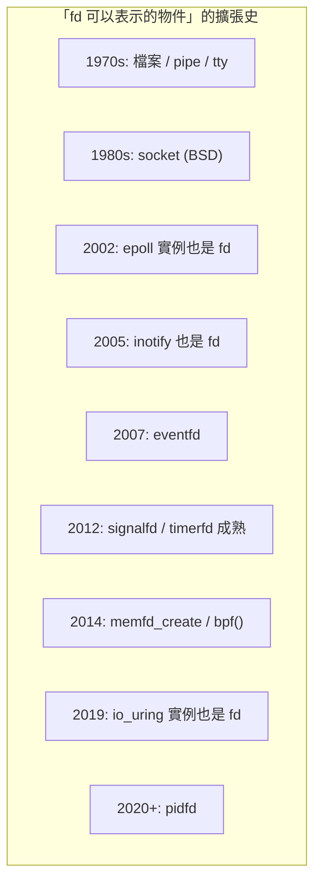
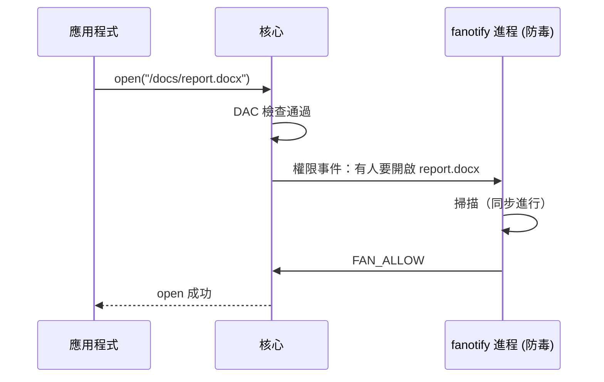
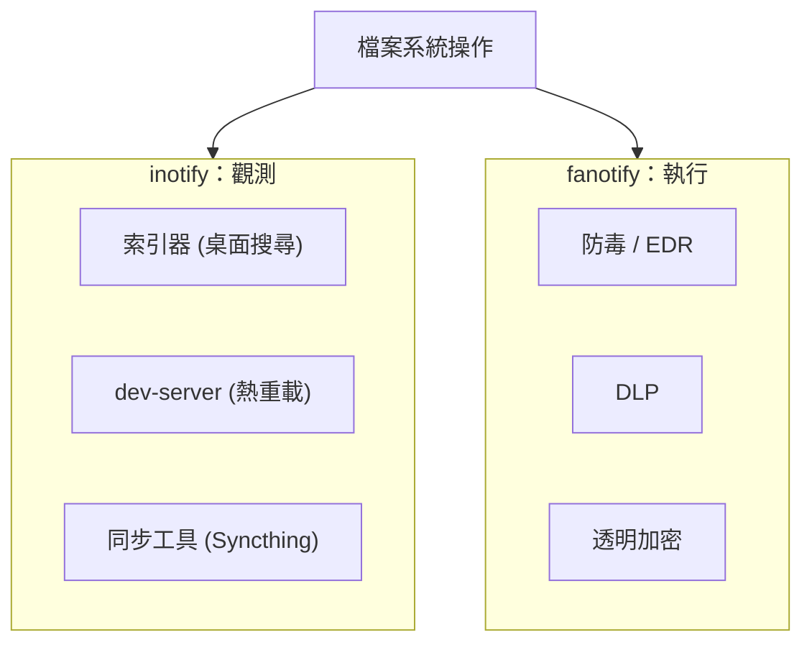
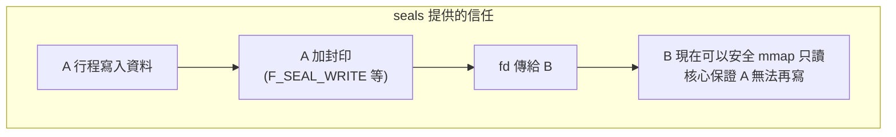
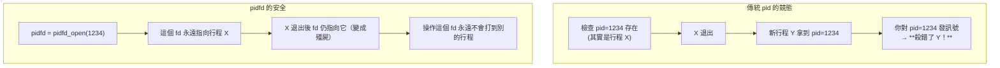
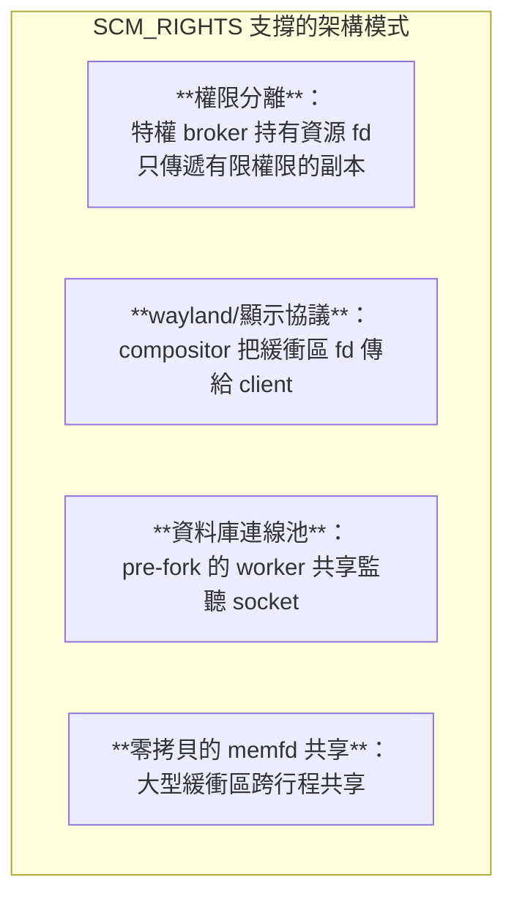
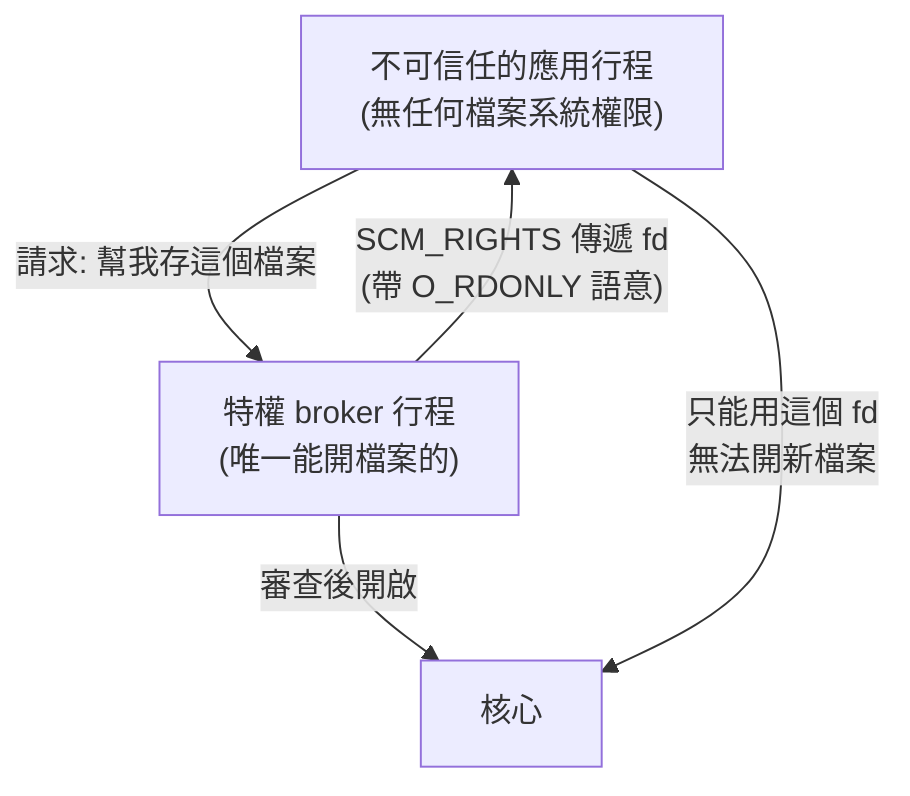
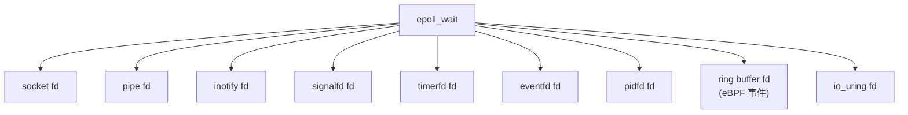
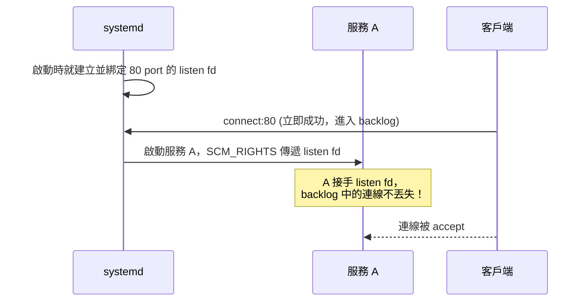

# 9.2 inotify、fanotify、memfd 與檔案描述符傳遞

## Unix 的深層命題：一切皆檔案描述符

Unix 最深刻的設計決策之一：**許多核心物件都被表示為檔案描述符（fd）**。



**這個趨勢的方向只有一個：把核心物件的「引用」變成 fd，從而讓它們可以：**

1. **被 `epoll` 監看**（第 1 章的事件迴圈統一所有 I/O）。
2. **被傳遞**（透過 Unix domain socket 的輔助訊息，跨行程分享核心物件）。
3. **被 pin / 生命週期管理**（關閉 fd 即釋放；`fork`/`exec` 的繼承語意）。

**本章介紹的每一個原語，都是這個統一方向的產物。**

## inotify：2005 年的檔案系統事件

### dnotify 的失敗

在 inotify 之前是 **dnotify**（Linux 2.4，2001），它用 fcntl 在**目錄**上註冊監看，透過訊號通知。它的缺陷是毀滅性的：

1. **只能監看目錄**（不能監看單個檔案）。
2. **用訊號通知**——訊號的語意與事件迴圈完全不相容（第 1 章的 `EINTR` 問題）。
3. **必須保持目錄的 fd 開著**——這會阻止目錄被卸載。

### inotify 的設計

**inotify（Linux 2.6.13，2005 年 8 月）** 修正了這一切：

```c
// 1. 建立實例（一個 fd！）
int fd = inotify_init1(IN_NONBLOCK | IN_CLOEXEC);

// 2. 註冊監看
int wd = inotify_add_watch(fd, "/var/log", IN_CREATE | IN_MODIFY | IN_DELETE);

// 3. 用 epoll 監看這個 fd —— 與 socket、pipe 統一！
struct epoll_event ev = { .events = EPOLLIN, .data.fd = fd };
epoll_ctl(epfd, EPOLL_CTL_ADD, fd, &ev);
```

**「inotify 實例是一個 fd」這個設計決策，是它成功的關鍵**：它自動獲得了 epoll 的統一事件迴圈、非阻塞語意、以及 fd 的全部生命週期管理。

### 事件類型

| 事件 | 觸發 |
|---|---|
| `IN_CREATE` / `IN_DELETE` | 檔案建立/刪除 |
| `IN_MODIFY` | 檔案內容修改 |
| `IN_ATTRIB` | metadata 變化（權限、時間） |
| `IN_MOVED_FROM` / `IN_MOVED_TO` | 重新命名 |
| `IN_CLOSE_WRITE` | 以寫入模式關閉 |
| `IN_ACCESS` / `IN_OPEN` | 存取/開啟 |
| `IN_DELETE_SELF` / `IN_MOVE_SELF` | 被監看物件自身被刪/移 |

**`IN_CLOSE_WRITE` 是一個特別精巧的事件**：它表示「一次完整的寫入已結束」。下游處理器（如日誌輪轉、索引器）用這個事件而非 `IN_MODIFY`，可以避免處理「寫到一半」的檔案。

### inotify 的限制

1. **單一佇列、無 per-進程隔離**：一個 inotify 實例的佇列滿了會丟事件（`IN_Q_OVERFLOW`）。
2. **遞迴監看要自己實作**：對每個子目錄逐一 `add_watch`（inotify-tools 的 `inotifywait -r` 就是這樣做的）。
3. **監看掛載點時有語意陷阱**（bind mount、overlayfs 的事件可見性）。

## fanotify：2009 年的權限與強制控制

**fanotify（Linux 2.6.37，2009 年 12 月/2010 年 1 月）** 是 inotify 的「安全版兄弟」，但定位完全不同：

| 面向 | inotify | fanotify |
|---|---|---|
| 目的 | **通知**（知道發生了什麼） | **干預**（允許/拒絕操作） |
| 權限 | 任何使用者 | **需要 `CAP_SYS_ADMIN`** |
| 監看範圍 | 指定路徑 | **整個掛載點/檔案系統** |
| 特殊能力 | 無 | **權限事件**（攔截並決定允許/拒絕） |

### fanotify 的殺手級特性：權限事件

```c
// 標記為權限監看者
fanotify_mark(fd, FAN_MARK_ADD, FAN_OPEN_PERM, AT_FDCWD, "/secure");

// 之後，任何行程要開啟 /secure 下的檔案時：
// 1. 核心暫停該操作
// 2. 發送權限事件給 fanotify 進程
// 3. fanotify 進程回覆 FAN_ALLOW 或 FAN_DENY
// 4. 核心繼續或拒絕
```

**這是使用者空間的存取控制**：**防毒軟體、DLP（資料外洩防護）、檔案加密系統**都靠這個機制實現「在檔案被打開之前做檢查」。



**注意同步性**：fanotify 的權限事件是**阻塞的**——應用程式會等待防毒掃描完成。這是功能，也是風險（fanotify 進程掛了會導致全系統的檔案開啟卡住）。

### inotify 與 fanotify 的互補



## memfd_create：2014 年的匿名記憶體檔案

**Linux 3.17（2014）** 加入 `memfd_create`：

```c
#include <sys/mman.h>

// 建立一個「匿名記憶體檔案」，返回 fd
int fd = memfd_create("my_shm", MFD_CLOEXEC | MFD_ALLOW_SEALING);

// 像普通檔案一樣使用
ftruncate(fd, 4096);
void *p = mmap(NULL, 4096, PROT_READ|PROT_WRITE, MAP_SHARED, fd, 0);

// 可以透過 SCM_RIGHTS 傳遞給其他行程！
```

**它取代的是什麼？** 舊的做法是 `shm_open` + `shm_unlink`（在 `/dev/shm` 建立真實檔案再刪掉），或 `open` + `unlink` 一個 tmpfs 檔案。

**`memfd_create` 的優勢**：

1. **完全匿名**：不需要任何檔案系統路徑，不存在「路徑被猜到」的攻擊面。
2. **不可 link 到檔案系統**：生命週期**完全**由 fd 引用數決定。
3. **支援 seals（封印）**——這是它最強大的特性。

### Seals：不可變性的機制

**`F_ADD_SEALS`** 允許 memfd 的持有者（或被傳遞者）**單方面聲明這塊記憶體的屬性不可改變**：

```c
// A 行程建立共享記憶體並寫入資料
int fd = memfd_create("shared", MFD_ALLOW_SEALING);
write(fd, data, size);

// 加封印：不允許再增長、不允許再寫入
fcntl(fd, F_ADD_SEALS, F_SEAL_GROW | F_SEAL_SHRINK | F_SEAL_WRITE);

// 把 fd 傳給 B
send_fd_via_socket(sock, fd);

// B 收到後可以「信任」這塊記憶體不會被 A 偷偷改動
// 因為核心強制執行了封印
```



**這解決了共享記憶體 IPC 的一個根本信任問題**：沒有 seals 時，B 必須「相信」A 不會改寫內容（TOCTOU 競態）；有 seals 時，**核心強制執行不變性**。

**實際應用**：`memfd` + seals 是 Wayland 的緩衝區共享協議、GPU 驅動的記憶體共享（DMA-BUF 的應用層部分）的基礎。

### memfd 與容器的關係

`memfd_create` 也是**無檔案系統攻擊面的執行方式**：攻擊者可以用 memfd 存放 payload，然後 `fexecve(fd, ...)` 直接從記憶體執行——**檔案系統上完全沒有痕跡**。這是「fileless malware」的標準技術，也是 EDR 工具（如 Falco）監控 `memfd_create` + `execve` 組合的原因。

> 同一個原語，既支撐了 Wayland 的安全 IPC，也成為攻擊者的工具。這與第 8.3 節 eBPF 的雙面性完全同構。

## pidfd：2019 年的行程引用

**Linux 5.3（2019）** 加入 `pidfd_open`：

```c
// 取得一個行程的 fd
int pidfd = pidfd_open(pid, 0);

// 用 epoll 監看它的退出！
struct epoll_event ev = { .events = EPOLLIN };
epoll_ctl(epfd, EPOLL_CTL_ADD, pidfd, &ev);

// 等待它退出
epoll_wait(epfd, &ev, 1, -1);   // 行程退出時變為可讀
```

**pidfd 解決的經典問題：PID 回收競態（PID recycling race）。**

傳統的做法用 `kill(pid, 0)` 檢查行程是否存在——但 PID 會被回收重用！在你檢查與操作之間，那個 PID 可能已經變成**別的行程**：



**pidfd 的意義遠不止「避免殺錯行程」**：

1. **行程成為了一等資源**：可以被 epoll 監看、被 SCM_RIGHTS 傳遞、用 `pidfd_getfd` 竊取其 fd（有權限檢查）。
2. **`clone(CLONE_PIDFD)`**：在建立子行程時同時取得 pidfd，消除父子之間的競態。
3. **process_madvise / process_vm_readv** 等跨行程操作有了安全的錨點。

**systemd、containerd、Kubernetes 的 kubelet 都已經遷移到 pidfd**——因為「管理大量行程的系統」正是 PID 回收競態的高風險區。

## SCM_RIGHTS：fd 的跨行程傳遞

**Unix domain socket 的輔助訊息（ancillary data）** 可以在行程之間**傳遞核心物件的引用**：

```c
// 發送方
struct msghdr msg = { .msg_control = cmsg_buf, .msg_controllen = sizeof cmsg_buf };
struct cmsghdr *cmsg = CMSG_FIRSTHDR(&msg);
cmsg->cmsg_level = SOL_SOCKET;
cmsg->cmsg_type = SCM_RIGHTS;
cmsg->cmsg_len = CMSG_LEN(sizeof(int));
memcpy(CMSG_DATA(cmsg), &fd_to_send, sizeof(int));
sendmsg(sock, &msg, 0);

// 接收方
recvmsg(sock, &msg, 0);
int new_fd;
memcpy(&new_fd, CMSG_DATA(cmsg), sizeof(int));
// new_fd 現在指向同一個核心物件！
```

### SCM_RIGHTS 是現代系統架構的黏合劑



**模式 1（權限分離）特別值得展開**——它是 OpenBSD `pledge`/Chrome 多行程架構的思想基礎：



**fd 的語意在傳遞時已經固定**（打開時的 O_RDONLY/O_RDWR），接收者**無法重新打開路徑**——它只有這個已經被審查過的視角。**這是比「給路徑 + 讓對方自己 open」安全得多的 IPC 模式。**

## eventfd 與 timerfd：事件迴圈的最後拼圖

**eventfd（Linux 2.6.22，2007）**：一個「計數器 fd」，`write` 增加計數、`read` 讀取並清零，可用 epoll 監看。

```c
int efd = eventfd(0, EFD_CLOEXEC | EFD_NONBLOCK);
// 工作執行緒完成任務後：
uint64_t one = 1;
write(efd, &one, sizeof one);
// 事件迴圈執行緒：
epoll_ctl(epfd, EPOLL_CTL_ADD, efd, &ev);   // 完成時被喚醒
```

**eventfd 解決的問題**：事件迴圈（epoll）只能監看 fd，但**執行緒間的完成通知**傳統上用 pipe 或條件變數。pipe 有系統呼叫與資料複製的開銷；條件變數根本不能進 epoll。**eventfd 是「條件變數的 epoll 化」。**

**timerfd**：同理，把定時器變成 fd——到期時 fd 變為可讀。**`epoll` 於是成為了真正的「萬物事件中心」**：socket、pipe、檔案事件（inotify）、訊號（signalfd）、定時器（timerfd）、執行緒完成（eventfd）、行程退出（pidfd）、BPF 事件（ring buffer fd）、io_uring 完成事件——**全部在一個 `epoll_wait` 裡。**



**這張圖就是第 1 章與本章的交會點**：epoll（2002）提供了事件迴圈的骨架，而 2005–2020 年間加入的一系列「fd 化」原語，把核心的所有異步通知都統一進了這個骨架。

## systemd 的例子：用 fd 傳遞簡化服務啟動

**sd_notify 與 socket activation**（systemd 的核心創新之一）直接建立在本章的原語上：



**「預先綁定 + 傳遞 fd」解決了服務重啟的埠空窗期問題**，也讓服務可以延遲啟動（lazy activation）——第一次有連線進來才啟動服務。**fd 傳遞讓「資源的所有權」可以平穩地從一個行程轉移到另一個。**

## 小結

1. **「一切皆 fd」是 Linux 持續二十年的統一方向**：epoll（2002）、inotify（2005）、eventfd（2007）、fanotify（2009）、memfd（2014）、bpf（2014）、io_uring（2019）、pidfd（2019）——全部遵循「核心物件 = fd」的路線。
2. **inotify（2005）修正了 dnotify 的致命設計**（訊號通知、只能監看目錄），靠「實例是 fd」獲得事件迴圈整合。
3. **fanotify（2009）是「安全級」的通知**：需要特權，支援權限事件，是防毒/DLP 的基礎設施。與 inotify 的分工是「觀測 vs 執行」。
4. **memfd_create（2014）** 提供匿名記憶體檔案；**seals 機制**讓「不可變共享記憶體」成為核心強制保證——解決了共享 IPC 的信任問題。它同時也是 fileless malware 的工具。
5. **pidfd（2019）消除了 PID 回收競態**，讓行程成為可監看、可傳遞、可安全操作的一等資源。
6. **SCM_RIGHTS 的權限分離模式**（特權 broker + 有限權限 fd）是 Chrome/systemd/Wayland 架構的共同基礎。
7. **eventfd/timerfd/pidfd 等完成「萬物事件化」**：一個 `epoll_wait` 統一所有核心異步通知。

下一節，我們退一步看這些機制背後的哲學：**Unix 哲學與系統呼叫介面的韌性**。
