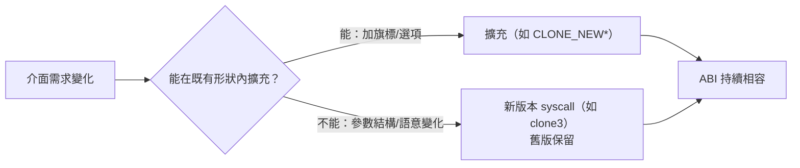

# 9.3 Unix 哲學與系統呼叫介面的韌性

## 一個驚人的事實

**1991 年寫的、為 i386 設計的 Linux 0.01 的系統呼叫介面，在 2026 年的核心上幾乎原樣可用。**

考慮一個實驗：把 1990 年代的 Unix 程式（甚至 1970 年代的）拿到現代 Linux 上編譯執行。多數情況下：

- `open`/`read`/`write`/`close`/`fork`/`execve`/`wait`——**完全相同**。
- `pipe`、`dup`、`select`——**完全相同**。
- 訊號語意——**完全相同**。

**對比同期的其他系統**：

| 系統 | 1991 年的 API 在 2026 年的狀態 |
|---|---|
| **Linux 系統呼叫** | 原樣可用，且持續擴充 |
| Windows API | 大量廢棄與重寫（Win32 → UWP → WinRT） |
| Solaris / HP-UX | 已消亡 |
| Java 平台 | JDK 1.1 的程式碼多有 deprecation |
| iOS / Android | 每 2-3 年強制 API 遷移 |

**這個「介面的韌性」是本章的主題**：它是怎麼做到的？代價是什麼？以及它與本書前九章介紹的所有機制之間，是什麼關係？

## Unix 哲學的工程表述

Doug McIlroy（1978 年，貝爾實驗室）的經典表述：

> 1. 讓每個程式做好一件事。要做新工作，就寫新程式，而不是在舊程式上加功能。
> 2. 期待每個程式的輸出成為另一個還未知程式的輸入。
> 3. 設計與建置軟體要儘早，幾週之內，因為笨拙的部分要被丟棄與重寫。
> 4. 使用工具而非熟練的勞力來減輕程式設計的負擔，即使你可能必須建工具來建立工具。

**第 1、2 條是「組合性」的宣言**。但 McIlroy 講的是**使用者空間的工具**（`grep | sort | wc`）。本章要論證的是：**Linux 把這個哲學下沉到了核心與系統呼叫層**。

### 系統呼叫層的「Unix 哲學」

把 McIlroy 的原則翻譯到系統呼叫介面：

| McIlroy 原則 | 系統呼叫層的體現 |
|---|---|
| 每個程式做好一件事 | 每個 syscall 語意單一（`dup` 就是複製 fd，不做別的） |
| 輸出可成為另一個的輸入 | **fd 是通用媒介**：任何 fd 可以被 `dup`、傳遞、放入 epoll（第 9.2 節） |
| 早建置、快丟棄 | 核心介面是小的；實作可以整個重寫（epoll、io_uring）而不動 ABI |
| 工具建立工具 | **原語組合出上層抽象**：namespaces + cgroups → 容器；epoll + eventfd → 事件迴圈 |

**關鍵的區分**：

> **介面（ABI）穩定 + 實作可替換 + 原語可組合 = 韌性。**

## ABI 穩定性的代價

**「永不破壞使用者空間」**（We do not break userspace）是 Linus Torvalds 的鐵律：

> "WE DO NOT BREAK USERSPACE!"（Linus Torvalds，2005 年，在拒絕一個破壞 ABI 的補丁時）

這條鐵律的**代價**是真實的，讓我們誠實地列出：

### 代價一：歷史包袱無法清除

```bash
# 現代核心仍然支援的 1980 年代語意
# 1. select 的 FD_SETSIZE=1024 上限（為了 ABI 不能改）
# 2. 訊號的侷限（用 sigaction 的 sa_restorer 這種歷史包袱）
# 3. termios 的結構佈局
# 4. SysV IPC（1978 年的設計，與 fd 化的現代介面並存）
```

**解法**：**舊的不刪，新的另開**。

- `select`（1983）→ `poll`（1997）→ `epoll`（2002）→ `io_uring`（2019）——**四代並存**。
- SysV IPC（`shmget`/`semget`）→ POSIX IPC（`shm_open`/`sem_open`）→ `memfd`（2014）。
- `clone`（2003）→ `clone3`（2019，結構化參數）。

**這就是為什麼 Linux 有 300+ 個系統呼叫，而且數字持續增長**：舊的不能刪，新的不斷加。

### 代價二：sysctl 與介面的「不可回退」

一旦某個介面（如 `/proc/sys/kernel/unprivileged_bpf_disabled` 的預設值、`vm.overcommit_memory` 的行為）被發行版與工具鏈依賴，改變它就是破壞。**安全預設值的變更經常卡在這裡。**

### 代價三：錯誤的介面永遠在

`ioctl`（萬能雜物）、`fcntl`（多義）、`setsockopt` 的部分選項——這些介面形狀不佳，但因為 ABI 承諾，只能修修補補。

## 韌性的真正來源：三個設計決策

如果只是「不刪舊介面」，Linux 只會變成一個巨大的博物館。**韌性的來源是三個積極的設計決策。**

### 決策一：機制與策略分離（mechanism, not policy）

回顧本書的原語清單，你會發現一個規律——**每個核心機制都不規定策略**：

| 核心機制 | 它**不**決定的事 |
|---|---|
| `epoll` | 事件迴圈的形狀、錯誤處理策略 |
| `clone` 的 namespace 旗標 | 容器格式、rootfs 佈局 |
| cgroups | 誰來分配資源、按什麼策略 |
| eBPF verifier | 程式的用途 |
| LSM hooks | 安全策略的內容 |
| `setsockopt(SO_REUSEPORT)` | 多行程的流量分配策略 |

**對比「策略內建」的設計**：如果核心內建「容器」概念，那容器的格式、生命週期、安全模型都被核心鎖死——而第 4 章的歷史告訴我們，容器格式在 2013–2015 年間劇烈演化（Docker → appc → OCI）。**正因為核心只提供機制，容器格式才能在使用者空間快速演化並最終標準化。**

### 決策二：fd 作為通用媒介

**第 9.2 節的「一切皆 fd」不只是一個趨勢，而是架構決策**。fd 提供了三個跨領域的保證：

1. **統一的生命週期**：引用計數、`close` 釋放、`fork` 繼承。
2. **統一的等待機制**：任何 fd 可以進 epoll（異步通知的統一介面）。
3. **統一的傳遞機制**：任何 fd 可以被 SCM_RIGHTS 傳遞（權限分離的基礎）。

**這就是為什麼新原語總是「fd 化」的**：`memfd`、`pidfd`、`io_uring`、`bpf()` 的 prog/map/link——**遵循現有抽象的擴充，比發明新抽象便宜得多，且立刻獲得全部既有能力。**

### 決策三：擴充而非修改

當既有介面不夠用時，Linux 的首選是**擴充**：

```c
// clone 的擴充史：旗標位元的堆疊
CLONE_VM, CLONE_FS, CLONE_FILES, ...           // 初代
CLONE_NEWNS (2002), CLONE_NEWPID (2008),
CLONE_NEWNET (2009), CLONE_NEWUSER (2013),
CLONE_NEWCGROUP (2016), CLONE_NEWTIME (2020)   // namespace 旗標
CLONE_PIDFD (2019)                             // 新能力

// epoll 的擴充史：新選項而非新介面
EPOLLONESHOT (2004), EPOLLEXCLUSIVE (2016),
EPOLLET, EPOLLWAKEUP, ...
```

**但擴充有極限**：當旗標位元用完、當參數結構需要變化，就開新版本（`clone3`、`epoll_pwait2`、`openat2`）。**「開新版本」而不是「修改舊語意」——這是 ABI 穩定與演化需求的調和。**



## 「永不破壞」的實踐機制

承諾靠什麼兌現？三個具體機制：

### 1. 版本化的系統呼叫測試

Linux 核心的自測試套件（`tools/testing/selftests/`）中，有大量針對**回溯相容性**的測試：舊旗標組合、邊界參數、歷史行為。

### 2. LTS 核心與發行版的穩定 ABI

長期支援核心（LTS）提供 2+ 年的 ABI 凍結；發行版（RHEL）甚至提供 10 年的 kABI 承諾（核心模組的 ABI 穩定）。**這讓企業可以部署核心模組（雖然 eBPF 正在讓模組變得多餘——這正是韌性的新形態）。**

### 3. 社群的回歸追蹤

「回歸（regression）」在 Linux 社群是最高優先級的 bug 類別。Linus 的 release 流程中，**發現回歸就暫停合併視窗**。

## eBPF：韌性哲學的新形態

讓我們用本章的框架重新檢視 eBPF——**它是不是「Unix 哲學」的延伸？**

**表面上看，eBPF 是違背哲學的**：它讓第三方程式進入核心，這是「在舊程式上加功能」的極端形式。

**深層看，eBPF 是哲學的延伸**：

| Unix 哲學原則 | eBPF 的體現 |
|---|---|
| 程式做好一件事 | 一個 eBPF 程式掛在一個 hook 上，語意單一 |
| 輸出可成為輸入 | **Map 是通用媒介**（fd，可傳遞、可 epoll） |
| 快速建置與丟棄 | **原子替換**（bpf_link）、熱更新 |
| 工具建立工具 | eBPF 程式由更高層工具生成（Cilium 編譯、Tetragon 策略編譯） |

**最深刻的對應是「機制與策略分離」**：

- 核心提供：verifier（安全機制）、hook（掛載機制）、map（狀態機制）、JIT（執行機制）。
- 策略完全在使用者空間：Cilium 的網路策略、Tetragon 的安全策略、bpftrace 的診斷腳本。

**eBPF 是「把核心變成一個可程式化的平台，同時保持核心作為機制的提供者」**。它沒有違反「永不破壞使用者空間」——恰恰相反，它讓**核心的擴充不再需要破壞任何東西**（不需要改核心原始碼、不需要模組 ABI）。

## 反例：韌性不是無限的

誠實的歷史也包含失敗案例：

### 1. SystemTap 的死亡

第 8.2 節提過：SystemTap 需要為每個核心版本編譯模組。**它的介面與核心內部結構耦合**，違反了「機制與策略分離」——當核心內部結構變化（而且是合法的變化），SystemTap 就壞。**最終被 eBPF + BTF/CO-RE 取代。**

**教訓**：依賴核心內部細節的介面，在「永不破壞使用者空間」的承諾下**不受保護**（那個承諾只覆蓋 UAPI，不覆蓋內部）。要活得久，必須用穩定介面（系統呼叫、tracepoint、BTF）。

### 2. aufs 的漫長等待

第 4.1 節提過：aufs 因為程式碼品質與維護問題多年進不了主線，發行版被迫帶著 out-of-tree 補丁。**最後核心社群寫了 overlayfs 進主線。** 「在主線之外等於死亡」——這是 Linux 生態的另一條鐵律。

### 3. dockershim 的移除

第 4.3 節：Kubernetes 依賴 Docker 的私有 API，最終在 1.24 移除 shim，整個生態被迫遷移。**依賴「某個實作的私有介面」是最脆弱的姿態**——即使那個實作如今仍然流行。

## 給架構師的啟示

把本章的觀察整理成可操作的設計準則：

| 準則 | 依據 |
|---|---|
| **用 fd 作為跨元件的資源媒介** | 第 9.2 節：fd 自動獲得生命週期、epoll、傳遞三項能力 |
| **新能力走「擴充旗標」或「新版本 syscall」** | clone/clone3 模式；不要修改既有語意 |
| **核心只給機制，策略放使用者空間** | 容器格式的演化史證明了這個分工的價值 |
| **只依賴 UAPI，不依賴內部結構** | SystemTap 的死亡；BTF/CO-RE 是合法的內部存取通道 |
| **把「舊介面」視為資產而非負債** | 四代 I/O 介面並存讓遷移可以漸進 |
| **原子替換優於停止-修改-啟動** | bpf_link、DNS 的 SO_REUSE、socket activation |

## 小結

1. Linux 系統呼叫介面 35 年的相容性不是「不做事」的結果，而是**三個積極決策**的結果：機制與策略分離、fd 作為通用媒介、擴充而非修改。
2. 「永不破壞使用者空間」的代價是舊介面永不消失（四代 I/O 介面、300+ syscall）——**這是刻意的：遷移可以漸進，生態不會被斷崖式拋棄。**
3. **韌性只覆蓋 UAPI，不覆蓋內部實作**——SystemTap 與 aufs 的教訓：依賴內部細節者死，用穩定介面（syscall/tracepoint/BTF）者活。
4. eBPF 不是對 Unix 哲學的違背，而是它的延伸：**核心提供機制（verifier/hook/map/JIT），策略在使用者空間（Cilium/Tetragon/bpftrace）**——而且它讓核心擴充變得「零破壞」。
5. 對架構師的轉譯：fd 媒介、擴充式演化、原子替換、只依賴公開介面。

**下一章是最後一章**：我們離開歷史，看 Linux 正在面對的新戰場——AI 算力、異質硬體與下一代挑戰。
