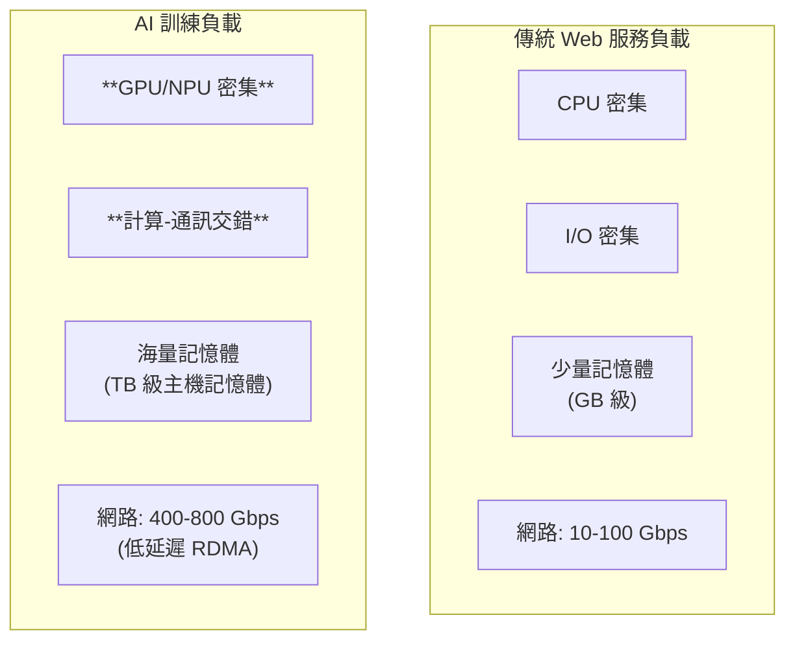
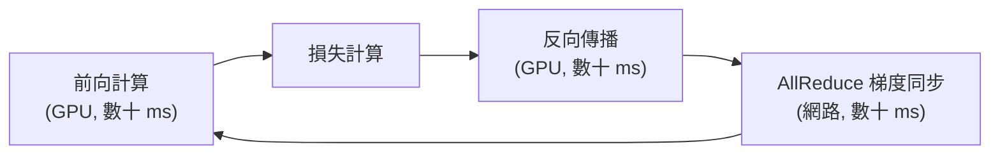
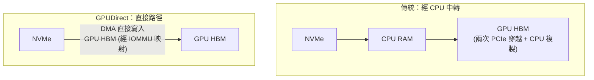
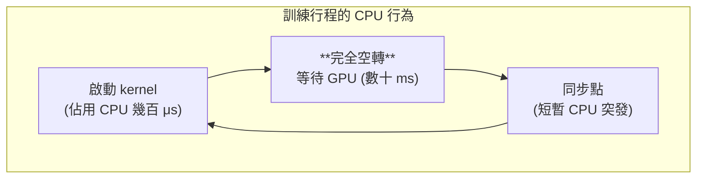
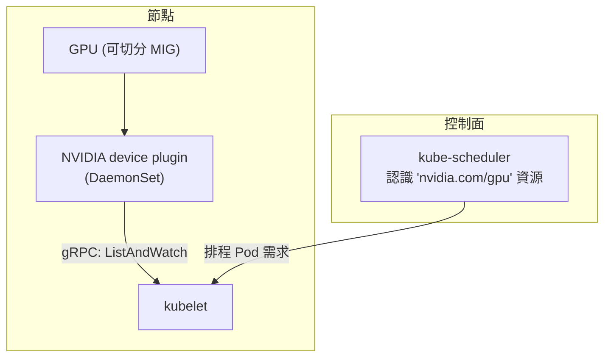
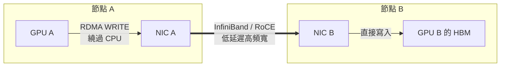

# 10.1 異質加速器與 GPU 叢集帶來的新瓶頸

## 工作負載的斷裂

2012 年 AlexNet 之後，深度學習的算力需求呈指數成長。到了 LLM 時代，單一訓練任務的資源形態是：



**關鍵差異：AI 訓練不是「I/O 密集」也不是「CPU 密集」，而是「計算與通訊交錯的流水線」。**

一個典型的訓練迭代：



**注意 AllReduce 這一步**：上千張 GPU 卡之間做全體一致的張量加總。這一步的通訊模式是：

- **集合通訊（collective communication）**：不是點對點，而是 all-to-all 的環形/樹狀聚合。
- **極高的頻寬需求**：每張卡每秒要發送數十 GB 的梯度。
- **極低的延遲容忍**：通訊時間與計算時間必須重疊，否則 GPU 空轉。

**這個工作負載形態對 Linux 提出了與 Web 時代完全不同的問題。**

## 第一個瓶頸：CPU 與 GPU 之間的資料路徑

### 傳統路徑的拷貝

GPU 訓練的資料流：

```
磁碟/NVMe → CPU 記憶體（頁快取）→ 使用者緩衝區 → pinned memory → GPU HBM
```

**多達三次拷貝**，且每次都要穿過 PCIe。以 PCIe 4.0 的 32 GB/s（x16）頻寬計算，把 1 TB 的資料從主機記憶體搬到 GPU 需要：

$$
T_{pcie} = \frac{1\text{TB}}{32\text{GB/s}} \approx 31 \text{ 秒}
$$

**而 A100/H100 的 HBM 頻寬是 2–3 TB/s**——GPU 大部分時間在**等待**資料。這就是為什麼「資料載入管線（dataloader）」是訓練效能的第一戰場。

### GPUDirect：讓 GPU 直接說話

**NVIDIA GPUDirect Storage / GPUDirect RDMA** 的核心思路與第 2 章的零拷貝**完全同構**：



**核心層的需求**：

1. **IOMMU（I/O Memory Management Unit）** 的使用者空間映射：把 GPU 的記憶體區域註冊為 DMA 可達（`cuMemMap`、`nvidia-peermem` 模組）。
2. **pinned memory 的 pin/unpin 管理**：鎖定實體頁，防止被 swap 或回收。
3. **與 `io_uring` 的整合**：非同步地把 NVMe 讀取直接指向 GPU 位址。

**這是第 2 章零拷貝故事在新硬體上的重演**——只是這次，資料路徑的兩端變成了「NVMe」與「HBM」，而中間的「CPU」變成了要被繞過的對象。

## 第二個瓶頸：排程器不理解 GPU

### CFS/EEVDF 的盲區

Linux 的 CPU 排程器（CFS，後改進為 EEVDF——Earliest Eligible Virtual Deadline First，Linux 6.6 起）為「CPU 計算」而設計。但 GPU 訓練行程的行為是：



**排程器看到的**：一個「大部分時間在睡覺、偶爾醒來突發」的行程。它可能會：

- 把該行程的 CPU 親和性排到「錯誤」的 NUMA 節點（遠離網卡/GPU）。
- 在同步點給它低優先級（因為「平均使用率低」）。
- 與其他訓練行程爭搶同一個核心（造成通訊執行緒的延遲抖動）。

**解法的方向**：

1. **CPU 親和性與 NUMA 綁定**（第 10.2 節詳述）。
2. **cgroup 的 CPU pinning**：Kubernetes 的 `cpuManagerPolicy: static`，把整數 CPU 的 Pod 綁定到專屬核心。
3. **core 特化**：一些核心提案（如「優雅地處理 GPU 等待中的行程」）持續在演化。

### Kubernetes 的裝置外掛框架

**Device Plugin**（Kubernetes 1.10 GA，2018）是叢集層對異質硬體的第一次正式回應：



**但 Device Plugin 的侷限很快暴露**：

1. **只處理「分配」，不處理拓撲**：不知道「這兩張 GPU 在同一個 NVSwitch 域」。
2. **沒有健康檢查的深度**：GPU 掉卡、ECC 錯誤的處理不一致。
3. **無法表達「一組裝置」的原子性**：要 8 張卡在一個 host 上，排程器只能多次試錯。

**後續演進**：DRA（Dynamic Resource Allocation，Kubernetes 1.26 alpha 起持續開發）用資源申請與分派（ResourceClaim）模型取代 Device Plugin，讓排程器具備拓撲感知。

## 第三個瓶頸：集合通訊與 RDMA

### InfiniBand / RoCE 進入 Linux 核心

AI 叢集的網路不再是乙太網 + TCP，而是：

- **InfiniBand**：專用網路，核心經由 `ibverbs` 介面提供 RDMA。
- **RoCE（RDMA over Converged Ethernet）**：在乙太網上跑 RDMA。

**RDMA（Remote Direct Memory Access）的語意**：一張卡的 NIC **直接讀寫**遠端機器的記憶體，**不經過遠端的 CPU 與作業系統**。



**延遲量級**：InfiniBand 的 RDMA 延遲約 1–2 μs；TCP/IP 棧的延遲約 20–100 μs。**差 50 倍**——對 AllReduce 這種每天呼叫數百萬次的操作，這是決定性差異。

**對 Linux 的要求**：

1. **`ibverbs` 介面**：使用者空間直接驅動 NIC 的佇列對（QP），核心只做建立與安全。
2. **記憶體註冊（memory registration）**：把使用者緩衝區 pin 住並登記到 NIC 的 MTT/ILT 表。
3. **與安全模型的新張力**：RDMA 繞過了遠端的核心——**誰能授權這個「繞過」？** 這是 RDMA 安全的核心問題（共享記憶體註冊、PAD 保護、與 cgroup/namespace 的互動）。

**這裡有一個深刻的主題重複**：第 8.1 節的 XDP 讓 eBPF 程式繞過核心的封包處理；RDMA 讓兩台機器的應用記憶體繞過彼此的核心。**「繞過核心以獲得效能」是持續的主旋律，但每一次繞過都產生新的安全與治理問題。**

### NCCL：在核心原語之上

**NCCL（NVIDIA Collective Communications Library）** 是 AllReduce 的實作，它把本章與第 2 章的原語全部用上：

- GPUDirect RDMA（零拷貝跨機）
- NVLink（機內 GPU 互連，800 GB/s）
- 環形/樹狀演算法（把 AllReduce 的通訊量從 $O(N)$ 降到 $O(2 \times (N-1)/N \times data)$ ）

$$
T_{allreduce} \approx \frac{2 \times (N-1)}{N} \times \frac{S}{B_{ring}}
$$

其中 $S$ 是張量大小、 $B_{ring}$ 是環的最小鏈路頻寬。**對 8 張卡與 1 GB 梯度，AllReduce 需要傳輸約 1.75 GB**——因此鏈路頻寬直接決定訓練吞吐。

## 第四個瓶頸：故障域與彈性

**訓練一個大模型需要數週到數月的連續運算。** 這期間：

- 硬體會故障（GPU、NVLink、網卡、交換機）。
- 節點會當機（核心 bug、驅動崩潰）。
- 會有「慢節點」（straggler）拖累整個 AllReduce 環。

**這對 Linux 的要求**：

| 需求 | 對應的機制 |
|---|---|
| 快速故障偵測 | eBPF 追蹤 NVLink/PCIe 錯誤、MCE 處理 |
| 快速故障恢復 | checkpoint/restore（CRIU + cgroup freeze，第 3.3 節） |
| 節點隔離 | cgroups + namespace（確保單一訓練任務不影響其他任務） |
| 供應鏈與映像 | 容器映像 + 契約（第 4 章） |

**特別值得注意的是「慢節點」**：AllReduce 是同步的集合操作，一個節點慢 10%，整個叢集慢 10%（美元成本以百萬計）。**偵測慢節點需要核心級的網路與 GPU 遙測——這正是 eBPF 的用武之地**（第 8.2 節的模式直接適用）。

## 與前九章的呼應：原語的再利用

讓我們用本書的框架，看 AI 時代的問題如何映射到既有的原語：

| AI 時代的需求 | 對應的核心原語 | 來自哪一章 |
|---|---|---|
| 資料載入零拷貝 | `io_uring` + O_DIRECT + pinned pages | 第 2 章 |
| 訓練任務隔離 | namespaces + cgroups | 第 3 章 |
| 任務的可攜交付 | OCI 映像 | 第 4 章 |
| 多機排程 | Kubernetes + Device Plugin/DRA | 第 5 章 |
| 節點級觀測 | eBPF 追蹤 + PSI | 第 8 章 |
| 異常攔截 | eBPF LSM / seccomp | 第 8、9 章 |
| 快速恢復 | cgroup freeze + CRIU | 第 3、9 章 |

**沒有一個需求需要「全新的核心」**——它們需要的**幾乎全部**是既有原語的組合，加上少量新介面（Device Plugin、DRA、GPU 驅動的記憶體管理）。

**這正是第 0 章「原語的價值」論點的終極檢驗**：當工作負載形態完全改變時，一個以「可組合原語」為基礎的系統，能以**增量**的方式適應。

## 小結

1. AI 訓練是「計算與通訊交錯」的負載，AllReduce 的同步性讓任何單點的延遲被全叢集放大。
2. CPU↔GPU 的資料路徑是第一瓶頸；GPUDirect 把第 2 章的零拷貝思想延伸到 HBM。
3. CFS/EEVDF 不理解 GPU 等待模式；cgroup pinning 與 Device Plugin/DRA 是叢集層的回應。
4. RDMA 讓跨機記憶體存取繞過雙方的核心，延遲降低 50 倍——**「繞過核心換效能」的主旋律，伴隨新的安全治理問題**。
5. 故障域管理（慢節點、checkpoint、恢復）把 cgroup freeze、CRIU、eBPF 遙測等原語重新組合。
6. **幾乎沒有需求需要全新的核心**——這是「可組合原語」架構的終極驗證。

下一節，我們深入記憶體管理與 NUMA——這是異質硬體時代 Linux 最深的戰場。
