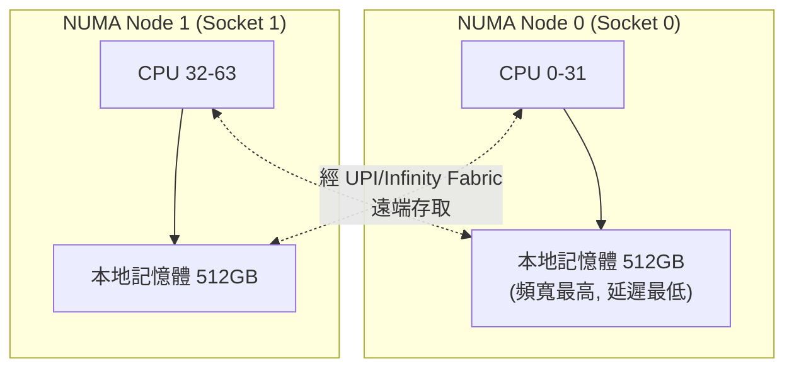
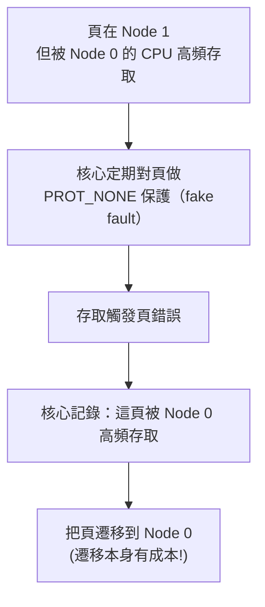
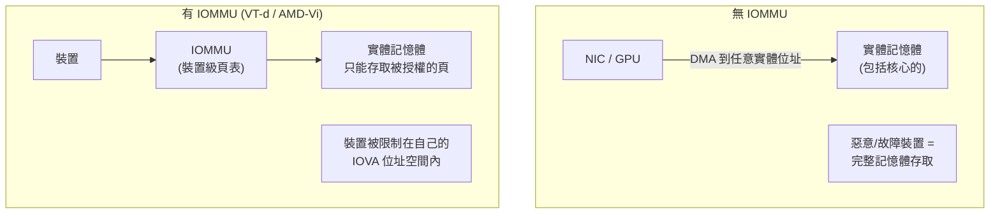
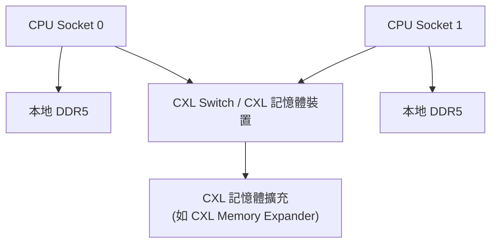

# 10.2 NUMA、IOMMU 與記憶體管理的挑戰

## NUMA：非一致性記憶體存取

### 什麼是 NUMA

現代多插槽伺服器的記憶體拓撲：



**遠端存取的代價**：

$$
\text{遠端延遲} \approx 1.4\text{-}2 \times \text{本地延遲}
$$

本地記憶體延遲約 80–100 ns，跨 UPI 約 140–200 ns。**看起來只有 2 倍，但在記憶體密集的負載中，這意味著 20–40% 的效能損失**——因為程式的效能取決於**最後一級快取未命中時**的記憶體延遲。

### `numactl` 與 NUMA 拓撲

```bash
# 查看拓撲
numactl -H
# available: 2 nodes (0-1)
# node 0 cpus: 0 1 2 ... 31
# node 0 size: 524288 MB
# node 1 cpus: 32 33 ... 63
# node 1 size: 524288 MB

# 把行程綁定到 node 0 的 CPU 與記憶體
numactl --cpunodebind=0 --membind=0 ./my_train
```

**對 AI 工作負載，NUMA 綁定是必選項**：網卡（NIC）連在某個 NUMA 節點，GPU 連在某個 PCIe root complex。**資料在「錯誤」的 NUMA 節點上每一次讀寫都在付遠端稅。**

### 核心層的 NUMA 支援

| 機制 | 說明 |
|---|---|
| **NUMA 感知的頁分配** | 首選分配在「分配者 CPU 所在節點」的記憶體 |
| `MPOL_BIND` / `MPOL_PREFERRED` | mmap 的記憶體策略（`set_mempolicy`、`mbind`） |
| `numa_balancing`（自動 NUMA 平衡） | 核心監測跨節點存取，**把頁遷移到存取者所在節點**（Linux 3.8+） |
| `numa.stat` | 遠端/本地存取的統計 |

**自動 NUMA 平衡（automatic NUMA balancing）** 是一個精巧的機制：



**取捨**：遷移一次的成本（複製 + TLB 沖刷）很高，但如果之後有數百萬次存取受益，就是淨賺。核心用取樣式的 fake fault 來「猜」哪些頁值得遷移。

**對 AI 負載的警示**：訓練行程的記憶體訪問模式劇烈變化（每個 iteration 不同 tensor），自動 NUMA 平衡可能在錯誤的方向上遷移，反而造成效能抖動。**生產環境常常選擇 `numa_balancing=disable` + 顯式的 `membind`。**

## IOMMU：裝置的虛擬記憶體

### 為什麼需要 IOMMU

**沒有 IOMMU 時**，DMA 是「裸」的：裝置可以直接讀寫**任何實體記憶體位址**。



**IOMMU 的三個功能**：

1. **位址轉換**：把裝置的 IOVA（I/O Virtual Address）轉換為實體位址。
2. **存取控制**：每個裝置有自己的頁表，未授權的位址存取被阻斷（並記錄 fault）。
3. **重映射中斷**：中斷的投遞也受控（防止中斷注入攻擊）。

**歷史**：Intel VT-d 於 2005 年左右提出規範，2008 年左右硬體普及；AMD-Vi（IOMMUv2）同期。Linux 的 `intel-iommu` 與 `amd-iommu` 驅動多年來持續演進。

### IOMMU 與容器/VM 的安全

**第 6.4 節的二級隔離，其硬體基礎就是 IOMMU**：

- Kata Containers 的 VM：透過 IOMMU 保證 guest 的裝置（virtio 後端）只能存取 guest 的記憶體。
- **VFIO / SR-IOV**：把一張實體裝置（如 GPU、NIC）**直通（passthrough）** 給容器/VM，靠 IOMMU 保證隔離。

```bash
# VFIO 直通的基本流程
# 1. 把裝置從核心驅動解綁
echo 0000:03:00.0 > /sys/bus/pci/devices/0000:03:00.0/driver/unbind
# 2. 綁到 vfio-pci
echo vfio-pci > /sys/bus/pci/devices/0000:03:00.0/driver_override
# 3. 建立 IOMMU group 並授予容器/VM
```

**這是「資源直通」與「硬體隔離」的結合**——Kata、以及 AI 場景的 GPU 直通（NVIDIA GPU Operator 的部分模式）都建立在 VFIO + IOMMU 之上。

### IOMMU 的效能代價

IOMMU 不是免費的：

1. **每次 DMA 都要查 IOVA 頁表**（可被裝置的 IOTLB 快取，但 miss 時昂貴）。
2. **大張量的分散映射**：如果緩衝區不連續，IOMMU 要建立多個映射項。
3. **GPUDirect RDMA 需要特殊的映射路徑**（peer-to-peer DMA）。

**因此 IOMMU 有多種模式**：

```bash
# iommu 模式選項（核心啟動參數）
intel_iommu=on iommu=pt    # passthrough：預設直通，僅對 VFIO 裝置啟用轉換
iommu=off                   # 完全關閉（僅在可信環境）
```

**`iommu=pt`（passthrough）是高效能計算的常見選擇**：預設讓裝置直通實體位址（免轉換開銷），只有明確要求隔離的裝置走 IOMMU 頁表。**效能與安全的取捨，再一次取決於部署配置。**

## 巨型頁：對抗 TLB 的物理常數

### TLB 的問題

每個虛擬頁的轉換都佔用一個 TLB（Translation Lookaside Buffer）條目。TLB 容量有限（L2 TLB 通常數千條）。

以 4 KB 頁計算，一個 L2 TLB 有 2048 條目時，能覆蓋的記憶體只有：

$$
2048 \times 4\text{KB} = 8\text{MB}
$$

**而現代資料庫、AI 模型的記憶體是 GB 到 TB 級。** TLB miss 的成本是數十到數百 ns——**在記憶體密集負載中，TLB miss 可以吃掉 10–30% 的效能。**

### 巨型頁的兩種形態

| 形態 | 大小 | 分配方式 |
|---|---|---|
| **Static huge pages**（hugetlbfs） | 2MB / 1GB（x86-64） | 開機預留：`hugepagesz=1G hugepages=1024` |
| **Transparent Huge Pages (THP)** | 2MB | 核心自動合併（`khugepaged`） |

**THP 的爭議**：

- **優點**：自動化，應用無需修改。
- **缺點**：
  - **延遲抖動**：合併需要記憶體整理（compaction），可能觸發長暫停。
  - **記憶體浪費**：一個 2MB 頁可能只有 100 bytes 被使用。
  - **與 cgroup/OOM 的互動複雜**。

**資料庫社群（如 PostgreSQL、Redis）與低延遲服務的共識**：**THP 用 `madvise` 模式（應用顯式請求）或直接 disable，改用顯式的 hugetlbfs。** Redis 的官方文件明確建議 `transparent_hugepage=never`。

**對 AI 的意義**：GPU 驅動使用自己的顯存管理，但**host 端的 pinned memory**（Dataloader 緩衝）用大頁可以顯著降低 TLB 壓力。

### MGLRU 與頁回收的現代化

**MGLRU（Multi-Generational LRU）**，Linux 6.1（2022）合併，是 Linux 頁回收演算法二十年來最大的重構：

**舊 LRU 的問題**：單一 active/inactive 雙鏈表，對「存取頻率的時間局部性」建模粗糙；在大記憶體機器（TB 級）上，掃描一輪的成本極高，造成**長尾延遲**。

**MGLRU 的思路**：把頁按「世代（generation）」組織成多個列表，用「最久未被存取的世代先回收」取代嚴格的 LRU。


**與 cgroup v2 的結合**：MGLRU 按記憶體 cgroup 分代回收，**這讓「某個容器的記憶體壓力」可以被隔離地處理**——是 cgroup v2 統一階層（第 3.4 節）與記憶體管理的深度咬合。

### zram / zswap：記憶體壓縮

在記憶體緊張的環境（如大型節點上的多租戶）：

- **zram**：把 swap 裝置放到 RAM 中的壓縮塊裝置（壓縮比約 3:1）。
- **zswap**：頁寫入磁碟 swap 之前先在記憶體中壓縮快取。

**取捨**：用 CPU 換記憶體。對 CPU 空閒（GPU 等待中）的 AI 節點，這可能是划算的交易；對 CPU 滿載的節點則是負擔。

## `madvise` 與記憶體提示

現代 Linux 提供了一組「提示型」介面，讓應用程式向核心表達**使用意圖**：

```c
madvise(addr, len, MADV_HUGEPAGE);    // 請求大頁
madvise(addr, len, MADV_DONTNEED);    // 釋放這些頁
madvise(addr, len, MADV_WILLNEED);    // 預讀
madvise(addr, len, MADV_SEQUENTIAL);  // 循序存取模式
madvise(addr, len, MADV_FREE);        // 可延遲回收（lazy free）
process_madvise(pidfd, ..., MADV_COLD); // 對別的行程做提示 (5.10+)
```

**`process_madvise`（Linux 5.10）** 特別值得注意：它允許一個行程**對另一個行程**的記憶體做提示（如標記為 cold 以便回收）。**這是「行程管理器」（如 Android 的 ActivityManager、systemd-oomd）對記憶體治理的新原語**——與 pidfd（第 9.2 節）配合，行程終於成為可以被「記憶體治理」的一等對象。

## CXL：記憶體架構的下一場革命

**CXL（Compute Express Link）** 是 2020 年代最重要的互連標準之一，它讓**記憶體可以掛在 CPU 之外**：



**CXL 對 Linux 的挑戰是根本性的**：它打破了「記憶體 = NUMA 節點」的假設：

1. **CXL 記憶體被映射為一個「偽 NUMA 節點」**（效能介於本地與遠端之間）——核心的 NUMA 抽象勉強接住了它。
2. **分層記憶體（memory tiering）**：核心需要決定「熱頁放 DDR、冷頁放 CXL」——這催生了新的頁遷移與放置策略（`memory tiering` 子系統）。
3. **與自動 NUMA 平衡的衝突**：兩種遷移策略（NUMA 平衡 vs 記憶體分層）需要協調。

**這是一個正在演化中的戰場**（2024–2026），核心的 `memory tiering`、`demotion` 路徑與 CXL 驅動持續在變化。**它展示了「硬體架構變化 → 抽象層被迫演化」的完整循環**——正是本書敘事主線的當代版本。

## 給部署者的記憶體檢查清單

把本章的內容整理為可操作的檢查清單：

| 檢查項 | 命令/設定 |
|---|---|
| NUMA 拓撲與綁定 | `numactl -H`；`--cpunodebind` / `--membind` |
| 遠端存取統計 | `numastat -m`；`/sys/devices/system/node/node*/numastat` |
| 自動 NUMA 平衡 | `cat /proc/sys/kernel/numa_balancing`（AI 負載常 disable） |
| THP 模式 | `cat /sys/kernel/mm/transparent_hugepage/enabled`（低延遲服務用 `madvise`） |
| 大頁池 | `/proc/meminfo` 的 `HugePages_Total/Free` |
| IOMMU 模式 | `dmesg | grep -i iommu`；`iommu=pt` |
| MGLRU | `cat /sys/kernel/mm/lru_gen/enabled`（6.1+） |
| PSI | `/proc/pressure/memory`（判斷是否在等記憶體） |
| cgroup 記憶體狀態 | `memory.current` / `memory.high` / `memory.events`（第 3.4 節） |

## 小結

1. **NUMA 的遠端稅**在記憶體密集負載中是 20–40% 的效能損失；`numactl` 綁定與自動 NUMA 平衡是兩種（常常衝突的）策略。
2. **IOMMU 是裝置的 MMU**：位址轉換 + 存取控制 + 中斷重映射，是 VFIO 直通與二級隔離（第 6.4 節）的硬體基礎；`iommu=pt` 是效能與安全的經典取捨。
3. **TLB 是被低估的物理常數**：4KB 頁在 TB 級記憶體下的 TLB miss 會吃掉 10–30% 效能；大頁（static hugetlbfs）是主要對策，THP 則有延遲抖動的爭議。
4. **MGLRU（6.1）** 重構了頁回收，與 cgroup v2 的結合讓「容器級的記憶體壓力」可以被隔離處理。
5. **`process_madvise`（5.10）+ pidfd** 讓行程管理器獲得了對其他行程記憶體的治理能力。
6. **CXL 打破「記憶體 = NUMA」的假設**，催生 memory tiering 子系統——硬體架構變化迫使抽象層演化的當代案例。
7. 記憶體管理是 Linux 中**歷史包袱最重、又最前沿**的領域：SysV shm 與 memfd、LRU 與 MGLRU、NUMA 與 CXL 並存。

最後一節，是全書的終章——回到最初的那個問題：**Linux 的獨創性究竟是什麼？**
