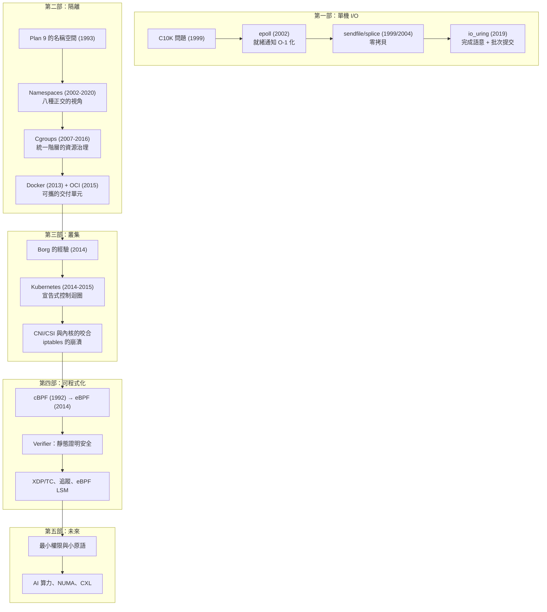
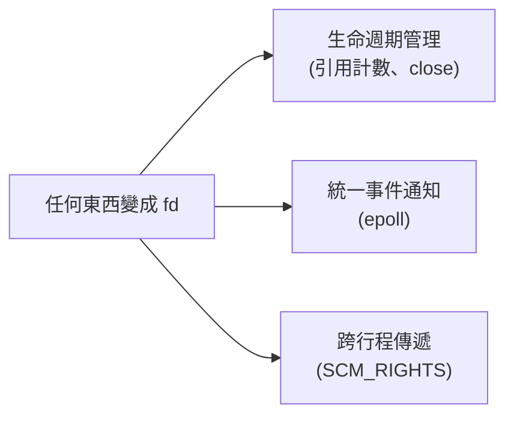
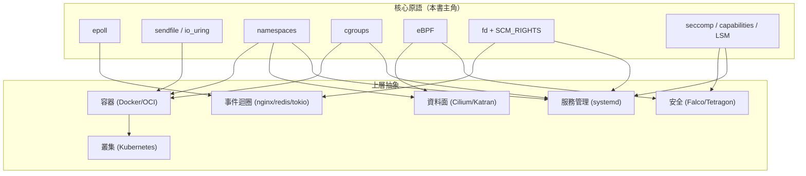
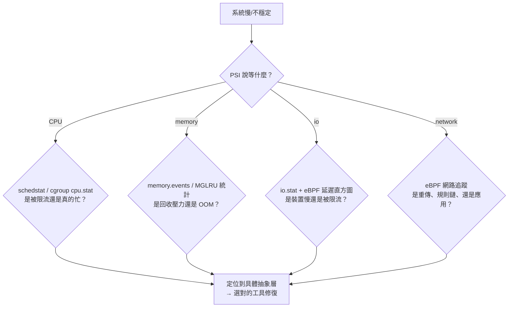

# 10.3 終章：可演進的原語才是 Linux 的獨創基因

## 回到 1991 年的那個夏天

1991 年 8 月 25 日，Linus Torvalds 在 comp.os.minix 寫下了那句著名的話：

> "I'm doing a (free) operating system (just a hobby, won't be big and professional like gnu) for 386(486) AT clones."

**如果只看功能清單**，1991 年的 Linux 0.01 沒有任何獨創之處：

- 多工——Unix 1970 年代就有。
- 虛擬記憶體——Multics 1960 年代、VAX 1970 年代就有。
- 分層檔案系統——Unix 的傳統。
- TCP/IP——BSD 1983 年就有。

**三十五年後回看，Linux 真正獨創的不是任何一項功能，而是一種演化的方式。**

## 本書走過的路

讓我們把九章的旅程壓縮成一張因果圖：

**注意每個箭頭的方向**：每一代抽象層的成熟，都暴露了新的瓶頸；每一個新瓶頸都催生了新的原語；每一個新原語都讓更大的抽象成為可能。

## 三條貫穿全書的主線

### 主線一： $O(n)$ 到 $O(1)$ 的持續戰爭

| 章節 | 戰場 | 從 | 到 |
|---|---|---|---|
| 第 1 章 | fd 監看 | select/poll 的 $O(n)$ 掃描 | epoll 的 $O(k)$ 事件回報 |
| 第 2 章 | I/O 提交 | 每 syscall 一次的固定成本 | io_uring 的批次提交 |
| 第 5、6 章 | Service 轉發 | iptables 的 $O(n)$ 規則鏈 | IPVS/eBPF 的 $O(1)$ hash |
| 第 8 章 | 觀測 | 全量事件上傳 | 核心內聚合（直方圖） |
| 第 7 章 | 核心擴充 | 重編譯核心/模組 | eBPF 按需載入 |

**這不是巧合，而是一種系統性的審美**：每當某個機制的成本隨「規模」線性成長，Linux 社群遲早會把它重構為「與規模無關」的常數成本或「與活躍量成正比」的成本。

### 主線二：機制與策略的分離

回顧每一章的核心原語，它們有一個共同的形狀——**核心給機制，使用者空間定策略**：

| 核心機制 | 留給使用者空間的策略 |
|---|---|
| `epoll` | 事件迴圈的結構 |
| namespaces | 容器格式與生命週期 |
| cgroups | 資源分配策略（systemd、kubelet） |
| eBPF verifier + hooks | 網路/追蹤/安全策略（Cilium、Tetragon） |
| LSM hooks | 安全模型（SELinux、AppArmor、eBPF LSM） |
| fd + SCM_RIGHTS | 權限分離的 IPC 模式 |

**這個分離的直接後果**：上層生態可以以「年」為單位快速演化（Docker→OCI 三年、Cilium 的持續重構、Kubernetes 的 CRD 生態），而核心以「十年」為單位穩定演化。**兩個時鐘、一個介面。**

### 主線三：每個原語都試圖「fd 化」

第 9.2 節的觀察值得在最後再強調一次。fd 化帶來的三項免費能力：

epoll、inotify、eventfd、memfd、pidfd、io_uring、bpf 的 prog/map/link、ring buffer——**新原語的「入場券」就是變成一個 fd**。這是 Linux 對「組合性」最執著的堅持。

## 獨創性的三個候選答案

在結尾，讓我們嚴肅地比較三種可能的答案。

### 候選一：「Linux 的獨創性在於開源與 GPL」

**支持論據**：沒有開源，就不會有幾千名開發者、不會有發行版生態、不會有雲廠商的投入。

**反駁**：開源且成功的系統不止 Linux（BSD 也很開源），且 GPL 限制與授權爭議也造成過生態分裂。**開源是條件，不是本質。**

### 候選二：「Linux 的獨創性在於工程執行力」

**支持論據**：epoll、cgroups v2、eBPF verifier、MGLRU——每一項都是高水準的工程實作。「永不破壞使用者空間」的紀律執行了三十年。

**反駁**：工程執行力是必要條件，但同期的 BSD、Solaris 團隊也有同水準的工程師。**執行力解釋不了「為什麼是這些功能被選擇了」。**

### 候選三（本書的答案）：「獨創性在於選擇了『可演進的原語』這條演化路線」

**論據鏈**：

1. **1990 年代**：當時的主流觀點是「作業系統應該提供大而全的服務」（微核心與單核心之爭、各種專用 OS）。Linux 選擇了相反的路：**提供小的、正交的、可組合的機制**。
2. **2000 年代**：當虛擬化以「完整 hypervisor」為主流時，Linux 沒有放棄 OS 級虛擬化路線（namespaces/cgroups），最終證明了「輕量隔離 + 共用核心」在雲端規模下更划算。
3. **2010 年代**：當核心擴充的主流做法是「編寫核心模組」時，eBPF 開闢了第三條路——**受限語言 + 靜態驗證 + 按需載入**。
4. **2020 年代**：當硬體走向異質（GPU、DPU、CXL）時，Linux 沒有為每種加速器發明新子系統，而是**把既有原語（cgroups、fd、io_uring、numactl）延伸到新硬體**。

**每一次，選擇的都是「最小的新增 + 最大的可組合」。**

**檢驗這個答案**：回到第 0 章的 Amdahl 框架——Linux 的每次演進都是**重新框定瓶頸到一個新的抽象層**，而不是在同一層優化常數。而「原語」正是最容易重新框定的構件：它們小到可以被棄用（如 splice）、可以被重寫（如 io_uring 取代 Linux AIO）、可以被組合（如八種 namespaces）、又不至於小到無法承載真實的語意（如 epoll 的就緒通知）。

> **可演進的原語 = 能被重新框定瓶頸的最小單位。**

## 給讀者的三個帶走物

### 1. 一套「原語清單」與其組合圖

**下次設計系統時，先問**：我要的這個能力，是已經有原語可以組合出來，還是值得引入一個新依賴？

### 2. 一套判斷「瓶頸在哪個抽象層」的方法

本書反覆出現的診斷路徑：

### 3. 一種看待「核心 vs 生態」的眼光

**Linux 的成功不是核心的成功，而是「核心提供機制 + 生態提供策略」這個分工作為整體的成功。**

- 判斷一個技術趨勢能否持久，問：**它是建立在穩定原語之上，還是建立在某個實作的私有介面上？**
  - OCI（穩定規格）→ 持久；dockershim（私有 API）→ 被移除。
  - BTF/CO-RE（公開格式）→ 持久；SystemTap（內部結構依賴）→ 被取代。
  - CNI/CSI/CRI（公開介面）→ 持久；in-tree plugin（原始碼綁定）→ 被外置。

## 未竟之業：仍在路上的問題

誠實地列出本書沒有給出答案、社群也還在辯論的問題：

| 問題 | 現狀 |
|---|---|
| **eBPF 的安全邊界** | verifier 的複雜度持續成長；`CAP_BPF` 的影響面仍在辯論（第 7.3 節） |
| **io_uring 的攻擊面** | 2022–2023 的漏洞風暴之後，禁用與 BPF 過濾（Linux 7.0）之間的平衡仍在摸索（第 2.3 節） |
| **容器逃逸的根治** | gVisor/Kata 有開銷，純容器有風險；「安全預設」的標準尚未確立（第 6.4 節） |
| **Kubernetes 的複雜度** | 控制迴圈模型的代價（最終一致性、偵錯困難）沒有根本解法（第 5.2 節） |
| **CXL 記憶體分層** | 頁放置與遷移策略仍在快速演化（第 10.2 節） |
| **AI 負載的排程** | EEVDF、DRA、拓撲感知排程都還在路上（第 10.1 節） |

**這些未竟之業，正是下一代「原語」的孵化器。** 本書的讀者——也就是你——可能正是下一個 epoll、下一個 cgroups、下一個 eBPF 的作者或使用者。

## 結語

回到標題那個問題：**一顆內核如何撐起現代雲端世界？**

答案是：**它從不試圖一次撐起任何東西。**

它提供一個 `epoll`，讓 nginx 撐起一萬個連線。
它提供八種 `namespaces`，讓 Docker 重新發明交付。
它提供一組 `cgroups`，讓 Kubernetes 讓多租戶成為可能。
它提供一個 `verifier`，讓 Cilium 把整個網路資料面搬進核心。
它提供 `fd` 這個通用媒介，讓三十五年來每一個新機制都能立刻獲得事件通知、生命週期與跨行程傳遞。

**Linux 的獨創基因，是一種謙遜的架構選擇**：

> **核心不預測未來——它只保證：無論未來長成什麼樣子，都由足夠小的原語組合而成。**

1983 年，`select` 誕生。2002 年，`epoll` 取代它——但 `select` 至今仍在。
2007 年，cgroups 誕生。2016 年，v2 重構它——但舊階層至今可用。
1992 年，BPF 誕生。2014 年，eBPF 擴展它——但舊過濾器仍在執行。

**每一次革命，都不處決上一代。這，就是可演進的原語的意義。**

這也是這本書想留給你最重要的一課：**在設計任何系統——一個函式庫、一個服務、一個平台——時，與其預測未來的需求，不如問自己：我提供的基本單位，夠不夠小、夠不夠正交、夠不夠可組合，以至於無論需求怎麼變，都能被重新組裝？**

如果答案是肯定的，那你的系統，就有了 Linux 的獨創基因。

---

*全書完*
