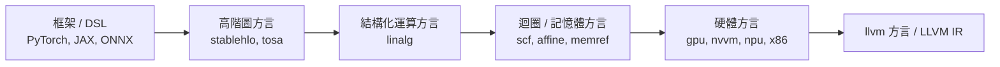
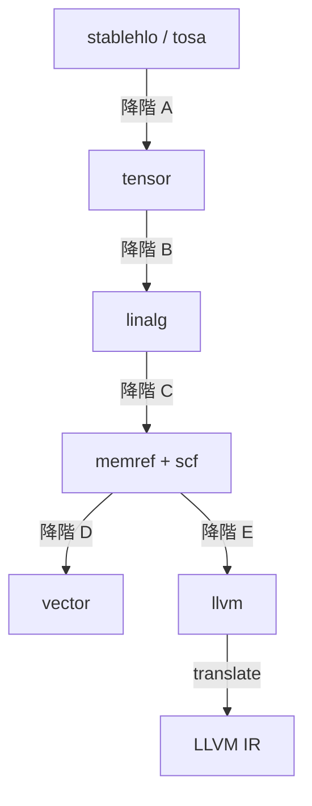
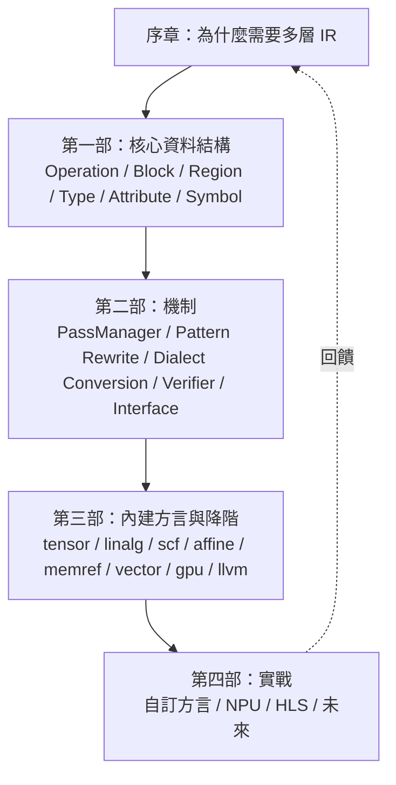

# 序章 0.1　單一 IR 的結構性瓶頸

> 本節導論：為什麼在有 LLVM IR 這麼成功的單一 IR 之後，還需要「多層中間表示法」？

## 0.1.1 一個成功的故事，以及它的隱含假設

LLVM IR 是編譯器史上少數真正「成功」的基礎設施。它把「把 C 編譯成機器碼」這件事拆成了 Frontend → LLVM IR → Backend 三段，並且在這三者之間插入了 **Target-independent IR** 這個概念：一份與語言無關、與目標無關的中間表示，讓十幾種前端（Clang、rustc、Swift、Zig 等）與三十幾種後端（x86、ARM、RISC-V、GPU…）共用同一套最佳化框架。

LLVM IR 的成功建立在一個樸素的假設之上：

> **存在一種「足夠低階、但不綁定目標」的表示，只要把它做得夠好，就能承載所有前端與所有後端的最佳化需求。**

這個假設在 2003 年到 2015 年之間基本上是成立的。但它的代價被隱藏在了 LLVM 的設計細節裡，而這些代價會在「領域特化」與「異質硬體」兩股力量同時施加壓力時暴露無遺。

讓我們把這個假設拆解成三個子命題：

1. **語意假設**：所有前端的高階語意（陣列的形狀、迴圈的迭代空間、矩陣乘的結構）最終都可以用「標量值 + 記憶體位址 + 數學運算」充分表達。
2. **最佳化假設**：只要 LLVM IR 保留了足夠的結構資訊（形狀、對齊、别名資訊、控制流結構），通用最佳化就能自動發掘領域專屬的最佳化機會。
3. **硬體假設**：目標機器的差異可以完全由 Backend 吸收，前端 IR 不需要知道目標的存在。

三個假設在實務上的失效點，正是 MLIR 存在的理由。

## 0.1.2 假設一的失效：領域語意的流失

考慮一段 C 程式碼：

```c
void conv2d(float *out, const float *in, const float *w) {
  for (int o = 0; o < 64; ++o)
    for (int i = 0; i < 56; ++i)
      for (int j = 0; j < 56; ++j)
        for (int c = 0; c < 3; ++c)
          for (int kh = 0; kh < 3; ++kh)
            for (int kw = 0; kw < 3; ++kw)
              out[(o*56 + i)*56 + j] += w[((o*3 + c)*3 + kh)*3 + kw]
                                     * in[((c*56 + i+kh)*56 + j+kw)];
}
```

LLVM IR 會忠實地把它變成一堆 `load` / `mul` / `add` / `getelementptr` / `store`。問題在於：**「這是一個卷積」這個資訊，已經從 IR 中徹底消失了**。剩下的只有記憶體存取模式。

這帶來兩個後果。

**後果 A：最佳化空間被壓縮。** 通用 LLVM pass 能看見的只有「記憶體存取之間的相依」，它無法知道「這個迴圈巢其實是 3x3 卷積」，因此無法套用卷積專屬的優化：

- 把 `kh`/`kw` 這兩個 filter 維度從最內層迴圈提出（迴圈交換與 interleave）；
- 把 `c` 維度向量化（通道維度向量化比空間維度向量化有效得多）；
- 識別出這是 GEMM 並呼叫高度最佳化的實作；
- 在 NPU 上把整個卷積映射成一個資料流運算，而非 6 層巢狀迴圈。

**後果 B：最佳化被硬編碼在 frontend 或 backend。** 為了補救 A，业界發展出兩條「逃生通道」：

- 在 frontend 裡做。例如 XLA 的做法：PyTorch/JAX 編譯器**不下沉到 LLVM IR 就先自己做融合**，用一套獨立的 HLO（High-Level IR）表示來保留矩陣乘、卷積等高階結構。代價是：XLA 需要自己重寫一整套 pass 管理器、IR 序列化、IR 轉換框架。
- 在 backend 裡做。例如 Intel 的 `isl` / `Polly` 多面體最佳化，或某些編譯器裡以 huge pattern 形式手寫的向量轉換。代價是：它們作用在已經「降階完畢」的 LLVM IR 上，能動的空間有限，而且無法跨前端共用。

MLIR 的核心洞見就在於：**這兩條逃生通道不該是逃生通道，而該是 IR 設計的主體。**

## 0.1.3 假設二的失效：形狀與結構資訊的過早確定

第二個問題是**資訊流失的時機**。

在 LLVM 的典範中，前端必須在產生 LLVM IR 的當下就決定好一切：

- 資料放在記憶體還是暫存器？（決定 `alloca` 與 `mem2reg`）
- 陣列是靜態配置還是動態配置？（決定 `alloca` 與 `malloc`）
- 資料的佈局是 row-major 還是 column-major？（決定 `getelementptr` 的步長）
- 迴圈的迭代次數在編譯期是否已知？

一旦前端做了這些決定，後端就再也無法改變。於是產生了以下常見的效能災難：

| 問題 | 症狀 | 根因 |
| --- | --- | --- |
| 陣列未向量化 | 迴圈逐元素執行 | 形狀/佈局在前端就定型 |
| 過早材質化 | 產生大量中間緩衝，頻寬爆炸 | 沒有「值語意」層可以延後決定 |
| 過早展開 | 迴圈被展開成一長串指令 | 迭代空間資訊在前端就消失了 |
| 綁死目標 | 同一份模型只能跑一種硬體 | IR 在前端就假定了目標假設 |

關鍵在於：**這些決策並非「非做不可」，而是被 IR 的表達能力強迫提早做的。**

LLVM IR 的 `alloca` 語意是「在 stack frame 裡配置一段記憶體」。這是一個 *buffer* 語意。一旦你說「這個值必須放在這個 buffer 裡」，你就再也無法說「這個值其實是一個純值，誰用誰拿就好，不必落地」。MLIR 的 `tensor` 型別正是為了補上這個洞：**一個不可變的、有形狀的、可以隨時被實例化的數學值**。它讓「這只是個值」與「這必須被寫進記憶體」兩種想法可以分開決定，而決定的時機被推遲到整個程式都已最佳化完之後。

這個「延遲決策」的能力，就是 MLIR 相對於 LLVM IR 最重要的增量之一。

## 0.1.4 假設三的失效：異質硬體的爆炸

第三個問題是**硬體多樣性帶來的工作量爆炸**。

2015 年時，主流編譯器要支援的後端大約是：x86、ARM、AArch64、MIPS、PowerPC、RISC-V。到 2020 年，這份清單變成了：x86、ARM、AArch64、RISC-V、PowerPC、MIPS、LoongArch、WebAssembly、AMDGCN、NVPTX、AMDGPU、Hexagon…再加上幾乎每一種都獨有的加速器（NPU、TPU、各類 DSP）。

假設每一種後端都需要「知道」自己被編譯的程式在做什麼，也就是需要高階語意。而高階語意無法從 LLVM IR 裡找回來——因為它已經被丟掉了。

結果就是：**每支援一種新的加速器，都要重做一次完整的「語意復原」工作**，而且是在一個資訊已經不全的 IR 上做。

MLIR 的答案是把「目標資訊」也變成 IR 的一部分，但**放在正確的層級**：



每個箭頭都是一次**受控的降階**（progressive lowering）。每個層級保留的資訊，都是下一層需要的：

- 高階圖方言保留**算子語意**（這是卷積還是矩陣乘）。
- `linalg` 保留**迭代空間與索引映射**（這是最佳化與融合的依據）。
- `scf` / `affine` 保留**控制流與迭代結構**（這是迴圈變換的依據）。
- `memref` 保留**佈局與別名**（這是記憶體排程的依據）。
- 硬體方言保留**目標特性**（warp 大小、共享記憶體容量、SRAM 大小）。

**每一層都是「恰如其分」的抽象層級**：既不過於抽象（丟失了優化所需的資訊），也不過於具體（綁死了後端）。

## 0.1.5 「多層」不是「多個」

這裡有個容易混淆的點，值得單獨澄清。

「多層 IR」不等於「有很多種 IR」。如果只是把 LLVM IR 拆成前端 IR、中段 IR、後端 IR，然後各自維護一套轉換程式碼，那只會帶來 LLVM 已經解決過的問題——重複的工具鏈、重複的 pass、重複的教訓。

MLIR 的「多層」有三個嚴格的性質：

**性質一：同一套基礎設施。** 所有層共用同一份 `Operation` 資料結構、同一個 `Context`、同一套 ODS 宣告機制、同一個 PassManager、同一套 Pattern Rewrite 與 Dialect Conversion 框架、同一個 verifier 基礎設施。從 `tensor` 到 `llvm` 的所有方言，都跑在同一個 pass manager 裡，共享同一個 threading 層、同一個診斷系統。

**性質二：方言之間的邊界是「語意邊界」而非「檔案邊界」。** 降階不是「把 A 翻譯成 B 的另一套表示」，而是「在 A 還保有語意的最後一刻，做一個能保留下游所需資訊的決策」。降階的目標方言通常可以比來源方言更通用——這是合法化（legalization）機制能成立的前提。

**性質三：降階是可組合、可分割、可重排的。** 因為每個方言只宣告「我能變成什麼」，pipeline 就是一串降階的串接，而每一步都可以獨立測試。這與傳統編譯器「一條龍」的風格截然不同。



降階 A 到 E 是彼此獨立的轉換，可以分給不同團隊並行開發，也可以針對不同目標重新組合順序。

## 0.1.6 一個具體的對比：把卷積編譯到 CPU 與 NPU

為了讓「多層」的抽象真正落地，我們用同一個卷積走一遍全流程。

**起點（框架層）**：

```mlir
func.func @conv2d(%arg0: tensor<64x56x56x3xf32>) -> tensor<64x56x56x64xf32> {
  %0 = "stablehlo.convolution"(%arg0, %weight) { ... } : (tensor<64x56x56x3xf32>, tensor<64x3x3x3xf32>) -> tensor<64x56x56x64xf32>
  return %0 : tensor<64x56x56x64xf32>
}
```

此時編譯器知道：這是卷積，輸入形狀是 `64x56x56x3`，filter 是 `64x3x3x3`。

**降階到 `linalg`**：卷積被表達成一個有明確迭代空間的結構化運算。此時編譯器知道：輸入通道數是 3（很小）、輸出通道數是 64、spatial 維度是 56x56。

**降階到 `scf` + `memref`**：佈局決定了，資料落到了具體的 buffer。這時如果目標是 NPU，編譯器問的問題完全不一樣了：

- **CPU 目標**會問：「哪個維度最值得向量化？」（答案通常是輸入通道數 3，或把 filter 展開後的 `kh*kw*c = 27`，形成一個長度 27 的 GEMM K 維）
- **NPU 目標**會問：「PE 陣列是 8x8 的嗎？那 `kh*kw*c = 27` 怎麼塞？」（答案通常是：把 `kh, kw` 攤平成 9，把 `c=3` 攤平成 27，然後改變資料流排程）

注意：**兩個目標需要的是不同層級的資訊**。CPU 需要迭代空間與形狀（linalg 層），NPU 需要 dataflow 與緩衝區容量（更靠硬體的層）。如果 IR 只有一層，這兩種需求只能二選一，或者被迫全部下放到某個幸運的幸運時刻。

**這就是多層 IR 的實質意義**：*不同的最佳化發生在不同的抽象層級，因此 IR 必須同時存在多個抽象層級。*

## 0.1.7 歷史的定位

MLIR 不是憑空出現的，它是三條技術路線匯流的產物：

| 線索 | 來源 | 貢獻 |
| --- | --- | --- |
| TensorFlow XLA / GrFusion | Google 內部，2010 年代中期起 | 圖層 IR、算子融合、跨硬體編譯的實務經驗 |
| Halide / Polyhedral / isl | 學術界，2000 年代 | 多面體模型、迴圈變換的理論基礎 |
| LLVM | 社群，2003 年起 | Pass 管理、多目標後端、驗證基礎設施、ODS 式宣告機制 |

2021 年 1 月，Chris Lattner 在 LLVM 官方部落格發表《MLIR: Scaling Compiler Infrastructure for Domain Specific Computation》，宣布 MLIR 計畫。MLIR 於 2021 年 12 月隨 LLVM 14 正式進入 LLVM 專案的主幹。此後的數年裡，IREE、Circt、Torch-MLIR、TensorFlow、StableHLO 等專案都以 MLIR 為基礎設施；`transform` 方言、`bufferization` 框架、`dialect conversion` 框架、`PDL`（Pattern Definition Language）等機制，都是在這個過程中逐漸長出來的。

> **歷史註記**：MLIR 這個名字裡的 "ML" 指的是 **Multi-Level**（多層），不是 Machine Learning。這個命名本身就宣告了它的核心主張：*一個編譯器基礎設施，應該同時提供多個抽象層級，而不是強迫所有前端與後端擠在同一層。*

## 0.1.8 除了「加一層」之外：其他可能的答案

在把 MLIR 放進歷史座標之前，值得先排除幾個看起來合理的替代方案。每一個都真實存在過，也都真實地解決了一部分問題——但沒有一個能同時滿足「多領域、多硬體、共用基礎設施」這個需求。

### 替代方案一：把最佳化做成外部工具

**代表**：Intel 的 ISL/Polly、LLVM 的 Loop idiom recognition、一些專案裡的 Triton／Apex。

**做法**：保留 LLVM IR 作為唯一 IR，額外寫一個獨立的工具來分析與轉換 LLVM IR。

**為什麼不夠**：

1. *資訊已經遺失*。等外部工具看到 LLVM IR 時，矩陣乘的迭代空間已被壓平成一串位址運算。要做 tiling，只能靠啟發式規則從位址模式裡「猜」回迭代空間（這是 Polly 做的事，稱為 *loop idiom recognition*，脆弱且保守）。
2. *無法跨前端重用*。外部工具是 LLVM IR 的專屬工具，前端若不是 LLVM 的，就用不上。
3. *無法表達高階轉換*。一個「把 4 個 elementwise op 融合成 1 個」的轉換，在 LLVM IR 層要靠巨大的 pattern 組合來表達，且每次融合的合法條件都要手工列舉。

### 替代方案二：多面體編譯器（polyhedral compiler）

**代表**：PolyBench／Polyhedral 工具鏈、 isl + schedulers、Halide、TVM。

**做法**：把迴圈巢抽象成多面體（迭代空間 + 依賴關係 + schedule），然後在多面體空間上做最佳化。

**為什麼不夠**：

1. *覆蓋率*。多面體方法要求存取函數是仿射的，遇到 gather/scatter、間接索引就會失敗，需要退回一般方法。這造成「兩套系統並存」的問題。
2. *與程式語言的整合*。多面體方法通常作用在 C 的一個子集上，且需要使用者或編譯器做大量前置重構。
3. *非迴圈導向的領域*。深度學習的圖結構、資料流排程的硬體描述語言，都不是「多面體迴圈」。

Halide 與 TVM 在這裡是關鍵的折衷：**它們保留了高階領域語意（tensor），但把 schedule 從語意中分離出來**。這個分離正是 MLIR `transform` 方言的靈感來源。

### 替代方案三：DSL 與 tracing/JIT

**代表**：Triton、TVM、cuDNN、cuBLAS、TFLite 的 delegate。

**做法**：不寫通用編譯器，而是為特定領域寫專用的 kernel 生成器；或對 JIT 產生的 kernel 做即時搜尋。

**為什麼不夠**：這是**互補**而非**替代**。DSL 能產出極高品質的 kernel，但覆蓋的算子集合有限，且無法處理任意程式。MLIR 的價值之一，就是讓 DSL 成為多層 IR 中的一層（`triton` 社群方言、`tosa`），從而與其他層共存。

### 替代方案四：讓 LLVM IR 變得更豐富

**做法**：在 LLVM IR 上加更多 metadata、更豐富的 intrinsic 集合、向量擴充。

**為什麼不夠**：LLVM IR 的**基本抽象**是「值 + 指令」，它的 control flow 是 CFG，它的 memory 是位址運算。即使加上 metadata，那些 metadata 也不會改變 IR 的**核心語意**。例如，LLVM IR 沒有「迭代空間」這個概念，所以 loop tiling 永遠只能是模式匹配，而不是語意操作。

MLIR 的做法相反：**不擴充既有 IR 的 metadata，而是引入新的抽象基元**（`Region`、`Block`、`BlockArgument`），讓「迭代空間」成為 IR 的一等公民。

## 0.1.9 歷史縱深：從三個「曾經的答案」到 MLIR

把上面的替代方案放進時間軸上，會發現一條清楚的脈絡：

| 時期 | 主流做法 | 遇到的問題 |
| --- | --- | --- |
| 1980–1990s | 目標碼產生器（GCC 早期）、語法導向的程式轉換 | 每個目標一套重複程式碼 |
| 1990–2000s | Retargetable compiler + GCC 的 *target description*；程序集語言 IR | 最佳化無法跨前端重用 |
| 2000–2010s | LLVM IR：單一通用 IR | 領域語意流失、異質硬體爆炸 |
| 2010s | 領域專屬 IR（XLA HLO、Halide/TVM schedule、polygonal） | 工具鏈重複、彼此不通 |
| 2020s | MLIR：多層、共享機制、方言生態 | 學習成本、碎片化（見第 12 章） |

MLIR 的貢獻不是發明「IR 這個東西」（那是 GCC 與 LLVM 的功勞），也不是發明「領域特化」（那是 XLA、Halide 的功勞），而是**第一次把「多個抽象層級」與「共享的編譯器機制」這兩件事組合起來，並且把它們包裝成一個社群可以共同參與的基礎設施**。

這個區別的重要性在於：**前者的成果是某一家公司的私有競爭力，後者的成果是整個生態系的能力上限。**

## 0.1.10 本書的路線圖


本書的結構對應上面這張「抽象層級地圖」：



閱讀時可以帶著一個問題：**「這個機制，是為了讓誰在什麼時候能做什麼事？」** 如果一個設計在某一層裡的存在理由說不清楚，通常代表它放錯了層級。

## 0.1.11 從 LLVM IR 到 MLIR IR：一份具體差異清單

上面的討論都是抽象的。為了讓「多層」這個詞落地，我們把 LLVM IR 與 MLIR IR 的關鍵差異列成清單。注意這不是「MLIR 比 LLVM 好」的論證——兩者處於不同的設計點；這是一份「**MLIR 為了多層而做了哪些不同的選擇**」的清單。

| 面向 | LLVM IR | MLIR IR |
| --- | --- | --- |
| 基本抽象 | `Instruction` + `BasicBlock` + `Function` | `Operation` + `Block` + `Region`（單一基元） |
| 巢狀結構 | 幾乎沒有（inline asm 除外） | `Region` 是一等公民，任意巢狀 |
| 控制流 | 唯一表示：basic block + terminator | 可選：SSACFG region、Graph region |
| 值傳遞 | `phi` 節點 | `BlockArgument`（region 入口的隱式值） |
| 型別 | 幾乎無型別（i32/f32/pointer 是少數例外） | 每個 operand 都有型別，型別可由方言定義 |
| 常數 | 只能是 operand（常數也在資料流上） | `Attribute`（不佔資料流、可雜湊、可序列化） |
| 陣列形狀 | 無（降成位址運算） | `tensor<4x8xf32>` 一等型別 |
| 迭代空間 | 無 | `scf.for` / `affine.for` / `linalg` 的 region 結構 |
| 佈局 | 隱含於 getelementptr | `memref` 型別上的顯式 strided layout |
| 變換機制 | pass + pattern（LLVM PatternRewriter） | pass + pattern + **Dialect Conversion**（合法性模型） |
| 宣告機制 | TableGen（指令描述） | TableGen + ODS（operation、interface、trait、DRR） |
| 模組化 | 單一語言 | 「方言」：可獨立版本化的 op 集合 |

兩點特別值得強調：

**第一，`Region` 的存在改變了「最佳化」的定義。** 在 LLVM IR 中，一個變換要保持「CFG 結構合法 + SSA 支配關係合法」。在 MLIR 中，除了這兩條，還有「region 的隔離性」與「terminator 約定」等約束，但同時也多了「可以在 region 內部重寫迭代空間」這種 LLVM 做不到的事。

**第二，`Attribute` 與 `Type` 的一等地位，讓「編譯期知道的資訊」有了正式的表達位置。** 在 LLVM IR 中，形狀、對齊、量化參數、tile 大小這些資訊要嘛不存在，要嘛塞在 metadata 裡（型別不安全的字串鍵值對）。在 MLIR 中，它們是 `Attribute`，可以被型別檢查、被 pattern 匹配、被序列化。

## 0.1.12 思考題

1. 請找一段你手邊的 LLVM IR，試著辨識出「迭代空間」在哪裡。你的答案很可能是「不存在」——這正是 [8.1](08.1-scf結構化控制流.md) 要解決的問題。
2. 假設你要為一個新的領域（例如「離散事件模擬」或「生物資訊序列比對」）設計一層 IR。根據 [0.2.5](00.2-多層IR的核心哲學.md) 的準則，這一層應該知道哪些資訊、不應該知道哪些資訊？
3. 討論：如果 LLVM IR 早二十年就有了 `Region`，會有什麼不同？（提示：想想 lambda、表達式模板、部分求值。）

## 0.1.13 術語速查表

本序章與後續章節會反覆使用以下詞彙。先給出定義，避免第一章開始就陷入名詞的迷宮。

| 術語 | 定義 |
| --- | --- |
| **IR（Intermediate Representation）** | 編譯器前端與後端之間的中間表示。LLVM IR、MLIR IR 都是 IR。 |
| **Operation** | MLIR IR 的唯一抽象基元。任何語意單元（加法、迴圈、函式呼叫）都是一個 Operation。 |
| **Region** | 一串 Operation 的容器，可巢狀在 Operation 內部。Region 是 MLIR 相較 LLVM IR 最關鍵的擴充。 |
| **Block** | Region 內的一組 Operation，以 terminator 結束。對應 LLVM 的 basic block。 |
| **Block Argument** | Block 的參數，由前驅的 terminator 傳入。取代 LLVM 的 `phi` 節點。 |
| **SSA（Single Static Assignment）** | 每個值只被賦值一次的表示法。MLIR 沿用 SSA，但把「值的定義」擴充到 block 參數。 |
| **Dialect（方言）** | 一組相關 Operation、Type、Attribute 的命名空間，是 MLIR 的模組化單位。 |
| **Trait** | 宣告在 Operation 上的靜態性質旗標（如 `Pure`、`ConstantLike`）。 |
| **Interface** | 可掛載在多個 Operation 上的多態行為擴充點（如 `FunctionOpInterface`）。 |
| **ODS** | Operation Definition Specification，MLIR 使用的 TableGen 產生的宣告式 op 定義格式。 |
| **Pass** | 在 IR 上執行的一次變換。MLIR 的 pass 以 `PassManager` 組織成樹狀 pipeline。 |
| **Pattern（模式）** | 「匹配某種 op 形狀並改寫它」的規則，是 MLIR 局部變換的基本單位。 |
| **PatternRewriter** | 執行改寫並維護 IR 一致性（use-list、operand 替換）的輔助類別。 |
| **Conversion（降階轉換）** | 把一個方言的 Operation 轉換成另一個方言的 Operation，且過程中保證 IR 合法。 |
| **ConversionTarget** | 宣告「哪些 Operation 合法／不合法／部分合法」的物件。 |
| **Type / Attribute** | 型別（如 `tensor<4x8xf32>`）與編譯期常數／元資料（如 `dense<[1.0]>`）。 |
| **Lowering（降階）** | 把高抽象層的 IR 轉換成低抽象層的 IR，是多層 IR 的核心操作。 |
| **Progressive Lowering** | 漸進式降階：分多步、每步只做一件事、每步之後 IR 都合法。 |
| **Bufferization** | 把「值語意」的 `tensor` 轉換成「記憶體語意」的 `memref` 的過程。 |
| **Shape Inference** | 從 Operation 的語意推導其結果形狀的過程。 |
| **Fusion（融合）** | 把多個 Operation 合併成單一 Operation，以減少中間結果與頻寬需求。 |
| **Tiling（分塊）** | 把迭代空間切成較小的磚（tile），以改善局部性並支援分塊平行。 |
| **Verifier（驗證器）** | 檢查 Operation 是否滿足其不變式的函式。 |
| **Location（位置）** | 記錄 Operation 對應到原始程式碼位置的資訊。 |
| **MLIRContext** | 儲存所有 uniqued 型別、屬性、操作名稱的物件，同時是執行緒安全的共享資源。 |

## 0.1.14 從這裡到全書：三個貫穿的問題

本序章建立的問題意識，會在後續每一章被重新提起。為了讓讀者能帶著框架往下讀，我們把全書要回答的三個問題先列出，並標明它們在哪裡被回答。

| 問題 | 第一次被回答 | 深入討論 |
| --- | --- | --- |
| 怎麼讓一個抽象層級「恰如其分」？ | [0.2](00.2-多層IR的核心哲學.md) 的資訊光譜 | [10.1](10.1-自訂方言的抽象層級設計.md) 的設計流程 |
| 怎麼保證降階過程中 IR 永遠合法？ | [1.3](01.3-Region的兩種語意.md) 的 region 語意 | [5.2](05.2-DialectConversion框架.md) 的合法性模型 |
| 怎麼讓新方言的實作成本夠低？ | [1.1](01.1-一切皆Operation.md) 的單一基元設計 | [10.2](10.2-TableGen規格與C++實作.md) 的 ODS 實作 |

第三個問題尤其值得強調，因為它是 MLIR 與「又一個只服務單一專案的框架」的根本差別。**MLIR 的設計讓「新增一個方言」的邊際成本低到足以支撐數百個方言共存。** 這不是巧合，而是 [第 3 章](03.1-為什麼需要TableGen.md) 那套宣告式機制的直接後果。

## 小結與延伸閱讀

* 單一 IR 的三個隱含假設——語意假設、最佳化假設、硬體假設——分別在領域特化、資訊過早確定、異質硬體三個方向上失效。
* 「多層」的核心不是「多個 IR」，而是**同一套基礎設施上的多個抽象層級**，以及在層與層之間保持語意的受控降階。
* 抽象層級的選擇直接決定了最佳化的可能性：*最佳化發生在資訊還沒流失的層級*。
* 不同後端需要不同層級的資訊（CPU 需要迭代空間，NPU 需要資料流），這是單層 IR 結構上無法滿足的需求。
* MLIR 於 2021 年 1 月公開，2021 年 12 月隨 LLVM 14 進入 LLVM 主幹；其血緣可追溯至 Google XLA/GrFusion、Halide/Polly 與 LLVM 三者。

延伸閱讀：

* Chris Lattner, *MLIR: Scaling Compiler Infrastructure for Domain Specific Computation*, LLVM Blog, 2021-01-26。
* MLIR Rationale: <https://mlir.llvm.org/docs/Rationale/>（MLIR 官方設計理由文件集，包含 dialect 設計原則）。
* MLIR Language Reference: <https://mlir.llvm.org/docs/LangRef/>。
* MLIR Dialects 一覽: <https://mlir.llvm.org/docs/Dialects/>。
* Wikipedia, *LLVM* 與 *Intermediate representation*：<https://en.wikipedia.org/wiki/Intermediate_representation>。
