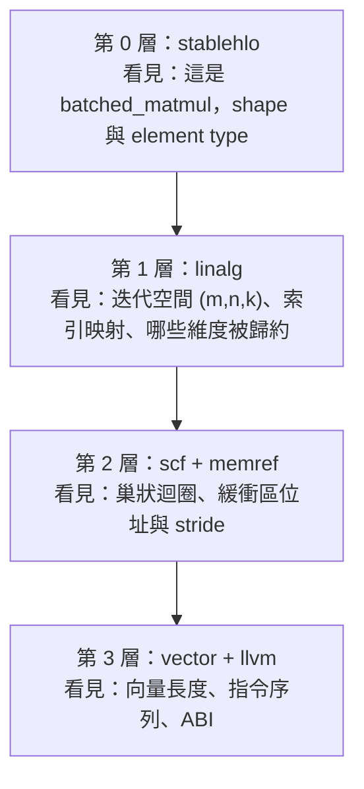

# 序章 0.2　多層中間表示法的核心哲學

> 本節導論：多層 IR 的設計原則是什麼？「恰如其分的抽象」這個說法在技術上意味著什麼？

## 0.2.1 抽象層級不是連續的，而是一個「資訊光譜」

初學者常以為，多層 IR 就是一條從高到低的階梯：

```
抽象數學 → 張量 → 迴圈 → 指令 → 位元
```

這個直覺是對的，但太粗糙。真正決定一個 IR 層級價值的，不是它的「高度」，而是**它保留了哪些資訊、丟棄了哪些資訊**。

我們可以用一個更精確的方式來刻畫：每個 IR 層級 $L$ 對應一個資訊集合 $I(L)$ ，也就是該層能夠「看見」的程式性質。對一個程式 $P$ ，一個最佳化 $O$ 能被施加的充要條件可以粗略寫成：

$$
O \text{ 可施加於 } P \iff \text{所需資訊} \in I(L)
$$

例如：

* **算子融合** 需要知道「哪些運算在資料流上相鄰且形狀相容」→ 需要 $I(L)$ 包含 *算子層級的資料流圖與形狀*。
* **向量化** 需要知道「迴圈的迭代空間與記憶體存取模式」→ 需要 *迭代空間*。
* **Tiling** 需要知道「迭代空間的哪些維度可交換」→ 需要 *affine 依賴關係*。
* **迴圈展開** 需要知道「迭代次數是常數」→ 需要 *靜態 trip count*。
* **DMA 插入** 需要知道「緩衝區在哪、由誰寫、寫了多少」→ 需要 *別名與容量資訊*。
* **指令排程** 需要知道「目標的延遲與吞吐」→ 需要 *目標機模型*。

而**過早降階的後果**，用這個符號寫出來就是：

$$
\text{降階後 } I(L_{i+1}) \subset I(L_i) \quad\Longrightarrow\quad \text{某些最佳化} \; O \notin \text{可施加集合}
$$

也就是說，**每一次降階都是一次資訊的不可逆刪除**。MLIR 的設計哲學因此可以濃縮成一句話：

> **降階要盡可能晚，但每次只刪除下一層不再需要的資訊。**

「晚」是關鍵詞。降階太早，你失去最佳化機會；降階太晚，你失去抽象帶來的簡化與可攜性。

## 0.2.2 三條設計原則

### 原則一：語意守恆（Semantic Preservation）

降階是**語意等價變換**：變換前後的可觀察行為必須一致。這聽起來是廢話，但它在實務上有非常具體的含義。

MLIR 對此的處理方式是：**在每一步降階之後，IR 都必須是合法的（legal）**。具體來說：

* 每個 operation 都必須通過它的 verifier；
* 每個 operation 的 operand 必須由 dominate 的 definition 產生（SSA 支配規則）；
* 型別必須匹配；
* 在 SSACFG region 中，每個 block 必須有 terminator，且 terminator 的分支目標必須存在。

這意味著 MLIR 的降階不是「先轉換成一個奇怪的臨時表示，最後再修正」，而是**每一步都必須是合法的、可被驗證的、可被獨立測試的**。

這個要求帶來一個漂亮的工程後果：**降階管線中的任何一步失敗，都可以精確指出是哪一步壞了**。相較之下，傳統編譯器常見的做法是「先降階成一個所有東西都被壓扁的通用形式，然後再想办法重構回去」，一旦出錯就難以追蹤。

### 原則二：漸進式降階（Progressive Lowering）

「漸進式」意味著：

1. **每一步只做一件事。** 「把 linalg 降到 memref + scf」是一個轉換；「把 memref 降到 llvm」是另一個。它們在不同的 pipeline 位置，針對不同的目標而存在。
2. **每一步都可以有多個實作。** 同一個來源抽象，針對 CPU 與 GPU 有不同的降階路徑；針對 x86 與 ARM 有不同的最後一跳。這種多樣性是分層的自然結果。
3. **每一步都是可開關的。** pipeline 中的步驟是使用者可見的，這讓「為什麼我的程式變慢了」變成一個可觀測、可二分（bisect）的問題。

在 MLIR 中，漸進式降階由 `ConversionTarget` 表達（見 [5.2](05.2-DialectConversion框架.md)）：每個方言宣告「我合法、我不合法、或我部分合法（在某個子集下合法）」，然後 conversion driver 負責把不合法的地方改寫成合法的樣子。

### 原則三：可組合性（Composability）

可組合性有三個層面：

**機制層面**：pass 與 pass 之間不應該有隱含的耦合。MLIR 用 `Analysis` 宣告依賴（見 [4.3](04.3-Analysis快取與失效.md)），用 `preserve<>` 宣告失效邊界（見 [4.3](04.3-Analysis快取與失效.md)）。這讓 pipeline 可以被自由重排。

**方言層面**：不同方言之間的降階關係是宣告式的、可查詢的。當你需要「把所有 `linalg` op 降到 `scf`」時，你不需要知道 `linalg` 內部有多少種 op、它們各自怎麼降。

**硬體層面**：這是多層 IR 最大的 payoff。同一套高階與中階方言，可以在不修改一行的情況下支援一個全新的後端——因為後端只是在最後一跳提供新的方言與新的轉換。

## 0.2.3 「恰如其分」的數學化理解：資訊論觀點

我們可以把每個 IR 層級視為一個**編碼**（coding）：把原始程式的行為，編碼成一個特定的表示。而降階就是**重新編碼**。

在資訊論的框架下，一個好的層級設計追求的是：

$$
\underbrace{H(\text{behavior})}_{\text{行為的熵}} \approx \underbrace{H(\text{IR}_L)}_{\text{表示的熵}} + \underbrace{H(\text{IR}_L \mid \text{behavior})}_{\text{編碼冗餘}}
$$

直觀地說：

* $H(\text{behavior})$ 是程式行為本身包含的資訊量。
* $H(\text{IR}_L)$ 是該層表示所承載的資訊量。
* $H(\text{IR}_L \mid \text{behavior})$ 是「知道行為之後，表示還剩多少冗餘」——這個量衡量了表示的**緊湊性**。

對一個好的抽象層級，我們希望：

1. **足夠豐富**： $H(\text{IR}_L)$ 要足夠大，涵蓋下一層最佳化所需的資訊；
2. **足夠緊湊**： $H(\text{IR}_L \mid \text{behavior})$ 要足夠小，也就是表示要能**排除大量不可能的行為**。

第二點是「恰如其分」的真正含義：**抽象的價值不只在於它能表達什麼，更在於它排除了什麼。**

一個只會表達一切、卻不排除任何東西的表示，就是「什麼都能做、什麼都做不好」。這正是把一切壓成 LLVM IR 的風險。反過來，一個排除了太多東西的表示，會讓某些合法的程式無法表達——同樣是壞設計。

用這個觀點重新看幾個 MLIR 的設計決策：

| 設計 | 它排除了什麼 | 為什麼這是收益 |
| --- | --- | --- |
| `tensor`（值語意） | 排除了 aliasing 與 mutation | 讓「這個值被用過幾次」「能不能重排」變成可推理的問題 |
| `linalg.generic` + affine map | 排除了「任意 gather/scatter 索引」 | 索引映射是仿射的 → 可做 dependence analysis、可做 tiling |
| `scf.for` 的結構化限制 | 排除了任意 goto、任意循環 | 迭代空間顯式存在 → 可做 loop tiling、可做 unroll、可證明終止 |
| `affine` 的 restricted map | 排除了非仿射索引 | 可做完整的多面體合法性判定，代價是覆蓋率受限 |
| `memref` 的显式 layout | 排除了「隱式連續」 | layout 明確 → 可以真正重排資料、更換 layout（layout conversion） |

**「限制」就是抽象的價值**。這是抽象資料型別（ADT）理論裡的同一個道理：`List[T]` 排除 `Set[T]` 的無序性，代價是換來可預測的複雜度分析。

## 0.2.4 對比：AST、中間表示、指令集的三個極端

我們把常見的編譯器表示放在「資訊光譜」上比較：

| 表示 | 保留的語意 | 排除的 | 適合的最佳化 |
| --- | --- | --- | --- |
| AST | 語法樹的全部結構 | 執行語意的細節（除非轉成 IR） | 語言層級轉換、內建函式最佳化 |
| LLVM IR | 標量值 + 位址 + 數學 | 陣列形狀、迭代空間、領域算子 | 標量最佳化、向量化、指令選取 |
| MLIR `linalg` | 迭代空間 + 索引映射 + 元素語意 | 具體佈局、別名 | 融合、tiling、向量化 |
| MLIR `llvm` | 位址算術 + 控制流 | 幾乎所有高階資訊 | 指令選取、排程、暫存器分配 |

可以說 LLVM IR 是「**通用 IR**」：它假設所有前端都可以先丟掉領域資訊，所有後端都可以從純位址運算重建一切。MLIR 不是要取代這個通用 IR（`llvm` 方言仍然存在，而且還相當重要），而是要**在通用 IR 之上補上一層能被查詢與最佳化的領域資訊**。

一個更精確的比喻：MLIR 就像資料庫的**查詢最佳化器**。SQL 查詢可以在多個等價計畫之間選擇（nested loop / hash join / merge join），但你不能把它們全部壓成同一個「等價形式」——那會讓最佳化器無從選擇。MLIR 的每個抽象層級就是一個「等價計畫空間」，而 pass 就是「計畫空間上的搜尋」。

## 0.2.5 抽象層級選擇的實務準則

設計一個方言時，「它應該站在哪一層」是首要問題。以下是一些可操作的準則：

**準則一：從「這個 op 需要知道什麼才能被最佳化」倒推。**

如果一個 op 想知道「輸入張量是 4x4 還是 1024x1024」，那是**領域方言**（`stablehlo` / `tosa` 層）。
如果一個 op 想知道「迭代空間的維度是哪些」，那是**結構化方言**（`linalg` 層）。
如果一個 op 想知道「這個 loop trip count 是 128，可以展開成 4x32」，那是**迴圈方言**（`scf` / `affine` 層）。

**準則二：領域方言不該包含硬體常數，硬體方言不該包含領域語意。**

一個好的分界是：

* `npu.matmul` 描述「這是一個矩陣乘」——領域/硬體無關。
* `npu.pe.array` 描述「這綁定到 8x8 的 PE 陣列，容量 64 KB SRAM」——硬體相關。

前者可以對接到任何 NPU；後者只在特定硬體上有意義。

**準則三：每個方言都應該能夠回答「我能被降到哪裡」。**

一個方言若沒有任何合法的降階路徑，它就是死胡同。要麼它自己就是終點（`llvm`），要麼它必須宣告它的降階目標。

**準則四：如果一個 op 帶有太多屬性，它可能該被拆成多個 op。**

`npu.conv2d` 若帶有 `kernel_size`、`stride`、`padding`、`dilation`、`groups`、`layout` 等十幾個屬性，它其實是一個「家族」而不是一個 op。MLIR 的做法是讓 op 保持小而精（`tosa.conv2d` + `tosa.depthwise_conv2d`），並用屬性表達變體。

**準則五：可組合性優於表達力。**

如果為了表達一個 op 而不得不加入 `region`，那要非常謹慎——region 會讓 verifier、pattern 匹配、canonicalization 都變複雜。但如果一個 op 天然含有內部結構（例如一個 loop nest、一個 MMA 指令序列），那用 region 表達反而比用一堆屬性好。

## 0.2.6 一個貫穿全書的範例

為了讓抽象層級的討論具體化，本書將在第四部實作一個**貫穿的範例方言**，暫定名為 `npu`（Neural Processing Unit）：


這個方言的價值在於：它讓「領域方言」與「硬體方言」的邊界變得可見。`nn.matmul` 可以在沒有 `npu` 的情況下存在（對接到 CPU 也能用），而 `npu.pe.mma` 完全綁定硬體。兩者之間由一個排程方言（`npu.tile`）連接。

這種「三段式」（領域 → 排程 → 硬體）的分解，是本書第 11 章的主軸，也是很多真實專案（例如 MLIR-based 的 TPU/NPU 編譯器）的實際結構。

## 0.2.7 多層 IR 的成本

誠實地說，多層 IR 不是免費的。以下是它的成本，讀者應該有意識：

**成本一：每一層都要學。** 一個工程師要理解 `tensor` → `linalg` → `scf` → `memref` → `vector` → `llvm` 的語意轉移，學習曲線比 LLVM IR 陡峭得多。

**成本二：轉換成本。** 每一次降階都要寫轉換、寫 verifier、寫測試。MLIR 上游有數百個方言 op，意味著有數百個這樣的轉換。

**成本三：中介表示可能過於抽象而失去最佳化機會。** `stablehlo` 層的抽象太粗，導致它無法直接編譯到 LLVM IR；必須先降階到 `linalg`/`tensor`，過程中可能丟失資訊。每一層都有它自己的「過於抽象」的風險。

**成本四：工具鏈複雜度。** 診斷訊息要跨層追蹤：一個錯誤可能是在 `linalg` 層產生、在 `memref` 層惡化的。MLIR 的 location 追蹤機制（每個 op 帶有來源位置）就是為了解決這個問題。

**成本五：碎片化。** 不同的專案各自發明類似的方言，導致生態系分裂。這個問題在 [12.3](12.3-方言生態碎片化與標準化.md) 中專門討論。

這些成本是真實的，也是「MLIR 是不是過度工程」的常見質疑。但要注意對照組：**如果不用多層 IR，這些成本並不是消失了，而是被轉嫁到了各個專案自己的工具鏈裡，而且每一個專案都要付一次。** 這正是 MLIR 的經濟學論證：把成本集中支付一次，然後讓所有參與者共用。

## 0.2.8 反面案例：過度抽象與過度具體

好的抽象層級不只靠「排除什麼」定義，也要靠「**避免兩種極端**」來定義。

### 極端一：過度抽象（過於高階）

**症狀**：這個方言裡的每個 op 都只說「這是什麼運算」，完全不說「資料在哪裡、怎麼排」。

**例子**：把整個卷積抽象成一個 `conv2d` op，形狀放在屬性裡，卻完全不涉及迭代空間與佈局。

**後果**：

* 無法做 tiling（不知道哪些維度可交換）；
* 無法做向量化（不知道哪個維度連續）；
* 無法做 bufferization（不知道誰寫誰讀）；
* 無法對接任何具體硬體（最後還是要全部降下去，而且降不下去）。

`stablehlo` 的 `convolution` op 就是處在這個位置。它不是沒有價值——它給了跨框架的穩定中介格式——但它**不能**是降階鏈的終點。

**MLIR 的設計啟示**：一個高階方言必須規劃好它的**降階路徑**。如果一個方言沒有明確的「下一層是誰」，那它多半是過度抽象。

### 極端二：過度具體（過於低階）

**症狀**：方言裡的 op 直接對應硬體指令，甚至包含暫存器編號、延遲週期數。

**例子**：自定義方言裡定義 `mma.sync.acc.r4f32` 這種 op。

**後果**：

* 硬體改版就要改 IR；
* 跨硬體移植不可能；
* 高階最佳化完全無從下手（迭代空間已被抹平）。

**MLIR 的設計啟示**：硬體特有資訊應該以**屬性**而非**新 op** 的形式表達。`npu.pe.mma` 若把 PE 陣列形狀（8x8）寫成屬性，就可以在不改 op 集合的情況下支援 16x16 的變體；反之，若寫成 `npu.pe.mma_8x8` 與 `npu.pe.mma_16x16` 兩個 op，就麻煩得多。

### 判斷準則

有一個簡單的測試可以判斷你的抽象層級是否合適：

> **如果這個 op 的某個屬性，在換一個目標硬體後就會變，那它應該是屬性。**
> **如果這個 op 的某個屬性，在換一個演算法後就會變，那它也應該是屬性（演算法差異應該用 region 或不同 op 表達）。**
> **如果一個 op 在換了演算法之後「看起來完全不一樣」，那它可能不該是同一個 op。**

以 `conv2d` 為例：kernel 大小、stride、padding、dilation、group 數都是**屬性**（換演算法時通常不變，換硬體時也不變）。但「1x1 卷積 vs 3x3 卷積 vs depthwise」在某些實作裡會走完全不同的硬體路徑——這時可以考慮拆成不同的 op，或引入一個更高階的抽象把它們統一。

## 0.2.9 一個完整的降階鏈：三層之間的資訊流

我們用一個具體例子把 [0.2.1](#021-抽象層級不是連續的而是一個資訊光譜) 的抽象說法落地：把一個 batched 矩陣乘從高階圖編譯到 CPU 機器碼，**每一層各自「看見」什麼**。



在第 0 層，能做的最佳化是**形狀相關的**（例如把 batch 維度與 m 維合併，因為它們連續）。做不到的是 tiling（不知道哪些維度可交換）。

在第 1 層，資訊量暴增：

* 知道 `k` 是歸約維度、知道 `m`/`n` 是平行維度；
* 知道 $C[m,n] = \sum_k A[m,k] \cdot B[k,n]$ 這個精確的存取關係；
* 於是可以判斷「把 `k` 切塊、把 `m` 切塊」是否合法（依賴關係可判定）；
* 可以做 producer/consumer fusion（相鄰的 `linalg` op 只要迭代空間相容就能合併）。

在第 2 層，資訊換了一個方向：**不再是「空間」，而是「記憶體」**。此時:

* 知道 `A` 的 buffer 是 row-major 且 stride 為 $(K, 1)$ ，即最內層維度的步幅是 1；
* 知道 `C` 是一塊新配置的緩衝區，與 `A`、`B` 沒有 alias；
* 於是可以做 loop interchange（把 `m` 換到外面以改善局部性）、可以決定要不要 copy-in 到 packed 佈局。

在第 3 層，資訊換成**目標相關**：向量長度是 8（AVX2 的 f32 是 8 寬）、是否有 FMA、呼叫慣例是 System V 還是 Windows。

**關鍵觀察**：這三層的資訊**互不重疊**。第 0 層的資訊在第 1 層還能推導出來（第 1 層的 shape 隱含了第 0 層的形狀），但第 1 層的資訊推不回第 0 層（你看到一個迭代空間，說不出它是矩陣乘還是卷積）。這是一個**單向的資訊流失**。

因此，一個好的降階鏈必須**在資訊還在的時候把它用掉**。第 0 層能做的形狀最佳化，不能留到第 2 層做——因為到第 2 層，矩陣乘已經變成一個三層巢狀迴圈，沒有人知道它原來是矩陣乘。

這也解釋了為什麼 `linalg` 存在的價值不在於「它比較 expressive」，而在於**它是一個資訊密度最高的停靠點**：迭代空間、索引映射、元素語意同時在場，而這三者正是絕大多數最佳化所需要的輸入。

## 0.2.10 思考題

1. 請用 [0.2.1](#021-抽象層級不是連續的而是一個資訊光譜) 的 $I(L)$ notation，描述你熟悉的某個編譯器（例如 LLVM、 或者某個硬體 SDK 的編譯器）在各個階段分別保留哪些資訊。
2. [0.2.9](#029-一個完整的降階鏈三層之間的資訊流) 說明第 2 層的資訊推不回第 0 層。請構造一個反例：某個資訊其實是可以推回去的嗎？（提示：想想 `linalg.matmul` 這個具體的 op。）
3. 假設你要在既有的 LLVM IR 流程中「局部」引入 MLIR（例如只把某個 pass 的輸出從 LLVM IR 改成 MLIR IR）。列出這件事在工程上最困難的三個地方。

## 0.2.11 抽象層級設計檢查清單

在設計或審查一個新方言時，可以逐條檢查以下項目。這份清單是前面各節的濃縮：

**關於抽象層級**

* [ ] 這個方言站在多層 IR 的哪一層？它與上下游的邊界在哪裡？
* [ ] 它「看見」的資訊集合 $I(L)$ 是什麼？哪些資訊它**刻意不**看見？
* [ ] 它有明確的降階目標嗎？如果它是終點，它對接的是什麼？
* [ ] 如果硬體換成另一種（GPU / CPU / NPU），這個方言需要修改嗎？如果需要，修改範圍有多大？

**關於 op 的設計**

* [ ] 每個 op 是否原子？它內部是否含有應該被顯式建模的結構（迭代空間、region）？
* [ ] 形狀、對齊、量化參數、tile 大小這些資訊，是以**屬性**表達而非以**不同的 op** 表達嗎？
* [ ] operand 與 result 的數目是否固定？若是可變的，是否使用了 ODS 的 segment size 機制？
* [ ] op 是否有明確的**副作用**語意？（純函數？讀寫記憶體？可能拋出？）

**關於可組合性**

* [ ] 這個方言能否與 `linalg` / `tensor` / `scf` 等既有方言共存於同一份 IR？
* [ ] 它的 pass 能否宣告對 `Analysis` 的依賴與失效（見 [4.3](04.3-Analysis快取與失效.md)）？
* [ ] 它能否被 `DialectConversion` 的合法性模型處理（見 [5.2](05.2-DialectConversion框架.md)）？

**關於工程紀律**

* [ ] 每個 op 都有 verifier 嗎？verifier 的成本是 $O(1)$ 嗎？
* [ ] 每個 op 都有往返測試（parse → print → parse 結果相同）嗎？
* [ ] 有沒有 FileCheck 測試覆蓋每個 op 的典型用法與邊界情況？
* [ ] 這個方言的名稱有前綴保護嗎？它與上游方言有重複嗎？

這份清單的實用版本可以貼在 PR 模板裡。**它的目的不是阻擋新方言，而是讓「這個方言的抽象層級是對的」變成一個可討論、可驗證的命題。**
## 0.2.12 這個抽象層級模型可以移植到哪裡？

「資訊光譜」與「恰如其分的抽象」不只適用於編譯器 IR。任何一個需要「在多個抽象層級上工作」的系統，都可以用同一個模型分析。

### 資料庫查詢最佳化

SQL 查詢在關係代數層、邏輯計畫層、物理計畫層、機器碼層各有不同的表示。查詢最佳化器的工作，正是在「同一組語意」的多個表示中搜尋。物理層知道「索引有 B+ 樹」——這與邏輯層的「等值 join」是同一件事的不同抽象，與 MLIR 中 `linalg` 與 `scf` 的關係完全同構。

### 作業系統的虛擬化

x86 指令、虛擬機指令、hypervisor 指令是三層。每一層保留的資訊不同：最底層保留中斷與頁表格式，中間層保留「這條指令要虛擬化什麼」。

### 神經網路模型

框架層的算子圖、編譯層的融合圖、硬體層的排程圖、機器層的指令序列。Triton 與 XLA 的關係正是「框架層與編譯層」的分界。

### 硬體設計

行為描述（Verilog）、RTL（邏輯閘與暫存器）、佈局（placement）與時序（timing）。CIRCT 的方言體系把這條鏈上的每一段變成一個明確的抽象層級。

**共同的結構**：每一層都是「同一份語意的一個更精確或更粗略的編碼」，而中間的轉換都是**受控的重新編碼**，其合法性都可以用某種「不變式」來檢查。MLIR 的 `Verifier` 與 `ConversionTarget` 就是這套「不變式」在編譯器領域的具體實現。

理解了這個模型，你會發現 MLIR 的很多設計決策其實是**必然的**：

* 為什麼要有 `Verifier`？因為每層都需要一個「這份表示合法」的判準。
* 為什麼要有 `ConversionTarget`？因為「降階」需要一個「什麼叫到達目標層」的判準。
* 為什麼要有 `Analysis` 與失效機制？因為每一層的查詢結果都只在該層有效。
* 為什麼 `Region` 必須有兩種語意？因為「有控制流」與「無控制流」是兩種本質不同的資訊結構。

## 小結與延伸閱讀

* 多層 IR 的本質是**資訊的分層保留**：每個抽象層級 $L$ 定義了一個資訊集合 $I(L)$ ，而最佳化的可施加性完全取決於所需資訊是否仍在集合內。
* 降階是資訊的不可逆刪除，因此原則是：**降階要盡可能晚，但每次只刪除下一層不再需要的資訊**。
* 「恰如其分的抽象」有兩面：足夠豐富以支援下層最佳化，足夠緊湊以排除不可能的行為。**限制就是抽象的價值**。
* 三條設計原則：語意守恆（每步降階後 IR 都合法）、漸進式降階（每步一件事、可開關）、可組合性（機制 / 方言 / 硬體三層）。
* 多層 IR 的成本是真實的（學習曲線、轉換量、碎片化），但相較於「每個專案各付一次」，集中支付是更經濟的選擇。

延伸閱讀：

* MLIR Rationale（設計理由）: <https://mlir.llvm.org/docs/Rationale/>。
* MLIR Dialect Conversion 說明: <https://mlir.llvm.org/docs/DialectConversion/>。
* Chris Lattner, *MLIR: Scaling Compiler Infrastructure for Domain Specific Computation*, 2021。
* Zhiren Zhu 等, *MLIR: Scaling Compiler Infrastructure for Domain Specific Computation* 相關演講（LLVM  conferences）。
* Wikipedia, *Abstraction (computer science)*：<https://en.wikipedia.org/wiki/Abstraction_(computer_science)>。
