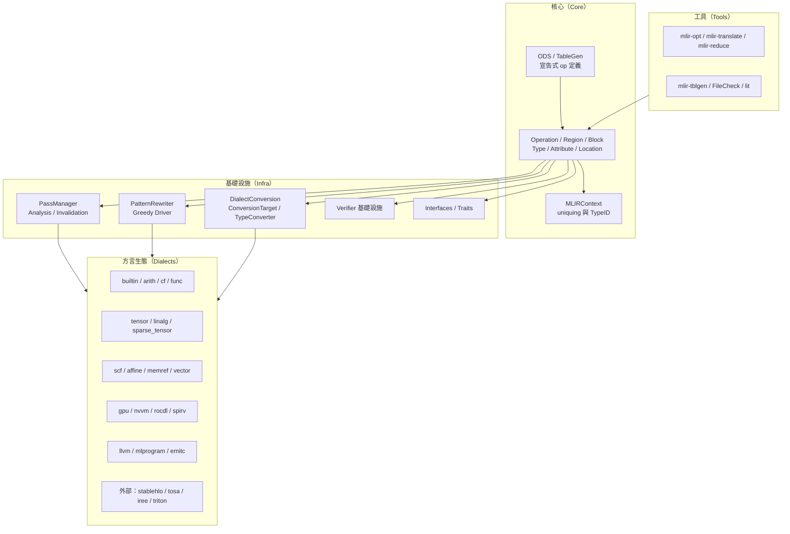

# 序章 0.3　MLIR 的誕生、設計目標與生態定位

> 本節導論：MLIR 是怎麼出現的？它的設計目標清單是什麼？它在今天的編譯器生態裡站在哪裡？

## 0.3.1 三個源頭的匯流

要理解 MLIR，最有效的方式是理解它的三個「基因來源」。

### 基因一：Google 的 XLA 與 GrFusion

XLA（Accelerated Linear Algebra）最初是 TensorFlow 的圖編譯器，目標是把 TensorFlow 的計算圖編譯成可在 TPU、GPU、CPU 上執行的程式。它的關鍵機制包括：

* **HLO（High-Level Operations）**：一種保留矩陣乘、卷積等高階算子語意的圖 IR。
* **GrFusion / GrOpGraph**：把多個低階 HLO 融合成單一高階 op 的「叢集」最佳化。GrFusion 是一套用 SMT 求解器（Z3）驗證叢集正確性的 fusion 框架。
* **指令層排程**：最終把 HLO 交給 PBQ（PrimitiveBufWriter）轉成 XLA HLO → LLVM IR 或 GPU 特定程式碼。

XLA 證明了「保留領域語意的多層 IR」在工程上是可行的，但它是一套**獨立的、與 LLVM 生態無關的**工具鏈。Google 內部同時存在多個類似系統（TensorFlow XLA、JAX XLA、Onnx Runtime、TFLite…），重複成本極高。

MLIR 的願景之一，就是把這類經驗**沉澱成通用的基礎設施**。

### 基因二：Halide、Polyhedral 與 isl

Halide（2013 年由 MIT 的 Jonathan Bachrach 與 Chris Tzekounakis 發表）提出了一個極具影響力的思想：**把計算語意與排程（schedule）分離**。

```c
Halide::Func f = ...
  .tile(x, y, xo, yo, xi, yi, 32, 32)
  .vectorize(xi)
  .parallel(yo);
```

Halide 的編譯器不需要猜：使用者明確給出排程，編譯器負責檢查排程是否合法（依賴關係是否被破壞），並產生硬體程式碼。這是「**宣告式 schedule**」的原型，也是 MLIR `transform` 方言的直接靈感來源之一（見 [12.4](12.4-編譯器最佳化與自動化搜尋.md)）。

在排程語言底下的多面體模型（Polygonal representation）由 Isabelle Fosserier 與 Alex Roshal 的 `isl`（Integer Set Library）工程化，提供了一套可判定合法性的多面體運算。

MLIR 的 `affine` 方言刻意**不**重現完整的 `isl` 能力（見 [8.2](08.2-affine多面體模型.md)），但保留了「迭代空間 + 仿射存取 + 可判定合法性」的核心。

### 基因三：LLVM 的基礎設施

LLVM 提供了 MLIR 賴以生存的幾乎所有「非 IR 部分」：

* **Pass 管理**：分層的 pass manager、analysis 管理、失效機制。
* **ODS 式宣告**：LLVM 自己就有 TableGen（用於 intrinsics、指令描述），MLIR 把它擴展成 ODS。
* **多目標架構**：如何把「目標無關的 IR」與「目標相關的 codegen」分開。
* **社群治理**：review 流程、回歸測試基礎設施（lit + FileCheck）、release 節奏。

**MLIR 的名字裡有 "LLVM"，正說明它是 LLVM 的延伸而非競爭對手。** 最後的 `llvm` 方言就是這個設計的具體體現：它把 MLIR IR 翻譯成 LLVM IR，交給既有的 LLVM 後端。

## 0.3.2 2021 年：MLIR 的公開

**2021 年 1 月 26 日**，Chris Lattner（LLVM 創作者、Clang 作者、Swift 語言的發起人之一）在 LLVM 官方部落格發表文章 *MLIR: Scaling Compiler Infrastructure for Domain Specific Computation*，正式公開 MLIR 計畫。

文章的論點可以濃縮為幾點：

1. **編譯器基礎設施應當支援領域特化計算**（domain specific computation），而不僅是通用的 C 語言編譯。
2. **IR 應當由多個抽象層級組成**，每個層級有自己的方言生態，而不是把所有東西壓成一個萬能 IR。
3. **可擴展性**（scalability）是首要考量：從手機到超算集群，編譯器必須能同時處理巨大與極小的程式。
4. **設計上應當保留最先進的編譯技術**（多面體最佳化、資料流排程等），而不是只做「教科書式」的編譯。

MLIR 計畫最初在 Google 內部發起，由 Chris Lattner 與 TensorFlow 團隊的成員推動，並吸收了 XLA 累積的經驗；"MLIR" 這個名稱在 2020 年底確定，隨後整個計畫被納入 **LLVM 專案**，並在 **2021 年 12 月隨 LLVM 14** 正式進入 LLVM 的 release 週期，成為 LLVM 的可選元件（`LLVM_ENABLE_MLIR` / `LLVM_EXPERIMENTAL_ENABLE_MLIR`）。

此後數年，MLIR 成為多個重要專案的基礎：

| 專案 | 領域 | 與 MLIR 的關係 |
| --- | --- | --- |
| **IREE** | 端側/邊緣 ML 編譯器與 runtime | 以 MLIR 為核心，自建 `iree.*` 方言體系 |
| **CIRCT** | 硬體（HLS、EDA） | MLIR 的硬體分支，共用基礎設施但有獨立方言體系 |
| **Torch-MLIR** | PyTorch 編譯 | 把 PyTorch 的 FX 圖編譯到 MLIR，再降到多個後端 |
| **TensorFlow** | 框架 | MLIR-based runtime 與 XLA v2 |
| **StableHLO** | 跨框架高階 IR | 以 HLO 為基礎的社群標準，作為中介格式 |
| **IREE / TensorFlow / JAX** | 編譯/runtime | 使用 `stablehlo` 作為跨框架 IR |
| **GCC MLIR**（GCC 15 起） | C/C++/Fortran | 把 MLIR 帶進 GCC |

## 0.3.3 設計目標清單

MLIR 的設計目標並非只有「多層 IR」一條。原始設計文件與後續的實踐，大致可歸納為以下幾條：

### 目標一：領域特化（Domain Specificity）

**目標**：允許編譯器為特定領域（機器學習、科學計算、硬體設計）提供專屬的表示與最佳化，同時共用同一套基礎設施。

**實踐**：`linalg`、`tosa`、`stablehlo`、`sparse_tensor`、`spirv`、`circt` 的 `hw`/`comb`/`seq` 等。

### 目標二：多層抽象（Multi-Level Abstraction）

**目標**：允許 IR 同時存在於多個抽象層級，且層與層之間的轉換是受控、可驗證的。

**實踐**：`DialectConversion` 框架、`ConversionTarget` 的合法性模型、partial conversion。

### 目標三：可擴展性（Scalability）

**目標**：同一套設計要能處理從 10 行程式到億行程式的編譯；要在單機到萬核叢集上都能工作。

**實踐**：context 的 unique 化避免重複資料、`Operation` 的 compact 表示、pass 的多執行緒、`transform` 方言把排程序列化以利於分散式搜尋。

### 目標四：保留先進最佳化技術

**目標**：不把編譯技術停留在「教科書水準」，要把多面體最佳化、資料流排程、量化的最新成果納入框架。

**實踐**：`affine` 方言、`transform` 方言、`linalg` 的結構化 op、`quant` 與 `sparse_tensor` 方言。

### 目標五：可驗證性與正確性

**目標**：IR 在任何時刻都必須是合法的；錯誤必須能被精準定位。

**實踐**：verifier 基礎設施、`Location` 追蹤、`--verify-diagnostics` 測試機制。

### 目標六：漸進式採用（Incremental Adoption）

**目標**：現有的編譯器可以只採用 MLIR 的一部分（例如只用 ODS 與 ODS 產生的 dialect，或者只把某個前端接到 MLIR），而不必全盤重寫。

**實踐**：MLIR 在 LLVM 14 中就是可選元件；`mlir-opt` 讓方言可以獨立於 LLVM 後端開發。

### 目標七：可攜性（Portability）

**目標**：同一份高階程式碼，經由不同的降階路徑，可以在 CPU、GPU、NPU 上執行。

**實踐**：`stablehlo` 作為跨硬體中介、`spirv` 作為跨 GPU 供應商中介、`linalg` 作為跨硬體結構化運算中介。

## 0.3.4 MLIR 的系統架構：核心與外圍

MLIR 的架構可以分成三圈：



**核心圈**極小，這是刻意的：MLIR 的核心只有一種資料結構（`Operation`）與一組容器（`Region`、`Block`）。所有方言都長在這上面。這使得：

* 新方言的實作成本極低（不需要繼承任何基類，只需要一個 dialect 類別與幾個 op 類別）；
* 跨方言的轉換天然可行（因為資料結構是同一種）。

**基礎設施圈**是「機制」，它不知道任何具體方言的存在。

**方言圈**是「政策」。這是 MLIR 與傳統編譯器最大的組織差異：**方言之間可以競爭，但機制是共用的。** 這解釋了為什麼 LLVM 的 `isl` / Polly 只能服務 LLVM IR，而 MLIR 的 `transform` 方言可以服務 `linalg`、`sparse_tensor`、`stablehlo` 等等。

## 0.3.5 與既有系統的定位比較

| 系統 | 抽象層級數 | 領域特化 | 可擴展性 | 成熟度 |
| --- | --- | --- | --- | --- |
| LLVM IR | 1（目標無關通用 IR） | 低（需外部工具） | 高 | 極高（2003–） |
| XLA / HLO | 2–3（圖 + 指令） | 高（ML） | 中 | 高（Google 內部 2010s–） |
| Halide | 2（計算 + schedule） | 中 | 中 | 中（2013–） |
| TVM | 2–3（tensor + schedule） | 高 | 中 | 中（2017–） |
| MLIR | 任意 | 極高 | 高 | 成長中（2021–） |
| CIRCT | 3–4 | 極高（硬體） | 中 | 成長中（2021–） |

**TVM 與 MLIR 的關係值得特別一提。** TVM（2017 年由清華大學 Tianqi Chen 等人提出）提供了「tensor + schedule + auto-tuning」的完整系統，在 ML 編譯器中影響深遠。MLIR 的 `transform` 方言在設計上吸收了 TVM 的經驗：把 schedule 變成 IR 的一部分，使其可被序列化、可被搜尋器生成。差別在於 TVM 的 schedule 是 Python 物件，MLIR 的 `transform` dialect 是 IR。

## 0.3.6 本書的讀者與使用方式

本書假設讀者具備：

* 對 C/C++ 與編譯器基礎（lexing、parsing、SSA、优化 pass）有基本認識；
* 對 LLVM IR 有概念性了解（不需要會寫）；
* 能讀懂 C++ 程式碼。

本書**不要求**讀者事先用過 MLIR。第二章會從 `Operation` 開始把核心資料結構講透；第四部則是完整的實作。

建議的閱讀路徑：

| 讀者 | 路徑 |
| --- | --- |
| 想快速上手寫方言 | 序章 → 第一部 → [6.3](06.3-除錯工具鏈.md) → 第四部 |
| 想理解編譯器架構 | 全書順序讀 |
| 做 ML / GPU 後端 | 第三部 → [9.2](09.2-GPU降階路徑.md) → 第四部 |
| 做 NPU / HLS | 序章 → 第三部 → 第四部 |
| 想研究編譯器最佳化 | 第二部 → [8.4](08.4-迴圈變換模式.md) → [12.4](12.4-編譯器最佳化與自動化搜尋.md) |

每章結尾都有「小結與延伸閱讀」，其中延伸閱讀盡量指向可以查證的官方文件路徑或公開論文，而不是需要憑記憶的敘述。

## 0.3.7 一個警告：MLIR 不是銀彈

MLIR 常被描述為「解決編譯器所有問題的框架」，這個說法需要澄清。

**MLIR 解決的問題**：多個領域特化編譯器之間重複造輪子的問題；多層降階缺乏統一機制的問題；IR 抽象層級選擇僵化的問題。

**MLIR 沒有解決、也不可能解決的問題**：

* **最佳化本身的品質。** MLIR 提供機制，不提供最佳化演算法。MLIR 的 `transform` 方言提供搜尋空間，但搜尋空間設計得好不好、評估函式準不準，仍然是研究問題。
* **硬體知識。** 「NPU 的 PE 陣列是 8x8」這種知識必須由硬體團隊提供，MLIR 不會自動知道。
* **工程成本。** 每個方言都需要 verifier、轉換、測試、文件。這是實實在在的人力成本。
* **領域語意的正確建模。** 「什麼是一個卷積」這個問題，MLIR 只提供表達它的機制，不提供正確的答案。

抱著這個心態，MLIR 才會被用在正確的地方：**當你的問題是「IR 抽象層級不對」或「要在多個硬體上重用編譯基礎設施」時，MLIR 是對的工具；當你的問題是「我的迴圈变换不够好」，MLIR 只是讓你更容易改進它。**

## 0.3.8 上游治理：MLIR 是怎麼長大的

MLIR 的成功不只來自設計，也來自**它如何被治理**。這對讀者理解「為什麼今天 MLIR 長成這個樣子」很重要。

### 設計的決策中心

MLIR 的重要設計決策由一個叫做 **design meeting** 的機制決定：任何一個新的方言、新的轉換框架、新的 trait，都需要在設計會議上被討論。這個機制的價值在於：

* **避免重複設計**。例如 `scf` 與 `affine` 兩套迴圈方言在設計初期被明確區分（`scf` 是通用的結構化控制流，`affine` 是帶多面體保證的子集），避免後來的 `cf` + `scf` + `affine` 三方重疊。
* **保留分歧意見的紀錄**。許多「為什麼不這樣做」的決定，在 MLIR 的 Rationale 文件中有記錄。

### 上游准入標準

一個方言要進入 LLVM 上游，必須滿足若干條件（細節隨時間演變，但大致方向穩定）：

* 必須有**多於一個**下游使用者（避免為了單一專案而上游化）；
* 必須有**完整的文件**與**回歸測試**；
* 必須遵守**命名規範**（保留前綴，避免與其他專案衝突）；
* 必須證明**無重複**——也就是說，不能只是把既有的社群方言原封不動搬進來。

第三點與第四點在實務上造成了大量「方言留在社群、上游只放接口」的結果（例如 `stablehlo` 留在社群，MLIR 上游放的是 `tosa` 與通用框架）。這反映了一個務實的認知：**上游化的成本不低，應當只把真正通用的部分上游化**。

### 從「單一專案」到「生態系」

MLIR 的一個重要演進是從「一個好用的 IR 框架」變成「一個有治理、有版本相容性策略、有跨專案整合測試的生態系」。這需要處理一些在純技術層面看不到的問題：

* **版本相容性**：方言可以帶 `dialect.version` 屬性，用來聲明「這個方言是第幾版的格式」，讓不同時期產生的 IR 能被正確解讀。
* **棄用流程**：`deprecated` 標記與遷移指南，讓上游可以演進而不破壞下游。
* **重複方言的治理**：當社群方言與上游方言功能重疊時，需要有辦法收斂。

這些在 [12.3](12.3-方言生態碎片化與標準化.md) 中會有更詳細的討論。

## 0.3.9 一個技術時間軸：MLIR 的機制如何逐步長出

MLIR 的各種機制不是同時出現的，而是隨著需求逐步長出來的。理解這個順序，有助於理解每個機制「為什麼長這樣」。

| 時期 | 新增的機制 | 驅動需求 |
| --- | --- | --- |
| 2021 | ODS、`Operation`/`Region`/`Block`、PassManager 移植、Trait | 需要一個能支撐數百個 op 的宣告式基礎設施 |
| 2021–2022 | `DialectConversion`、`ConversionTarget`、`TypeConverter` | 純 pattern rewrite 無法保證「降階完成」，需要合法性模型 |
| 2022 | `transform` 方言、`linalg` 的 payload 風格化 | 需要可宣告式、可序列化的排程描述 |
| 2022–2023 | `bufferization` 框架、`tensor` 與 `memref` 的分離 | `tensor` 語意的 bufferization 是一個全系統問題，需要專門的框架 |
| 2023 | `PDL`（Pattern Definition Language）、`pdl_interp` | 需要把 pattern 從 C++ 搬到 IR 裡，以支援自動生成與解譯 |
| 2023–2024 | `sparse_tensor`、`quant` 的擴充、`ub` 方言 | 稀疏與量化是兩個真實的領域，需要領域方言支援 |
| 2024– | 工具鏈整合（`mlir-opt` 的 LSP、`mlir-reduce`）、Python binding 強化 | 讓 MLIR 可被 IDE 與工具鏈使用 |

這張表說明一件事：**MLIR 的機制總是「被真實需求拉出來的」，而不是「先設計好架構再去找需求」**。這也是為什麼閱讀 MLIR 原始碼時會看到某些 API 設計得不太對稱——它們反映的是需求出現的順序。

同時它也解釋了為什麼本章一開始列出的「設計目標」並不是一次成型的。MLIR 的實際發展過程更接近：

$$
\text{設計目標} \approx \lim_{k \to \infty} \text{反覆修正後的共識}
$$

## 0.3.10 思考題

1. 閱讀 [0.3.9](#039-一個技術時間軸mlir-的機制如何逐步長出) 的表格，選出你認為「早就該有、卻花了最久」的機制，並說明為什麼它難。
2. 假設你要為一個新的領域（例如自動駕駛的感知堆疊）設計一個方言。根據 [0.3.7](#037-一個警告mlir-不是銀彈)，列出三個你**不應該**指望 MLIR 幫你解決的問題。
3. [0.3.3](#033-設計目標清單) 列出的七個目標，你認為哪一個在實務中最常被低估？

## 0.3.11 如何閱讀 MLIR 的原始碼

MLIR 是一個大型專案，新手最常見的挫折是「不知道從哪裡開始看」。這裡給出一條可行的路徑，這條路徑也正是本書的章節順序所反映的路徑。

### 第一步：先看語言參考，不要先看原始碼

`docs/LangRef.md` 是 MLIR 的「語言手冊」，它用最短的篇幅描述了 IR 的完整語法。讀完它，你就知道：

* 什麼是 Operation、Region、Block；
* 通用格式（generic form）長什麼樣；
* 屬性、型別、位置怎麼寫。

這一步大約需要 30 分鐘，但省下後面數小時的猜測。

### 第二步：用 `mlir-opt` 動手，而不是讀 C++

MLIR 最好的學習材料是**可執行的範例**。先建立一個 toy 專案：

```bash
# 用 CMake 引入 MLIR
find_package(MLIR REQUIRED CONFIG)
list(APPEND CMAKE_MODULE_PATH "${MLIR_CMAKE_DIR}")
list(APPEND CMAKE_MODULE_PATH "${LLVM_CMAKE_DIR}")

include(AddMLIR)
include(TableGen)
include(AddLLVM)
include(HandleLLVMOptions)

add_executable(my-opt my-opt.cpp)
target_link_libraries(my-opt PRIVATE MLIROptLib MLIRIR)
mlir_check_all_link_libraries(my-opt)
```

然後寫一個最小的 dialect，註冊到 `my-opt`，用它印出、轉換自己的 op。**能跑起來比讀懂重要**，因為 MLIR 的抽象很多是「跑起來才知道它的行為」。

### 第三步：沿著三條主線讀原始碼

| 想理解的東西 | 從哪裡開始讀 |
| --- | --- |
| 資料結構與生命週期 | `lib/IR/Operation.cpp`、`lib/IR/Block.cpp`、`lib/IR/Region.cpp` |
| pass 與轉換機制 | `lib/Pass/`、`lib/Transforms/`、`lib/Conversion/` |
| 表格生成（ODS） | `include/mlir/TableGen/`、`tools/mlir-tblgen/`、`lib/TableGen/` |
| 驗證與診斷 | `lib/IR/Verifier.cpp`、`include/mlir/IR/Verifier.h`、`lib/IR/Diagnostics.cpp` |
| 一個真實的方言 | `include/mlir/Dialect/Linalg/`、`lib/Dialect/Linalg/` |

### 第四步：從測試反推語意

MLIR 的測試目錄 `test/` 本身就是最好的規格文件。每個 `.mlir` 測試檔的開頭都有 `// RUN:` 行說明這個測試怎麼跑，後面是 `// CHECK:` 說明預期輸出。

**讀測試比讀實作更快理解一個 pass 的行為**，因為測試是「輸入 → 預期輸出」的配對，比數千行 C++ 有效率得多。

### 第五步：注意版本差異

MLIR 的 API 變動相當快（例如 `bufferization` 框架、`transform` 方言、`PDL` 都在演進中）。讀網路上的部落格文章時，一定要注意文章對應的 LLVM 版本。本書盡量描述「長期的設計意圖」，而不是「特定版本的 API 細節」；當需要具體 API 細節時，請以你手頭的 LLVM 版本的 `docs/` 為準。

## 小結與延伸閱讀

* MLIR 的三個基因來源：Google XLA/GrFusion（圖層 IR 與融合）、Halide/Polly（宣告式 schedule 與多面體模型）、LLVM（pass 管理、ODS 式宣告與多目標架構）。
* 2021 年 1 月 26 日 Chris Lattner 公開 MLIR；2021 年 12 月隨 LLVM 14 進入 LLVM 專案。
* 七項設計目標：領域特化、多層抽象、可擴展性、保留先進最佳化技術、可驗證性、漸進式採用、可攜性。
* 架構分三圈：極小的核心（`Operation` 與容器）、共用的機制（PassManager / Rewriter / Conversion / Verifier / Interface）、競爭的方言生態。
* MLIR 提供機制而非最佳化演算法；它解決的是「抽象層級」與「基礎設施重用」問題，不是「最佳化品質」問題。

延伸閱讀：

* Chris Lattner, *MLIR: Scaling Compiler Infrastructure for Domain Specific Computation*, LLVM Blog, 2021-01-26：<https://blog.llvm.org/2021/01/mlir-scaling-compiler-infrastructure-for-domain.html>。
* MLIR 官方網站與文件：<https://mlir.llvm.org/docs/>。
* MLIR Rationale：<https://mlir.llvm.org/docs/Rationale/>。
* Jonathan Bachrach 等, *Halide: A Language and Framework for Portable Parallelism*, 2013（LLVM 的一篇 post）。
* Wikipedia, *LLVM*：<https://en.wikipedia.org/wiki/LLVM>；*Halide*：<https://en.wikipedia.org/wiki/Halide>。
