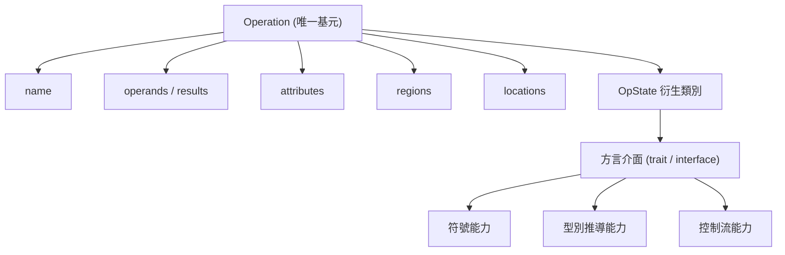
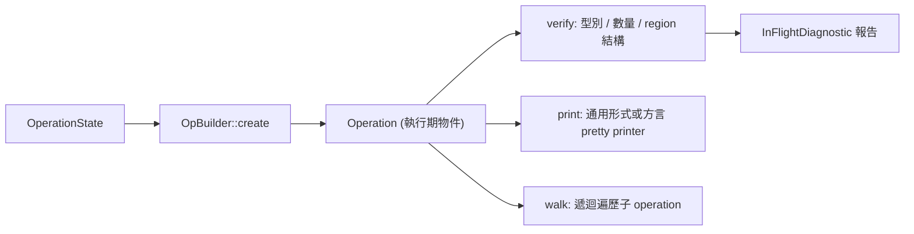

# 1.1 一切皆 Operation

前一節我們描述了 MLIR 的整體願景：一個可以在多個抽象層之間漸進式降階的異質編譯器基礎設施。但願景要落地，必須先回答一個更根本的問題——IR 的最小組成單位是什麼？

在 LLVM 的世界裡，答案很明確：值（`Value`）。`Instruction` 只是「會產生值或使用值」的容器，模組、`Function`、中繼資料都是值或值的容器。這個設計在單一抽象層的世界裡很好用，因為 IR 只有一種形狀。然而 MLIR 要同時容納 `affine.for`、`gpu.kernel`、`linalg.matmul`、`llvm.call` 這結構迥異的操作時，發現「一切都是值」不夠用了。

MLIR 的答案是：**一切皆 Operation**。`Operation` 是 IR 中唯一的抽象基元。值、區塊、區域、模組、函式，全部都是 `Operation` 的某種投影。這是 MLIR 與 LLVM 在哲學上最根本的分野，也是本章要逐項拆解的內容。

## Operation 的六大構成

一個 `Operation` 在記憶體中承載六類資訊：

| 構成 | 型別 | 角色 |
|---|---|---|
| name | `OperationName` | 操作身分（例：`arith.addf`） |
| operands | `ValueRange` | 輸入值（SSA 使用） |
| results | `MutableResultRange` | 輸出值（SSA 定義） |
| attributes | `DictionaryAttr` | 編譯期常數與詮釋資料 |
| regions | `MutableRegionRange` | 內嵌的 IR 容器 |
| locations | `Location` | 來源位置資訊 |

這六項的排列組合，就是 MLIR 語言的全部表達能力。任何一個方言操作，本質上都是這六項的一個特定實例。

讓我們從最小的完整例子開始：

```mlir
%0 = arith.addf %a, %b : f32
```

拆解成六項：

* name 是 `arith.addf`；
* operands 是 `%a` 與 `%b`；
* results 是 `%0`（單一結果，型別 `f32`）；
* attributes 為空；
* regions 為空；
* location 指向產生這行指令的原始碼位置。

再看一個把六項全部用滿的例子：

```mlir
%0 = "scf.if"(%cond) ({
  %1 = arith.addf %x, %y : f32
  scf.yield %1 : f32
}, {
  %1 = arith.mulf %x, %z : f32
  scf.yield %1 : f32
}) -> (f32) {some_flag = true} loc("test.mlir":12:5)
```

這裡 name 是 `scf.if`，operands 是 `%cond`，results 是 `%0`，attributes 含有 `some_flag`，regions 有兩個（then 與 else），location 指向 `test.mlir` 第 12 行。**單一物件承載了結構化控制流、條件選擇與中繼資料三種資訊**，這在 LLVM IR 裡需要 `phi` 節點、`switch` 指令與 metadata 分開表達。

## OpState 與 Operation 類別的關係

MLIR 用兩層類別來表示操作，這是新手最常困惑的地方。

`mlir::Operation` 是所有操作的**統一執行期表示**，它是一個非虛擬類別（non-virtual），所有方言共享同一份二進位佈局。它的好處是 storage 只需要一份、遍歷不需要虛函式呼叫。

`mlir::OpState` 則是**方言操作類別的共同基底**。當你用 TableGen 定義一個操作時，生成的 C++ 類別會繼承 `OpState`：

```cpp
class AddFOp : public OpState {
public:
  using Op::OpState;
  static StringRef getOperationName() { return "arith.addf"; }

  static void build(OpBuilder &builder, OperationState &state, Value lhs, Value rhs,
                    FloatType type);
  Value getLhs();
  Value getRhs();
  void setLhs(Value value);
};
```

兩者之間的關係是**一個 `Operation` 執行期物件對應多個可能的 C++ 類別**。也就是說，執行期拿到一個 `Operation *`，想知道它是不是 `arith.addf`，有兩種做法：

1. 查 `OperationName` 的字典（name-based lookup）；
2. 轉型成 `AddFOp`（type-based lookup）。

`OpState` 內部其實就是持有 `Operation *`，並提供 `getOperation()` 把它取回來。因此：

```cpp
void AddFOp::setLhs(Value value) {
  (*this)->setOperand(0, value);
}
```

`*this` 是 `Operation *`。這種「同一份資料、兩種視圖」的設計，是 MLIR 能同時支援「泛用反射式遍歷」與「強型別 accessor」的原因。

關鍵在於：**`OpState` 不是 polymorphic 的**。它沒有虛函式表，所有 accessor 都是由 TableGen 生成的、針對該操作編譯時期就知道的操作碼（opcode）編碼。`Operation::getName()` 回傳一個整數 ID，用來在全域的 operation table 中索引，效率接近陣列查表。

```cpp
mlir::Type f32Type = builder.getF32Type();
Operation *op = builder.create<arith::AddFOp>(loc, lhs, rhs, f32Type);

// 等價的泛用寫法（但沒有型別檢查）
Operation *generic = builder.create(arith::AddFOp::getOperationName(),
                                   {lhs, rhs}, f32Type);
```

## Operation 的生命週期與 uniquing

`Operation` 的生命週期由 `Operation *` 這個裸指標手動管理，這與 C++ 的 `std::shared_ptr` 風格不同。MLIR 的選擇理由是性能：IR 在編譯過程中會被大量複製與改寫，reference counting 的原子操作成本會成為瓶頸。

生命週期的幾個關鍵規則：

* **父容器擁有子 Operation**。一個 `Operation` 屬於它最外層包含它的 `Region`，而 `Region` 屬於某個 `Operation` 的 `regions` 欄位。刪除父 Operation 會連帶刪除所有後代。
* **頂層 Operation 由 `MLIRContext` 的 `ownsOperation` / `destroy` 管理**。
* **Operation 只能被 move，不能被 copy**。複製必須顯式呼叫 `Operation::clone(IRMapping &mapper)`，這是刻意設計——複製 operation 時它的 operands 需要重新映射到新的位置。

```cpp
// 正確的複製方式：clone 會把 operand 映射到新位置
IRMapping mapper;
ModuleOp clonedModule = moduleOp.clone(mapper);

// 頂層 operation 的擁有者是 MLIRContext
MLIRContext *ctx = moduleOp.getContext();
```

`IRMapping` 扮演的是「舊值到新值」的對應表，在 clone 的過程中把 operands 與 block arguments 一併替換。

### OperationName 與 uniquing

Operation 沒有可變的「名稱」欄位。所謂操作的名字（`arith.addf`）其實是 `OperationName`，而 `OperationName` 是**全域唯一化（uniqued）**的：同一個 context 裡，同一個字串名字只會對應到一個 `OperationName` 實例。

```cpp
OperationName name = OperationName("arith.addf", context);
// name2 == name，因為 context 內已 uniqued
OperationName name2 = OperationName("arith.addf", context);
assert(name == name2);
```

uniquing 的好處是：名字的比較退化為**指標比較**，這讓 `Operation::getName()` 在遍歷中幾乎零成本。背後的實作是一個 `StringMap<OperationName>`，把字串映射到堆上的 `OperationName` 物件。

名字裡除了方言前綴，還可以帶一組 **traits**：

```mlir
"test.myop"() {traits = ["NoTerminator"]} : () -> ()
```

traits 描述的是「這個操作的 region 應該怎麼被驗證」，例如 `NoTerminator` 表示區域不需要以 terminator 結束。這些 trait 會被記錄在 `OperationName` 裡，在操作被建立時就決定驗證規則，不必等到驗證階段才去查字串。

### Mangler：名字的外部表示

IR 內部的名字是 `arith.addf` 這種帶點的結構，但外部世界（assembler、symbol table、pretty printer）需要一個單一的平坦字串。MLIR 提供了 `Mangler` 來做這件事。

```cpp
// 將 OperationName 轉成合法的 MLIR 識別字
std::string mangled;
raw_string_ostream os(mangled);
Mangler mangle;
mangle.printOpName(getName(), os, /*isProlog=*/false);
// 結果類似 "arith.addf"；對於含特殊字元的名字會加引號
```

`Mangler` 也處理**重複消歧**。當同一個 scope 內有兩個同名符號，pretty printer 會在後面加上數字後綴：

```mlir
func.func @foo() { ... }
func.func @foo_0() { ... }
```

這個消歧過程由 `AsmState` 與 `SSANameState` 協作完成，是 `mlir::OpPrintingFlags` 之外的另一條路徑。

## use-list：SSA 使用者列表的維護

`Operation` 不只有一個 operands 欄位；在 SSA 形式中，一個 `Value` 可能被多個 op 使用。MLIR 為每個 `Value` 維護一條**使用列表（use-list）**，這是編譯器中最基礎的資料結構之一。

MLIR 的 `Value` 抽象成兩類：

* `OpResult`：`Operation` 的某個 result，由 op 擁有。
* `BlockArgument`：`Block` 的參數，由 block 擁有。

兩者都繼承自 `Value`。`Value` 內部指向一個 `detail::ValueImpl` 的基類，其中 `OpResultImpl` 多存了一份「使用此值的 op 列表」的指標。

```cpp
// 一條 use-list 的節點
struct UseNode {
  Operation *owner;   // 使用此值的 operation
  unsigned operandNo; // 在 owner 的 operands 中的索引
  UseNode *next;      // 下一個使用者
};
```

使用列表的典型用途：

1. **RAUW（ReplaceAllUsesWith）**：把一個值換成另一個值。
2. **DCE（Dead Code Elimination）**：找出沒有使用者的 op。
3. **Pattern 重寫**：找出某個 op 的使用者並改寫它們。

```cpp
// RAUW 的概念流程
void replaceAllUsesWith(Value from, Value to) {
  from.replaceAllUsesWith(to);
}
// 這會把 from 的每一條 use-list 節點的 owner->operands[operandNo] 換成 to
```

`Operation::replaceAllUsesWith` 的實作本質是遍歷 `from` 的使用列表，並對每個使用者呼叫 `setOperand(operandNo, to)`。每次 `setOperand` 又會把節點從 `from` 的列表移到 `to` 的列表。

在 C++ 層，MLIR 也提供了迭代器，方便寫 pattern：

```cpp
// 走訪 op 的所有使用者
for (Operation *user : op->getUsers()) {
  // ...
}
```

`OpOperand` 是「(operation, operand index)」的配對，`OpResult` 也是類似的配對。它們讓 `replaceOp` 這類 API 可以精確表達「把第 3 個 operand 換掉」。

## Operation 在 C++ 與 Python 中的可見性差異

這是 MLIR 新手常踩的坑：**MLIR 中並不是所有 Operation 都有對應的 C++ 類別，Python 也一樣**。

C++ 側的情況：

* 由 TableGen `def` 產生的操作有 `OpState` 衍生類別，可用 `cast<arith::AddFOp>(op)`。
* **外部方言（external dialect）**或用 `let cppNamespace` 隱藏的操作，可能沒有生成可用的類別。此時只能用 `Operation *` + name-based API。

```cpp
// 沒有對應 C++ 類別時的操作，只能用泛用 API
Operation *op = block->front();
if (op->getName().getStringRef() == "my_ext.myop") {
  // 用 getAttr / setAttr 操作
  op->setAttr("mode", builder.getStringAttr("fast"));
}
```

Python 側的差異更明顯：

* Python binding 是 C++ binding 的子集，只綁定了 `OpState` 衍生的方言操作。
* **Dialect 的 Python 類別只暴露部分能力**。例如 `func.FuncOp` 在 Python 中可以建立，但 `Region` 的操作要透過 `Region` 物件的 `blocks` 屬性操作。
* Python 中大量使用 `PyOperation`/`PyOpView` 這類泛型包裝：

```python
from circt.ir import Module, Context
from circt.dialects import func

with Context() as ctx, Location.unknown(ctx):
    module = Module.create()
    f = func.FuncOp("main", ([], []))
    entry = f.add_entry_block()
    with InsertionPoint(entry):
        func.ReturnOp([])
    module.operation.verify()
```

Python 綁定中，**未知的操作**會退化成 `PyOpView`，其屬性存取會轉發到 C++ 的 `Operation` 方法（`getAttr` / `setAttr`）。若要寫跨方言的通用 Python 工具程式，就必須假設拿到的是 `PyOpView`。

另外，Python 的 `Module.create()` 回傳的是一個 `Module` 物件而非 `ModuleOp`——因為 `ModuleOp` 本身沒有 Python 類別；`mlir::ModuleOp` 在 C++ 裡是 `Op<>` 衍生的，但在 Python 中 `Module` 類別扮演的是「持有 ModuleOp 的 owner wrapper」。

## 多層 IR 裡 Operation 作為唯一抽象基元

現在可以回答本章開頭的問題：為什麼 MLIR 選擇「一切皆 Operation」？

理由有三層。

**第一，結構化的表達力。** LLVM IR 是扁平的操作序列，控制流靠 `br` 與 `phi` 節點編碼。MLIR 的 `Operation` 內建 `Region`，所以一個操作可以直接擁有巢狀的 IR：

```mlir
"test.container"() ({
^bb0(%arg0: i32):
  "test.inner"() : () -> ()
  "test.container.yield"() : () -> ()
}) : () -> ()
```

這讓「一個操作 = 一個具有巢狀語義的建構」成為可能，而不是把巢狀結構拆平成 `br` 與 `phi`。

**第二，統一的驗證與重寫。** 因為所有東西都是 `Operation`，`Operation::verify()` 可以遞迴驗證整棵樹；`RewritePattern` 可以匹配任意層級的 op；`Region` 可以被 `walk` 遍歷。沒有例外條目。

**第三，也是最關鍵的：Operation 是「方言介面」的載體。** MLIR 把語言特性拆成可組合的介面（interface）：`SymbolOpInterface`、`CallGraphOpInterface`、`RegionBranchTerminatorOpInterface`、`InferTypeOpInterface` 等。當一個操作繼承某個介面時，它就自動獲得相應的能力。

```cpp
// 一個操作實作某個 dialect interface
class MyCallOp
    : public Op<MyCallOp, OpTrait::VariadicOperands, OpTrait::OneResult,
                OpTrait::ZeroRegions, CallGraphOpInterface::Trait> {
public:
  StringRef getCallee() { return getCalleeAttr().getValue(); }
  void setCallee(StringRef name) {
    setCalleeAttr(StringAttr::get(getContext(), name));
  }
};
```

這就是 MLIR 的「漸進式降階」得以成立的原因：每一層方言只宣告自己需要的介面，轉換框架則依介面而非名稱來配對規則。



在這個圖裡，`Operation` 是根，而所有擴展機制都是掛在它上面的。`name` 決定了它在語言中的身分，`attributes` 承載編譯期常數，`regions` 承載巢狀結構，其餘三項則把它與外部世界（符號表、型別系統、來源資訊）連結起來。

下一節我們會沿著 `Operation` 的 `regions` 往下鑽：region 裡裝的是 `Block`，block 裡裝的是 `Operation`，而 block 的參數（`Block Argument`）正是 MLIR 取代 LLVM `phi` 節點的關鍵設計。

## 建構 Operation：OpBuilder 與 OperationState

理解資料結構之後，還需要理解這些資料結構是怎麼被產生的。MLIR 提供兩條建構路徑：一條是泛用的 `OperationState`，另一條是 TableGen 產生的 `build` 方法。

`OperationState` 是一個暫時的、可填空的建構描述：

```cpp
OperationState state(loc, "test.myop");
state.addOperands({lhs, rhs});
state.addTypes(resultType);
state.addAttribute("mode", builder.getStringAttr("fast"));
state.addRegion();
Operation *op = builder.create(state);
```

在 `OperationState` 被 `builder.create(state)` 消耗之前，它只是一個純資料的暫存區。這帶來一個好處：**建構與插入可以分離**。例如一個 op 需要在被插入之前先知道插入位置（因為 region 內的 block 順序會影響語意），就可以先建後插。

TableGen 產生的 `build` 則是型別安全的版本，它在內部建立 `OperationState` 並呼叫 `builder.create<MyOp>(...)`：

```cpp
void MyOp::build(OpBuilder &builder, OperationState &state, Value lhs, Value rhs) {
  state.addOperands({lhs, rhs});
  state.addTypes(builder.getI32Type());
}
```

`OpBuilder` 本身持有 `MLIRContext *` 與當前的 `InsertionPoint`。`InsertionPoint` 決定了新 op 插到哪裡：

```cpp
// 在 block 末尾插入
builder.setInsertionPointToEnd(block);
builder.create<arith::ConstantOp>(loc, builder.getI32Type(),
                                     builder.getI32IntegerAttr(42));

// 在某個 op 之後插入
builder.setInsertionPointAfter(someOp);
```

在 Python 側，`InsertionPoint` 也被完整綁定：

```python
with InsertionPoint(block) as ip:
    op = arith.constant(i32, 42)
```

`OpBuilder` 還提供便利方法 `createOrFold`：

```cpp
// 若可折疊（例如常數折疊）則回傳既有 op，否則建立新的
Value v = builder.createOrFold<arith::AddFOp>(loc, lhs, rhs, f32Type);
```

`createOrFold` 會先嘗試用 `fold` 介面折疊操作；若折疊成功且結果是常數，就直接回傳既有值，不產生新 op。這對 canonicalization 與模式重寫都是核心機制。

## Operation 的驗證與印錄

`Operation::verify()` 是 MLIR 的靜態正確性閘門，它遞迴地檢查：

* 操作名稱是否存在於 context 的 dialect registry；
* operand / result 的數量與型別是否符合操作定義；
* attributes 是否符合宣告的型別；
* region 內的 block 結構是否符合該區域的語意（SSACFG 或 Graph）；
* 巢狀的 region 是否遵守 isolation 規則。

```cpp
if (failed(moduleOp.verify()))
  return failure();
```

驗證的失敗以 `InFlightDiagnostic` 回報，包含來源位置資訊，因此錯誤訊息可以直接指向使用者的原始碼。

`Operation::print` 與 `Operation::dump` 是除錯主力。`print` 需要一個 `OpPrintingFlags`：

```cpp
OpPrintingFlags flags;
flags.enableDebugInfo();   // 印出 location
flags.printGenericOpForm(); // 印出 "test.myop"() : () -> () 這種通用形式
moduleOp.print(outs(), flags);
```

「通用形式」（generic form）是除錯時特別有用的表示：所有 op 都以 `"dialect.op"(operands) {attrs} : (types) -> (types)` 的固定格式印出，避開了方言自訂的 pretty printer 可能的錯誤。MLIR 內建 `--mlir-print-op-generic` 這個 pass 選項正是切換到通用形式。



這條流程說明了一件事：MLIR 把「建立」與「檢查」分開，`create` 不做驗證，驗證是獨立的步驟。這在編譯管線中很重要——因為重寫過程中經常會暫時產生不合法狀態（例如刪除了 terminator 卻還沒插入新的），強制每次 create 都驗證會讓重寫難以撰寫。

## 小結與延伸閱讀

* `Operation` 是 MLIR 唯一的抽象基元，名稱、操作碼、operands、results、attributes、regions、locations 七項資訊定義了它的一切；`OpState` 只是同一份資料的強型別視圖，並非多型物件。
* `OperationName` 在 `MLIRContext` 內被 uniqued，使名稱比較退化為指標比較；`Mangler` 負責把結構化名稱平坦化成合法的外部識別字並處理消歧。
* `Value` 的使用列表（use-list）由 `OpResult` 與 `BlockArgument` 共同維護，是 RAUW、DCE 與重寫的基礎設施。
* C++ 與 Python 都只為部分操作提供強型別類別；未建模或外部方言的操作必須退化為以 `Operation *` 或 `PyOpView` 操作的泛用介面。
* 延伸閱讀：
  * MLIR 官方文件「Introduction to the IR」與「Using the C++ API」章節：`mlir/docs/IntroductionToTheIR.md`、`mlir/docs/UsingTheC++API.md`
  * Operation 定義語法：`mlir/docs/DefiningDialects.md`
  * 建構與重寫 API 總覽：`mlir/docs/Builders.md`、`mlir/docs/HowToBuildAMlirDialect.md`
  * LLVM 開發者會議論文（MLIR 設計系列）：`https://llvm.org/docs/`
  * 維基百科條目「MLIR」與「Static single assignment assignment」：`https://en.wikipedia.org/wiki/MLIR`
