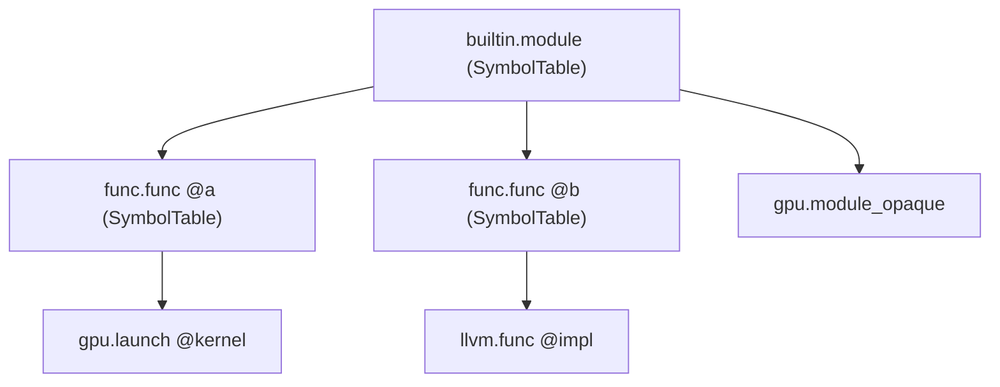

# 2.3 Symbol、Symbol Table 與 Call Graph

前兩節我們建立了 MLIR 的型別系統（[2.1](02.1-MLIR型別系統.md)）與屬性系統（[2.2](02.2-Attribute與編譯期常數.md)）。到這裡，IR 的**局部**語意已經完备：一個 op 有名字、有 operand、有 result、有屬性、有 location。

但 IR 還需要回答一個**全域**問題：這個 op 引用的是誰？

在 LLVM IR 中，這個問題由 `GlobalValue` 與 `Function` 的名字系統處理，符號表由 `Module` 擁有。在 MLIR 中，答案稍微複雜一些，原因是 MLIR 允許**任意層級**的巢狀符號表、允許方言自訂符號語意、並且需要跨方言解析外部符號引用。

這一節的主題就是：MLIR 如何組織「名字 → 定義」的對應關係，以及它如何支撐 call graph 分析。

## Symbol 屬性：兩種基本形態

MLIR 中，一個 operation 要成為「符號」（symbol），必須宣告 `Symbol` 這個 trait：

```tablegen
def FuncOp : Func_Op<"func", [
    IsolatedFromAbove,
    FunctionLike,
    Symbol,
    CallableOpInterface,
    ...
  ]> {
  let arguments = (ins SymbolNameAttr:$sym_name);
  ...
}
```

`Symbol` trait 的作用是宣告：

1. 這個 op **有一個名字**（透過 `sym_name` 屬性，通常型別為 `SymbolNameAttr`）；
2. 這個 op **可以放在符號表中**；
3. 這個 op **可以被其他 op 以名字引用**。

符號引用有兩種形態。

### 形狀一：SymbolRefAttr（弱引用）

`SymbolRefAttr` 指向一個**由名字組成的路徑**：

```mlir
func.func @compute() { ... }
func.func @caller() {
  func.call @compute() : () -> ()
  return
}
```

`func.call` 的 `callee` 屬性型別是 `FlatSymbolRefAttr`（`SymbolRefAttr` 的特化，剛好只有一段路徑）：

```cpp
// func::CallOp 的 callee 是一個 FlatSymbolRefAttr
auto callee = callOp.getCalleeAttr();
StringRef name = callee.getValue();

// 指向巢狀符號
auto nested = SymbolRefAttr::get(ctx, {"outer", "inner"});
```

`SymbolRefAttr` 的**路徑語意**：它由多段名字組成，例如 `["module", "func"]`。這表達「在 `module` 這個符號表裡找到 `func` 這個符號」。

**重要**：`SymbolRefAttr` 是**名字**而非**指標**。它不直接指向被引用的 op，而是儲存一條路徑。實際的解析（把路徑轉成 op 指標）在需要時才進行。這與 LLVM 的 `GlobalValue*` 直接指標引用形成對比。

### 形狀二：直接 operand 引用（強引用）

某些操作直接把被引用者作為 operand：

```mlir
%0 = "test.direct_call"(%callee_fn) : (!func<() -> ()>) -> ()
```

這時 callee 是一個 SSA value，型別是 `!func<() -> ()>`。這被稱為**「direct symbol reference via operand」**，MLIR 提供了 `SymbolUserOpInterface` 來表達「本 op 的某個 operand 引用了某個符號」。

兩種形態的取捨：

| | SymbolRefAttr | Operand 引用 |
|---|---|---|
| 引用對象 | 名字路徑 | SSA value（op 或 block argument） |
| 間接呼叫 | 支援（名字在執行期才決定） | 不支援 |
| 可被 rename | 容易（重寫屬性） | 需 RAUW |
| 分析支援 | 需要 symbol resolution | 直接 |
| 跨方言 | 通用 | 需要統一型別 |

`func.call` 刻意採用 **SymbolRefAttr**，因為它必須支援**間接呼叫**（被呼叫者的名字可以在執行期由另一個值決定，例如函式指標表）。

## SymbolTable trait 與符號表的組織

「符號表」是一個**持有符號的 operation**。MLIR 用 `SymbolTable` trait 宣告這個角色：

```tablegen
def ModuleOp : ModuleOp<"module", [
    IsolatedFromAbove,
    SymbolTable,
    ...
  ]> {
  let regions = (region SizedRegion<1>:$body);
}
```

`SymbolTable` trait 提供：

* 一個**符號表內的符號索引**：名稱 → operation 的對應表；
* 一個**子符號表列表**；
* `insert` / `remove` / `lookup` 的操作。

符號表在 MLIR 中是一個**巢狀的樹狀結構**。最外層通常是 `builtin.module`，其內可以包含 `func.func`（內部還有自己的符號表，例如存放 `gpu` 的 kernel 常數）。



### 名稱的巢狀解析

假設 `A` 裡有 `func.func @f`，而 `f` 內部有 `gpu.launch @k`。若 `f` 裡有一個 op 引用 `@k`，解析順序是：

1. 先在**最內層**可見的符號表中查找（由內向外）；
2. 若找不到，再到**最外層**（module）查找。

MLIR 把它定義為**由內向外的詞法作用域**（lexical scoping），但有一個重要例外：**module 層級的符號永遠可見**。

這個「內向外的詞法作用域」與 LLVM 的全域符號表不同。LLVM 中所有符號都是全域的，巢狀只存在於 LLVM IR 的模組巢狀（`Module` 有子模組），但函式不能巢狀定義。MLIR 允許 `func.func` 內再定義 `func.func`（雖然不常見），這時內層的同名符號會遮蔽外層。

## SymbolTableCollection 與 walkSymbolTables

在程式中走訪符號表，MLIR 提供 `SymbolTableCollection`：

```cpp
#include "mlir/IR/SymbolTable.h"

// 建立一個 collection，遍歷 op 之下所有的符號表
mlir::SymbolTableCollection symbolTables;
symbolTables.walkSymbolTables(op, [&](mlir::SymbolTableCollection::SymbolTableTable &table) {
  // 對每個遇到的符號表呼叫
  return WalkResult::advance();
});
```

`SymbolTableCollection` 的核心資料結構是 `SymbolTableTable`：

```cpp
class SymbolTableTable {
public:
  llvm::MapVector<StringAttr, Operation *> &getTable();
  llvm::MapVector<StringAttr, Operation *> &getNearestSymbolTable();
  llvm::MapVector<StringAttr, Operation *> &getSymbolTables();
};
```

它有三張表：

1. `getTable()`：當前符號表**直接包含**的符號（名稱 → op）。
2. `getNearestSymbolTable()`：最近的祖先符號表的同名項。
3. `getSymbolTables()`：子符號表本身（子符號表也是一種符號）。

`SymbolTableCollection` 還提供**快取**，避免重複建立：

```cpp
mlir::SymbolTableCollection symbolTables;
symbolTables.walkSymbolTables(op, [&](mlir::SymbolTableCollection::SymbolTableTable &table) {
  auto &direct = table.getTable();
  for (auto &entry : direct) {
    StringRef name = entry.first.getValue();
    Operation *symbol = entry.second;
    (void)name; (void)symbol;
  }
  return WalkResult::advance();
});
```

`walkSymbolTables` 的回傳型別是 `WalkResult`，可以決定是否繼續往下走。

### 在 Python 中走訪符號

Python 綁定了 `SymbolTable` 的一部分 API，但更常見的做法是用 `walk` 搭配 `SymbolOpInterface`：

```python
from circt.ir import Module, Operation
from circt.dialects import func

module = Module.create()
# 走訪所有帶 SymbolOpInterface 的操作
for op in module.walk():
    if op.has_trait("Symbol"):
        name = op.attributes.get("sym_name")
```

## 可見性與巢狀符號表

符號的**可見性**（visibility）由一個標準屬性表達：

```mlir
func.func @public_fn() attributes {sym_visibility = "public"} { ... }
func.func @private_fn() attributes {sym_visibility = "private"} { ... }
```

`sym_visibility` 是 `StringAttr`，可見的值有三種：

| 值 | 語意 |
|---|---|
| `"public"` | 符號可被外部引用（預設） |
| `"private"` | 符號只在當前符號表內可見 |
| `"nested"` | 符號只對子符號表可見 |

`"nested"` 是 MLIR 相對 LLVM 的一個擴充，用於表達「這個符號只對我的子代可見，但我的子代不能看到我的父代其他符號」。

這個可見性屬性由 `SymbolOpInterface` 統一定義，任何方言只要實作這個介面就可以支援它：

```cpp
class MySymbolOp : public Op<MySymbolOp, OpTrait::Symbol, SymbolOpInterface::Trait> {
public:
  StringAttr getSymNameAttr() { return (*this)->getAttrOfType<StringAttr>("sym_name"); }
  StringRef getVisibility() {
    if (auto attr = (*this)->getAttrOfType<StringAttr>("sym_visibility"))
      return attr.getValue();
    return SymbolTable::getSymbolVisibility(*this);
  }
  void setVisibility(StringRef visibility);
};
```

## 符號重新定義規則與 duplicate symbol 診斷

MLIR 的符號表**不允許同一層級有重複名稱**。若在一個符號表內插入兩個同名符號，會得到診斷：

```
error: redefinition of symbol 'foo'
```

這個規則與 C 語言的 linkage 規則、C++ 的名字 mangling 規則、以及 Rust 的 module 系統形成有趣的對比：

* **C**：同一 translation unit 內重複定義是錯誤，但 static 變數與不同 TU 的同名符號可以共存。
* **Rust**：同名項在不同 module 中可以共存（透過路徑區分），但同一 module 內不行。
* **MLIR**：同一符號表內不行，不同符號表內可以（因為路徑不同）。

MLIR 選擇「同一表內不行」的嚴格規則，理由是**符號表就是名字解析的作用域**。允許同名會讓解析結果依賴插入順序，帶來不可預測的行為。

在 C++ 中插入符號：

```cpp
mlir::Operation *existing = symbolTable.lookup("foo");
if (existing) {
  // 已經有同名的符號
}
symbolTable.insert(op);
```

`SymbolTable::insert` 會在重複時發出錯誤診斷並回傳失敗。

### 重命名

`SymbolTable::replaceAllSymbolUses` 是重命名的主力 API：

```cpp
// 將符號 oldName 重新命名為 newName，並更新所有引用
if (failed(symbolTable.replaceAllSymbolUses(oldName, newName)))
  return failure();
```

這個 API 會**同時**處理：

* 該符號表內的 `SymbolRefAttr`（包含巢狀路徑）；
* 該符號的子符號表內的引用；
* 透過 `SymbolUserOpInterface` 宣告的 operand 引用。

這個「一次呼叫更新所有引用」的性質，是 MLIR 相較手動維護引用表的語言（例如早期 C++ 的 name lookup）的一個重要優勢。

## func.call 與間接呼叫的限制

`func.call` 使用 `FlatSymbolRefAttr`，因此：

* 可以呼叫任何**靜態已知名字**的函式；
* 支援**間接呼叫**：被呼叫者的名字是字串常數，但這仍是靜態的。

真正的「間接」——被呼叫者在執行期才決定——在 MLIR 中**不是** `func.call` 的能力。原因是 `func.call` 的 `callee` 屬性型別是 `FlatSymbolRefAttr`，一個編譯期就固定的字串。

MLIR 對此的處理方式是：需要執行期間接呼叫時，方言會引入專用的操作，例如 `llvm.call` 在 LLVM 層級支援透過指標的間接呼叫，或使用 `func.call_indirect` 之類的擴充操作。

這個限制的意義在於：**MLIR 的符號引用系統是「編譯期解析」的**。所有 `SymbolRefAttr` 最終都會被解析成具體的 operation 指標。這使得 call graph 分析、間接呼叫偵測、以及符號解析的正確性都變得可行。

反過來說，任何「執行期才知道的 callee」的操作都**不能**用 `SymbolRefAttr` 表達，必須使用 SSA value + 某種型別（例如 `!llvm.ptr` 或 `!func<() -> ()>`）。

## SymbolUserOpInterface 與外部符號引用

`SymbolUserOpInterface` 是處理「operand 引用了符號」這個場景的標準機制。

一個 op 宣告它引用了某些符號：

```tablegen
def DirectCallOp : MyDialect_Op<"direct_call", [
    DeclareOpInterfaceMethods<SymbolUserOpInterface>
  ]> {
  let arguments = (ins SymbolRefAttr:$callee);
  let results = (outs);
}
```

`SymbolUserOpInterface` 定義了三個核心方法：

```cpp
// 1. 這個 op 引用了哪些符號？
llvm::SmallVector<SymbolRefAttr> getSymbolRefs(Region *region);

// 2. 這個 op 引用了哪些符號（給 symbol resolution 使用）？
llvm::SmallVector<SymbolRefAttr> getSymbolRefs();

// 3. 替換某個符號引用
void replaceSymbolUses(SymbolTableCollection &symbolTable,
                       SymbolTableCollection::SymbolTableTable &symbolTable,
                       SymbolRefAttr symbol, StringAttr newName);
```

第三個方法 `replaceSymbolUses` 是**重命名的關鍵**。當符號表呼叫 `replaceAllSymbolUses` 時，它會對每個 `SymbolUserOpInterface` 的 op 呼叫這個方法，讓 op 有機會更新自己的引用。

一個完整的實作範例：

```cpp
// 概念上的實作
void DirectCallOp::replaceSymbolUses(SymbolTableCollection &symbolTable,
                                      SymbolTableCollection::SymbolTableTable &table,
                                      SymbolRefAttr symbol, StringAttr newName) {
  auto nested = symbol.getNestedReferences();
  auto &callee = getCalleeAttr();
  if (callee == symbol)
    setCalleeAttr(FlatSymbolRefAttr::get(getContext(), newName.getValue()));
}
```

### 外部符號引用

「外部符號」指的是**不在當前 IR 樹中定義**的符號，例如匯入的函式或全域變數。MLIR 的 `SymbolTable::lookupNearestSymbolFrom` 找不到時，就表示這是外部引用。

```cpp
// 在符號表中查找，找不到就是外部符號
if (mlir::SymbolTable::lookupSymbolIn(symbolTable, name)) {
  // 內部符號
} else {
  // 外部符號：可能是匯入的函式，或尚未定義的參考
}
```

在驗證階段，MLIR 會檢查**內部**引用是否存在，但對外部引用放行（因為它們可能在 IR 之外定義）。這個區分需要 pass 作者自己注意。

## ModuleOp 作為隱式符號表

`builtin.module` 是 MLIR IR 的根，它**永遠**是符號表。這個特性使得：

* 模組層級的符號（`func.func`、`llvm.global`）可以互相引用；
* 模組層級的符號**對所有巢狀層級可見**。

`ModuleOp` 提供了便利方法：

```cpp
#include "mlir/IR/BuiltinOps.h"

// 取得模組中的某個符號
auto module = moduleOp.getOperation();
Operation *fn = module->lookupSymbol("main");

// 走訪模組中的所有符號（直接子孫）
module->walk([&](Operation *op) {
  if (auto sym = dyn_cast<mlir::SymbolOpInterface>(op)) {
    StringRef name = sym.getName();
    (void)name;
  }
});
```

`Operation::lookupSymbol` 是 `SymbolTable::lookupSymbolIn` 的操作層級包裝。

## CallGraph 介面與跨方言符號解析

`CallGraph` 是 MLIR 內建的**跨方言**呼叫關係分析。它的關鍵設計是：**不依賴 `func.call`，而是依賴 `CallGraphOpInterface`**。

```cpp
#include "mlir/Analysis/CallGraph.h"

mlir::CallGraph callGraph(moduleOp);
callGraph.walk([&](mlir::CallGraphNode *node) {
  for (mlir::CallGraphNode *callee : node->getCallees()) {
    // 呼叫關係
  }
  return mlir::WalkResult::advance();
});
```

`CallGraphOpInterface` 的核心方法：

```cpp
// 這個 op 可以被當作被呼叫者嗎？
bool isCallable() const;

// 這個 op 呼叫了哪些符號？
llvm::SmallVector<SymbolRefAttr> getCallableFor(SymbolTableCollection &symbolTable);

// 這個 op 呼叫了哪些符號？（含區域內）
void getCallableFor(SymbolTableCollection &symbolTable,
                    llvm::SmallVector<SymbolRefAttr> &callable,
                    llvm::SmallVector<SymbolRefAttr> &calleeOperands);
```

`CallGraphOpInterface::Trait` 提供了 `getCallableFor` 的預設實作（基於 `SymbolRefAttr` 屬性），但方言可以覆寫它以支援自訂的呼叫形式。

`func.func` 與 `func.call` 都實作了這個介面。`func.call` 的實作特別注意了**間接呼叫**：如果 callee 的屬性被標記為間接（例如屬性中帶有某個旗標），`getCallableFor` 會回傳空清單，代表「無法靜態解析」。

### 跨方言符號解析

`CallGraph` 的一個重要用途是**跨方言的符號解析**。考慮 `spirv` 或 `gpu` 這類方言：一個 `gpu.launch` 呼叫一個 `gpu.kernel`（後者定義在同一個 module 中），而 `gpu.kernel` 內部可能呼叫 `llvm.func`。

`CallGraph` 透過 `CallGraphOpInterface` 統整這些，**不需要中央註冊表**。每個方言只要實作介面，就自動被納入分析。

```cpp
// 判斷某個 op 是否被某個符號呼叫
mlir::CallGraphNode *node = callGraph.lookup(calleeOp);
// 或
bool isCalled = callGraph.isNodeReachableFromEntryNode(node);
```

### 在 Python 中做符號解析

```python
from circt.ir import Module, Operation
from circt.dialects import func

module = Module.create()
# 取得模組的直接子操作
for op in module.body.operations:
    if hasattr(op, "sym_name"):
        print(op.sym_name)
```

## 完整 C++ 範例

```cpp
#include "mlir/IR/BuiltinOps.h"
#include "mlir/IR/SymbolTable.h"
#include "mlir/Analysis/CallGraph.h"
#include "mlir/Dialect/Func/IR/FuncOps.h"

using namespace mlir;

void exploreSymbols(ModuleOp module) {
  MLIRContext *ctx = module.getContext();

  // 1. 在符號表中查找名稱
  Operation *mainFn = SymbolTable::lookupSymbolIn(module, "main");
  Operation *byString = module.lookupSymbol("main");
  assert(mainFn == byString);

  // 2. 從某個 op 位置向外查找最近的符號
  // 適用於「從使用點往上找定義」的語境
  Operation *user = mainFn;
  Operation *nearest = SymbolTable::lookupNearestSymbolFrom(
      mainFn, mainFn->getParentOp(), "helper");
  (void)user; (void)nearest;

  // 3. 用 SymbolTableCollection 做批次查找
  SymbolTableCollection symbolTables;
  symbolTables.walkSymbolTables(module, [&](SymbolTableCollection::SymbolTableTable &table) {
    auto &direct = table.getTable();
    for (auto &entry : direct) {
      // entry.first 是 StringAttr（符號名），entry.second 是 Operation
      StringRef name = entry.first.getValue();
      Operation *symbol = entry.second;
      (void)name; (void)symbol;
    }
    return WalkResult::advance();
  });

  // 4. 解析一個 SymbolRefAttr 的路徑
  if (auto func = dyn_cast<func::FuncOp>(mainFn)) {
    auto callee = func.getSymNameAttr();
    (void)callee;
  }

  // 5. 重命名並更新所有引用
  // 假設要把 "main" 改成 "entry"
  if (failed(SymbolTable::replaceAllSymbolUses(module, "main", "entry")))
    return;

  // 6. 建立 call graph
  CallGraph callGraph(module);
  callGraph.walk([&](CallGraphNode *node) {
    for (CallGraphNode *callee : node->getCallees()) {
      // 呼叫關係
    }
    return WalkResult::advance();
  });

  // 7. 建立符號引用
  auto ref = SymbolRefAttr::get(ctx, {"outer", "inner"});
  (void)ref;
}
```

### 混合符號表與巢狀引用

```mlir
builtin.module @outer {
  func.func @helper() { return }
  func.func @caller() {
    func.call @helper() : () -> ()
    return
  }
  // 巢狀符號表
  builtin.module @inner {
    func.func @shadowed() { return }
    func.func @uses_outer() {
      // 由內向外的詞法作用域：先找 @inner 的符號表，找不到再找 @outer
      func.call @helper() : () -> ()
      return
    }
  }
}
```

## 常見陷阱

1. **符號引用是名字而非指標**。修改符號名字之後，若沒有呼叫 `replaceAllSymbolUses`，引用就會失效。
2. **`SymbolRefAttr` 的巢狀路徑元素數量**。`FlatSymbolRefAttr` 只能有一段；多段必須用 `SymbolRefAttr::get`。
3. **外部符號不會報錯**。引用不存在的符號時，只有在驗證階段對內部引用才會報錯；外部引用被放行。
4. **`lookupNearestSymbolFrom` 與 `lookupSymbolIn` 語意不同**。前者是「從某個 op 往外層找最近的符號表」，後者是「在某個符號表裡找」。混用會得到預期外的結果。
5. **同名遮蔽是有意的**。內層符號表可以定義與外層同名的符號；解析時內層優先。

## 小結與延伸閱讀

* 符號是宣告了 `Symbol` trait 的 operation，其名字由 `sym_name`（`SymbolNameAttr`）屬性承載；引用有 `SymbolRefAttr`（名字路徑，支援巢狀與間接呼叫）與 operand 直接引用兩種形態。
* `SymbolTable` trait 把 operation 變成「作用域」，實作由內向外的詞法作用域，並以 `sym_visibility` 屬性表達 public / private / nested 三種可見性；同一符號表內禁止重複名稱。
* `SymbolTableCollection` 提供批次查找與快取，`replaceAllSymbolUses` 一次呼叫即可更新所有 `SymbolRefAttr` 與 `SymbolUserOpInterface` 宣告的引用。
* `CallGraph` 建立在 `CallGraphOpInterface` 之上，與具體方言無關，因此能跨方言分析呼叫關係；無法靜態解析的間接呼叫以空結果表示。
* 延伸閱讀：
  * MLIR 官方文件「Symbol Tables」與「Dialects and Operations」：`mlir/docs/SymbolTables.md`、`mlir/docs/Dialects.md`
  * `SymbolTable` 與 `SymbolTableCollection` API：`mlir/include/mlir/IR/SymbolTable.h`
  * `CallGraph` 與 `CallGraphOpInterface`：`mlir/include/mlir/Analysis/CallGraph.h`、`mlir/include/mlir/Interfaces/CallInterfaces.td`
  * `func` 方言的呼叫語意：`mlir/include/mlir/Dialect/Func/IR/FuncOps.td`
  * 維基百科條目「Lexical scope」與「Call graph」：`https://en.wikipedia.org/wiki/Lexical_scope`
