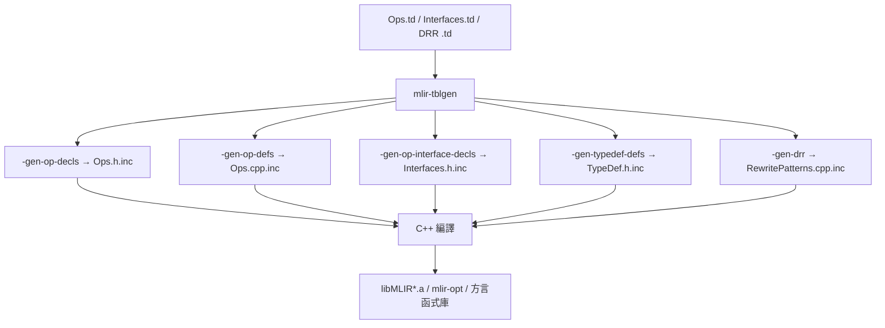
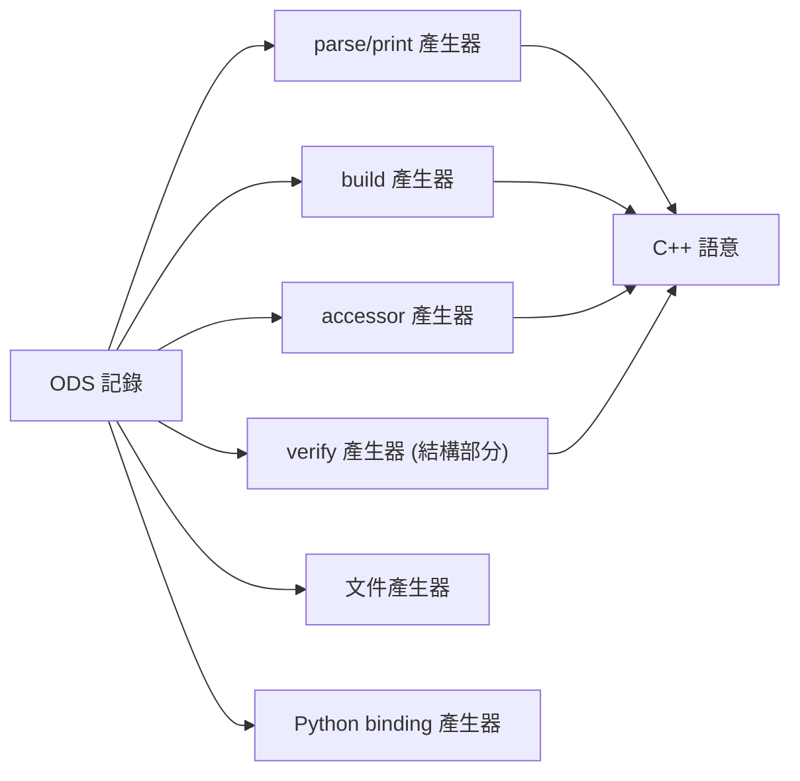

# 3.1 為什麼 MLIR 重度依賴 TableGen

## 從一個具體的痛點開始

MLIR 把 `Operation` 當作整個世界唯一的原子，這一點在本書第一部的「一切皆 Operation」一節已經確立。但真正動手寫第一個方言時，會立刻撞上一面牆：每定義一個 `Operation`，你就得寫好幾百行高度重複的 C++。

假設你要定義一個最簡單的二元加法操作 `my.add`，它至少需要：

```cpp
// MyOps.td 的 C++ 對應物，手寫版本
class AddOp : public Op<AddOp, OpTrait::VariadicOperands, OpTrait::OneResult> {
public:
  using Op::Op;
  static StringRef getOperationName() { return "my.add"; }

  static ParseResult parse(OpAsmParser &parser, OperationState &result) {
    // 解析 operand、型別、屬性
  }
  static void print(OpAsmPrinter &p, AddOp op) {
    // 列印 operand、型別、屬性
  }

  Value getLhs() { return getOperand(0); }
  Value getRhs() { return getOperand(1); }
  Value getResult() { return getResult(0); }

  static void build(OpBuilder &builder, OperationState &state, Value lhs, Value rhs,
                    Type resultType);
  static void build(OpBuilder &builder, OperationState &state, Type resultType,
                    ValueRange operands, ArrayRef<NamedAttribute> attributes = {});

  LogicalResult verify();
};
```

把 `parse`、`print`、`build`、accessor、`verify` 全部換成 `my.sub` 的版本，你會得到幾乎一模一樣、只換了型別與名稱的程式碼。若你的方言有 40 個 operation，這就是 40 份重複。

重複本身不是致命的，致命的是重複會**漂移**：某個 operation 有三種 operand、某個 operation 忘了寫 verifier、某個 operation 的 printer 少印了一個屬性。要靠人力把 40 份副本保持一致，成本是 $O(n)$ 的修改、 $O(n)$ 的審查，而且每次改動都要重新審查全部。

MLIR 的答案不是「更聰明的程式碼生成」，而是**把重複抽成模板，讓模板只有一份**。這個模板就是 TableGen。

## TableGen 是什麼：LLVM 的資料描述語言

TableGen 是 LLVM 專案自 2008 年左右就在使用的資料描述語言（data description language, DDL），原本是為 LLVM 自己的 intrinsics、指令描述、以及 pass 的 `-gen-*` 工具服務的。它本身不是一個完整的程式語言——它沒有迴圈以外的控制流、沒有函式、沒有型別檢查——它更像是一種「帶模板能力的資料定義語言」，並且內建了一套特定於 LLVM 的物件模型。

TableGen 程式碼在編譯前會被 `llvm-tblgen` 轉譯成 C++（或其他語言）的程式碼產物。

MLIR 大量複用這個基礎設施，而不是另起爐灶，因為 LLVM 已經把 `llvm-tblgen` 打磨得相當完整，而且 LLVM 的 intrinsics 定義本身就是「一份宣告式描述產生大量機械 C++」的典範。

TableGen 的核心概念只有五個：

```tablegen
// 1. class：定義一個「欄位藍圖」
class Op<string mnemonic, list<Trait> traits = []> {
  string summary = ?;
  list<OpArgument> arguments = [];
  list<OpResult> results = [];
  string assemblyFormat = ?;
  list<OpBuilder> builders = [];
  string extraClassDeclaration = ?;
}

// 2. def：用藍圖實例化一個具體物件
def AddOp : Op<"add", [Pure]>;

// 3. defvar：一個具名變數
defvar MyList = [A, B, C];

// 4. multiclass：可參數化的類別巨集
multiclass BinaryOp<string mnemonic, list<Trait> traits = []> {
  def AddOp : Op<mnemonic # "add", traits>;
  def SubOp : Op<mnemonic # "sub", traits>;
}

// 5. let：覆寫父類別的欄位值
let summary = "binary addition" {
  def AddOp : Op<"add", [Pure]>;
}
```

再加上 `include`（引入另一個 `.td` 檔的定義）與 `foreach`（以變數迴圈批次產生定義），這六樣東西組成了 TableGen 語言的全部核心。

### class 與 def：模板與實例

`class` 定義的是**欄位的形狀**，不是物件本身。`def` 才是真正產生的具體記錄（record）。這正是 MLIR 想要的：ODS（Operation Definition Specification）裡的 `Op` 是一個 class，而 `def AddOp : Op<"add", [Pure]>;` 是 def。

一個 def 可以有多個父類別，用逗號分隔：

```tablegen
def AddOp : Op<"add", [Pure]>, OpTrait::OneResult;
```

父類別的欄位若無衝突會被合併；衝突時要透過 `let` 在特定父類別脈絡中解決，例如：

```tablegen
def AddOp : Op<"add", [Pure]>, OpTrait::NOperands<2>::Impl {
  let summary = "adds two operands";
}
```

`OpTrait::NOperands<2>::Impl` 這個寫法的用意是：MLIR 的 trait 是一個龐大的類別階層，`NOperands<N>` 是模板，`Impl` 是把模板實例化成可用於繼承的具體型別。

### defvar、multiclass 與 foreach

`defvar` 讓你把一串值抽出來命名，避免到處複製貼上：

```tablegen
defvar AnyType = [AnyTypeOf<["IntegerType", "FloatType"]>];
defvar BinaryLike = [Pure, SameOperandsAndResultType];
```

`multiclass` 是**參數化的類別巨集**。典型用途是「一整族語義相近、只有名字和參數不同的 operation」，例如比較類運算：

```tablegen
multiclass CmpOp<string mnemonic, string builtin, list<Trait> traits = []> {
  def CmpEQOp : Op<mnemonic # "_eq", !listconcat(traits, [Pure, SameOperandsAndResultType])>;
  def CmpNEQOp : Op<mnemonic # "_neq", !listconcat(traits, [Pure, SameOperandsAndResultType])>;
  def CmpGTOp : Op<mnemonic # "_gt", !listconcat(traits, [Pure, SameOperandsAndResultType])>;
  def CmpLTEOp : Op<mnemonic # "_lte", !listconcat(traits, [Pure, SameOperandsAndResultType])>;
  def CmpGTOp : Op<mnemonic # "_gt", !listconcat(traits, [Pure, SameOperandsAndResultType])>;
}

def CmpI : CmpOp<"cmpi", "icmp", [Pure]>;
```

注意 `!listconcat` 這個前綴感嘆號的寫法：TableGen 裡 `!` 開頭的是**內建函式**（built-in function），例如 `!listconcat`、`!strconcat`、`!dag`（在建構 operation 參數列表時特別重要，見下一節）。

`foreach` 則是批次產生相似定義：

```tablegen
defvar Indices = [0, 1, 2, 3, 4];
foreach idx in Indices {
  def GetElementOp : Op<"get_element_" # idx, [Pure]> {
    let summary = "get element " # idx;
  }
}
```

### let 與 include

`let` 的作用是「在接下來的區塊中，給某些類別的某個欄位指定值」。它有兩種常見形態：

```tablegen
// 全域形式：設定之後所有同類定義的預設值
let summary = "an operation";
let description = [{
  長篇描述。
}];

// 局部形式：只在某個 def 內生效
def AddOp : Op<"add", [Pure]> {
  let summary = "adds two numbers";
  let description = [{
    The `my.add` operation adds its two operands.
  }];
}
```

`include` 則是跨檔案複用：

```tablegen
include "mlir/IR/OpBase.td"
include "mlir/IR/AttrTypeBase.td"
include "mlir/IR/SymbolInterfaces.td"
```

MLIR 的 ODS 之所以能「一行宣告就獲得完整的 C++ op 類別」，秘密就在於 `OpBase.td` 這類基礎檔案裡：它把 MLIR 已有的 C++ trait 類別**鏡射**成 TableGen 的 class/def，再用 `!cast<>` 把它們接回真正的 C++ 型別。這個機制稱為 **ODR**（Operation Definition Rules，後述）。

## TableGen 的一個關鍵設計：類別 vs 產生器

TableGen 有兩種不同的東西，混淆它們是初學者最常犯的錯：

1. **記錄（record）**：一筆資料。`def AddOp : Op<"add">;` 產生一筆記錄，裡面有欄位值。
2. **產生器（generator / info）**：C++ 裡寫的函式，接收記錄並輸出文字。`defm` 對應的 `GenXxx` 類別是產生器。

在 MLIR 的 ODS 裡，`mlir-tblgen` 的 `-gen-op-decls` 是一個 C++ 產生器，它讀入 `OpBase.td` 與你的方言 `.td` 檔，輸出 op 的 C++ 宣告。`mlir-tblgen` 本身是 `llvm-tblgen` 的薄包裝加上 MLIR 專屬的 `-gen-*` 動作。

## ODS：TableGen 之上的 MLIR 專用模型

ODS 是 MLIR 建立在 TableGen 上的**方言定義模型**。它的核心物件有三個：

| ODS 概念 | 角色 | 對應到 C++ |
| --- | --- | --- |
| `Op` | operation 的模板類別 | `mlir::Op<...>` 的 CRTP 參數 |
| `OpTrait` | 語意限制的標記 | `mlir::OpTrait::...` |
| `OpInterface` | 跨 op 的能力介面 | `mlir::OpInterface::...` |

ODS 定義了 operation 的靜態結構：**名稱、operand、result、attribute、region、trait**。它的設計哲學是：

> MLIR 中每一個 operation 的**語意**可以自由手寫（verifier、fold、canonicalization），但它的**結構**（有幾個 operand、operand 的型別條件是什麼、怎麼被解析與列印）應該由工具鏈統一產生。

這個分工讓「每個 op 都有 parser/printer」不再是一個需要記憶力的負擔。

## 四個子系統：ODS、ODR、DRR、Interfaces

這四個詞在 MLIR 文件與原始碼中經常混用，但指的是不同的東西。

### ODS（Operation Definition Specification）

ODS 是**描述 operation 結構的宣告式語言**，也就是上面 `Op` / `OpTrait` 那套。ODS 檔案副檔名是 `.td`，放在 `include/<方言>/Ops.td`。它回答「這個 op 長什麼樣」。

### ODR（Operation Definition Rules）

ODR 是 ODS 的**具體資料模型與記錄語法**，包含：

* `Op` class 本身的欄位定義（`arguments`、`results`、`traits`、`assemblyFormat`、`builders`、`extraClassDeclaration`）。
* 一個 op 在 ODS 裡怎麼被「組裝」成真正的 IR 節點：`Op` class 有一個特殊的 `dag` 欄位型別，用 `!dag` 語法描述 op 的操作數／結果：

```tablegen
def AddOp : Op<"add", [Pure]> {
  let arguments = (ins AnyType:$lhs, AnyType:$rhs);
  let results = (outs AnyType:$result);
}
```

這裡 `(ins ...)` / `(outs ...)` 括號內的東西，在 TableGen 內部其實是一個 `dag` 記錄。ODR 定義了這個 dag 的文法，以及它如何被 `mlir-tblgen` 翻譯成「operand 有序列表 + result 有序列表 + 每個元素的型別約束」。

ODR 還定義了 **operand segment** 的概念：當一個 op 同時有 variadic operand 與其他 operand 時，IR 需要記錄「variadic 那段實際有幾個值」。ODR 用 `AttrSizedOperandSegments` trait 或 `SameVariadicOperandSize` 來表達這件事，後端會生成 `getODSOperandIndexAndLength` 之類的映射程式碼。

### DRR（Declarative Rewrite Rules）

DRR 是一個**建立在 ODS 之上的重寫規則語言**，用來宣告式地描述「什麼樣的 op 樹可以被改成什麼樣的 op 樹」。它是 ODS 的兄弟而非子集：DRR 檔案通常是獨立的 `.td`，用 `include` 引入 ODS 檔案。DRR 的細節在 [3.3](03.3-DRR宣告式重寫規則.md) 專節討論。

### Interfaces（OpInterface / TypeInterface / AttrInterface / RegionKindInterface）

Interfaces 是**跨方言的能力抽象**。ODS 裡的 trait 表達「這個 op 必須具備某個語意限制」（例如 `Pure` 表示不修改全域狀態、可以刪除），而 interface 表達「這個 op 支援某組操作，可以被泛型演算法查詢」（例如 `SymbolOpInterface` 表示它可以當作符號被引用）。

ODS 定義了四類主要的 interface 對應機制：

```tablegen
// 1. 宣告一個介面（通常放在 CommonInterfaces.td 或自訂的 .td）
def MyOpInterface : OpInterface<"MyOpInterface"> {
  let methods = [
    StaticInterfaceMethod<"Type getElementType()">,
    InterfaceMethod<"Value getRoot()">,
  ];
}

// 2. 在 op 上宣告「我實作了這個介面」
def LoadOp : Op<"load", [MyOpInterface]>;

// 3. 產生一份「查詢此介面」的輔助程式
def MyOpInterfaceImpl : MyOpInterface<"LoadOp">;
```

`OpInterface` 是 ODS 裡的一個 **class**，它會被 `-gen-op-decls` 轉成 `mlir::OpInterface::MyOpInterface<ConcreteOp>` 的 CRTP 基類，並產生 `dyn_cast` / `isa` 支援與一份 `MyOpInterface` 的 `Trait` 基類。

`TypeInterface` 與 `AttrInterface` 是同樣的模式，但主體分別是 `mlir::Type` 與 `mlir::Attribute`：

```tablegen
def ShapedTypeInterface : TypeInterface<"ShapedType"> {
  let methods = [
    InterfaceMethod<"int64_t getNumElements()">,
  ];
}
```

`RegionKindInterface` 則比較特別——它是**內建**在 MLIR 裡的（`mlir::RegionKindInterface`，定義於 `mlir/IR/OpDefinition.h`），用來區分 `SSACFG`（單一 block、有 terminator）與 `GraphRegion`（多 block、可以有分支）等 region 結構。它的存在是為了讓通用的遍歷與轉換程式碼知道「這個 region 裡的 block 是不是 SSA 支配關係構成的 CFG」。

一個 op 可以同時有多個 interface，ODS 會把它們組成多重繼承，並且——這是關鍵——ODS 會自動產生 `Interface` trait 讓 `isa<MyOpInterface>(op)` 能運作。

### ODS 與 ODR 的關係

用一句話總結：

* **ODS** 是「描述 operation 的語言與框架」。
* **ODR** 是「ODS 所使用的 operation 記錄文法與資料模型」。
* **DRR** 是「用 ODS 的資料模型描述重寫規則的語言」。
* **Interfaces** 是「用 ODS 描述跨 op 能力的機制」。

## tblgen 的產生流程

MLIR 的建置流程中，`.td` 檔案經過以下管線：



在 CMake 層面，這由 `mlir_tablegen` 這個函式自動完成：

```cmake
set(LLVM_TARGET_DEFINITIONS Ops.td)
mlir_tablegen(MyOps.h.inc -gen-op-decls)
mlir_tablegen(MyOps.cpp.inc -gen-op-defs)
add_public_tablegen_target(MyOpsIncGen)

add_mlir_dialect_library(MLIRMyDialect
  MyDialect.cpp
  MyOps.cpp
  DEPENDS
  MyOpsIncGen
)
```

`mlir_tablegen` 會把 `.td` 的相對路徑、include 路徑（`-I`）都處理好，並且在 CMake 層建立正確的依賴關係：**改 `.td` 會觸發重新產生 `.inc`，重新產生 `.inc` 會觸發重新編譯使用它的 `.cpp`**。這是 CMake 的「dependency scanning + 產生檔宣告」機制，不是靠人肉維護的 `Makefile` 規則。

產出的 `.inc` 檔案形如：

```cpp
// MyOps.h.inc
class AddOp : public ::mlir::Op<AddOp, ::mlir::OpTrait::NOperands<2>::Impl,
                                 ::mlir::OpTrait::OneResult,
                                 ::mlir::OpTrait::ZeroRegions> {
public:
  using ::mlir::Op::Op;
  static ::llvm::StringRef getOperationName() { return "my.add"; }
  static ::llvm::ArrayRef<::mlir::Type> getTypeIds() { ... }
  ...
};
```

```cpp
// MyOps.cpp.inc
::mlir::ParseResult AddOp::parse(::mlir::OpAsmParser &parser,
                                  ::mlir::OperationState &result) {
  ::mlir::OpAsmParser::UnresolvedOperand lhs, rhs;
  ::mlir::Type lhsType, rhsType;
  if (parser.parseOperand(lhs) || parser.resolveOperand(lhs, lhsType, result.operands))
    return ::mlir::failure();
  ...
}

void AddOp::print(::mlir::OpAsmPrinter &p) {
  p << " ";
  p.printOperand(getLhs());
  p << ", ";
  p.printOperand(getRhs());
  p.printOptionalAttrDict((*this)->getAttrs());
}
```

## Single source of truth：TableGen 讓 C++ 與 ODS 共用一份事實

這是本節最重要的觀念，也是理解 MLIR 架構的關鍵。

在沒有 TableGen 的世界裡，「一個 operation 的完整定義」散落在多處：

1. `parse()` 裡手寫的 operand 順序
2. `print()` 裡手寫的 operand 順序
3. `build()` 裡手寫的參數型別
4. accessor 裡手寫的 `getOperand(0)`
5. `verify()` 裡手寫的型別檢查
6. 呼叫端 C++ 程式碼裡建構 op 時的參數順序

這六處必須彼此一致，但它們之間沒有任何機制性關聯；一致性完全靠人的注意力維持。

在 TableGen 世界裡，這六處全部由**同一筆 ODS 記錄**衍生：



ODS 是唯一的事實來源（single source of truth），其他所有東西都是它的投影。這帶來三個直接好處：

**好處一：新增 operand 是一次單點修改。**
假設 `my.add` 要加第三個 operand，改動 ODS 的 `arguments` 一行，然後編譯器會把 parse/print/build/accessor/verify 全部重新產生出來。型別不一致的錯誤會在編譯期就爆掉。

**好處二：ODS 是機器可讀的。**
因為 ODS 是結構化資料，其他工具可以直接消費它。MLIR 上游就有：

* `-gen-op-doc` → 產生方言的 Markdown/RST 文件。
* `-gen-python-bindings` → 產生 Python 綁定。
* `-gen-op-interface-decls` → 產生 interface 的輔助類別。
* 社群工具如 `mlir-tblgen` 的 `-dump-json` → 把 ODS 轉成 JSON 供外部工具分析。

**好處三：ODS 本身就是一種文件。**
`let description` 裡寫的文字會同時出現在原始碼產物旁邊與產生的文件中，不會過期。

### ODS 的 `!cast` 機制

ODS 裡要引用 C++ 型別時，不是寫字串，而是寫 `!cast<>`：

```tablegen
def MyDialect : Dialect {
  let name = "my";
  let cppNamespace = "::mlir::my";
}

def AddOp : Op<"add", [Pure]> {
  let cppNamespace = "::mlir::my";
  let extraClassDeclaration = [{
    /// 回傳這個 op 應該被放在哪個 dialect 的 namespace
    ::mlir::StringRef dialectNamespace() { return "::mlir::my"; }
  }];
}
```

當 ODS 需要指定「某個欄位其實對應到 C++ 的某個類別」時，例如 trait 的實作類別，ODS 使用：

```tablegen
def AddOp : Op<"add", [Pure, DeclareOpInterfaceMethods<SymbolOpInterface>]> {
}
```

`DeclareOpInterfaceMethods` 這個 trait 會讓 ODS 產生兩樣東西：在 op 類別內產生一組**預設拋出 "not implemented" 的 stub 方法**（繼承自 `SymbolOpInterface`），並且在 `.cpp.inc` 中產生一段「檢查你確實 override 了所有方法」的可選程式碼。這個 trait 搭配 `InterfaceMethod` 的 `defaultImplementation` 參數，讓介面的實作變成**可選但受檢查**。

## 一個完整的 TableGen 範例與其 C++ 對照

我們從一個最小方言開始，走完整條管線。

### TableGen 來源

```tablegen
// include/mlir/Dialect/My/MyOps.td
include "mlir/IR/OpBase.td"
include "mlir/IR/SymbolInterfaces.td"

def My_Dialect : Dialect {
  let name = "my";
  let cppNamespace = "::mlir::my";
  let summary = "A toy dialect for demonstration";
}

class My_Op<string mnemonic, list<Trait> traits = []>
    : Op<My_Dialect, mnemonic, traits>;

def AddOp : My_Op<"add", [Pure, SameOperandsAndResultType]> {
  let summary = "Adds two operands";
  let description = [{
    The `my.add` operation adds its two operands and produces one result
    of the same type.
  }];

  let arguments = (ins AnySignlessIntegerOrFloatLike:$lhs,
                        AnySignlessIntegerOrFloatLike:$rhs);
  let results = (outs AnySignlessIntegerOrFloatLike:$result);

  let assemblyFormat = "$lhs `,` $rhs attr-dict `:` type($result)";
}
```

### ODS → 產生的 C++ 類別

`mlir-tblgen -gen-op-decls` 會產生（節錄，格式經過排版）：

```cpp
//===- MyOps.h.inc - My dialect ops ----------------*- C++ -*-===//

class AddOp : public ::mlir::Op<AddOp,
                                 ::mlir::OpTrait::NOperands<2>::Impl,
                                 ::mlir::OpTrait::OneResult,
                                 ::mlir::OpTrait::ZeroRegions> {
public:
  using ::mlir::Op::Op;
  static ::llvm::StringRef getOperationName() {
    return "my.add";
  }
  static ::llvm::ArrayRef<::mlir::Type> getTypeIds() {
    static ::llvm::ArrayRef<::mlir::Type> types = {
        ::mlir::Type::get<::mlir::NoneType>()};
    return types;
  }

  ::mlir::Value getLhs() { return this->getOperand(0); }
  ::mlir::Value getRhs() { return this->getOperand(1); }
  ::mlir::Value getResult() { return this->getResult(0); }

  ::mlir::IntegerType getLhsType() {
    return ::llvm::cast<::mlir::IntegerType>(this->getOperand(0).getType());
  }
  ...
  static ::llvm::ParseResult parse(::mlir::OpAsmParser &parser,
                                  ::mlir::OperationState &result);
  static void print(::mlir::OpAsmPrinter &p);
  static void build(::mlir::OpBuilder &builder, ::mlir::OperationState &state,
                    ::mlir::Value lhs, ::mlir::Value rhs,
                    ::mlir::Type result);
  ::mlir::LogicalResult verify();
};
```

注意三個關鍵點：

* `::mlir::Op<AddOp, ...>` 的 CRTP 第一個參數就是 op 本身，MLIR 用它做靜態多型（`isa`/`cast` 的編譯期最佳化）。
* accessor 名稱由 ODS 的 `$lhs` 決定，變成 `getLhs()`。
* `parse`/`print`/`build`/`verify` 的**宣告**被自動產生；`verify` 只有宣告，是因為 `Pure` 與 `SameOperandsAndResultType` 這類 trait 提供了結構性的 verifier，而具體的**語意** verifier 留給使用者以 `hasVerifier = 1` 開啟。

### 手寫的方言骨架

ODS 只描述 op，方言本體仍要手寫：

```cpp
// include/mlir/Dialect/My/MyDialect.h
#include "mlir/IR/Dialect.h"
#include "mlir/Dialect/My/MyOps.h"

#include "MyOps.h.inc"

namespace mlir {
namespace my {

class MyDialect : public ::mlir::Dialect {
public:
  explicit MyDialect(::mlir::MLIRContext *context);
  static ::llvm::StringRef getDialectNamespace() { return "my"; }
  ::mlir::Type parseType(::mlir::DialectAsmParser &parser) const override;
  void printType(::mlir::Type type, ::mlir::DialectAsmPrinter &printer) const override;
};

} // namespace my
} // namespace mlir
```

```cpp
// lib/Dialect/My/MyDialect.cpp
#include "mlir/Dialect/My/MyDialect.h"
#include "mlir/IR/Builders.h"
#include "mlir/IR/DialectImplementation.h"
#include "mlir/IR/OpImplementation.h"
#include "mlir/IR/TypeUtilities.h"

#include "MyOps.h.inc"

using namespace mlir;
using namespace mlir::my;

void MyDialect::initialize() {
  addOperations<
#define GET_OP_LIST
#include "MyOps.cpp.inc"
      >();
}

#define GET_OP_CLASSES
#include "MyOps.cpp.inc"

void AddOp::build(OpBuilder &builder, OperationState &state, Value lhs, Value rhs,
                  Type result) {
  state.addOperands({lhs, rhs});
  state.addTypes(result);
}
```

這裡 `#define GET_OP_LIST` / `#define GET_OP_CLASSES` 是 TableGen 產生檔的傳統慣例：先用 `#define` 設定「我要取檔案裡的哪一段」，再 `#include` 進來。這樣同一個 `.inc` 檔可以在不同位置以不同視角被引入。

### 最終的 MLIR 組語

```mlir
module {
  func @example(%a: i32, %b: i32) -> i32 {
    %0 = my.add %a, %b : i32
    return %0 : i32
  }
}
```

`assemblyFormat` 那一行

```
"$lhs `,` $rhs attr-dict `:` type($result)"
```

告訴 ODS：「operand `lhs` 直接印，operand `rhs` 前印字面逗號，最後印 result 的型別，中間夾一個 attr-dict」。產生器據此寫出對稱的 `parse` 與 `print`。

## TableGen 語言的限制

沒有任何工具是完美的，TableGen 的限制值得明說，因為它們直接解釋了 MLIR 為何仍保留手寫程式碼。

**限制一：沒有真正的運算流程。**
TableGen 只有少數內建函式（`!add`、`!mul`、`!strconcat`、`!listconcat`、`!substr`、`!dag` 等）。它不是圖靈完備的語言，無法做複雜的條件判斷。這意味著「根據 operand 數量決定要做什麼」這類邏輯寫不出來。

**限制二：巨集是純粹的模板展開。**
`multiclass` 的參數化只是字串與清單的代換，沒有真正的多型。所有 `def` 最終都被展開成獨立的記錄，這對除錯其實是好事（錯誤訊息裡看到的是展開後的真實內容），但對大型定義檔會造成編譯時間膨脹。

**限制三：ODS 無法表達「語意」。**
ODS 能說「這個 op 有兩個同型 operand」，但說不了「第二個 operand 必須是第一個的某種變化」。這正是 `hasVerifier = 1` 存在的理由：語意驗證永遠要手寫。

**限制四：ODS 對 attribute 的描述有先天弱點。**
ODS 能描述 attribute 的名稱與型別約束，但它不描述 attribute 的**鍵值順序語意**（哪個是預設值、哪個必填）。`let builders` 可以指定「哪些 attribute 必須在 build 參數中明確給定」，但更複雜的條件（例如「若給了 `fastmath` 則必須給 `flags`」）做不到。

**限制五：TableGen 的錯誤訊息對新人不友善。**
一個拼錯的 field name 會報「unknown field」，而不是「你在 `Op` class 裡想設定的 `assemblyFormat` 不存在，是想寫 `assemblyFormat` 嗎？」。ODS 裡定義了上百個 class，初學期需要靠 grep 上游的 `OpBase.td` 才能定位問題。

**限制六：不能產生任意 C++。**
ODS 有 `extraClassDeclaration` 這個逃生門，可以在 op 類別裡插入任意 C++ 程式碼。但這是**受控的違反**：因為插入的是使用者在 `.td` 檔裡寫的 C++，所以 ODS 仍然知道 op 的**結構**，只是允許你貼上一小段手寫語意程式碼。這是「Template 的 Template」模式（the template of the template）。

## 為何 MLIR 仍保留手寫程式碼

把 TableGen 做不到的事列出來，就知道哪些必須手寫：

| 需求 | 原因 | 手寫位置 |
| --- | --- | --- |
| 語意正確性驗證 | ODS 無法表達跨 operand 的條件 | `verify()` |
| 折疊規則（fold） | 需要任意 C++ 邏輯 | `OpFoldResult fold()` |
| canonicalization pattern | 需要跨 op 匹配 | `RewritePattern` 子類 |
| 複雜的解析（如巢狀屬性字典） | ODS 的 `assemblyFormat` 不夠用 | `parse()` / `print()` 自訂 |
| 新的 trait 或 interface | 需要 C++ 類別階層 | `OpTrait::` / `OpInterface::` |
| Pass 與 PassManager | 與 IR 結構無關 | 手寫 C++ |
| Analysis | 與 IR 結構無關 | 手寫 C++ |

一句話：**TableGen 負責「形狀」，C++ 負責「意義」**。

這個分工也解釋了 MLIR 的「漸進式降階」（progressive lowering）哲學：每一層抽象都在同一個 Operation 骨架上做更窄的語意約束，因此可以用工具鏈自動產生解析器、驗證器、文件、以及跨語言綁定，而不是每一層都重寫一套基礎設施。

## 成本分析：TableGen 到底省了多少

粗略估算一個中等規模方言。假設 30 個 operation，每個平均：

* 手寫 `parse`/`print`：80 行
* 手寫 `build`：25 行
* 手寫 accessor：15 行
* 手寫結構性 `verify`：30 行

手寫總計約 $30 \times 150 = 4500$ 行 C++。用 ODS 描述結構，每個 op 平均 8 行 `$...$` 描述加 3 行 summary，加上手寫 verifier（假設只有 40% 的 op 需要，平均 30 行）：約 $30 \times 11 + 12 \times 30 = 690$ 行 TableGen 加 360 行 C++。

產生的 `.inc` 檔案體積大致與手寫量相當，但那是**機器產生的**，不會有 typo、漏掉 accessor、或 parse 與 print 順序不一致的問題。

更關鍵的是**維護成本**：新增一個 operand 時，手寫要改 4 個以上的地方（漏掉任何一個都會是 bug），ODS 要改 1 個地方（其餘自動同步）。若把「漏改」的機率估為每次修改 10%，那麼 $n$ 個手寫副本在 $k$ 次修改中全部保持一致的機率是 $(1 - 0.1k)^n$ ， $n = 30$ 、 $k = 5$ 時已經低到沒有實務意義。ODS 把這個乘積變成 1。

## 小結與延伸閱讀

* TableGen 是 LLVM 的資料描述語言，MLIR 用它取代了每個 operation 的重複 C++ boilerplate，使「一個 op 的結構」只有一份描述。
* ODS 是 MLIR 在 TableGen 上的方言定義模型；ODR 是 operation 記錄的具體文法；DRR 是建立在 ODS 上的重寫規則語言；Interfaces 是跨 op 的能力抽象機制，四者分工不同、常被混用。
* `mlir-tblgen` 透過 `-gen-op-decls` / `-gen-op-defs` / `-gen-drr` 等動作產生 `.h.inc` / `.cpp.inc`，由 CMake 的 `mlir_tablegen` 建立正確的重新產生依賴。
* ODS 是 single source of truth：parse/print/build/accessor/verify 都是同一筆 ODS 記錄的投影，因此結構變更只需單點修改。
* TableGen 不能表達語意，因此 MLIR 保留手寫的 verifier、fold、pattern 與 pass；設計原則是「TableGen 負責形狀，C++ 負責意義」。
* 延伸閱讀：`mlir/docs/DeclarativeRewrites.md`（DRR 語法）、`mlir/docs/OpDefinitions.md`（ODS 與 ODR 的完整參考）、`mlir/include/mlir/IR/OpBase.td`（ODS 的權威 class 定義）、`mlir/include/mlir/IR/OpDefinition.h`（ODS 對應的 C++ trait 階層）、`llvm/docs/TableGen/`（TableGen 語言本身）、`mlir/docs/Tools/MLIR-Tblgen/`（產生器說明）。
