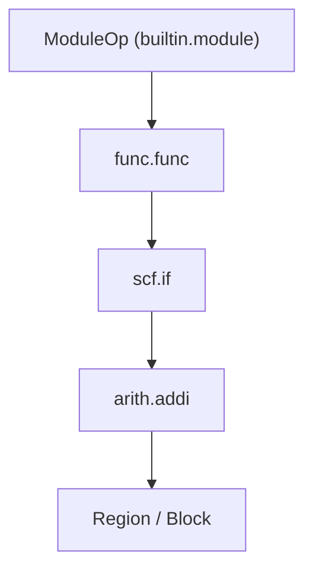
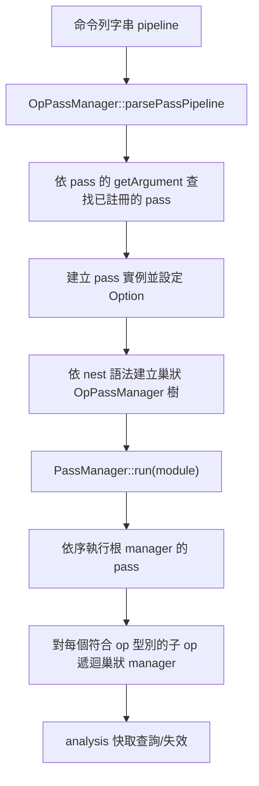

# 4.1 Pass 的生命週期與巢狀執行模型

## 從「改寫」到「流程」

第二部前三節處理的是**單次改寫**的機制：ODS 描述 operation 的結構（[3.2](03.2-ODS定義Operation.md)），DRR 描述一個重寫規則（[3.3](03.3-DRR宣告式重寫規則.md)）。但一個真實的編譯流程不是「一個改寫」，而是**一長串有順序、有依賴、有時要巢狀的改寫**。

MLIR 的答案是 Pass 管線。Pass 是 MLIR 的「轉換階段」抽象：一個有名字、有參數、可以被序列化描述、在指定操作上執行的轉換單元。

本節要回答的核心問題是：

* Pass 是怎麼被描述、被建構、被執行的？
* 一個 pass 到底作用在哪些 operation 上？這就是「巢狀執行模型」的由來。
* Pass 之間的先後關係是怎麼表達與保證的？
* 為什麼「被改寫後的 op 樹」不會讓 pass 的作用範圍失效？

## Pass 的基類架構

MLIR 的 pass 基礎架構在 `mlir/Pass/Pass.h`，分三層。

### `Pass`：最抽象的基底

```cpp
namespace mlir {

class Pass {
public:
  virtual ~Pass();

  /// 取得此 pass 的識別字串，必須是合法的命令列參數片段。
  virtual StringRef getArgument() const = 0;

  /// 取得此 pass 的描述字串，會出現在時間統計報告中。
  virtual StringRef getDescription() const = 0;

  /// 依賴分析（Analysis）被 pass 執行時被請求，用來決定快取失效策略。
  virtual void getDependentAnalyses(preservedAnalysesTy &preservedAnalyses) const {}

  /// 依賴方言（DependentDialects）：此 pass 可能引入的方言。
  virtual void getDependentDialects(MLIRContext *context) const {}

  /// pass 需要在什麼類型的 operation 上執行。
  virtual StringRef getOpName() const = 0;
};

} // namespace mlir
```

`Pass` 本身有四個「宣告性」的部分與一個「執行事實」的部分：

| 方法 | 作用 | 誰在用 |
| --- | --- | --- |
| `getArgument()` | 命令列上的識別名，如 `canonicalize` | PassManager 解析 pipeline 時 |
| `getDescription()` | 人類可讀描述 | `--mlir-pass-statistics` 輸出 |
| `getDependentDialects()` | 宣告可能引入的方言 | PassManager 預先載入方言 |
| `getDependentAnalyses()` | 宣告會用到的分析 | 分析失效機制（見 [4.3](04.3-Analysis快取與失效.md)） |
| `runOnOperation()` | 實際工作 | PassManager 呼叫 |

### `OperationPass<T>`：作用於特定 op 類型

```cpp
template <typename OpT>
class OperationPass : public Pass {
public:
  /// 取得此 pass 作用的 operation 的型別名稱。
  StringRef getOpName() const final { return OpT::getOperationName(); }

  /// 執行此 pass 的核心函式。
  virtual void runOnOperation() = 0;

protected:
  /// 取得目前正在處理的 operation。
  OpT getOperation() { return this->getOperationImpl(); }

private:
  OpT getOperationImpl();
};
```

`OperationPass<T>` 的關鍵在於 `getOperation()`：pass 執行期間，「當前的 operation」是隱含的上下文。這個設計讓 pass 程式碼不必到處傳遞 op 參數。

### `PassWrapper<PassT, OperationPass<T>>`：CRTP 的實作輔助

直接繼承 `OperationPass<T>` 需要自己寫 `clone()`（pass manager 需要複製 pass 來建立巢狀實例），這是惱人的瑣事。`PassWrapper` 幫你做：

```cpp
template <typename PassT, typename BaseT>
class PassWrapper : public BaseT {
public:
  /// 複製此 pass。
  std::unique_ptr<Pass> clonePass() const override {
    return std::make_unique<PassT>(*static_cast<const PassT *>(this));
  }

  /// 判斷此 pass 是否可以在指定 operation 上執行。
  bool canScheduleOn(Operation *op) const override {
    return op->getName().getStringRef() == BaseT::getOpName();
  }
};

/// 便利別名。
template <typename T>
using OperationPass = PassWrapper<T, OperationPassBase<T>>;
```

實務上，MLIR 上游的做法是：

```cpp
struct MyCanonicalizePass : public PassWrapper<MyCanonicalizePass, OperationPass<ModuleOp>> {
  MLIR_DEFINE_EXPLICIT_INTERNAL_INLINE_TYPE_ID(MyCanonicalizePass)

  StringRef getArgument() const final { return "my-canonicalize"; }
  StringRef getDescription() const final {
    return "Canonicalize operations in the my dialect";
  }

  void getDependentDialects(DialectRegistry &registry) const override {
    registry.insert<arith::ArithDialect>();
  }

  void runOnOperation() override;
};
```

（`getDependentDialects` 的簽名在 MLIR 演進中從 `MLIRContext *context` 改為 `DialectRegistry &registry`，兩者並存過一段時間；新寫的代碼應以 `DialectRegistry` 版本為準。）

`MLIR_DEFINE_EXPLICIT_INTERNAL_INLINE_TYPE_ID` 這個巨集值得注意：MLIR 的 `TypeID` 機制要求每個需要被 `dyn_cast` 的類別有唯一的 type ID。`PassWrapper` 預設會自動產生一個，但使用巨集可以**手動指定 ID 的位置**，這在 pass 需要被 `dyn_cast` 或需要 `Operation::getPass` 之類的場景中特別重要。

### `ModulePass`：作用於整個模組

```cpp
class ModulePass : public Pass {
public:
  StringRef getOpName() const final { return "module"; }

  virtual void runOnOperation() = 0;

protected:
  ModuleOp getOperation() { return this->getOperationImpl(); }
};
```

`ModulePass` 是作用在 `builtin.module` 上的 pass。它的存在意義是提供「模組層級」的視野——例如收集整個模組的符號表、做跨 function 的分析。

## Operation Pass vs Module Pass：界線在哪裡

MLIR 的操作層級從外到內是：



* **Module Pass** 作用在 `builtin.module`，看得見整棵樹。
* **Operation Pass\<func::FuncOp\>** 作用在每個 `func.func`，看不見模組層的東西（除非透過符號表 lookup）。
* **Operation Pass\<arith::ArithDOp\>** 作用在**每個** `arith` op 上——注意，是每個！這是巢狀執行的關鍵。

「Operation Pass\<T\>」與「Module Pass」的差別不只是作用範圍大小，更是**執行次數**：

* `OperationPass<func::FuncOp>` 在一個有 10 個函式的模組上，會被執行 **10 次**，每次 `getOperation()` 拿到一個不同的 `func.func`。
* `ModulePass` 永遠只執行 **1 次**。

這也解釋了為什麼需要兩者：若一個轉換只关心單一函式內部，用 `OperationPass<func::FuncOp>` 可以讓 pass 管理器**自動並行**處理不同函式（見 [4.2](04.2-多執行緒平行化.md)）；若轉換需要全域視野，就必須用 `ModulePass`，放棄平行機會。

## OpPassManager：巢狀執行的管理者

`OpPassManager` 是把 pass 組織成樹狀結構的核心。

```cpp
class OpPassManager {
public:
  /// 建構一個作用於指定 op 類型的 pass manager。
  OpPassManager(StringRef name, OperationName opName);
  OpPassManager(StringRef name, TypeID opType);

  /// 加入一個 pass。
  void addPass(std::unique_ptr<Pass> pass);

  /// 建立巢狀的 pass manager。
  OpPassManager &nest(StringRef name, OperationName opName);
  OpPassManager &nest<OpT>(StringRef name);

  /// 設定此 pass manager 是否並行執行。
  void setPassInstrumentation(std::unique_ptr<PassInstrumentation> instrumentation);

  /// 執行此 pass manager。
  void run(Operation *op);
  ...
};
```

### `nest` 的意義

`nest` 讓 pass manager 形成樹：

```cpp
void buildPipeline(OpPassManager &pm) {
  pm.addPass(createCanonicalizerPass());
  pm.addPass(createCSEPass());

  // 巢狀：對每個 func.func 內部執行
  OpPassManager &funcPM = pm.nest<func::FuncOp>("func.func");
  funcPM.addPass(createLoopInvariantCodeMotionPass());
  funcPM.addPass(createMem2RegPass());
}
```

這棵樹的語意是：

* `pm` 作用於 `builtin.module`。
* `pm` 的直接子 pass（`Canonicalizer`、`CSE`）作用於模組。
* `pm` 的巢狀子 manager `funcPM` 作用於模組中的**每一個** `func.func`，而它的子 pass（`LICM`、`mem2reg`）作用於那個函式。

### 巢狀的執行順序

一個關鍵細節：**父 manager 的 pass 先於其巢狀 manager 執行**。整體順序是：

1. 父 manager 的第一個 pass（作用於模組）。
2. 父 manager 的第二個 pass。
3. ...
4. 父 manager 的**所有** pass 都跑完。
5. 巢狀 manager 開始，作用於每個 `func.func`。
6. 更深的巢狀遞迴。

但這裡有個更細的規則：`OpPassManager::run` 的實作是「先跑自己這層的所有 pass，再對每個子 op 遞迴跑巢狀 manager」。而「子 op」的識別是在**巢狀 manager 開始執行時**做的，也就是在父層所有 pass 都跑完之後。

這意味著：**父層的 pass 可以新增或刪除 `func.func`**，而巢狀 manager 會看到最終的結果。這是一個很實用的性質——例如一個「把 `func.func` 內聯進 caller」的 module pass 跑完後，巢狀的 function-level pass 才會看到 inline 後的函式集合。

### `OperationPass::getOperation()` 的型別安全

`OperationPass<T>` 的 `getOperation()` 回傳 `T` 型別（可能是 `Op` 或 `OpState`），而不是 `Operation *`。這是靜態型別安全的來源：

```cpp
struct MyFuncPass : public PassWrapper<MyFuncPass, OperationPass<func::FuncOp>> {
  void runOnOperation() override {
    func::FuncOp func = getOperation();
    // func 是 func::FuncOp，不是 Operation *
    for (Block &block : func.getBody()) {
      ...
    }
  }
};
```

在 `runOnOperation()` 之外（例如 `initialize` 或 `getDescription`），`getOperation()` 不可用——pass 還沒被指派 operation。

## 宣告式 pipeline

Pass 可以被**用字串描述**，這是 `mlir-opt` 與其他工具能接受 `--pass-pipeline='...'` 的基礎。

```cpp
struct MyPass : public PassWrapper<MyPass, OperationPass<ModuleOp>> {
  MLIR_DEFINE_EXPLICIT_INTERNAL_INLINE_TYPE_ID(MyPass)

  StringRef getArgument() const final { return "my-pass"; }
  StringRef getDescription() const final { return "Do my thing";
  }
};
```

一旦有了 `getArgument()`，pass 就自動出現在 pipeline 語言裡：

```bash
mlir-opt input.mlir --pass-pipeline='builtin.module(my-pass,canonicalize)'
```

pipeline 語言的文法：

```
pipeline ::= pass-manager-list
pass-manager-list ::= pass-manager (',' pass-manager)*
pass-manager ::= ('builtin.'|'any'|'func.'...)? '(' pipeline-entry-list ')'
pipeline-entry-list ::= pipeline-entry (',' pipeline-entry)*
pipeline-entry ::= (pass-arg ('=' pass-arg-value)?) | (pass-manager-list)
```

實際例子：

```bash
# 模組層級的三個 pass
mlir-opt input.mlir --pass-pipeline='builtin.module(canonicalize,cse,canonicalize)'

# 巢狀：模組層 canonicalize，然後對每個 func.func 做 LICM
mlir-opt input.mlir --pass-pipeline='builtin.module(canonicalize,func.func(loop-invariant-code-motion))'

# 更深層的巢狀
mlir-opt input.mlir --pass-pipeline='builtin.module(func.func(scf.if(some-pass)))'
```

`mlir-opt` 也有每個 pass 各自的旗標：

```bash
mlir-opt input.mlir --canonicalize --cse
```

這是 `PassRegistration` 的副作用：註冊 pass 時，MLIR 會自動為它建立一個命令列選項。

### PassRegistration 與 PassPipelineRegistration

```cpp
void registerMyPasses() {
  PassRegistration<MyCanonicalizePass>();
  PassRegistration<MyLoweringPass>();

  // 也可以註冊一個具名的 pipeline
  PassPipelineRegistration<>(
      "my-full-pipeline",
      "Run my complete lowering pipeline",
      [](OpPassManager &pm) {
        pm.addPass(createCanonicalizerPass());
        pm.addPass(createMyLoweringPass());
      });
}
```

`PassPipelineRegistration` 讓你可以把一組 pass 打包成一個命令列選項 `--my-full-pipeline`，這在構建工具（build systems）與流水線整合上非常實用。

### 傳參給 pass

pass 可以有參數，透過 `Option`：

```cpp
struct MyPass : public PassWrapper<MyPass, OperationPass<ModuleOp>> {
  MyPass() = default;
  MyPass(const MyPass &other) : PassWrapper(other) {}

  StringRef getArgument() const final { return "my-pass"; }
  StringRef getDescription() const final { return "Do my thing with a limit"; }

  ::llvm::cl::Option<int> maxIterations{
      *this, "max-iterations",
      ::llvm::cl::desc("Maximum number of iterations"),
      ::llvm::cl::init(10)};

  void runOnOperation() override {
    for (int i = 0; i < maxIterations; ++i) {
      ...
    }
  }
};
```

在 pipeline 語言中傳參：

```bash
mlir-opt input.mlir --pass-pipeline='builtin.module(my-pass{max-iterations=5})'
```

注意 `clone()` 會複製 pass 狀態，而 `Option` 的值也會被複製——這是 `PassWrapper` 幫忙處理的事。選項的 `init` 預設值是宣告時的初始狀態。

## 從命令列 pipeline 到執行：完整流程



`PassManager::run` 的實作可以粗略地這樣理解：

```cpp
void PassManager::run(Operation *op) {
  // 1. 依 parallelization 設定決定是否用 ThreadPool
  // 2. 記錄 pass 統計
  // 3. 呼叫 OpPassManager::run(op)
}
```

而 `OpPassManager::run` 內部：

```cpp
void OpPassManager::run(Operation *op) {
  // 1. 依 op 型別過濾
  // 2. 對每個 pass: 檢查 canScheduleOn, 執行 runOnOperation()
  // 3. 對每個巢狀 manager: 找出對應的子 op, 遞迴 run
}
```

## 被改寫後的 op 樹：巢狀範圍如何維持

這是本節最需要推演的部分。

**問題。** `pm.nest<func::FuncOp>("func.func")` 建立了「作用於每個 `func.func`」的 manager。但 pass 會改寫 IR：`func.func` 可能被刪除、被搬移、被替換成別的 op。如果巢狀 manager 在遍歷時遇到 op 樹正在被改寫，會怎樣？

**MLIR 的答案分兩層。**

**第一層：遍歷期間的 op 快照。** MLIR 的 `Operation` 是以 **use-list** 維護的雙向連結結構。刪除一個 op 時，MLIR 會做 `op->dropAllReferences()`，把它的 operand 的 use-list 移除、它的 result 的 use-list 移除，然後把它從 parent 的 block 中 unlink。這代表**刪除 op 本身是 O(1)**（對已知的 op）。

**第二層：巢狀 manager 的執行時機。** 關鍵在於 `OpPassManager::run` 的實作順序：

1. 先跑完**本層**的所有 pass。
2. **然後**才遍歷 op 樹找出符合巢條件的子 op。
3. 對每個找到的子 op 執行巢狀 manager。

因為第 1 步全部完成後才做第 2 步的遍歷，**遍歷開始後，本層的 pass 不會再改寫 op 樹**（除非是巢狀 manager 自己的 pass 在更深的層級改寫——但那不會影響當前層正在遍歷的父層結構，因為 MLIR 的改寫 API 鼓勵「先收集、後修改」）。

這就是 MLIR 為什麼強調「不要在遍歷 op 樹時同時修改它」的原因：遍歷器的安全性靠的是「遍歷期間不改變被遍歷的集合」這個約定。

### 巢狀 manager 看到的是「當下的」op 集合

假設有這樣的 pipeline：

```cpp
pm.addPass(createInlineAllFunctionsPass());   // 模組級
OpPassManager &funcPM = pm.nest<func::FuncOp>("func.func");
funcPM.addPass(createMem2RegPass());
```

若 inline pass 把三個函式內聯成一個，`funcPM` 執行時看到的是 **inline 後**的函式集合（一個），而不是 inline 前的三個。這是正確且直覺的行為。

反過來，若把 `mem2reg` 放在 inline **之前**：

```cpp
OpPassManager &funcPM = pm.nest<func::FuncOp>("func.func");
funcPM.addPass(createMem2RegPass());
pm.addPass(createInlineAllFunctionsPass());
```

這個寫法在 MLIR 中會被視為**錯誤的 pipeline 組織**——因為模組級的 pass 與 func 級的 pass 是兩個不同層級的 manager，它們沒有明確的先後關係保證。MLIR 的 `OpPassManager` 有一個檢查：nest 的 manager 必須在父 manager 的 pass **之後**執行。這是 `OpPassManager::addPass` 的語意所隱含的。

## 建立 PassManager 的完整範例

### 用 C++ 建立並執行

```cpp
#include "mlir/Dialect/Arith/IR/Arith.h"
#include "mlir/Dialect/Func/IR/FuncOps.h"
#include "mlir/Dialect/LLVMIR/LLVMDialect.h"
#include "mlir/IR/MLIRContext.h"
#include "mlir/IR/BuiltinOps.h"
#include "mlir/Pass/PassManager.h"
#include "mlir/Transforms/Passes.h"

int main(int argc, char **argv) {
  mlir::MLIRContext context;
  context.getOrLoadDialect<mlir::arith::ArithDialect>();
  context.getOrLoadDialect<mlir::func::FuncDialect>();
  context.getOrLoadDialect<mlir::LLVM::LLVMDialect>();

  mlir::OpPassManager pm("builtin.module");
  pm.addPass(mlir::createCanonicalizerPass());
  pm.addPass(mlir::createCSEPass());

  mlir::OpPassManager &funcPM = pm.nest<mlir::func::FuncOp>("func.func");
  funcPM.addPass(mlir::createLoopInvariantCodeMotionPass());

  auto module = mlir::parseSourceFile<mlir::ModuleOp>(
      "input.mlir", &context);
  if (!module)
    return 1;

  if (mlir::failed(pm.run(module.get())))
    return 1;

  module->print(mlir::llvm::outs());
  return 0;
}
```

### 用命令列 pipeline

```bash
# 一次性執行整條 pipeline
mlir-opt input.mlir \
  --pass-pipeline='builtin.module(canonicalize,cse,func.func(loop-invariant-code-motion))' \
  -o output.mlir

# 巢狀更深的 pipeline
mlir-opt input.mlir \
  --pass-pipeline='builtin.module(func.func(scf.if(canonicalize)))'

# 顯示每個 pass 的時間統計
mlir-opt input.mlir --canonicalize --mlir-pass-statistics

# 印出 pipeline 統計
mlir-opt input.mlir --canonicalize --mlir-pass-statistics-display=list

# 追蹤每個 pass 的執行
mlir-opt input.mlir --canonicalize --mlir-print-ir-after-all
```

`--mlir-print-ir-after-all` 會在每個 pass 之後印出 IR，這是除錯 pass 最實用的選項之一。

## Debug 選項

`PassManager` 提供幾個關鍵的除錯與正確性機制。

**驗證器。** 每個 pass 執行前後，MLIR 會（預設）驗證 IR：

```cpp
struct PassManagerOptions {
  /// 是否在每個 pass 後驗證 IR。
  bool verifyPasses = true;
  /// 是否印出 IR 統計。
  bool printIRStats = false;
  /// 是否啟用多執行緒。
  bool enableVerifier = true;
};
```

更精確地說，`PassManager` 的 `enableVerifier` 決定「是否在 pass 之後執行驗證」。驗證失敗時的診斷是：

```
error: 'arith.addi' op operand type mismatch
note: see current operation: %0 = arith.addi %arg0, %arg1 : i32, i64
```

MLIR 會指出「是哪个 pass 破壞了 IR」——這是 pass 除錯的核心需求。相關旗標：

```bash
mlir-opt input.mlir --canonicalize --mlir-disable-verify   # 關閉驗證（危險）
mlir-opt input.mlir --canonicalize --verify-each=1           # 開啟驗證
```

**Pass instrumentation。** `PassInstrumentation` 是觀察 pass 執行的 hook 介面：

```cpp
class PassInstrumentation {
public:
  virtual ~PassInstrumentation() = default;

  /// 每個 pass 開始前。
  virtual void runBeforePass(Pass &pass, Operation *op) {}
  /// 每個 pass 完成後。
  virtual void runAfterPass(Pass &pass, Operation *op) {}
  /// 分析被失效時。
  virtual void runAfterPassFailed(Pass &pass, Operation *op) {}
};
```

`PassInstrumentation` 讓外部工具（例如資料流程分析收集器、IR 統計器、甚至 transpiler）可以在不改動 pass 本身的情況下掛鉤。這是 MLIR 的一個漂亮設計：**觀察者模式**貫穿整個 pass 系統。

## 從 Pass 到 Pass 的控制流：pipeline 是「有序的樹」

把上面的資訊整理成一個模型。

一個 pass manager 樹可以形式化為：

$$
\mathcal{P} = (N, \mathcal{C}, \prec)
$$

其中 $N$ 是 manager 節點集合， $\mathcal{C}$ 是父子邊（`nest` 建立的邊）， $\prec$ 是同層 pass 之間的嚴格偏序（由加入順序決定）。

執行語意：

$$
\mathrm{run}(n, o) = \mathrm{seq}\bigl(\mathrm{passes}(n),\, \mathrm{map}(\mathrm{children}(n),\, \mathrm{run})\bigr)
$$

其中 $\mathrm{passes}(n)$ 依 $\prec$ 依序在 $o$ 上執行， $\mathrm{children}(n)$ 的每個子 manager $c$ 被套用到 $o$ 中所有符合 $c$ 的 op 型別的子 op 上。

這個模型解釋了幾件事：

* **同層的 pass 是嚴格有序的**（因為 $\prec$ 是偏序），所以同層 pass 之間**不可能**平行（它們的先後關係有意義）。
* **不同子 op 上的同層 pass 可以平行**（因為它們作用在不相交的 op 集合上），這是 [4.2](04.2-多執行緒平行化.md) 的基礎。
* **父子 manager 之間有隱含的全序**：父層的所有 pass 都先於子層的所有 pass。

## 一個實務上的教訓：pass 的顆粒度決定平行度

既然平行性取決於「同一個 manager 的不同實例作用在不同 op 上」，那麼 pass 的**切分方式**就直接決定了最終的加速比。

考慮一個模組裡有 100 個函式，每個函式有 1000 個 op。

* 若把轉換寫成 `OperationPass<ModuleOp>`，只有 1 個實例，完全沒有平行機會。
* 若寫成 `OperationPass<func::FuncOp>`，有 100 個實例，可平行到 100 執行緒（受限於 CPU 核心數）。
* 若寫成 `OperationPass<arith::ArithDOp>`，有 100000 個實例——但每個實例只做一點點事，per-instance 的開銷（analysis 查詢、IR 驗證）會佔大頭。

實務上的甜蜜點通常是**函式級**或**迴圈級**：粒度夠粗以摊銷 per-pass 開銷，夠細以提供足夠的平行度。這是 MLIR 實踐中一個反覆出現的設計判斷。

## 小結與延伸閱讀

* Pass 架構是三層的：`Pass`（抽象宣告）、`OperationPass<T>`（作用於特定 op）、`PassWrapper`（CRTP 實作輔助，提供 `clonePass` 與 `canScheduleOn`）。
* Operation pass 與 module pass 的差別不只是範圍，更是**執行次數**：前者對每個匹配 op 執行一次，後者永遠只執行一次。
* `OpPassManager` 以樹狀結構表達巢狀：`nest<func::FuncOp>` 建立「對每個函式」的作用層；父層 pass 先於子層 pass，巢狀 manager 看到的是父層改寫後的 op 集合。
* 宣告式 pipeline 把 pass 組織序列化：`builtin.module(canonicalize,func.func(loop-invariant-code-motion))`；`PassRegistration` 與 `PassPipelineRegistration` 讓 pass 自動出現在命令列。
* 被改寫的 op 樹不會破壞巢狀範圍，因為 `OpPassManager::run` 先跑完本層所有 pass 才開始遍歷子 op；這也是「遍歷期間不要修改 op 樹」這條約定的技術基礎。
* 延伸閱讀：`mlir/include/mlir/Pass/Pass.h`（pass 基礎類別）、`mlir/include/mlir/Pass/PassManager.h`（`OpPassManager` 與 `PassManager`）、`mlir/include/mlir/Pass/PassRegistry.h`（註冊機制）、`mlir/docs/Passes.md`（撰寫 pass 的指南）、`mlir/lib/Pass/Pass.cpp`（實作細節，含 pipeline 解析）。
