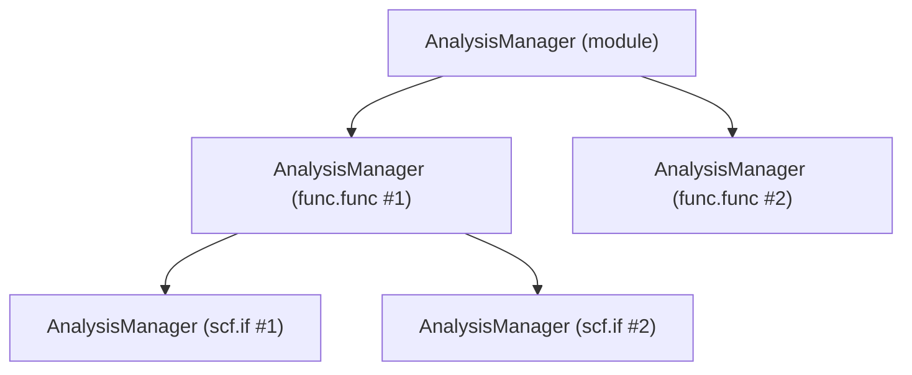

# 4.3 Analysis 的快取、失效與 Pass 依賴管理

## 問題的來源：查詢不該重複做

[4.2](04.2-多執行緒平行化.md) 我們建立了「每個 pass 實例拿到一棵獨立 op 子樹」的平行模型。但有一類工作不符合這個模型：**查詢式分析**。

考慮一個名為 `DominanceInfo` 的分析：它回答「在 block A 裡，值 `v` 是否支配某個操作」。它需要計算 block 之間的支配關係樹，這是一個非平凡的演算法，複雜度約 $O(n \log n)$ （ $n$ 為 block 數量）。

如果每個需要支配資訊的 pass 都自己重算一次，一個有 100 個函式、每個函式 50 個 block 的模組會做：

$$
100 \times 50 = 5000 \text{ 次支配樹計算}
$$

而正確的做法是每個函式算一次，共 100 次——**50 倍的浪費**。

更麻煩的是，MLIR 的 pass 數量在實務上遠多於「需要支配資訊的 pass」。一個典型的 GPU 編譯 pipeline 有 50 到 100 個 pass，其中十幾個會查詢支配關係、use-def 鏈、符號解析。若全部重算，編譯時間會被分析 dominate。

**Analysis** 就是 MLIR 對這個問題的答案：一個**可快取的查詢結果**，其**失效**由框架根據 pass 的行為自動處理。

## Analysis 的定義

### `AnalysisInfo` 家族

MLIR 的 analysis 是用**模板特化**定義的，而非繼承自一個共同基底類別：

```cpp
namespace mlir {
namespace detail {

/// Analysis 結果的基底概念。
template <typename T>
struct AnalysisInfo {
  /// 分析的結果型別。
  using ResultT = T;
};

} // namespace detail
} // namespace mlir
```

一個具體的分析需要提供兩件事：

1. **結果型別**：一個存放查詢結果的類別。
2. **計算函式**：給定一個 operation，如何算出結果。

```cpp
namespace {

/// 一個簡單的範例分析：統計一個 operation 內 op 的數量。
struct CountOpsAnalysis {
  unsigned count = 0;
};

} // namespace

namespace mlir {
namespace detail {

template <>
struct AnalysisInfo<CountOpsAnalysis> {
  using ResultT = CountOpsAnalysis;

  static ResultT analyze(Operation *op) {
    ResultT result;
    op->walk([&](Operation *nested) {
      if (nested != op)
        result.count++;
    });
    return result;
  }
};

} // namespace detail
} // namespace mlir
```

這個「用 `AnalysisInfo<T>` 的特化來定義分析」的設計，是 MLIR 中相當獨特的一種模式。它的好處是**零繼承開銷**、**零動態派發**，而且結果型別與計算函式的綁定是編譯期完成的。

### 內建的分析

MLIR 內建了幾個常用分析：

| 分析 | 結果 | 用途 |
| --- | --- | --- |
| `DominanceInfo` | 支配關係樹 | 支配性 DCE、可變性分析、LICM |
| `CFGAnalysis` | 控制流圖 | 迴圈偵測、可達性分析 |
| `LoopAnalysis` | 迴圈結構 | LICM、loop unroll |
| `RegionAnalysis` | region 的 block 結構 | region 型別查詢 |
| `SymbolTableAnalysis` | 符號表 | 符號解析、lookup |
| `CallGraphAnalysis` | 呼叫圖 | 死函式消除 |
| `BufferizableOpInterface` 相關 | bufferization 的可 bufferize 資訊 | 記憶體操作分析 |
| `ValueAnalysis` | 值的常數性資訊 | 常數折疊 |

## `AnalysisManager`：快取的持有者

`AnalysisManager` 是 analysis 快取的管理者。它的核心 API：

```cpp
namespace mlir {

class AnalysisManager {
public:
  /// 取得（或計算）指定 operation 的分析結果。
  template <typename AnalysisT>
  typename AnalysisT::ResultT getAnalysis(Operation *op);

  /// 取得指定 operation 的分析結果，若不存在則返回 nullptr。
  template <typename AnalysisT>
  typename AnalysisT::ResultT *getAnalysis(Operation *op);

  /// 失效指定 operation 的某個分析。
  template <typename AnalysisT>
  void invalidateAnalysis(Operation *op);

  /// 失效指定 operation 的所有分析。
  void invalidateAll(Operation *op);

  /// 讓分析管理器知道某個 operation 已被改寫。
  void invalidate(Operation *op);
};

} // namespace mlir
```

### `AnalysisManager` 的巢狀結構

這裡有一個關鍵設計：**`AnalysisManager` 是階層式的**。



`AnalysisManager` 持有一個「父 manager」的指標。當你對某個 operation 請求分析時，manager 會：

1. 先在自己的快取裡找。
2. 找不到，就計算（計算函式可以透過 `getAnalysis` 請求父層或更細粒度的分析，形成遞迴）。
3. 把結果存入自己的快取。

這個階層結構對效能很重要：對 `func::FuncOp` 請求 `DominanceInfo` 時，`DominanceInfo` 內部會對每個 block 請求更細粒度的資訊——但那些是不同 op 的 manager，不會衝突。

### `OpToAnalysisManagerMap`

`AnalysisManager` 內部用一個 `DenseMap` 把 operation 指標對應到它的 manager：

```cpp
template <typename AnalysisT>
typename AnalysisT::ResultT AnalysisManager::getAnalysis(Operation *op) {
  // 1. 在自己的 cache 中查找
  auto it = cache.find(AnalysisT::getAnalysisKey());
  if (it != cache.end())
    return it->second;

  // 2. 計算
  AnalysisT::ResultT result = AnalysisT::analyze(op);

  // 3. 存入 cache
  cache.insert({AnalysisT::getAnalysisKey(), result});
  return result;
}
```

## `PreservedAnalyses`：失效的宣告機制

失效的問題是：**一個 pass 改了 IR，pass manager 怎麼知道哪些分析還有效？**

MLIR 的答案是「**由 pass 宣告**」。每個 pass 在執行完後回報它保留了哪些分析：

```cpp
namespace mlir {

/// 一組被保留的分析的描述。
class PreservedAnalyses {
public:
  /// 建構一個空的（什麼都沒保留）集合。
  PreservedAnalyses();

  /// 保留所有分析。
  static PreservedAnalyses all();

  /// 一個都不保留。
  static PreservedAnalyses none();

  /// 保留指定的分析。
  template <typename AnalysisT>
  void preserve();

  /// 保留某個 operation 上的指定分析。
  template <typename AnalysisT>
  void preserve(Operation *op);

  /// 判斷某個分析是否被保留。
  template <typename AnalysisT>
  bool isPreserved(Operation *op) const;

  /// 判斷某個分析是否被保留（針對所有 operation）。
  template <typename AnalysisT>
  bool isPreserved() const;

  /// 取得被保留的分析集合（用於巢狀粒度）。
  const PreservedAnalyses &getNestedPreservedAnalyses() const;
};

} // namespace mlir
```

### `PreservedAnalyses` 的內部表達

`PreservedAnalyses` 內部維護一個 `preservedAnalyses` 集合與一個 `allAnalysesPreserved` 旗標。它還支援「巢狀粒度」：一個 `PreservedAnalyses` 可以記錄「模組層的分析全部保留，但 `func.func` 上的某個分析沒保留」。

這個巢狀粒度是失效機制的精妙之處所在。

### Pass 如何宣告保留什麼

`Pass` 有一個可覆寫的方法：

```cpp
class Pass {
public:
  /// 取得此 pass 依賴的分析。
  virtual void getDependentAnalyses(PreservedAnalyses &preservedAnalyses) const;

  /// pass 執行完成後，宣告保留了什麼。
  virtual void markAnalysesPreserved(PreservedAnalyses &preservedAnalyses) const;
};
```

預設的 `markAnalysesPreserved` **什麼都不保留**——這是安全的預設值：假設 pass 改了 IR，所有分析都要失效。只有確定安全的 pass 才需要顯式宣告保留。

```cpp
struct MyPurePass : public PassWrapper<MyPurePass, OperationPass<func::FuncOp>> {
  void markAnalysesPreserved(PreservedAnalyses &preservedAnalyses) const override {
    // 這個 pass 不改變 CFG 結構，因此支配關係仍然有效。
    preservedAnalyses.preserve<DominanceInfo>();
  }

  void runOnOperation() override {
    // ...
  }
};
```

### `preserve` 與 `preserve<Analysis>()` 的寫法

現代 MLIR 提供了更方便的寫法：

```cpp
void markAnalysesPreserved(PreservedAnalyses &preservedAnalyses) const override {
  preservedAnalyses.preserve<DominanceInfo>();
  preservedAnalyses.preserve<CFGAnalysis>();
}
```

也可以一次保留「所有分析」或「一個都沒保留」：

```cpp
preservedAnalyses.preserveAll();       // 等價 PreservedAnalyses::all()
preservedAnalyses.preserveNone();      // 等價 PreservedAnalyses::none()
```

## 失效機制：誰 invalidate 誰

### 失效的傳遞方向

失效是**由外而內**傳遞的。假設 pipeline 是：

```
builtin.module(pass-A, func.func(pass-B))
```

* `pass-A` 在模組層執行完，回報 `markAnalysesPreserved`。
* 若 `pass-A` 說「我沒保留任何分析」，則模組層與其**所有子層**（所有 `func.func` 的 manager）的分析快取全部失效。
* 若 `pass-A` 說「我保留了 `DominanceInfo`」，則模組層的 `DominanceInfo` 保留，但所有 `func.func` 層的 `DominanceInfo` 呢？

這裡是巢狀粒度發揮作用的地方。MLIR 的 `PreservedAnalyses` 能表達：

```cpp
preservedAnalyses.preserve<DominanceInfo>();
preservedAnalyses.preserve<AnalysisManager::NestedAnalysis<...>>();  // 巢狀
```

實際上，MLIR 提供了兩種粒度的操作：

```cpp
/// 保留此 operation 上的分析，以及其所有嵌套 operation 的對應分析。
template <typename AnalysisT>
void preserve();

/// 只保留此 operation 上的分析，不影響嵌套。
template <typename AnalysisT>
void preserve(Operation *op);
```

### 失效的演算法

概念上，pass manager 在每個 pass 執行完後做：

```
1. 取得 pass 的 PreservedAnalyses
2. 對每個被此 manager 管理的 operation op（包含巢狀）：
   a. 對每個已快取的分析 A：
      若 A 未被保留（且非「保留全部」）：
        從 op 的 manager 中移除 A 的快取
3. 若 pass 修改了 op 樹本身（新增/刪除 op）：
   對被刪除/新增的 op 及其子樹，移除所有分析快取
```

第 3 點很重要：新增或刪除 operation 時，那個 operation 的 analysis 快取必須被清掉（因為 analysis 的快取是以 operation 指標為 key，operation 被刪除後指標可能會被重用——這是個真實的 bug 來源）。

### 一個完整的失效推演

假設有這樣的 pipeline：

```bash
mlir-opt input.mlir --pass-pipeline='builtin.module(cse,func.func(dominance-based-dce))'
```

1. `cse` 在模組層執行。它做的是 common subexpression elimination，會替換 op。
2. `cse` 沒有覆寫 `markAnalysesPreserved`，所以回報 `PreservedAnalyses::none()`。
3. Pass manager 因此清空模組層與所有函式層的 analysis 快取。
4. `dominance-based-dce` 在 `func.func` 層執行，向 manager 請求 `DominanceInfo`。
5. Manager 發現快取已被清空，重新計算。

若 `cse` 改寫為：

```cpp
void markAnalysesPreserved(PreservedAnalyses &preservedAnalyses) const override {
  // CSE 只替換等價 op，不改變 CFG 與支配關係。
  preservedAnalyses.preserve<DominanceInfo>();
  preservedAnalyses.preserve<CFGAnalysis>();
}
```

則第 3 步只清空未被保留的分析（例如 `CallGraphAnalysis`），`DominanceInfo` 被保留下來，第 5 步的重新計算被省下。

## 失效粒度：operation 粒度 vs pass 粒度

MLIR 的失效有兩個層次。

**Pass 粒度。** 一個 pass 執行完，影響的是**它作用的 operation 子樹**。`OperationPass<func::FuncOp>` 影響的是那個函式及其後代，不是其他函式。

**Operation 粒度。** 當 pass 在 IR 上做了結構性的修改（新增 op、刪除 op），MLIR 會對**那些被修改的 operation** 做精細的失效。

第二種透過 `PatternRewriter` 自動完成。`PatternRewriter` 的 `replaceOp`、`eraseOp`、`insertBefore`、`setOperand` 等方法都會通知 operation 及其父層的 analysis manager：

```cpp
/// 通知 analysis manager 某個 operation 已被改寫。
void notifyOperationRemoved(Operation *op);
void notifyOperationReplaced(Operation *op, ValueRange newValues);
```

`PatternRewriter` 的實作（`RewriterBase::Listener`）會呼叫 `analysisManager->invalidate(op)`，使得**該 operation 上的分析**以及**其子樹上的分析**被清除，但父層（例如 `func::FuncOp` 上的 `DominanceInfo`）是否失效，取決於修改的性質。

這裡有一個微妙但重要的區別：

| 修改 | 對父層分析的影響 |
| --- | --- |
| 替換一個 op（`replaceOp`） | 父層的 `DominanceInfo` **可能**失效（block 結構可能改變） |
| 刪除一個 op | 同上 |
| 插入一個 op | 同上 |
| 改變一個 operand（`setOperand`） | 影響 use-def，但不影響支配關係 |
| 改變一個屬性 | 通常不影響任何結構性分析 |

MLIR 的 `DominanceInfo` 與 `CFGAnalysis` 屬於「結構性分析」，它們對 op 樹的結構變化敏感。因此只要你動到 block 或 terminator，就必須假設它們失效。

## 常見分析範例

### `DominanceInfo`

`DominanceInfo` 回答：「從某個 operation 出發，能否到達某個值的所有使用點？」這是 SSA 形式下「這個值在此處一定可用」的判準。

```cpp
namespace mlir {
namespace detail {

template <>
struct AnalysisInfo<::mlir::DominanceInfo> {
  using ResultT = ::mlir::DominanceInfo;

  static ResultT analyze(Operation *op) {
    return ResultT(op);
  }
};

} // namespace detail
} // namespace mlir
```

使用：

```cpp
void runOnOperation() override {
  func::FuncOp func = getOperation();
  DominanceInfo domInfo = getAnalysis<DominanceInfo>();

  func.walk([&](Operation *op) {
    if (auto load = dyn_cast<memref::LoadOp>(op)) {
      Value ptr = load.getMemRef();
      // 檢查 ptr 是否在此處支配（保證 SSA 合法）
      if (Operation *def = ptr.getDefiningOp())
        if (!domInfo.dominates(def, op))
          return signalPassFailure();
    }
  });
}
```

`DominanceInfo` 的演算法是經典的 **Cooper-Harvey-Kennedy 立即支配樹**（簡稱 CHK 演算法），在一般控制流圖上的複雜度是 $O(n \alpha(n))$ ，幾乎是線性的。

### `CFGAnalysis`

`CFGAnalysis` 建立控制流圖：

```cpp
namespace mlir {
namespace detail {

template <>
struct AnalysisInfo<::mlir::CFGAnalysis> {
  using ResultT = ::mlir::CFGAnalysis;

  static ResultT analyze(Operation *op) {
    return ResultT(op);
  }
};

} // namespace detail
} // namespace mlir
```

它的核心資料結構是「每個 block 的後繼 block 集合」。對一個 `func::FuncOp`，CFG 包含所有 `func.func` 內的 block；對一個 `scf.for`，CFG 包含該 op 的 region 內的 block。

```cpp
CFGAnalysis cfg = getAnalysis<CFGAnalysis>();
for (Block &block : func.getBody()) {
  for (Block *succ : cfg.getSuccessors(&block)) {
    // ...
  }
}
```

### Shape inference

Shape inference 不是 MLIR 內建的單一分析，而是**由方言自己實作**的典型例子。以 `tensor` 方言為例，結果型別的推導是：

```cpp
/// 推導 op 的結果型別。
LogicalResult inferReturnTypes(MLIRContext *context, std::optional<Location> loc,
                                ValueRange operands, DictionaryAttr attributes,
                                OpaqueProperties properties, RegionRange regions,
                                SmallVectorImpl<Type> &inferredReturnTypes);
```

這個函式被註冊到 dialect 上：

```cpp
void TensorDialect::initialize() {
  addOperations<
#define GET_OP_LIST
#include "TensorOps.cpp.inc"
      >();
  addTypes<
#define GET_TYPEDEF_LIST
#include "TensorTypes.cpp.inc"
      >();
  addInterfaces<
      TensorDialectInferenceInterface>();
}
```

推導的結果被快取在 op 的屬性中（`tensor` 方言把推導出的 shape 存成 `tensor` op 的隱藏屬性），這讓後續的 pass 可以直接讀取而不需重算。

### Bufferization 的分析

bufferization 是 MLIR 中分析機制最複雜的應用。它需要判斷：

* 哪些 op 可以被 bufferize（`BufferizableOpInterface`）。
* 各個 `tensor` 值之間是否有 alias 關係。
* 哪些 buffer 可以被 in-place 改寫。

MLIR 為此提供：

```cpp
/// 判斷一個 op 是否可以被 bufferize。
bool isOpBufferizable(Operation *op);

/// 查詢一個值的 alias 資訊。
FailureOr<Value> getAliasingOp(Value v, AnalysisState &state);
```

`AnalysisState` 是 bufferization 專用的分析狀態容器，它追蹤「已經 bufferize 了哪些值」。

## 正確宣告分析失效

這是最容易出錯、也最重要的一節。

### 規則一：預設什麼都不保留

`markAnalysesPreserved` 的預設實作回報 `PreservedAnalyses::none()`。**不要為了「效能」而輕易覆寫它**。只有在你能論證「這個 pass 的所有修改都不影響那些分析」時才保留。

### 規則二：保留前先問三個問題

1. **這個 pass 會改變 op 樹的結構嗎？**（新增/刪除 op、改變 block、改變 terminator）→ 若是，結構性分析（`DominanceInfo`、`CFGAnalysis`）**必須失效**。
2. **這個 pass 會改變資料流嗎？**（改變 operand、改變 use-def 鏈）→ 若是，`ValueAnalysis`、`CallGraphAnalysis` 類的分析失效。
3. **這個 pass 會改變屬性語意嗎？**（例如改了某個影響 shape 推導的屬性）→ 若是，相關的分析失效。

### 規則三：巢狀粒度要精確

```cpp
void markAnalysesPreserved(PreservedAnalyses &preservedAnalyses) const override {
  // 只保留當前 operation 上的分析，不影響嵌套 operation。
  preservedAnalyses.preserve<DominanceInfo>(getOperation());
}
```

如果你的 pass 作用於 `func::FuncOp` 且只改了函式**內部**某些 op 的屬性（不改結構），那麼函式本身的 `DominanceInfo` 仍然有效，但巢狀 op 上的分析可能失效。

### 一個正確的範例

```cpp
struct SetMemorySpacePass
    : public PassWrapper<SetMemorySpacePass, OperationPass<func::FuncOp>> {
  MLIR_DEFINE_EXPLICIT_INTERNAL_INLINE_TYPE_ID(SetMemorySpacePass)

  StringRef getArgument() const final { return "set-memory-space"; }
  StringRef getDescription() const final {
    return "Set the memory space attribute on memref operations";
  }

  void runOnOperation() override {
    func::FuncOp func = getOperation();
    func.walk([&](Operation *op) {
      if (auto alloc = dyn_cast<memref::AllocOp>(op)) {
        alloc.setMemorySpaceAttr(IntegerAttr::get(IntegerType::get(op->getContext()), 1));
      }
    });
  }

  void markAnalysesPreserved(PreservedAnalyses &preservedAnalyses) const override {
    // 只改屬性，不改 op 樹結構，也不改 operand。
    // 因此支配關係、CFG、以及所有結構性分析都仍然有效。
    preservedAnalyses.preserve<DominanceInfo>();
    preservedAnalyses.preserve<CFGAnalysis>();
  }
};
```

### 一個錯誤的範例

```cpp
struct BadPass : public PassWrapper<BadPass, OperationPass<func::FuncOp>> {
  void runOnOperation() override {
    func::FuncOp func = getOperation();
    func.walk([&](Operation *op) {
      // 這個 pass 會插入新的 op，改變了 CFG。
      if (isa<SomeOp>(op))
        op->getContext()->getLoadedDialect<arith::ArithDialect>();
      // 插入：
      // builder.setInsertionPoint(op);
      // builder.create<arith::ConstantOp>(...);
    });
  }

  void markAnalysesPreserved(PreservedAnalyses &preservedAnalyses) const override {
    // 錯誤：這個 pass 改變了 op 樹結構，DominanceInfo 與 CFGAnalysis
    // 一定會過時。但這裡卻宣告保留它們。
    preservedAnalyses.preserve<DominanceInfo>();
  }
};
```

這個錯誤的後果是**延遲崩潰**：某個後續的 pass 拿到過時的 `DominanceInfo`，基於錯誤的支配關係做出錯誤的改寫，最後在某個不相關的地方崩潰。這類 bug 極難診斷。

## 從 pass 取得分析

在 pass 內取得分析有兩種方式。

**方式一：`getAnalysis<T>()`。**

```cpp
void runOnOperation() override {
  func::FuncOp func = getOperation();

  // 取得（或計算）當前 operation 的 DominanceInfo。
  DominanceInfo domInfo = getAnalysis<DominanceInfo>();

  // 取得巢狀 operation 的分析。
  auto *domInfoPtr = getAnalysis<DominanceInfo>(someBlock);
}
```

`getAnalysis<T>()` 委派給 pass 所屬 operation 的 `AnalysisManager`。

**方式二：`getCachedAnalysis<T>()`。**

```cpp
// 只在已快取時取得，不觸發計算。找不到則返回 nullptr。
DominanceInfo *domInfo = getCachedAnalysis<DominanceInfo>();
```

這在「某個分析可能不存在，用它來決定是否執行某段優化」時很有用。

### 依賴宣告

pass 應該宣告它依賴哪些分析：

```cpp
void getDependentAnalyses(PreservedAnalyses &preservedAnalyses) const override {
  // 這個 pass 的邏輯假設支配關係有效。
  preservedAnalyses.preserve<DominanceInfo>();
}
```

`getDependentAnalyses` 與 `markAnalysesPreserved` 的**語意不同**：

| 方法 | 時機 | 意義 |
| --- | --- | --- |
| `getDependentAnalyses` | pass **建構時** | 宣告「這個 pass 需要哪些分析」，影響分析的預先計算與失效 |
| `markAnalysesPreserved` | pass **執行完** | 宣告「這個 pass 保留了哪些分析」 |

在實務中，很多 pass 只實作 `getDependentAnalyses` 來宣告依賴，讓 MLIR 知道「這個 pass 執行的時候，`DominanceInfo` 必須是最新的」。

## Analysis 的失效與平行化的交互

回到 [4.2](04.2-多執行緒平行化.md) 的平行模型。analysis 快取與平行化的關係是：

**每個平行實例有獨立的 analysis manager。** 對 `func::FuncOp` 的分析快取存在於該函式的 manager 中；兩個平行實例（作用於不同函式）各自快取自己的結果，互不干擾。

**但父層的分析是共享的。** 模組層的 `SymbolTableAnalysis` 只有一份（因為只有一個模組 manager）。若兩個平行實例都請求它：

* 讀取是安全的（符號表建構後唯讀）。
* 但若第一次請求觸發計算，兩個執行緒可能同時計算——這需要內部同步。

MLIR 的 `AnalysisManager` 在需要時會做同步，或者更好的做法是**在進入平行區域之前，先在主執行緒計算好共享的分析**。這是 `getDependentAnalyses` 機制的另一個用途：pass manager 可以在 pass 執行前預先計算好依賴的分析，避免在平行區域內觸發計算。

## 成本模型：快取的收益

粗略估算 analysis 快取的收益。

設：

* $A$ ：一個分析的成本（例如 `DominanceInfo` 的計算）。
* $k$ ：查詢該分析的 pass 數量。
* $n$ ：IR 中的相關 operation 數量。

沒有快取：總成本 $k \cdot n \cdot A$ （每個 pass 對每個 op 都重算）。

有快取（假設計算一次，之後 $O(1)$ 查詢）：總成本 $n \cdot A + k \cdot n \cdot O(1)$ 。

加速比：

$$
\frac{k \cdot n \cdot A}{n \cdot A + k \cdot n} \approx \frac{k \cdot A}{A + k}
$$

當 $k \gg A$ （查詢次數遠多於計算成本）時，加速比趨近 $k$ ——也就是省掉幾乎所有重複計算。

反過來，若 $A$ 極大（例如複雜的別名分析）且 $k$ 很小，快取的收益就微乎其微，但快取的**成本**（記憶體）仍在。所以不是所有東西都該做成 analysis。

**記憶體成本。** 每個 operation 的每個分析結果都存在記憶體裡。對一個有 10000 個 op 的模組，若每個 op 的 analysis 結果是 1 KB，總共就是 10 MB。這在大型模型編譯中不可忽略。因此 MLIR 的分析快取是**按需建立**的：只有被查詢過的分析才會被計算與快取。

## 診斷：分析失效問題的除錯技巧

分析過時造成的 bug 症狀通常是「某個 pass 產生了不可信的結果」或「在某個不相關的地方崩潰」。以下是有效的診斷步驟。

**關閉快取。** MLIR 沒有直接的「每次都重算」開關，但可以透過讓 pass 不宣告保留任何分析來強制失效：把有問題的 pass 的 `markAnalysesPreserved` 移除，看 bug 是否消失。

**在懷疑點手動重新計算。**

```cpp
void runOnOperation() override {
  func::FuncOp func = getOperation();
  getAnalysis<DominanceInfo>().invalidate();
  DominanceInfo fresh = getAnalysis<DominanceInfo>();
  // ...
}
```

**使用 `--mlir-print-ir-after-all`。** 若失效機制有問題，通常能從 IR 的異常改變看出來。

**思考「誰改變了它」。** 一個實用的除準則：如果某個 pass P 依賴分析 A，而 A 是在 P 之前由 pass Q 建立的，那麼問題出在 Q 與 P 之間的某個 pass 沒有正確宣告失效。

## 小結與延伸閱讀

* Analysis 是可快取的查詢結果，以 `AnalysisInfo<T>` 的模板特化定義，零繼承開銷、編譯期綁定；`AnalysisManager` 以 operation 為粒度階層式快取。
* 失效由 pass 透過 `PreservedAnalyses` 宣告，預設「什麼都不保留」；`markAnalysesPreserved` 保留、`getDependentAnalyses` 宣告依賴，兩者時機與語意不同。
* 失效粒度有兩層：pass 粒度（影響它作用的子樹）與 operation 粒度（`PatternRewriter` 在改寫時自動通知，精準失效受影響 op 的快取）。
* 平行化的交互：每個平行實例有獨立的 analysis manager，但父層分析是共享的，應在進入平行區域前預先計算。
* 保留分析前必須論證「不改變 op 樹結構、不改變資料流、不改變影響推導的屬性」；否則會造成難以診斷的延遲崩潰。
* 延伸閱讀：`mlir/include/mlir/Analysis/AnalysisManager.h`（`AnalysisManager` 與 `AnalysisInfo`）、`mlir/include/mlir/Analysis/PreservedAnalyses.h`（失效宣告機制）、`mlir/include/mlir/IR/Dominance.h`（`DominanceInfo`）、`mlir/include/mlir/Analysis/CFG.h`（`CFGAnalysis`）、`mlir/docs/Passes.md`（pass 撰寫指南中的 analysis 章節）、`mlir/include/mlir/Interfaces/InferTypeOpInterface.h`（型別推導介面）。
