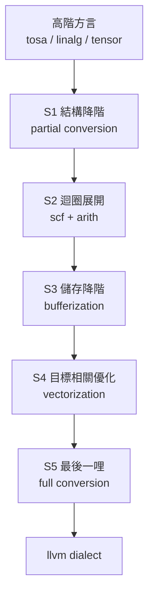
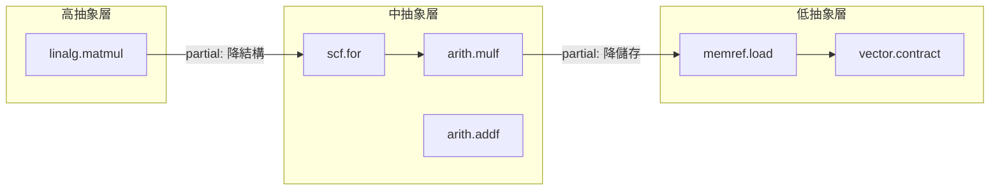

# 5.3 Partial Lowering 與 Full Lowering 的策略差異

前兩節分別介紹了改寫引擎與轉換框架。把它們放在一起，會立刻浮現一個工程問題：**一個真實的編譯器，應該在什麼時候、用什麼方式，把高階抽象一路壓到硬體相關的層級？**

答案不是唯一的。MLIR 刻意提供 `applyPartialConversion` 與 `applyFullConversion` 兩種轉換風格，就是因為不同的編譯目標、不同的優化階段，需要不同程度的「強制降階」。本節把這兩種風格拆開來看，並給出一個典型的多層降階 pipeline。

## Full Conversion 的嚴格性

先回顧 `applyFullConversion` 的成功條件：

$$
\forall o \in \mathrm{ops}(\mathrm{region}),\quad \mathrm{legal}(o) = \mathrm{true}
$$

這個全稱命題在實務上相當嚴格，有三層後果。

**後果一：target 必須完整。** 凡是要在轉換結束後留在 IR 裡的 op，都必須被宣告為 legal。漏掉一個 `addLegalOp`，conversion 就會以「failed to legalize operation」失敗。這迫使 pass 作者把「我想要什麼樣的最終 IR」完整寫出來——這是好事，因為它把隱性假設變成了顯性宣告。

**後果二：不能保留「暫時的高階 op」。** full conversion 結束時，IR 必須是**單一抽象層**的（或至少是被宣告為 legal 的那幾層）。不能說「先把 `linalg` 降成 `scf` + `arith`，但 `tensor` 先留著」——除非 `tensor` 被宣告為 legal。

**後果三：轉換期間的 IR 必須合法。** 這一點在 [5.2](05.2-DialectConversion框架.md) 已提過。full conversion 尤其依賴這個性質：driver 會在過程中不斷重新檢查合法性，一旦發現非法 op 就必須立刻把它合法化，否則整個轉換失敗。

### Full conversion 適合什麼情境

| 情境 | 是否適合 full conversion |
| --- | --- |
| 一個 pass 要把某個方言整體消滅，且結果必須是乾淨的 | 適合 |
| 最後一哩：整個模組降成 `llvm` 方言 | 適合（這是 MLIR 最常見的 full conversion） |
| 中途階段：從 `linalg` 降到 `scf`/`arith`，但 `tensor` 還在 | 不適合，需用 partial |
| 只轉換某個 region 內的子樹 | 視情況；region 邊界處通常需要 partial |

### 最後一哩的典型寫法

把整個模組降成 LLVM IR 的 pass，長相大致如下：

```cpp
void runOnOperation() override {
  MLIRContext *ctx = &getContext();
  LowerToLLVMOptions options(ctx);
  TypeConverter &typeConverter = options.typeConverter;

  RewritePatternSet patterns(ctx);
  populateArithToLLVMConversionPatterns(typeConverter, patterns);
  populateFuncToLLVMConversionPatterns(typeConverter, patterns);
  populateSCFToControlFlowConversionPatterns(typeConverter, patterns);
  populateMemRefToLLVMConversionPatterns(typeConverter, patterns);
  populateFinalizeMemRefToLLVMConversionPatterns(typeConverter, patterns);
  populateBuiltinConversionPatterns(typeConverter, patterns);

  LLVMConversionTarget target(*ctx);
  target.addLegalOp<ModuleOp>();

  if (failed(applyFullConversion(getOperation(), target, std::move(patterns))))
    signalPassFailure();
}
```

這裡的 `LLVMConversionTarget` 是 LLVM 專案提供的轉換目標，它把 `llvm` 方言宣告為合法、其餘常見方言宣告為非法（部分帶有動態條件）。因為 `llvm` 方言涵蓋了幾乎所有底層抽象（`llvm.func`、`llvm.mlir.global`、`llvm.return` 等），full conversion 在這裡是合理的：LLVM IR 本身就是最終抽象層。

## Partial Lowering 的實用性

相對地，`applyPartialConversion` 的成功條件是：

$$
\forall o,\ \mathrm{illegal}(o) \Rightarrow o \notin \mathrm{ops}(\mathrm{result})
$$

也就是說：**只要被宣告為 illegal 的 op 都消失了，就算成功**。其餘的 op（合法的、或是 target 根本不認識的）可以留在結果裡。

這個差別看似只是「寬嚴不同」，實際上帶來三種完全不同的工程能力。

### 能力一：混合抽象層的 IR

最直接的用途，是讓一個 pipeline 的中途階段自然地處於「多層共存」狀態：

```mlir
func.func @f(%A: tensor<128x128xf32>) -> tensor<128x128xf32> {
  %0 = linalg.matmul ins(%A, %B : tensor<128x128xf32>, tensor<128x128xf32>)
                     outs(%C : tensor<128x128xf32>) -> tensor<128x128xf32>
  return %0 : tensor<128x128xf32>
}
```

假設這個 pipeline 有三個階段：

1. `linalg` → `scf` + `arith`（控制流與運算展開）
2. `tensor` → `memref`（bufferization）
3. `memref` → `llvm`（最後一哩）

在第 1 階段結束時，IR 中會同時出現 `scf.for`、`arith.mulf`（新產生的低階 op）以及還沒被處理的 `tensor.empty`（舊的高階 op）。這就是 partial lowering 的典型產物：**混合抽象層**。

這種混合 IR 有個重要特性：它是**合法的**（宣告 `tensor` 為 legal），因此可以直接送進 verifier，也可以被後續 pass 看到。

### 能力二：選擇性降階

很多 pass 只關心某一類 op。例如，一個「把 `scf.for` 迴圈向量化」的 pass 只想要把 `scf.for` 降成 `affine.for` 或 `vector` 序列，完全不想碰 `linalg` 或 `tensor`。

```cpp
void runOnOperation() override {
  MLIRContext *ctx = &getContext();
  ConversionTarget target(*ctx);
  target.addLegalDialect<scf::SCFDialect>();
  target.addLegalDialect<tensor::TensorDialect>();
  target.addIllegalOp<scf::ForOp>();   // 只要求 scf.for 消失。

  RewritePatternSet patterns(ctx);
  patterns.add<ForOpToAffineFor>(ctx);

  if (failed(applyPartialConversion(getOperation(), target, std::move(patterns))))
    signalPassFailure();
}
```

這裡 `applyPartialConversion` 是正確選擇，因為「`scf.for` 消失」就是這個 pass 的全部目標；其他 op 的去留不是它該管的事。

### 能力三：漸進式的重複降階

有時同一個抽象需要「一層一層剝」。例如把 `linalg` 降到 `loops`（`scf.for` + `arith`），再把 `loops` 降到 `affine`，再把 `affine` 降到 `scf`。每一層都是一次 partial conversion。

```bash
mlir-opt input.mlir -convert-linalg-to-loops -convert-loops-to-affine -lower-affine
```

## 混合抽象層 IR 的工程挑戰

partial lowering 聽起來很美，但它把複雜度從「轉換機制」搬到了「pipeline 設計」與「後端 pass 的健壯性」上。讓我們把這些挑戰攤開來看。

### 挑戰一：後端 pass 必須處理多種表示

假設 pipeline 中 `linalg` 已被降成 `scf` + `arith`，但 `tensor` 還在。此時若你想寫一個「把 `memref.copy` 換成 DMA」的 pass，它需要回答：這個 `memref.copy` 的來源 operand 是 `tensor`（還沒 bufferize）還是 `memref`（已經 bufferize）？

若 pass 的邏輯假設「IR 中只有 `memref`」，它就必須**先確認前提成立**，否則會做出錯誤的假設：

```cpp
/// 一個必須自我保護的 pass：只在 IR 已經全是 memref 時才運作。
struct DmaPromotionPass : public PassWrapper<DmaPromotionPass, OperationPass<func::FuncOp>> {
  void runOnOperation() override {
    FuncOp func = getOperation();

    // 自我檢查：若還有 tensor 類的 operand 存在，就跳過這個 pass。
    bool allMemref = true;
    func.walk([&](Operation *op) {
      if (isa<memref::CopyOp>(op)) {
        if (!op->getOperand(0).getType().isa<memref::MemRefType>())
          allMemref = false;
      }
    });
    if (!allMemref) {
      return;   // 前提不成立，安靜地不做任何事。
    }

    // ... 真正的轉換 ...
  }
};
```

這類「前提檢查」是 MLIR 中很常見的工程模式：pass 宣告自己需要什麼樣的 IR 前提，然後在 `runOnOperation` 開頭檢查，不滿足就直接 return。這與「假設 pipeline 順序正確」相比要健壯得多，因為 pipeline 順序經常會被使用者改動。

### 挑戰二：同一個語意有多種表示

在混合 IR 中，「一個矩陣乘積」可能同時以三種形式存在：

| 表示 | 抽象層 |
| --- | --- |
| `linalg.matmul` | 高階結構化 |
| `scf.for` + `arith.mulf` + `arith.addf` | 中階迴圈 |
| `memref` 上的 `vector` 指令序列 | 低階向量化 |

一旦要寫跨越多個抽象層的優化（例如「在 `linalg` 層做 tiling，在 `scf` 層做 unroll」），就必須理解每一層的表示，優化器會變得非常複雜。

MLIR 的實務答案是**分層優化**：讓每個 pass 只在自己的抽象層工作，並透過 conversion 把結果「交棒」給下一層。

### 挑戰三：轉換順序不可隨意調換

考慮下面兩個 pass：

- A：`linalg` → `scf` + `arith`
- B：`tensor` → `memref`（bufferization）

如果先做 A 再做 B 與先做 B 再做 A，結果**不一定相同**。原因在於：

- 先做 A：`linalg.matmul` 變成一堆 `arith` 與 `scf`，其 operand 仍是 `tensor`。接著 bufferization 需要處理「大量算術 op 的 tensor operand」，轉換規則變複雜。
- 先做 B：先把所有 `tensor` 變成 `memref`，`linalg.matmul` 變成 `linalg.matmul`（memref 版）。接著 A 把它降成 `memref` 上的迴圈。

實務上，主流的 MLIR 編譯流水線（例如 IREE、Triton、torch-mlir 的部分路徑）大致遵循類似順序：

```text
高階方言 → 結構化降階 → bufferization → 迴圈/向量化 → LLVM dialect
```

也就是**先降結構（structure），再降儲存（storage）**，或反之，但必須固定下來並記錄在 pipeline 裡。

### 挑戰四：debug 變難

混合 IR 的除錯是實務上最常見的抱怨。當一個 pass 失敗時，你看到的是「一半高階、一半低階」的 IR，很難判斷問題出在哪個階段。緩解手段包括：

- 在 pipeline 的每一步之間插入 `--mlir-print-ir-after-all`，或用 `-mlir-print-ir-after=<pass-name>` 只印特定 pass。
- 在每個 pass 邊界做一次合法性檢查（`mlir-opt` 預設就會）。
- 在 pipeline 文件中明確標註每一階段的「抽象層邊界」。

## 典型 pipeline

下面是一個從高階結構化方言一路降到 LLVM dialect 的典型 pipeline，並標註每一階段使用哪一種 conversion。

| 階段 | 輸入抽象層 | 輸出抽象層 | 轉換風格 | 典型 pass |
| --- | --- | --- | --- | --- |
| S1 | `tosa` / `stablehlo` / 高階 DSL | `linalg` / `tensor` | partial | `convert-tosa-to-linalg`、`convert-linalg-to-...` |
| S2 | `linalg` | `scf` + `arith`（迴圈） | partial | `convert-linalg-to-loops` |
| S3 | `tensor` + `scf` | `memref` + `scf` | partial | `one-shot-bufferize` / `bufferize` |
| S4 | `memref` + `scf` | `memref` + `vector` | partial | 針對目標的向量化 pass |
| S5 | `memref` + `vector` | `llvm` | full | `convert-func-to-llvm`、`convert-arith-to-llvm`、`convert-scf-to-cf`、`finalize-memref-to-llvm` |

注意 S5 是 full conversion：此時 IR 應該只剩 `memref`、`arith`、`scf`（或已轉成 `cf`）、`func` 這幾層，正好對應到 `LLVMConversionTarget` 宣告為合法的那批方言。





第二張圖想表達的是：conversion 階段之間存在「抽象層重疊」的瞬間，partial lowering 讓這種重疊合法化，而 full conversion 強制在轉換結束時收斂到單一抽象層。

## 何時該降階到 LLVM dialect

「降到 LLVM dialect」是一個分水嶺：它意味著放棄方言層級的語意資訊，交給 LLVM 後端做選指令、選指令排程、暫存器分配。判準可以整理成以下幾條。

**判準一：語意資訊是否已經用盡。** 如果你的 IR 已經被降到「記憶體操作 + 算術運算 + 控制流」的程度，方言層的資訊（例如稀疏性、精度策略、資料型別的語意）就已經沒被利用了，此時降到 LLVM 合理。反之，若你還保有可被後端利用的高階資訊（例如 `linalg` 的 tiling 資訊、`tosa` 的量化參數），就不該太早下降。

**判準二：目標硬體的差異是否已被吸收。** GPU、NPU、AVX-512 等目標的差異，通常表現在「用什麼指令序列」而不是「用什麼 IR 抽象」。因此像 `gpu`、`rocdl`、`nvvm` 這類方言的定位是**目標專屬的中間層**，它們在降到 LLVM 之前就先吸收了硬體特性。

**判準三：是否還有高階優化機會未被執行。** 這是最實際的一條：檢查 pipeline 裡所有的高階優化 pass 是否已經跑完。常見的檢查清單：

- 循環分割（loop tiling / fusion）是否已完成？
- 死碼消除、常數傳播是否已在高階做過？
- 是否有專為目標設計的向量化 pass？
- 是否有量化／稀疏化等專用 pass 還沒執行？

**判準四：是否需要 LLVM 之外的資訊。** 如果最終產物不是 LLVM IR（例如要產生 SPIR-V、要產生 C code 給其他工具鏈），那麼降到 LLVM dialect 就不對——應該降到 `spirv`、`emitc` 等對應的目標方言。這一點在 [7.3](07.3-高階圖方言與算子融合.md) 類的場景特別重要。

一個實用的判準式：

$$
\text{降到 LLVM dialect 的時機} \approx \min \{ t \mid \forall p \in P_{\text{high-level}},\ p \text{ 已於 } t \text{ 之前執行完畢} \}
$$

也就是「在所有高階優化都跑完之後」，而不是「能降就降」。

## 動態合法性在 pipeline 中的角色

`ConversionTarget` 的動態合法性，是處理「同一個 op 在不同上下文合法性不同」的關鍵。pipeline 中常見的三種用法。

### 用法一：依 operand 型別判斷

「這個 op 只有在 operand 已經是目標型別時才合法」——這讓 partial conversion 能安全地只處理一部分：

```cpp
// 只有當 operand 已經是 memref 時，my.load 才合法；否則必須被降階。
target.addDynamicallyLegalOp<my::LoadOp>([](my::LoadOp op) {
  return op.getSource().getType().isa<memref::MemRefType>();
});
```

### 用法二：依屬性判斷

「帶有 `my.padding` 屬性的 op 必須降階；不帶的可以留著」：

```cpp
target.addDynamicallyLegalOp<my::AnnotateOp>([](my::AnnotateOp op) {
  return !op->hasAttr("my.must_lower");
});
```

### 用法三：依 op 所在的 region 判斷

「在 `func.func` 裡的 `scf.for` 合法，在 `gpu.module` 裡的不合法」——這在混合 CPU/GPU pipeline 中很實用：

```cpp
target.addDynamicallyLegalOp<scf::ForOp>([](scf::ForOp op) {
  // 只有在 CPU 函式裡的迴圈才保留。
  return op->getParentOfType<gpu::GPUModuleOp>() == nullptr;
});
```

### `markUnknownOpDynamicallyLegal` 的策略性用法

在 partial conversion 中，未被宣告的 op 會讓人不安——它們到底會不會被轉換？明確的做法是：

```cpp
// 保守策略：只允許明確知道的方言，其餘全部視為需要轉換。
target.markUnknownOpDynamicallyLegal([](Operation *op) {
  return llvm::isa<func::FuncOp, ModuleOp>(op);
});
```

或

```cpp
// 寬鬆策略：允許任何未知 op 留下（適合只想轉換少數 op 的 pass）。
target.markUnknownOpDynamicallyLegal([](Operation *) { return true; });
```

寬鬆策略的風險是：converter 可能「以為自己成功了」，但其實留下了不該留的高階 op。實務上建議：**能列舉就列舉，無法列舉時才用寬鬆策略，並在 pass 文件中說明**。

## 轉換期間的 IR 合法性約束

前面提過 conversion 要求「過程中 IR 必須合法」。這個約束在 pipeline 設計上有具體後果。

**約束一：不能「先刪後建」。** 若一個 pass 想把 `my.op` 刪掉、稍後再插入等價的新 op，中間狀態會是「少了東西」的 IR，可能違反 verifier（例如 block 的 terminator 被刪掉）。正確做法是用 `replaceOp` / `replaceOpWithNewOp` 一次完成。

**約束二：不能留下「半型別」的 op。** 新建的 op 必須要嘛完全使用目標型別，要嘛透過 materialization 產生合法的過渡值。

**約束三：block 結構必須完整。** 每個 block 都需要 terminator（region 型 op 需要 terminator op）；conversion 在重寫含 region 的 op 時，會檢查新 region 是否有 terminator。這是為什麼轉換 `func.func` 這類含 region 的 op 時，pattern 必須提供完整的 body。

**約束四：driver 會在過程中重複驗證。** 這代表 conversion 的執行時間與 IR 大小成正比（甚至更差），大型專案裡 conversion 是明顯的效能熱點。緩解方式包括：把大型 module 在進入 conversion 前先切成較小的單位、或使用 `applyPartialConversion` 縮小受影響範圍。

## 降階順序對最佳化的影響

「過早降階會失去高階資訊」——這句話需要精確化。

### 資訊損失的三個階段

| 階段 | 若降階太早，會失去什麼 |
| --- | --- |
| `linalg` → 迴圈 | 失去迭代空間與 indexing map 的結構資訊，之後很難再做 tiling 或 fusion |
| `tensor` → `memref` | 失去值語意（value semantics），無法再做 copy elision、原地最佳化 |
| `scf`/`cf` → `llvm` | 失去結構化控制流資訊，LLVM 後端難以做 loop rotation、jump threading |

### 一個具體的對比

假設 `linalg.matmul` 的大小是 $128 \times 128 \times 128$ 。

**先降迴圈再 tiling（過早降階）**：降成 `scf.for` 之後，資訊只剩「三層巢狀迴圈，上限 128」。要再做 tiling，你得從迴圈邊界猜測哪些維度對應 M、N、K——在 $2^3 = 8$ 種可能的 tiling 中要重新推導。

**先 tiling 再降迴圈（正確順序）**：在 `linalg` 層，tiling 是宣告式的：

```mlir
%0 = linalg.matmul ins(...) outs(...) -> tensor<128x128xf32>
```

可以在這個層次指定 tile size $= 32$ ，得到一個明確的 tiling 結構，然後再降成迴圈。

### 反向的風險

「過早降階有風險」不代表「越晚降越好」。太晚降階也有代價：

- IR 體積爆炸：`linalg.matmul` 只有一個 op，降成迴圈後是 $128^3 = 2{,}097{,}152$ 次乘加，IR 會大到無法編譯。
- 優化機會流失：中間表示越低階，能做的優化越少。
- 除錯困難：低階 IR 對高階語意沒有提示。

因此存在一個甜蜜點（Sweetspot）：

$$
\text{甜蜜點} = \arg\max_t \; \big( \text{高階優化收益}(t) - \text{IR 膨脹成本}(t) - \text{資訊流失}(t) \big)
$$

實務上的判準是：**在「某個方言的優化機會全部用完」的那個時刻降階**。

## 一個混合 IR 的完整實例

最後用一個具體例子把上面的概念串起來。目標是：把 `my` 方言（假設它有 `my.matmul` 與 `my.elementwise`）一路降到 LLVM dialect，並在過程中刻意保留一個混合階段。

```cpp
/// 階段 S2：把 my.matmul 降成迴圈，但保留 tensor 抽象。
/// 這是一次 partial conversion：只要求 my.matmul 消失。
struct MatmulToLoops : public PassWrapper<MatmulToLoops, OperationPass<func::FuncOp>> {
  MLIR_DEFINE_EXPLICIT_INTERNAL_INLINE_TYPE_ID(MatmulToLoops)

  StringRef getArgument() const override { return "my-matmul-to-loops"; }

  void getDependentDialects(DialectRegistry &registry) const override {
    registry.insert<scf::SCFDialect>();
    registry.insert<arith::ArithDialect>();
  }

  void runOnOperation() override {
    MLIRContext *ctx = &getContext();

    ConversionTarget target(*ctx);
    // 要消滅的目標。
    target.addIllegalOp<my::MatmulOp>();
    // 允許存在的抽象層。
    target.addLegalDialect<scf::SCFDialect>();
    target.addLegalDialect<arith::ArithDialect>();
    target.addLegalDialect<tensor::TensorDialect>();   // 混合 IR：tensor 暫時留著。
    target.addLegalDialect<func::FuncDialect>();

    RewritePatternSet patterns(ctx);
    patterns.add<MatmulToLoopsPattern>(ctx);

    if (failed(applyPartialConversion(getOperation(), target, std::move(patterns))))
      signalPassFailure();
  }
};
```

轉換後的 IR 會是這樣（`tensor` 還在，`scf` 與 `arith` 已出現）：

```mlir
func.func @matmul(%A: tensor<4x4xf32>, %B: tensor<4x4xf32>) -> tensor<4x4xf32> {
  %c0 = arith.constant 0 : index
  %c4 = arith.constant 4 : index
  %init = tensor.empty() : tensor<4x4xf32>
  %r = scf.for %i = %c0 to %c4 step %c1 iter_args(%acc = %init) -> tensor<4x4xf32> {
    %r2 = scf.for %j = %c0 to %c4 step %c1 iter_args(%acc2 = %acc) -> tensor<4x4xf32> {
      %r3 = scf.for %k = %c0 to %c4 step %c1 iter_args(%acc3 = %acc2) -> tensor<4x4xf32> {
        %a = tensor.extract %A[%i, %k] : tensor<4x4xf32>
        %b = tensor.extract %B[%k, %j] : tensor<4x4xf32>
        %p = arith.mulf %a, %b : f32
        %s = arith.addf %acc3, %p : f32
        %u = tensor.insert %s into %acc3[%i, %j] : tensor<4x4xf32>
        scf.yield %u : tensor<4x4xf32>
      }
      scf.yield %r3 : tensor<4x4xf32>
    }
    scf.yield %r2 : tensor<4x4xf32>
  }
  return %r : tensor<4x4xf32>
}
```

這份 IR 正是「混合抽象層」的具體樣貌：控制流與算術已是中階抽象，但資料仍是高階的 `tensor`。下一階段的 bufferization 再把 `tensor` 收掉。

## 決策表：何時用哪一種

| 你的目標 | 選擇 | 理由 |
| --- | --- | --- |
| 把某個方言整體消滅 | `applyFullConversion` | 成功條件最明確 |
| 只轉換少數幾種 op | `applyPartialConversion` | 避免被迫宣告整個 IR 的形狀 |
| pipeline 中途階段 | `applyPartialConversion` | 需要保留其他抽象層 |
| 最後一哩（降到 LLVM dialect） | `applyFullConversion` | LLVM dialect 是完整的目標抽象層 |
| 實驗性、探索性的降階 | `applyPartialConversion` | 失敗時保留大部分 IR 便於觀察 |

## 小結與延伸閱讀

- Full conversion 要求轉換結束時區域內所有 op 都合法，因此必須完整宣告目標；partial conversion 只要求被標記為 illegal 的 op 消失，因而天然支援「混合抽象層」。
- Partial lowering 把複雜度從轉換機制搬到 pipeline 設計與後端 pass 的健壯性上：後端 pass 必須自我檢查前提，pipeline 順序必須固定並記錄。
- 降階到 LLVM dialect 的判準是「高階優化機會已用盡」，而不是「能降就降」；太早降階會失去 tiling、值語意、結構化控制流等資訊。
- 動態合法性（依型別、屬性、所在 region 判斷）是 partial conversion 能安全運作的前提，也是表達「在 CPU 函式保留、在 GPU 模組降階」這類上下文規則的工具。
- 一個可操作的 pipeline 設計原則：每個階段只做一件事，並用一次 partial conversion 完成，轉換之間的抽象層重疊是合法且可預期的中間狀態。

延伸閱讀：

- MLIR 官方文件 `mlir/docs/DialectConversion.md`：`ConversionTarget` 合法性語意與 partial / full conversion 的差異。
- MLIR 官方文件 `mlir/docs/Bufferization/` 下的說明文件：bufferization 作為獨立降階階段的設計。
- MLIR 官方文件 `mlir/docs/Passes.md`：pass manager 與 pipeline 組合方式。
- IREE 與 Triton 的編譯 pipeline 原始碼（`compiler/src/compiler/...`）：真實世界的多階段降階順序範例。
- LLVM 開發者會議網站上的 MLIR 設計文件（`llvm.org/docs/Designs/MLIRDesign.html`）：抽象層分層與降階策略的設計動機。
