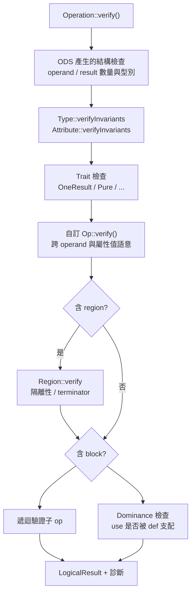

# 6.1 Verifier：靜態不變式與結構檢查

MLIR 的 IR 是**可變的**。這是它相對於傳統 SSA 形式的中間表示最大的優點——pass 可以自由地重寫、搬移、刪除 op——但也帶來了最大的風險：如果一個 pass 寫錯了，IR 會不會壞掉，而且**壞掉的時候要怎麼知道**？

MLIR 的答案是 **Verifier**：一組在 IR 上執行的結構性檢查，確保任何時刻的 IR 都滿足一組明確宣告的不變式。本節說明這些不變式是什麼、由誰來檢查、以及如何在實務上寫出有用的 verifier。

## 為什麼 IR 需要不變式

先看一個反面案例。假設某個 pass 把一個 op 的結果換成了型別不符的值：

```cpp
// 錯誤的 pattern。
rewriter.replaceOpWithNewOp<arith::AddFOp>(op, f32Value, tensorValue);
```

如果沒有任何檢查，IR 會變成一個「看起來還在、其實語意已毀」的東西。後續的 pass 讀到它時，可能產生任意錯誤——而且錯誤訊息會指向離真正原因很遠的地方。

Verifier 的作用就是把這個錯誤**在發生的當下抓住**，並且給出足夠精確的診斷。

更深一層，Verifier 還扮演「**IR 與硬體之間的契約**」這個角色。整個編譯系統的正確性，建立在一個假設上：經過驗證的 IR 一定滿足語意要求。一旦這個假設被打破，後端就不必再做任何防禦性檢查——這是整個架構能夠簡潔的關鍵。

## 驗證的層級

MLIR 的驗證不是單一函式，而是分層的。理解這個分層，才能知道「錯誤是誰抓到的」。

| 層級 | 檢查對象 | 誰執行 | 典型失敗 |
| --- | --- | --- | --- |
| Op 級別 | 單一 op 的屬性、operand、result | op 自己的 `verify()`（ODS 產生呼叫） | 「operand type mismatch」 |
| Trait 級別 | trait 附加的不變式 | `OpTrait::verifyTrait` 系列 | 「op with N results expected」 |
| Type / Attribute 級別 | 型別與屬性的內部結構 | `Type::verifyInvariants`、`Attribute::verifyInvariants` | 「invalid enum value」 |
| Region / Block 級別 | region 的隔離性、block 的 terminator | `Region::verify`、`Block::verify` | 「block with no terminator」 |
| Dominance 級別 | SSA use 是否被 def 支配 | `Operation::verify` 的 dominance 檢查 | 「operand does not dominate this use」 |
| Module 級別 | 模組層級的全域約束（符號唯一性等） | `ModuleOp` 的自訂 verifier | 「duplicate symbol name」 |
| Dialect 級別 | 整個方言的跨 op 約束 | dialect 自訂的 verifier | 取決於方言實作 |

其中前三層是「每個 op 宣告自己的規則」，這是 MLIR 的核心設計：**不變式的宣告位置與被檢查的對象是同一個地方**。這意味著 op 的作者同時是不變式的作者與第一個受害者，沒有翻譯成本。

### 從 ODS 到 verifier 的呼叫鏈

一個 op 的 `verifyInvariants()` 大致按這個順序執行：

```text
Op<ConcreteType>::verifyInvariants(op):
    1. 檢查 operand 與 result 的數量、型別是否與 ODS 宣告一致
         （由 ODS 根據 arguments / results 產生）
    2. 檢查每個 operand / result 的 Type 與 Attribute 本身是否合法
         （呼叫 Type::verifyInvariants / Attribute::verifyInvariants）
    3. 檢查 trait 的不變式
         （OpTrait::verifyTrait 系列：SameOperandsAndResultType、
          OneResult、NRegionsHaveOneBlock 等）
    4. 若 op 宣告了 hasVerifier，呼叫自訂的 Op::verify()
    5. 若 op 宣告了 hasRegionVerifier，遞迴驗證內含的 region
```

第 5 步是「region verifier」：一個含 region 的 op（例如 `func.func`）會在確認自身合法後，遞迴驗證 region 內的每一個 op。

ODS 中宣告自訂 verifier 的方式：

```tablegen
def My_Op : My_Op<"my_op", [Pure]> {
  let arguments = (ins I32:$lhs, I32:$rhs);
  let results = (outs I32:$result);

  // 產生自訂 verifier 的呼叫。
  let hasVerifier = 1;
}
```

對應的 C++ 實作放在 op 類別中：

```cpp
LogicalResult MyOp::verify() {
  // 檢查 lhs < rhs 這種跨 operand 的語意約束。
  return emitOpError("requires lhs to be less than rhs");
}
```

## `verify()` 的呼叫時機

Verifier 不是只在最後跑一次。MLIR 在多個關鍵點觸發驗證：

| 時機 | 觸發者 | 目的 |
| --- | --- | --- |
| 解析完 `.mlir` 檔案後 | `mlir::parseSourceFile` / `mlir-opt` | 確保輸入合法 |
| 每個 pass 執行完後 | `PassManager`（verifier 啟用時） | 找出破壞不變式的 pass |
| 每個 pass 執行前 | `PassManager` | 確保上一個 pass 留下的 IR 可用 |
| 轉換過程中每一步 | Conversion driver | 保證轉換中途 IR 合法（見 [5.2](05.2-DialectConversion框架.md)） |
| greedy 改寫每次之後 | `GreedyRewriteConfig::strictMode` | 定位破壞不變式的 pattern |
| `mlir-opt` 輸出前 | `mlir-opt` 預設 | 最終保證 |

`PassManager` 的 verifier 是可控制的：

```cpp
PassManager pm(ctx);
pm.enableVerifier();    // 預設就是啟用的。
pm.disableVerifier();   // 除錯或效能測試時才關閉。
```

這裡有一個重要的實務建議：**關閉 verifier 應該是診斷手段，不是優化手段**。關閉 verifier 會讓「pass 寫錯了」的問題延後到更難追的地方爆發，且症狀可能完全不同。

### 驗證與 pass 的分工

Verifier 的職責是**檢查結構**，不是**推導性質**。這個分界線很重要：

| 應該放在 verifier | 應該放在 pass |
| --- | --- |
| operand 型別是否匹配 | 型別是否在整個函式中一致 |
| result 數量是否正確 | 某個 op 是否真的可以刪除 |
| block 是否有 terminator | 某個 use 是否真的沒有其他使用者 |
| 屬性值是否在合法列舉範圍內 | 屬性值是否代表最佳化機會 |
| region 是否被正確隔離 | region 內的 op 是否可被合併 |

判準是**成本**：verifier 對每個 op 都會執行，因此必須是 $O(1)$ （相對於 IR 大小）且不做全域分析。任何需要「走訪整個函式」才能判定的條件，都應該寫成 pass。

## 不變式的分類

把常見的不變式攤開來看，可以分成五類。

### 一、型別匹配

「operand 的型別必須等於宣告的型別」是最基本的不變式，由 ODS 自動產生檢查。

```tablegen
def My_AddOp : My_Op<"add", [Pure]> {
  let arguments = (ins F32:$lhs, F32:$rhs);
  let results = (outs F32:$result);
}
```

這意味著 `my.add` 的兩個 operand 必須都是 `f32`，result 必須是 `f32`。ODS 產生的檢查會在解析時就報錯：

```text
error: 'my.add' op operand #0 must be 32-bit float, but got 'i32'
```

若 `lhs` 與 `rhs` 允許多型別，可以寫成 `AnyTypeOf` 或 `F32Like`，檢查邏輯會相應地放寬。

### 二、result 個數與型別

「這個 op 有幾個 result」是 trait 表達的：

```tablegen
def My_PureOp : My_Op<"pure", [Pure, OneResult]> {
  let arguments = (ins AnyType:$input);
  let results = (outs AnyType:$result);
}
```

`OneResult` trait 會產生「必須恰好有一個 result」的檢查。若 op 沒有 result，`Results<[]>` 是合法的（ODS 會產生「不得有 result」的檢查）。

### 三、terminator 存在性

每個 block 都必須以 terminator op 結束。這是 region 結構的基本規則：

```text
error: 'builtin.module' op block #0 does not end with a terminator
```

terminator 的型別由 region 的 `SingleBlockImplicitTerminator` 或 block 的 terminator trait 指定。在 C++ 中建立 block 時，常見的寫法是：

```cpp
Block *body = new Block();
OpBuilder::InsertionGuard guard(builder);
builder.setInsertionPointToStart(body);
builder.create<arith::ConstantOp>(loc, builder.getF32FloatAttr(0.0f));
builder.create<func::ReturnOp>(loc, result);
```

漏掉 `ReturnOp` 就是最常見的 verifier 失敗之一。

### 四、屬性合法性

屬性本身也帶有結構。例如枚舉型屬性必須是合法的列舉值：

```tablegen
def My_AttrKindAttr : My_AttrDef<"AttrKind", "kind"> {
  let parameters = (ins "My_AttrKind":$value);
  let assemblyFormat = "`<` $value `>`";
}
```

型別與屬性也可以有自訂 verifier，簽章是：

```cpp
LogicalResult MyAttr::verify(llvm::function_ref<InFlightDiagnostic()> emitError);
```

### 五、區域隔離

MLIR 的 region 有兩種（見 [1.3](01.3-Region的兩種語意.md)）：SSACFG region 與 graph region。兩者的隔離規則不同：

- SSACFG region：block 之間的值傳遞必須透過 block argument 或 branch operand。
- graph region：block 之間的值傳遞必須透過 `SuccessorOperands` 屬性明示。

隔離性檢查會驗證：graph region 中，每個跨 block 的 value 使用都必須被 `SuccessorOperands` 涵蓋。違規時的訊息大致是：

```text
error: operand #0 ('%v') is used by an operation in a successor block, but is not
       a successor operand
```

## `LogicalResult` 與診斷串接

MLIR 的 error 處理不是例外，而是**回傳值 + 診斷物件**的組合。

`LogicalResult` 是一個輕量的布林值封裝：

```cpp
namespace mlir {
class LogicalResult {
public:
  static LogicalResult success();
  static LogicalResult failure();
  bool failed() const;
  explicit operator bool() const;
};
} // namespace mlir
```

診斷則由 `InFlightDiagnostic` 表示。它的關鍵特性是「**延遲發送**」：錯誤訊息在被要求發送之前不會被格式化，這讓診斷可以先累積資訊再送出。

```cpp
LogicalResult MyOp::verify() {
  if (getLhs() == getRhs())
    return emitOpError("requires different operands");

  // attachNote 可以附加補充說明。
  return emitOpError("operand types are inconsistent")
             .attachNote(getLoc())
             .emit();
}
```

`emitOpError` 本身回傳 `InFlightDiagnostic`，在 `return` 語句中直接使用時，其解構子會自動發送診斷——這是 MLIR 的常見慣用寫法。

### 診斷串接的三種寫法

**其一，直接 return。** 適合單一錯誤：

```cpp
LogicalResult MyOp::verify() {
  return emitOpError("must have at least one operand");
}
```

**其二，附加 note。** 適合一個錯誤但有多個相關位置：

```cpp
LogicalResult MyOp::verify() {
  return emitOpError("operand and result types must match")
             .attachNote(getOperand(0).getLoc()) << "operand is "
             << getOperand(0).getType()
             .attachNote(getResult(0).getLoc()) << "result is "
             << getResult(0).getType();
}
```

**其三，先收集再彙總。** 適合需要回報多個獨立問題的情況：

```cpp
LogicalResult MyOp::verify() {
  bool failed = false;
  for (Value operand : getOperands()) {
    if (!operand.getType().isF32()) {
      emitOpError("expected f32 operand")
          .attachNote(operand.getLoc())
          << "got " << operand.getType();
      failed = true;
    }
  }
  return failure(failed);
}
```

MLIR 提供了 `failure(bool isFailure = true)` 的重載，讓「有錯誤就回傳 failure」這類邏輯可以簡潔地表達。

### 為什麼不用例外

在編譯器內部，例外有幾個實際問題：跨語言邊界（pass 可能以 plugin 形式載入）、-fno-exceptions 的建置選項、以及效能（hot path 上的 try/catch 會阻止部分最佳化）。MLIR 選擇 `LogicalResult` + 診斷物件的組合，讓錯誤路徑成本可預測，且診斷可以被序列化、聚合與呈現。

## `Operation::verify` 與 `mlir::verify`

上游 MLIR 提供兩條驗證入口：

```cpp
namespace mlir {
// 驗證給定的 operation。如果 verifyRecursively 為 true，遞迴驗證其內部 region。
LogicalResult verify(Operation *op, bool verifyRecursively = false);
} // namespace mlir
```

以及成員函式：

```cpp
// 在 mlir/IR/Operation.h 中。
class Operation {
public:
  /// Verify the operation. 'flags' 是保留給未來使用的旗標。
  LogicalResult verify(unsigned flags = 0);
};
```

一個值得澄清的點：上游 MLIR **並沒有** `MLIRContext::verify` 這個成員函式。context 層級的行為是由 context 所**註冊**的東西決定的——例如 context 知道哪些方言已註冊、哪些 op 類型的 `verifyInvariants` 存在——而驗證的入口始終是 operation 層級的 `verify()` 或自由函式 `mlir::verify`。這與「verifier 是 per-op 的宣告式規則集合」這個設計是一致的。

### 在 pass 內主動驗證

有時你想在某個轉換之後立刻驗證，以便把錯誤定位到具體的轉換步驟：

```cpp
void runOnOperation() override {
  // ... 做某個轉換 ...

  if (failed(mlir::verify(getOperation(), /*verifyRecursively=*/true))) {
    getOperation().emitError("IR is invalid after transformation");
    signalPassFailure();
    return;
  }
}
```

這是開發新 pass 時非常實用的技巧：它把「我改壞了什麼」從「後面某個 pass 報錯」變成「我剛做完這一步就報錯」。

## 實作一個 op verifier

把上面種種東西整合起來，寫一個完整、有意義的 verifier。

### ODS 宣告

```tablegen
// my_ops.td
def My_Conv2DOp : My_Op<"conv2d", [Pure]> {
  let arguments = (ins
      F32:$input,
      F32:$filter,
      OptionalAttr<StrAttr>:$padding
  );
  let results = (outs F32:$result);

  let hasVerifier = 1;
  let assemblyFormat = "$input `,` $filter attr-dict `:` type($result)";
}
```

### C++ 實作

```cpp
#include "mlir/Dialect/Arith/IR/Arith.h"
#include "mlir/IR/BuiltinTypes.h"
#include "mlir/IR/PatternMatch.h"

/// 驗證 my.conv2d 的 padding 屬性。
LogicalResult my::Conv2DOp::verify() {
  auto padding = (*this)->getAttrOfType<StringAttr>("padding");
  if (!padding)
    return success();

  StringRef value = padding.getValue();
  if (value != "same" && value != "valid")
    return emitOpError()
           << "unsupported padding mode '" << value
           << "'; expected 'same' or 'valid'";

  return success();
}
```

這個 verifier 檢查的是「屬性值的合法列舉」——這是 verifier 最典型的用途之一：ODS 無法表達的、依賴屬性**值**（而非型別）的約束。

### 一個更複雜的例子：跨 operand 的一致性

```cpp
/// 驗證 my.broadcast 的 shape 相容性。
LogicalResult my::BroadcastOp::verify() {
  auto inputType = llvm::cast<RankedTensorType>(getInput().getType());
  auto resultType = llvm::cast<RankedTensorType>(getResult().getType());

  if (inputType.getRank() != resultType.getRank())
    return emitOpError()
           << "rank mismatch: input has rank " << inputType.getRank()
           << " but result has rank " << resultType.getRank();

  for (auto [inDim, resDim] :
       llvm::zip(inputType.getShape(), resultType.getShape())) {
    if (inDim != resDim && inDim != ShapedType::kDynamic)
      return emitOpError()
             << "dimension mismatch during broadcast: input dim " << inDim
             << " vs result dim " << resDim;
  }

  return success();
}
```

注意這段程式碼：它讀取的是**型別的形狀**，屬於 $O(1)$ 的局部檢查，所以放在 verifier 是恰當的。如果改成「驗證 input 的 shape 與 result 的 shape 在整個程式中一致」，那就不該放在這裡。

## 實作一個 type verifier

型別的 verifier 簽章不同（用 `function_ref` 接收診斷產生器）：

```tablegen
def My_PrecisionAttr : My_AttrDef<"Precision", "precision"> {
  let parameters = (ins "my::Precision":$value);
}
```

```cpp
/// 驗證精度屬性。
LogicalResult my::PrecisionAttr::verify(
    llvm::function_ref<InFlightDiagnostic()> emitError) {
  if (llvm::is_contained(getValue(), {my::Precision::FP32, my::Precision::BF16,
                                      my::Precision::FP16}))
    return success();

  return emitError() << "unsupported precision '" << getValue() << "'";
}
```

## Verifier 的成本考量

Verifier 不是免費的。粗略估算：驗證一個 op 需要檢查其 operand、result、屬性與 trait，成本約為 $O(k)$ ，其中 $k$ 是該 op 的屬性數量。因此驗證整個 module 的成本是 $O(|IR|)$ 。

若一個 pipeline 有 $P$ 個 pass，且每個 pass 後都驗證，總成本是：

$$
C_{\text{total}} \approx P \cdot O(|IR|)
$$

這在大型專案裡是顯著的成本。緩解策略：

**其一，關閉 pass 之間的驗證，改用手動驗證點。** 在開發期用 `--verify-each`（預設開啟），在正式建置或效能測試時關閉。

**其二，保持 verifier 便宜。** 這是最重要的一條紀律：verifier 裡不做任何全域分析、不做型別推導、不做 $O(n)$ 的迴圈。違反這條紀律會讓整個 MLIR pipeline 變慢，而且往往是無聲的——因為 verifier 的成本不會被歸因到任何特定 pass。

**其三，把昂貴的檢查升級為 pass。** 這是本章最核心的設計判準。舉例來說，一個「所有 `tensor` 型別必須在同一函式中一致」的需求，不是 verifier 的責任（那需要走訪整個函式），而是應該寫成一個獨立的 pass：

```cpp
/// 一個明確的檢查 pass：驗證函式內所有 tensor 的元素型別一致。
struct TensorElementTypeConsistencyPass
    : public PassWrapper<TensorElementTypeConsistencyPass, OperationPass<func::FuncOp>> {
  void runOnOperation() override {
    func::FuncOp func = getOperation();
    Type elementType;
    bool first = true;

    auto walkResult = func.walk([&](Operation *op) {
      for (Value operand : op->getOperands()) {
        auto tensorType = llvm::dyn_cast<RankedTensorType>(operand.getType());
        if (!tensorType)
          continue;
        if (first) {
          elementType = tensorType.getElementType();
          first = false;
        } else if (elementType != tensorType.getElementType()) {
          op->emitError("inconsistent tensor element type in function");
          walkResult.interrupt();
          return;
        }
      }
    });

    if (walkResult.wasInterrupted())
      signalPassFailure();
  }
};
```

把它寫成 pass 的好處是：只在需要的時候跑（例如在一個特別的除錯建置中），而且診斷訊息可以針對性地指出問題，而不是混在每次 pass 後的驗證雜訊中。

## 常見 verifier 失敗與除錯方式

### 「expected N results」

```text
error: 'my.op' op expected 1 results, but got 0
```

原因：pattern 用 `replaceOp` 換成了數量不符的值，或 `OpConversionPattern` 產生了 result 數量不同的新 op。除錯方式：檢查 `replaceOp(op, values)` 的 `values` 數量是否等於 `op->getNumResults()`。

### 「operand does not dominate this use」

```text
error: 'my.op' op operand #0 does not dominate this use
```

原因：SSA 使用點不在定義點的作用域內。常見於 pattern 從 block A 取了一個值，卻插入到 block B 中；或 region 重排時沒有同步調整 block argument。除錯方式：印出 op 的位置與 region 結構，確認 value 的定義點與使用點的支配關係。

### 「type mismatch」

```text
error: 'arith.addf' op operand #0 must be 32-bit float, but got 'tensor<f32>'
```

原因：pattern 沒有做型別轉換，或在 conversion 中用了原始 operand 而非 adaptor 的值（見 [5.2](05.2-DialectConversion框架.md)）。除錯方式：確認用的是 `adaptor.getOperands()`。

### 「block does not end with a terminator」

```text
error: 'builtin.func' op block #0 does not end with a terminator
```

原因：手寫 IR 或用 `eraseOp` 刪掉了 terminator。除錯方式：檢查建立 block 的地方是否漏了 terminator。

### 「region is not isolated」

```text
error: operand #0 ('%v') is used by an operation in a successor block, but is not a successor operand
```

原因：在 graph region 中，跨 block 使用 value 卻沒有透過 `SuccessorOperands` 宣告。除錯方式：確認 region 的 kind 與傳值方式匹配。

### 通用除錯流程

```bash
# 1. 印出通用格式，便於看清每個 op 的真實結構（包含所有屬性）。
mlir-opt input.mlir --mlir-print-op-generic

# 2. 只在失敗時印出 IR。
mlir-opt input.mlir -my-pass --mlir-print-ir-after-failure

# 3. 逐步印出，看是哪一步壞掉。
mlir-opt input.mlir -my-pass --mlir-print-ir-after-all
```

若要快速判斷「這是解析階段就壞了，還是 pass 弄壞的」，可以用 `mlir-opt --verify-each`（預設開啟）並比較 `--mlir-print-ir-before` / `--mlir-print-ir-after` 的輸出；更多除錯手法見 [6.3](06.3-除錯工具鏈.md)。

## 驗證流程圖



## 小結與延伸閱讀

- Verifier 的分層設計讓「規則宣告的位置」與「規則被檢查的位置」重疊：op 的作者同時宣告不變式並承擔第一線的錯誤偵測。
- 五類常見不變式是型別匹配、result 個數、terminator 存在性、屬性合法性、區域隔離；它們大多由 ODS 自動產生，只有依賴屬性**值**的約束需要手寫。
- `LogicalResult` 搭配 `InFlightDiagnostic` 的延遲發送，讓診斷可以附加 note、彙總多個問題，並且不需要例外。
- 最重要的工程紀律是**成本邊界**：verifier 必須是 $O(1)$ 的局部檢查；任何需要走訪整個函式的條件都應該寫成獨立的 pass。
- 驗證錯誤要定位到具體的一步，最有效的手段是在可疑的轉換之後立刻呼叫 `mlir::verify`，並用 `--mlir-print-ir-after-all` 追蹤。

延伸閱讀：

- MLIR 官方文件 `mlir/docs/Verifier.md`：verifier 的設計說明與撰寫指引。
- MLIR 原始碼 `mlir/include/mlir/IR/Verifier.h`：`mlir::verify` 與 `VerifierFlags` 的定義。
- MLIR 原始碼 `mlir/include/mlir/IR/OpDefinition.h`：`Op::verifyInvariants`、trait verifier 與 `OpTrait::verifyTrait` 系列。
- MLIR 原始碼 `mlir/lib/IR/Verifier.cpp`：dominance、region 隔離性與 terminator 檢查的實作。
- MLIR 官方文件 `mlir/docs/Tools/` 下的說明：`mlir-opt` 與 `--verify-each`、`--verify-diagnostics` 的用法。
