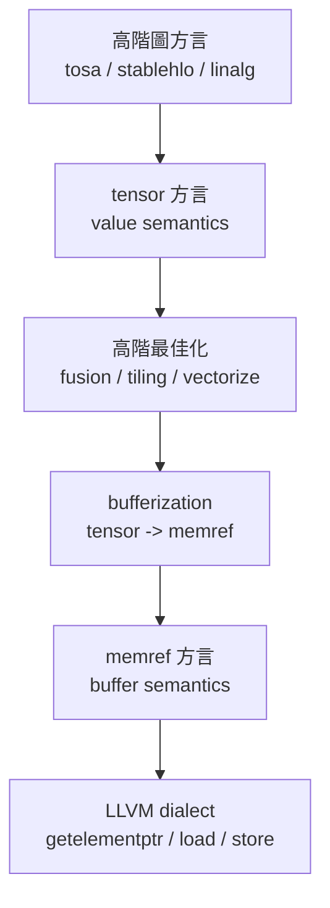

# 7.1 tensor 方言與結構化運算的設計理念

在 [1.1](01.1-一切皆Operation.md) 我們確立了 MLIR 的基本哲學：一切皆 `Operation`，IR 是一棵可巢狀的樹。這棵樹要能承載從模型層到機器碼的所有抽象，但不可能只有一棵樹——不同抽象層需要不同的**語意假設**。`llvm.add` 假設的是「值住在記憶體裡某個位址」，`linalg.matmul` 假設的是「一堆索引空間上的數學運算」，而這兩種假設之間無法直接互換。

本章開始進入「第三部：MLIR 內建方言與漸進式降階」。本節要解決的核心問題是：**在「數學」與「記憶體」之間，需要一層什麼樣的中間表示？**

答案是 `tensor` 方言——一個**無緩衝（unbufferized）**的數學值抽象。

## value-based 與 buffer-based 的根本差異

先把兩種世界觀並排擺出來。

**buffer-based 語意**（`memref` 的世界）：

* 值的定義是「一段記憶體區域」加上「形狀與步幅」。
* 值是**可變的**。`memref.store` 會改變它。
* 值**可以有別名**。兩個 `memref` 可以指向同一段記憶體的不同切片。
* 因此，SSA 對 buffer 不成立：同一個 buffer 經過 `store` 之後內容會變，SSA 的「每個值只賦值一次」原則無法維持。

**value-based 語意**（`tensor` 的世界）：

* 值的定義是「一個由元素組成的多維數學對象」。
* 值是**不可變的**。任何運算都產生新值。
* 值**沒有別名**：兩個相等內容的 tensor 是兩個獨立的值。
* 因此 SSA 完整成立。所有操作都是純函數（pure function），除了少數明標為有副作用的操作。

這個差異不是風格問題，而是決定了整個編譯管線能寫出什麼樣的最佳化。

舉一個具體例子。假設我們想計算 $C = A + B$ ，其中 $A$ 與 $B$ 都是 $2 \times 3$ 的矩陣。

在 buffer-based 語意下：

```mlir
func.func @buffer_add(%A: memref<2x3xf32>, %B: memref<2x3xf32>, %C: memref<2x3xf32>) {
  %c0 = arith.constant 0 : index
  %c1 = arith.constant 1 : index
  %c2 = arith.constant 2 : index
  %c3 = arith.constant 3 : index
  scf.for %i = %c0 to %c2 step %c1 {
    scf.for %j = %c0 to %c3 step %c1 {
      %a = memref.load %A[%i, %j] : memref<2x3xf32>
      %b = memref.load %B[%i, %j] : memref<2x3xf32>
      %s = arith.addf %a, %b : f32
      memref.store %s, %C[%i, %j] : memref<2x3xf32>
    }
  }
  return
}
```

這段程式碼裡有兩個資訊已經**被提前決定**了：

1. 記憶體的佈局（row-major？column-major？stride 是多少？）。
2. 誰擁有 `C`，`C` 的內容原本是什麼（可能是未初始化的垃圾值）。

這兩個問題在這個階段**不該**被決定。理由是：佈局選擇會影響效能（向量化、cache blocking、GPU 的 coalescing），而最佳化常常需要在看到全部程式碼後才能做出好的佈局選擇。TF 前端的 `tf.reshape` / `tf.transpose` 這類操作在降階到 buffer 之前，其實並沒有真正改變任何資料——它只是改變了「這份數學資料的形狀解讀方式」。在 buffer 世界裡，reshape 變成了一次昂貴的資料搬移；在 tensor 世界裡，它只是型別改變。

這就是 `tensor` 方言存在的根本理由：**它是 bufferization 的輸入，讓編譯器可以先在高階做最佳化，再決定記憶體佈局。**

## tensor 方言的核心操作

`tensor` 方言刻意做得很小。它提供的操作大致可分為四類。

### 容器建構

`tensor.empty` 建立一個形狀已知的 tensor，內容未定義：

```mlir
%t = tensor.empty() : tensor<2x3xf32>
```

注意 `tensor.empty` 的語意：它**不讀取**任何記憶體，因為根本沒有記憶體。它只是一個「形狀與元素型別」的記錄。真正決定內容的是後續的 `tensor.insert` 或 `tensor.generate`。

`tensor.from_elements` 從標量建構：

```mlir
%t = tensor.from_elements %a, %b, %c, %d : f32, f32, f32, f32
```

等價於 `tensor<4xf32>` 的 `tensor.splat` 風格，但各元素可不同。`tensor.splat` 則是同一個值複製到所有位置：

```mlir
%t = tensor.splat %v : tensor<2x3xf32>
```

### 元素存取

`tensor.extract` 讀取單一元素：

```mlir
%e = tensor.extract %t[%i, %j] : tensor<2x3xf32>
```

`tensor.insert` 寫回單一元素並產生新 tensor：

```mlir
%t2 = tensor.insert %e into %t[%i, %j] : tensor<2x3xf32>
```

這兩者的存在**只是為了讓高階程式碼能表達精細控制**。在實務上，編譯器幾乎總是把它們提升成更整齊的形式：`tensor.extract` 序列在有界且可展開時會被 `linalg.generic` 吸收；而在 bufferization 階段，`tensor.insert` 會被轉成對應 `memref` 的 `memref.store`。

### 生成

`tensor.generate` 用一個 region 描述每個元素如何算出來，是 `tensor` 方言裡最重要的高階操作：

```mlir
%t = tensor.generate %i, %j {
^bb0(%i: index, %j: index):
  %a = tensor.extract %A[%i, %j] : tensor<2x3xf32>
  %b = tensor.extract %B[%i, %j] : tensor<2x3xf32>
  %s = arith.addf %a, %b : f32
  tensor.yield %s : f32
} : tensor<2x3xf32>
```

它的存在讓我們能把「元素級的運算」寫成一個**單一的、高階的、可整體最佳化的操作**，而不是散落成數百萬條 `extract`/`insert`。

### 形狀與型別操作

`tensor.dim` 取得某一維的長度（可能是動態的）：

```mlir
%d = tensor.dim %t, %c1 : tensor<?x3xf32>
```

`tensor.cast` 在**相容**的型別之間轉換（例如把 `tensor<?x3xf32>` cast 成 `tensor<4x3xf32>`，前提是維度值確實相容）：

```mlir
%tc = tensor.cast %t : tensor<?x3xf32> to tensor<4x3xf32>
```

`tensor.cast` 是**需要驗證**的轉換，不是無條件的 reinterpret。這個設計很重要：它讓「執行期檢查 reshape 是否合法」這件事在 IR 層面是顯式的。

`tensor.reshape` 則是一個特殊的操作：形狀改變但元素總數不變且**保證是 row-major 的重新解讀**：

```mlir
%r = tensor.reshape %t : tensor<2x3xf32> to tensor<3x2xf32>
```

## 靜態 shape 與動態 shape

`tensor` 的型別寫法是 `tensor<2x3xf32>`（全靜態）、`tensor<?x3xf32>`（第一維動態）、`tensor<2x?xf32>`（第二維動態）、`tensor<?x?xf32>`（全動態）。

靜態 shape 的好處是編譯期就知道尺寸，可以做：

* 常數折疊（把 `tensor.dim` 直接算成常數）；
* 完全的靜態迴圈展開；
* 更精確的記憶體佈局推導（因為沒有 runtime stride）；
* 更好的死碼與邊界檢查消除。

動態 shape 的好處是能處理執行期才知道的尺寸，支援動態 batch 這類真實需求。

`tensor.dim` 的語意是「取得該維的長度」。若型別中該維是靜態的，`tensor.dim` 會被恆等折疊成常數；若動態，則保留。

在 C++ 裡，靜態與動態 shape 的區分體現在 `ShapedType::getShape()` 回傳的 `ArrayRef<int64_t>`：靜態維度是 $\geq 0$ 的具體數字，動態維度是 `ShapedType::kDynamic`（值為 $-1$ ）。

```cpp
auto t = cast<TensorType>(value.getType());
for (int64_t d : t.getShape()) {
  if (d == ShapedType::kDynamic)
    llvm::errs() << "dynamic dim\n";
  else
    llvm::errs() << "static dim: " << d << "\n";
}
```

## tensor.extract_slice 與 tensor.insert_slice

子區塊操作是 `tensor` 方言最能體現 value 語意的地方。`tensor.extract_slice` 產生一個新 tensor，是原 tensor 某個子區域的**值語意拷貝視圖**：

```mlir
%sub = tensor.extract_slice %t[0, 1] [2, 2] [1, 1] : tensor<4x4xf32> to tensor<2x2xf32>
```

四個參數依序是：起點 offset、大小、stride。上面這個例子取的是從 $(0, 1)$ 開始、大小 $2 \times 2$ 、步幅為 1 的區塊。

`tensor.insert_slice` 則把一個值寫進目標 tensor 的某個子區塊，產生新 tensor：

```mlir
%res = tensor.insert_slice %sub into %t[0, 1] [2, 2] [1, 1] : tensor<2x2xf32> into tensor<4x4xf32>
```

這兩者構成一對互逆的結構化操作。**關鍵是它們在 value 語意下完全不需要 alias 分析**：讀取 `tensor.extract_slice` 的結果不會影響 `%t`，寫入 `tensor.insert_slice` 的結果不會影響 `%t`。而在 buffer 世界裡，同樣的操作需要 `memref.subview` 並且必須回答「這個 subview 與原 buffer 是否可能重疊」。

正因為如此，bufferization 才需要一個獨立的、一整套 alias 分析與 ownership 模型——我們在 [8.3](08.3-memref記憶體抽象.md) 會詳細談這件事。

## element type 的多樣性

`tensor` 的元素型別不限于 `f32`。常見的有：

| 類型 | 用途 |
|---|---|
| `f32` / `f64` | 一般浮點 |
| `bf16` / `f16` | 縮短浮點，ML 推論常見 |
| `i8` / `i16` / `i32` / `i64` | 整數 |
| `si8` / `si16` / `si32` / `si64` | 有符號整數（`SignlessIntegerType` 之外的明確帶號型別） |
| `ui8` / `ui16` / ... | 無符號整數 |
| `index` | 索引值 |
| `bool` / `i1` | 布林 |
| `complex<f32>` | 複數（`complex` 方言） |
| `vector<4xf32>` | 元素本身是向量（`vector` 方言） |
| `!quant.any<i8:f32, 1.0>` | 量化型別（`quant` 方言） |

這個多樣性帶來一個重要推論：`tensor` 方言的 element type 與 `memref` 的 element type 是**同一套型別系統**。這意味著 bufferization 通常不需要轉換元素型別（少數量化相關的操作除外），只需要改變「值的物理承載方式」。

值得強調的是 `bf16`。它在硬體上通常沒有原生運算，但作為**儲存格式**極為有效：位元組數只有 `f32` 的一半，且保留了 `f32` 的指數範圍。MLIR 讓 `tensor<...xbf16>` 與 `tensor<...xf32>` 並存，使得「儲存用 bf16、計算用 f32」的模式可以自然表達。

## 廢除 strided layout：一次重要的設計演進

這是理解現代 `tensor` 方言的關鍵。

**早期**（約 2021–2022 年）的 MLIR 中，`tensor` 的型別是包含 layout 的：

```mlir
tensor<?x?xf32, strided<[?, ?], offset: ?>>
```

也就是說，一個 tensor 可以帶著「記憶體佈局」的資訊。這看起來很方便，但事後證明是個錯誤的抽象。

**問題在於語意污染**。一個 `tensor` 是數學值，它的**內容**由元素序列決定，與如何存放無關。但如果型別攜帶 layout，那麼 `tensor.cast` 的合法性取決於 layout，而 `tensor.extract_slice` 的結果 layout 也要被推導出来——所有這些都把「資料在哪裡」的概念注入了「資料是什麼」。

更麻煩的是，這讓 tensor 與 memref 的界線模糊：既然 tensor 有 layout，那麼 bufferization 到底做了什麼？它就退化成了「把 tensor 的 layout 換成 memref 的 layout」這種無意義的轉換。

**現代 MLIR 的做法**：`tensor` 型別**不再承載任何 layout 資訊**。`tensor` 只有 shape 與 element type。所有 layout 相關的問題（stride、offset、記憶體空間）一律由 `memref` 承擔。

這個決定帶來幾個直接的好處：

1. **bufferization 變成真正的型別改變**。`tensor<2x3xf32>` → `memref<2x3xf32, strided<[3, 1], offset: ?>>`，這一步「決定記憶體佈局」的語意是真實的。
2. **`tensor.cast` 變得簡單**。只有 shape 相容性需要檢查，不需要考慮 layout 一致性。
3. **GPU 的問題自然浮現**。GPU 需要的是 layout，但語意運算不需要；把 layout 集中在 memref 讓 GPU pass 有明確的介入點。

實務上的影響：現代 MLIR 中，`tensor` 與 `memref` 之間還多了一個中間類型 `UnrankedTensorType`（`tensor<*xf32>`），用於 shape 在執行期才確定、且 element type 也可能推導不出來的情況。`UnrankedMemRefType` 與之對稱。

## 一個完整的 tensor 範例

把上面講的組合起來：

```mlir
func.func @tensor_pipeline(%A: tensor<4x8xf32>, %B: tensor<8x16xf32>) -> tensor<4x16xf32> {
  %c0 = arith.constant 0 : index
  %c1 = arith.constant 1 : index
  %c2 = arith.constant 2 : index
  %c4 = arith.constant 4 : index
  %c8 = arith.constant 8 : index
  %c16 = arith.constant 16 : index

  %init = tensor.empty() : tensor<4x16xf32>
  %out = scf.for %i = %c0 to %c4 step %c1 iter_args(%acc = %init) -> (tensor<4x16xf32>) {
    %acc1 = scf.for %j = %c0 to %c8 step %c1 iter_args(%a2 = %acc) -> (tensor<4x16xf32>) {
      %v = tensor.extract %B[%j, %i] : tensor<8x16xf32>
      %acc2 = tensor.insert %v into %a2[%i, %j] : tensor<4x16xf32>
      scf.yield %acc2 : tensor<4x16xf32>
    }
    scf.yield %acc1 : tensor<4x16xf32>
  }
  return %out : tensor<4x16xf32>
}
```

這個範例展示了 `tensor` 與 `scf` 的協作方式：`scf.for` 的 `iter_args` 攜帶「迴圈不變量」作為**值**在迭代間傳遞，而不是像 buffer 那樣「每輪疊加回同一塊記憶體」。這種「累加器是值」的模型，正是 value 語意最直觀的体现。

## 從 tensor 到 memref：形狀上的對照

| 概念 | tensor 側 | memref 側 |
|---|---|---|
| 型別 | `tensor<2x3xf32>` | `memref<2x3xf32, strided<[3,1], offset: ?>>` |
| 讀取 | `tensor.extract` | `memref.load` |
| 寫入 | `tensor.insert` | `memref.store` |
| 切片 | `tensor.extract_slice` | `memref.subview` |
| 建構 | `tensor.empty` / `tensor.generate` | `memref.alloc` / `linalg.fill` |
| 可變性 | 不可變 | 可變 |
| 別名 | 無 | 有 |
| SSA | 成立 | 不成立（需轉成 memref.subview 鏈） |

這個對照表是理解 [8.3](08.3-memref記憶體抽象.md) 的前導。

## 為什麼 bufferization 必須發生在「最後」

讓我們把時序講清楚，這是本章最核心的推論。

考慮一個簡單的程式，計算 $C[i] = A[i] + B[i] \cdot 2$ ，其中 $A$ 與 $B$ 都是 $N$ 元素的向量。

在 **tensor 階段**，編譯器可以：
* 重新排程迴圈（因為没有 alias，任意交換兩個獨立計算都是合法的）；
* 對 $N$ 做向量化的 loop fission；
* 把 $A$ 與 $B$ 的讀取合併，減少記憶體流量；
* 決定最後的 layout（row-major / column-major / blocked）。

在 **buffer 階段**（bufferization 之後），這些最佳化**大部分變得非法或困難**：
* 一旦 `$C$` 被 bufferize 成為與 ` $A$ 可能 alias 的 memref，「重新排程」就需要 alias 分析；
* 迴圈合併需要證明兩次迭代的寫入集合不重疊——這是陣列相依分析（array dependence analysis）的活。

所以 MLIR 的管線順序是明確的：



注意 `bufferization` 這一步的**位置**。它是分水嶺：從這裡往下，IR 就變成了「有別名的可變記憶體」，高階最佳化的空間大幅縮小。

## 語意細節：tensor.generate 與 region terminator

`tensor.generate` 是一個帶 region 的操作。region 的 terminator 是 `tensor.yield`。我們在 [1.1](01.1-一切皆Operation.md) 已經看過 region/terminator 的一般模型；這裡補充一點：`tensor.generate` 的 region 參數就是迭代維度的索引：

```mlir
%t = tensor.generate %i, %j {
^bb0(%ii: index, %jj: index):
  ...
  tensor.yield %s : f32
} : tensor<2x3xf32>
```

`tensor.yield` 必須恰好 yield 一個值，其型別必須與 `tensor.generate` 的 element type 相容。這個約束由 verifier 強制。

另一個細節是 `tensor.generate` 的 region 可以有**零個或多個** `tensor.yield` 分支嗎？答案是：只有一個。`tensor.generate` 沒有條件分支語意；若需要條件，必須降階到 `scf.if` 內部或改用其他形式。

## 混合語意的存在：bufferization.to_tensor 與 to_memref

在真實的 MLIR 管線中，純 tensor 與純 memref 的世界很少完全分開。`bufferization` 方言提供了轉換橋樑：

```mlir
%m = bufferization.to_memref %t : memref<2x3xf32>
%t2 = bufferization.to_tensor %m : memref<2x3xf32>
```

`bufferization.to_memref` 的語意是「把這個 tensor 的內容搬到一塊新的緩衝區，並交出所有權」。`bufferization.to_tensor` 則是「把這個 memref 的當前內容視為一個 tensor 值」。後者意味著 buffer 的內容被「凍結」成一個值。

`to_tensor` 的存在揭示了 value 與 buffer 之間的**不對稱性**：從 tensor 到 buffer 是資訊損失的（要決定佈局、要決定 alias），從 buffer 到 tensor 則是資訊損失的（丟掉 alias 資訊、之後再也改不動）。這條單向橋樑正是 bufferization 需要複雜 alias 分析的原因。

## 驗證與可讀性：一些實務建議

在實作編譯器時，處理 `tensor` 有幾個容易踩的坑：

* **不要在 tensor 階段做手動的 extract/insert 迴圈展開**。如果你寫的是「用 `tensor.extract` 迴圈產生資料」，幾乎總是錯的；應該寫 `tensor.generate`，讓最佳化有結構可以抓。
* **`tensor.dim` 在靜態 shape 上應立即折疊**。`canonicalize` pass 會做這件事，但如果你手寫 pattern，最好自己判斷。
* **`tensor.cast` 的合法性要靠 verifier**。把 `tensor<?x3xf32>` cast 成 `tensor<4x3xf32>`，verifier 只會檢查「形狀相容性」，執行期真正的數值檢查需要由 lowering 產生 runtime check。
* **`tensor.splat` 與 `linalg.fill` 的選擇**。在 tensor 階段用 `tensor.splat`；在 memref 階段用 `linalg.fill` 或 `memref.store` 迴圈。

## 小結與延伸閱讀

* `tensor` 是 value-based 語意：不可變、無別名、SSA 成立；`memref` 是 buffer-based 語意：可變、有別名、SSA 不成立。兩者的差異是 MLIR 整個分層的起點。
* `tensor` 的存在意義是**延後記憶體佈局決策**，讓 bufferization 成為最後一個高階步驟；在此之前所有 alias 相關的最佳化都還合法。
* 核心操作分四類：容器建構（`tensor.empty`、`tensor.from_elements`、`tensor.splat`）、元素存取（`tensor.extract`、`tensor.insert`）、生成（`tensor.generate`）、形狀操作（`tensor.dim`、`tensor.cast`、`tensor.reshape`）。
* `tensor.extract_slice` / `tensor.insert_slice` 是 value 語意下的結構化子區塊操作，不需要 alias 分析；這正是它們比 `memref.subview` 簡單得多的原因。
* 現代 MLIR 的 `tensor` 型別**不再承載 layout**。所有 stride、offset、memory space 資訊都由 `memref` 承載，這讓 bufferization 成為真正的語意改變而非形式轉換。
* 延伸閱讀：
  * MLIR 方言文件：`mlir/docs/Dialects/Tensor.md`、`mlir/docs/Dialects/Bufferization.md`
  * `Tensor` 與 `MemRef` 類別的 C++ API：`mlir/include/mlir/IR/BuiltinTypes.h`
  * 維基百科條目「Intermediate representation」與「Abstract syntax tree」：`https://en.wikipedia.org/wiki/Intermediate_representation`
  * MLIR 社群討論關於 tensor layout 移除的討論：LLVM 開發者論壇 `https://llvm.org/docs/`
