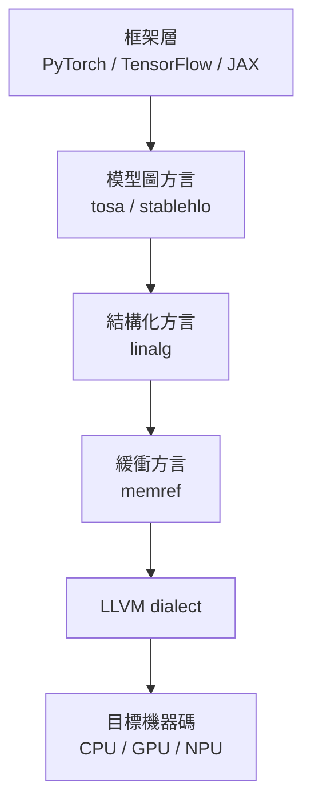
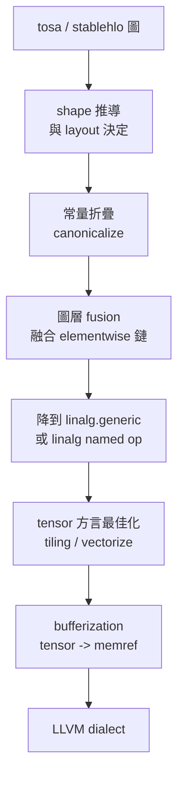

# 7.3 高階圖方言（TOSA / StableHLO / XLA）與算子融合

前兩節我們一路向下：`tensor` 提供不可變的數學值，`linalg` 提供帶索引結構的結構化運算。兩者都假設了「**運算的形狀與結構是編譯器已知的**」。但真實的機器學習模型不是這樣的：模型的輸入形狀可能只有部分已知，一堆運算是動態形狀的，而且模型框架（PyTorch、TensorFlow、JAX）各自的 op 集合與命名完全不同。

本節要處理的問題是：**如何在「模型框架的 op」與「編譯器可最佳化的結構」之間插入一層跨硬體、跨框架的共同語言？**

答案就是「高階圖方言」（high-level graph dialect）。本節以 TOSA 與 StableHLO 為主軸，並交代 XLA/GrFusion 與 MLIR 的血緣關係。

## 為什麼需要「完全高階」的圖方言

先釐清「高階」的兩個含義。在本節的脈絡中，「高階」指的是**抽象層級高**，不是「運算複雜度低」。

一個完整的前端→後端管線有這些層：



高階圖方言夾在框架與 `linalg` 之間，扮演三個角色：

**角色一：攔截模型層的 op。** 框架把模型轉成一個 op 圖，編譯器接管這個圖。高階圖方言的 op 集合必須涵蓋模型層會用到的運算：卷積、池化、矩陣乘、reshape、softmax、concat、split、量化-反量化……

**角色二：提供可攜性。** 一個 ONNX 模型要能跑在 CPU、GPU、NPU 上；一個 TFLite 模型要能跑在數十種 SoC 上。可攜性的前提是圖層的 op 集合**不依賴任何具體硬體的佈局或指令集**。

**角色三：提供最佳化起點。** 圖層是「融合」的天然戰場——相鄰的 elementwise op 可以融成一個 kernel，卷積後面的 bias + activation 可以融成一個 epilogue。在圖層做融合，粒度是 op 級別的，比在循環級別做 fusion 簡單得多，也更有效。

## TOSA：社群標準的硬體無關 op 集合

TOSA（Tensor Operator Set Architecture）於 2019 年發布，起源於 ONNX 社群與 TensorFlow Lite 團隊。它不是任何一家公司的私有格式，而是一份**公開規格**：定義了一組 op 的語意、shape 推導規則、與量化模型。

TOSA 的設計目標寫在規格裡，非常直白：**讓同一個模型描述能在多種硬體上被實作**，包括那些沒有強大編譯器、甚至只有固定功能 accelerator 的裝置。

### TOSA 的 op 集合

TOSA 是一份相對精簡的規格，主要 op 類別包括：

| 類別 | 代表 op |
|---|---|
| 卷積 | `CONV_2D`, `DEPTHWISE_CONV_2D`, `CONV_3D` |
| 全連接 | `FULLY_CONNECTED` |
| 池化 | `MAX_POOL_2D`, `AVG_POOL_2D` |
| 激活 | `RELU`, `TANH`, `LOGISTIC`, `LEAKY_RELU`, `PRELU` |
| 正規化 | `BATCH_NORM`, `INSTANCE_NORM`, `L2_NORMALIZATION` |
| 量化 | `QUANTIZE`, `DEQUANTIZE`, `QUANTIZED_CONV_2D`, `QUANTIZED_FULLY_CONNECTED` |
| 形狀 | `RESHAPE`, `TRANSPOSE`, `CONCATENATE`, `SPLIT`, `SLICE`, `EXPAND`, `SQUEEZE` |
| 逐元素 | `ADD`, `SUB`, `MUL`, `DIV`, `MAXIMUM`, `MINIMUM` |
| 其他 | `RESIZE_BILINEAR`, `GATHER`, `PAD`, `MEAN`, `ARG_MAX`, `SOFTMAX` |

TOSA 有幾個特色：

1. **量化是一等公民**。`QUANTIZE` / `DEQUANTIZE` / `QUANTIZED_CONV_2D` 是獨立 op，不是屬性。量化參數（scale、zero-point）隨 op 傳遞。
2. **shape 推導有明確規則**，包括部分動態 shape 的處理。
3. **有 profile 與 level 的概念**。TOSA 定義了不同的 profile（例如 FP32、INT8、INT4），描述該 profile 下哪些 op 可用、量化模型如何。

### TOSA 在 MLIR 中的形式

MLIR 上游有 `tosa` 方言（`mlir/Dialect/Tosa`）。它的 op 大致對應規格，但有一個重要差異：**MLIR 的 TOSA 方言是「可組合的 IR」，不是「一條流水線的固定格式」**。它有 verifier、可以折疊、可以轉換。

一個 MLIR TOSA 例子：

```mlir
func.func @tosa_conv2d(%input: tensor<1x224x224x3xf32>, %filter: tensor<3x3x3x64xf32>,
                       %bias: tensor<64xf32>) -> tensor<1x112x112x64xf32> {
  %0 = "tosa.conv2d"(%input, %filter, %bias) <{strides = [2, 2], padding = "SAME", dilations = [1, 1]}> {
    region zero_region {
      ^bb0(%out: tensor<1x112x112x64xf32>):
        %cst = arith.constant dense<0.0> : tensor<1x112x112x64xf32>
        linalg.yield %cst : tensor<1x112x112x64xf32>
    }
  } : (tensor<1x224x224x3xf32>, tensor<3x3x3x64xf32>, tensor<64xf32>) -> tensor<1x112x112x64xf32>
  return %0 : tensor<1x112x112x64xf32>
}
```

TOSA 的 shape 佈局是 **NHWC**（batch, height, width, channel），這與「layout 是硬體相關的」直覺相反——但原因是 TOSA 假設的目標硬體（特別是手機 NPU）普遍使用 channel-last 佈局。NHWC 在 TOSA 裡是**語意的一部分**（op 的 shape 推導規則直接寫死 NHWC），不是可以隨意改寫的 layout。

這裡有個重要的教訓：**「硬體無關」不等於「layout 無關」**。TOSA 選擇把 channel-last 提升進語意層，是一個明確的取捨：它換來了硬體覆蓋率，付出的是「TOSA 图不能直接餵給偏好 row-major 的 CPU 後端」。

## StableHLO：HLO 的社群化延伸

StableHLO 的血緣要從 XLA 講起。

### XLA 與 GrFusion：MLIR 的起點

XLA（Accelerated Linear Algebra）是 Google 為 TPU 設計的編譯器。TPU 的編譯流程大致是：把 TensorFlow graph 轉成 XLA HLO（High-level Operations），然後由 XLA 編譯器把 HLO 降階成 TPU 指令。

HLO 是一個**圖層 IR**，其 op 集合包含 `add`、`multiply`、`convolution`、`fusion`、`reduce`、`transpose`、`broadcast` 等。它的設計特色是：

* 每個 op 都有明確的 shape 推導規則。
* 融合（fusion）在圖層進行：`fusion` op 把多個 producer 與 consumer 包成一個 fusion 節點。
* 有 layout assignment pass，把 layout（`NHWC` / `NCHW` 等）指派給每個 op。

GrFusion 是 Google 內部在 XLA 基礎上開發的 GPU 融合編譯器，進一步強化了 HLO 的融合能力——把 elementwise 的 producer/consumer 鏈合成單一 kernel，並做 tiling 與向量化。

**MLIR 專案正是源於把 XLA/GrFusion 這條線的經驗 generalize 成一個通用的多層 IR 基礎設施。** 這個血緣關係解釋了 MLIR 許多設計選擇的來歷：多方言、漸進式降階、plugin dialect、以及「圖層做融合」這個核心思想。

### StableHLO 社群化

HLO 長期是 Google 內部格式，缺乏外部的穩定版本與文件。生態上的問題是：不同的編譯器（IREE、Graviton、OpenXLA）需要的是同一份 HLO 語意，但各自重新實作解析與轉換，容易分歧。

StableHLO 專案正是為了解決這個問題而啟動：把 HLO 的 op 集合**社群化、版本化、文件化**，定義一份穩定的語意規範，並提供工具鏈（`stablehlo` 的 Python API、`opt`、`translate`）。

StableHLO 與 TOSA 的定位比較：

| 面向 | TOSA | StableHLO |
|---|---|---|
| 起源 | ONNX / TFLite 社群，2019 年 | Google 內部 HLO 的社群化 |
| 主要場景 | 邊緣裝置、量化推論 | 跨硬體的通用圖 IR、編譯器互通 |
| 佈局 | NHWC 寫死在語意中 | 支援多種 layout，layout 可推導 |
| 量化 | 一等公民 | 支援量化但非核心焦點 |
| 動態 shape | 支援有限 | 支援良好 |

### StableHLO 的 MLIR 形式

StableHLO 是**外部方言**（不在 MLIR 上游），使用 `stablehlo` 前綴：

```mlir
func.func @stablehlo_matmul(%a: tensor<128x64xf32>, %b: tensor<64x256xf32>) -> tensor<128x256xf32> {
  %c0 = stablehlo.constant dense<0.0> : tensor<128x256xf32>
  %r = "stablehlo.dot"(%a, %b, %c0) ({
  ^bb0(%arg0: tensor<128x64xf32>, %arg1: tensor<64x256xf32>, %arg2: tensor<128x256xf32>):
    %lhs = stablehlo.broadcast_in_dim %arg0, dims = [0, 1] : (tensor<128x64xf32>) -> tensor<128x64xf32>
    %rhs = stablehlo.broadcast_in_dim %arg1, dims = [1, 2] : (tensor<64x256xf32>) -> tensor<64x256xf32>
    stablehlo.add %lhs, %rhs : tensor<128x64x256xf32>
  }) : (tensor<128x64xf32>, tensor<64x256xf32>, tensor<128x256xf32>) -> tensor<128x256xf32>
  return %r : tensor<128x256xf32>
}
```

`stablehlo.dot` 的 payload region 特別值得注意：它的語意是「把兩個輸入 **broadcast 到同一個三元組形狀** 後逐元素相乘，再與第三個 operand 相加」。也就是說，**dot 的區域語意是 elementwise 的，batch 維是 broadcast 出來的**。

這個設計是 StableHLO 的關鍵取捨，也是它與 `linalg.matmul` 的最大差異：

* `linalg.matmul` 的索引映射是 `(d0,d1,d2) -> (d0,d2)` / `(d2,d1)` / `(d0,d1)`，reduction 維 $k$ 是**真正被歸約的維度**。
* `stablehlo.dot` 把 $k$ 變成一個 broadcast 維，然後用 elementwise 乘法表達。

為什麼 StableHLO 要這樣做？因為 XLA 的原始設計就是如此：HLO 的 `dot` 在 broadcast 語意下展開成 elementwise multiply + reduce 的組合。這個表示的好處是**形狀推導變得完全機械化**：任何 op 的 shape 都是「把 operand broadcast 到共同形狀後 elementwise 運算」。

代價是：`stablehlo.dot` 的 reduction 維度被隱藏在一個 broadcast 過的 tensor 裡，**編譯器要從 `dot` 的 payload region 重新辨識出 reduction 結構**才能做 tiling 與向量化。這是 StableHLO 到 `linalg` 轉換的核心難題。

在 C++ 中取得 StableHLO op（透過外部方言的 name-based API）：

```cpp
Operation *dot = ...;
if (dot->getName().getStringRef() == "stablehlo.dot") {
  // 取得 payload region 中的 broadcast op
  Region &region = dot->getRegion(0);
  Operation &first = region.front().front();
  // ...
}
```

## 在圖層做 fusion 的挑戰

圖層 fusion 聽起來簡單，實際上有五個真實的約束。

### 約束一：形狀相容性（shape compatibility）

要融合兩個 op，producer 的輸出形狀必須與 consumer 的輸入形狀**完全相同**（在維度順序、大小、元素型別上）。在圖層，一個 `reshape` 會徹底改變形狀，阻斷任何跨越它的融合。

更隱蔽的是：形狀可能是**動態的**。若 producer 的輸出維度是 `%d`（執行期才知道），consumer 必須保證用同樣的 `%d`，這在圖層是看不出的，需要符號推導。

### 約束二：依賴關係（producer-consumer 關係）

一個 op 的所有 consumer 都必須能被一起融合，或者該 op 必須是「最後一個使用者」（否则融合會複計算）。

典型的失敗案例如下。 $X$ 同時被 $A$ 和 $B$ 使用。若把 $X$ 融進 $A$ ， $B$ 就得重新計算 $X$ 。fusion pass 需要一個「last use」分析來判斷。

### 約束三：佈局（layout）

這是圖層 fusion 最棘手的部分。

若 producer 產生的 layout 與 consumer 需要的 layout 不同，融合就要求把 consumer 改成 consumer 的 layout——但這可能讓整條鏈的佈局不一致，反而更糟。

HLO 的解法是 **layout assignment pass**：先決定每個 op 的佈局，再做 fusion。StableHLO 把這件事推得更遠：**layout 不在 IR 中，而是透過 `stablehlo.layout` attribute 在需要的時機指定**。

### 約束四：量化約束

量化模型對 fusion 有額外限制。若 producer 是 `QUANTIZE`（輸出 int8），consumer 是 `QUANTIZED_CONV_2D`（輸入 int8），融合後量化參數必須一致。TOSA 對此有明確規則。

### 約束五：副作用與 alias

一般圖 IR 假設無副作用。但某些 op 有副作用（如 `stablehlo.custom_call`、in-place 的 `scatter`）。有副作用的 op 不能被任意重排或融合。

## 圖層降階到 linalg / tensor 的路徑

高階圖方言不是終點，它必須向下走。典型路徑：



**步驟一：shape 推導。** 圖層 op 的 shape 推導規則是規格的一部分。StableHLO 有 `StableHLOOps.cpp` 裡的 shape 推導函式；TOSA 方言也有對應的 `inferReturnTypes`。在 MLIR 中，這透過 `InferTypeOpInterface` 表達，靜態 shape 的 op 可以宣告 `InferTypeOpAdaptor` 來自動推導結果型別。

**步驟二：常量折疊。** 圖層裡有大量常數（權重），折疊能帶來直接收益。

**步驟三：圖層 fusion。** 這個階段把 elementwise 鏈合成 `linalg.generic`，把多個 op 合成單一 kernel。

**步驟四：降到 linalg。** 這是最關鍵的一步。`stablehlo.dot` 要被轉成 `linalg.matmul`，需要：

1. 從 payload region 中辨識出兩個 broadcast 的 shape，抽出 batch 維。
2. 找出被 broadcast 出來的維度——那就是 contraction 維。
3. 檢查這個維在兩個 operand 中長度相同。
4. 建立新的 indexing maps 與 iterator types。

這一步在實務中稱為 **「dot 分解」（dot decomposition）**，是 StableHLO 到 linalg 路徑中最複雜的一段。

**步驟五：linalg 最佳化。** 到了這裡，[8.4](08.4-迴圈變換模式.md) 的 tiling / fusion / vectorize 就作用在結構化的迭代空間上了。

**步驟六：bufferization 與降階。** 見 [8.3](08.3-memref記憶體抽象.md)。

## 為什麼高階圖方言不能直接編譯到 LLVM IR

這個問題的答案，就是整個第三部存在的理由。

若把 StableHLO 或 TOSA 圖直接降階到 LLVM IR（`llvm` 方言），會遇到四個障礙。

**障礙一：缺少 layout 資訊。** LLVM IR 裡的 load/store 是「對某個指標做存取」，它假設記憶體已經存在、已經排好。圖層的 op 完全不涉及 layout——`stablehlo.dot` 只說「這兩個數學物件相乘」。要產生 LLVM IR，你必須先決定：資料放在哪裡？row-major 還是 column-major？每個維度的 stride 是多少？這個決定在圖層是沒有的。

**障礙二：缺少 aliasing 資訊。** LLVM IR 裡的 `load`/`store` 有明確的 alias 語意（`noalias`、`readonly`）。圖層的 value-based op 沒有 alias 概念。要降階，就必須先決定 bufferization 策略（每個 op 的輸出是否重用輸入的緩衝區），這是 [8.3](08.3-memref記憶體抽象.md) 的主題。

**障礙三：缺少控制流結構。** 圖層 op 的迭代空間是**隱含**的（存在於 shape 與 op 語意中），不是 IR 裡的迴圈。降階到 LLVM IR 時，這些迭代空間必須被**展開成實際的迴圈 nest**。但一個 $4096 \times 4096$ 的矩陣乘法展開成迴圈會讓 LLVM IR 爆炸。

中間需要 `linalg` 這一層提供**循環表示**：迭代空間是 IR 的一部分，可以被 tiling、可以保持結構。

**障礙四：元素型別不對齊。** 圖層支援 `bf16`、`f16` 等型別，LLVM dialect 支援，但圖層的 op 是「整個 tensor 的運算」，LLVM 是「單一元素的運算」。粒度不對齊。

把四個障礙整理成一個對照表：

| 層 | 有 layout？ | 有 alias？ | 有迴圈結構？ | 粒度 |
|---|---|---|---|---|
| StableHLO / TOSA | 否 | 否 | 否（隱含） | tensor |
| linalg / tensor | 語意無 / 推導有 | 否 | 是（迭代空間） | tensor + 索引 |
| memref | 是 | 是 | 是（顯式） | buffer |
| llvm | 是 | 是 | 是（基本區塊） | 標量 |

**每一列的「有/無」組合，就是一層的必要存在理由。** 圖層→linalg 補上了「迭代空間與索引結構」；linalg→memref 補上了「layout 與 alias」；memref→llvm 補上了「標量細節與機器抽象」。

## 一個實際的 pipeline 指令

在 MLIR 中，這條路徑可以用 `mlir-opt` 的 pass pipeline 描述。以 TOSA 為例：

```bash
mlir-opt \
  --tosa-convert-to-linalg \
  --linalg-generalize-named-ops \
  --linalg-fuse-elementwise-ops \
  --linalg-tile \
  --convert-linalg-to-loops \
  --convert-scf-to-cf \
  --finalize-memref-to-llvm \
  input.mlir -o output.llir
```

以 StableHLO 為例（使用 `stablehlo-opt`）：

```bash
stablehlo-opt \
  --stablehlo-legalize-shape \
  --canonicalize \
  --chlo-legalize-operands \
  --stablehlo-legalize-composite \
  stablehlo-opt \
  --convert-stablehlo-to-linalg \
  --linalg-generalize-named-ops \
  ...
```

這些 pass 名稱在各專案中可能略有不同，重點是**順序**：先 shape 與合法性、再折疊與融合、再結構化降階、最後到 LLVM。

## 從 TOSA 降到 linalg：逐步拆解

前面說過「高階圖方言不能直接編譯到 LLVM IR」，但 TOSA 降到 linalg 這條路徑是可行且有標準做法的。讓我們把一個卷積的降階逐步拆開，因為這能清楚顯示「圖層的隱含結構」如何被「顯式地重新建立」。

### 第一步：TOSA 的 conv2d 形狀語意

TOSA 的 `CONV_2D` 輸入形狀是 $[N, H, W, C_{in}]$ ，權重形狀是 $[C_{out}, C_{in}, kH, kW]$ ，輸出是 $[N, H', W', C_{out}]$ 。

注意權重形狀中 ** $C_{out}$ 在最前面**——這是 TOSA 規格的選擇，與常見的 PyTorch 不同：PyTorch 把 $C_{out}$ 放在最後。降階時必須處理這個轉置。

### 第二步：展開成 linalg.generic

一個 TOSA 卷積在 linalg 中可以寫成：

```mlir
%r = linalg.generic {
  indexing_maps = [
    affine_map<(d0, d1, d2, d3, d4, d5, d6) -> (d0, d1, d2, d3)>,
    affine_map<(d0, d1, d2, d3, d4, d5, d6) -> (d4, d3, d5, d6)>,
    affine_map<(d0, d1, d2, d3, d4, d5, d6) -> (d0, d1, d2, d4)>
  ],
  iterator_types = ["parallel", "parallel", "parallel", "parallel",
                    "parallel", "reduction", "reduction"]
} ins(%input : tensor<1x112x112x3xf32>)
  ins(%filter : tensor<64x3x3x3xf32>)
  outs(%init : tensor<1x112x112x64xf32>) {
^bb0(%in: f32, %f: f32, %acc: f32):
  %p = arith.mulf %in, %f : f32
  %s = arith.addf %acc, %p : f32
  linalg.yield %s : f32
} -> tensor<1x112x112x64xf32>
```

我們看到幾件事：

* 迭代空間有 7 維，分別是 $N$ 、 $H$ 、 $W$ 、 $C_{in}$ 、 $C_{out}$ 、 $kH$ 與 $kW$ 。其中 $C_{in}$ 、 $kH$ 與 $kW$ 是 reduction 維。
* **filter 的 indexing map 把 $C_{out}$ 放在第一位**——這直接反映了 TOSA 的權重形狀佈局。**語意沒有被改變，只是被重新表述成索引映射。**
* 兩個 reduction 維，也就是 $kH$ 與 $kW$ ，被合併到一個 filter 維 `d_5` 與 `d_6`。

這一步就是「圖層降到 linalg」的**全部工作**：把圖層 op 的隱含迭代空間展開成顯式的迭代維度與 affine map。

### 第三步：交給 linalg 最佳化

一旦到達 `linalg.generic`，[8.4](08.4-迴圈變換模式.md) 的 tiling、fusion、vectorization 就有了結構可抓。一個典型的 GPU 卷積 tiling：

```
tile sizes = [1, 8, 8, 0, 32, 0, 0]
             N  H  W  Ci Co Kh Kw
```

$N$ 維不切（batch 維由 GPU 的 thread block 分攤）， $H$ 、 $W$ 切 8×8（對應一個 8×8 的 thread tile）， $C_{in}$ 與 $C_{out}$ 的切法由 backend 決定。

### 為什麼這個降階很「廉價」

值得強調：從 TOSA conv2d 到 `linalg.generic`，我們**沒有做任何最佳化**。我們只是把圖層 op 的語意「攤平」成迭代空間描述。所有最佳化都在之後進行。

這正是 MLIR 分層的核心承諾：**圖層不需要自己是最优化的，但它必須足夠精確地描述語意，使得下一層能推導出結構。**

## XLA / GrFusion 與 MLIR 的血緣：更詳細的時序

讓我們把歷史講得更精確一些，因為這解釋了 MLIR 許多設計的來歷。

**第一階段：XLA 與 TPU。** Google 為 TPU 建立了 XLA 編譯器。它的輸入是 TensorFlow 的 graph，輸出是 TPU 指令。XLA 的核心是 HLO：一個帶明確 shape 推導規則的圖層 IR，並且有一個把 HLO 降階到 TPU 的編譯流程（HLO → Triton/While → TPU）。

**第二階段：GrFusion 與 GPU。** GrFusion 是在 XLA 基礎上為 GPU 打造的融合編譯器。它解決的核心問題是：GPU 上每個 kernel launch 的開銷很大，且記憶體頻寬是瓶頸，因此需要把 elementwise 的 producer/consumer 鏈合成單一 kernel。GrFusion 的做法是在 HLO 層做 fusion，並且把 layout 指派（layout assignment）與 fusion 一起考慮。

**第三階段：MLIR 的誕生。** Chris Lattner 於 2021 年 1 月在 LLVM 官方部落格公布 MLIR。MLIR 的核心洞察是：XLA/GrFusion 這套做法（多層 IR、漸進式降階、在高層做融合）是通用的，不只適用於 TPU 或 GPU，應該做成整個 LLVM 生態的基礎設施。

這個血緣解釋了 MLIR 的幾個特徵：

* **多方言架構**：XLA 用 HLO、Triton、While 等多個「階段」；MLIR 把「階段」推廣成「方言」。
* **plugin dialect**：XLA 需要支援多種硬體；MLIR 用 dialect 註冊機制與 `OpAsmDialectInterface` 支援外部方言。
* **漸進式降階**：XLA 的降階流程是固定的；MLIR 把每一步變成可組合的 pass。
* **在圖層做 fusion**：直接承襲自 GrFusion 的經驗。

同時也解釋了 MLIR 與傳統 LLVM 的差異：LLVM 的 pass 大多是**單一抽象層的局部改寫**；MLIR 的 pass 可以在多個抽象層之間工作。

## 實務上的教訓

* **不要在圖層做過度簡化。** TOSA 的 NHWC 寫死是為了硬體覆蓋率。若你的目標是 CPU，應盡早在進入 TOSA 前就把 NCHW 轉成 NHWC（硬體加速器需要），而不是把 TOSA 圖降到 row-major 來對付 CPU。
* **圖層是 fusion 成本最低的地方。** 在圖層融合兩個 elementwise op 是「合併兩個 op」，成本極低；在循環級別融合則要處理 loop nest 的邊界。TOSA / StableHLO 融合應儘早做。
* **dot 分解是難點。** 若你的模型大量使用 batched matmul 且形狀動態，dot 分解的正確性與效率是瓶頸。
* **量化流程需要統一規劃。** TOSA 的量化 op 與 linalg 的一致性量化（`quant` 方言 + `linalg.quantized_matmul`）之間需要顯式的轉換，不能指望自動對接。

## 小結與延伸閱讀

* 高階圖方言在框架與結構化方言之間提供共同語言，承擔三個角色：攔截模型層 op、提供硬體無關的可攜性、提供 op 級別 fusion 的最佳化起點。
* TOSA 是 2019 年由 ONNX / TFLite 社群建立的硬體無關 op 集合標準，量化是一等公民，NHWC 佈局寫死在語意中。
* StableHLO 是 Google 內部 XLA HLO 的社群化延伸，強調版本化與跨編譯器互通；其 `dot` op 以 broadcast + elementwise 表達矩陣乘法，reduction 維隱含在 broadcast 中。
* MLIR 源於 XLA / GrFusion 的經驗，Google 內部的 TPU 編譯器是起點；MLIR 把這條線 generalize 成通用的多層 IR。
* 圖層 fusion 的五個約束：形狀相容性、producer-consumer 依賴、佈局、量化、副作用。
* 圖方言不能直接降到 LLVM IR，因為缺少 layout、缺少 aliasing、缺少顯式迴圈結構、粒度不對齊——這四項缺口正好對應 `linalg`、`memref`、`scf` 各自的存在理由。
* 延伸閱讀：
  * MLIR TOSA 方言文件：`mlir/docs/Dialects/TOSA.md`
  * Linalg 專案與 StableHLO 專案的文件目錄（TOSA 規格版本由 ONNX 社群發布）
  * MLIR 轉換文件：`mlir/docs/ConversionDocs/`
  * 維基百科條目「TensorFlow Lite」、「Accelerator (computing)」、「Compiler」：`https://en.wikipedia.org/wiki/TensorFlow_Lite`
