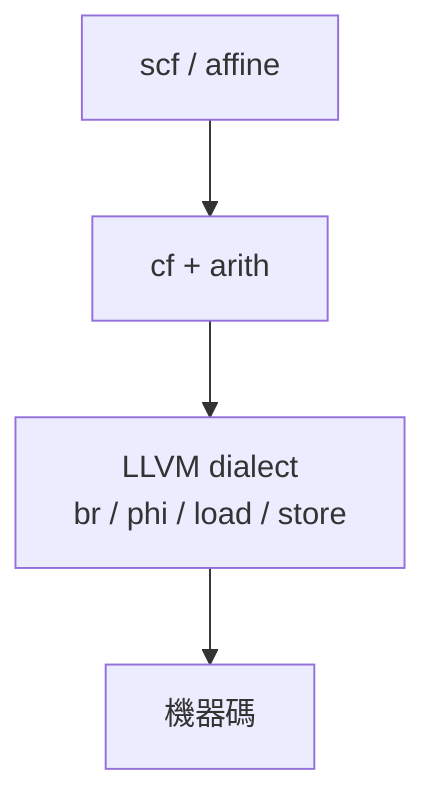

# 8.1 scf 方言：結構化控制流

第三部我們一路從框架層下降到 `linalg`。但到目前為止，我們描述的運算都是「單一 op、內含固定結構」的形式。真正的程式需要迴圈、條件分支、遞迴。而這正是第八章的主題：**控制流與記憶體**。

本章的問題是：**控制流應該以什麼形式存在於 IR 中，才能讓編譯器對它做最佳化？**

LLVM 的答案是 `br` 與 `phi`：扁平化的基本區塊圖，每個基本區塊以 terminator 結束，跨區塊的值傳遞靠 `phi` 節點。這個表示對機器碼生成是最終形態，但對高階最佳化非常不友好——「這是一個可以 tiling 的迴圈」這個資訊在 `br`/`phi` 的形式下已經被抹掉了。

`scf`（Structured Control Flow）方言提供的是中間答案：**保留結構化語意，但用 region 來表達**。

## 結構化控制流的定義

在回到具體 op 之前，先把「結構化」這個詞的技術內涵講清楚。結構化控制流要求每個 region 滿足：

1. **單一入口（single entry）**：區域只能從開頭進入，不能跳進中間。
2. **多個出口（multiple exit）**：區域可以有多個離開點，但每個都是明確的 terminator。
3. **無 goto**：不能任意跳到另一個標籤。控制轉移只能向前（forward）或透過結構化的迴圈返回。
4. **region 必須有 terminator**：每個 block 的最後一個 op 是 terminator。

這四條規則的實踐意義是：**控制流圖（CFG）的形狀受到約束**，因此可以用結構化的方式分析與重寫。

對比一下：

```mlir
// LLVM 風格：任意跳轉
cf.br ^loop
^loop:
  ...
  cf.cond_br %c, ^body, ^exit
^body:
  ...
  cf.br ^loop
```

```mlir
// SCF 風格：結構化
scf.for %i = %c0 to %n step %c1 {
  ...
}
```

後者不僅更短，更重要的是：**編譯器可以從「這是一個 `scf.for`」直接推導出迭代範圍、歸約結構、可 tiling 性**，而不需要做 CFG 分析。

## scf.for：帶累積值的迴圈

`scf.for` 的完整語法：

```mlir
scf.for %i = %lb to %ub step %step iter_args(%acc = %init) -> (tensor<8xf32>) {
  %new = ...
  scf.yield %new : tensor<8xf32>
}
```

四個部分：

* **%i**：隱式 induction variable，由迴圈產生。它的型別是 `index`。
* **lb / ub / step**：下界、上界、步長，三者都是 `index` 型別的值。上界是**開啟**的（exclusive），也就是說迭代的條件是 $i < ub$ 。
* **iter_args**：迭代間傳遞的值的初始值清單。
* **body region**：以 `scf.yield` 結尾，yield 的值數量必須與 `iter_args` 相同。

`scf.for` 的語意可以用數學寫清楚。若 `iter_args` 為 $\mathbf{v}_0, \mathbf{v}_1, \dots, \mathbf{v}_{k-1}$ ，body 為函數 $F$ ，則：

$$ \mathbf{v}^{(0)} = \mathbf{v}_0, \qquad \mathbf{v}^{(t+1)} = F(\mathbf{v}^{(t)}, i_t) $$

最終結果是 $\mathbf{v}^{(T)}$ ，其中 $T$ 是滿足 $lb + T \cdot step < ub$ 的最小整數 $T$ 。若 $lb \ge ub$ ，迴圈執行零次，結果就是 $\mathbf{v}_0$ 。

這個「零次迭代也必須產生合法結果」的規則，是 `scf.for` 與傳統 `for` 迴圈的重要差異——它讓 `iter_args` 的初值必須是合法的初始累積值。

### 一個完整例子

```mlir
func.func @prefix_sum(%in: tensor<8xf32>) -> tensor<8xf32> {
  %c0 = arith.constant 0 : index
  %c1 = arith.constant 1 : index
  %c8 = arith.constant 8 : index
  %init = tensor.empty() : tensor<8xf32>
  %r = scf.for %i = %c0 to %c8 step %c1 iter_args(%acc = %init) -> (tensor<8xf32>) {
    %v = tensor.extract %in[%i] : tensor<8xf32>
    %prev = scf.for %j = %c0 to %i step %c1 iter_args(%p = %v) -> (f32) {
      %pv = tensor.extract %in[%j] : tensor<8xf32>
      %s = arith.addf %p, %pv : f32
      scf.yield %s : f32
    }
    %out = tensor.insert %prev into %acc[%i] : tensor<8xf32>
    scf.yield %out : tensor<8xf32>
  }
  return %r : tensor<8xf32>
}
```

注意 `scf.for` 巢狀在 `scf.for` 裡，而內層迴圈的上界依賴外層的 `%i`。這是結構化控制流的一個重要能力：**迴圈邊界可以是變數**，這在 `cf` 方言裡需要 `phi` 與複雜的 CFG 修補。

### `%i` 的隱式 induction variable

`scf.for` 的 `%i` 有幾個技術細節值得強調：

* 它的型別永遠是 `index`，不是 `i32`。這讓它能與 `affine` 方言、`memref` 的索引、`tensor` 的索引統一。
* 它**不是** region 的 block argument，而是 op 的「隱式」operand/result。也就是說，`scf.for` 實際上有兩組隱藏的 operand/result：歸納變數與累積值。這是為什麼 `scf.for` 有 `OpTrait::VariadicOperands` 與 `OpTrait::VariadicResults`。
* 在 region 內部，`%i` 就像一個 block argument 一樣可用，但它綁定到 op 的外部。

因此 `scf.for` 的 operand 列表在 generic form 中是：

```mlir
"scf.for"(%lb, %ub, %step, %init) ({
^bb0(%i: index, %acc: tensor<8xf32>):
  ...
  "scf.yield"(%new) : (tensor<8xf32>) -> ()
}) : (index, index, index, tensor<8xf32>) -> tensor<8xf32>
```

可以清楚地看到：3 個索引 operand + variadic 的 iter_args 是 operands；1 個 induction variable + variadic 的累積值是 region 的 block arguments；而 results 只有累積值（歸納變數是內部的）。

這個區分在 C++ 中由 `getInductionVar()`、`getRegionIterArgs()`、`getResults()` 等 accessor 提供。

## scf.if：兩種形式

`scf.if` 有兩種形式，這個差異不是風格問題，而是語意問題。

### 無結果形式（no result）

```mlir
scf.if %cond {
  // 副作用
}
```

只有 then region，沒有 else region。語意是「條件成立時執行 then 區塊」。

### 有結果形式（with result）

```mlir
%r = scf.if %cond -> (f32) {
  %a = arith.constant 1.0 : f32
  scf.yield %a : f32
} else {
  %b = arith.constant 2.0 : f32
  scf.yield %b : f32
}
```

這時 then 與 else 兩個 region 必須都存在，且都以 `scf.yield` 結尾。else region 是**必須的**（即使其內容為空），因為 `scf.if` 的 result 型別必須在兩條路徑上都有定義。

這個「結果由兩條路徑共同決定」的語意，正是 `scf.if` 能被 lowering 成 `cf` 時需要 `phi` 節點的原因。

值得注意的是：在 generic form 裡，`scf.if` 的 operand 只有 `%cond`，結果在 results：

```mlir
"scf.if"(%cond) ({
  "scf.yield"(%a) : (f32) -> ()
}, {
  "scf.yield"(%b) : (f32) -> ()
}) : (i1) -> f32
```

## scf.while：最一般的迴圈形式

`scf.while` 是結構化控制流中表達力最強的形式。它有兩個 region：

```mlir
%r = scf.while (%arg : f32) : (f32) -> f32 {
  %c = arith.cmpi slt, %arg, %n : f32
  scf.while.cond %c
} do {
^bb0(%arg: f32):
  %next = arith.addf %arg, %one : f32
  scf.while.yield %next : f32
}
```

* **before region**：只包含 `scf.while.cond`，接收傳入的參數，產生一個 `i1` 條件。條件為 false 時跳出。
* **after region**：包含 `scf.while.yield`，計算下一輪的參數。

`scf.while` 與 `scf.for` 的對應關係：

* `scf.for` 是 `scf.while` 的特例：歸納變數由框架提供。
* `scf.for` 有明確的 lb/ub/step，編譯器可以直接做迴圈計數、trip count 分析、tiling。
* `scf.while` 只有條件，trip count 未知。

實務上，若能用 `scf.for` 就用 `scf.for`，因為更多最佳化可用。

一個更複雜的 `scf.while` 例子——帶兩個狀態的迭代：

```mlir
%r:2 = scf.while (%i = %c0, %acc = %init) : (index, f32) -> (index, f32) {
  %cond = arith.cmpi slt, %i, %n : index
  scf.while.cond %cond
} do {
^bb0(%i: index, %acc: f32):
  %ni = arith.addi %i, %c1 : index
  %nacc = arith.addf %acc, %one : f32
  scf.while.yield %ni, %nacc : index, f32
}
```

## scf.parallel：宣告式的並行迴圈

`scf.parallel` 是 MLIR 中表達並行的方式：

```mlir
scf.parallel (%i, %j) = (%c0, %c0) to (%m, %n) step (%c1, %c1) {
  ...
  scf.reduce
}
```

* 迭代空間可以是多維的。
* 迭代變數以 region 的 block arguments 形式提供——`scf.parallel` 的 body region **有** block arguments，就是各維的索引：

```mlir
scf.parallel (%i, %j) = (%c0, %c0) to (%m, %n) step (%c1, %c1) {
^bb0(%i: index, %j: index):
  %v = ...
  scf.yield
}
```

但與 `scf.for` 不同，`scf.parallel` 的語意是**迭代之間相互獨立**（沒有 loop-carried dependency），因此 body 內**不允許** `scf.yield` 值——body 的 terminator 是 `scf.reduce`（若有 reduction）或單純的 `scf.yield`（無值）。

### reductions

`scf.parallel` 支援 reduction：

```mlir
scf.parallel (%i) = (%c0) to (%n) step (%c1) iter_args(%acc = %zero) -> (f32) {
^bb0(%i: index, %acc: f32):
  %v = arith.constant 1.0 : f32
  %s = arith.addf %v, %acc : f32
  scf.reduce %s : f32
}
```

`scf.reduce` 會把區域內產生的值與傳入的累積值合併，並依據累積值的型別決定運算子。對於 `f32`，預設是加法；對於 `i32`，預設是加法；`arith.mulf` 之類則需要明確指定：

```mlir
scf.reduce %s into %acc {using = arith.mulf : f32}
```

「預設運算子由型別決定」這個設計是 `scf.parallel` 相對 `scf.for` 的一個便利之處：編譯器不需要分析 payload 就能決定 reduction 的種類。但它也有侷限——`f32` 的乘法 reduction 與加法 reduction 在型別上無法區分，所以 `using` 屬性是必要的。

### 為什麼 `scf.parallel` 存在

`scf.parallel` 的存在意義是**給並行化 pass 一個明確的目標**。

在 `scf.for` 上做並行化，編譯器必須分析 loop-carried dependency，證明沒有的相依，才能安全地開 thread。在 `scf.parallel` 上，這個資訊是**由語意直接保證**的——`scf.parallel` 的語意就是「這些迭代互相獨立」。

因此 `scf.parallel` 的 pipeline 位置通常是：

1. 從 `scf.for` + `scf.if` 轉換過來（pattern 負責證明 independence）。
2. 然後由 `scf-parallel-loop-collapsing`、`affine-parallelize` 等 pass 處理。
3. 最後由 backend 決定如何映射到硬體執行緒（`gpu.launch`、`omp.parallel`、`spirv`）。

## scf.index_switch

`scf.index_switch` 是一個「依整數值選擇 region」的 switch：

```mlir
%r = scf.index_switch %i -> f32 {
  case 0 {
    %a = arith.constant 1.0 : f32
    scf.yield %a : f32
  }
  case 1, 2 {
    %b = arith.constant 2.0 : f32
    scf.yield %b : f32
  }
  default {
    %c = arith.constant 3.0 : f32
    scf.yield %c : f32
  }
}
```

`case` 標籤可以列出多個值（`case 1, 2`）。`default` 是必須的（與 `scf.if` 的 else 類似——保證所有路徑都有定義）。

它相對於 `scf.if` 的優點是 case 數量多時更清晰，且 lowering 到 `cf.switch` 更直接。

## 為什麼 scf 比 cf 好優化

現在可以回答本節的核心問題。讓我們把兩種表示放在具體的最佳化任務面前比較。

### 案例一：迴圈 tiling

**任務**：把一個迴圈 nest 分塊。

在 `cf` 中，要做 tiling 需要：
1. 從 CFG 中辨識出迴圈結構（back edge + 迴圈頭）。
2. 從 `phi` 節點重建歸納變數（推論 `i_next = i + 1` 的關係）。
3. 推論 `phi` 的初值與迴圈出口的值。
4. 處理迴圈內可能存在的 `br` 分支，確認結構簡單。

在 `scf` 中，以上的 1–3 全部是**免費的**：
1. `scf.for` 本身就是迴圈。
2. `%i` 就是歸納變數，`lb`/`ub`/`step` 都在屬性裡。
3. `iter_args` 就是 `phi` 的對應物。

第 4 點仍然存在——`scf.for` 的 body 裡可能有 `scf.if`，這在 tiling 時需要處理。

### 案例二：向量化

**任務**：把迴圈體向量化。

在 `cf` 中，需要先「識別迴圈」再「確認記憶體存取連續」。但記憶體存取的連續性資訊在 `llvm` 之前不存在（`memref` 有，`cf` 配合 `memref` 時要靠 dominance 分析）。

在 `scf` 中，向量化的 pattern 可以直接匹配 `scf.for` + `memref.load` 的組合，用 `vector` 方言的 `vector.transfer_read` 替換。

### 案例三：迴圈融合（fusion）

**任務**：把相鄰的兩個迴圈合併。

在 `cf` 中，這需要判斷兩個迴圈的迭代空間是否相同、是否有相依——CFG 的形狀使得這個判斷變得複雜。

在 `scf` 中，`linalg` 風格的 fusion 可以直接在 `scf.for` 上做，因為 iteration space 是顯式的。

### 結構化性帶來的具體好處

讓我們把差異量化。假設一個 pass 需要辨識「一個迭代次數固定的迴圈」：

| 需要的資訊 | `cf` 形式 | `scf` 形式 |
|---|---|---|
| 迴圈存在 | 需 CFG 分析 | `op->getName() == "scf.for"` |
| 迭代次數 | 需從 `phi` 與 branch 條件推導 | `ub` 與 `lb`、`step` 直接可用 |
| 歸納變數 | 需從 `phi` 的 incoming value 推導 | `getInductionVar()` |
| 累積值 | 需從 `phi` 推導 | `getRegionIterArgs()` / `getResults()` |
| 迴圈體邊界 | 需識別 back edge | region 邊界天然明確 |
| 安全性 | 需證明沒有別的跳入迴圈 | 結構化語意直接保證 |

結構化性把「**需要分析才能得到的資訊**」變成「**語意直接提供的資訊**」。這是 scf 的全部價值所在。

## scf.execute_region

`scf.execute_region` 是一個簡單但有用的操作：執行一個 region，把它的 yield 值作為結果，但不引入任何控制流結構：

```mlir
%r = scf.execute_region -> (f32) {
  %a = arith.constant 1.0 : f32
  scf.yield %a : f32
}
```

它的實用場景是**表達「這個值是從一段計算來的」，但不需要把它做成 if/while**。例如在 pattern 中，需要一個「計算某個值」的 place holder，而 `scf.if` 會引入分支。

在實務上，`scf.execute_region` 常用於讓 pattern 重寫變得局部化——把一段計算包成一個 op，之後再單獨處理它。

## 從 scf 到 cf / arith 的降階

最後，說明 `scf` 如何降階到更底層的表示。降階的核心工具是 `cf` 方言（Control Flow）與 `arith` 方言。

### scf.for 到 cf

`scf.for` 降階成 `cf` 的標準形式：

```mlir
// scf.for %i = %lb to %ub step %step iter_args(%acc = %init) -> (T) { ... }
// 降階為：
cf.br ^loop(%lb, %init)
^loop(%iv: index, %arg: T):
  %cond = arith.cmpi slt, %iv, %ub : index
  cf.cond_br %cond, ^body(%iv, %arg), ^exit(%arg)
^body(%iv: index, %arg: T):
  // body 內容，%acc 被 %arg 取代
  ...
  %next = arith.addi %iv, %step : index
  cf.br ^loop(%next, %newArg)
^exit(%res: T):
  // %res 為最終結果
```

這正是我們在 [1.1](01.1-一切皆Operation.md) 提到的 `phi` 節點的等價物——在 `cf` 中，累積值透過**區塊參數**（`^loop(%iv, %arg)`）傳遞，而不是 `phi`。

### scf.if 到 cf

```mlir
// scf.if %cond -> T { ... } else { ... }
cf.cond_br %cond, ^then, ^else
^then:
  ...
  cf.br ^merge(%v1)
^else:
  ...
  cf.br ^merge(%v2)
^merge(%res: T):
```

### 降階策略與注意事項

降階 pass 在 MLIR 中是 `mlir::ConversionPattern` 的集合，位於 `mlir/lib/Conversion/SCFToControlFlow/`。典型寫法：

```cpp
namespace {
struct ForOpLowering : public OpConversionPattern<scf::ForOp> {
  using OpConversionPattern::OpConversionPattern;

  LogicalResult
  matchAndRewrite(scf::ForOp op, OpAdaptor adaptor,
                  ConversionPatternRewriter &rewriter) const override {
    Location loc = op.getLoc();
    Value lb = adaptor.getLowerBound();
    Value ub = adaptor.getUpperBound();
    Value step = adaptor.getStep();

    // 建立區塊
    auto *lbBlock = rewriter.createBlock(op.getRegion().getBlocks().empty()
                                              ? op->getBlock()
                                              : nullptr);
    // ...
    return success();
  }
};
} // namespace
```

不過實務上，`scf` 到 `cf` 的轉換用的是一個**共用基礎設施** `mlir/lib/Conversion/SCFToControlFlow/SCFToControlFlow.h` 裡的 helper，以及 `cf` 方言的 `CondBranchOpInterface` 與 `BranchOpInterface` 介面來處理結果傳遞。

在 C++ 中，這些介面讓轉換 pass 可以**泛用**地處理「把 op 的結果轉成區塊參數」這件事：

```cpp
// 取得 branch 操作的結果型別列表
SmallVector<Type> resultTypes(op.getResultTypes());
```

### 為什麼不直接用 cf

你可能會問：既然 `scf` 最終要降到 `cf`，為什麼不讓前端直接產生 `cf`？

三個理由：

1. **前端表達能力有限。** 大多數語言的 AST 有結構化的 `for`/`while`/`if`，把它們降成 `cf` 需要前端做大量工作。讓前端直接產生 `scf.for` 簡單得多。
2. **最佳化需要結構。** 這是核心原因。`scf.for` 存在的價值就是讓最佳化 pass 有東西可抓。
3. **漸進式降階哲學。** MLIR 的整個設計就是「每一層做自己擅長的事」。`scf` 這一層做結構化控制流的高階最佳化；`cf` 那一層做最終的 CFG 優化與 LLVM IR 生成。

### 底層的順序

實際的降階順序通常是：



在到達 `cf` 之前，`scf` 與 `affine` 都會被完全展開。`affine` 先降到 `scf`（因為 affine 的下界可以依賴外層維度，而 `scf.for` 的上界也可以是變數，兩者可以互相轉換），`scf` 再降到 `cf`。

## 實務上的注意事項

* **能用 `scf.for` 就不要用 `scf.while`。** trip count 未知時才用 `while`。
* **不要手寫 `scf.if` 的 else region 為空但有結果。** 這在 MLIR 中不合法；必須給出實際的值。
* **迭代變數一律用 `index` 型別。** 不要用 `i32` 然後到處 cast。
* **`iter_args` 的初值決定了「零次迭代」的結果。** 如果語意上「至少執行一次」，那 `scf.for` 不是正確的表達，應該用 `scf.while`。
* **`scf.parallel` 的 reduction 預設運算子由型別決定**，在乘reduction 這類場景必須用 `using` 明確指定。

## 小結與延伸閱讀

* 結構化控制流的四條規則：單一入口、多個出口、無 goto、region 必須有 terminator。這些規則把 CFG 的形狀約束住，讓最佳化不必做任意 CFG 分析。
* `scf.for` 提供 lb/ub/step、隱式歸納變數與 `iter_args` 累積值；`scf.for` 與 `scf.while` 的差別在於 trip count 是否可知，而這直接決定了可用最佳化的範圍。
* `scf.if` 分為無結果與有結果兩種形式；有結果形式要求 then 與 else 都存在，這是它在 lowering 成 `cf` 時需要 `phi` 的原因。
* `scf.parallel` 以語意直接保證迭代獨立性，讓並行化 pass 不必自己做相依分析；reduction 透過 `scf.reduce` 表達，預設運算子由型別決定。
* 結構化相較 `cf` 的核心好處是把「需要分析才能得到的資訊」變成「語意直接提供的資訊」：迭代次數、歸納變數、累積值都不再需要從 `phi` 推導。
* 降階路徑為 `affine` → `scf` → `cf`/`arith` → LLVM dialect，轉換由 `mlir::ConversionPattern` 與 `cf` 的分支介面驅動。
* 延伸閱讀：
  * MLIR SCF 方言文件：`mlir/docs/Dialects/SCF.md`
  * MLIR CF 方言文件：`mlir/docs/Dialects/CF.md`
  * 轉換實作參考：`mlir/lib/Conversion/SCFToControlFlow/`
  * 維基百科條目「Structured programming」與「Control flow」：`https://en.wikipedia.org/wiki/Structured_programming`
