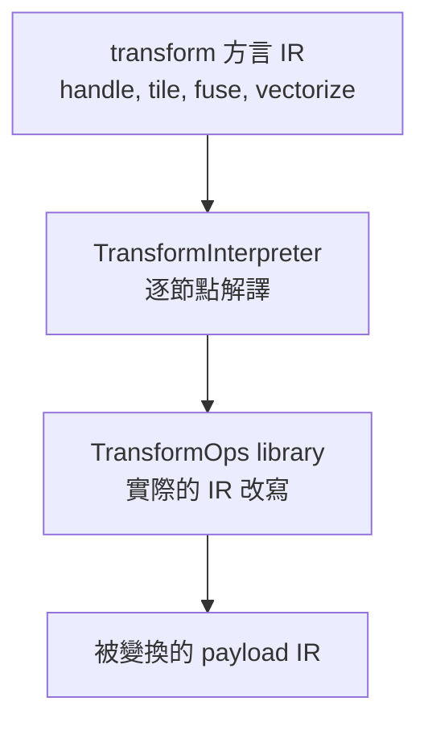

# 8.4 迴圈變換：Tiling、Fusion、Unrolling 與 Parallelization

[8.1](08.1-scf結構化控制流.md) 建立結構化控制流，[8.2](08.2-affine多面體模型.md) 補上了索引結構，[8.3](08.3-memref記憶體抽象.md) 補上了記憶體與佈局。現在所有降階的前提都具備了。

本節要處理的問題是：**有了這些結構，編譯器到底能做哪些迴圈變換，以及怎麼做？**

我們會先建立**canonical loop nest** 的形式化定義，再依次處理 tiling、fusion、unrolling、vectorization、parallelization，最後比較 MLIR 的兩種實作路徑：`transform` 方言（宣告式）與 C++ pass（命令式）。

## 為什麼需要 canonical 形式

在討論任何具體變換之前，先回答一個方法論問題：為什麼「先變成某個形式，再做變換」比「直接做變換」好？

答案來自多面體模型的經驗（[8.2](08.2-affine多面體模型.md)）：變換的合法性判斷需要一個**統一的表示**。若每個 pass 都在「任意形狀」的迴圈上運作，它就必須處理所有可能的形狀組合，變成不可寫的程式碼。

因此 MLIR 採取了與 [8.2](08.2-affine多面體模型.md) 中提到的 **canonical loop nest** 類似的策略。canonical loop nest 的形式化定義：

一個迴圈 nest 被稱為 canonical，若且僅若它滿足：

1. 每個迴圈有**恰好一個**維度對應一個 memref 的維度（或被 fusion 合併）。
2. 每個 iteration index 只被用於**載入或儲存**該 index 所對應的維度。
3. 每個 memref 的存取都是**單維的**（只被一個 iteration index 索引）。
4. 迴圈的巢狀順序與記憶體維度的順序一致。

在這個形式下，tiling 與 fusion 的實作可以變得非常簡潔：tiling 就是在每個迴圈上加一層 tile 迴圈；fusion 就是把兩個 loop nest 合併。

**MLIR 中最接近這個 canonical 形式的具體表現，是 `linalg` 的 tile 結構**——`linalg` op 的迭代空間是隱含的、扁平的，tiling 把它切成 `linalg.tile` op 的 nest。

## 變換一：Tiling（分塊）

### 定義與目的

Tiling 把一個大小為 $n$ 的迭代維度切成大小為 $t$ 的塊。形式化地，若迭代空間是 $[0, n)$ ，tiling 後的空間是 $[0, \lceil n/t \rceil) \times [0, t)$ ，新的索引映像是：

$$
\text{tile\_index} = \lfloor i / t \rfloor, \qquad \text{inner\_index} = i \bmod t
$$

這個轉換的意義在於**同時**：

* 讓迴圈體變小，可以完全放進 cache（或 register 檔）。
* 讓外層迴圈的 trip count 變小，可以被平行化。

這是 cache blocking 的核心：在一個大矩陣乘法中，若不 blocking， $B$ 的每一行都會被完整掃過；若 blocking 成 $\sqrt{n} \times \sqrt{n}$ 的塊， $B$ 的整個子矩陣可以留在 cache 裡。

Tiling 引入了一個新的迭代維度（tile index）。若原 nest 有 $d$ 維，tiling 後會有 $2d$ 維（每維變成 tile 與 inner 兩層），除非某些維度被合併。

### 在 linalg 中實作

`linalg` 方言有一個專門的 op：`linalg.tile`。它的結構是：

```mlir
%tiled = linalg.tile %producer[
  %tile_sizes] to %tile_sizes
  {operandDps = [...]} : (f32) -> f32
```

實際的語法稍微複雜。`linalg.tile` 有兩種形式：只有單一輸入時是「點對點」tile，多個輸入時是「維度對齊的 tile」。

具體來說，`linalg.tile` 的作用是：把一個 op 的迭代空間切塊，並對每個 tile 內部產生一個新的 op。輸出的 op 通常是 `linalg.generic`（tile 內部）或被 tile 的原 op（tile 大小等於整個空間時）。

一個簡化的示意：

```mlir
// 原本
%0 = linalg.matmul ins(%a : tensor<256x256xf32>) ins(%b : tensor<256x256xf32>)
                outs(%c : tensor<256x256xf32>) -> tensor<256x256xf32>

// tile 之後（概念上）
%1 = linalg.matmul ins(%a_tile : tensor<64x256xf32>) ...
```

實際 MLIR 語法由 `linalg::tileOp` 與 `linalg::TileOp` 定義，其建構需要 tile sizes 與 `operandDps`（dps = destination-passing style）。

### 通用 tile 與混合 tile

`linalg` 的 tiling 支援兩種模式：

* **generic tile**：對所有迭代維度切出固定大小的 tile。
* **mixed tile**：對某些維度切 tile，對某些維度用整個尺寸（不切）。這對矩陣乘法特別重要——通常 $M$ 與 $N$ 需要切，但 $K$ 維不切（因為 $K$ 維是 reduction，完整的 $K$ 迴圈有利於累加器保持在 register 中）。

這正是多面體編譯器裡的「rectangular tiling」與「iterative rectangular tiling」的區別。

## 變換二：Fusion（融合）

### 兩種形式

Fusion 有兩種基本形式，方向相反：

**Producer fusion（向上融合）**：把 consumer 與它的 producer 融成一個 op，producer 的計算被「吸收」進 consumer。

```mlir
// 融合前
%0 = linalg.generic ... ins(%a) ... -> tensor<8xf32>
%1 = linalg.generic ... ins(%0) ... -> tensor<8xf32>

// 融合後（單一 op）
%1 = linalg.generic ... ins(%a) ... -> tensor<8xf32>
```

**Consumer fusion（向下融合）**：把 producer 的結果與 consumer 一起產生，producer 的 op 被移除，其計算被搬到 consumer 之前。

```mlir
// 融合前
%0 = linalg.generic ... ins(%a) ... -> tensor<8xf32>
%1 = linalg.generic ... ins(%b) ins(%0) ... -> tensor<8xf32>

// 融合後
%1 = linalg.generic ... ins(%b) ins(%a) ... -> tensor<8xf32>
```

在實務上，producer fusion 較常用，因為它不需要重新計算。

### 依賴條件

Fusion 不是永遠合法的。必須滿足幾個條件：

1. **形狀相容**：producer 的輸出形狀必須與 consumer 的對應輸入形狀**完全相同**（不只是相容）。若 consumer 會 broadcast producer 的輸出，則 producer fusion 會導致重複計算。
2. **迭代空間相容**：兩個 op 的迭代空間必須能對齊。在 `linalg` 中，這表現為「兩者的 indexing maps 在對應的維度上一致」。
3. **DPS 約束**：producer 的輸出 buffer 在融合後會被捨棄，因此需要確認沒有其他使用者。
4. **副作用**：有副作用的 op 不能被融合。

在 `linalg` 中，這些條件被 `linalg::fuseElementwiseOps` 這類 pass 實作，並且可以查詢 `linalg::LinalgOp` 的 `getNumLoops()` 與 indexing maps 來判斷。

### Fusion 的收益與代價

Fusion 的收益：

* 減少中間結果的記憶體流量。這個收益往往很大：在元素級的鏈上，每一個中間結果都要寫入記憶體再讀出。
* 減少 kernel launch 開啟（在 GPU 上尤其重要）。

Fusion 的代價：

* 可能導致 register pressure 增加（fusion 太多時）。
* 可能破壞 cache 局部性（若 producer 與 consumer 的存取模式差異很大）。
* 會限制後續的 tiling 與向量化選擇。

**因此實務上的 fusion 是有節奏的**：先做一輪 fusion，再 tiling，再 fusion。MLIR 的 `linalg-fuse-elementwise-ops` 與 `linalg-fuse-nops` 這類 pass 通常被安排在這個節奏裡。

## 變換三：Unrolling（展開）

### 定義與目的

Unrolling 把一個 trip count 為 $n$ 的迴圈，展開成一個 trip count 為 $\lceil n / k \rceil$ 的迴圈，每個迭代體包含原來 $k$ 個迭代的內容。

收益：

* 減少迴圈控制開銷（分支預測、計數器更新）。對短迴圈特別有效。
* 讓編譯器看到跨迭代的相依，能更好地做指令排程與寄存器分配。
* 是 SIMD 向量化的基礎：把迴圈展開 $k$ 次後，其中的 $k$ 個獨立運算可以合成一個向量操作。

代價：

* 程式碼膨脹（i-cache 壓力）。
* 尾端處理（trip count 不是 $k$ 的倍數時的 remainder loop）增加複雜度。

### Unroll 與 Vectorize 的關係

在現代 MLIR 中，unroll 與 vectorize 常常是**一起做的**，因為 `vector` 方言的 transfer op 本身就隱含了展開：

```mlir
// 向量化前
%v = memref.load %m[%i] : memref<1024xf32>
%r = arith.mulf %v, %c : f32
memref.store %r, %out[%i] : memref<1024xf32>

// 向量化後（用 vector<4xf32>）
%v = vector.transfer_read %m[%i], %cst : memref<1024xf32>, vector<4xf32>
%r = arith.mulf %v, %vcst : vector<4xf32>
vector.transfer_write %r, %out[%i] : vector<4xf32>, memref<1024xf32>
```

這裡每個迭代處理 4 個元素，相當於隱含的 4 次 unroll。

`vector` 方言還有 `vector.contract`，用來表達向量化的矩陣乘法：

```mlir
%r = vector.contract {indexing_maps = [affine_map<(d0, d1, d2) -> (d0, d2)>,
                                    affine_map<(d0, d1, d2) -> (d2, d1)>,
                                    affine_map<(d0, d1, d2) -> (d0, d1)>],
                       iterator_types = ["parallel", "parallel", "reduction"],
                       kind = #vector.kind<add>}
  %lhs, %rhs, %acc : vector<8x4xf32>, vector<4x8xf32>, vector<8x8xf32>
```

## 變換四：Parallelization（並行化）

### 定義與目的

Parallelization 把一個迴圈的迭代空間分配到多個執行緒上。

在 `scf` 中，這由 `scf.parallel` 表達（[8.1](08.1-scf結構化控制流.md)）。

### Reduction 的處理

並行化 reduction 是最麻煩的部分。若迴圈是：

$$
s = \sum_{i=0}^{n-1} a_i
$$

並行化成 $p$ 個執行緒後，每個執行緒得一個部分和 $s_k = \sum_{i \in T_k} a_i$ ，最後要合併： $s = s_0 + s_1 + \cdots + s_{p-1}$ 。

這個合併步驟是**額外的同步點**。在 `scf` 中，`scf.parallel` 的 `scf.reduce` 正是承載這個語意：

```mlir
%result = scf.parallel (%i) = (%c0) to (%n) step (%c1) iter_args(%acc = %zero) -> (f32) {
^bb0(%i: index, %acc: f32):
  %v = memref.load %a[%i] : memref<?xf32>
  %s = arith.addf %v, %acc : f32
  scf.reduce %s : f32
}
```

### 到硬體的映射

`scf.parallel` 到硬體的映射由 backend 決定：

| 目標 | 對應機制 |
|---|---|
| 多執行緒 CPU | `scf.parallel` → `omp.parallel` → LLVM |
| GPU | `scf.parallel` → `gpu.launch` + `gpu.block_id` / `gpu.thread_id` |
| SPIR-V | `scf.parallel` → `spirv` 的 Workgroup / ExecutionMode |
| NPU | 專門的 dialect 與 pass |

## 實作路徑一：transform 方言

`transform` 方言是 MLIR 中**宣告式**地表達迴圈變換的方式。它的設計哲學是：**把變換本身表示成一棵 IR 樹**，然後由一個解譯器（interpreter）來執行。

### 為什麼要有 transform 方言

傳統的做法是每個變換寫一個 C++ pass。C++ pass 的問題：

* 變換之間難以組合（tiling 的結果要餵給 fusion，但兩者由不同的 pass 實作，各自硬編碼 IR 形狀的假設）。
* 復現與除錯困難（pass 的執行順序寫在 C++ 裡）。
* 無法被工具（如 autotuning）動態生成。

`transform` 方言把變換變成資料：



`transform` 方言有兩類 op：

* **Handle 相關**：`transform.structured.match`、`transform.structured.match.named`（找到目標 op 並產生 handle）、`transform.structured.yield`、`transform.sequence`。
* **變換操作**：`transform.structured.tile`、`transform.structured.fuse`、`transform.structured.vectorize`、`transform.structured.pad`、`transform.structured.rewrite_as_reshape` 等。

### 一個完整的 transform 範例

```mlir
module attributes {transform.with_named_sequence} {
  transform.named_sequence @__transform_main(%arg0: !transform.any_op) {
    %matmul = transform.structured.match.named ops{["linalg.matmul"]} in %arg0 : (!transform.any_op) -> !transform.any_op
    %tiled, %loops, %tile_sizes, %generated_loops = transform.structured.tile %matmul
        [64, 64, 0] : (!transform.any_op) -> (!transform.any_op, !transform.any_op,
                                              !transform.any_op, !transform.any_op)
    %fused = transform.structured.fuse %tiled, %matmul
        {iterators = [0, 1]} : (!transform.any_op, !transform.any_op) -> !transform.any_op
    %vectorized = transform.structured.vectorize %fused
        vector_sizes = [8, 8] : !transform.any_op
    transform.structured.yield
  }
}
```

逐行解讀：

* `transform.named_sequence @__transform_main` 定義一個具名序列，參數是 `!transform.any_op`（被變換的 IR 根）。
* `transform.structured.match.named ops{["linalg.matmul"]}` 找到 payload IR 中的 `linalg.matmul`，回傳一個 handle。
* `transform.structured.tile %matmul [64, 64, 0]` 以 tile size $[64, 64, 0]$ 對它做 tiling。**三個數字對應三個迭代維度**；`0` 表示該維不切（這正是混合 tiling）。回傳四個值：tiled op、loops、tile sizes、generated loops。
* `transform.structured.fuse %tiled, %matmul {iterators = [0, 1]}` 把兩者融合。`iterators = [0, 1]` 指定融合的迭代維度。
* `transform.structured.vectorize %fused vector_sizes = [8, 8]` 向量化。
* `transform.structured.yield` 結束序列。

### 執行

在 C++ 中執行一個 transform 序列：

```cpp
mlir::transform::TransformOp transformOp = ...;
mlir::transform::TransformInterpreter interpreter(transformOp.getTransformOpState());
mlir::transform::TransformState state = transformOp.getTransformOpState();
(void)interpreter.executeOnOperation(payloadOp, state);
```

`TransformState` 維護 handle 到實際 `Operation *` 的對應，以及 `TransformHandle` 與 `Value` 的映射。

`transform` 方言的 op 是**宣告性**的：它們不需要在 MLIR 中被 "lower"；由 `TransformInterpreter` 在執行時直接作用於 payload IR。

### transform 的優點與限制

優點：

* 變換序列是資料，可以被序列化、比較、產生。
* 變換之間的組合由同一個直譯器處理，不需要每個 C++ pass 各自假設 IR 形狀。
* autotuning 可以動態生成不同的變換序列並比較結果。

限制：

* `transform` 方言的 op 集合只覆蓋了「常見」變換；複雜的自訂變換仍需寫 C++。
* 序列的執行是「once」的——一次執行完就沒有 IR 留下，這對除錯不利（可透過 `transform.print` 或除錯選項緩解）。
* 需要 payload IR 與 transform IR 在同一個 module 裡（或用 `transform.with_named_sequence` 屬性連結）。

## 實作路徑二：C++ pass

另一條路徑是直接寫 C++ pass。

### 內建輔助函式

MLIR 的 `linalg` 在 `mlir/include/mlir/Dialect/Linalg/Transforms/Transforms.h` 與 `mlir/include/mlir/Dialect/Linalg/Transforms/Utils.h` 中提供了一批輔助函式。

最常用的是 **tileConsumer** 與 **tileProducer**：

```cpp
namespace mlir {
namespace linalg {

/// 把 consumer op tile 成給定的 tile sizes，替換 consumer 並回傳新的 op。
/// producer 提供資料給 consumer。
FailureOr<Operation *> tileConsumer(RewritePatternSet &patterns,
                                    Operation *consumer,
                                    ArrayRef<int64_t> tileSizes,
                                    ArrayRef<int64_t> tileLoops,
                                    bool fuseProducer = true);

/// 把 producer op tile 成給定的 tile sizes，並把結果接到 consumer。
FailureOr<Operation *> tileProducer(RewritePatternSet &patterns,
                                    Operation *producer,
                                    Operation *consumer,
                                    ArrayRef<int64_t> tileSizes,
                                    ArrayRef<int64_t> tileLoops);

} // namespace linalg
} // namespace mlir
```

這兩個函式的存在，正是我們前面強調的「canonical 形式」的價值：它們假設 consumer 處於一個**標準形狀**（迭代空間與 indexing maps 可預測），若不符合，它們會失敗並要求先做 canonicalization。

一個使用 `tileConsumer` 的完整 pattern：

```cpp
namespace {

struct TileConvPattern : public OpRewritePattern<linalg::Conv2DNhwcHwcfOp> {
  using OpRewritePattern::OpRewritePattern;

  LogicalResult matchAndRewrite(linalg::Conv2DNhwcHwcfOp op,
                                PatternRewriter &rewriter) const override {
    SmallVector<int64_t> tileSizes = {1, 8, 8, 0, 0, 0, 0};
    SmallVector<int64_t> tileLoops = {0, 1, 2};

    FailureOr<Operation *> newOp = linalg::tileConsumer(
        rewriter.getRewritePatternSet(), op, tileSizes, tileLoops);
    if (failed(newOp))
      return rewriter.notifyMatchFailure(op, "failed to tile consumer");
    rewriter.replaceOp(op, newOp->getResults());
    return success();
  }
};

} // namespace
```

注意 `tileSizes` 與 `tileLoops` 兩個陣列：`tileSizes` 是**每一個**迭代維度對應的大小（長度等於迭代空間維度數），`tileLoops` 則指定**哪些**維度要實際被切（長度等於要切的維度數）。上面例子中 `tileLoops = {0, 1, 2}` 表示切維度 0、1、2，也就是 $N$ 、 $H$ 與 $W$ ；其餘維度，例如 $C$ 與 reduction 維，不切。

### 一個完整的 C++ pass

```cpp
namespace {

struct TileMatmulPass
    : public PassWrapper<TileMatmulPass, OperationPass<func::FuncOp>> {
  MLIR_DEFINE_EXPLICIT_INTERNAL_INLINE_TYPE_ID(TileMatmulPass)

  StringRef getArgument() const final {
    return "tile-matmul-pass";
  }

  StringRef getDescription() const final {
    return "把 linalg.matmul 以 64x64 的 tile 切分";
  }

  void getDependentDialects(DialectRegistry &registry) const override {
    registry.insert<linalg::LinalgDialect, scf::SCFDialect>();
  }

  void runOnOperation() override {
    func::FuncOp func = getOperation();

    RewritePatternSet patterns(&getContext());
    patterns.add<TileMatmulPattern>(&getContext());

    if (failed(applyPatternsAndFoldGreedily(func, std::move(patterns))))
      signalPassFailure();
  }
};

} // namespace
```

`applyPatternsAndFoldGreedily` 是 MLIR 的貪婪重寫引擎：它反覆嘗試所有 pattern 直到沒有變化。這個引擎的行為對 tile pass 很重要——因為 tiling 產生的新 op 可能又符合某些 pattern。

### transform 介面

MLIR 也提供 `mlir::transform::interfaces` 讓自訂變換可以掛在 transform 序列上。若需要一個 transform 方言裡沒有的變換，可以定義一個帶 `TransformOpInterface` 的 op：

```cpp
class MyTransformOp
    : public Op<MyTransformOp, OpTrait::OneResult,
                mlir::transform::interfaces::TransformOpInterface,
                mlir::transform::interfaces::TransformEffectsInterface> {
public:
  using Op::OpTrait::OneResult;

  static StringRef getOperationName() { return "transform.my_transform"; }

  void applyToOne(mlir::transform::TransformRewriter &rewriter,
                  mlir::transform::TransformState &state,
                  mlir::transform::TransformOpInterface *transformOp) {
    auto handle = getHandle();
    auto payloadOps = state.getOps(handle);
    // 實際的變換邏輯
    rewriter.notifyMatchFailure(transformOp, "not implemented");
  }

  mlir::transform::TransformHandle getHandle() {
    return getHandleAttr().getValue();
  }

  mlir::transform::TransformHandle getHandleAttr() {
    return (*this)->getAttrOfType<mlir::transform::TransformHandleAttr>(
        "handle");
  }
};
```

這個介面讓自訂變換能與 `transform` 方言的內建變換**混合使用**：一個 transform 序列裡可以有 `transform.structured.tile`，也可以有 `transform.my_transform`。

`TransformOpInterface` 的核心方法有：

* `applyToOne`：對單一 payload op 施加變換。
* `applyToAll`：對一組 payload op 施加變換。
* `getTransforms`：取得此 op 產生的 transform handle。

`TransformEffectsInterface` 則讓一個變換宣告它對 IR 的影響（是否改變 payload op 的數量、是否可能失敗），供解譯器處理失敗與副作用追蹤。

## 兩種做法的比較

| 面向 | transform 方言 | C++ pass |
|---|---|---|
| 形式 | 宣告式，變換是 IR 資料 | 命令式，變換是程式碼 |
| 組合性 | 好，由同一個解譯器處理 | 需小心協調各 pass 的形狀假設 |
| 動態生成 | 可以（autotuning） | 不行 |
| 除錯 | 序列可序列化、列印 | 需在 C++ 層下斷點 |
| 覆蓋範圍 | 只限已實作的 op | 理論上無限 |
| 執行效率 | 有直譯器開銷 | 直接 |
| 學習曲線 | 需要理解 handle 語義 | 需要理解 C++ API |

實務上的建議是**混合使用**：

* 固定的、流水線式的變換組合，用 C++ pass（例如上面的 `tileConsumer` 輔助函式）。
* 需要根據執行期資訊決定的、或需要 autotuning 的，用 transform 方言。
* 兩者可以共存：C++ pass 產生的 payload IR 可以再被 transform 序列處理。

## 為什麼在 MLIR 中做迴圈變換比傳統多面體編譯器容易

這個對比是本節的收束。

**傳統多面體編譯器（Polly、 Pluto 系）** 的工作流程：

1. 把整個程式轉成多面體表示（需要處理任意 C 語言的控制流，通常靠 `isl` 的 Presburger 分析）。
2. 建立完整的 dependence relation。
3. 從 dependence relation 導出一個「合法的初始 schedule」。
4. 用 schedule transformation 演算法（Pluto 的 tiling / skewing / fusion）尋找高效 schedule。
5. 把最終 schedule 寫回程式碼。

這是一個**全域的、離散的**最佳化問題：schedule 空間是離散的，搜尋演算法複雜度高，而且整個流程需要對整個函式做完整的分析。

**MLIR 的做法**：

1. 不需要把程式轉成多面體表示。迭代空間由 `linalg` op 的 indexing maps 直接給出。
2. 不需要完整的 dependence relation。合法性用保守的區間/仿射分析判斷。
3. 變換是**局部的、可組合的**：`tileConsumer` 假設 consumer 處於 canonical 形狀，失敗就要求先 canonicalize。
4. 沒有「尋找最佳 schedule」這一步——變換序列是由人（或 autotuner）指定的。

代價是：**MLIR 失去了自動尋找最佳 schedule 的能力**。Polly 的排程器能自動決定 tiling 大小、loop interchange 順序、fusion 組合；MLIR 則要求 pipeline 的作者手動決定（或用 autotuning 窮舉）。

但 MLIR 得到的回報是：

* **實作複雜度大幅下降。** 一個可用的 tiling pass 不需要多面體理論，只需要正確處理 canonical 形狀。
* **與其他最佳化自然組合。** 因為 IR 保持結構化，LLVM 的既有 pass 可以在最後接手。
* **可攜性。** 同一個 pipeline 可以在 CPU、GPU、NPU 上重用，只需換掉最後的 backend 降階。

用一句話總結：**MLIR 把「自動的、離散的多面體最佳化」換成了「可組合的、結構保留的、宣告式的變換原語」，並把最佳化的決定權交給 pipeline 作者或 autotuner。**

## 完整的 pipeline 範例

把上述概念串成一個可執行的指令序列：

```bash
mlir-opt \
  --canonicalize \
  --linalg-fuse-elementwise-ops \
  --linalg-tile \
  --linalg-vectorize \
  --convert-linalg-to-loops \
  --convert-scf-to-cf \
  --convert-arith-to-llvm \
  --finalize-memref-to-llvm \
  --convert-func-to-llvm \
  --reconcile-unrealized-casts \
  input.mlir -o output.llir
```

在 C++ 中註冊這條 pipeline：

```cpp
void registerMyPipeline() {
  PassRegistration<>(
      "my-tile-pipeline",
      "融合、tiling 並向量化 linalg op",
      [](OpPassManager &pm) {
        pm.addPass(createCanonicalizerPass());
        pm.addPass(createLinalgFusionElementwiseOpsPass());
        pm.addPass(createLinalgTilePass());
        pm.addPass(createLinalgVectorizePass());
      });
}
```

## 實務注意事項

* **先 canonicalize，再變換。** 大多數 tile/fusion pass 假設 canonical 形狀，違背時會「silently 不做事」。這時要檢查 pass 的診斷訊息而不是只看 IR 有沒有變。
* **tiling 順序重要。** 通常是：fusion → tiling → vectorization。反過來（先 vectorize 再 tiling）會失去很多機會。
* **tile size 要配合硬體。** CPU 上通常配合 L1/L2 大小；GPU 上配合 shared memory 容量；NPU 上配合 DMA 與 buffer 大小。
* **reduction 維通常不切。** 這是混合 tiling 的主要用途。
* **fusion 過度會導致 register spill。** 在元素級鏈上尤其明顯。
* **transform 方言的序列要小心 payload 失效。** 若序列中的一個 op 被替換，後續 handle 可能失效；`transform` 提供了 `transform.sequence` 與失效檢查來協助。

## 小結與延伸閱讀

* Tiling 把迭代維度切成 $[0, \lceil n/t \rceil) \times [0, t)$ ，同時改善 cache 局部性與外層並行性；`linalg` 支援純 tile 與混合 tile（reduction 維不切）。
* Fusion 有 producer fusion 與 consumer fusion 兩種方向，合法性取決於形狀完全相容、迭代空間可對齊、DPS 約束與副作用。
* Unrolling 減少控制開銷並暴露跨迭代相依，是 SIMD 的基礎；現代 MLIR 中 unroll 常隱含在 `vector` 的 transfer op 裡。
* Parallelization 在 `scf` 中由 `scf.parallel` 表達，reduction 由 `scf.reduce` 承載，最終映射到 `omp`、`gpu` 或 `spirv`。
* `transform` 方言把變換本身表示成 IR（handle、tile、fuse、vectorize），由 `TransformInterpreter` 解譯執行；優點是宣告式、可序列化、可 autotune，缺點是覆蓋範圍有限。
* C++ 路徑以 `mlir::linalg::tileConsumer` / `tileProducer` 與 `applyPatternsAndFoldGreedily` 為代表，實作直接、可覆蓋任意變換，但 pass 之間需要人工協調形狀假設。
* 兩條路徑互補：固定的流水線用 C++，動態決定的用 transform；`mlir::transform::interfaces::TransformOpInterface` 讓自訂變換可以掛進同一個序列。
* MLIR 相比傳統多面體編譯器，以「放棄自動 schedule 搜尋」換取「實作簡潔、與其他方言整合、可攜」。
* 延伸閱讀：
  * MLIR transform 方言文件：`mlir/docs/Dialects/Transform.md`
  * Linalg 轉換文件：`mlir/docs/Transforms/Linalg.md`
  * `tileConsumer` / `tileProducer` 宣告：`mlir/include/mlir/Dialect/Linalg/Transforms/Utils.h`
  * transform 介面：`mlir/include/mlir/Dialect/Transform/Interfaces/TransformInterfaces.h`
  * 維基百科條目「Loop tiling」與「Loop unrolling」：`https://en.wikipedia.org/wiki/Loop_tiling`、`https://en.wikipedia.org/wiki/Loop_unrolling`
