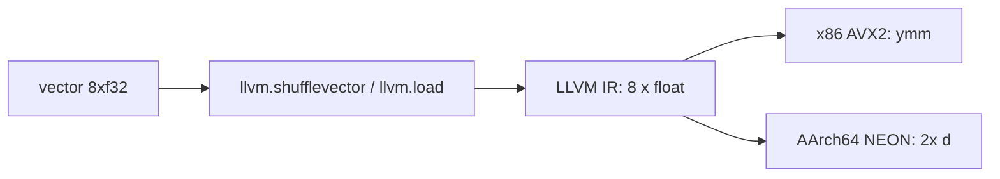

# 9.1 vector 方言：硬體無關的向量抽象

[8.4](08.4-迴圈變換模式.md) 結束時，我們手上有一個可以任意重排的 loop nest 與一組結構化 op。缺的最後一塊拼圖是：**當我們決定把某個維度向量化時，該用什麼語言描述向量運算？**

直接寫 `xmm0` 暫存器是不行的：那把抽象層級拉回組合語言，編譯器再也無法做 loop-invariant code motion、常量折疊或別的變換。但寫成「8 個 `f32` 的陣列加一個 `f32` 的陣列」也不行：那只是把 loop nest 用另一種語法重寫，編譯器看不到機器的向量寬度。

`vector` 方言正是這兩者之間的那一層。它的設計目標可以一句話說完：

> 提供一個**硬體無關、但保留向量形狀**的 IR，讓後端可以在降階時自由選擇 AVX、NEON、SVE 或 GPU 的 warp 操作。

這一章會說明 `vector` 方言的資料模型、記憶體存取 op（尤其是 `transfer_read` / `transfer_write` 的 permutation map 為何存在）、歸約 op、以及 scalable vector 這個關鍵設計。

## 為什麼需要一層專門的向量 IR

先看兩個極端之間的落差。

**極端 A：寫成 scalar loop。**

```mlir
%sum = arith.constant 0.0 : f32
scf.for %i = %c0 to %c8 step %c1 {
  %a = memref.load %A[%i] : memref<?xf32>
  %b = memref.load %B[%i] : memref<?xf32>
  %s = arith.addf %a, %b : f32
  %sum = arith.addf %sum, %s : f32
}
```

這個形式是正確的，但「向量化」在這裡是一個**外部優化 pass 的產物**，優化器必須自己完成：合法性檢查（依賴距離、aliasing）、迴圈複製（peeling for alignment）、尾巴處理（scalar epilogue）、intrinsic 選擇與組合。它要處理的所有情形，都源自一個根本缺陷——**IR 中沒有「這八個元素是一組」這個資訊**。

**極端 B：寫死 register 與寬度。**

```mlir
// 假想的 x86 專用語法
%v = vaddps xmm0, xmm1, xmm2
```

這裡資訊量過多：優譯器被綁死在一個 4-lane 的 SSE/AVX 配置上，換到 NEON 或 SVE 就得重寫。MLIR 的 `llvm` 方言其實就是這個極端（它的指令幾乎一一對應 LLVM IR），但那是降階的最後一步，不該是起點。

**中間就是 `vector` 方言。** 它只宣告「這是一個長度為 $n$ 的向量，元素型別為 $T$ 」，不宣告寬度、暫存器數量、排列順序，也不宣告遮罩策略。

這裡有一個關鍵的**抽象層級分離**：

| 資訊 | 屬於哪一層 |
| --- | --- |
| 哪些元素屬於同一個向量 | `vector` 方言 |
| 向量長度（元素個數） | `vector` 方言（但允許 scalable） |
| lane 的實際排布方式、暫存器分配 | 降階到 `llvm` / 目標後端時決定 |
| 遮罩的產生方式（對齊、邊界） | `vector` 方言（mask 值）與 pass（如何算） |

值得強調的是最後一列：**`vector` 方言的遮罩（mask）是資料，不是控制流程**。這讓遮罩可以自由地被 fold、被 CSE、被常量折疊，而不是被硬編碼成分支。

## 核心型別：`vector<NxMxf32>` 與 `vector<[4]xf32>`

`vector` 方言的型別語法是 `vector<...>`，其中最內層是元素型別，外層是各個維度的長度。

```mlir
func.func @types(%v: vector<4xf32>, %m: vector<2x8xf32>, %s: vector<[4]xf32>) {
  return
}
```

三者的差異不是外觀上的，而是**語意上根本不同**：

* `vector<4xf32>` 是**固定長度（fixed-length）**向量。它的長度是 IR 的一部分，可以被靜態推理：`vector.extract` 的索引範圍是 $[0, 4)$ 。
* `vector<2x8xf32>` 是多維固定長度向量。`vector.extract` 在 2 維情形要給兩個索引。
* `vector<[4]xf32>` 是**可縮放（scalable）**向量，方括號是它的記號。

### scalable vector 為什麼重要

固定長度向量有個尷尬的問題：**硬體的向量長度不固定**。

ARM SVE 的向量長度由實作決定，可以是 128-bit 到 2048-bit 的任意值（且在同一支程式碼的不同執行中可能不同）。AVX-512 是 512-bit（16 個 `f32`），但 AVX2 是 256-bit（8 個）。NEON 是 128-bit（4 個 `f32`）。

如果 IR 裡只有固定長度向量，要支援 SVE 就只有三條路：

1. 每個可能的長度各寫一份 IR —— 不可能，長度是連續的。
2. 只支援最小公分母（128-bit / 4 lane），把 SVE 的長度資訊在後端重新展開 —— 會浪費 SVE 的效能。
3. **在 IR 中引入「長度是執行期參數」的向量型別。**

第三條就是 scalable vector。它的核心語意是：

$$
\texttt{vector<[4]xf32>} \text{ 的 lane 數} = 4 \times V,
$$

其中 $V$ 是執行期的向量長度倍率（vector length multiplier），由目標機決定。在 SVE 上 $V = 1$ 表示 128-bit，向量長度由 `cntb` 指令在執行期取得；在更寬的實作上 $V$ 可以是 2、4 甚至 16。

**關鍵推論**：scalable vector 的「元素個數」不再是編譯期常數。這直接影響了所有依賴長度常數的操作：

* `vector.extract %v[%i]` 中， $i$ 的合法範圍是 $[0, 4V)$ ， $V$ 未知 → **索引範圍無法靜態檢查**。
* `vector.reduction` 的結果型別不變，但「迭代了多少次」是執行期的事。
* 迴圈 trip count 與向量長度綁定時，不能靜態展開。

因此 scalable vector 引入了一個在固定長度世界不存在的概念：**runtime vector length**。MLIR 把它表示成 `vector.vscale` 這個 op（回傳 `index` 型別的 $V$ ），並有 `vector.step` op 表示「一次迭代的步長」。

```mlir
// scalable vector 上的歸約
%vscale = vector.vscale : index
%sum = vector.multi_dim_reduction <add> %v, %init : vector<[4]xf32> into f32
```

MLIR 用 `vector.vscale` 而不是讓 pass 直接假設長度，正是為了讓**降階順序**可以自由選擇：先降到固定長度（在 $V$ 已知的目標上展開），或直接降到 scalable-aware 的 LLVM 方言（LLVM IR 本身有 `<vscale x 4 x float>` 型別）。

### `vector.type` op

`vector` 方言還提供了一個 `vector.type` op，用於**以 operation 的形式建構型別**。它存在的理由是：某些向量型別無法用簡潔的字面語法表達，尤其是帶有**動態維度**的向量。

```mlir
// 以 op 的形式建構一個第二維動態的向量型別
%vt = vector.type [4] : f32
```

在一般程式中 `vector.type` 很少出現，但它在兩個地方不可替代：

1. 通用轉換框架（[5.2](05.2-DialectConversion框架.md)）在需要「依運算結果推導型別」時，需要一個產生型別的 operation 節點。
2. `vector.broadcast` 這類「改變形狀」的 op，其結果型別有時需要從 operand 推導，用 `vector.type` 表達更清楚。

## 記憶體存取：從 `vector.load` 到 `vector.transfer_read`

向量化最大的難題不是算術，而是**記憶體**。原因很直觀：一個向量操作在邏輯上讀的是 $n$ 個「不連續的或連續的」元素，但真實硬體的向量 load 指令有嚴格限制——通常只支援：

* 對齊的連續區塊；
* 特定的「stride pattern」（如 `deinterleave`）；
* 或需要先 gather。

所以 MLIR 的 `vector` 方言用了**三層**記憶體 op，由簡單到複雜。

### 第一層：`vector.load` / `vector.store`

最基本的形式：連續、靜態對齊偏移、單一索引。

```mlir
%v = vector.load %A[%i] : memref<?xf32>, vector<8xf32>
vector.store %v, %B[%j] : memref<?xf32>, vector<8xf32>
```

語意：`vector.load` 讀取 $\texttt{A}[i \dots i+7]$ 這八個連續元素，組成一個 `vector<8xf32>`。`vector.store` 反之。

限制很明顯：**沒有遮罩、沒有 permutation map、只能一次處理一維**。這意味著它無法處理尾端（trip count 不是 8 的倍數）的情形。

### 第二層：`vector.transfer_read` / `vector.transfer_write`

`transfer` 系列是 `vector` 方言真正的核心，也是本節最需要推演的部分。

一個 `vector.transfer_read` 的語意可以這樣描述：

> 從一個 memref 讀取資料，讀取位置由一組 **permutation map** 決定，讀取結果依 **permutation map** 的輸出一維次序排列；對超出範圍或被 mask 為 false 的位置，填入 **padding value**。

```mlir
// 讀取一個 2x4 的區塊並轉置排列
%v = vector.transfer_read %A[%i, %j], %cst0 {
  permutation_map = affine_map<(d0, d1) -> (d1, d0)>
} : memref<128x256xf32>, vector<4x2xf32>
```

這裡 `permutation_map` 是關鍵。它的型別是 `AffineMap`，定義域是**來源 memref 的維度**，值域是**目標向量維度**（或反過來，視 op 方向而定，MLIR 內部採用的約定是：map 把來源 index 映到目標 index）。

在這個例子中，`affine_map<(d0, d1) -> (d1, d0)>` 意思是：來源的第 $(d_0, d_1)$ 維，對應到目標的第 $(d_1, d_0)$ 維。換句話說，**讀出來的 8 個元素是來源 2x4 區塊的轉置**。

另一個常見的 permutation：

```mlir
// 隔行抽取（deinterleave）
permutation_map = affine_map<(d0) -> (d0, 2)>   // 需要 2 維來源
```

`affine_map<(d0) -> (d0, 2)>` 的意思是：目標 lane $i$ 的元素取自來源索引 $2i$ （當第二個結果維度常數為 2 時）。這種形式用來表達「取偶數位元組」這類 AVX 的 shuffle 模式。

### 為什麼 permutation map 是必要的

這是本節的核心論點，值得展開。

假設我們只有 `vector.load`（連續讀取）。為了表達「轉置讀取」或「跨 lane 搬移」，你只有兩種選擇：

**選擇一：先讀成連續向量，再用 `vector.shuffle` 重排。**

```mlir
%raw = vector.transfer_read %A[%i, %j], %cst0 : memref<128x256xf32>, vector<2x4xf32>
%tr  = vector.shape_cast %raw : vector<2x4xf32> to vector<8xf32>
%out = vector.shuffle %tr, %tr [4, 5, 0, 1, 6, 7, 2, 3] : vector<8xf32>
```

這是可行的，而且 `vector.shuffle` 本身表達能力很強。但它有個致命問題：**它強制要求先做一次完整讀取**。而真實硬體上，某些 permutation 是硬體直接支援的：

* AVX-512 的 `vpermt2ps` 可以從兩個來源向量選取任意 lane；
* AVX2 的 `vperm2f128` 可以做 128-bit 區塊交換；
* NEON 的 `vqtbl1q_u8` 可以做 byte 級的 table lookup。

更關鍵的是，若目標是 **AVX-512 的 masked gather**（`vgatherdps`），它能一次處理**不連續**的 16 個地址。但用 `load` + `shuffle` 根本表達不了不連續讀取——你得先有 16 個獨立的 scalar load 再 insert，那已經把向量化的意義摧毀了。

**選擇二：直接描述「哪個目標 lane 取自哪個來源位置」。**

這正是 permutation map 的做法。把「跨 lane 搬移」統一描述成一個**從來源空間到目標空間的索引映像**，好處是：

1. **統一性**：連續讀取、轉置、隔行、broadcast、broadcast-interleave、gather 全部是同一個機制的特例。
2. **可組合**：permutation 是 affine map，可以做 map 的合成、化約、與其他 affine 運算互動（[8.2](08.2-affine多面體模型.md) 的多面體工具鏈直接可用）。
3. **降階目標明確**：後端可以把一個 affine permutation map 匹配到具體的 shuffle 指令序列，若匹配不上則 fallback 到通用的 `shuffle` + `select`。

讓我們把幾個常見情形列成表，說明它們如何被統一：

| 想要的行為 | permutation map | 說明 |
| --- | --- | --- |
| 連續讀取 | `affine_map<(d0) -> (d0)>` | 恆等映射 |
| 轉置 2x4 | `affine_map<(d0, d1) -> (d1, d0)>` | 交換維度 |
| lane 0 全部取來源元素 0 | `affine_map<(d0) -> (d0, 0)>` | 退化為 broadcast |
| 取偶數位元組 | `affine_map<(d0) -> (d0, 2)>` | 常數步長 |
| 交錯兩向量 | `affine_map<(d0) -> (d0 mod 2, d0 div 2)>` | 需要 `mod`/`div`，affine map 不直接支援 |

最後一行暴露了 affine map 的**表達力上限**：permutation map 不能表達任意置換，只能表達「仿射結構」的置換。這不是缺陷，而是刻意的取捨——affine map 保證了可分析性，代價是覆蓋不了任意 shuffle。任意 shuffle 由 `vector.shuffle` 這個「以整數陣列描述」的 op 來補足。兩者共存，是 `vector` 方言表達力與可分析性的平衡點。

### 遮罩與 `in_bounds`

真實的向量化程式幾乎一定會遇到「長度不對齊」的問題。假設一個迴圈 trip count 是 $n = 1000$ ，向量長度是 8，則最後一塊只用到 $1000 \bmod 8 = 0$ … 讓我們取 $n = 1003$ ，則需要讀 126 個向量（ $126 \times 8 = 1008$ ），其中最後一個向量的 5 個 lane 越界。

MLIR 有兩種處理方式：

**方式一：`in_bounds` 屬性（宣告式信任）**

```mlir
%v = vector.transfer_read %A[%i], %cst0 {in_bounds = [true]} : memref<?xf32>, vector<8xf32>
```

`in_bounds = [true]` 是一個 `DenseBoolArrayAttr`，長度等於**來源維度**。它的語意是「我保證這個存取不會越界，越界的部分是 UB，不需要處理」。這讓後端可以省略邊界檢查，直接產生無mask 的向量指令。

**方式二：mask（執行期遮罩）**

```mlir
%mask = vector.create_mask %n : vector<8xi1>
%v = vector.transfer_read %A[%i], %cst0, %mask : memref<?xf32>, vector<8xf32>
```

`vector.create_mask` 根據一個執行期的長度產生 mask：前 $\min(n, 8)$ 個 lane 為 true，其餘為 false。越界的 lane 會被填成 **padding value**（此處是 `%cst0`）。

這兩種模式的差別是**優化機會**：若 pass 能證明 `in_bounds`，後端就能產生乾淨的 `vmovups`；否則必須產生帶 mask 的版本。

實務上，常見的 pipeline 是：

1. 先用保守的 masked 版本，保證正確；
2. 跑一個 **mask 消除 pass**（例如 `vector.mask` 相關的 canonicalization，或針對已知 trip count 的分析），把能證明 in-bounds 的地方改成 `in_bounds = [true]`；
3. 後端據此選擇指令序列。

### `vector.mask` op

除了 `transfer_read` 的第三個 operand（mask）之外，MLIR 後來加入了 **`vector.mask`** op，用來給**任意**向量 op 加遮罩，而不只是存取。

```mlir
%mask = vector.create_mask %n : vector<8xi1>
%r = vector.mask %mask {
  vector.yield %v : vector<8xf32>
} : vector<8xf32> -> vector<8xf32>
```

`vector.mask` 的語意是：對 mask 為 false 的 lane，把 `vector.yield` 的對應值替換成 poison/零。這個 op 的存在解決了一個實際問題：**迴圈向量化時，「計算本身」也需要遮罩**。

例如：

```mlir
// 原始
scf.for %i = %c0 to %n step %c1 {
  %x = memref.load %A[%i] : memref<?xf32>
  %y = arith.mulf %x, %c2 : f32
  memref.store %y, %B[%i] : memref<?xf32>
}
```

向量化後，如果最後一塊越界的 lane 讀到 poison 值然後乘以 2 再存回去——存回去會覆蓋別的資料！因為 `transfer_write` 的 mask 只遮蔽「寫出」，但計算用的是 poison。所以需要 `vector.mask` 把計算結果也遮蔽掉。

完整向量化後的形狀是：

```mlir
%mask = vector.create_mask %n : vector<8xi1>
%v = vector.transfer_read %A[%i], %cst0, %mask : memref<?xf32>, vector<8xf32>
%r = vector.mask %mask {
  vector.yield %v : vector<8xf32>
} : vector<8xf32> -> vector<8xf32>
%w = vector.mulf %r, %c2 : vector<8xf32>
vector.transfer_write %w, %B[%i], %mask : vector<8xf32>, memref<?xf32>
```

## 元素存取與重排

### `vector.extractelement` / `vector.insertelement`

最基礎的 lane 操作。`vector.extractelement` 從向量取出一個元素（型別降成元素型別），`vector.insertelement` 反之。

```mlir
%e = vector.extractelement %v[%i] : vector<8xf32>, i32
%nv = vector.insertelement %f, %v[%i] : vector<8xf32>
```

它們的用途主要是**跨長度轉換的橋樑**：把一個向量拆成元素（用於後端沒有對應 shuffle 指令時的 fallback），或者把元素組成向量。

### `vector.extract` / `vector.insert`

這兩個是**多維**版本，可以從多維向量的某個位置抽出子向量。

```mlir
// 從 4x8 的向量抽出第 2 行的 8 個元素
%row = vector.extract %v[2] : vector<4x8xf32> from vector<8xf32>
// 把 8 元素向量塞回 4x8 向量的第 2 行
%nv = vector.insert %row, %v[2] : vector<8xf32> into vector<4x8xf32>
```

它們的存在是為了讓**多維向量與一維向量之間可以互轉**，這在處理矩陣類運算時特別有用——矩陣乘法的 tiling 經常把二維區塊重新解釋成一維向量。

### `vector.shuffle`

`vector.shuffle` 是**通用重排** op，用一個整數陣列描述結果的每個 lane 從哪裡來。

```mlir
%r = vector.shuffle %a, %b [0, 4, 1, 5, 2, 6, 3, 7] : vector<4xf32>
```

語意：結果有 8 個 lane。第 $i$ 個 lane 取自「把 $a$ 與 $b$ 串接成長度 8 的序列」的第 `mask[i]` 個元素。

這個形式可以表達**任意**置換（包括非仿射的），是 permutation map 的超集。代價是：

* 需要在 IR 中佔用一個常數陣列（`ArrayAttr`）；
* 後端必須把它降解成一串具體的 shuffle 指令，而硬體通常只支援有限的 shuffle 模式。

因此實務上，**permutation map 優先**：能寫成 affine map 的就寫成 affine map，讓後端更容易匹配到硬體指令。

## 歸約：從 `vector.reduction` 到 `vector.multi_dim_reduction`

歸約（reduction）是把一個向量的多個元素塌縮成一個元素的操作，例如加和、最大值。MLIR 提供了兩個層級的 op。

### `vector.reduction`

單維、單一結果：

```mlir
%sum = vector.reduction <add> %v, %init : vector<8xf32> into f32
```

語意： $r_0 = \text{init}$ ， $r_{i+1} = r_i \oplus v_i$ ，結果是 $r_n$ 。`init` 是恆等元素（加法的 0，最大值的 $-\infty$ ）。

注意 `init` 必須是 operand 而非屬性，因為它可能是一個計算出來的值（例如「最大值」的初值要從某個已知資料算出來）。

### `vector.multi_dim_reduction`

多維版本，可以把 $m \times n$ 的向量塌縮成一維或完全塌縮成標量：

```mlir
// 2x4 -> 4，沿維度 0 歸約
%rowSums = vector.multi_dim_reduction <add> %v, %init : vector<2x4xf32> into vector<4xf32>
// 2x4 -> 1
%total = vector.multi_dim_reduction <add> %v, %init : vector<2x4xf32> into vector<1xf32>
```

為什麼需要兩個 op？因為 `vector.reduction` 只處理「整個向量塌縮成標量」這一個情形，多維向量的部分歸約無法用它表達。`vector.multi_dim_reduction` 用「結果型別」來隱式決定歸約掉哪些維度：結果有 $k$ 維，就表示歸約掉 $n - k$ 個維度。

### 硬體對應

| 硬體 | 對應指令 | 降階方式 |
| --- | --- | --- |
| x86 AVX2 | `vaddps`（橫向） | 需要 shuffle + shuffle |
| x86 AVX-512 | `vaddps %zmm, %zmm, %zmm`（含 broadcast） | 直接對應 |
| ARM NEON | `vaddvq_f32`（add across vector） | 直接對應 |
| ARM SVE | `addv`（horizontal） | 直接對應 |
| GPU | warp shuffle + reduce | 需 loop unroll 展開 |

注意 x86 在 AVX-512 之前的橫向加和**沒有單一指令**，需要「shuffle 高低半部 → 相加 → 再 shuffle」。這說明了為什麼 `vector.reduction` 的降階是一個**獨立的 pattern** 而不是直譯。

## 一個完整的 MLIR 範例

下面這段把本章的元件串起來：多維向量、transfer 的 permutation map、遮罩、歸約，以及以 region 形式表達的條件計算。

```mlir
// 對 4x8 的矩陣做「逐列加權求和」，其中權重在執行期才知道
func.func @weighted_row_sum(
    %A: memref<128x256xf32>,
    %w: memref<8xf32>,
    %n: index,
    %out: memref<128xf32>) {
  %c0 = arith.constant 0 : index
  %c1 = arith.constant 1 : index
  %cst = arith.constant 0.0 : f32

  // 一次處理一列
  %row = vector.transfer_read %A[%c0, %c0], %cst {
    permutation_map = affine_map<(d0, d1) -> (d1)>
  } : memref<128x256xf32>, vector<256xf32>

  // 用權重做點積：先乘再歸約
  %wv = vector.broadcast %w : memref<8xf32> -> vector<256xf32>
  // 實際上需要先把 8 個權重 broadcast 成 256 個 lane，這裡用 splat 語義示意
  %prod = vector.mulf %row, %wv : vector<256xf32>
  %sum = vector.multi_dim_reduction <add> %prod, %cst : vector<256xf32> into vector<1xf32>
  %s = vector.extract %sum[0] : vector<1xf32> from f32
  memref.store %s, %out[%c0] : memref<128xf32>
  return
}
```

接著是一個展示 mask 與 shuffle 配合的片段：

```mlir
// 假裝要把兩個 4-lane 向量交錯成一個 8-lane 向量
%a = arith.constant dense<[1.0, 2.0, 3.0, 4.0]> : vector<4xf32>
%b = arith.constant dense<[5.0, 6.0, 7.0, 8.0]> : vector<4xf32>
// 結果為 [1,5,2,6,3,7,4,8]
%ab = vector.shuffle %a, %b [0, 4, 1, 5, 2, 6, 3, 7] : vector<4xf32>

// 同樣的效果，用 permutation map 表達更適合硬體匹配
// (affine_map<(d0) -> (d0 mod 2, d0 div 2)> 不被 affine map 支援，故 shuffle 不可省)

// 帶遮罩的存取：最後一塊可能越界
%mask = vector.create_mask %n : vector<8xi1>
%tail = vector.transfer_read %A[%c0], %cst, %mask : memref<?xf32>, vector<8xf32>
```

## 降階到 LLVM 與具體 ISA

`vector` 方言的降階有兩條路。

### 路徑 A：`vector` → `llvm`（`convert-vector-to-llvm`）

LLVM IR 沒有「向量」這種一等型別，它用 `<4 x float>` 這種 LLVM struct type 表示 SIMD 值。MLIR 的轉換把：

| `vector` op | LLVM IR 對應 |
| --- | --- |
| `vector.load` | `llvm.load` + `vector.load`（LLVM 的 intrinsic） |
| `vector.store` | `llvm.store` |
| `vector.extractelement` | `llvm.extractelement` |
| `vector.insertelement` | `llvm.insertelement` |
| `vector.shuffle` | `llvm.shufflevector` |
| `vector.splat` | `llvm.shufflevector`（自身 shuffle） |
| `vector.broadcast` | `llvm.shufflevector` 或 constant splat |
| `vector.reduction` | 一串 `llvm.shufflevector` + `llvm.fadd` 等 |
| `vector.transfer_read/write` | `llvm.load`/`llvm.store` + 可能的 `llvm.masked.load`/`llvm.masked.store` 或 shuffle |

`llvm.shufflevector` 的語意恰好和 `vector.shuffle` 一致：給兩個來源向量與一個 mask 陣列，指定結果每個 lane 取自哪裡。所以 `vector.shuffle` → `llvm.shufflevector` 是近乎一對一的轉換。

**但** `llvm.shufflevector` 的 mask 必须是**常數陣列**。因此 `vector.shuffle` 的 mask 若是可變的（例如由 `arith.select` 算出來），就得先被 canonicalize 成常數，否則轉換會失敗。這是 `vector` 方言 canonicalization 的重要目標之一。

### 路徑 B：`vector` → 目標專用方言

更進階的做法是走 `arm_neon` / `arm_sve` / `x86` 這類目標方言，它們保留指令級資訊（lane 順序、指令語意），能產生更好的程式碼：

```mlir
// arm_neon 方言
%v = arm_neon.ld1 %p : vector<4xf32>
%w = arm_neon.addp %v, %v : vector<4xf32>, vector<4xf32>
```

### x86 AVX 的路徑

在 x86 上，最終的指令選擇發生在 LLVM 後端。但 MLIR 階段仍可做有意義的事：

1. **決定向量長度**：`vector<8xf32>` 對應 AVX2（256-bit），`vector<16xf32>` 對應 AVX-512。
2. **辨識 shuffle pattern**：把 `vector.shuffle` 的 mask 陣列與 x86 的指令模式比對。
3. **重排以利於指令融合**：例如把 `vector.reduction` 重排成 LLVM 更喜歡的 shuffle 序列。

### ARM NEON / SVE 的路徑

NEON 是固定 128-bit，所以 `vector<4xf32>` 直接對應一個 `q` 暫存器。SVE 是 scalable，所以 `vector<[4]xf32>` 對應一個 SVE 暫存器，其長度在執行期。

降階工具鏈大致是：



在實務上，**target triple 與 CPU feature 是關鍵輸入**。`mlir-opt --convert-vector-to-llvm=target=aarch64` 這類參數會影響降階決策。

## 到 GPU：warp 寬度

GPU 的向量化單位不是 8 個 `f32`，而是 **warp**（NVIDIA 是 32 執行緒，AMD wavefront 是 64）。GPU 上的「向量操作」本質上是 warp-wide 的操作。

因此 GPU 路徑中，`vector` 方言通常被降階成**一個迴圈被展開成 $N$ 個顯式指令**（unrolled），每個指令處理一個 lane：

```mlir
// vector<4xf32> 在 GPU 上的典型降階：展開 + shuffle
%v0 = vector.extractelement %v[%c0] : vector<4xf32>, i32
%v1 = vector.extractelement %v[%c1] : vector<4xf32>, i32
%v2 = vector.extractelement %v[%c2] : vector<4xf32>, i32
%v3 = vector.extractelement %v[%c3] : vector<4xf32>, i32
```

這個「展開成 scalar 再由 GPU 的 warp 隱式並行」的做法，是 GPU 編譯的標準策略。細節見 [9.2](09.2-GPU降階路徑.md)。

## 不規則長度：mask 的代價

最後要正視一個問題：**遮罩並不便宜**。

在 x86 上，帶 mask 的向量操作（AVX-512）需要額外的寄存器 mask，且 mask 暫存器數量有限（k0–k7）。在 AVX2 上沒有 mask 指令，masked op 必須被展開成「比較 + blend」，這會讓程式碼膨脹 2–3 倍。

在 GPU 上更糟：warp 內執行緒分歧（divergence）會讓整個 warp 走兩條路徑。

所以遮罩的**消除**是向量化 pipeline 中極有價值的一步。MLIR 提供了 `vector.mask` 與 `transfer` 的 `in_bounds` 屬性，正是為了讓 pass 有辦法做這件事：

```mlir
// 有機會被 canonicalize 成 in_bounds 版本
%v = vector.transfer_read %A[%i], %cst0, %mask : memref<?xf32>, vector<8xf32>
```

一個常見的優化是 **peeling**：若向量的起始位址已知 8 對齊，且 trip count 是 8 的倍數，則整段都可以標成 `in_bounds = [true]`，完全不需要 mask，只留一個 scalar 的尾巴迴圈。

## 小結與延伸閱讀

* `vector` 方言的核心是**硬體無關但保留形狀**：它宣告「 $n$ 個元素的向量」，不宣告寄存器與指令；`vector<4xf32>` 與 `vector<[4]xf32>` 的差異（固定 vs scalable）會改變下游所有與長度相關的推理。
* `vector.transfer_read` / `transfer_write` 需要 permutation map，是為了把**跨 lane 搬移**統一成「來源空間到目標空間的索引映像」，同時讓連續讀取、轉置、broadcast 退化為特例；代價是 affine map 的表達力有限，需由 `vector.shuffle` 補足。
* 遮罩是 `vector` 方言中的一等資料：`vector.create_mask`、`transfer` 的 mask operand 與 `vector.mask` op 三者分工處理「越界讀」、「越界寫」與「越界計算」三件事，缺一不可。
* 降階的主路徑是 `convert-vector-to-llvm`，`vector.shuffle` 對應 `llvm.shufflevector`（要求常數 mask），`vector.reduction` 需要專門的 shuffle 序列；更進階則走 `arm_neon` / `arm_sve` 等目標方言。
* mask 的消除（peeling + `in_bounds` 標註）是效能關鍵，因為 masked op 在舊式 ISA 上代價高昂。

延伸閱讀：

* MLIR 官方文件：`mlir/Dialect/Vector/README.md` 與 `docs/Dialects/vector.md`（由 `mlir-tblgen -gen-dialect-doc` 產生）。
* LLVM 官方文件：`llvm/docs/Vectorizers.rst`、`llvm/docs/LangRef.rst` 中的 `<vscale x 4 x float>` 與 scalable vector 條目。
* Arm 官方文件：`SVE` 與 `NEON` 的 intrinsics 參考（Arm Developer 網站）。
* 維基百科條目：SIMD、`Scatter-gather`。
