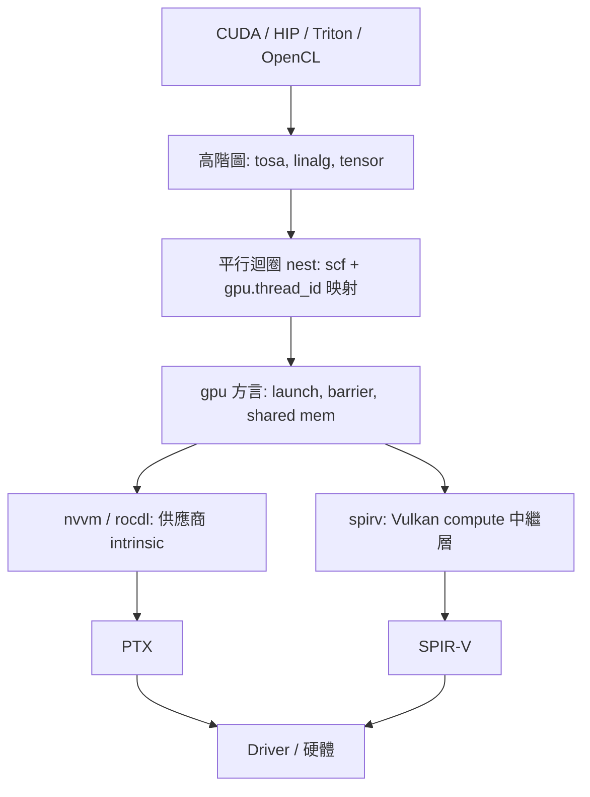

# 9.2 GPU 降階路徑：gpu、nvvm/rocdl、spirv

[9.1](09.1-vector方言.md) 建立了「形狀保留」的向量抽象。但向量只是 CPU 與部分加速器共通的一層；GPU 的執行模型完全不同：它不是「一條執行緒上的 SIMD」，而是「成千上萬個執行緒以 warp 為單位共享記憶體與控制流」。

本節要處理的問題是：**如何用一套 IR 表達這種執行模型，並讓它降階到 PTX、AMDGCN 或 SPIR-V？**

答案分三層：`gpu` 方言描述**執行模型**（thread grid、barrier、shared memory、subgroup）；`nvvm` / `rocdl` 方言描述**供應商特有**的指令級操作（PTX intrinsic、AMD matrix core）；`spirv` 方言則是**跨供應商的中繼層**，讓同一份高階程式碼能編譯成 Vulkan compute 或 OpenCL。

## GPU 執行模型的量化基礎

在寫任何 IR 之前，先把 GPU 的執行參數寫清楚，因為所有抽象都從這裡推導。

一塊 GPU 執行一個 kernel 時：

* **Grid（網格）**：kernel launch 的最外層單位，維度上限通常三維 $(G_x, G_y, G_z)$ ，總 block 數可達數十萬。
* **Block（執行緒區塊）**：一個 block 內的執行緒透過 **shared memory** 與 **barrier** 溝通，並且可以一起被排到同一個 SM 上。block 大小上限通常是 1024（CUDA、HIP 一致）。
* **Warp / Wavefront**：硬體真正同時執行的執行緒群。NVIDIA 為 32 執行_thread，AMD 為 64（wave64）。**同一個 warp 內的執行緒共用同一個 program counter**，這是分支分歧（divergence）的根源。
* **Subgroup / Wave**：跨供應商的通用名稱，指的就是 warp。MLIR 的 `gpu` 方言用 `subgroup` 這個詞。

把三層量化關係列出來：

$$
\text{總執行緒數} = G_x \cdot G_y \cdot G_z \cdot B_x \cdot B_y \cdot B_z
$$

$$
\text{硬體同時執行數} = (\text{每 SM 的 block 數}) \times (\text{每 block 的 warp 數}) \times W
$$

其中 $W$ 是 warp 寬度（32 或 64）。第二個式子遠小於第一個，這就是 GPU 的本質：**它是一台用 gigantic 的執行緒數去換取低單執行緒效能的機器**。

這個數學事實有兩個直接的編譯器後果：

1. **執行緒索引必須是廉價的**。`threadIdx.x` 之類的查詢要能編譯成一次讀取暫存器，而不是去讀記憶體。
2. **block 內的執行緒必須能同步**。因為 shared memory 的正確性依賴「寫入 → barrier → 讀取」的順序，而硬體不保證跨 warp 的執行順序，`barrier` 是**語意要求**，不是優化提示。

## GPU 編譯的分層

從語言前端到目標 ISA，GPU 編譯可以分為四層：

1. **語言前端**：CUDA C++、HIP、OpenCL C、Vulkan compute shader、或者更上層的 Triton、TVM、Mojo。輸出通常是一個「per-thread 的 SSA 函式」加上「launch 資訊」。
2. **高階圖方言**：`tosa`、`stablehlo`（外部）、`linalg`、`tensor`。這一層描述「算子與資料形狀」，完全不見執行緒。
3. **中階**：把高階圖降成**帶 thread 映射的 parallel loop nest**。MLIR 裡這一步由 `scf` / `linalg` 上的轉換加上 `gpu` 方言完成。這是本章的核心。
4. **目標方言**：`nvvm`（NVIDIA）、`rocdl`（AMD）、`spirv`（Vulkan）、`xegpu`（AMD ROCm 實驗路徑）。



注意這張圖裡的**分岔點在 `gpu` 方言**：`gpu` 是「所有 GPU 供應商共通」的抽象，`nvvm` / `rocdl` / `spirv` 是其下的**各自特化**。這個設計的好處是：寫一個 `linalg` 到 `gpu` 的降階 pass，就同時支援了三個後端。

## `gpu` 方言的核心 op

### `gpu.module` 與 `gpu.func`

`gpu.module` 是一個 **module op**（類似 `builtin.module`），把一個或多個 `gpu.func` 聚集起來。`gpu.func` 則是一個函式 op，內部可以包含任意 dialect 的 op。

```mlir
gpu.module @kernels {
  gpu.func @matmul(%a: memref<?x?xf32>, %b: memref<?x?xf32>, %c: memref<?x?xf32>)
      kernel
      attributes {gpu.block_dim = [32, 1, 1]} {
    %tid = gpu.thread_id x
    %bid = gpu.block_id x
    ...
    gpu.return
  }
}
```

`gpu.func` 與 `func.func` 的差異有幾個關鍵點：

* **它是 kernel，不是普通函式**。kernel 沒有明確的參數 ABI——參數是由 host 端透過某種「kernel launch 介面」傳入的（CUDA 是packed struct，Vulkan 是 push constant 或 buffer）。
* **它需要 `gpu.block_dim` 屬性**來宣告 launch 時的 block 大小。這是必要的，因為編譯器要根據 block 維度決定 shared memory 的配置、以及哪些索引映射是 thread-invariant。
* **它用 `gpu.return` 結束**，而不是 `func.return`。

`gpu.module` 上的 `gpu.func` 也可以有 host 端的 helper function（不帶 `kernel` 關鍵字），這在實務上很常見——某些初始化工作希望由單一執行緒做。

### `gpu.launch_func`

在 host 端，啟動 kernel 的 op 是 `gpu.launch_func`：

```mlir
gpu.launch_func gpu.kernel<@kernels::@matmul>
    grid(1, 1, 1) block(256, 1, 1)
    args(%a, %b, %c)
    : memref<?x?xf32>, memref<?x?xf32>, memref<?x?xf32>
```

它的語意是「以指定的 grid 與 block 尺寸啟動 kernel，並傳入這些參數」。

在 LLVM 層，這被降階成對應 runtime API 的呼叫：CUDA 的 `cudaLaunchKernel`、HIP 的 `hipLaunchKernelGGL`，或者在 Vulkan 上是 command buffer 的記錄。

`gpu.launch_func` 在 dialect conversion 中通常由 **`gpu-to-nvvm` / `gpu-to-rocdl`** 系列 pass 處理成「runtime 函式呼叫」，而 `gpu.module` 內部的 `gpu.func` 則被轉成同名的 LLVM 函式。

### 執行緒與 block 索引

四個核心 op：

```mlir
%tx = gpu.thread_id x        // block 內的 thread 索引，0 <= tx < block_dim.x
%ty = gpu.thread_id y
%bx = gpu.block_id x         // grid 內的 block 索引
%by = gpu.block_id y
%dx = gpu.block_dim x        // block 尺寸（此處是編譯期常數）
%dy = gpu.block_dim y
%gx = gpu.grid_dim x         // grid 尺寸
```

要注意語意的細微差別：

* `gpu.thread_id` 是**在 block 內**的索引，範圍是 $[0, \texttt{block\_dim})$ 。
* `gpu.block_id` 是**在 grid 內**的索引。
* 全域執行緒索引是兩者的組合： $\text{global\_id} = \text{block\_id} \cdot \text{block\_dim} + \text{thread\_id}$ 。

`gpu.block_dim` 與 `gpu.grid_dim` 在 `gpu.func` 內是**常數**（因為 `gpu.block_dim` 屬性宣告了 block 尺寸），但 `gpu.grid_dim` 是**執行期值**，因為 grid 尺寸由 host 端在 launch 時決定。

降階到 LLVM dialect 時，這些 op 變成讀取特殊暫存器的 intrinsics：

| `gpu` op | LLVM 對應 |
| --- | --- |
| `gpu.thread_id x` | `llvm.nvvm.read.ptx.sreg.tid.x`（NVVM）或 `llvm.amdgcn.workitem.id.x`（ROCDL） |
| `gpu.block_id x` | `llvm.nvvm.read.ptx.sreg.ctaid.x` / `llvm.amdgcn.workgroup.id.x` |
| `gpu.block_dim x` | 編譯期常數（由 `gpu.block_dim` 屬性推導） |
| `gpu.grid_dim x` | `llvm.nvvm.read.ptx.sreg.nctaid.x` |

這裡可以看出 MLIR 的一個設計模式：**`gpu` 方言提供供應商中立的高階抽象，`nvvm` / `rocdl` 方言提供供應商特定的低階操作，而轉換 pass 負責把前者接到後者上**。

### 記憶體空間

GPU 有多個記憶體空間，它們的**延遲與頻寬差異極大**，因此必須在 IR 中區分。MLIR 用 `memref` 的 memory space 屬性表達：

| 記憶體空間 | 說明 | MLIR 寫法 |
| --- | --- | --- |
| Global | 裝置全域記憶體，由所有 block 共享 | `#gpu.address_space<global>` |
| Shared | block 內共享，由硬體管理 | `#gpu.address_space<shared>` |
| Workgroup / Local | workgroup 內共享（OpenCL 稱 local） | `#gpu.address_space<workgroup>` |
| Private / Constant | 執行緒私有 | `#gpu.address_space<private>` / `<constant>` |

```mlir
func.func @kernel(%a: memref<128xf32, #gpu.address_space<global>>,
                  %out: memref<128xf32, #gpu.address_space<global>>) {
  %smem = memref.alloc(%c128) : memref<128xf32, #gpu.address_space<shared>>
  ...
  memref.dealloc %smem : memref<128xf32, #gpu.address_space<shared>>
}
```

`memref.alloc` 搭配 shared address space，就是「在 shared memory 配置一塊 buffer」。這是 `gpu` 方言最漂亮的設計之一：**它沒有引入專門的 shared memory op，而是複用 `memref` 的型別系統**。因為 shared memory 本質上就是一個生命週期由 block 決定、可被 `memref.alloc` / `memref.dealloc` 管理、可用 `memref.load` / `memref.store` 存取的線性緩衝區。

差别在於 **shared memory 的位址空間由 thread 決定**：在 CUDA 中，每個 thread 看到的是**同一塊** shared memory（因為 block 內執行緒共用 base address），但在 AMD 的某些架構上則是 workgroup 私有。MLIR 把它統一成 block 內共享的語意。

### `gpu.barrier`

```mlir
gpu.barrier
```

語意：block 內所有執行緒在這一點同步。它的**正確性依賴條件**是：所有到達 barrier 的路徑上，執行緒數必須相同。若有執行緒提前 `return`，barrier 會 deadlock（CUDA 上甚至不保證是死鎖，可能是未定義行為）。

因此 GPU 編譯器必須知道**哪些控制流路徑會到達 barrier**。這是一個真實的編譯難題，也是 `gpu` 方言需要 `gpu.conditional_block` 這類結構的原因。

### `gpu.shuffle` 與 warp

`gpu.shuffle` 是 warp 內的資料交換：

```mlir
%v = gpu.shuffle %value, %srcLane, %width, %mode : f32
```

四個參數分別是：要廣播的值、來源 lane 索引、最大參與寬度、模式。

模式有幾種：

* `builtin.shuffle.idx`：每個 lane 指定自己想要的來源 lane（這是最靈活的，語意上像 butterfly exchange）。
* `builtin.shuffle.xor`：**butterfly** 交換，給定一個 mask，lane $i$ 從 lane $i \oplus \text{mask}$ 取值。這是 warp reduction 的標準做法。
* `builtin.shuffle.up` / `builtin.shuffle.down`：相鄰 lane 間的移位。

以 warp 內求和為例，標準的 butterfly reduction 需要 $\log_2 W$ 步（ $W$ 是 warp 寬度，32 則是 5 步）：

$$
s_0 = x, \qquad s_{k+1} = s_k + \text{shuffle\_xor}(s_k, 2^k)
$$

五步之後，每個 lane 都持有完整的總和。這正是 `gpu.shuffle` 存在的理由——**它是 warp 級別的歸約原語**，而 `vector.reduction`（[9.1](09.1-vector方言.md)）處理的是「一條執行緒內的 SIMD 歸約」，兩者是不同層級的東西。

MLIR 還提供 `gpu.subgroup_reduce` 這類更高階的 op（用於 `gpu.subgroup_reduce.add` 等），它是 `gpu.shuffle` 序列的高階表示，讓後端可以挑更好的指令序列。

## 從 `scf` / `linalg` 到 `gpu`：thread 映射

這是 GPU 編譯中最有價值的部分：如何把一個**沒有執行緒概念的**迴圈 nest，變成**每個執行緒做一小塊工作**。

### 問題形式化

給定一個 `scf.for` nest：

```mlir
scf.for %i = %c0 to %M step %c1 {
  scf.for %j = %c0 to %N step %c1 {
    %v = memref.load %A[%i, %j] : memref<?x?xf32>
    memref.store %v, %B[%i, %j] : memref<?x?xf32>
  }
}
```

我們要決定：哪些維度映射到 grid、哪些映射到 block、哪些映射到 thread、以及是否需要 block 內的迴圈。

這個決策的本質是**一個三路分解問題**：把迭代空間 $[0, M) \times [0, N)$ 切成

$$
[0, M) \times [0, N) = \underbrace{[0, G_0) \times \cdots}_{\text{grid}} \times \underbrace{[0, B_0) \times \cdots}_{\text{block}} \times \underbrace{[0, T_0) \times \cdots}_{\text{thread}}
$$

每個維度選擇映射到三者的哪一個。

### 判準

對維度 $d$ （長度 $L_d$ ），選擇映射目標的判準是：

| 目標 | 適合的條件 | 原因 |
| --- | --- | --- |
| thread | $L_d$ 較大，且運算對該維度有連續存取 | 執行緒 ID 取得廉價，且相鄰 thread 存取相鄰記憶體 → coalescing |
| block | $L_d$ 中等 | 提供 block 內共享與同步的機會 |
| grid | $L_d$ 極大，或該維度需要大量資源 | 提供執行緒數的擴展性，且不需要跨 block 溝通 |

**記憶體 coalescing** 是最重要的效能判準。在 NVIDIA 上，一個 warp 的 32 個執行緒若存取連續的 32 個 `float`，會被合併成 4 個 128-bit 的記憶體交易；若存取 32 個相距 1024 bytes 的位址，則是 32 個獨立交易，頻寬利用率掉到 1/32。

因此，一個典型的映射規則是：**讓 thread 索引對應最內側（連續）的維度**。

### 轉換的做法

對最內側維度，映射到 thread 的轉換就是把迴圈的 induction variable 換成 thread id，並加上 block/grid 的基底：

$$
i = \text{block\_id}_x \cdot \text{block\_dim}_x + \text{thread\_id}_x
$$

MLIR 中對應的轉換由 `scf-parallel-loop-collaboration` 與 `gpu-map-block-ids` / `gpu-map-thread-ids` 這類 pass 完成。

一個完整的降階樣例：

```mlir
// 原始：純 scf 迴圈
func.func @axpy(%A: memref<?xf32>, %B: memref<?xf32>, %alpha: f32) {
  %c0 = arith.constant 0 : index
  %c1 = arith.constant 1 : index
  %cM = memref.dim %A, %c0 : memref<?xf32>
  scf.for %i = %c0 to %cM step %c1 {
    %a = memref.load %A[%i] : memref<?xf32>
    %b = memref.load %B[%i] : memref<?xf32>
    %r = arith.mulf %a, %alpha : f32
    %s = arith.addf %r, %b : f32
    memref.store %s, %A[%i] : memref<?xf32>
  }
  return
}
```

降階成 GPU 版本：

```mlir
gpu.module @kernels {
  gpu.func @axpy(%A: memref<?xf32, #gpu.address_space<global>>,
                 %B: memref<?xf32, #gpu.address_space<global>>,
                 %alpha: f32)
      kernel attributes {gpu.block_dim = [64, 1, 1]} {
    %tid = gpu.thread_id x
    %bid = gpu.block_id x
    %bdim = gpu.block_dim x
    %c0 = arith.constant 0 : index
    %c1 = arith.constant 1 : index
    %c64 = arith.constant 64 : index
    %gidx = arith.muli %bid, %bdim : index
    %i = arith.addi %gidx, %tid : index
    %cM = memref.dim %A, %c0 : memref<?xf32>
    %inb = arith.cmpi slt, %i, %cM : index
    scf.if %inb {
      %a = memref.load %A[%i] : memref<?xf32, #gpu.address_space<global>>
      %b = memref.load %B[%i] : memref<?xf32, #gpu.address_space<global>>
      %r = arith.mulf %a, %alpha : f32
      %s = arith.addf %r, %b : f32
      memref.store %s, %A[%i] : memref<?xf32, #gpu.address_space<global>>
    }
    gpu.return
  }
}
```

注意 `scf.if` 的存在：因為 grid 尺寸是執行期才知道的（host 端決定 launch 幾個 block），總執行緒數可能超過資料長度，所以**必須有邊界檢查**。這是 GPU 編譯裡「執行緒映射」與「邊界檢查」兩件事永遠綁在一起的原因。

### `linalg` 到 `gpu`

`linalg` 方言有專門的 GPU 路徑：`linalg` op 可以被 tile 成 tile，然後把 tile 的外部維度映射到 grid/block/thread。

```mlir
// 概念上：把 matmul 的 M, N 維切給 grid/block，K 維留在 block 內
linalg.matmul ins(%a, %b) outs(%c)
```

在實務上，MLIR 的做法是：

1. `linalg` op 轉成 `scf` loop nest（`linalg-to-loops` 或 `linalg-to-parallel-loops`）。
2. `scf` loop nest 透過 thread 映射變成 `gpu` 形式。

但更好的做法是直接用 **`linalg` 的 tile + `gpu` 映射的整合路徑**，避免中間產生大量臨時 tensor。例如一個 tile 大小為 $128 \times 128$ 的矩陣乘法：

* tile 的 $M$ 維切 8 份 → grid.x = 8
* tile 的 $N$ 維切 8 份 → grid.y = 8
* tile 內部 $K$ 維用 block 內迴圈
* tile 內的 M/N 細分給 thread

這會讓 block 內有 $128 \times 128 / 256 = 64$ 次計算，剛好適合一個 block。

### Shared memory 與 tile

有 shared memory 的版本會把 tile 先載入 shared memory，再做內部計算：

```mlir
gpu.func @tiled_matmul(...) kernel attributes {gpu.block_dim = [256, 1, 1]} {
  %smem_a = memref.alloc() : memref<128x128xf32, #gpu.address_space<shared>>
  %smem_b = memref.alloc() : memref<128x128xf32, #gpu.address_space<shared>>
  // 載入 tile
  scf.for %k = %c0 to %c128 step %c1 {
    %t = gpu.thread_id x
    %a = memref.load %A[%i, %k] : memref<?x?xf32, #gpu.address_space<global>>
    memref.store %a, %smem_a[%k, %t] : memref<128x128xf32, #gpu.address_space<shared>>
  }
  gpu.barrier
  // 計算
  scf.for %k = %c0 to %c128 step %c1 {
    ...
  }
  gpu.return
}
```

`gpu.barrier` 在這裡是**必須的**：沒有它，執行緒 A 可能還沒寫完 `smem_a`，執行緒 B 就已經開始讀。這就是 shared memory 排序規則的實踐。

### `scf.parallel` 與 `gpu`

另一條路徑是 `scf.parallel`（[8.1](08.1-scf結構化控制流.md)）：`scf.parallel` 天然帶有「維度列表」的語意，更接近 thread 映射的需要。`scf-parallel-loop-collaboration` 這類 pass 會把 `scf.parallel` 的維度按政策分配給 grid/block/thread。

## `nvvm` 與 `rocdl`：供應商特化的低階層

`gpu` 方言刻意不包含 PTX 或 AMDGCN 特有的東西。原因是：這些東西往往是**效能關鍵但不可移植**的，而且需要精確控制指令序列。

`nvvm` 方言提供 PTX 層級的操作：

```mlir
// 讀取特殊暫存器
%tid = nvvm.read.ptx.sreg.tid.x : i32
%cta = nvvm.read.ptx.sreg.ctaid.x : i32
%clock = nvvm.read.ptx.sreg.clock : i64

// 記憶體存取（帶 cache hint）
%v = nvvm.ld.global.ca.f32 %ptr : !llvm.ptr
nvvm.st.global.cg.f32 %ptr, %v : !llvm.ptr

// warp shuffle
%s = nvvm.shfl.sync.idx.i32 %val, %srcLane, %mask, %segmask

// 矩陣核心（WMMA）
%mma = nvvm.wmma.m16n16k16.row.col.f32.f16.f16.f32 ...
```

`rocdl` 方言則提供 AMD 對應的：

```mlir
%id = rocdl.workitem.id.x : i32
%wg = rocdl.workgroup.id.x : i32
%v = rocdl.load.f32 %ptr : !llvm.ptr
%s = rocdl.ds.swizzle %value, %offset
%m = rocdl.mfma.mf32_16x16x16f16 ...
```

兩者的對應關係是清楚的：

| 抽象 | `nvvm` | `rocdl` |
| --- | --- | --- |
| thread id | `nvvm.read.ptx.sreg.tid.x` | `rocdl.workitem.id.x` |
| block id | `nvvm.read.ptx.sreg.ctaid.x` | `rocdl.workgroup.id.x` |
| warp id | `nvvm.read.ptx.sreg.warpid` | `rocdl.wave.id` |
| shuffle | `nvvm.shfl.sync.*` | `rocdl.ds.bpermute` / `rocdl.ds.swizzle` |
| 矩陣核心 | `nvvm.wmma.*` | `rocdl.mfma.*` |

**降階的接縫**：`gpu` → `nvvm` / `rocdl` 的轉換，就是把 `gpu.thread_id` 換成對應的讀暫存器 op，把 `gpu.shuffle` 換成對應的 shuffle op，把 `gpu.barrier` 換成 `nvvm.barrier0` / `rocdl.s_barrier`。

## SPIR-V：跨供應商的中繼層

SPIR-V 是 Khronos 為 Vulkan、OpenCL、OpenGL compute 定義的標準中間表示。它的定位是：**比 PTX / AMDGCN 更高、但比 `gpu` 方言更接近硬體的中繼層**。

`spirv` 方言提供 `spirv.module`、`spirv.func`、`spirv.EntryPoint`，以及一整套覆蓋 SPIR-V 指令集的 op。

它作為中繼層的價值在於**供應商中立**：一份用 `spirv` 方言寫的 kernel，可以編譯成 NVIDIA 的 SPIR-V → NVVM → PTX，也可以編譯成 AMD 的 SPIR-V → AMDGCN。這在多供應商部署（例如雲端遊戲、跨平台推理）中有實際價值。

```mlir
spirv.module @shader Logical GLSL450 {
  spirv.EntryPoint "Kernel" @main
  spirv.func @main() "None" {
    %gid = spirv.WorkgroupSize %x : i32, i32, i32
    ...
    spirv.Return
  }
}
```

SPIR-V 的一個特點是它比 PTX 更接近「數學運算 IR」：它有 `OpCapability`、`OpMemoryModel`、以及顯式的 storage class（`Uniform`、`Workgroup`、`Function`、`Private`、`CrossWorkgroup`）。這些 storage class 幾乎一一對應 MLIR 的 `gpu` 記憶體空間。

所以 `gpu` → `spirv` 的降階也是一套 storage class 對應：

| `gpu` address space | SPIR-V storage class |
| --- | --- |
| global | `CrossWorkgroup` |
| shared / workgroup | `Workgroup` |
| local (private) | `Function` / `Private` |

## 完整的降階 pipeline

把以上串起來，一條典型的 GPU pipeline 是：

```text
mlir-opt input.mlir \
  --convert-linalg-to-loops \
  --convert-scf-to-cf \
  --gpu-kernel-outlining \
  --gpu-map-block-ids \
  --gpu-map-thread-ids \
  --convert-gpu-to-nvvm \
  --convert-nvvm-to-llvm \
  --convert-arith-to-llvm \
  --convert-func-to-llvm \
  --convert-cf-to-llvm \
  --convert-index-to-llvm \
  --finalize-memref-to-llvm \
  --convert-arith-to-llvm \
  -o gpu.llvm.mlir
```

然後交給 LLVM：

```bash
mlir-translate --mlir-to-llvmir gpu.llvm.mlir -o gpu.ll
llc -march=sm_80 -filetype=asm gpu.ll -o gpu.s
ptxas gpu.s -o gpu.cubin
```

對 AMD：

```text
mlir-opt input.mlir \
  --convert-linalg-to-loops \
  --gpu-kernel-outlining \
  --gpu-map-block-ids \
  --gpu-map-thread-ids \
  --convert-gpu-to-rocdl \
  --convert-rocdl-to-llvm \
  --convert-func-to-llvm \
  -o gpu.llvm.mlir
```

`gpu-kernel-outlining` 這個 pass 值得特別說明：它把 device 端的 kernel 函式**從 host 函式中切出來**，變成一個獨立的 `gpu.module`，並在原處插入 `gpu.launch_func`。這是「一份 IR 同時描述 host 與 device」的 MLIR 風格。

## 一個完整的 `gpu` 方言範例

把上面所有元件組合起來：

```mlir
gpu.module @vecadd_module {
  gpu.func @vecadd(%a: memref<?xf32, #gpu.address_space<global>>,
                   %b: memref<?xf32, #gpu.address_space<global>>,
                   %c: memref<?xf32, #gpu.address_space<global>>)
      kernel attributes {gpu.block_dim = [256, 1, 1]} {
    %tid = gpu.thread_id x
    %bid = gpu.block_id x
    %bdim = gpu.block_dim x
    %base = arith.muli %bid, %bdim : index
    %i = arith.addi %base, %tid : index
    %c0 = arith.constant 0 : index
    %c1 = arith.constant 1 : index
    %n = memref.dim %a, %c0 : memref<?xf32, #gpu.address_space<global>>
    %valid = arith.cmpi slt, %i, %n : index
    scf.if %valid {
      %av = memref.load %a[%i] : memref<?xf32, #gpu.address_space<global>>
      %bv = memref.load %b[%i] : memref<?xf32, #gpu.address_space<global>>
      %r = arith.addf %av, %bv : f32
      memref.store %r, %c[%i] : memref<?xf32, #gpu.address_space<global>>
    }
    gpu.return
  }
}

func.func @host(%a: memref<?xf32, #gpu.address_space<global>>,
                %b: memref<?xf32, #gpu.address_space<global>>,
                %c: memref<?xf32, #gpu.address_space<global>>) {
  %g0 = arith.constant 0 : index
  %n = memref.dim %a, %g0 : memref<?xf32, #gpu.address_space<global>>
  %c256 = arith.constant 256 : index
  %grid = arith.ceildivsi %n, %c256 : index
  gpu.launch_func gpu.kernel<@vecadd_module::@vecadd>
      grid(%grid, %c1, %c1) block(%c256, %c1, %c1)
      args(%a, %b, %c)
      : memref<?xf32, #gpu.address_space<global>>,
        memref<?xf32, #gpu.address_space<global>>,
        memref<?xf32, #gpu.address_space<global>>
  return
}
```

這段程式碼展示了 MLIR GPU 風格的幾個要點：

1. **一份 IR 同時有 host 與 device**：`func.func @host` 是 host 端，`gpu.module` 裡是 device 端。
2. **邊界檢查內建**：因為 grid 大小是執行期值，必須 `scf.if`。
3. **記憶體空間寫在型別裡**：不是寫在 op 上。

## 效能考量與實務陷阱

最後談幾個實務上會遇到的問題。

**grid 尺寸的選擇**。上面的範例用了 `ceildivsi`，這保證「每個元素恰好被處理一次」。但如果資料量很小（例如只有 100 個元素，block 大小 256），就會啟動一個 block，其中 156 個執行緒什麼都不做卻仍佔著資源。更好的做法是讓 host 端根據實際資料量調整。

**shared memory 占用限制**。每個 SM 的 shared memory 容量是有限的（例如 A100 是 164 KB）。若每個 block 都用 128 KB，就只能放一個 block 在 SM 上，occupancy 極低。實務上要同時考慮 shared memory 用量與 block 數。

**warp 分歧**。若同一個 warp 內的執行緒走不同分支，整個 warp 必須串行執行兩條路徑。`gpu.conditional_block` 與「先計算再選取」的風格（把分歧轉成 `arith.select`）是兩種對策。

**寄存器壓力**。unroll 太多會讓每執行緒的寄存器數暴增，導致每 SM 能容納的 block 數下降。GPU 編譯器常需要在 unroll 與 occupancy 之間取捨。

## 小結與延伸閱讀

* GPU 的三層執行模型（grid / block / warp）決定了 IR 抽象：`gpu` 方言用 `gpu.launch_func`、`gpu.thread_id`、`gpu.block_id` 表達前兩層，用 `gpu.shuffle` 與 `gpu.subgroup_reduce` 表達第三層。
* 記憶體空間是 GPU 抽象的核心，`gpu` 方言複用 `memref` 的 address space 機制（`#gpu.address_space<shared>` 等），而不是自創一套 shared memory op。
* 從 `scf` / `linalg` 到 `gpu` 的關鍵是**三路分解**（grid / block / thread），判準是 coalescing 與同步需求；降階後必須補上邊界檢查，因為 grid 尺寸是執行期值。
* `nvvm` 與 `rocdl` 是供應商特化的低階層，負責特殊暫存器讀取、warp shuffle、矩陣核心；`spirv` 則是跨供應商的中繼層，讓同一份 kernel 走 Vulkan 路線。
* GPU 效能不只取決於降階正確性，還取決於 occupancy：shared memory 用量、寄存器數、grid 尺寸選擇與 warp 分歧都是一階因素。

延伸閱讀：

* MLIR 官方文件：`mlir/Dialect/GPU/README.md`、`mlir/Dialect/NVVM/README.md`、`mlir/Dialect/ROCDL/README.md`、`mlir/Dialect/SPIRV/README.md`。
* LLVM 官方文件：`llvm/docs/AMDGPUUsage.rst`、`llvm/docs/NVPTXUsage.rst`。
* Khronos 官方文件：SPIR-V 規範（SPIR-V Specification）與 Vulkan compute 教程。
* 維基百科條目：`Compute unified device architecture`、`HIP (software)`、`Warp scheduler`。
