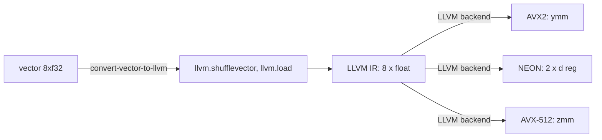

# 9.3 CPU 降階路徑：從高階方言到 llvm 方言與機器碼

[9.1](09.1-vector方言.md) 與 [9.2](09.2-GPU降階路徑.md) 分別走了向量與 GPU 兩條路。本節回到最主流的那條：**CPU 路徑**。

CPU 降階的終點是機器碼，而 MLIR 把它委託給 LLVM 後端。要讓 LLVM 後端能接手，MLIR 必須先把 IR 降到一種「LLVM 能理解、且沒有任何高階資訊遺失」的形式。這個形式就是 **`llvm` 方言**。

本節要回答四個問題：

1. `llvm` 方言為什麼是「LLVM IR 的一一對應」，這個設計的代價與收益是什麼？
2. 高階方言（`func`、`memref`、`scf`、`cf`、`vector`）分別如何降成 `llvm`？
3. 降階的**順序**為什麼重要？
4. `memref` 的 descriptor 如何變成 C 的指標？

## `llvm` 方言的定位

### 一一對應的設計

`llvm` 方言的設計原則異常簡單：**每個 LLVM IR 指令對應一個 MLIR op**。

| LLVM IR | `llvm` 方言 op |
| --- | --- |
| `define i32 @f(i32 %x)` | `llvm.func @f(%x: i32) -> i32` |
| `%p = getelementptr inbounds float, float* %p, i64 %i` | `%p = llvm.getelementptr %p[%i] : (!llvm.ptr, i64) -> !llvm.ptr` |
| `%v = load float, float* %p` | `%v = llvm.load %p : !llvm.ptr` |
| `store float %v, float* %p` | `llvm.store %v, %p : !llvm.ptr` |
| `call i32 @g(i32 %x)` | `%r = llvm.call @g(%x) : (i32) -> i32` |
| `br label %bb1` | `llvm.br ^bb1` |
| `br i1 %c, label %t, label %f` | `llvm.cond_br %c, ^t, ^f` |
| `%v = shufflevector <4 x float> %a, <4 x float> %b, <4 x i32> <i32 0, i32 5, i32 2, i32 7>` | `%v = llvm.shufflevector %a, %b [0, 5, 2, 7] : vector<4xf32>` |
| `@g = global i32 42` | `llvm.mlir.global private constant @g() : i32` |

這個「一一對應」不是巧合，而是刻意的：**MLIR 把 LLVM IR 的型別與指令重新編碼到 MLIR 的 type/attribute/op 系統中**，好處是：

* `mlir-translate --mlir-to-llvmir` 可以做**機械式的**轉換（`mlir::translateToLLVMIR`），不需要理解語意。
* LLVM 後端的既有最佳化（指令選擇、迴圈最佳化、register allocation）完全不用改。

代價則是：**在降到 `llvm` 方言之後，MLIR 層級的所有高階資訊都沒了**。這帶來一個關鍵的工程原則：

> **降到 `llvm` 方言是最後一步，不是第一步。**

### 為什麼不能提早降到 `llvm`

考慮把 `tensor` / `linalg` 直接降到 `llvm`。會發生什麼？

`linalg.matmul` 降成 `llvm` 的唯一出路是：先展開成一堆 `llvm.load` / `llvm.mulf` / `llvm.fadd`。這時所有「這是一個矩陣乘法」的資訊都消失了。LLVM 後端看見的是一個巨大的迴圈 nest，它**或許**能再向量化（LLVM 的 loop vectorizer 有時能认出 matmul 模式），但：

* **佈局資訊（layout）丟失**。`memref` 的 layout 決定了 `memref.load` 對應到什麼樣的位址運算；降成 `llvm` 後 LLVM 只看到一串 GEP，完全不知道哪些位址是「同一個 cache line」。
* **向量化機會被規則化限制**。MLIR 的向量化是在 `scf` / `linalg` 上做的（[8.4](08.4-迴圈變換模式.md)、[9.1](09.1-vector方言.md)），可以自由選擇 tiling 順序、interleave、mask 策略。降到 `llvm` 之後，LLVM 的 loop vectorizer 的選項少得多。
* **合法性分析需要高階資訊**。alias 分析、依賴距離計算，在 `linalg` 的 indexing maps 上做最自然；降成 `llvm` 之後只能靠 LLVM 的 AA（`basic-aa` 等）。

所以正確的降階順序是：

$$
\text{高階圖} \rightarrow \text{平行 / 結構化迴圈} \rightarrow \text{向量 + 記憶體} \rightarrow \text{llvm 方言} \rightarrow \text{LLVM IR} \rightarrow \text{機器碼}
$$

每一層只做一件事，且降階的**時機**由最佳化決策決定，而不是由方言邊界決定。

### 雙向轉換：`convert-to-llvm` 與 `convert-from-llvm`

`llvm` 方言是**雙向**的，這在 MLIR 裡不常見。

* **向下**：`mlir::populateFuncToLLVMConversionPatterns`、`populateMemRefToLLVMConversionPatterns`、`populateSCFToLLVMConversionPatterns` 等，把高階方言降成 `llvm`。
* **向上**：`populateLLVMToLLVMConversionPatterns`（在 `LLVMToLLVMIR` 與 `LLVMIRToLLVM` 兩邊都有），把 `llvm` 方言轉回 `llvm` 方言的**原生形式**。用處是：
  * **LLVM IR round-trip**：`mlir-translate --mlir-to-llvmir` 然後 `--llvmir-to-mlir`，用來測試 MLIR 與 LLVM IR 的相容性。
  * **重組 `llvm` 方言**：把 `llvm` 方言的 op 轉成 MLIR 原生的 `func` / `memref` / `arith`，這是「從 LLVM IR 重新建立高階抽象」的入口。實務上，Rust 的 `rustc` 與 CIRCT 的部分路徑都會做這件事。

`llvm` 方言的 op 在 MLIR 裡定義方式很特別：它們**不是**用 ODS 寫的，而是手寫 C++ 類別（`mlir/Dialect/LLVMIR/LLVMOps.h`），因為它們必須緊密對應 LLVM 的 C++ API 資料結構。ODS 只用於產生文件的輔助描述。

## `llvm` 方言的核心 op 詳解

### `llvm.func`

`llvm.func` 是 `func.func` 的低階對應，但它**多了幾樣東西**：

1. **屬性（attributes）**：ABI 相關的屬性被塞進 op 的 discardable attributes 裡。

```mlir
llvm.func @add(i32 %a, i32 %b) -> i32 attributes {llvm.linkage = #llvm.linkage<external>} {
  %0 = llvm.add %a, %b : i32
  llvm.return %0 : i32
}
```

常見的屬性有 `llvm.linkage`、`llvm.cconv`、`llvm.dllcallingconv`、`llvm.visibility`、`llvm.emit_c_interface`。

2. **`vararg` 屬性**：對應 LLVM 的 `...` 變長引數。

3. **沒有 `sym_visibility` 這種高階概念**：`func.func` 的 `sym_visibility`（public / private / nested）需要被翻譯成 `llvm.linkage`（external / internal / private）。

### `llvm.mlir.global`

全域變數：

```mlir
llvm.mlir.global private constant @counter() : i32
llvm.mlir.global private global @buf() : !llvm.array<10xi8>
```

注意 MLIR 特有的 `!llvm.array<10xi8>` 型別——LLVM IR 裡 `[10 x i8]` 這個型別在 MLIR 中沒有對應的通用型別，所以 `llvm` 方言自己定義了 `LLVM::LLVMPointerType`、`LLVM::LLVMArrayType` 等。

### `llvm.mlir.constant`

LLVM 的 `constant` 指令：

```mlir
%c = llvm.mlir.constant(42 : i32) : i32
%p = llvm.mlir.constant(null) : !llvm.ptr
```

它與 `arith.constant` 的差別在於：`arith.constant` 可以是任意型別的 DenseElementsAttr；`llvm.mlir.constant` 只支援 LLVM 型別系統中的值，且必須是**完全常數**（這是 LLVM IR 的限制）。

### `llvm.getelementptr`

GEP 是 LLVM 中最複雜的指令之一，因為它的語意取決於**來源型別的結構**。

```mlir
%p = llvm.getelementptr %base[%i, %j] : (!llvm.ptr, i64, i64) -> !llvm.ptr
```

MLIR 把它拆解成**明確的結構化形式**：來源型別的「形狀」由 operand 的型別鏈決定，而索引是獨立的 operand。

`llvm.getelementptr` 的 overload 有幾種：

| overload | 語意 |
| --- | --- |
| `getelementptr` | 完整 GEP，索引經過型別結構 |
| `inbounds` | 同上，但宣告不會越界 |
| `none` | 不做 index scaling |

在 MLIR 裡，**struct 與 array 的索引處理被特別對待**：

```mlir
// %s: !llvm.ptr to !llvm.struct<"foo", (i32, i64)>
// 取第一個欄位
%f0 = llvm.getelementptr %s[0, 0] : (!llvm.ptr, i32, i32) -> !llvm.ptr
```

MLIR 規定：struct 索引與 array 索引的區分，透過「index 是否為常數 0 且型別鏈中有 struct」來表達。這個規則有點微妙，但避免了 GEP 指令在 LLVM 中的 type-index 交錯結構。

### `llvm.load` / `llvm.store`

```mlir
%v = llvm.load %p {alignment = 4} : !llvm.ptr -> f32
llvm.store %v, %p {alignment = 4} : f32, !llvm.ptr
```

注意 `llvm.load` 的型別是 `!llvm.ptr`（**不透明指標**），而元素型別是**由 op 的回傳型別推導**。這與 LLVM IR 的 `load float, float* %p` 在資訊量上等價（LLVM 中 pointer type 決定 element type，MLIR 中則由 result type 決定）。

`llvm.ptr` 是**不透明指標**（opaque pointer）— LLVM 15 之後，LLVM IR 全面採用 opaque pointer，MLIR 的 `llvm` 方言也跟上了這個改變。

### `llvm.call` / `llvm.invoke`

```mlir
%r = llvm.call @printf(%fmt, %arg) : (!llvm.ptr, i32) -> i32
```

變長引數需要特殊的處理：MLIR 用 `llvm.call` 的 operand 型別 `!llvm.struct<(i32, ...)>` 或 `!llvm.vararg` 來表達。實際上，MLIR 提供了 `llvm.vararg` 型別來表達 C 的 varargs。

### `llvm.br` / `llvm.cond_br` / `llvm.switch`

```mlir
llvm.br ^bb1(%arg : i32)
llvm.cond_br %c, ^bb1, ^bb2
llvm.switch %v : i32, ^default [ 0: ^bb0, 1: ^bb1 ]
```

`llvm` 方言的分支是**顯式**的（不像 `cf` 有 `cf.cond_br` 那樣帶 `^bb` 的顯式區塊參數，但兩者概念相同）。

## `func` → `llvm.func`：ABI 的處理

`func.func` 與 `llvm.func` 的最大差異是 **ABI（calling convention）**。

`func.func` 的呼叫慣例是**未指定**的：

```mlir
func.func @f(%a: i32, %b: memref<?xf32>) -> i32 {
  return %a : i32
}
```

降成 `llvm.func` 時，必須決定：

1. **memref 怎麼傳？** 由 descriptor（structure of arrays）展開成多個指標？還是用 `byval` 傳一個指標？
2. **回傳值怎麼傳？** `memref` 不能直接回傳。
3. **varargs 怎麼處理？**

MLIR 的預設策略由 `mlir::LLVMTypeConverter` 決定，而這個策略是**可設定的**。這是 `llvm` 方言轉換框架最重要的一個設計點。

### MemRef 的三種展開模式

`LLVMTypeConverter` 對 memref 提供三種 conversion：

**模式 A：unranked/descriptor 展開成多個參數（"expanded"）**

一個 `memref<2x?xf32>` 展開成：

```mlir
llvm.func @f(%base: !llvm.ptr, %offset: i64, %s0: i64, %s1: i64) -> ...
```

這是 AOSP 的 `descriptor2pointer` 風格，把 descriptor 攤平成一串參數。

**模式 B：descriptor 以 byval 傳遞**

```mlir
%desc = ... : !llvm.struct<(ptr, i64, i64, i64)>
llvm.call @f(%desc) : (!llvm.ptr) -> i32
```

**模式 C：descriptor 留在記憶體，但以一個不透明指標傳遞**

這是 C++ ABI 的做法（`std::span` / `MemRefDescriptor`），descriptor 是個 stack 上的 struct，指針指向它。

MLIR 的 `LLVMTypeConverter` 預設是**模式 B 加上 expanded 的混合**，具體由 `convertFuncOptions` 的幾個旗標控制：`useBarePtrCallConv`、`useTypedPointers`、`indexBitwidth`、`dataLayout` 等。

### 產生 byval 的方式

若選擇 byval 模式，轉換需要**建立一個 stack slot**：

```mlir
// 原始
func.func @f(%a: memref<?xf32>) { ... }

// 降階後（byval 風格）
llvm.func @f(%arg0: !llvm.ptr) {
  %slot = llvm.alloca %c1 x i64 : (i64) -> !llvm.ptr
  %desc = llvm.getelementptr %slot[0] : (!llvm.ptr, i32) -> !llvm.ptr
  llvm.store %base, %desc : !llvm.ptr, !llvm.ptr
  ...
  llvm.return
}
```

這個「建立 stack slot、填入 descriptor、傳指標」的序列，就是 memref → pointer 轉換的核心工作。

### Variadic 函式

`func.func` 的 `variadic` 屬性在 `llvm` 方言裡對應 LLVM 的 varargs。MLIR 的處理方式是：variadic 函式的參數用 `!llvm.struct<(i32, ...)>` 這種型別包裝，或在 `llvm.call` 上用 `!llvm.vararg` 型別的 operand。

## `memref` → `llvm`：descriptor 的命運

`memref` 降到 `llvm` 是最需要仔細看的轉換，因為它牽涉到 **descriptor 的內部結構**。

### Descriptor 的結構

一個 rank- $r$ 的 strided memref，在 MLIR 內部由以下部分構成：

| 欄位 | 型別 | 說明 |
| --- | --- | --- |
| allocated pointer | `!llvm.ptr` | 配置的基底 |
| aligned pointer | `!llvm.ptr` | 對齊後的基底 |
| offset | `i64` | 起點偏移 |
| sizes | `i64` × $r$ | 各維長度 |
| strides | `i64` × $r$ | 各維步幅 |

在 `builtin` 中，descriptor 是一個 `MemRefType` 的內部屬性；在 `llvm` 方言中，它被表示成 `!llvm.struct<(ptr, ptr, i64, i64, ...)>`，或透過 `llvm.extract_value` / `llvm.insert_value` 逐欄存取。

### 降階的兩條路

**路徑 1：保留 descriptor（byval / expanded）**

優點是資訊完整（size、stride 都在），缺點是每次存取都要從 descriptor 讀 stride，增加指令數。

**路徑 2：descriptor 降成裸指標（bare pointer）**

若 memref 是**連續且從 offset 0 開始**（`strided` layout 但 stride 全部等於相鄰維 size 的乘積），則 descriptor 可以被**完全丟棄**，只用一個 `!llvm.ptr`。這就是 `useBarePtrCallConv` 的效果。

判斷條件可以形式化為：對 rank- $r$ 的 memref，其第 $i$ 維的 stride 必須滿足

$$
\text{stride}_i = \prod_{j=i+1}^{r-1} \text{size}_j
$$

（以列-major 為例）。這個條件在 `isStridedContiguous` 這類 helper 中被檢查。

這是一個重要的優化：**連續 memref 是最常見的情況**，把它降成裸指標可以省掉大量 descriptor 存取。

### `memref.load` 的降階

```mlir
// 原始
%v = memref.load %A[%i, %j] : memref<?x?xf32>
```

降成 `llvm`（bare pointer 模式）：

```mlir
%base = llvm.extractvalue %arg0[0] : !llvm.struct<(ptr, i64, i64, i64)>  // 或直接是 base
%off  = llvm.extractvalue %arg0[1] : ...
%s1   = llvm.extractvalue %arg0[3] : ...
%idx  = llvm.muli %j, %s1 : i64
%idx2 = llvm.addi %idx, %i : i64
%ptr  = llvm.getelementptr %base[%idx2] : (!llvm.ptr, i64) -> !llvm.ptr
%v    = llvm.load %ptr : !llvm.ptr -> f32
```

在 **strided / dynamic 形式**下，`memref.load` 降成 `llvm.load` + 一串 GEP 運算；在 **identity layout 且 contiguous** 下，GEP 可以簡化為單一的線性索引。

### `memref.subview` / `memref.reinterpret_cast` / `memref.view`

這幾個 op 的降階各有難點：

* `memref.subview` — 產生**新的 descriptor**（新的 offset、新的 sizes/strides），因此必須建立一個新的 stack slot 或用 `llvm.insertvalue` 逐欄構造。
* `memref.reinterpret_cast` — 改變 shape/stride 檢視，改變 offset。
* `memref.view` — 把一塊平坦記憶體重新解讀成 strided memref，需要 `llvm.alloca` + 填 descriptor。

這些 op 在 MLIR 中對 descriptor 的處理，是「memref 到 LLVM 轉換」中最容易出 bug 的地方，也因此 MLIR 有專門的 `memref-to-llvm` 測試覆蓋各種 layout 組合。

## `scf` / `cf` → `llvm`

### `scf` → `cf` → `llvm`

`scf`（結構化控制流）的降階有兩種策略：

**策略 A：完全展開（`--convert-scf-to-cf`）**

`scf.for` 變成一組 `cf` 分支 + block argument。優點是 `cf` 的區塊結構直接對應 LLVM 的基本區塊。缺點是**迴圈變成 if-then-else 鏈**，LLVM 的迴圈最佳化需要再把它認出來（LLVM 有 `LoopSimplify` / `LCSSA` 這類 pass 可以做到，但多花時間）。

**策略 B：保留迴圈（`--convert-scf-to-llvm` 的 `convert-arith-to-llvm` 風格）**

MLIR 的 `scf` 到 `llvm` 轉換裡，`scf.for` 會被轉成 **LLVM 風格的迴圈結構**：一個 header block 帶一個 phi-like 的 block argument，加上 body 與 latch。這個形式 LLVM 能直接認出是迴圈。

```mlir
// scf.for 降階後的典型形狀
llvm.br ^header
^header(%iv: i64):
  %c = llvm.icmp slt, %iv, %n : i64
  llvm.cond_br %c, ^body, ^exit
^body:
  ...
  %iv_next = llvm.addi %iv, %step : i64
  llvm.br ^header(%iv_next : i64)
^exit:
  llvm.return
```

實務上，`--convert-scf-to-cf` 之後接 `--convert-cf-to-llvm` 是最常見的組合。

### `cf` → `llvm`

`cf` 方言直接對應 LLVM 的基本區塊與分支：

```mlir
cf.br ^bb1
cf.cond_br %c, ^bb1, ^bb2
cf.switch %v : i32, ^default [ 0: ^bb0 ]
```

`cf` → `llvm` 幾乎是一對一的，因為兩者的 CFG 表達方式幾乎相同。差別在於 `cf` 用 `cf.br`（帶 `^bb` 引用）而 `llvm` 用 `llvm.br`（block argument 傳參）。

### `arith` → `llvm`

`arith` 是最機械的一層：

```mlir
%c = arith.constant 42 : i32     →  %c = llvm.mlir.constant(42 : i32) : i32
%a = arith.addi %x, %y : i32     →  %a = llvm.add %x, %y : i32
%b = arith.cmpi slt, %x, %y : i32 → %b = llvm.icmp slt, %x, : i32
%d = arith.divui %x, %y : i32    →  %d = llvm.udiv %x, %y : i32
%e = arith.select %c, %a, %b : i32 → %e = llvm.select %c, %a, %b : i32
```

注意 `arith.cmpi` 與 `llvm.icmp` 的 predicate 命名幾乎相同（`slt`、`ult`、`eq` …），所以轉換是簡單的映射表。

## 一條完整的 pipeline

把上述所有東西串起來，一條 CPU pipeline 的樣子：

```text
mlir-opt input.mlir \
  --canonicalize \
  --cse \
  --convert-linalg-to-affine-loops \
  --affine-loop-normalize \
  --affine-scalrep \
  --lower-affine \
  --convert-scf-to-cf \
  --memref-expand-strided-metadata \
  --expand-strided-metadata \
  --convert-arith-to-llvm \
  --convert-index-to-llvm \
  --finalize-memref-to-llvm \
  --convert-func-to-llvm \
  --convert-cf-to-llvm \
  --reconcile-unrealized-casts \
  -o out.llvm.mlir

mlir-translate --mlir-to-llvmir out.llvm.mlir -o out.ll
llc -O3 -march=native -filetype=asm out.ll -o out.s
```

順序的每一步都有理由：

1. `canonicalize` / `cse` — 早期清理，讓後續 pattern 更容易匹配。
2. `convert-linalg-to-affine-loops` — 把結構化 op 展開成 affine 迴圈。
3. `lower-affine` — 把 affine 迴圈降成 `scf`。
4. `convert-scf-to-cf` — 結構化控制流降到區塊圖。
5. `expand-strided-metadata` — 執行期才知道的 stride 被**展開成 if-else 鏈**（這一步可能產生大量程式碼，實務上要小心）。
6. `convert-arith-to-llvm` / `convert-index-to-llvm` — 算術降到 LLVM 指令。
7. `finalize-memref-to-llvm` — memref 降到裸指標或 byval descriptor。
8. `convert-func-to-llvm` — 函式降到 LLVM 函式（處理 ABI）。
9. `reconcile-unrealized-casts` — 清理轉換過程中殘留的 cast。

**注意順序不能隨意調換**：`finalize-memref-to-llvm` 必須在 `convert-func-to-llvm` 之前，因為後者要決定 memref 的 ABI 展開方式，而前者依賴那個決定。

## `llvm` 方言到 LLVM IR

最後一步是 `mlir-translate`：

```bash
mlir-translate --mlir-to-llvmir out.llvm.mlir -o out.ll
```

這個轉換是 `mlir::translateModuleToLLVMIR`，它做幾件事：

1. 把 `llvm` 方言的 op 轉成 LLVM C++ API 的 `llvm::Instruction`。
2. 建立 `llvm::Module`、函式簽章（`llvm::FunctionType`）。
3. 處理 `llvm.mlir.global` → `llvm::GlobalVariable`。
4. 建立 metadata（`!llvm.metadata`）。
5. 設定 target triple 與 data layout。

由於 `llvm` 方言與 LLVM IR 一一對應，這個轉換是**機械的**，不需要任何語意分析。

## 從 `llvm` 方言回到高階：`--convert-from-llvm`

反方向也有意義：

```text
mlir-opt llvm..mlir \
  --convert-func-to-llvm \
  --unrealized-conversion-cast
```

更實用的是 `llvm` → 原生 MLIR 的一組轉換（`populateLLVMToLLVMConversionPatterns` 的另一個方向），它能把 `llvm` 方言重建為 `func` / `memref` / `arith`。這在做以下事情時有用：

* 從既有的 LLVM IR 匯入，再用高階 pass 最佳化（**LLVM-based MLIR 工具鏈的入口**）。
* 驗證 MLIR 與 LLVM 的相容性（round-trip 測試）。

## 向量到 x86 AVX / ARM NEON 的路徑

[9.1](09.1-vector方言.md) 提過 `vector` 有兩條降階路。這裡把 CPU 這條講完整。

### 路徑一：全部走 `llvm`



好處：簡單、LLVM 負責一切。
壞處：MLIR 層級失去對 shuffle pattern 的控制，只能靠 LLVM 的 SelectionDAG 來認。

### 路徑二：走目標方言

`arm_neon` 方言保留 NEON 指令的語意（lane 順序、intrinsic 行為），能產生比 LLVM 更精確的 NEON 程式碼：

```mlir
%v = arm_neon.ld1 %p : vector<4xf32>
%w = arm_neon.fadd %v, %v : vector<4xf32>
%s = arm_neon.addp %w, %w : vector<4xf32>
```

`arm_sve` 方言則對應 scalable 向量。

**實務上的選擇**：若目標是 x86，直接走 `llvm` 路徑通常足夠，因為 LLVM 的 x86 後端非常強。若目標是 ARM 且要榨出 NEON 效能，用 `arm_neon` 方言能得到更好的結果。

### 一個關於「過早降階」的實例

考慮 `linalg.matmul` 在 `memref` 上的版本。兩種降階順序的結果：

| 順序 | 結果 |
| --- | --- |
| 先降到 `llvm` 再讓 LLVM 向量化 | LLVM 需要從 1000 行的迴圈裡重新認出 matmul；可能成功，可能產生次佳的 tiling |
| 先在 MLIR 做 tiling + packing + 向量化，再降到 `llvm` | 明確的 tile 結構，MLIR 已經排好資料順序，`llvm` 只是逐條翻譯 |

這就是 MLIR 存在的核心理由之一：**把最佳化決策放在資訊最豐富的那一層做**。在 `linalg` 層做 tiling 時，編譯器知道索引對應關係（indexing maps）；降到 `llvm` 之後這些資訊已經被沖刷成位址運算。

## 一個完整的 CPU 端到端範例

從高階到 `llvm` 方言：

```mlir
// 原始
func.func @sum(%A: memref<16xf32>) -> f32 {
  %c0 = arith.constant 0 : index
  %c1 = arith.constant 1 : index
  %c16 = arith.constant 16 : index
  %f0 = arith.constant 0.0 : f32
  %acc = scf.for %i = %c0 to %c16 step %c1 iter_args(%a = %f0) -> f32 {
    %v = memref.load %A[%i] : memref<16xf32>
    %s = arith.addf %a, %v : f32
    scf.yield %s : f32
  }
  return %acc : f32
}
```

降到 `llvm` 方言（bare pointer 連續 memref）：

```mlir
llvm.func @sum(%arg0: !llvm.ptr) -> f32 {
  %c0 = arith.constant 0 : index
  %c1 = arith.constant 1 : index
  %c16 = arith.constant 16 : index
  %f0 = arith.constant 0.0 : f32
  %r0 = scf.for %i = %c0 to %c16 step %c1 iter_args(%a = %f0) -> f32 {
    %v = llvm.load %arg0[%i] : !llvm.ptr -> f32
    %s = llvm.fadd %a, %v : f32
    scf.yield %s : f32
  }
  llvm.return %r0 : f32
}
```

再降到純 `llvm` 方言（`scf` 已被展開）：

```mlir
llvm.func @sum(%arg0: !llvm.ptr) -> f32 {
  %f0 = llvm.mlir.constant(0.0 : f32) : f32
  llvm.br ^bb1(%f0 : f32)
^bb1(%acc: f32):
  %iv = llvm.mlir.constant(0 : i64) : i64
  %v = llvm.load %arg0[%iv] : !llvm.ptr -> f32
  %s = llvm.fadd %acc, %v : f32
  %iv.next = llvm.addi %iv, %c1_i64 : i64
  %cmp = llvm.icmp slt, %iv.next, %c16_i64 : i64
  llvm.cond_br %cmp, ^bb1(%s : f32), ^bb2
^bb2:
  llvm.return %s : f32
}
```

最後是 `mlir-translate` 的輸出（LLVM IR）：

```llvm
define float @sum(ptr %arg0) {
entry:
  br label %loop

loop:
  %iv = phi i64 [ 0, %entry ], [ %iv.next, %loop ]
  %acc = phi float [ 0.000000e+00, %entry ], [ %s, %loop ]
  %v = load float, ptr %arg0, align 4
  %s = fadd float %acc, %v
  %iv.next = add nuw nsw i64 %iv, 1
  %cmp = icmp slt i64 %iv.next, 16
  br i1 %cmp, label %loop, label %exit

exit:
  ret float %s
}
```

這個對照說明了一件事：**`llvm` 方言與 LLVM IR 的結構幾乎相同**，這是設計目標，不是巧合。

## 小結與延伸閱讀

* `llvm` 方言的設計原則是「LLVM IR 的一一對應」，好處是 `mlir-translate --mlir-to-llvmir` 可以機械式轉換、代價是高階資訊全部流失，因此**降到 `llvm` 必須是最後一步**。
* `func` → `llvm.func` 的核心是 ABI 決策：`LLVMTypeConverter` 以可設定的方式決定 memref 是展開成多參數、以 byval 傳 descriptor、還是在連續情況下降成裸指標；variadic 與 linkage 則由屬性承載。
* `memref` → `llvm` 的核心是 descriptor 欄位（allocated/aligned pointer、offset、sizes、strides）如何被逐欄存取或直接丟棄；`expand-strided-metadata` 把執行期 stride 展開成 if-else 鏈，是常見的程式碼膨脹來源。
* 降階順序有硬性依賴：`finalize-memref-to-llvm` 依賴 `convert-func-to-llvm` 的 ABI 決定；`scf` 必須在 `cf` 之後降；`reconcile-unrealized-casts` 最後清理。
* 向量化有 `convert-vector-to-llvm` 與目標方言（`arm_neon` / `arm_sve`）兩條路；前者簡單，後者在 ARM 上通常更優。

延伸閱讀：

* MLIR 官方文件：`mlir/Dialect/LLVMIR/README.md`、`mlir/Conversion/` 下的 `MemRefToLLVM`、`FuncToLLVM`、`SCFToControlFlow`、`ArithToLLVM` 轉換原始碼。
* LLVM 官方文件：`llvm/docs/LangRef.rst`（LLVM IR 語言參考）、`llvm/docs/MemorySSA.rst`、`llvm/docs/Vectorizers.rst`。
* MLIR 官方文件：`mlir/Dialect/MemRef/README.md`（`memref` 到 LLVM 的 descriptor 對應表）。
* 維基百科條目：`Calling convention`、`System V ABI`。
