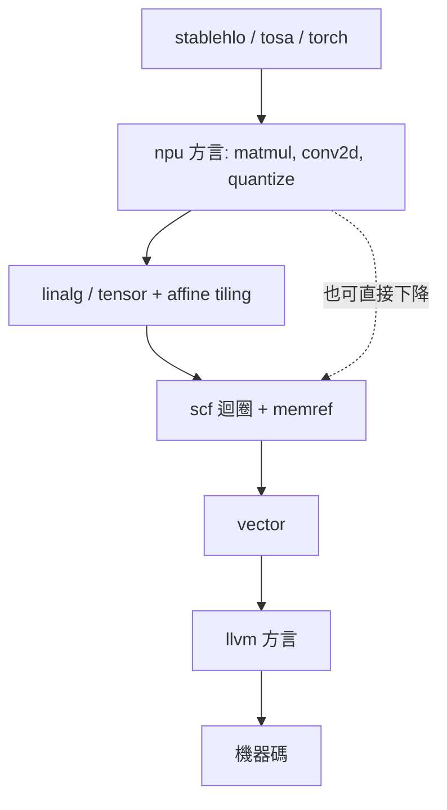

# 10.1 從零打造自訂 Dialect：抽象層級設計

[第 9 章](09.3-CPU降階路徑與llvm方言.md) 走完了三條降階路：向量、GPU、CPU。從這一章開始，議題反轉——我們不再是 IR 的消費者，而是 **IR 的生產者**：要設計一個全新的方言，讓自己的硬體或演算法能被編譯。

本章的目標不是「教會你怎麼寫 TableGen」（那是 [10.2](10.2-TableGen規格與C++實作.md) 與 [10.3](10.3-Verifier與自訂Pass.md) 的事），而是回答一個更難的問題：

> **在多層 IR 的階梯上，我的方言應該站在哪一階？**

這個問題回答錯了，後面寫多少 C++ 都沒用——因為 IR 的抽象層級決定了「哪些最佳化還有機會」，也決定了「你的方言是否會被其他方言吃掉」。

## 貫穿全章的範例方言：`npu`

為了讓討論具體，本章設計一個假想的 **`npu` 方言**，描述一款張量加速器（Neural Processing Unit）。它有下列硬體特性：

* 以「張量 tile」為工作單位，支援 `matmul`、`conv2d`、`relu`、`add`。
* 內部有專用的 on-chip SRAM。
* 支援 int8 與 int16 量化運算。
* 有自己的 DMA 引擎與多核排程。

我們要從零設計 `npu` 方言，並在 [10.4](10.4-測試與mlir-opt整合.md) 為它寫測試。

### 起始問題：為什麼不用現成的方言

在設計之前，先誠實地問：**為什麼不直接用 `linalg` + `tosa` + `tensor`？**

答案是「有時候真的不需要」。但如果我們的加速器有 `linalg` 無法表達的東西，就值得自訂：

* **量化語意**：`linalg` 沒有內建的「scale / zero-point」量化型別，而 NPU 的 int8 運算核心要求量化參數在編譯期就綁定。
* **硬體特有的排程限制**：NPU 只有 4 個 DMA channel，同時最多 4 個 tile 可以被搬運。這是一個**資源限制**，需要表達。
* **片上 SRAM 的一次性特徵**：某些權重必須常駐 SRAM。

這些都是**真正的、不能用通用抽象表達**的約束。設計方言的理由應該是「我要表達通用 IR 表達不了的東西」，而不是「我要有一個自己的方言」。

## 抽象層級：先決定站在哪一階

### 多層 IR 的階梯

把常見的 IR 層次排出來（由高到低）：

| 層級 | 代表 | 特徵 |
| --- | --- | --- |
| 圖 / 計算圖 | `stablehlo`、`tosa`、`linalg` | 描述「什麼資料流向哪裡」，完全沒有程式控制流 |
| 結構化迴圈 | `scf`、`affine` | 有結構化的迭代，有明確的索引語意 |
| 低階 IR | `llvm` | 接近機器碼，SSA + 基本區塊 |
| 指令集 | x86 / ARM / PTX | 具體指令與暫存器 |

方言可以落在這些層之間的**任何位置**。選擇的判準是：**你希望哪一層的資訊在降階時被保留到最後？**

### 判準一：資訊保留

假設 NPU 的 `matmul` op 有以下資訊：

* 輸入輸出形狀（ $M \times K$ 、 $K \times N$ 、 $M \times N$ ）
* 量化參數（scale、zero-point）
* 目標 SRAM tile 大小
* 是否使用累積器

如果方言站在**圖層**（像 `linalg`），這些資訊以 op 的 operand 與屬性形式存在，可以被高階最佳化看到與改寫。

如果方言站在**低階**（像 `llvm`），資訊會被沖刷成位址運算與數值運算，量化參數變成常數乘法。

### 判準二：誰來做最佳化

方言設計的一個隱含問題是：**你打算自己寫最佳化，還是把最佳化交給 MLIR 的通用機制？**

如果方言站在圖層，你可以重用 `linalg` 的 fusion、`tensor` 的 canonicalization、多面體的 tiling。若站在低階，你得自己重寫所有東西。

### 判準三：可組合性

如果你的方言能與其他方言「和平共處」（你的 op 可以被 bufferization、`linalg` fusion 等通用 pass 處理），設計就成功了一半；若它是一個「牆」，任何跨方言最佳化都失效。

### `npu` 的落點決定

我們的決定：

> `npu` 方言站在**圖層與結構化迴圈層之間**，語意上接近 `linalg`，但攜帶 NPU 專有的量化與資源資訊。

理由：

1. `matmul` / `conv2d` 是**高階運算**，有明顯的迭代空間語意，適合放在圖層。
2. 量化參數是**編譯期已知的常數**，屬於 op 的屬性而非 operand。
3. SRAM tile 大小與 DMA channel 數量是**目標資源限制**，屬於 op 的屬性或模組層級的屬性。
4. 我們**不**在 `npu` 方言中表達「迴圈」——那是 `scf` 的事。`npu.matmul` 是一個原子 op，內部結構由後端的 lowering 決定。



這張圖說明 `npu` 是一個**可選擇的旁路**：它可以先降到 `linalg`（走通用最佳化路線），也可以直接降到 `scf`/`memref`（走快速路線）。

## 語意邊界：什麼是屬性、什麼是 operand

這是方言設計中**最容易出錯**的地方。搞錯了會導致：常數折疊不能做、CSE 不正確、canonicalization 失效、甚至轉換 pass 無法正確重寫。

### 判準

| 資訊 | 應該放在 | 理由 |
| --- | --- | --- |
| 計算過程中會被用到的**值** | operand | 值的來源決定資料流；必須可被 CSE、DCE、canonicalize |
| **形狀** | operand 的型別 | 形狀改變時 op 的語意改變 |
| **恆為常數**且影響 codegen 的量 | attribute | 屬性可被摺疊、可以當快取 key |
| **目標資源限制** | attribute 或 module 屬性 | 影響排程，不影響資料流 |
| **可變的執行期參數** | operand | 例如動態的 batch size |

### 具體決策

`npu.matmul` 的 operand 與屬性：

```mlir
// 形狀透過 operand 的型別表達
%npu.matmul ins(%a, %b) outs(%c) : tensor<128x256xf16, #npu.q<scale=0.5, zp=0>>
```

在這個設計裡：

* `a`、`b`、`c` 是 operand（它們的值會影響結果，必須進資料流）。
* 量化參數 `scale=0.5, zp=0` 是**型別的一部分**（一個 `#npu.q` type），因為量化參數改變就代表**這個值是不同的數值**。把它放在 operand 屬性裡會是錯的：兩個量化參數不同但值相同的 operand 會被 CSE 誤合併。
* tile 大小是 **module 層級屬性**（`gpu.module` 上宣告 NPU 的拓撲），而不是 op 屬性。

### 一個反例

若把量化參數放在 op 屬性：

```mlir
// 錯誤設計
%npu.matmul ins(%a, %b) outs(%c) {scale = 0.5 : f32} : tensor<128x256xf16>
```

問題：`%a` 這個 operand 在兩處出現但量化參數不同時，CSE 會誤以為它們相同。若量化參數放在型別裡，CSE 比較型別時就會區分開。這就是 MLIR 的「**值即型別**」傳統。

## 可組合性：原子 op 還是帶 region 的 op

這是第二個核心設計問題，也往往是方言設計中影響最深的一個。

### 選項 A：原子 op

```mlir
%npu.matmul ins(%a, %b) outs(%c) : tensor<128x256xf16>
```

`matmul` 是一個黑盒子：內部做了什麼（tiling？packing？循環 nest？）完全不可見。

**優點**：

* 語意清晰、verifier 簡單。
* 適合「這件事只有我的硬體知道怎麼做」的情況。
* 容易對接硬體手寫的核心（fixed-function engine）。

**缺點**：

* **後端無法再優化內部**。若不同場景需要不同 tiling，必須在方言層寫很多變體。
* 通用 pass 無法穿透（例如 `linalg` 的 fusion 對 `npu.matmul` 視而不見）。
* 若加速器其實是「可程式化」的（能跑任意迴圈），原子 op 就是資訊損失。

### 選項 B：region 內的循環 nest

```mlir
%npu.matmul ins(%a, %b) outs(%c) {
^bb0(%i: index, %j: index, %k: index):
  %av = npu.load %a[%i, %k] : tensor<128x256xf16>
  %bv = npu.load %b[%k, %j] : tensor<256x128xf16>
  %acc = npu.macc %acc, %av, %bv : ...
  ...
}
```

**優點**：

* 內部結構可被高階 pass 最佳化（tiling、fusion、unroll、vectorization）。
* 可以精確指定 NPU 特有的排程（哪個維度給哪個硬體單元）。
* 與 `scf` / `linalg` 的既有最佳化相容。

**缺點**：

* 方言變複雜（要定義 region 的語意、block argument 的約定）。
* 硬體若不能接受任意結構，需要後端做合法性檢查。
* 對編譯器作者要求高。

### 選項 C：混合——`npu` 提供「帶 region 的 matmul」

實務上的最佳解往往是：

```mlir
// 高階：原子 op，給不需要內部細節的場景
%npu.matmul ins(%a, %b) outs(%c) : tensor<128x256xf16>

// 進階：region 版本，給需要控制內部排程的場景
%npu.matmul_region ins(%a, %b) outs(%c) {
  ...
}
```

或者更漂亮的做法：**同一個 op，region 是可選的**。

```mlir
// 原子形式
%npu.matmul ins(%a, %b) outs(%c) : tensor<128x256xf16>

// region 形式：同一個 op，但帶了 region
%npu.matmul ins(%a, %b) outs(%c) {
^bb0(...):
  ...
}
```

在 MLIR 中，一個 op 可以有**可選的 region**（用 `OptionalRegion` 或 `VariadicRegion`），但這會讓 verifier 與 builder 變複雜。實務上更常見的是拆成兩個 op。

### 我們的決策

我們採取**兩個 op**的策略：

| op | 用途 | 降階目標 |
| --- | --- | --- |
| `npu.matmul` | 原子形式，交給硬體的 fixed-function 引擎 | 直接降到 NPU 指令序列 |
| `npu.matmul_looped` | region 形式，內部是 `scf` 迴圈 | 降到 `scf` → NPU 排程器 |

並提供一個 pass `npu-expand-matmul`，把 `npu.matmul` 展開成 `npu.matmul_looped`（當硬體是 general-purpose core 時用），或反過來把 `npu.matmul_looped` 折疊成 `npu.matmul`（當硬體有專用引擎且 region 恰好匹配引擎能力時）。

這個設計的好處是：**使用者不需要一開始就知道要用哪種形式**，因為有一個 canonicalization pass 可以在它們之間轉換。

### 判準：怎麼決定

一個實用的判準是問：

> **這件事的內部結構，是「所有實例都一樣」，還是「因場景而異」？**

* 若**所有實例的內部結構都一樣**（例如每個 `matmul` 都是固定 128x64 tile 的 4x4 微kernel），那內部結構就是**冗餘資訊**，應該用原子 op（資訊損失為零）。
* 若**內部結構會依場景而變**（tile 大小、資料佈局、是否用 DMA），那應該用 region 形式或把它外部化成屬性。

## 與既有方言的邊界

**不要重複 `linalg` 的功能。** 這是最重要的告誡。

判斷標準：**如果一個 `linalg` op 加上「幾個屬性」就能表達你的需求，那你就用 `linalg` 加屬性，不要新造 op。**

比較三種方案：

| 方案 | 優點 | 缺點 |
| --- | --- | --- |
| A：擴充 `linalg`（新 op 或新屬性） | 自動獲得 `linalg` 的 fusion、tiling、bufferization | 需要改上游；方言版本相容性問題 |
| B：在 `linalg` 之上建自己的方言，只放**真正獨有**的東西 | 維護成本低、自動相容 | 若獨有東西太少，方言不值得存在 |
| C：完全自造 | 完全自由 | 重寫所有東西、與 ecosystem 脫節 |

我們的方案是 **B**，且刻意讓 `npu` 方言的 op 數量保持極少：

```mlir
// 唯一的運算 op
npu.matmul
npu.conv2d
npu.add
npu.relu

// 獨有的量化 op（linalg/tosa 都沒有）
npu.quantize
npu.dequantize

// 獨有的排程 / 資源 op
npu.alloc_tile
npu.dma_copy
npu.tile
```

注意 `npu.add`、`npu.relu` 這些其實 `linalg` 也有——**它們不該存在**。我們把它們刪掉，改用 `linalg.generic` 或 `tosa`。這是一個很值得強調的原則：

> **方言的每個 op 都應該有「只有它能表達」的語意。** 如果兩個方言都能表達同一件事，那兩個都會不完整。

我們的 `npu` 方言最終只保留：

| op | 為什麼獨有 |
| --- | --- |
| `npu.matmul` | 帶 NPU 特有的量化累加語意（int32 累加器 + per-channel scale 佈局） |
| `npu.quantize` / `npu.dequantize` | 量化參數綁定在型別上，`arith` / `linalg` 無法表達 |
| `npu.tile` | 表達「把一個張量切成 NPU 的 on-chip tile 格式」，含硬體的對齊要求 |
| `npu.dma_copy` | 表達非同步 DMA 搬運，含 channel 佔用 |
| `npu.npu_config` | 模組層級：宣告 NPU 的拓撲（SRAM 大小、DMA channel 數） |

## 可攜性與可擴充性的取捨

設計方言時，總會面對「做窄做寬」的取捨。

### 過度泛化

**問題**：`npu.matmul` 要支援所有可能的形狀、量化組合、tile 佈局，於是 op 有十幾個屬性、二十幾種組合，某些組合在硬體上根本不合法。

**症狀**：verifier 變成一個巨大的 switch；文件表格爆炸；使用者要讀懂才能用。

**解法**：把硬體**真正**的約束限制寫進 dialect 定義，用 verifier 擋掉非法組合（[10.3](10.3-Verifier與自訂Pass.md) 會給完整範例）。

### 過度專屬

**問題**：`npu.matmul_v3_int8_m16n8k16_tiled` — 每個硬體版本一個 op。

**症狀**：op 數量爆炸、無法泛化、pass 要寫 N 個 pattern。

**解法**：用**屬性**而非新 op 來表達變體。

### 實用的取捨框架

我們建議用一個簡單的判準表來決定每個資訊的歸屬：

| 問題 | 若「是」 | 歸屬 |
| --- | --- | --- |
| 這個變化只影響**這個硬體版本**嗎？ | 是 | 屬性，且預設值由 dialect 定義 |
| 這個變化會讓 op 的**數值語意**改變嗎？ | 是 | 型別或 operand |
| 這個變化會影響**排程**嗎？ | 是 | 模組層級屬性 |
| 這個變化對**所有使用者**都一樣嗎？ | 是 | dialect 層級預設值 |

### 可擴充性機制

MLIR 提供 `OpTrait::HasParent`、dialect 的 `useDefaultTypePrinterParser`、以及** extensible dialect** 機制：方言可以宣告某些 op 是 extensible，讓外部專案（不必修改上游）透過 `OpExtension` 新增 attribute 或 trait。

在實務上，這對 `npu` 意味著：第三方可以在不 fork 上游的情況下，加上「我的 NPU 變體支援稀疏權重」這類擴充。

## 設計決策表格

把本章的決策整理成一張表：

| 決策點 | 選項 | 我們的選擇 | 理由 |
| --- | --- | --- | --- |
| 抽象層級 | 圖層 / 迴圈層 / 低階 | 圖層（接近 `linalg`） | 保留量化與 tile 資訊給高階最佳化 |
| 量化參數歸屬 | operand 屬性 / operand 型別 / 型別 | **operand 型別**（`#npu.q<...>`） | 量化參數改變即數值改變，CSE 需區分 |
| 形狀歸屬 | 屬性 / 型別 | **型別**（`tensor<128x256xf16>`） | 型別改變即語意改變 |
| tile 大小歸屬 | op 屬性 / 模組屬性 | **模組屬性** | 是全域資源限制，非 per-op |
| matmul 內部結構 | 原子 / region / 兩者 | **兩者**（`npu.matmul` 與 `npu.matmul_looped`） | 內部結構隨場景而變，但多數使用者只想原子 |
| 與 `linalg` 的關係 | 取代 / 擴充 / 疊加 | **疊加**，只留獨有語意 | 避免重造輪子，自動獲得通用最佳化 |
| DMA 的表達 | 獨立 op / 屬性 | **獨立 op** `npu.dma_copy` | 有資源佔用語意，需要能被排程器分析 |

## 先寫語意規格文件的流程

在動手寫 TableGen 之前，**先寫規格文件**。這是本章最實用的一條建議。

### 規格文件的模板

每一個 op 的規格文件應該包含：

**1. 語意（Semantics）**

用一句話說明這個 op 計算什麼。用數學式定義最精確：

> `npu.matmul` 計算 $C = \operatorname{sat}_{int8}(Q(A) \cdot Q(B))$ ，其中 $Q$ 是由型別上的量化參數定義的仿射量化。

**2. 合法型別**

| 位置 | 型別 | 限制 |
| --- | --- | --- |
| operand 0 | `tensor<MxKxT, #npu.q<s0,z0>>` | 元素型別必須是 `T` |
| operand 1 | `tensor<KxNxT, #npu.q<s1,z1>>` | $K$ 必須與 operand 0 相容 |
| result | `tensor<MxNxT, #npu.q<s2,z2>>` | $M, N$ 由 operand 推導 |

**3. 前置條件（Preconditions）**

* $M, N, K$ 必須是正整數。
* $K$ 必須是硬體支援的 tile 大小的倍數（例如 16 的倍數）。
* 量化型別的 `zero-point` 必須在該元素型別的表示範圍內。

**4. 結果（Result）**

* 累加以 int32 進行，最後 requantize 回 `T`。
* 溢位行為是 saturating（與硬體一致）。

**5. 副作用**

無。這是純函數 op。

**6. 範例**

至少一個正確範例與一個錯誤範例（後者會成為 `--verify-diagnostics` 測試的素材，見 [10.4](10.4-測試與mlir-opt整合.md)）。

### 文件的產生

MLIR 的方言文件可以**從 ODS 自動產生**（`add_mlir_doc`），但規格文件裡那些「為什麼」與「硬體背景」是自動產生不了的。所以流程是：

1. 手寫 `docs/NPU.md`（含完整的語意規格）。
2. 用 `mlir-tblgen -gen-dialect-doc` 產生**操作摘要表**（op 名稱、摘要、operand 型別）。
3. 把手寫文件與產生的表格合併。

```text
mlir-tblgen -gen-dialect-doc -dialect=npu docs/NPU.md.inc -I include
```

`add_mlir_doc(NPUOps npu -gen-dialect-doc -dialect=npu)` 會自動處理這件事。

### 規格文件的驗收標準

在寫 C++ 之前，規格文件應該已經能回答：

* 這個 op 的**每一個屬性**為什麼存在？刪掉它會怎樣？
* 兩種合法輸入之間，結果是否相同？（決定它能不能被 fold）
* 哪些組合是非法的？（決定 verifier 要檢查什麼）
* 這個 op 能不能被 canonicalize 成別的 op？（決定 fold/canonicalize pattern 的設計）

## 本章成果如何被下一節使用

現在我們有了：

* 一個確定的抽象層級（圖層，接近 `linalg`）。
* 一個確定的 op 集合（`npu.matmul`、`npu.quantize`、`npu.tile`、`npu.dma_copy`）。
* 每個 op 的 operand/屬性歸屬決策。
* 一份「待實作」的語意規格。

[10.2](10.2-TableGen規格與C++實作.md) 會把這些決策**翻譯成 TableGen 與 C++ 程式碼**：ODS 檔如何定義 dialect、type 與 op；哪些部分由 ODS 自動產生、哪些必須手寫。

## 小結與延伸閱讀

* 方言設計的第一個問題不是「怎麼寫」，而是「站在多層 IR 的哪一階」；判準是「希望哪一層的資訊保留到最後」與「最佳化由誰做」。
* operand 與屬性的歸屬決定 CSE、folding 與 canonicalization 的正確性；判準是「這個量改變是否意味著數值語意改變」——若是，就放進型別。
* 原子 op 與 region op 的取捨，取決於「內部結構是否所有實例都一樣」；實務上常以兩個 op 並存、加上互相轉換的 pass 來兼顧。
* 不重複 `linalg` 的功能：方言的每個 op 都應該有「只有它能表達」的語意，否則兩邊都不完整。
* 先寫語意規格文件再動手寫程式碼，規格文件本身就是 `--verify-diagnostics` 測試的素材來源。

延伸閱讀：

* MLIR 官方文件：`mlir/Dialect/Tosa/README.md`、`mlir/Dialect/Linalg/README.md`（`linalg` 與 `tosa` 是「方言邊界劃分」的兩個範例）。
* MLIR 官方文件：`mlir/docs/Dialects.md`（ODS 與 dialect 設計指南）、`mlir/include/mlir/IR/OpBase.td`。
* LLVM 開發者會議論文：MLIR 的設計系列文章（llvm.org 部落格的 "MLIR: A Compiler Infrastructure" 系列）。
* 維基百科條目：`Tensor Processing Unit`、`Data quantization`。
