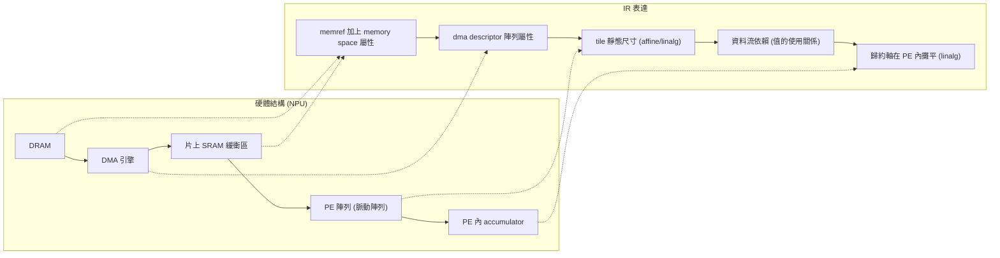

# 11.1 專用張量引擎與脈動陣列對 IR 的特殊需求

[9.3](09.3-CPU降階路徑與llvm方言.md) 結束了通用後端的討論，接下來進入第四部：**自訂方言設計與異質硬體後端實戰**。第四部的每一節都在做同一件事：把一個真實存在的加速器家族，拆解成「IR 需要承載哪些硬體事實」，然後示範如何在 MLIR 裡把它表達出來。

本節的主角是 NPU（Neural Processing Unit，神經處理單元）與其中最具代表性的架構：**脈動陣列（Systolic Array）**。我們要回答的問題不是「怎麼寫一個 matmul 的 kernel」，而是更根本的：

> 一個以資料流為本性的加速器，對中間表示法（IR）提出了哪些**硬性的、不可迴避的**要求？

這個問題的答案，將決定 11.2 的分塊策略、11.3 的搬移生成、11.4 的後端對接方式。所以請把本節看成第四部的地基。

## 硬體本質：資料流機器不是控制流機器

### GPU 與 NPU 的根本差異

要理解 NPU 對 IR 的需求，先要把它和 GPU 對照。兩者都執行大量算子，但組織哲學幾乎相反。

| 面向 | GPU | NPU / 專用張量引擎 |
| --- | --- | --- |
| 程式模型 | SIMT，主導權重複 | 資料流（dataflow），主導權重複 |
| 程式控制流 | 由執行緒執行緒（warp）分支隱含表達 | 靜態編排的資料流圖，執行時無分支 |
| 硬體是什麼 | 大量 ALU 加上暫存器堆積 | 固定形狀的 PE 陣列加上資料搬运網路 |
| 資料來源 | 執行緒從記憶體讀寫 | DMA 從 DRAM 搬到片上 SRAM |
| 同步 | 隱式（warp 內）+ 顯式 barrier | 硬體管線握手（ready/valid） |
| 中間結果 | 主要留在暫存器 | 主要留在 SRAM 緩衝區與 PE 內的 accumulator |

關鍵差異在第三列與最後一列。GPU 的硬體本質是「**可程式化的 SIMD 叢集**」：你寫一個 kernel，編譯器把它變成幾千條執行緒指令，這些指令共用一個大型暫存器檔，靠著暫存器檔與 warp 排程器隱藏延遲。控制流雖然存在，但相對不重要——因為分支預測失誤的懲罰被 warp 內的遮罩執行吸收。

NPU 相反。它的硬體本質是「**固定的資料流引擎**」：整個晶片在設計時就決定了資料要怎麼流、buffer 有多大、PE 陣列是什麼形狀。執行時沒有程式計數器在跳轉（或者說，跳轉只在極少數地方存在），取而代之的是**每個資料流節點在等待上游資料就緒**。

這個差異在編譯期表現為一個非常實際的問題：

> 在 GPU 上，編譯器要決定「哪些操作可以並行執行、哪些要同步」；在 NPU 上，編譯器要決定的是「整張資料流圖的形狀」。

而後者一旦決定，幾乎不可更改。這是因為硬體容量是固定的：SRAM 只有那麼大，PE 只有那麼多個，DMA 通道只有那麼幾條。

### 脈動陣列的設計原理

脈動陣列的概念由 H. T. Kung 在 1981 年提出（"Algorithmic Architectures for Multiprocessors"）。它的核心想法是：把計算組織成規則的**二維或一維格子**，資料像血液一樣在格子之間有規律地「搏動」（systole 指心臟收縮期，正好形容這種節律性的流動）。

以最經典的 $n \times n$ 矩陣乘法為例，考慮 $n$ 個 PE 排成一列，每個 PE 是一個乘法累加器（MACC）。資料流是：

* 矩陣 $A$ 的元素 $a_{i,j}$ 從左端進入，第 $i$ 個 PE 在第 $i$ 拍收到 $a_{i,j}$ 。
* 矩陣 $B$ 的元素 $b_{k,j}$ 以每拍一列的速度垂直注入（skewing 機制）。
* 結果 $C$ 的部分和以每拍一列的速度從底部流出。

第 $p$ 拍時，PE $i$ 計算的是：

$$
c_{i,p} = c_{i,p-1} + a_{i,p} \cdot b_{p-i, p}
$$

這裡有兩個關鍵性質值得記住，因為它們直接決定 IR 的形狀：

**性質一：資料重複利用是硬體自動完成的。** $B$ 的一列只需要從記憶體搬一次，就沿著 PE 陣列被重複使用 $n$ 次。 $A$ 也一樣。硬體結構本身就是一種快取。

**性質二：accumulator 必須連續。** PE 內部的累加器在整個 K 維（或類似的縮維維度）上必須累加完成，才能輸出結果。這意味著**歸約軸的迭代必須被攤平到同一個 PE 內**，不能被中斷到不同 PE 或不同時段。這是一個硬性的「不可打斷」約束。

2015 年 Google 發表的第一代 TPU 晶片論文（"In-Datacenter Performance Analysis of a Tensor Processing Unit"）把這個想法發揚光大：它使用 256×256 個 int8 MAC 運算單元構成二維二級環（torus）排列，明確以「降低能耗」為首要目標，並且刻意**移除了快取層級**、以 700MB/s 的記憶體頻寬搭配 46MB 的片上 SRAM——全部靠軟體編譯器精心安排資料重複利用來補償沒有硬體 cache 的損失。

這個設計選擇是關鍵：既然沒有硬體 cache，編譯器就**必須**在編譯期把資料重複利用做到極致。而要做到這件事，IR 必須能夠看見（a）完整的資料流拓樸，（b）每條資料路徑的長度與流量，（c）所有 buffer 的大小。

### 用一句話總結硬體對 IR 的三個要求

把上面三節濃縮，NPU 對 IR 的硬性要求是：

1. **資料流依賴必須顯式存在於 IR 中**，而不能只是「隱含在 SSA 使用-def 關係裡」，也不能靠執行期的握手推導。
2. **緩衝區容量必須是編譯期常數**，而且 IR 要能區分「哪一塊 buffer 在哪一段時間被誰佔用」。
3. **PE 數量與陣列形狀必須是編譯期常數**，因為它們決定了可用的 parallelism 上限與歸約軸的攤平方式。

這三點分別對應 IR 的三種機制：**memory space 屬性**（[8.3](08.3-memref記憶體抽象.md)）、**tile/index 靜態化**（11.2）、**硬體資源建模**（[12.2](12.2-管線化與資料流排程的IR表達.md)）。

## 硬體結構與 IR 表達的對照

下圖左側是硬體結構，右側是它對應的 IR 表達。中間的箭頭表示「這條硬體事實變成 IR 事實」的映射。



### 逐一對照

| 硬體事實 | IR 語意 | 在 MLIR 中的落點 |
| --- | --- | --- |
| 有一塊容量固定的片上 SRAM | 緩衝區是有限資源，必須排程佔用 | `memref` 的 memory space 屬性 + 獨立的 bufferization 選項 |
| 有專用 DMA 引擎 | 搬移是一種可排程的資源操作 | `async` 方言的 `async.copy`，或自訂 `npu.dma` op |
| PE 陣列形狀固定 | 可用 parallelism 有硬上限，迭代空間要對齊 | `linalg` op 的 tile size 必須與陣列維度匹配 |
| accumulator 連續 | 歸約軸不可分割 | `linalg` 的 reduction iterator 必須留在同一個 op 內 |
| 資料在格子上有規律地流動 | 資料流拓樸是編譯期已知的事實 | SSA 值 + 顯式的 buffer 依賴邊 |
| 資料重複利用由硬體提供 | 編譯器不必也不應重複搬運 | `linalg` 的 operand 重用 + tile 內的迴圈結構 |

## IR 抽象層的選擇：op 化還是 region 化？

這是設計 NPU 方言時最核心的一個決定。當我們要把「用 PE 陣列算一個矩陣乘法」放進 IR，有兩種風格截然不同的做法。

### 做法 A：把 PE 陣列建模成一個 op

```mlir
npu.systolic_matmul ins(%a : tensor<128x256xf32>)
                    ins(%b : tensor<256x128xf32>)
                    outs(%c : tensor<128x128xf32>)
                 { array_rows = 128 : i64, array_cols = 128 : i64 }
                    -> tensor<128x128xf32>
```

**優點：**

* 編譯器可以把整個矩陣乘法交給硬體自動處理（Google TPU 就是這樣：一個 `matmul` 交給 MMA 單元）。
* 高階 IR 保持簡潔，不會被硬體細節污染。
* 硬體的排程能力被完整利用。

**缺點：**

* **資訊損失嚴重。** 當硬體的 PE 陣列不夠大，或者資料形狀是動態的，編譯器就必須把 op 拆開——但拆開之後沒有任何機制描述「怎麼拆」。
* 硬體若有更細緻的排程需求（例如雙緩衝、部分 PE 閒置），op 層級的抽象表達不了。
* 不利於跨後端：GPU 後端無法和 NPU 後端共用同一個高階 op。

### 做法 B：把資料流建成 region

```mlir
npu.dataflow {
^bb0(%a: tensor<128x256xf32>, %b: tensor<256x128xf32>):
  %a_tiled = npu.tile %a tile_sizes [128, 128] : tensor<128x256xf32>
  %b_tiled = npu.tile %b tile_sizes [128, 128] : tensor<256x128xf32>
  %c = npu.mma.pe_array ins(%a_tiled, %b_tiled) : tensor<128x128xf32>
  npu.yield %c : tensor<128x128xf32>
} : (tensor<128x256xf32>, tensor<256x128xf32>) -> tensor<128x128xf32>
```

**優點：**

* 每個節點對應一個可排程的資料流階段，編譯器可以插入緩衝、插入搬移、做跨節點的排程。
* 資訊損失小，硬體約束可以在 region 內逐步施加。
* 天然支援多個後端。

**缺點：**

* 高階 IR 變得「低階」，閱讀者要理解硬體模型才能看懂。
* 編譯器要自己負責 op 內部的高階最佳化，否則會做出比硬體自動排程更差的排程。

### 實務上的答案：兩者共存，分層使用

主流的實務做法（XLA 的 TPU 後端、IREE 的 NPU 後端、大致而言所有把既有高階 IR 映射到固定功能引擎的系統）都是**兩層並存**：

* **高階層**保留 `linalg` / `tosa` 這類結構化 op 的語意，讓最佳化 pass（fusion、tiling、layout 推導）先在這個層次做完。
* **硬體層**引入一個把 op 映射到固定功能硬體單元的轉換，這時才把陣列形狀、buffer 大小等常數「凍結」進屬性。

也就是說，做法 A 與 B 並非互斥，而是**轉換管線的兩個端點**。中間需要一個「拆解 / 合併」的關鍵轉換，這正是 11.2 與 11.3 要處理的問題。

## 「張量引擎方言」還是「硬體方言」？

設計 NPU 後端時，方言的邊界畫在哪裡，是一個影響長期維護成本的決定。讓我們比較兩種策略。

### 策略一：領域方言（domain dialect）

`npu` 方言描述的是「**張量運算**」，而不是「**這塊晶片**」：

```mlir
npu.conv2d %img, %filter { stride = 1 : i64, padding = "same" }
    -> tensor<...>
npu.attention %q, %k, %v { heads = 8 : i64 }
    -> tensor<...>
```

好處是**硬體無關**。同一個 `npu` 方言可以編譯到 TPU、到某個自研 NPU、到一個 CPU 模擬器。硬體特有資訊（PE 數量、SRAM 大小）不放在 op 定義裡，而是放在 pass 的配置或 Target 描述裡。

壞處是**抽象不夠**，編譯器在最後仍然需要知道「這個 conv2d 到底該怎麼排到 PE 陣列上」，而那一步沒有任何 IR 語意可以依循。

### 策略二：硬體方言（hardware dialect）

`mychip` 方言描述的是「**這塊晶片的資源與原語**」：

```mlir
mychip.pe_array rows = 128, cols = 128
mychip.sram buffer_id = 0, size_kb = 512
mychip.dma chan = 2
```

好處是**資訊足夠**，編譯器的最後一步變成一個機械性的排程問題。
壞處是**綁死硬體**，而且使用者要為不同晶片維護不同方言、不同的 pass pipeline。

### 折衷：一個方言，兩層抽象

比較務實的折衷，是讓方言裡同時存在「領域 op」與「硬體資源描述」兩類概念，並用一個獨立的 pass 把它們分開：

```mlir
// 高階：領域 op
%r = mychip.nn.conv2d %x, %w { ... } : tensor<...>

// 經過 mychip-decompose pass 之後
%r = mychip.pe.mma %lhs, %rhs
    { rows = 128 : i64, cols = 128 : i64, accum_bits = 32 : i64 }
    : tensor<128x128xi32> -> tensor<128x128xi32>
```

規則是：**`mychip.*` 命名空間下的 `nn.*` 與 `pe.*` 分成兩個子命名空間**，前者是領域層（硬體無關），後者是硬體層（硬體相關）。中間用一個明確的 pass 做分界，好處是：

1. 使用者寫程式時只碰領域層。
2. 硬體相關的資訊集中在硬體層 op 的屬性裡，可以由配置驅動生成，不必手寫。
3. 跨硬體重用的部分（領域層）可以直接餵給不同後端。

### 一個容易踩的陷阱：把硬體參數寫進 op 的 operand

不建議的做法是把 PE 數量當成 op 的一個 operand：

```mlir
// 不建議
%r = mychip.mma %lhs, %rhs, %num_pe : tensor<...>
```

因為 `num_pe` 在執行期是常數，把它做成 operand 會讓 SSA 的資料流圖裡多出一條不該有的邊，妨礙 bufferization 與排程分析。若必須出現在 IR 中，應該是**屬性**（attribute）而非 operand：

```mlir
%r = mychip.pe.mma %lhs, %rhs
    { rows = 128 : i64, cols = 128 : i64 }
    : tensor<128x128xi32> -> tensor<128x128xi32>
```

屬性在 IR 中是純編譯期常數，不參與資料流，不會污染排程分析。這與 [2.2](02.2-Attribute與編譯期常數.md) 的原則一致。

## memory space 與 DMA 的需求

NPU 對 IR 的最後一個重要需求，是**記憶體位址空間的分層**。

一個典型的 NPU 資料路徑有三層位址空間：

1. **外部記憶體（DRAM）**：容量大（數 GB），延遲高（數百到數千拍）。
2. **片上 SRAM**：容量小（數 MB），延遲低，但**數量有限**，是排程的瓶頸。
3. **PE 內部暫存器 / accumulator**：最小最快，但完全由硬體排程佔有。

MLIR 裡表達這種分層的標準機制是 `memref` 的 **memory space** 屬性（見 [8.3](08.3-memref記憶體抽象.md)）：

```mlir
// 外部記憶體
%in = memref.alloc() : memref<128x256xf32>
// 片上 SRAM（memory space 3 是約定的 accelerator scratchpad）
%buf = memref.alloc() : memref<128x128xf32, 3>
```

但這裡有個真實的困難：`memref.alloc` 在通用的 `memref` 語意裡意味著「從執行期 heap 取得一塊記憶體」，而對 NPU 而言，正確的語意是「**取得一塊 SRAM 緩衝區，並把它註冊給 DMA 引擎，使其可以被硬體搬運**」。這兩者不同於：

* 生命週期管理方式不同（SRAM 是靜態分配的池子，不是 heap）。
* 可被 DMA 直接存取這件事，需要與 runtime 與驅動程式協調。

因此，實務上通常會引入一個硬體層的 buffer 描述 op：

```mlir
%buf = mychip.sram.alloc() { size_bytes = 65536 : i64 } : !mychip.sram<65536>
mychip.dma.descriptor %buf, %src { channel = 0 : i64 }
```

這裡的 `%src` 是一個 `memref`，而 `%buf` 是 SRAM 的 handle。兩者型別不同，正確地表達了「這次搬移是跨位址空間的」。

### 為什麼 memory space 屬性不足以描述 DMA

`memref` 的 memory space 屬性回答的是「**這塊記憶體在哪裡**」，但 DMA 還需要「**這次搬移的時機、來源、大小**」。這三件事都不是 `memref` 能負載的：`memref` 描述的是「一塊已存在的記憶體視圖」，而不是「一次搬移事件」。

因此 DMA 必須是一種**操作**（op），而不是一種**型別**（type）。這是 11.3 的主題，也是為什麼 `async` 方言（`async.copy`、`async.execute`、`async.group`）的存在是必要的：MLIR 已經把「非同步搬移 + 群組 + 等待」的形狀标准化了，自訂 NPU 後端可以直接把 `async.copy` 降階成硬體 descriptor，而不是重新發明一套。

## 一個完整的例子：把 IR 抽象拉回現實

讓我們把上面所有的討論濃縮成一個具體的場景，看看這些 IR 需求是怎麼被使用的。

假設要在一個 $128 \times 128$ 的 PE 陣列上做 $128 \times 256 \times 128$ 的 matmul（ $M = 128$ , $K = 256$ , $N = 128$ ）。SRAM 容量是 512KB。

**第一步：磚形狀由硬體常數決定。** PE 陣列一次處理 $128 \times 128$ 的 tile，所以 $M$ 與 $N$ 維度不需再切；但 $K = 256$ 必須切成兩段（假設 accumulator 是 32 bit 且 $A$ 的 tile 是 128×128×4B = 64KB）。容量估算見 11.2。

**第二步：資料流依賴決定搬移順序。** $A$ 的兩個 tile（ $k=0$ 與 $k=1$ ）必須依序進入同一組 PE 的 accumulator，所以搬移必須被排成 pipeline，不能同時進行。

**第三步：歸約軸不可打斷。** $K$ 維在 PE 內累加，IR 中 `linalg.matmul` 的 reduction iterator 不能被 tiling 成獨立的 op。

這三句話分別是 11.2、11.3、以及本章「accumulator 必須連續」小節的直接後果。

```mlir
// 最終降到硬體層的 IR 形狀（概念示範）
func.func @main(%a: tensor<128x256xf32>, %b: tensor<256x128xf32>) -> tensor<128x128xf32> {
  %c0 = arith.constant 0.0 : f32
  %init = tensor.empty() : tensor<128x128xf32>
  %z = linalg.fill ins(%c0 : f32) outs(%init : tensor<128x128xf32>) -> tensor<128x128xf32>
  %r = linalg.matmul ins(%a, %b : tensor<128x256xf32>, tensor<256x128xf32>)
                outs(%z : tensor<128x128xf32>) -> tensor<128x128xf32>
  return %r : tensor<128x128xf32>
}
```

這段高階 IR 幾乎不含任何 NPU 資訊——這是刻意的。NPU 資訊應該在**降階時**才被注入，而不是讓使用者一開始就受限於硬體。這樣的高階 IR 同時可以餵給 GPU 後端與 CPU 後端。

## 骨架：一個 NPU 方言的 ODS 起點

前面討論的都是抽象，但抽象要落地，第一步是寫出方言定義。MLIR 的 ODS（Operation Definition Specification）機制（見 [3.1](03.1-為什麼需要TableGen.md) 與 [3.2](03.2-ODS定義Operation.md)）要求我們把「硬體事實」翻譯成「型別與屬性」。

先看一個硬體層 op 的定義。假設 `mychip.pe.mma` 表示「把兩個 tile 餵給 PE 陣列做矩陣乘法累加」：

```tablegen
def Mychip_PE_MMAOp : Mychip_PE_Op<"mma",
    [Pure, DeclareOpInterfaceMethods<MemoryEffectsOpInterface>]> {
  let summary = "在 PE 陣列上執行的矩陣乘法累加";
  let description = [{
    把 `lhs` 與 `rhs` 兩個 tile 送入 PE 陣列，結果累加到 `acc`。
    陣列形狀由 `rows`/`cols` 屬性指定，必須與硬體配置的 PE 陣列
    形狀一致。歸約維度不可在此 op 外部被打斷。
  }];

  let arguments = (ins AnyRankedTensor:$lhs, AnyRankedTensor:$rhs);
  let results = (outs AnyRankedTensor:$acc);

  let assemblyFormat = [{
    `ins` `(` $lhs `,` $rhs `:` type($lhs) `,` type($rhs) `)`
    attr-dict `:` type($acc)
  }];

  let extraClassDeclaration = [{
    /// 陣列列數，編譯期常數。
    ::llvm::ArrayRef<int64_t> getArrayRows() {
      return (*this)->getAttrOfType<IntegerAttr>("rows").getValue().getValues();
    }
  }];
}
```

幾個值得說明的設計點：

**其一，硬體常數用 `IntegerAttr` 而非自訂型別。** `rows` / `cols` 是編譯期整數常數，用 `IntegerAttr` 就夠，不需要定義 `Mychip_PEArrayType`。這與 [2.1](02.1-MLIR型別系統.md) 的「先有數字再用型別」原則一致。

**其二，`Pure` 這個 trait 要謹慎。** 標記 `Pure` 意味著「此 op 沒有記憶體副作用」，DSE 與 CSE 可以自由移動它。但如果 PE 陣列本身是**有限資源**（它確實是），移動 op 的順序可能改變資源的瞬間佔用量。在實務上，更保險的寫法是宣告 `MemoryEffectsOpInterface`，讓副作用分析能追蹤對 SRAM 的讀寫。

**其三，`assemblyFormat` 把硬體屬性藏在 `attr-dict` 裡。** 這是刻意的：`rows`/`cols` 是硬體配置決定的，不該由撰寫 IR 的人手動填寫，而是由 pass 從 Target 描述注入。把它放進 `attr-dict`（而不是寫進格式字串）意味著「這是實驗性／配置性資訊」的語意，也讓使用者手寫 IR 時不必煩惱。

**其四，`DeclareOpInterfaceMethods<MemoryEffectsOpInterface>`。** 這個宣告要求 ODS 產生 `getEffects` 的宣告，並讓實作者提供副作用描述。對 NPU 而言，這不只是形式：bufferization pass（[11.3](11.3-DMA搬移生成.md)）要靠副作用資訊判斷「誰產生資料、誰消費資料」，若 `mma` 宣告錯誤，產生的搬移就會漏掉或多餘。

### 領域層 op 的定義風格

相對地，領域層的 `mychip.nn.conv2d` 應該盡量「MLIR 風格」，把大部分可推導的參數交給 verifier 檢查：

```tablegen
def Mychip_NN_Conv2DOp : Mychip_NN_Op<"conv2d",
    [Pure, Commutative]> {
  let summary = "二維卷積（硬體無關的領域 op）";
  let arguments = (ins AnyRankedTensor:$input, AnyRankedTensor:$filter);
  let results = (outs AnyRankedTensor:$output);

  let assemblyFormat = "attr-dict ($input `,` $filter `:` type($input) `,` type($filter)) `:` type($output)";

  let hasVerifier = 1;
  let extraClassDeclaration = [{
    /// 驗證 stride、padding、dilations 與 input/filter 形狀的一致性。
    ::mlir::LogicalResult verifyConv2DShapes();
  }];
}
```

注意 `Commutative` 這個 trait：在卷積中它其實**不成立**（filter 翻轉的問題），但在硬體的累加模型下，很多 op 的結果對 operand 順序不敏感。誠實的做法是不要亂加 trait——trait 錯誤會讓 DSE 做出錯誤的決策。這個例子裡加 `Pure` 而不加 `Commutative` 才是正確的。

### 兩層之間的 pass 契約

ODS 只描述了 op，**兩層之間的映射規則**要寫在 pass 裡。這個 pass 的契約（contract）是整個設計中最需要仔細寫文件的部分：

| 輸入端 | 輸出端 | 保證 |
| --- | --- | --- |
| `mychip.nn.*`（領域層） | `mychip.pe.*` / `mychip.sram.*`（硬體層） | 陣列形狀屬性等於 Target 配置；所有 buffer 大小不超過 SRAM 容量 |
| `tensor` 型別 | `memref` 型別（帶 memory space） | 每個 buffer 恰好被一條產生路徑定義 |
| 靜態形狀 | 靜態形狀 | 不允許出現動態維度（除非 Target 宣告支援） |

把這張表寫進 pass 的文件與註解，比寫在腦子裡有用得多——因為 NPU 專案的成員流動率通常很高。

## 設計檢查清單

把本節的內容收斂成一個可以直接使用的設計檢查清單：

* [ ] IR 是否能區分 DRAM 與 SRAM？（→ memory space）
* [ ] IR 是否能表達「這次搬移」而不是只有「這塊記憶體」？（→ op 而非 type）
* [ ] 硬體參數（PE 數量、陣列形狀、SRAM 大小）是屬性還是 operand？（→ 應該是屬性）
* [ ] 歸約軸的不可打斷性是否在 IR 中被保留？（→ 不要過早打散 `linalg` 的 reduction）
* [ ] 領域 op 與硬體 op 是否分在不同子命名空間？
* [ ] 整條降階路徑上，資料流的形狀何時被凍結？誰決定凍結？
* [ ] 高階 IR 是否仍可被其他後端消費？

## 小結與延伸閱讀

* NPU 與 GPU 的差異不在算力，而在**程式模型**：GPU 是「主導權重複的 SIMT 叢集」，NPU 是「資料流引擎」。前者對 IR 的要求偏重控制流與同步，後者偏重資料流拓樸、buffer 容量與資源形狀。
* 脈動陣列（1981 年 H. T. Kung 提出）與 2015 年 Google 第一代 TPU 論文共同確立了 NPU 的基本設計哲學：**以硬體結構取代快取層級，把資料重複利用的責任交給編譯器**。
* 硬體對 IR 的三項硬性要求是：資料流依賴顯式化、緩衝容量為編譯期常數、PE 數量與陣列形狀為編譯期常數。
* 建模方式的取捨是「op 化 vs region 化」；實務上是兩層並存——高階保留結構化 op 語意，硬體層才注入陣列與 buffer 的常數。
* 方言邊界的建議：領域層（硬體無關）與硬體層（硬體相關）分開，之間用明確的 pass 分界；硬體參數一律用屬性承載，不用 operand。
* 延伸閱讀：MLIR 上游文件 `mlir/docs/Dialects.md`（方言設計與准入原則）、`mlir/docs/Bufferization.md`；CIRCT 專案 `mlir/docs/../circt/docs/` 下的 `Why CIRCT.md` 與方言總覽；LLVM 官方部落格 Chris Lattner 於 2021 年 1 月發表 "MLIR: Scaling Compiler Infrastructure for Domain Specific Computation" 一文，其中說明了 MLIR 與硬體 IR 的關係。
