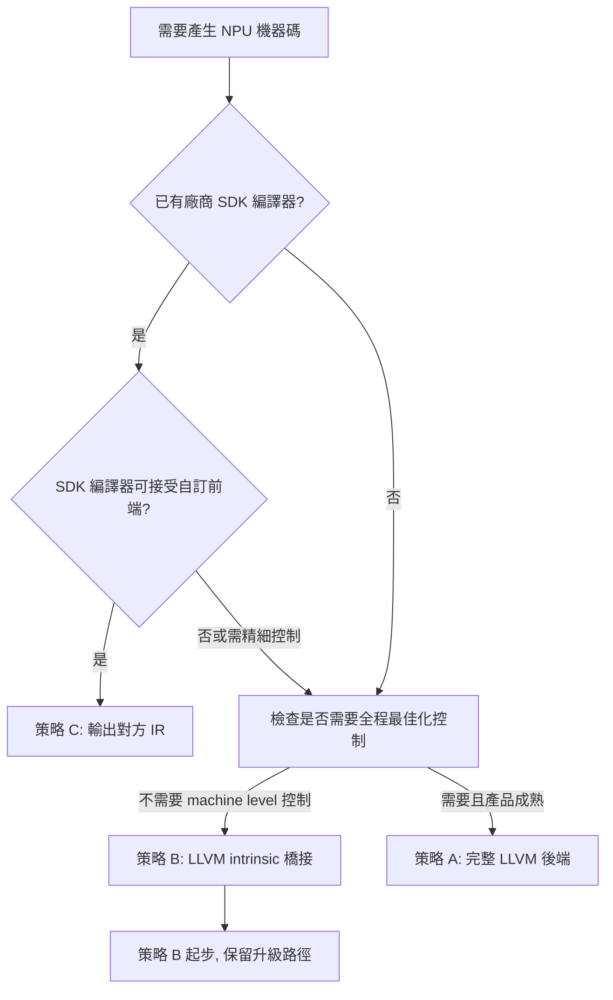
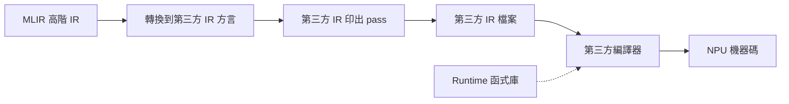
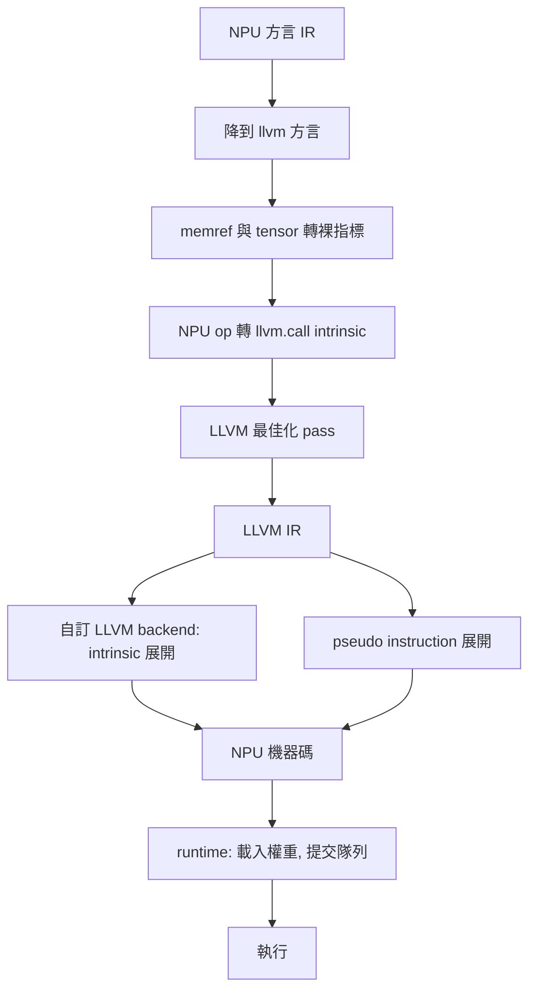

# 11.4 從 MLIR 方言對接自訂 ISA、Runtime 與第三方後端

[11.3](11.3-DMA搬移生成.md) 完成了從資料流到 DMA 指令的推導，IR 裡現在有一堆 `mychip.pe.mma`、`mychip.dma.copy` 這類硬體層的 op。剩下的問題是：**怎麼把這些 op 變成真正能執行的機器碼？**

本節要比較三種對接策略的成本與收益，並給出推薦方案（LLVM intrinsic 橋接）的完整實作示範，包含：

* 自訂 LLVM 後端需要的介面與工作量估計
* 從 NPU 方言降到 `llvm` 方言的完整 conversion pattern
* runtime ABI 設計
* 驗證策略

## 三種對接策略的比較

在寫任何程式碼之前，先做策略選擇。這個選擇決定接下來幾個月的工程量，必須慎重。

### 策略 A：直接降階到 LLVM IR

把 NPU 方言的 op 轉成 LLVM IR，然後交給 LLVM 的 codegen 產出機器碼。

**問題在於**：LLVM 的 codegen 是**目標相依**的。若要產出 NPU 的機器碼，你必須寫一個 LLVM 後端（backend），也就是實作：

* `TargetMachine`（描述目標的寄存器、指令、位元組碼大小）
* `SelectionDAG` 的合法化（legalization）與指令選擇
* `AsmPrinter` / `TargetLowering` / `TargetInstrInfo` 等一整套

這是一份**以月為單位**的工作。LLVM 的後端框架本身有數千行的膠水程式碼（boilerplate），而且要跟上 LLVM 每個版本的 API 變動。對於一個「MLIR 加上一個自訂加速器」的團隊來說，這個成本極不成比例。

更糟的是：**你會失去 LLVM 所有的最佳化**。因為 MLIR 降階到 LLVM IR 之後，LLVM 只知道「怎麼編譯」，不知道「什麼是 NPU」。所有 NPU 特有的最佳化（tile 大小選擇、PE 使用率最大化、pipeline 深度）都得在 MLIR 側做完，然後 LLVM 只能在通用的 machine IR 層面做諸如指令選擇與排程。

**唯一的優點**：完全掌控機器碼生成，包括最細緻的排程。

### 策略 B：降階到 LLVM intrinsic，再由自訂 LLVM backend 實作

這是**推薦方案**。核心想法是：

> 自訂 LLVM backend 只做一件事：把 LLVM IR 中的一組**特定 intrinsic**，翻譯成你的 NPU 指令序列。通用運算（指標運算、迴圈控制、位元組搬移）仍然交給 LLVM 的通用後端處理。

在 MLIR 這一側，NPU 方言降階成 `llvm` 方言，其中 NPU 專屬的 op 變成 `llvm.call` 到一個宣告的 intrinsic 函式。

**為什麼這個方案好？**

1. **LLVM 保留全部通用最佳化**：LLVM 會對 `llvm.call` 之間的程式碼做寄存器分配、排程、迴圈最佳化。
2. **自訂後端的工作量大幅下降**：不需要完整的指令選擇器與合法化器，只需要在 `SelectionDAG` 上加一個 pattern，或直接在 `MachineFunction` 的 `InstrEmitter` 階段把 intrinsic 展開成指令。
3. **可以漸進採用**：先做 intrinsic 方案，等產品成熟後，若需要更激進的最佳化，再把整個 backend 寫出來。
4. **跨版本維護成本低**：intrinsic 介面相對穩定，比 LLVM backend API 穩定得多。

**缺點**：

* intrinsic 的介面必須設計好，否則會限制後端的最佳化空間。
* LLVM 的最佳化有時會「看不穿」intrinsic（例如無法跨越 intrinsic 邊界做向量化）。這可以用 `llvm.call` 的屬性（`nounwind`、`memory` effects 等）來緩解。
* 對 LLVM 的 memory effects 分析需要正確宣告，否則 LLVM 可能過度保守。

### 策略 C：輸出自訂中間格式，交給第三方編譯器

如果你的 NPU 廠商已經提供了自己的編譯器與 SDK（這在業界相當常見），你可以讓 MLIR 產生它的 IR，交給它編譯。

**優點**：成本最低。你不需要寫任何 LLVM 後端，也不需要自己處理 ISA 細節。

**缺點**：

* 最佳化受限於第三方編譯器的能力與它的介面暴露程度。
* 你對產生的機器碼幾乎沒有控制權。
* 整合成本（錯誤回報、profile、除錯）通常比想像中高。
* 隨著你的前端越做越好，你會逐漸需要第三方編譯器不提供的控制點，最後還是得自己寫後端。

### 比較表

| 面向 | A：完整 LLVM 後端 | B：LLVM intrinsic 橋接 | C：第三方編譯器 |
| --- | --- | --- | --- |
| 初始工程量 | 數月 | 數週 | 數天 |
| 長期維護成本 | 高（跟 LLVM 版本） | 中（intrinsic 介面穩定） | 低（但受限於對方） |
| 通用最佳化保留 | 保留 | 保留 | 取決於對方 |
| NPU 專屬最佳化空間 | 完整 | 受限於 intrinsic 粒度 | 受限於對方 |
| 對產出碼的控制 | 完全 | 中等 | 低 |
| 適用的階段 | 成熟產品 | **多數專案** | 早期驗證、綁定既有 SDK |
| 風險 | 高 | 中 | 中（依賴外部） |

### 決策流程



實務上的建議是：**永遠從策略 B 開始，並保留未來升級到 A 的可能**。這意味著 intrinsic 的設計要從一開始就考慮「如果未來要自己寫後端，哪些資訊需要保留」。

## 從 NPU 方言降階到 LLVM 方言

### 降階目標的形狀

`llvm` 方言是 MLIR 與 LLVM IR 之間的橋樑（見 [9.3](09.3-CPU降階路徑與llvm方言.md)）。降階的產物有兩種典型形態：

* **指令式**：`llvm.mlir.undef`、`llvm.add`、`llvm.mlir.constant` 等，把運算映射成 LLVM IR 的運算子。
* **intrinsic 式**：`llvm.call` 到一個宣告的函式。

NPU 專屬的硬體操作（PE 陣列運算、DMA 提交）用 intrinsic 式；一般邏輯（迴圈控制、位元組操作）用指令式。

### intrinsic 的宣告

LLVM intrinsic 在 MLIR 中有兩種呈現方式：

1. **LLVM intrinsic 的 MLIR 對應 op**：例如 `llvm.intr.*` 系列。MLIR 為許多 LLVM intrinsic 定義了專門的 op（例如 `llvm.intr.memcpy`、`llvm.intr.fma`）。
2. **自訂 intrinsic**：在 `llvm` 方言外部宣告一個普通函式符號，並用 `llvm.call` 呼叫它。

對 NPU 來說，通常需要的是第 2 種——因為 intrinsic 是自訂的。

宣告方式：

```mlir
llvm.func @mychip_pe_mma(%a: !llvm.ptr, %b: !llvm.ptr, %out: !llvm.ptr, %rows: i64, %cols: i64)
```

宣告之後，MLIR 的 `llvm` 方言轉換 pass（`convert-func-to-llvm`、`convert-arith-to-llvm` 等）會把它轉成 LLVM IR 中的 `declare` 指令。

### 完整的 conversion pattern

下面是一個把 `mychip.pe.mma` 降階成 `llvm.call` 的完整 conversion pattern。

先看 op 定義：

```tablegen
def Mychip_PE_MMAOp : Mychip_PE_Op<"mma"> {
  let summary = "PE 陣列矩陣乘法";
  let arguments = (ins
    LLVM_AnyPointer:$lhs,
    LLVM_AnyPointer:$rhs,
    LLVM_AnyPointer:$out,
    I64Attr:$rows,
    I64Attr:$cols);
  let results = (outs);

  let assemblyFormat = [{
    `ins` `(` $lhs `,` $rhs `,` $out `:` type($lhs) `,` type($rhs) `,` type($out) `)`
    `rows` $rows `cols` $cols attr-dict
  }];
}
```

注意這裡 operands 已經是 `!llvm.ptr`，代表**這個 op 已經處於降階後的階段**。這是 MLIR 降階的常見做法：先做一輪「把 `tensor`/`memref` 轉成裸指標」的轉換，讓高階 op 變成指標型 op，然後再做低階轉換。

對應的 conversion pattern：

```cpp
namespace {

/// 把 `mychip.pe.mma` 降階成 `llvm.call @mychip_pe_mma`。
struct MMAOpLowering : public mlir::OpConversionPattern<mychip::PE_MMAOp> {
  using mlir::OpConversionPattern<mychip::PE_MMAOp>::OpConversionPattern;

  mlir::LogicalResult
  matchAndRewrite(mychip::PE_MMAOp op, mlir::OpAdaptor adaptor,
                  mlir::ConversionPatternRewriter &rewriter) const override {
    mlir::Location loc = op.getLoc();

    // 1) 組出 intrinsic 的函式型別
    auto ptrTy = mlir::LLVM::LLVMPointerType::get(op.getContext());
    auto i64Ty = rewriter.getI64Type();
    auto fnTy = rewriter.getFunctionType({ptrTy, ptrTy, ptrTy, i64Ty, i64Ty}, {});

    // 2) 取得（或建立）intrinsic 的宣告
    auto symAttr = mlir::SymbolRefAttr::get(op.getContext(), "mychip_pe_mma");
    mlir::FlatSymbolRefAttr fnRef = mlir::SymbolRefAttr::get(symAttr);
    mlir::LLVM::LLVMFuncOp func = mlir::dyn_cast_or_null<mlir::LLVM::LLVMFuncOp>(
        rewriter.lookupNearestSymbolFrom(op, fnRef.getAttr()));
    if (!func) {
      func = rewriter.create<mlir::LLVM::LLVMFuncOp>(
          loc, fnRef.getAttr(), fnTy);
      // 宣告 intrinsic 的語意屬性，讓 LLVM 的最佳化知道它的副作用
      func->setAttr("llvm.emit_c_interface",
                    rewriter.getUnitAttr());
    }

    // 3) 產生呼叫
    mlir::Value rows = rewriter.create<mlir::arith::ConstantIntOp>(
        loc, op.getRows(), 64);
    mlir::Value cols = rewriter.create<mlir::arith::ConstantIntOp>(
        loc, op.getCols(), 64);

    rewriter.replaceOpWithNewOp<mlir::LLVM::CallOp>(
        op, func, mlir::ValueRange{adaptor.getLhs(), adaptor.getRhs(),
                                   adaptor.getOut(), rows, cols});
    return mlir::success();
  }
};

} // namespace
```

幾個關鍵細節：

**其一，intrinsic 的宣告必須被重用。** `lookupNearestSymbolFrom` 找到既有的宣告就重用，找不到才建立。否則會產生重複符號。

**其二，`llvm.call` 的引數必須是 LLVM  dialect 能處理的型別。** 裸指標是 `!llvm.ptr`，整數是 `i64`。所有高階型別（`tensor`、`memref`）必須先被轉換掉。這就是為什麼 op 定義裡直接用 `LLVM_AnyPointer`。

**其三，副作用宣告。** `mychip_pe_mma` 會寫入 `out` 指向的記憶體。若不告知 LLVM，LLVM 的 alias analysis 可能做出錯誤的假設（例如把對 `out` 的載入快取起來）。在 `llvm.call` 上可以掛屬性：

```cpp
auto call = rewriter.create<mlir::LLVM::CallOp>(...);
call->setAttr("memory_effects", rewriter.getStringAttr("write"));
```

或者更好的做法是把 intrinsic 註冊進 LLVM 的 intrinsic 描述表，讓 LLVM 知道它讀寫哪些指標。MLIR 提供了 `mlir::LLVM::ExtraLLVMIRAttr` 與 `LLVM::LinkageAttr` 等鉤子，但完整的 intrinsic 註冊要在 LLVM 側做。

### 更完整的方案：把 NPU 指令變成 LLVM 的 pseudo instruction

策略 B 有個「弱化版」：只把 intrinsic 當成黑盒，LLVM 對它內部一無所知。但如果你的 NPU 指令其實是「一條指令完成一堆事」（例如一條指令啟動一次矩陣乘法），那麼 LLVM 的排程完全看不到它的內部並行性。

改進做法是：在 LLVM 側把你的 NPU 指令註冊成一條 **pseudo instruction**（帶內部 parallelism），讓 LLVM 的 machine scheduler 知道它的 latency 與 throughput。這需要在 LLVM 側寫：

```cpp
// 在 TargetInstrInfo.td 中
def MYCHIP_MMA : Inst<(outs), (ins), "", []>;
```

並在 `SelectionDAG` 的 `LowerOperation` 裡把 intrinsic 轉成這條 pseudo instruction。

這是策略 B 與策略 A 之間的過渡地带：**用最少的 LLVM 側工作，換取 machine level 的排程能力**。

## 自訂 LLVM backend 需要的介面

如果最終要走到策略 A，以下介面是必備的。列在這裡是為了讓你**估算工作量**。

| LLVM 元件 | 職責 | 估算工作量 |
| --- | --- | --- |
| `Target` / `TargetMachine` | 目標描述：指令集、CPU 型號、位元組碼大小 | 中 |
| `TargetLowering` | 合法化、`LowerOperation`、擴充指令 | 高 |
| `TargetInstrInfo` | 指令描述、延遲／吞吐模型 | 中 |
| `SelectionDAG` patterns | intrinsic → machine instruction | 中 |
| `AsmPrinter` | machine instruction → 組語 | 中 |
| `TargetMachineScheduler` | machine level 排程 | 中 |
| `MC lowering` / `AsmBackend` | 組語 → 位元組碼、relocation | 低到中 |
| `TargetAnalysis` | 迴圈分析、别名分析 | 中 |

一個有用的量級感覺：LLVM 的 "RISCV" 或 "Mips" 這類真實後端是數萬行。但一個**只支援 intrinsic 展開**的最小後端，可以壓縮到數千行。

**最務實的路徑是：先用策略 B，然後在 LLVM 側註冊 pseudo instruction（上面提到的過渡地帶），只有在這仍然不夠時才寫完整後端。**

## 對接既有第三方編譯器

若目標是對接廠商 SDK 編譯器，做法是：MLIR 降階到第三方 IR，用一個 pass 印出該 IR。

**通用架構：**



**實作的關鍵點：**

1. **用一個方言承載第三方 IR**，而不是把第三方 IR 的概念塞進 MLIR 的既有方言。這樣降階的邊界清晰。
2. **印出 pass 要處理 ABI 問題**：第三方編譯器通常假設自己的 calling convention（如 `__attribute__((regparm))` 或特殊的 callee-saved 規則）。MLIR 的 `llvm.func` 需要設定正確的 `llvm.calling_convention` 屬性。
3. **除錯資訊要傳遞**：第三方 IR 通常有自己的 debug info 格式。若可行，用 `llvm.loc` 之類的機制傳遞行號。

**以第三方 IR 為例（概念示範）：**

```mlir
// 降階後的第三方方言
tdnn.matmul %a, %b, %out { m = 128 : i64, n = 128 : i64, k = 128 : i64 }
```

然後一個印出 pass：

```cpp
void Mychip_ExportThirdPartyPass::runOnOperation() {
  mlir::ModuleOp module = getOperation();
  std::string text;
  llvm::raw_string_ostream os(text);
  for (mlir::Operation &op : module.getBody()->getOperations()) {
    if (auto mma = mlir::dyn_cast<ThirdParty_MatmulOp>(op)) {
      os << "MATMUL " << mma.getM() << " " << mma.getN() << " " << mma.getK() << "\n";
    }
  }
  // 寫入輸出檔案
}
```

這種做法在實務中可行，代價是失去最佳化控制。

## runtime ABI 設計

無論用哪種策略，都需要一個 runtime。runtime 的職責通常包括：

1. **記憶體配置**：把 `memref` 轉成 NPU runtime 能理解的 buffer handle。
2. **權重載入**：把常駐權重（可能是幾 GB）從磁碟或遠端載入到 NPU 可存取的記憶體。
3. **隊列提交**：把產生好的指令串交給驅動程式。
4. **事件同步**：跨主機與裝置、跨多個裝置的同步。
5. **錯誤處理**。

### 透過 `llvm.func` 宣告 runtime API

MLIR 的標準做法是宣告外部函式：

```mlir
llvm.func @mychip_runtime_alloc(size_bytes: i64, space: i32) -> !llvm.ptr
llvm.func @mychip_runtime_submit(ptr: !llvm.ptr) -> i32
llvm.func @mychip_runtime_wait(ptr: !llvm.ptr) -> i32
llvm.func @mychip_runtime_free(ptr: !llvm.ptr)
```

然後用 `llvm.call` 呼叫：

```mlir
%buf = llvm.call @mychip_runtime_alloc(%size, %space)
    : (i64, i32) -> !llvm.ptr
```

### buffer 描述的跨語言約定

最麻煩的部分是「MLIR 側的 `memref` 與 runtime 側的 buffer handle 如何對應」。常見的三種方案：

**方案一：把 buffer 描述符以固定的二進位布局傳遞。**

```cpp
// 描述符的 C 定義，MLIR 側用相同布局建構
struct MychipBufferDesc {
  uint64_t addr;
  uint64_t size;
  uint32_t space;
  uint32_t flags;
};
```

在 MLIR 側：

```mlir
%desc = ... // 用 memref.get_global 或 store 寫出一個 struct
```

這個方案的問題是 MLIR 裡要寫出符合 C struct 布局的位元組，繁瑣但可行。

**方案二：runtime 端維護一個表，MLIR 傳索引。**

```mlir
%handle = llvm.call @mychip_runtime_register(%ptr, %size, %space) : (...) -> i64
```

MLIR 傳裸指標與大小，runtime 回傳一個整數 handle，後續的提交指令用 handle。這個方案最簡潔，也最常被採用。

**方案三：直接把 `!llvm.ptr` 當作 handle。** runtime 的 `alloc` 回傳一個特製的指標值，其位址空間不在虛擬位址空間中（這是某些加速器 runtime 的做法，例如把 handle 編碼在高位）。

### 提交與同步

提交模型的選擇影響很大：

| 模型 | 描述 | 優點 | 缺點 |
| --- | --- | --- | --- |
| 命令列 model | 每次提交一次 `submit` 呼叫 | 簡單、除錯容易 | 每次提交有 overhead，批次小時效率差 |
| 批次 model | 累積多個指令後一次提交 | 效率高 | 需要在 IR 中表達「提交邊界」 |
| 持續 model | 提交後裝置持續執行，host 非同步 | 隱藏延遲 | 錯誤回報困難，需要事件機制 |

對 NPU 而言通常是**批次 model**：編譯器在 IR 中插入 `submit` 標記，runtime 累積到某個數量或遇到同步點才提交。

在 IR 中表達提交邊界，可以用一個自訂 op：

```mlir
mychip.submit { slot = 0 : i32 }
```

或用 `llvm.call` 直接呼叫 runtime：

```mlir
llvm.call @mychip_runtime_submit(%ctx) : (!llvm.ptr) -> i32
```

### 事件同步

跨 stream 的同步通常用「事件」：

```mlir
mychip.event.record %ev
mychip.event.wait %ev
```

MLIR 上游的 `gpu` 方言有 `gpu.event` op 的先例（`gpu.createEvent`、`gpu.recordEvent`、`gpu.waitEvent`）。NPU 方言可以沿用同樣的形狀。

## 對接第三方編譯器與自訂 LLVM 後端的取捨

把三種策略放在一起，用一個更實際的決策準則：

* **你的 NPU 指令是否「粗粒度」？** 如果一條指令就能完成整個矩陣乘法（像 TPU 的 MMA 單元），那麼 intrinsic 橋接幾乎不損失效能——因為 LLVM 也沒什麼可最佳化的。選策略 B。
* **你的 NPU 指令是否「細粒度」**（例如有很多不同的向量運算指令、且彼此有 pipeline 關係）？那麼 machine level 排程很重要，需要 pseudo instruction 甚至完整後端。
* **你是否能接受被綁定？** 若產品生命週期短、且廠商 SDK 會持續更新，策略 C 的整合成本會隨時間累積。

## 驗證策略

無論哪種策略，驗證都是核心工作。以下是分層的驗證方法。

### 層次一：結果對照（golden test）

最基本也最重要的：**同一個 kernel，用不同路徑產生的結果必須相同**。

```mlir
// 參考路徑：全在 CPU 上算
func.func @reference(%a: tensor<128x128xf32>, %b: tensor<128x128xf32>) -> tensor<128x128xf32>
```

比較對象包括：

* CPU 實作（用 `linalg` 在 CPU 後端上跑）
* 模擬器（模擬 NPU 的行為）
* 實機

由於浮點運算的順序會影響結果（NPU 的脈動陣列累加順序與 CPU 向量化不同），**比對必須用容差**，而非位元組相同。這一點在驗證 NPU 時特別常被忽略。

### 層次二：隨機測試

用隨機形狀、隨機資料產生大量的測試案例，自動比對參考結果。這個方法能抓到「只有特定形狀才觸發」的邊界錯誤（例如 11.2 提到的尾磚問題）。

MLIR 上游提供了 `mlir/test/lib/Transforms/TestTransforms.cpp` 這類的測試基礎設施，可以參考；MLIR 的 `mlir/test/` 目錄下有大量使用 `FileCheck` 的例子。

### 層次三：intrinsic 語意驗證

對每個 intrinsic，寫一個獨立的小測試，確認它在硬體上的行為符合宣告。例如：

```mlir
// 測試：mma 的結果與參考實作一致
func.func @test_mma() {
  %a = ... // 128x128 的隨機矩陣
  %b = ...
  %r = mychip.pe.mma %a, %b, %out { rows = 128 : i64, cols = 128 : i64 }
  // 檢查 %out
}
```

### 層次四：除錯資訊

一個實用的技巧：讓每個 intrinsic 都可被「攔截」。也就是在 LLVM 側把 intrinsic 實作成為一個 wrapper，既能做真正的硬體呼叫，也能在除錯模式下退化成一段等價的軟體實作（用 LLVM IR 實作矩陣乘法）。

這使得**同一個二進位**可以在沒有硬體的機器上執行，功能正確但很慢——這對 CI 與軟體整合測試極有價值。

## 完整流程與決策



## 一個完整範例：從方言到 LLVM IR

把上面所有步驟串成一個具體的 MLIR 檔案。

**第一步，NPU 方言 IR（降階前）：**

```mlir
func.func @matmul(%a: memref<128x128xf32, 3>, %b: memref<128x128xf32, 3>,
                  %out: memref<128x128xf32, 3>) {
  mychip.pe.mma %a, %b, %out { rows = 128 : i64, cols = 128 : i64 }
  return
}
```

**第二步，memref 轉裸指標：**

```mlir
func.func @matmul(%a: !llvm.ptr, %b: !llvm.ptr, %out: !llvm.ptr) {
  %0 = llvm.mlir.constant(128 : i64) : i64
  %1 = llvm.mlir.constant(128 : i64) : i64
  llvm.call @mychip_pe_mma(%a, %b, %out, %0, %1)
      : (!llvm.ptr, !llvm.ptr, !llvm.ptr, i64, i64) -> ()
  return
}
```

**第三步，轉成真正的 LLVM IR（概念示範）：**

```llvm
define void @matmul(ptr %a, ptr %b, ptr %out) {
entry:
  call void @mychip_pe_mma(ptr %a, ptr %b, ptr %out, i64 128, i64 128)
  ret void
}

declare void @mychip_pe_mma(ptr, ptr, ptr, i64, i64)
```

第四步之後就是 LLVM 後端的工作了——在策略 B 之下，這只需要一個 intrinsic 的展開邏輯。

## 一份實務檢查清單

* [ ] intrinsic 的介面是否保留了未來自寫後端所需的資訊？（陣列形狀、tile 尺寸等）
* [ ] 所有 intrinsic 的記憶體副作用是否已宣告？（否則 LLVM 的 alias analysis 會出錯）
* [ ] 是否有至少一條「軟體等價實作」路徑，用於 CI？
* [ ] runtime 的 buffer handle 與 `memref` 的對應關係是否明確且有文件？
* [ ] 浮點比對是否使用容差？容差如何決定？
* [ ] 提交邊界（submit）在 IR 中是顯式的嗎？
* [ ] 是否保留了除錯資訊（行號）到最終產物？

## 小結與延伸閱讀

* 三種對接策略的取捨是工程量的取捨：完整 LLVM 後端（數月）、LLVM intrinsic 橋接（數週，推薦）、第三方編譯器（數天但受限）。
* 推薦策略 B，並在 LLVM 側把 NPU 指令註冊為 pseudo instruction 作為過渡地帶，保留升級路徑。
* MLIR 側的關鍵工作是：把 NPU op 降階成 `llvm.call` 到 intrinsic，並正確宣告副作用；memory space 與 `memref` 需先轉成裸指標。
* runtime ABI 的核心是 buffer handle 的約定（描述符 struct、handle 表、或編碼指針）與提交／同步模型。
* 驗證必須分層：golden test（注意浮點容差）、隨機測試、intrinsic 語意驗證，以及「同一二進位可在無硬體上執行」的除錯路徑。
* 延伸閱讀：MLIR 上游文件 `mlir/docs/Conversion/DialectToLLVM/README.md`（轉換到 LLVM 的指南）；`mlir/docs/TargetDialect.md`（target dialect 概念）；LLVM 官方文件 `llvm/docs/HowToWriteALLVMBackend.rst`（自訂後端的入門）；`llvm/docs/CodeGen/SelectionDAG.rst`（指令選擇流程）。
