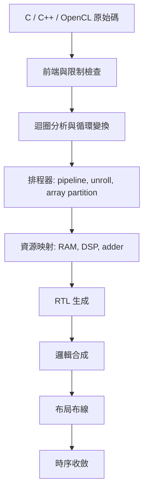
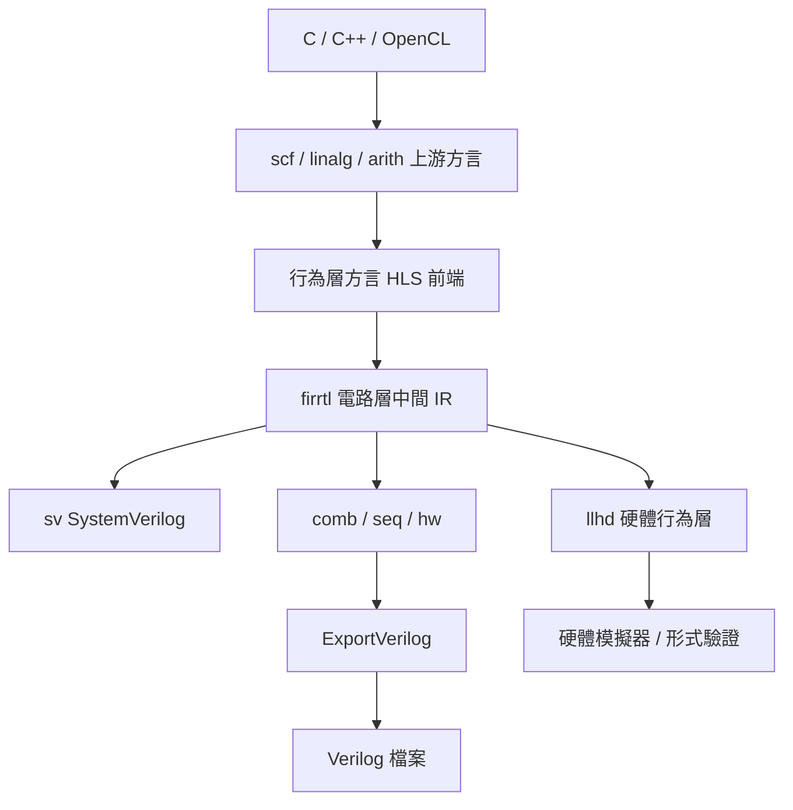
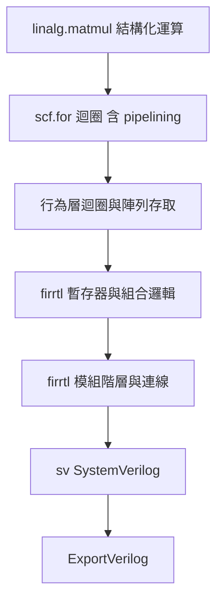

# 12.1 MLIR 在 HLS 與 HDL 降階中的角色

第四部結束在 [11.4](11.4-對接自訂ISA與Runtime.md)：我們把一個 NPU 的抽象一路推到機器碼。第五部轉向另一個方向——**不是從軟體走向機器碼，而是從演算法走向硬體描述**。

這就是硬體加速器開發的另一條路徑：與其設計一個固定的加速器再寫編譯器去映射它，不如**從演算法出發，用高階合成（High-Level Synthesis, HLS）自動產生 RTL**。這條路徑的門檻低得多，也讓「硬體設計」變成一種軟體活動。

但 HLS 有它自己的痛點。本節要回答：

> MLIR 與 CIRCT 是怎麼進入 HLS 領域的？它解決的是什麼問題？CIRCT 的方言層次是怎麼安排的？

## 傳統 HLS 流程與它的痛點

### 典型流程

一個現代的 HLS 工具（例如商用的 Vitis HLS、或開源的 LegUp、POLIMI、或基於 LLVM 的開源嘗試）的流程大致是：



這個流程裡有四個「資訊」節點：限制檢查、迴圈變換、排程、資源映射。它們的問題是：

**痛點一：前端與優化脫節。** 工具的前端是一個獨立的 C++ 前端（或重用 LLVM 的前端），它把 AST 轉成工具自己的內部表示。這個內部表示與前端緊密耦合：想改變前端（例如加入新的語言特性、或支援 Python/DSL），就要改內部表示，進而影響所有下游 pass。而下游 pass（排程、資源映射）又是針對這個內部表示寫的。

**痛點二：最佳化報告是「事後」的。** 工具會產生一份報告，說明「我把這個迴圈 pipelined 了，II = 2，佔用了 3 個 DSP」。但這個報告是**在最佳化決策之後**才輸出的，它不能反饋回前端或排程器。結果是使用者看到報告後，只能回到原始碼手動改寫，再重新跑一次——一個非常慢的迭代迴圈。

**痛點三：難以重用。** 工具內部表示既然與前端耦合，就難以把某個 pass（例如一個排程器）抽出來用在別的流程上。學術界因此有大量「我們實作了一個新的排程演算法」的工作，每次都伴隨著重新實作整條基礎設施。

**痛點四：跨層最佳化不可行。** 一個理想的 HLS 流程，會在「演算法層面」做迴圈交換與 fusion（這需要理解陣列的語意），在「排程層面」做 pipelining 與 unroll，在「資源層面」做 array partition。這三層的決策互相影響，但傳統工具把它們放在三個獨立的階段，各階段的輸出只往前單向流動。

**痛點五：硬體描述本身也是一個孤島。** 即使 HLS 產生了 RTL，RTL 還要跟手寫的 RTL 整合（匯流排、跨模組介面、除錯）。這個整合語言（Verilog / SystemVerilog）有自己的問題：沒有型別安全、沒有組合子、錯誤只在模擬或合成時才發現。

## CIRCT：MLIR 的硬體分支

### 專案的起源與定位

CIRCT 是 MLIR 的硬體分支，於 2021 年起在 LLVM 專案內發展。它把 MLIR 的核心基礎設施（ODS、pass 管理器、`DialectConversion`、轉換框架）**原封不動地複用到硬體領域**，並新增了硬體領域的方言。

CIRCT 的設計哲學可以概括為：

> 用 MLIR 的基礎設施，讓硬體設計成為「IR 變換」而不是「程式生成」。

一個重要的區分：**CIRCT 不是 HLS 工具**。它是一個**硬體 IR 與轉換基礎設施**。基於它可以建構 HLS 工具，也可以建構別的東西（例如硬體設計的驗證、形式驗證的 front-end、RTL 到 C++ 的轉譯）。

### CIRCT 的方言生態

CIRCT 引入或推動的方言（大致分為三層）：

**硬體描述層（RTL 級）**

* `firrtl` — FIRRTL，一種以電路為中心的中間硬體 IR。**它是 CIRCT 裡的「LLVM IR」**：它是大多數硬體工具鏈的匯合點。
* `sv` — SystemVerilog。`firrtl` 的最終輸出形式。
* `comb` — 組合邏輯的基礎 op（`comb.and`、`comb.or`、`comb.mux`、`comb.concat` 等）。`comb` 是 CIRCT 早期的主要方言之一，後來隨著 `firrtl` 與 `hw` 的分工而角色縮小。
* `seq` — 時序邏輯（暫存器、計數器）。
* `hw` — 硬體結構（module、instance、wire、interface）的基礎描述。

**硬體行為層（描述「行為」而非「結構」）**

* `llhd` — Low-Level Hardware Description，一個行為層的硬體 IR，描述訊號的值變化與 process 語意。LLHD 的目標是**同時支援硬體與軟體**：它可以描述 Verilog 的 process 語意，也可以描述 C 的風格。
* `calyx` — 介面語言，用於中介層與資料路徑描述。

**行為層（用於 HLS 前端）**

* `affine` / `scf` / `linalg` / `arith` — 這些是 MLIR 上游方言，CIRCT 直接複用。
* CIRCT 自己的 `esi`（Elastic System Interface，用於連接不同元件）、`msft`（微軟的方言）、`pci`、`svase`（SystemVerilog 的子集）等。

### 方言層次的關係



這個圖的關鍵是 **`firrtl` 的位置**。它就像 LLVM IR 在軟體編譯器裡的位置：上面有多種前端（各種高階語言），下面有多種輸出（Verilog、模擬、形式驗證）。

## `hw` 方言：硬體結構的基礎描述

`hw` 方言（`mlir::hw::HWDialect`，CIRCT 提供）描述硬體的**結構**，而不是行為。

```mlir
module attributes {hw.verilogSymbol = "Top"} {
  hw.module @Top(in %clk: !seq.clock, in %rst: !seq.reset,
                 out a: i32, out b: i32) {
    %reg = seq.compreg %clk, %rst, %init : i32
    %0 = comb.add %a, %b : i32
    comb.assign %reg, %0 : i32
    hw.output %reg : i32
  }
}
```

這裡的幾個 op 值得注意：

* `hw.module` — 模組的宣告。**它同時是型別的產生器**（module 名稱與埠的型別構成一個 `!hw.module.type`）與**值的產生器**（module 定義）。
* `hw.instance` — 例化某個模組。
* `hw.output` — 模組的輸出埠賦值。
* `seq.compreg` — 時序暫存器（相當於 Verilog 的 `always @(posedge clk)`）。
* `comb.add` — 組合邏輯的加法器。

**`hw` 與 `comb` 的分工**：`hw` 描述「結構」（有什麼模組、有什麼線、有什麼埠），`comb` 描述「組合邏輯的值運算」。這樣的分工讓 `hw` 方言保持極小，而所有的運算表達都放在 `comb` 與 `seq` 裡。

### 為什麼硬體需要一個像 `hw` 這樣的「結構」方言

在軟體裡，LLVM IR 幾乎不需要描述「模組結構」——所有東西都是函式。硬體不同：一個設計裡有階層的模組實例，每個實例有自己的介面（輸入埠、輸出埠），而且**埠的型別必須在定義處與實例處一致**。

`hw` 方言的設計因此需要：

* **模組型別（module type）**：`!hw.module.type<@Foo(i32) -> i32>`。這是帶參數的型別，MLIR 的型別系統支援帶參數的型別（[2.1](02.1-MLIR型別系統.md)）。
* **符號引用**：`hw.instance @bar of @Foo : ...`，用 `SymbolTable` 管理（[2.3](02.3-SymbolTable與跨區域參照.md)）。

## `firrtl` 作為硬體的 LLVM IR

### 為什麼需要一個「電路層」的中間 IR

直覺上，HLS 工具可以從 `linalg` 直接產生 Verilog。但那會迫使工具在生成 Verilog 的同時就決定所有電路細節，失去最佳化空間。

`firrtl` 提供了一個中間層，讓：

1. **高階到電路的轉換**與**電路的進一步最佳化**分開。
2. 多種電路層最佳化可以在 Verilog 生成之前進行。

### FIRRTL 的核心概念

FIRRTL（Flexible Intermediate Representation for RTL）是 MLIR 之外的既有語言，CIRCT 把它重新實作為一個 MLIR 方言（`mlir::firrtl::FIRRTLDialect`）。它的核心是**電路與連線**：

```mlir
firrtl.circuit "Top" {
  firrtl.module @Top(in %clock: !firrtl.clock, in %reset: !firrtl.reset,
                     out a: !firrtl.uint<1>) {
    %r = firrtl.reg %clock {name = "r"} : !firrtl.uint<1>
    %0 = firrtl.and %r, %a : (!firrtl.uint<1>, !firrtl.uint<1>) -> !firrtl.uint<1>
    firrtl.connect %r, %0 : !firrtl.uint<1>, !firrtl.uint<1>
  }
}
```

FIRRTL 的抽象層次值得仔細體會：

* `firrtl.reg` — 暫存器（帶時鐘與重置）。
* `firrtl.connect` — 連線（把一個值接到一個目的地）。
* 型別帶位寬：`!firrtl.uint<8>`、`!firrtl.sint<32>`、`!firrtl.fixed<8,4>`。**這是硬體的特點**：型別帶寬度是語意的一部分。

### FIRRTL 的位寬語意

FIRRTL 定義了精確的位寬推論規則。這些規則不只是「整數運算要小心 overflow」這麼簡單，它們定義了**硬體電路的實際行為**：

* 加法：結果寬度為兩者寬度的較大者再加一，記作 $\mathrm{max}(w_1, w_2) + 1$ 。
* 乘法：結果寬度為 $w_1 + w_2$ 。
* 截斷與擴張是顯式的 op（`firrtl.tail`、`firrtl.pad`）。

在軟體裡，`i32` 的加法 overflow 是未定義行為；在硬體裡，加法器就是那麼寬。因此硬體 IR 必須把 overflow 變成顯式的、可推導的事實。這是硬體 IR 與軟體 IR 一個本質的差異。

### FIRRTL 的其他特點

* **Aggregate 型別**：`!firrtl.bundle<...>`、`!firrtl.vector<...>`，用來描述匯流排介面。
* **Analog 型別**：描述類比訊號（在某些介面裡需要）。
* **時序**：所有暫存器共享同一個時鐘域（在 `firrtl.circuit` 層級宣告），這個假設在實務上有時需要放寬，故有 `seq` 方言來處理多時鐘域的情況。

## 從 `scf` / `linalg` 到 FIRRTL 的路徑

### 完整的降階鏈

一個 HLS 流程的高階到低階路徑大致是：



**第一階段：結構化運算到迴圈。** `linalg.matmul` 展開成帶 `scf.for` 的巢狀迴圈。這個轉換在 MLIR 上游有對應的機制（`linalg` 到 loops 的轉換）。

**第二階段：迴圈到行為層。** 這是 HLS 特有的一步：把迴圈變成**硬體的控制結構**。具體包含：

* **Pipeline 展開**：`scf.for` 的 body 被複製成 $k$ 份，每份之間插入暫存器（這是 12.2 的主題）。
* **陣列宣告**：迴圈中的陣列存取被映射到具體的記憶體（register array、block RAM）。
* **資源綁定**：乘加映射到 DSP。

**第三階段：行為到電路。** 迴圈完全展開後，剩下的就是「一堆暫存器與組合邏輯」，把它們轉成 `firrtl` 的 op。

### 一個具體的對照

高階：

```mlir
func.func @matmul(%a: memref<128x128xf32>, %b: memref<128x128xf32>,
                  %out: memref<128x128xf32>) {
  %c0 = arith.constant 0.0 : f32
  %c1 = arith.constant 1 : index
  %c128 = arith.constant 128 : index
  linalg.fill ins(%c0 : f32) outs(%out : memref<128x128xf32>)
  scf.for %i = %c0 to %c128 step %c1 {
    scf.for %j = %c0 to %c128 step %c1 {
      scf.for %k = %c0 to %c128 step %c1 {
        %a_k = memref.load %a[%i, %k] : memref<128x128xf32>
        %b_k = memref.load %b[%k, %j] : memref<128x128xf32>
        %o_k = memref.load %out[%i, %j] : memref<128x128xf32>
        %m = arith.mulf %a_k, %b_k : f32
        %s = arith.addf %o_k, %m : f32
        memref.store %s, %out[%i, %j] : memref<128x128xf32>
      }
    }
  }
  return
}
```

降到 `firrtl`（概念示範，實際轉換會展開成大量乘法器，這裡只展示結構）：

```mlir
firrtl.circuit "Matmul" {
  firrtl.module @Matmul(in %clock: !firrtl.clock,
                        in %a: !firrtl.fixed<32,24>,
                        in %b: !firrtl.fixed<32,24>,
                        out %out: !firrtl.fixed<32,24>) {
    %acc = firrtl.reg %clock {name = "acc"} : !firrtl.fixed<32,24>
    %prod = firrtl.mul %a, %b : (!firrtl.fixed<32,24>, !firrtl.fixed<32,24>) -> !firrtl.fixed<32,24>
    %sum = firrtl.add %acc, %prod : (!firrtl.fixed<32,24>, !firrtl.fixed<32,24>) -> !firrtl.fixed<32,24>
    firrtl.connect %acc, %sum : !firrtl.fixed<32,24>, !firrtl.fixed<32,24>
    firrtl.connect %out, %sum : !firrtl.fixed<32,24>, !firrtl.fixed<32,24>
  }
}
```

從這個對照可以看出 HLS 的關鍵決策：**迴圈完全展開，換取硬體的完全靜態性**。這與 NPU 上「迴圈靜態展開成磚序列」是同一個思想（[11.2](11.2-張量分塊與片上緩衝排程.md)），只是目的不同：HLS 是為了讓合成器能做出正確的電路，NPU 是為了讓資料流能被靜態排程。

### `ExportVerilog`：終點

CIRCT 提供 `circt-translate --export-verilog` 把 `firrtl`（或 `sv`）輸出成 Verilog 檔案。

```bash
circt-translate --export-verilog --lower-memories input.mlir -o output.v
```

`--lower-memories` 這個選項值得注意：它把 FIRRTL 的記憶體（`firrtl.mem`）降階成 Verilog 的 `always` 區塊或外部 RAM 實例。這一步展示了 FIRRTL 的一個設計選擇——**記憶體在高階是宣告式的，在低階才綁定到實作（register file 或 BRAM）**。這個選擇與 NPU 上「tiling 決定 SRAM 分配」是類比的：兩者都是把「資源」的選擇延後到有全域資訊的階段。

## HLS 與軟體編譯器共享 MLIR 基礎設施的好處

這是本章的最終問題：MLIR 帶給 HLS 的，不只是「另一種 IR」，而是**一整套工程基礎設施的複用**。

### 具體的共享項目

| 基礎設施 | 在軟體編譯器中的用途 | 在 HLS 中的用途 |
| --- | --- | --- |
| ODS | 宣告 op、型別、介面 | 宣告 `hw.module`、`firrtl.and` |
| Pass 管理器 | 管線組織、巢狀 pass、多執行緒 | 同一套 |
| `DialectConversion` | 型別轉換、合法性 | 行為層到電路層的轉換 |
| `OpTrait` / `OpInterface` | 副作用、memory effect、可折叠性 | 推斷 FIRRTL 的位寬規則 |
| Verifier | 結構不變式 | 檢查位寬一致性 |
| `SymbolTable` | 跨區域引用 | 模組階層 |
| 位置資訊 | 除錯 | 行號傳遞到 Verilog |
| `Type` 系統 | 泛型型別 | 帶寬度的整數、有向量型別 |

### 一個具體的證據：位寬推論

FIRRTL 最有趣的部分是它的**位寬推論**。這在 MLIR 中是透過 trait 系統實現的：`firrtl` 定義了 `WidthInferenceOpInterface` 與 `ExprOpInterface`，每個 op 實作自己的寬度規則。

ODS 中的樣貌大致是：

```tablegen
def FIRRTL_AddOp : FIRRTLExprOp<"add", [Pure, SameTypeOperands, Commutative]> {
  let summary = "加法器";
  let arguments = (ins FIRRTLWidthable:$lhs, FIRRTLWidthable:$rhs);
  let results = (outs FIRRTLWidthable:$result);

  let builders = [
    OpBuilder<(ins "Value":$lhs, "Value":$rhs), [{
      return build($_builder, $_state, lhs.getType(), lhs, rhs);
    }])>
  ];
}
```

而寬度規則在 C++ 裡實作，註冊在一個寬度推論的表格裡：

```cpp
// 概念示範
static const std::array<BinaryOpWidthRule, 4> binaryRules = {{
    // op 名稱, 寬度函式
    {"firrtl.add", [](int64_t l, int64_t r) { return std::max(l, r) + 1; }},
    {"firrtl.mul", [](int64_t l, int64_t r) { return l + r; }},
    {"firrtl.sub", [](int64_t l, int64_t r) { return std::max(l, r) + 1; }},
    {"firrtl.div", [](int64_t l, int64_t r) { return l; }},
}};
```

**這裡的關鍵洞察是**：硬體的位寬推論，與軟體的型別推導，在工程本質上是同一件事——都需要一個**可組合的規則系統**，把 op 的語意與型別綁在一起。MLIR 的 ODS 提供了宣告 op 的機制，trait 系統提供了把「規則」掛在 op 上的機制。這套機制**從語言前端就已經存在**，因此 HLS 可以直接複用，而不必重新發明。

### 第二個證據：MLIR 的轉換框架

從行為層到電路層的轉換，是一個**型別轉換與 op 轉換**的混合過程。MLIR 的 `DialectConversion`（[5.2](05.2-DialectConversion框架.md)）正是為此設計：它能同時處理型別改變（`memref` 變成 `!firrtl.bundle`）與 op 改變。

一個轉換 pattern 的樣貌：

```cpp
struct MemRefLoadLowering
    : public mlir::OpConversionPattern<memref::LoadOp> {
  using mlir::OpConversionPattern<memref::LoadOp>::OpConversionPattern;

  mlir::LogicalResult
  matchAndRewrite(memref::LoadOp op, mlir::OpAdaptor adaptor,
                  mlir::ConversionPatternRewriter &rewriter) const override {
    mlir::Location loc = op.getLoc();
    // 找到對應的 FIRRTL 記憶體埠
    auto mem = lookupMemory(op.getMemRef());
    if (!mem)
      return rewriter.notifyMatchFailure(op, "no matching FIRRTL memory");

    // 產生 FIRRTL 的讀取
    auto data = rewriter.create<firrtl::SubfieldOp>(loc, mem.dataType,
                                                     adaptor.getMemRef(), "data");
    rewriter.replaceOpWithNewOp<firrtl::ConnectOp>(loc, data, adaptor.getIndices());
    rewriter.replaceOp(op, data);
    return mlir::success();
  }
};
```

用 `ConversionPatternRewriter` 取代 `PatternRewriter` 是一個關鍵差異：前者保證轉換的原子性與合法性（型別轉換過程中，IR 可能處於「半轉換」的狀態，普通 pattern 會因此失效）。這正是硬體轉換需要的——因為硬體的「未轉換」形式與「已轉換」形式的型別系統差異很大。

### 第三個證據：同一個 pass 管理器

CIRCT 的 pass 與 MLIR 的 pass 共用 `mlir::PassManager`。這意味著：

* 同一個管線裡可以同時有 MLIR 的 pass 與 CIRCT 的 pass。
* 多執行緒 pass 執行的機制完全相同（[4.2](04.2-多執行緒平行化.md)）。
* 分析快取的失效邏輯相同（[4.3](04.3-Analysis快取與失效.md)）。

一個 HLS 工具的 pass 管線看起來是這樣：

```cpp
void buildPipeline(mlir::PassManager &pm) {
  // 高階最佳化
  pm.addPass(mlir::createCanonicalizerPass());
  pm.addPass(mlir::createCSEPass());
  pm.addPass(createLoopPipelinePass());       // 12.2 的主題
  pm.addPass(createArrayPartitionPass());     // 資源映射
  pm.addPass(createMemoryInferencePass());    // 推斷記憶體型別

  // 行為到電路
  pm.addPass(createLowerToFIRRTLPass());

  // 電路層最佳化
  pm.addPass(createFIRRTLCanonicalizerPass());
  pm.addPass(createRemoveUnusedPortsPass());
}
```

注意 `createCSEPass()` 與 `createCanonicalizerPass()` 這些都是 MLIR 上游的 pass，在硬體流程裡**直接可用**。這就是基礎設施複用的價值。

## 硬體 IR 與軟體 IR 的差異總覽

把本章的內容整理成一張對照表。這張表在設計自訂硬體方言時非常有用：

| 面向 | 軟體 IR（LLVM / MLIR） | 硬體 IR（FIRRTL / LLHD） |
| --- | --- | --- |
| 基本單位 | 指令序列 | 電路（module 與 connect） |
| 組合關係 | SSA | 連線（connection） |
| 型別 | 固定寬度整數、浮點 | **帶寬度的**整數、固定點 |
| 副作用 | 記憶體存取 | 連線（隱含的順序敏感性） |
| 模組結構 | 幾乎不需要 | **核心概念**（階層的模組實例） |
| 時序 | 隱含的順序 | **顯式的時鐘與暫存器** |
| Overflow | 未定義行為 | **定義明確的位寬規則** |
| 平行性 | 由排程器決定 | 由結構直接決定 |

其中「**電路即平行**」這一列值得特別體會：在硬體裡，兩個獨立的操作就是平行執行的，不需要排程器去發現。而這也解釋了為什麼 HLS 的核心問題不是「平行化」（像 HPC 編譯器那樣），而是「**資源分配**」——因為平行度已經由資料流決定了，剩下的問題是在有限的乘法器、DSP、BRAM 下如何安排。

## 一個實作層面的提醒

CIRCT 的方言定義相對於 MLIR 上游方言有幾個不同的慣例，新接觸時容易困惑：

1. **ODS 檔案位置**：`include/circt/Dialect/FIRRTL/FIRRTLOps.td` 這類路徑。
2. **匯出 op 與內部 op 的區分**：CIRCT 有「匯出到 Verilog 的 op」與「只在 CIRCT 內部存在的 op」的區分。
3. **位寬型別的組合性**：`!firrtl.uint<8>` 這種帶參數的型別，verifier 需要檢查參數合法性。
4. **`firrtl` 與 `sv` 的關係**：`sv` 是 SystemVerilog 的對應方言，兩者共存；`firrtl` 更簡潔，`sv` 更貼近 Verilog。

這些都不是語言層面的難題，而是**工程慣例的差異**。熟悉 MLIR 的 ODS 與 trait 系統之後，適應期通常是數週。

## 小結與延伸閱讀

* 傳統 HLS 的痛點是前端與優化脫節、最佳化報告事後、難以重用、跨層最佳化不可行，以及 RTL 本身的孤島化。
* CIRCT 是 MLIR 的硬體分支（2021 年起在 LLVM 內發展），把 ODS、pass 管理器、`DialectConversion`、trait 系統完整複用到硬體領域。
* `firrtl` 是硬體領域的「LLVM IR」：多種前端匯入、多種輸出（Verilog、模擬、形式驗證）的匯合點。
* `hw` 描述結構（module / instance / wire / port），`comb` 與 `seq` 描述行為；`llhd` 提供硬體行為層的統一抽象。
* 硬體 IR 的關鍵差異是**帶寬度的型別**與**顯式的時序**，位寬推論規則透過 `WidthInferenceOpInterface` 實作——這與軟體的型別推導在工程本質上相同。
* 共享 MLIR 基礎設施的直接收益：同一個 pass 管理器、同樣的轉換框架、同樣的 ODS 宣告機制，以及上游的 `canonicalize` 與 `cse` 等 pass 直接可用。
* 延伸閱讀：CIRCT 專案文件 `circt/docs/WhyCIRCT.md`、`circt/docs/GettingStarted.md` 與 `circt/docs/Dialects/`（各方言說明）；MLIR 上游文件 `mlir/docs/Dialects.md` 與 `mlir/docs/TransformDialects.md`。
