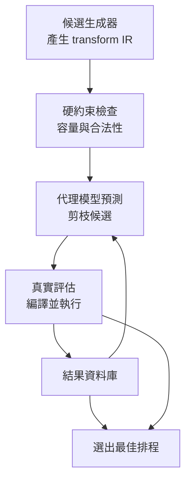

# 12.4 編譯器最佳化與自動化搜尋的結合

[12.3](12.3-方言生態碎片化與標準化.md) 討論了方言生態的治理，但留下了一個工程問題：即使方言設計良好、轉換路徑完整，編譯器仍然要面對龐大的最佳化決策空間，而這些決策往往互相衝突。

本節要處理的問題是：

> 能不能把「編譯器的最佳化決策」本身變成一個**可被搜尋的對象**？如果可以，需要什麼樣的 IR 基礎設施？搜尋空間該怎麼設計？評估函式從哪裡來？

這個問題的答案，在 MLIR 裡有一個明確的落點：**`transform` 方言**。它是把「排程」從 C++ 程式碼提升為 IR 資料的機制。

## 最佳化空間的傳統處理方式

### 傳統的啟發式

傳統編譯器面對最佳化決策，通常的做法是寫**啟發式規則**：

```cpp
// 傳統做法：決策寫死在 pass 裡
if (tileSize > 128) {
  // 啟發式：較大的磚比較好
  useSmallTiles = false;
}
```

這種做法的問題有三個：不可搜索（決策沒有被暴露出來）、不可重用（每個新硬體都要重寫一遍）、不可解釋（使用者不知道為什麼是這個 tile size，也無法手動微調）。

### 搜尋空間的形式化

把最佳化決策抽象成一個決策向量，問題就變得清晰了。設決策空間為 $D$ ，其中每個決策 $d$ 有一組取值 $V_i$ ：

$$
d = (d_1, d_2, \ldots, d_m), \qquad d_i \in V_i
$$

其中 $m$ 是決策的數量。一個卷積網路的分塊決策可能有：

* $d_1$ ：輸出通道的磚大小，候選為 1、2、4、8、16、32
* $d_2$ ：歸約維度的磚大小，候選為 16、32、64、128
* $d_3$ ：是否融合前一個算子，候選為是與否
* $d_4$ ：是否向量化，候選為是與否

搜尋空間的大小是所有候選集合大小的乘積。即使每個維度只有幾個候選，組合起來也會迅速超過數千，而每個候選的評估都要「編譯並執行」，代價極高。這正是為什麼 autotuning 在實務上是**昂貴**的，以及為什麼需要剪枝與代理模型。

## `transform` 方言：把排程變成 IR

### 定位

`transform` 方言的核心想法是：**排程決策本身是資料，不是程式碼**。

傳統做法中，pass 的控制流程寫在 C++ 裡，因此「如何排程」無法被外部程式生成、無法被序列化、無法被 diff。`transform` 方言把這些決策表示成 IR op，於是：

* 排程腳本可以存成檔案，人可以閱讀與修改。
* 排程腳本可以被搜尋器**生成**（例如一個產生 `transform` IR 的 Python 程式）。
* 排程腳本可以被**評估**（套用後量測結果）。

### 一個具體的例子

```mlir
module attributes { transform.with_named_sequence } {
  transform.named_sequence @__transform_main(%arg0: !transform.any_op {transform.readonly}) {
    %0 = transform.structured.match ops{["linalg.conv_2d_nhwc_hwcf"]} in %arg0 : (!transform.any_op) -> !transform.any_op
    %1:2 = transform.structured.tile %0 sizes [32, 32, 32, 32] : !transform.any_op
    %2 = transform.structured.vectorize %1 : !transform.any_op
    transform.yield
  }
}
```

這段 IR 的意思是：「找到 `linalg.conv_2d_nhwc_hwcf`，把它切成 32 的磚，然後向量化」。注意幾件事：

* 排程的**參數**（磚大小 32）出現在 IR 中，因此可以被程式生成。
* 排程的**結構**（先切再向量化）也出現在 IR 中，因此可以被搜尋器改變順序與組合。
* 這段 IR 可以被 dump 成文字，存成 `.mlir` 檔案，讓人檢視與手動微調。

### Handle 機制

`transform` 方言引入了一個「handle」概念：`!transform.any_op` 是一個對某個 IR 對象的**引用**，而不是值本身。op 之間透過 handle 傳遞被操作的對象：

```
%0 = transform.structured.match ... in %arg0   // 找到目標
%1:2 = transform.structured.tile %0 sizes ...   // 對目標做分塊
%2 = transform.structured.vectorize %1          // 對結果做向量化
```

這個機制解決了「變換的結果要怎麼傳遞」的問題。在 C++ pass 中，結果是透過 rewrite 完成的；而在 `transform` 中，變換是在獨立的模組上執行的，透過 handle 明確地指定「我要動哪個對象」。

### `transform` 與 `DialectConversion` 的分工

`transform` 方言與 [5.2](05.2-DialectConversion框架.md) 介紹的 `DialectConversion` 框架是互補的，不是重複的：

* `DialectConversion` 負責的是「**在單一類型系統內**把 op 從一種表示轉成另一種表示」，並保證轉換過程中 IR 始終合法。
* `transform` 負責的是「**在多個高階結構變換之間**做編排」，例如先分塊再融合再向量化，而每個結構變換的實作仍然由各自的 pass 提供。

換句話說：`transform` 是**排程語言**，`DialectConversion` 是**轉換機制**。

## 搜尋空間的設計

### 決策維度的清單

把第四部分與第五部分提到的決策整理成表。每一列是一個可搜尋的維度，欄位是候選集合與影響的機制。

| 決策維度 | 候選集合 | 影響的機制 | 典型章節 |
| --- | --- | --- | --- |
| 磚大小（各維度） | 32、64、128、256 | 片上緩衝區容量與資料重複利用 | [11.2](11.2-張量分塊與片上緩衝排程.md) |
| 磚的順序（outer/inner） | 少數排列 | cache 局部性與流水線深度 | [8.4](08.4-迴圈變換模式.md) |
| 是否融合相鄰 op | 是、否 | 中間結果的記憶體流量 | [7.3](07.3-高階圖方言與算子融合.md) |
| 融合的邊界 | 部分融合 | 暫存器壓力 | [7.3](07.3-高階圖方言與算子融合.md) |
| 向量化寬度 | 1、2、4、8、16 | 硬體向量寬度利用率 | [8.4](08.4-迴圈變換模式.md) |
| 展開因數（unroll factor） | 1、2、4、8 | 迴圈開銷與碼量 | [8.4](08.4-迴圈變換模式.md) |
| 管線階段數 | 2、4、8 | 時序收斂與 II | [12.2](12.2-管線化與資料流排程的IR表達.md) |
| 雙緩衝份數 | 1、2、3 | 搬移與運算重疊 | [11.2](11.2-張量分塊與片上緩衝排程.md) |
| 記憶體佈局 | row-major、column-major、block | 存取效率與串流化 | [8.3](08.3-memref記憶體抽象.md) |
| 資料型別精度 | fp32、fp16、bf16、int8 | 頻寬與能耗 | [11.1](11.1-脈動陣列與NPU的IR需求.md) |

### 搜尋空間的三種範圍

在設計搜尋空間時，有三個層次的選擇：

**層次一：整體空間。** 把所有決策維度的候選做笛卡兒積。空間最大，但評估成本也最高。只有在決策維度很少（少於四個）時才可行。

**層次二：分階段搜尋。** 先決定高階結構（哪些 op 融合、磚的順序），再決定低階參數（磚大小、展開因數）。這是最常用的做法，因為高階決策的影響遠大於低階決策。

**層次三：局部搜尋。** 以一個手動或啟發式產生的排程為起點，只對少數維度做局部擾動。例如只試探磚大小的候選集合，其餘固定。

在實務上，**層次二加層次三的組合**最有效率：先決定融合策略，再對每個融合後的 op 群組獨立搜尋磚大小。

### 硬約束的剪裁

不是所有組合都合法。例如：

* 磚大小必須讓緩衝區放得進片上 SRAM（[11.2](11.2-張量分塊與片上緩衝排程.md) 的容量公式）。
* 向量化寬度必須整除硬體向量寬度。
* 融合後的 buffer 生命週期不能超過硬體限制。

這些約束應該在**產生候選時就剪掉**，而不是留到評估階段才失敗。

## 評估函式

### 真實評估的成本

最直接的評估函式是「**編譯後的執行時間**」。這意味著每個候選都要：

1. 產生對應的 `transform` IR。
2. 套用變換並完成後端編譯。
3. 在真實硬體（或模擬器）上執行。
4. 量測時間。

這個流程的成本是編譯時間加上執行時間。若單次評估要 30 秒，而候選有 1000 個，單次完整的搜尋就要 8 小時以上。這就是為什麼 autotuning 幾乎總是「離線」進行（編譯時或部署時），而不是每次執行時。

### 代理評估（proxy evaluation）

為了降低成本，實務上會使用代理模型。常用的代理量：

| 代理指標 | 計算方式 | 與真實時間的相關性 |
| --- | --- | --- |
| 估計的記憶體流量 | 從 bufferization 後的 IR 統計 | 中到高（對記憶體受限的硬體特別高） |
| 估計的運算次數 | 從 tile 結構計算 FLOP 與重用率 | 中 |
| 產生的機器碼大小 | 編譯後的指令數 | 低到中 |
| 資料搬移位元組數 | DMA descriptor 總長度 | 高（對 NPU 特別高） |
| SRAM 使用量 | 排程後的 buffer 總量 | 代理的是合法性而非速度 |

一個很有用的代理是 [11.2](11.2-張量分塊與片上緩衝排程.md) 引入的容量模型：給定候選磚大小，可以立即算出 SRAM 是否足夠、以及資料重複利用比。這讓大部分「顯然很糟」的候選可以在不編譯的情況下被排除。

### 評估的噪聲

真實執行時間是有噪聲的量測。因此評估函式需要處理兩個問題：

* **重複量測**：同一候選執行多次取中位數或最小值（最小值通常更穩定，因為它受排程干擾影響最小）。
* **正規化**：相對於一個基準排程的加速比，而不是絕對時間。這樣在不同機器負載下比較才有意義。

## 搜尋演算法

### 隨機搜尋

最簡單的方法：每次隨機抽樣一個候選，評估它，記錄最好的。

它的優點是**沒有假設**，實作簡單，且平行化容易。缺點是浪費：在維度多的空間裡，隨機抽樣的效率很低。

隨機搜尋之所以在很多 autotuning 場景中表現不差，原因是一個統計事實：搜尋空間的「好區域」往往佔比不小，隨機抽樣在前期就能找到不錯的點。

### 貝葉斯最佳化

把評估函式視為一個未知的黑函式，用迴歸模型（高斯過程）從已評估的點建立代理，並用獲取函式（acquisition function）選擇下一個要評估的點。

優點是**樣本效率高**：它會利用已知的資訊，集中探索有希望的区域。缺點是實作複雜，且在高維空間中代理模型的擬合效果會下降。

### 演化與遺傳演算法

維護一個候選族群，用「變異」（改變一個決策維度）與「交叉」（結合兩個候選的部分決策）產生新候選，選出最好的若干進入下一代。

這是**分階段搜尋的自然形式**：可以讓低階參數在族群內自由變異，而高階結構透過交叉保留。這與前面說的「先決定融合策略，再搜尋磚大小」的思路完全一致。

### 基於代理模型的剪枝

第四種、也是實務上最有效的一種，是**用代理模型預測候選的效能，只對預測最好的少數候選做真實評估**。

流程是：

1. 用一批初始候選做真實評估，收集資料（決策向量、量測時間）。
2. 訓練一個代理模型（例如梯度提升樹或小型神經網路），預測執行時間。
3. 對大量未評估的候選，用代理模型預測並排序。
4. 對預測最好的若干候選做真實評估，把結果加回訓練集。
5. 重複 2 到 4。

這個方法把「真實評估」的次數壓到遠小於候選總數。

### 成本模型的兩種用法

代理模型扮演兩個角色，容易被混淆：

* **作為剪枝器（pruner）**：用預測值排序，只挑選少量候選做真實評估。準確度要求中等。
* **作為排程器（scheduler）**：直接用預測值選出最終排程，完全不做真實評估。準確度要求很高。

第一種用法容錯度高得多，是實務上的主流。第二種用法的風險是：代理模型在訓練資料的分佈之外可能完全失效（例如遇到模型沒見過的形狀），導致排程品質比啟發式還差。

## 與 XLA 的 autotune 比較

XLA 是 MLIR 之前在這方面最具影響力的系統，它的 autotune 做法值得對照。

| 面向 | XLA | 基於 `transform` 的做法 |
| --- | --- | --- |
| 排程的表示 | 內部 C++ 資料結構（HLO instruction 的屬性） | `transform` 方言的 IR |
| 排程的可序列化 | 有限（主要在 XLA 內部） | 是（就是 IR 本身） |
| 搜尋器的輸入 | C++ 物件 | 文字化的 IR |
| 候選產生 | C++ 程式碼生成 | 可用任意語言生成 IR |
| 與 MLIR 的關係 | XLA 的 HLO 與 MLIR 相互獨立，後來有轉換路徑 | 同一個 IR 生態系 |

XLA 的做法在它自己的生態裡非常有效，但它的排程決策存在於 C++ 物件裡，外部工具很難生成或修改它。`transform` 方言的關鍵改進正是把這一層「打開」：讓排程變成可被外部程式生成與檢視的資料。

值得補充的是，XLA 的 autotune 已經發展出許多精緻的啟發式與代理方法（例如以指令執行時間迴歸的模型），這些經驗可以移植到 `transform` 架構上；而 `transform` 架構的優勢是能把這些方法實作在語言層，而不是散落在 C++ 程式碼裡。

## 機器學習式成本模型

### 可行性分析

把「給定排程決策預測執行時間」當成一個迴歸問題來看：

* **輸入特徵**：決策向量加上 IR 的結構特徵。例如：磚大小、各維度的重用率、產生的 DMA 次數、估計的 SRAM 使用量、矩陣乘法的 FLOP 數。
* **標籤**：真實量測到的執行時間。
* **模型**：梯度提升樹（在小資料量下表現好且容易解釋）、或以 IR 為輸入的序列模型。

### 資料需求

模型學習式成本模型最大的挑戰是**資料量**：

* 每筆訓練資料需要一次完整的「編譯 + 執行」，成本高。
* 決策向量的維度越高，所需的樣本數越多。
* 覆蓋率要求：模型要能對**沒有見過的模型**做出合理預測。

因此純粹的機器學習成本模型在實務上通常是「輔助」而非「主角」：它用來剪枝，而不是完全取代真實評估。

### 一個務實的混合架構

結合前面幾節的內容，一個務實的架構是：



這個閉迴圈的重點在於：**代理模型用真實評估的結果不斷更新**，而真實評估的次數被代理模型壓到最小。

## 把最佳化器本身寫成 pass 的困境

最後一個問題是方法論上的，它值得單獨討論，因為它常被誤用。

### 循環論證

「用 MLIR 來寫 autotuner」聽起來很自然：既然 `transform` 把排程變成 IR，就可以寫一個 pass 來搜尋排程。但這裡有個循環論證：

* 要評估一個排程，需要編譯並執行。
* 要執行，需要有產生排程的編譯器。
* 編譯器包含這個搜尋 pass。
* 因此，搜尋 pass 在評估候選時會遞迴地呼叫自己。

### 這個困境的三種解法

**解法一：把評估器隔離。** 搜尋 pass 不在 pass 管線中，而是作為一個獨立的「離線工具」存在。它呼叫的是一個**不含搜尋 pass** 的編譯器。這是主流做法：autotuning 是離線步驟。

**解法二：把候選預先展開。** 在搜尋之前，先把所有候選排程的編譯產物（例如不同磚大小下的低階 IR）生成好，搜尋時只做量測。這把編譯成本從搜尋迴圈中移出，但會佔用大量磁碟空間。

**解法三：兩階段。** 第一階段用代理模型快速篩選，第二階段對少量候選做真實編譯與執行。第一階段完全不需要執行硬體。

### 另一個層面的循環：優化器的優化

還有一層更深的循環：**優化器本身的參數也該被優化**。例如搜尋器的族群大小、變異率。這在文獻中通常被歸為「超參數調整」，實務上往往用固定的經驗值，並不真的搜尋。誠實地說，這個問題至今沒有令人滿意的答案。

## 一個完整的搜尋流程

把整個流程串起來，作為本節的具體產出。

```text
function autotune(module, target, budget):
    # 步驟 1: 建立候選空間
    candidates = enumerateCandidates(module)      # 依硬約束剪枝

    # 步驟 2: 產生初始樣本
    initial = sample(candidates, k)
    results = {}
    for c in initial:
        results[c] = evaluate(c)                  # 真實編譯與執行

    # 步驟 3: 訓練代理模型
    model = train(results)

    # 步驟 4: 剪枝迴圈
    while budgetRemaining():
        pool = unevaluated(candidates)
        predicted = model.predict(pool)
        top = selectTop(predicted, m)
        for c in top:
            results[c] = evaluate(c)
            budgetRemaining()
        model = retrain(results)

    # 步驟 5: 選出最佳
    best = argmin(results, key = time)
    emit(best)
```

這個流程的每一個候選都是一段 `transform` IR，因此「搜尋結果」與「手寫排程」在形式上是同一種東西，可以被人檢視與微調。

## 搜尋結果的保存與複用

最後一個實務問題：搜尋結果要怎麼保存。

由於排程現在是 IR，保存結果變成了一件平凡的事：把選中的那段 `transform` IR 存成檔案。這個檔案可以被：

* **納入版控**：排程的變更可以被 code review 審查，就像程式碼一樣。
* **快取**：以「模型指紋 + 目標描述 + 搜尋器版本」為鍵，把搜尋結果快取起來。下次編譯同一個模型時直接命中。
* **作為基準**：與新一版的搜尋結果比較，量化最佳化器的改進。

快取的鍵設計需要謹慎。若鍵只包含模型指紋，那麼在搜尋器或硬體描述改變後，快取會失效得不明不白。實務上把「搜尋器版本」與「目標描述的雜湊」一起放進鍵，是比較穩妥的做法。

這也帶出一個容易被忽略的價值：**排程的差異化儲存**。因為排程是結構化的資料，可以只儲存「相對於預設排程的差異」，讓快取的儲存成本大幅下降。

## 小結與延伸閱讀

* MLIR 把「最佳化空間」變成可程式化的搜尋空間：`transform` 方言把排程決策從 C++ 程式碼提升為 IR 資料，因而可被生成、序列化、評估與搜尋。
* `transform` 的 handle 機制解決了變換對象的傳遞問題；它與 `DialectConversion` 的分工是「排程語言」對「轉換機制」。
* 搜尋空間設計的關鍵是分層（先高階結構後低階參數）與硬約束前置剪裁；磚大小、融合、向量化、展開因數、管線階段、緩衝份數、佈局與精度是常見維度。
* 評估函式的成本是瓶頸，代理指標（資料搬移位元組數、SRAM 使用量、估計重用率）是實務上的預篩手段；真實量測必須處理噪聲並做正規化。
* 搜尋演算法可選隨機搜尋（無假設）、貝葉斯最佳化（樣本效率高）、演化演算法（適合分階段）與代理模型剪枝（實務主流）。
* 與 XLA 相比，`transform` 架構的差異在於排程決策是 IR 而不是 C++ 物件，因此外部工具可以生成與修改它。
* 把最佳化器寫成 pass 會遇到循環論證；主流解法是把它做成離線步驟，並用代理模型把真實評估次數壓到最小。
* 延伸閱讀：MLIR 上游文件 `mlir/docs/TransformDialects.md`；`mlir/docs/Dialects/Transform/`（方言說明）；`mlir/include/mlir/Dialect/Transform/Interfaces/TransformOps.td`（ODS 定義）；XLA 專案文件中關於 autotuning 的說明（其儲存庫的 `docs/` 目錄）。
