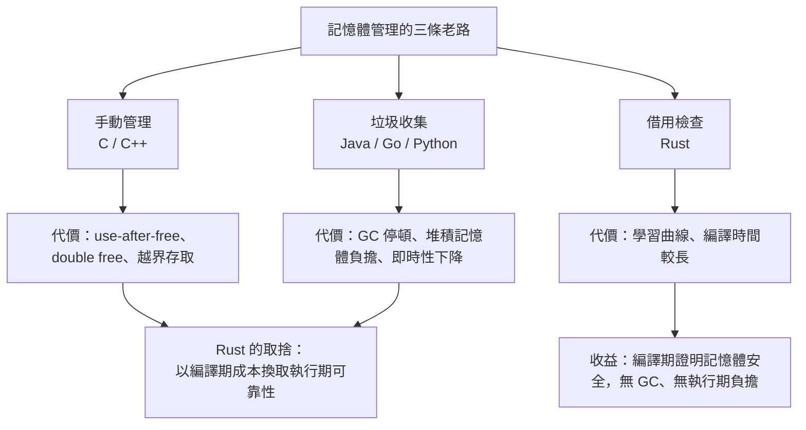

# 0.1 前言：為什麼選擇 Rust——安全性、性能與工程成本的三角

寫程式的人幾乎都曾經在某個深夜，被一個使用後釋放的指標搞得分頁終端與核心傾印僵在畫面上。那不是能力問題，而是語言選擇的必然結果。因為在 C 與 C++ 的世界裡，記憶體的所有權從來不曾被任何一行程式碼宣告，它只存在於每位工程師的腦中，並隨著團隊規模、程式碼行數與工期壓力而逐漸稀釋。Rust 的誕生，正是要把這段消失在腦中的推理，改寫成編譯器可以證明的命題。

## 一、記憶體管理的老路與各自的代價

人類處理記憶體的方式，大致只有三條路。第一條是手動管理，以 C 與 C++ 為代表：配置記憶體的權利與釋放記憶體的責任，都交給程式設計師自己。這條路的優點是性能與控制力極高，沒有任何執行期負擔，編譯產物貼近硬體；但它的代價是整個工業史上最龐大的弱點來源集合——use-after-free、double free、越界存取，以及隨之而來的記憶體洩漏。麥克軟與 Chrome 團隊公開的統計反覆顯示，超過七成的安全性弱點根源在記憶體，而其中絕大多數並非低階的系統程式錯誤，只是「某個物件已經被別人釋放」這種任何人類都會犯的錯。

第二條路是垃圾收集，以 Java、Go 與 Python 為代表。程式設計師完全不必思考釋放，物件的生命週期交給執行期堆積回收器處理，代價則轉嫁到兩個地方：一是停頓，無論是分代假說下的短暫 pause，還是大型物件造成的長時間標記，都可能在關鍵路徑上造成尾延遲；二是堆積記憶體負擔，因為回收時機落後於作用域結束，被回收前的物件仍佔著記憶體，對即時性系統而言這是一筆看不見的預算。Rust 不走這條路，它選擇讓編譯期就決定誰活到什麼時候。

第三條路是借用檢查，也就是 Rust 的做法。所有權（ownership）、借用（borrow）與生命週期（lifetime）構成一套靜態規則，編譯器會證明每個值都有唯一且明確的釋放時機，任何指標都不可能指向已被釋放的記憶體。任何時候，若一條路徑上有兩個指標可能同時指向同一塊記憶體，而其中之一又可能被寫入，編譯器就會直接拒絕這段程式碼，除非你用 `Rc`/`RefCell` 或執行緒安全的 `Arc`/`Mutex` 明確宣告「我承擔這個責任」。這種把不確定性顯式化的做法，與其說是限制，不如說是一種協議：程式碼的意圖被強迫著寫出來，而不是藏在心裡。

三條路徑的取捨，可以用一個簡化的成本模型來理解。若把一次記憶體操作在執行期的期望成本記為 $`c_e`$ ，編譯期的一次靜態分析成本記為 $`c_c`$ ，而程式碼行數記為 $`n`$ ，那麼手動管理與垃圾收集的總成本大致形如 $`O(n) \cdot c_e`$ ，而借用檢查把相當一部分 $`c_e`$ 提前換成了 $`O(n) \cdot c_c`$ 。真正的差別不在於誰更省，而是省在哪一段時間：一個在崩潰的那一瞬間付出，一個在建置的那一分鐘付出。對長時間運轉、無法重啟的系統來說，把風險前置到可以被人類檢查的編譯期，幾乎總是較划算的交易。

第三條路的代價是真實存在的：初期學習曲線陡峭，編譯時間比同級工具鏈更長，開發者必須用一種從未在別的語言遇過的方式思考資料流。Rust 的選擇從來不是「沒有代價」，而是**把代價從執行期移到編譯期**——這正是它能用零成本抽象同時提供記憶體安全與 C 級效能的根本原因。



## 二、Rust 的設計哲學：零成本抽象與可靠性

Rust 的哲學可以濃縮成一句話：把安全性從工程紀律變成語言保證。具體而言，它是一門**沒有垃圾收集器**的語言，同時**不要求你為了正確而使用 `unsafe`**——`unsafe` 存在，但它是一個明確的、可稽核的邊界，而不是逃逸口。在例外機制上，Rust 走的是另一條路：沒有例外，也沒有 `null` 指標，所有可能失敗的操作都必須以 `Result` 回傳，而沒有值的情況一律用 `Option` 表達，於是「空指標例外」這種在別的語言裡高居排行榜的錯誤，在型別系統層級就被排除了。

所謂零成本抽象，是指泛型、特徵（trait）靜態多態所帶來的抽象在編譯後不留痕跡：迭代器（iterator）會被展開成迴圈，泛型容器在單一型別的場景下被具體化，`dyn` 對照表則被編譯成一次函式指標跳轉。這讓 Rust 得以同時提供高階的表達力與低階的效能，抽象不再是「用方便換速度」的交易，而是兩者兼得。當可靠性成為編譯期可證明的性質，開發者就不必把時間耗在記憶體 bug 的排查上，那些成本會被重新投入到產品邏輯本身。

可以這麼說：在多數語言裡，抽象與效能之間是一條取捨的直線；在 Rust 裡，抽象與效能之間是一條平的線，因為編譯器負責吸收差額。`Vec<T>` 與 `Vec<U>` 是兩份不同的機器碼，但在原始碼裡它們是同一份泛型程式碼，撰寫者不需要為了效能而放棄抽象。類似的道理也體現在錯誤處理上，`Result` 不是把例外換成列舉值而已，它讓「這條路徑可能失敗」成為型別資訊的一部分，編譯器據此強迫呼叫端處理，於是「忘記檢查錯誤」這類疏漏從流程圖上消失。

另一個常被低估的保證是**並行的安全性**。Rust 的所有權與借用規則同時就是資料競爭的靜態分析器：若兩個執行緒可能同時存取同一份資料，其中至少一個必須是獨佔的，或兩者都不可變，否則程式碼無法通過編譯。這意味著 `Arc<Mutex<T>>` 的型別簽章不只是執行期保護的記號，而是編譯器已驗證過的結論。在 C++ 中要靠 code review、clang-tidy 靜態分析與數千小時的執行期測試才能逼近的性質，Rust 直接把它放進語言本身。

| 面向 | Rust | C++ | Go |
| --- | --- | --- | --- |
| 記憶體安全 | 編譯期保證，無 GC | 需手動管理，易出錯 | GC 管理，無 use-after-free |
| 垃圾收集器 | 無 | 無 | 有，伴隨停頓與堆積負擔 |
| 零成本抽象 | 是，特徵與泛型多態無執行期開銷 | 模板可行，零成本但易致編譯膨胀 | 介面呼叫有間接成本 |
| 執行緒安全 | 由型別系統保證無資料競爭 | 需手動搭配同步機制 | 執行緒安全但共享狀態須用通道 |
| 學習曲線 | 陡峭，觀念需長期調整 | 中等，門檻低但坑多 | 平緩，最容易上手 |
| 典型事故型態 | 編譯期錯誤 | 執行期記憶體錯誤 | 停頓與延遲 |

## 三、語言演進的關鍵節點

Rust 的歷史並不算長，但幾個節點足以劃出它的性格。2010 年，Graydon Hoare 個人啟動了這個專案，起因很朴素：他長期抱怨 C++ 缺乏記憶體安全，卻又寫不出比 C++ 更好用的高階替代品。Mozilla 在 2012 年成為主要贊助者，Rust 也從語言研究走向瀏覽器引擎的實際需求。2015 年 5 月，Rust 1.0 發布，代表語言進入穩定期，也意味著往後的每個版本都不再允許破壞性變更。2018 年，Rust 進入 WebAssembly 的官方首選語言行列，社群得以在瀏覽器裡做從未想像過的事。

2021 年 6 月發布的 1.56 版本，是生態系結構的一次重大轉向：Rust 社群開始以三年為週期聚焦新的工作重點，1.56 確立了以 `async`/`await` 與 WebAssembly 為核心的方向，此後每年都有新的穩定版沿著同一節奏推出，讓語言的演進從「社群各自嘗試」轉為「有方向、有路線圖的整合」。2024 年 2 月的 1.85 版本帶來了 2024 版編輯（Rust 2024 Edition），統一了語法慣例並加速了編譯速度；而在 2024 年底，官方進一步改善了借用檢查器與 `async` 的相容性，讓未來的借用規則能夠涵蓋更複雜的非同步情境。回頭看，這條時間軸說明一件事：Rust 的成熟不是一次性的設計，而是靠著穩定的版本節奏與社群治理逐步收斂的。

版本節奏之所以能夠穩定，前提是語言保證了相容性。Rust 遵循「先讓它能編譯，再讓它變好」的原則：一個被廣泛使用的 API 若要變更語意，必須經過正式的 RFC（Request for Comments）流程，經由技術評審委員會投票表決，然後經歷長達數個版本的遷移期。這種治理成本看似高昂，卻換來了生產環境可以放心升級的基礎設施；對照 C++ 二十年間被新標準與函式庫演進反覆折騰的歷史，Rust 的相容性政策是一項被低估的工程成果。

至於為什麼是 WebAssembly 與非同步這兩條主線？前者讓 Rust 的記憶體安全特性得以在瀏覽器沙箱中發揮，同時獲得一份極佳的可攜性示範；後者則是回應真實世界的 IO 密集需求——一個網路服務需要同時維護上萬個連線，若每個連線配一個 OS 執行緒，堆積記憶體與排程開銷都會失控，Rust 的無堆積成本的 `Future` 讓單一執行緒就能輕鬆承載大量併發工作。2021 年之後，社群重心又轉向嵌入式的 `no_std` 支援、更好的錯誤處理 API 與編譯速度優化，這些都是同樣的節奏。

## 四、生態系與工業採用

Rust 的另一項優勢是生態系的完整度。Cargo 是官方工具鏈，統一了建置、測試、發布與文件生成，並且把依賴管理做得非常省心；crates.io 上已有數十萬個公開套件，涵蓋序列化、HTTP、資料庫、密碼學、CLI 介面到遊戲引擎等幾乎所有領域。Tokio 讓非同步執行模型在語言層級獲得一等公民的地位，Serde 提供了衍生式的序列化框架，Axum 則讓寫出高效能 Web 服務變得輕鬆。更特別的是 Bevy 這類以資料導向為核心的遊戲引擎，證明 Rust 不只適合後端，也能在圖形與即時渲染領域嶄露頭角。

工業界的採用並非一時的流行，而是由安全需求驅動的長期投資。Linux 核心自 6.1 版開始接受 Rust 程式碼，主要用於驅動程式與抽象層；Chromium 與 Android 為了降低記憶體弱點而導入 Rust，Android 團隊更明確以「在數百萬台裝置上徹底消滅某類漏洞」為目標。Microsoft 在多個產品線推動 Rust，Microsoft Research 的 Fuzzilli 專案則成為 Rust 模糊測試的重要基礎設施；Cloudflare 把 Rust 用於邊緣網路與 DDoS 防禦的核心元件，理由正是效能與可靠性可以同時獲得。

這些案例有一個共同特徵：它們全都處在「弱點成本極高」的領域。作業系統核心的漏洞可能被用來取得根權限，瀏覽器引擎的漏洞幾乎等於在使用者裝置上執行任意程式碼，邊緣節點的崩潰會直接轉化為服務中斷。在這些位置，少一個記憶體錯誤所省下的除錯時間，比多花在學習曲線上的時間要有價值得多。反過來說，如果你的專案是三天就能做完的原型，或是團隊每季都在換血，Rust 的前期成本很可能收不回來——這也是下一節要談的。

```bash
# 檢查環境中可用的 Rust 版本
rustc --version
cargo --version
```

## 五、Rust 不適合的地方

誠實地說，Rust 並不是所有情境的正解。它的編譯時間顯著偏長，大型專案的一次完整建置可能遠超同儕的 C++ 或 Go，迭代節奏因而受影響；它對某些依賴動態語言特性的寫法——例如執行期反射、隨意改變物件的形狀、全域可變狀態——幾乎是敵意的，設計上直接拒絕這些模式；對已經龐大到數百萬行的 C++ 專案而言，遷移成本極高，混編期間的 FFI 邊界也會帶來新的抽象漏損；同時編譯期對記憶體與 CPU 的需求也高於多數語言，對 CI 資源有限的團隊是一筆要計算的成本。這些不是可以迴避的瑕疵，而是同一枚硬幣的另一面——你選擇了什麼，就必然放棄了什麼。

「編譯時間」這一項尤其容易被低估。Rust 的單一 crate 編譯往往快得驚人，但在一個依賴數百個 crate 的工作區裡，增量編譯的失效邊界卻相當保守，一次改動可能連帶失效數十個下游 crate。緩解的方式是把大型專案拆成更多小 crate、謹慎使用泛型與巨集展開，並在 CI 上配置快取與分散式建置，但這些都是需要刻意經營的工程，而不是預設免費的。對照 C++ 模板的編譯膨脹問題，Rust 的做法相當節制，但它畢竟也沒有消除這個問題。

在語言特性上，Rust 的「無 GC、無全域可變狀態、無執行期型別擦除」是一組互相咬合的取捨。執行期多型必須透過 `dyn` 特徵物件或泛型來表達，兩者都有成本；`unwrap_or_else` 這類閉包在熱路徑上仍可能帶來額外開銷；`Rc` 的參考計數是非原子的，跨執行緒時必須換成 `Arc` 並承受原子操作的代價。這些都不是缺陷，而是同一個設計立場在不同面向的投影：寧可讓編譯器多做事，也不要在執行期留下不確定的分支。

## 六、本書的閱讀方式

因此，請不要把這本書當成語法手冊。Rust 的所有權不是一個語法規則，借用檢查器也不是一個需要繞過的關卡；它們是一種**思維訓練**，強迫你把「資料從哪裡來、活多久、誰能看見」這件事寫成程式碼能表達的東西。借用檢查器在你寫下 `&mut` 的那一刻拋出的錯誤，通常指向設計上的隱憂：共享狀態太多、依賴關係太隱晦、抽象層次錯置。學會傾聽這些編譯期訊息，才是真正進入 Rust 的門檻；語法反而是三章之後就能自然上手的事。

下面這個極小的範例，或許能讓你先行感受「所有權直覺」。它不需要任何前置知識，卻已經包含了 Rust 最核心的直覺：值離開作用域時自動被釋放，而把它交給別人以後，自己就不能再用了。
```rust
fn main() {
    // 這個字串由 main 擁有
    let greeting = String::from("Hello, Rust");

    {
        // 借用：只在這個區塊內借用 greeting，不取得所有權
        let reference = &greeting;
        println!("借用階段：{reference}");
    } // 借用在此結束，greeting 仍屬於 main

    // 移動：把所有權轉交給 taken，之後 greeting 不可再使用
    let taken = greeting;

    println!("移動之後：{taken}");
    // println!("{greeting}");  // 編譯錯誤：值已被移動
}
```

把這段程式碼在編譯器裡跑過一次，看它先接受、再拒絕，你就已經摸到 Rust 的邊界在哪裡。三種行為各自對應一個概念：`&greeting` 是不取得所有權的借用，作用域結束後借用即失效；`let taken = greeting;` 是一種移動（move），所有權轉移後原變數失效，但底層的堆積記憶體並沒有被複製，因此沒有額外的配置成本；而最後那行被註解掉的程式碼會得到編譯器的「value moved here」錯誤。若把 `String::from` 換成整數 `42`，編譯器會因為整數是 `Copy` 型別而允許重複使用——這個差異，正是「所有權」這套機制只作用在擁有堆積資源的值上的直接證據。

第 1 章起會從工具鏈安裝與第一個程式開始，之後一路走向所有權、生命週期、錯誤處理、非同步並行，最終以三個可運作的專案收束。整條路徑的終點，不是「學會 Rust 的語法」，而是「能夠用 Rust 的方式思考資料流」。

## 七、安全性、性能與工程成本的三角

回到標題：Rust 的誘惑不在於它比 C++ 快，也不只在於它比 Go 安全，而在於它讓**三者同時朝正確的方向移動**。安全性提高了，因為記憶體錯誤被編譯期消除；性能沒有損失，因為沒有 GC 也沒有執行期檢查，抽象還能零成本；工程成本在前期會上升——你要學會新的思考方式，前期編譯也會更慢——但中期之後，會花在除錯、回歸與安全稽核上的時間會急劇下降。這個三角的平衡點並非對所有團隊都相同，但它確實存在，而本書的目的，就是帶你走到能夠自己判斷自己站在哪一邊的位置。
