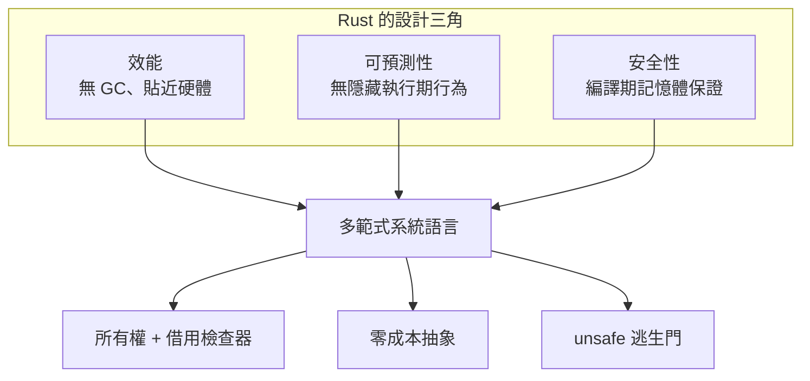

# 1.1 什麼是 Rust？它的設計哲學與應用場景

## 一門在「安全」與「控制」之間取捨的系統語言

Rust 是一門多範式的系統程式語言，同時具備低階語言的資源控制能力與高階語言的抽象表達能力。它不像 C 那樣把抽象完全交給程式設計者的紀律，也不像 C++ 那樣把所有安全機制做成可選的模板；它試圖在語言層面直接規定「什麼樣的程式碼是安全的」，並且交由編譯器負責證明。Rust 沒有垃圾收集器，也沒有手動呼叫 `free` 的義務，取而代之的是所有權與借用檢查器這套靜態規則。當然，Rust 也保留了 `unsafe` 區塊，讓需要直接操作硬體、呼叫 C 函式庫或撰寫 FFI 的工程師可以明確地表達「這裡我承擔責任」，從而在安全的預設值與必要的逃生門之間取得平衡。

理解 Rust 最快的方式，是先理解它解決的問題。長期以來，軟體安全最大的單一來源並非演算法錯誤，而是記憶體管理錯誤：緩衝區溢出、使用釋放後記憶體、指標越界、重複釋放。這類錯誤在 C 與 C++ 的龐大程式碼庫中反覆出現，而且往往並非「寫錯了」，而是「忘了考慮某個邊界情況」。Rust 的整個設計軸心，就是要把這類錯誤從「執行期可能發生」變成「無法通過編譯」。

Rust 的定位因此可以畫成三個交疊的圓：效能、可預測性與安全性。大多數語言只能穩穩佔住其中一到兩個，Rust 試圖三者兼得，代價則是編譯期更長的借用檢查時間、陡峭的學習曲線，以及一種與其他語言明顯不同的所有權心智模型。



## 設計目標與嚴格的「零成本抽象」

Rust 官方文件裡常被引用的一句話是「Rust 的目標是提供類似 C++ 的效率，但有更高的安全性」。這句話的落點在「零成本抽象」（zero-cost abstraction）。這個詞經常被誤解成「抽象在執行期不花任何時間」，更精確的定義其實是：**抽象不引入執行期成本**。它允許在某些情況下有成本，但這個成本必須與手寫同等功能的程式碼相當。

具體來說，迭代器鏈 `iter().map(f).filter(g).collect()` 與手寫迴圈在最佳化後產生的機器碼幾乎相同；泛型在單型化（monomorphization）後與直接使用具體型別沒有差別；enum 的樣式比對在編譯期被轉成跳轉表或分支。這些都不是「執行期零成本」的直接保證，而是「你手寫的等價程式也不會更省」的保證。

這個理念背後是一組明確的取捨：

| 設計目標 | 具體手段 | 付出的代價 |
|---|---|---|
| 安全性 | 所有權、借用檢查、`Result`/`Option` | 編譯期檢查時間較長 |
| 性能 | 無 GC、單型化、對 LLVM IR 的直接控制 | 底層複雜度不比 C 低 |
| 可預測性 | 明確的型別、無隱式轉型、無例外隱藏控制流 | 程式碼更囉嗦 |
| 生產力 | Cargo、crates.io、`rustfmt`、`clippy` | 進入叢集時要熟悉一套慣例 |

Rust 的生產力並非來自「寫較少行數」，而是來自「除錯時間的節省」與「維護成本的下降」。錯誤在編譯期被攔下，程式碼就不必在半夜被叫醒。

「零成本」這個詞最容易被誤解成「什麼都沒有」，所以需要再強調一次它的邊界。它說的是抽象的**增量成本**為零，而非抽象本身免費。泛型會產生程式碼膨脹，因為每個型別參數組合都會被單型化成一份獨立實作；迭代器鏈在未最佳化時確實比手寫迴圈慢；錯誤處理用 `Result` 而非例外，會讓簽名變長、需要顯式傳播。Rust 的做法是否認這些成本，而是把它們變成可預期、可選擇的。

值得強調的是，這個判準與 C++ 的模板設計哲學高度一致。Rust 借用檢查器的基本單位是編譯期的靜態檢查，而 C++ 模板同樣在編譯期展開成具體程式碼。兩者都拒絕在執行期做泛型解析，因此 Rust 也沒有 Java 的型別擦除所帶來的装箱開銷與最佳化障礙。差別在於 Rust 把「型別參數必須滿足一組可檢查的約束」寫進了語言本身，讓編譯器能在生成機器碼之前就確認型別行為是安全的。

Rust 的抽象能力還有一層常被忽略的面向：它並不排斥高階語言的表達力。列舉（enum）與模式比對（pattern matching）提供了代數資料型別（algebraic data type）的味道，泛型與特徵（trait）提供了類似 Haskell 的靜態多態，巨集（macro）提供了類似 Lisp 的擴充性，而 `async` 與 `await` 則讓非同步流程可以寫成接近同步的樣子。這些能力之所以能在沒有垃圾收集器的系統語言中存活，是因為它們全都發生在編譯期。

## 社群與治理

Rust 的另一項常被低估的資產是它的治理結構。Rust 由 Mozilla 發起，後來移交給 Rust 基金會，成為一個由多個公司與個人捐贈者共同支持的專案。它的核心開發流程採用「拉取請求 + 審查 + 顧問團」的機制，任何重大語言變更都必須經過技術評審委員會討論。這種相對保守的治理帶來了語言變更的穩定性，但也造成了迭代速度的爭議。

實務上對 Rust 社群最常見的批評是它「過度民主」，小型改進往往需要漫長的討論才能落地。另一個常見的觀察是社群文化的差異：Rust 社群重視編譯錯誤訊息的可讀性與文件品質，新手問題通常會被耐心地引導而非直接拒答。對初學者而言，官方書籍與文件被公認為程式語言中最優秀的一批教學材料之一。

## 與主流語言的對照

把 Rust 放進既有工具箱裡比較，才能看出它的位置。C 是最直接的祖先：同樣是無 GC、同樣貼近硬體，但 C 把所有權交給程式設計者的紀律。C++ 提供零成本抽象與龐大的生態，但安全機制幾乎都是可選的，裸指標依然是合法且常用的寫法。Go 是近年的強烈對照，它以簡潔的語法與極快的編譯速度取勝，但垃圾收集器帶來了延遲抖動，記憶體安全靠執行期檢查與競態偵測器而非編譯期證明。Python 則完全站在另一個極端：動態型別、GC、執行期錯誤，成本低但只能在受控環境中運行。

```rust
fn main() {
    // 靜態型別、編譯期檢查、無 GC
    let xs: Vec<i64> = vec![3, 1, 4, 1, 5];
    let total: i64 = xs.iter().filter(|x| **x > 1).sum();
    println!("total = {total}");
}
```

四種語言在同一個「讀取環境變數並解析」的小任務上，安全保證的來源截然不同。C 與 C++ 依賴程式設計者不犯錯，Go 依賴執行期偵測，Rust 依賴編譯期證明。這個差異在專案規模放大後會被指數化地放大，因為「不犯錯」的概率隨程式碼行數下降，而「編譯期證明」的覆蓋率恆為百分之百。

## 適用場景

Rust 最擅長的，是那些同時需要「接近底層」與「不怕出錯」的領域。作業系統核心與驅動程式是它的原生場景，因為核心程式碼最怕的正是遠端攻擊帶來的記憶體破壞；Linux 核心社群自 2021 年起持續在 rust-for-linux 專案中評估 Rust 進入核心的可行性，多數結論是核心中的部分子系統（例如驅動與檔案系統介面層）最適合先行導入。嵌入式開發受益於沒有 GC 帶來的抖動與可預測的堆疊使用量，Rust 也讓嵌入式社群得以在沒有作業系統的環境中使用安全的抽象，例如 `no_std` 環境下的 `embedded-hal` 介面。

命令列工具是 Rust 近年最成功的應用方向。`ripgrep` 以多執行緒與 SIMD 加速的搜尋在效能上擊敗傳統的 `grep`，`fd` 用更友善的預設值取代 `find`，`bat` 則把語法高亮帶進終端機。它們共同的成功要素是：啟動時間在毫秒級、記憶體占用低、並且透過 crates.io 分發時能讓一般使用者用套件管理器直接安裝。

網路服務是另一個重鎮。`tokio` 這類執行期讓 Rust 能支撐高併發連線，同時保有 `Send` 與 `Sync` 提供的編譯期資料競爭保證。在相同硬體上，Rust 服務的吞吐量與延遲表現通常優於依賴垃圾收集器的同類服務，因為每一次配置都可以被仔細控制。這對基礎設施成本有直接影響：更低的每請求記憶體用量，代表同樣的機器能服務更多流量。

Rust 還有兩個特別值得注意的領域。WebAssembly 是 2018 年後 Rust 的重要增長點，`wasm-bindgen` 讓 Rust 與 JavaScript 互通，而 wasm32 目標在安全沙箱中執行、體積小、啟動快，非常適合瀏覽器外的邊緣運算與雲端函式。區塊鏈同樣是這樣的市場：鏈上程式碼一旦部署就無法事後回頭修補，編譯期保證因此具有直接的經濟價值，太多以 Rust 撰寫的智能合約正是被記憶體安全漏洞重複洗劫過。此外，瀏覽器引擎也是 Rust 的重要落點，Servo 與 Firefox 的 Quantum 專案證明了 Rust 能承擔瀏覽器引擎這種規模龐大又必須安全的系統軟體。

值得留意的是，以上所有場景都共享同一個特徵：出錯的代價很高。核心崩潰會讓整機重啟，嵌入式錯誤可能燒毀硬體，合約漏洞會直接損失資金。Rust 把記憶體安全從「盡力而為」提升為「語言層面的保證」，在這些領域的價值遠高於一般商業應用。

## 不適用場景

誠實地說，Rust 並非所有情境的最佳選擇。快速 GUI 原型是明顯的弱勢區：Rust 的編譯時間讓「修改、執行、看到結果」的迴圈變得漫長，而 GUI 生態圈仍以 Python 的綁定與 C++ 的既有框架為主。對於編譯時間極度敏感的大型專案，例如需要頻繁全量重建的巨型單體倉庫，Rust 與既有 C++ 基礎設施的工具鏈整合也仍有摩擦。

在已經成熟的 C++ 程式碼上做漸進遷移時，Rust 與 C++ 之間的 FFI 邊界本身就是新的風險來源。型別語意的落差常常在介面層而非實作層爆發：一個 C++ 的 `std::vector` 傳到 Rust 端，長度資訊由誰維護、迭代器失效的規則如何對齊，都需要人工設計。此外，若團隊無法投入時間建立所有權心智模型，Rust 的「編譯不過」特性會從優勢轉化為阻礙生產力的來源。

另一個常見的誤解是把 Rust 當成「更好的 C++」而全面替換。實際上 Rust 與 C++ 在很多地方是互補而非競爭的：C++ 有更成熟的 GUI、遊戲與數值運算生態，Rust 有更安全的系統層。混合語言的團隊用 C++ 寫上層、用 Rust 寫核心，是相當務實的選擇。

## 語言演進的關鍵節點

Rust 的歷史比許多人以為的短，但節奏相當密集。2015 年 5 月的 1.0 版本是真正的分水嶺，在此之前的 Rust 經歷了借用檢查器與 Green 垃圾收集器的多次重寫，1.0 確立了所有權模型作為不可動搖的核心。2018 年是 WebAssembly 正式隨主流瀏覽器普及的年份，Rust 的 wasm32 目標因此獲得大量關注，生態快速成形。

2021 年 1.56 帶來了 Rust 2021 版次（edition），把不相交欄位型別與 panic 語法不一致等破壞性變更集中處理，同時推動了 Cargo 對 workspace 與依賴解析的改進。2024 年 1.85 則是近年最重要的節點之一，它讓 Rust 2024 edition 正式落地，引入非同步函式在特徵中的支援、為生成器保留 `gen` 關鍵字、要求 `unsafe` 屬性必須附帶說明文件，並放寬生命週期捕捉規則。最具象的變化是 Rust 開始要求最低 1.84 版本，這意味著它正式放棄對非常舊工具鏈的支援，換取語言設計上的自由度。

| 版本 | 時間 | 代表性變更 |
|---|---|---|
| 1.0 | 2015-05 | 所有權模型定案，借用檢查器穩定 |
| 1.25 | 2018-05 | `async` 與 `await` 語法確立 |
| 1.39 | 2019-11 | `async fn` 與 `await` 正式可用 |
| 1.56 | 2021-10 | Rust 2021 edition，workspace 支援 |
| 1.85 | 2024-02 | Rust 2024 edition 落地 |

版次（edition）機制本身值得留意。它讓 Rust 可以每三年進行一次向下相容的破壞性變更，而不必重演 C++ 歷經三十年的相容性包袱。專案在 `Cargo.toml` 中宣告 `edition = "2021"`，編譯器便依此套用對應的語義規則，同一份程式碼甚至可以在不同版次下編譯，以利於遷移。

## 同一件事的兩種寫法

下面用同一個鏈結串列的求和任務，對照 C++ 的裸指標與 Rust 的所有權。兩段程式都會輸出 `3`，但 C++ 版本無法阻止刪除節點後仍使用指標的程式碼，而 Rust 版本連「懸垂指標」這個狀態都無法表達。

```cpp
#include <iostream>

struct Node {
    int value;
    Node* next;
};

int sum(Node* node) {
    if (node == nullptr) {
        return 0;
    }
    return node->value + sum(node->next);
}

int main() {
    Node second{2, nullptr};
    Node first{1, &second};
    std::cout << sum(&first) << "\n";  // 輸出 3
    // 錯誤示範（編譯得過，但執行期未定義行為）：
    // delete &second;
    // std::cout << sum(&first);      // 讀取已釋放記憶體
}
```

```rust
struct Node {
    value: i32,
    next: Option<Box<Node>>,
}

fn sum(list: &Option<Box<Node>>) -> i32 {
    match list {
        Some(node) => node.value + sum(&node.next),
        None => 0,
    }
}

fn main() {
    let list = Some(Box::new(Node {
        value: 1,
        next: Some(Box::new(Node { value: 2, next: None })),
    }));
    println!("{}", sum(&list)); // 輸出 3
}
```

Rust 版本的關鍵在於 `Box<Node>` 明確表達「堆積配置的擁有權」，而 `Option` 讓「沒有下一個節點」成為型別的一部分而非空指標。當 `list` 離開作用域時，Rust 會遞迴地釋放整個串列，程式碼裡沒有任何一處呼叫 `delete`，也沒有任何一處可能忘記呼叫。若有人試圖在釋放後再讀取，編譯器會直接拒絕，而不是讓程式在執行期表現出未定義行為。

## 為什麼安全性必須由編譯器保證

有一個常見的直覺是：既然 Rust 的編譯器已經把安全規則寫得這麼嚴格，那麼只要照著規則寫程式就好，為什麼還需要其他工具？因為規則本身就是誤差的來源。

考慮一個有 $ n $ 個提交的開源專案，每個提交都會被許多貢獻者審查。若單一提交的缺陷逃逸機率為 $ p $ ，而每個提交平均被 $ k $ 位審查者獨立檢查，則漏掉的機率可用一個簡化模型描述：

$$
P(\text{逃逸}) \approx p^{k}
$$

也就是說，審查者數量以指數方式降低逃逸機率。但關鍵在於 $ k $ 會隨專案規模與團隊規模而趨於飽和：人一天能認真看的程式碼行數是有限度的，隨著程式碼成長， $ k $ 幾乎不會成長。若 $ p $ 為固定的 $ 10^{-2} $ ，則需要 $ k = 4 $ 才能把逃逸機率壓到 $ 10^{-8} $ 的量級；但當程式碼多到沒有任何團隊能維持四輪有效審查時，這個保證就失效了。

更根本的是，審查能力與缺陷分佈並不匹配。記憶體安全缺陷屬於「需要特定推理才能發現」的類型：單看一個函式是對的，只有把兩百行的上下文一起看才知道存取已經失效。這類推理正是人類審查最薄弱、工具最擅長的領域。

因此結論是：把安全性從「工程紀律」轉移到「語言保證」，並非為了取代審查，而是把審查從不可能完成的任務中解放出來。編譯器可以在毫秒內對整個程式碼庫做完整且一致的檢查；人可以把精力集中在真正需要理解意圖的地方。Rust 在 2018 年到 2023 年間被微軟、亞馬遜、Google 與 Meta 陸續導入作業系統與基礎設施層，正是這條推理路徑的實證。

安全性不該是「多花時間小心就能得到」的東西，它應該是「寫出來就必然具備」的性質。這就是 Rust 存在的理由，也是它值得學習的理由。

---

下一節將說明要動手寫第一行程式之前，需要先把 Rust 的工具鏈裝好：誰負責版本管理、誰負責編譯、誰負責建置與相依管理。
