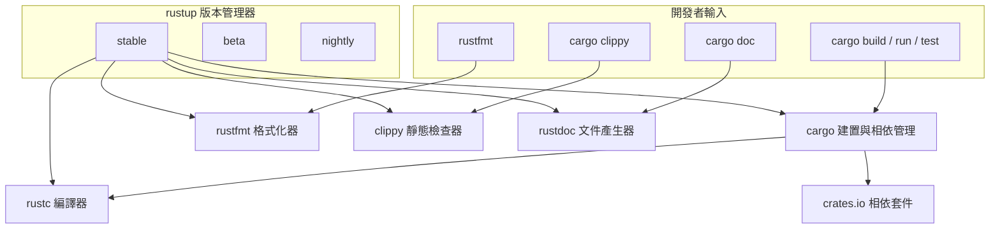

# 1.2 安裝 Rust 工具鏈（rustup、rustc、cargo）

## 工具鏈的組成與分工

初接觸 Rust 的時候，最常見的困惑是「到底要裝幾個東西」。答案是一個官方發行工具鏈（toolchain），其中包含六個角色分工明確的元件。最上層是 `rustup`，它是版本管理器而非編譯器，負責安裝、移除與切換不同版本與不同目標的 Rust 工具鏈，所有工具鏈檔案都存放在 `~/.rustup` 目錄下。

`rustc` 是真正的編譯器，它把 Rust 原始碼轉譯成機器碼，但在日常開發中你幾乎不直接呼叫它，而是透過 `cargo` 驅動。`cargo` 是建置工具與相依套件管理器的合體，它負責解析 `Cargo.toml`、下載相依套件、決定編譯順序、呼叫 `rustc`、並提供執行、測試與文件產生等功能。附帶的三個官方工具各司其職：`rustfmt` 負責程式碼格式化，`clippy` 是靜態檢查器，提供數百條常見錯誤與不 Idiomatic 寫法的診斷，`rustdoc` 則從原始碼中的文件註解產生 API 文件。



這個分層設計的第一個好處是可替換性。編譯器與建置工具是分開的，因此社群可以寫替代的建置器，或讓 `cargo` 呼叫外部的 C 編譯器。第二個好處是可攜性：因為 `rustup` 把所有東西放在使用者目錄下，幾乎不需要系統管理員權限，也幾乎不會與系統套件管理器產生的版本衝突。

三個官方輔助工具值得單獨說明。`rustfmt` 的設計哲學是「零設定爭議」，它不接受任何風格選項，所有格式規則都寫死在工具裡，唯一的選擇是要不要在 CI 中檢查格式。這種做法徹底消除了團隊內部關於縮排、換行與引號風格的無盡爭論，讓格式差異不再出現在程式碼審查的討論中。`clippy` 則是把常見的錯誤模式與不建議的寫法編碼成數百條 lint，例如偵測 `unwrap()` 在可能為空的情況下被使用、建議改用 `iter().map(..)` 而非手動迴圈、警告不必要的 `clone()` 呼叫。它與 `rustc` 共用同一套前端，因此診斷訊息格式一致。

`rustdoc` 是第三個工具，它從原始碼中的 `///` 文件註解產生 API 文件，並且支援在文件中直接執行測試程式碼。`cargo doc --open` 是最常見的用法，會建置文件並自動開啟瀏覽器。文件中的程式碼範例會在建置時被實際編譯，若範例有誤，建置就會失敗，這個設計讓文件不容易過時。

`rustup component` 指令用來管理這些元件，`rustup component add clippy` 安裝、`rustup component remove clippy` 移除、`rustup component list` 列出可用項目。元件與工具鏈是綁定的，換了一個工具鏈就要重新安裝元件，這也是為什麼 `rust-toolchain.toml` 可以聲明 `components` 欄位的原因。

| 元件 | 角色 | 日常用法 |
|---|---|---|
| `rustup` | 版本與目標管理器 | `rustup update`、`rustup target add` |
| `rustc` | 編譯器本體 | 少直接呼叫，多由 `cargo` 驅動 |
| `cargo` | 建置、相依管理、測試、發布 | `cargo build`、`cargo run`、`cargo test` |
| `rustfmt` | 程式碼格式化器 | `cargo fmt`，零設定爭議 |
| `clippy` | 靜態檢查器 | `cargo clippy`，數百條 lint |
| `rustdoc` | 文件產生器 | `cargo doc --open` |
| `rust-src` | Rust 標準函式庫原始碼 | 供 rust-analyzer 與 nightly 使用 |

除了官方工具之外，社群也提供了編輯器整合的套件，例如 Visual Studio Code 的 rust-analyzer 語言伺服器。`rust-analyzer` 是以 Rust 實作的，它提供程式碼補全、跳至定義、內嵌提示（hover）與即時診斷。把它設定為編輯器的語言伺服器，可以獲得接近 IDE 的體驗，而這些體驗本質上是「持續執行 `cargo check` 並把結果送回編輯器」。理解這一點很重要：編輯器中的紅色波浪線並不是編譯器的全部訊息，真正的編譯器仍然是最權威的裁判。

## 在各平台安裝

最通用的安裝方式是官方的 `rustup` 腳本。它會下載並執行一個小型安裝程式，過程中會詢問要安裝的預設工具鏈，建議選擇 `stable`。

在 Linux 與 macOS 上，最簡單的做法是直接執行：

```bash
curl --proto '=https' --tlsv1.2 -sSf https://sh.rustup.rs | sh
```

這行指令會下載安裝腳本並立即執行。習慣上會先下載再檢查內容，比較符合資安原則：

```bash
curl --proto '=https' --tlsv1.2 -sSf https://sh.rustup.rs -o rustup-init.sh
sh rustup-init.sh
```

安裝過程中有三個常見的互動提示。第一個是預設工具鏈的選擇，一般輸入 `1` 即可選擇 `stable`；若希望保守起見先看新版變化，可以選 `2` 進入 `beta`。第二個是提問是否要安裝 `rustfmt` 與 `clippy`，這兩個官方工具幾乎不需要猶豫，應直接接受。第三個是關於 `PATH` 的說明，安裝程式會修改 `~/.profile` 或 `~/.bashrc`，在 macOS 上則是 `~/.zshrc`，把 `~/.cargo/bin` 加入搜尋路徑。

若系統上沒有 `curl`，多數 Linux 發行版可以使用 `wget`：

```bash
wget --https-only https://sh.rustup.rs -O rustup-init.sh
sh rustup-init.sh
```

macOS 使用 Homebrew 的使用者也可以安裝 `rustup`，但要注意 Homebrew 提供的 `rust` 公式與 `rustup` 的行為不同，直接安裝 `rustup` 才是取得多版本管理能力的正確方式：

```bash
brew install rustup
rustup-init
```

Windows 上則是下載 `rustup-init.exe` 執行安裝程式。安裝過程會詢問預設工具鏈與是否安裝 Visual Studio 的 C++ 建置工具，後者是必要的，因為 Rust 在 Windows 上連結時需要使用微軟的連結器（linker）。

在 Linux 上若要安裝給所有使用者，可以改用套件管理器，例如 Debian 與 Ubuntu 的 `apt install rustup`，但要注意這類套件版本往往落後官方數個版本，且不提供 `rustup` 的完整功能。

## 驗證安裝

安裝完成後要重新載入 shell 設定（通常是 `source ~/.cargo/env`），讓 `~/.cargo/bin` 進入 `PATH`。接著用三個指令確認：

```bash
rustc --version
cargo --version
rustup --version
```

正常情況下會看到類似 `rustc 1.85.0 (4d91de4e8 2025-02-17)` 的輸出，`cargo --version` 會顯示對應的版本號與編譯日期。三者版本一致代表工具鏈安裝完整。如果 `rustc` 找不到但 `rustup` 存在，問題幾乎都在 `PATH` 設定。

確認安裝是否真正可用，最可靠的方式是編譯並執行一個實際的程式，而不是只看版本號。在 macOS 與 Linux 上可以先建立一個暫存目錄：

```bash
mkdir -p ~/rust-smoke-test && cd ~/rust-smoke-test
rustc hello.rs -o hello && ./hello
```

這個步驟會連同系統的連結器一起驗證，能夠抓出缺少 `cc`、`ld` 或微軟連結器等問題。

在 macOS 上，可以把匯出指令寫進 `~/.zshrc`：

```bash
echo 'source "$HOME/.cargo/env"' >> ~/.zshrc
source ~/.zshrc
```

## 多版本與工具鏈管理

Rust 採每六週一次發行的節奏，三條並行的發行軌道讓不同需求的團隊各取所需。`stable` 是穩定版軌道，每六週發布一次，正式環境應該使用它。`beta` 是下一個穩定版的預覽，功能已凍結，主要用來驗證即將到來的變更。`nightly` 則是每日建置版本，含有尚未穩定的實驗性功能，某些語言特性（例如常數泛型）只有 nightly 才能使用。

選擇哪一條軌道，是一個關於風險的決策。使用 `stable` 意味著 API 相對穩定，但可能需要等待數月才能取得新功能。使用 `nightly` 可以第一時間使用最新特性，但必須接受 API 可能隨時改變，因此只應在明確標示的不穩定功能（feature gate）中使用 nightly 專屬特性。實務上常見的折衷是「以 stable 為主，在個別 crate 中用 nightly 特性」，Rust 對此提供了 `#![feature(...)]` 屬性搭配 `cargo +nightly` 的工作流。

常見的工具鏈操作如下：

```bash
rustup toolchain list
rustup install nightly
rustup default stable
rustup update
rustup component add clippy rustfmt
rustup target add wasm32-unknown-unknown
```

`rustup toolchain list` 會標示出目前預設的工具鏈，通常在預設項目旁加上 `(default)` 標記。若某個專案需要特定版本，可以在其目錄下建立 `rust-toolchain.toml` 檔案，把版本鎖定：

```toml
[toolchain]
channel = "1.85.0"
components = ["rustfmt", "clippy"]
```

如此一來，進入該目錄後執行任何 `cargo` 指令都會自動使用指定工具鏈。

## 目標 triples 與交叉編譯

Rust 的編譯目標由「目標 triple」標識，例如 `x86_64-unknown-linux-gnu` 描述的是架構、廠商、作業系統與 ABI。要為其他架構編譯，先安裝該目標的標準函式庫：

```bash
rustup target add aarch64-unknown-linux-gnu
cargo build --target aarch64-unknown-linux-gnu
```

交叉編譯的門檻主要在於連結器與 C 函式庫。Rust 會為目標平台產生物件檔，但最終的連結步驟仍然需要對應平台的 `gcc`、`ld` 與 C 執行期。在 Linux 上使用 `aarch64-unknown-linux-gnu` 時，通常需要安裝 `gcc-aarch64-linux-gnu` 這類交叉工具鏈套件。對於無法使用 GNU 工具鏈的目標，例如 Apple Silicon 與 Windows ARM，提供 `aarch64-apple-darwin` 與 `aarch64-pc-windows-msvc` 等目標。

常見的目標包括 `x86_64-unknown-linux-gnu`（Linux 桌面）、`x86_64-apple-darwin`（Intel Mac）、`aarch64-apple-darwin`（Apple Silicon）、`x86_64-pc-windows-msvc`（Windows）、`x86_64-unknown-linux-musl`（使用 musl libc 的靜態連結）以及 `wasm32-unknown-unknown`（WebAssembly）。

其中 musl 目標值得特別一提。glibc 是 Linux 上最廣泛使用的 C 函式庫，但它的動態載入行為在某些容器環境中會造成相容性問題，`musl` 目標使用 Alpine Linux 的 musl libc，可以產生體積更小、行為更可預測的執行檔。對於要部署到邊緣運算設備或製作單一檔案程式的情境，`x86_64-unknown-linux-musl` 是很實用的選擇。

WebAssembly 目標的使用方式稍有不同。Rust 編譯到 wasm32 之後是一個 `.wasm` 檔案，還需要透過 `wasm-bindgen` 與 JavaScript 側溝通：

```bash
rustup target add wasm32-unknown-unknown
cargo build --target wasm32-unknown-unknown --release
```

輸出檔案會位於 `target/wasm32-unknown-unknown/release/` 目錄下。

## 離線與 vendoring 的企業考量

在網路受限或無法連線 crates.io 的環境中，例如部分政府機關或工廠內網，標準做法是將相依套件下載到專案內的 `vendor` 目錄，稱為 vendoring。這個流程能確保建置的可重現性，同時讓資安稽核得以檢查所有進入建置流程的原始碼。

```bash
cargo vendor
```

這個指令會把所有相依套件的原始碼複製到 `vendor` 目錄，並印出一段需要加進 `.cargo/config.toml` 的設定：

```toml
[source.crates-io]
replace-with = "vendored-sources"

[source.vendored-sources]
directory = "vendor"
```

設定完成後，`cargo build --offline` 就能完全離線建置。專案中的 `Cargo.lock` 必須一併提交進版控，否則每個人解析出的相依版本可能不同，保證也就失效了。

除了 vendoring，另一種常見做法是設定內部 crate 鏡像伺服器。企業通常會架設一個 crates.io 的代理快取，讓所有建置流量都走內部網路：

```toml
[source.crates-io]
replace-with = "internal-mirror"

[source.internal-mirror]
registry = "https://crates.internal.example.com/api/v1/crates"
```

這兩種做法的共同好處是把「相依套件的來源」變成可稽核、可控管、可重現的東西。當然，鏡像伺服器必須保證其內容與上游 crates.io 一致，否則就等於引入了供應鏈風險。

## 常見安裝問題

最普遍的第一個問題是 `PATH` 未設定。症狀是終端機回報 `command not found: cargo`，而 `~/.cargo/bin` 目錄確實存在。解法是把 `source "$HOME/.cargo/env"` 加進 shell 設定檔，或手動將該路徑加入 `PATH` 環境變數。

第二個問題出現在 Windows 上，表現為編譯時出現 `linker link.exe not found`。這通常代表未安裝 Visual Studio 的 C++ 建置工具，必須透過 Visual Studio Installer 補上「使用 C++ 的桌面開發」工作負載。

第三個問題是代理伺服器。企業環境的 `http_proxy` 與 `https_proxy` 環境變數對 `rustup` 有效，但對 `cargo` 未必，`cargo` 使用自己的 HTTP 堆疊，需要在 `~/.cargo/config.toml` 中明確設定：

```toml
[http]
proxy = "http://proxy.example.com:3128"

[http.certificate]
openssl-ca-certs = "/etc/ssl/certs/ca-certificates.crt"
```

第四個問題較少見但令人困惑：當系統中存在舊的 `rustc`（例如 `/usr/bin/rustc`）時，它可能排在 `PATH` 的較前面位置，使得 `rustup` 安裝的版本被遮蔽。執行 `which -a rustc` 就能看出所有的候選路徑。

還有一類問題來自容器環境。在 Docker 映像中，如果基礎映像已經用套件管理器安裝了 Rust，之後又用 `rustup-init.sh` 安裝一次，就會出現兩份並存的工具鏈。此時通常的做法是乾淨地移除套件管理器版本，只保留 `rustup` 的安裝：

```bash
apt-get remove -y rustc cargo
rm -rf /usr/local/cargo /usr/local/rustup
curl --proto '=https' --tlsv1.2 -sSf https://sh.rustup.rs | sh -s -- -y
```

在持續整合的環境中，這類步驟已經被官方維護的 `rust:1.85` 之類 Docker 映像封裝好了。直接以這些映像為基底可以省下大量安裝時間，也能確保建置環境與版本完全可重現。

## 編譯流程的底層

理解 `rustc` 內部如何運作，有助於理解編譯時間的成本從何而來。整個流程分成前端與後端兩個階段。前端負責詞法分析、語法分析、型別檢查、借用檢查，並將程式碼轉換成中間表示（MIR，Mid-level Intermediate Representation）。MIR 是一種控制流程圖形式的表示，特別適合做資料流分析，因此所有權與生命週期的檢查幾乎都在這一層完成。

MIR 還讓一類在原始碼層面難以表達的轉換變得容易，例如把 `?` 運算子展開成一連串的分支、把 `for` 迴圈改寫成帶狀態的迴圈結構、把 `match` 統一成同一種稱為「呼叫」的底層形式。因為 MIR 已經把高階語法結構攤平，後續的最佳化就不必再處理語法層級的複雜性。


MIR 之後會被轉譯成 LLVM IR，交給 LLVM 後端進行機器碼層級的最佳化與指令選擇，最後由系統的連結器組合成可執行檔。這意味著 Rust 共享了 LLVM 這個成熟的最佳化基礎設施，也意味著「Rust 的效能」與「LLVM 的最佳化能力」在很大程度上是同一件事。

因為 LLVM 是跨平台的，Rust 得以用同一套最佳化基礎設施支援從 x86 到 RISC-V、從 ARM 到 WebAssembly 的大量架構。Rust 官方維護的 tier 分級制度會依據平台的需求量與穩定度，把目標平台分成三個層級：第一層是最常見的平台（例如 x86_64-linux、aarch64-macos），保證隨每個 stable 版本一起發布並接受完整的回歸測試；第二層是需求較少的平台，但仍隨 stable 發布；第三層是僅在 nightly 建置的實驗性平台，只有在沒有其他限制時才會被提升層級。

`cargo build` 與 `cargo build --release` 的差異在於 profile。預設的開發 profile 關閉最佳化（`opt-level = 0`），保留完整的除錯資訊，編譯速度快但執行效率低。Release profile 則啟用最佳化並去除除錯資訊，執行速度顯著提升，但編譯時間更長、除錯體驗變差。兩者的除錯資訊差異可以用最佳化層級來理解：

$$
\text{編譯時間} \approx C_{0} + C_{\text{opt}} \cdot \left( \frac{1}{\text{parallel}} \right) + C_{\text{codegen}}
$$

其中 $`C_{0}`$ 是前端與借用檢查的固定成本， $`C_{\text{opt}}`$ 是最佳化階段的成本，兩者都可以透過平行編譯分攤。實務上的建議因此是：日常開發用 `cargo build` 或 `cargo check`，需要量測效能時才切換到 release。

有一個容易混淆的細節需要澄清：release profile 並非完全「沒有除錯資訊」，而是把除錯資訊的等級從完整降為 `line-tables-only`，也就是只保留行號對應而移除變數資訊。因此在 release 組態下除錯仍然能看到「這一行是哪一行」，但看不到區域變數的值。想要在 release 環境下做完整的除錯，可以在 profile 中設定 `debug = true`。

另外，Rust 的最佳化預設不會開啟跨 crate 的連結期最佳化（`lto = false`），這是為了讓平行編譯能夠運作。完整的 `lto = true` 能帶來數個百分點的執行期提升，但編譯時間會顯著拉長。

## 編譯時間的成本與增量編譯

Rust 的編譯時間長期是社群最常抱怨的議題，尤其對大型專案而言。其主要成本來自單型化：每一個泛型型別參數的組合都會產生一份獨立的機器碼，泛型使用得越廣，產生的程式碼量就越大。同時，借用檢查與生命週期分析屬於全專案層級的分析，無法像單一函式的型別檢查那樣被細緻地快取。

Cargo 提供了幾種緩解手段。增量編譯預設在開發 profile 中啟用（`incremental = true`），它把中間結果存放在 `target/debug/incremental` 目錄下，使得第二次建置只重新編譯受影響的 crate。`cargo check` 只做前端分析，不產生程式碼，因此能省下 MIR 最佳化與 LLVM 後端這兩段最昂貴的時間。`codegen-units` 設定則控制 LLVM 階段的平行粒度，數值越大並行度越高但最佳化效果稍差。

在大型專案中，模組的拆分方式會直接影響增量編譯的效率：把彼此獨立的功能放進不同的 crate，比放在同一個 crate 的不同模組中更有利，因為 crate 之間的邊界就是編譯並行的邊界。這個道理在實務上常被低估，一個把所有東西塞進單一 `lib.rs` 的專案，即使功能模組分得很清楚，增量編譯的效益仍然有限。

另一個顯著影響編譯時間的因素是泛型的使用方式。泛型函式在每個被呼叫的地方都會被單型化，如果同一個泛型函式在一百個不同型別上被呼叫，就會產生一百份機器碼。雖然 `cargo bloat` 這類工具可以協助找出體積膨脹的來源，但真正的解法通常是重新設計抽象的邊界，讓泛型參數停留在較高的層級而不是向下傳播。

值得留意的是，Rust 團隊把「編譯速度」列為語言發展的長期優先事項。Rust 1.75 之後推出的並列前端（parallel frontend）讓多執行緒能同時進行型別檢查與借用檢查，這是近年編譯時間改善的主要來源之一。理解這個背景，才能明白為什麼官方文件反覆建議把 `cargo check` 當成日常的主要回饋迴圈：它跳過了最昂貴的後端階段，在大型專案上可以省下數倍的等待時間。

工具鏈安裝完成之後，下一節就要真正寫下第一行程式，並觀察編譯器如何與你對話。
