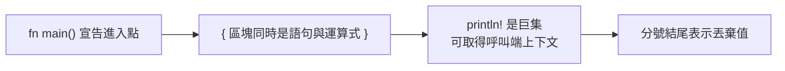

# 1.3 編寫與執行 Hello World

## 最小程式的完整解剖

先看最簡單的 Rust 程式：

```rust
fn main() {
    println!("Hello, world!");
}
```

這三行裡藏著四個重要的語言概念。第一，`fn` 關鍵字宣告函式，`main` 是程式的進入點。Rust 與許多語言不同，它要求 `main` 回傳單元型別 `()`，通常省略不寫。這種「所有函式都必須明確回傳值」的規則，讓型別資訊在整個程式中保持完整。

第二，`println!` 是**巨集**而非函式，尾端的驚嘆號就是區分兩者的標記。為什麼需要巨集？因為它必須在編譯期取得呼叫位置的資訊，例如 `println!("{name}")` 裡的 `name` 這個名字是在 `main` 函式作用域中的變數，普通的函式無法做到這件事。若把驚嘆號去掉，`println` 會被解析成一個不存在於標準函式庫中的函式，編譯器會明確告訴你「找不到名稱 `println`」。

第三，語句以分號結尾。`println!(...)` 回傳單元型別，若省略分號，編譯器會報錯說「這裡有額外的括號」或型別不符。

第四，程式碼區塊 `{}` 在 Rust 中同時是語句區塊與**運算式**。`{ let x = 5; x * 2 }` 這個區塊會求值為 `10`，因為最後一行沒有分號的運算式，其值就是整個區塊的值。這個特性是 Rust 表達式導向語言的核心，也是為什麼函式的回傳值可以寫成 `if` 或 `match` 而不需要 `return`。例如要取得兩個數字中的較大值，可以直接寫：

```rust
fn max_of(a: i32, b: i32) -> i32 {
    if a > b {
        a
    } else {
        b
    }
}
```

兩個分支的結果都是 `i32`，因此整個 `if` 運算式的型別就是 `i32`，也就是函式的回傳型別。若換成 C 的寫法，必須先宣告變數再賦值，或使用三元運算子。表達式導向的設計讓「值從哪裡來」在程式碼中是顯而易見的。



## 兩種建立方式

第一種是最直接的方式，用 `rustc` 直接編譯單一檔案：

```bash
mkdir -p ~/hello-rust && cd ~/hello-rust
cat > hello.rs <<'EOF'
fn main() {
    println!("Hello, world!");
}
EOF
rustc hello.rs -o hello
./hello
```

`rustc` 會預設產生與輸入檔同名的執行檔，因此 `rustc hello.rs` 已經足以得到 `hello`。指定 `-o` 只是為了自訂輸出名稱。

第二種是使用 Cargo 建立專案，這才是實際開發應採用的方式：

```bash
cargo new hello-rust
cd hello-rust
cargo run
```

`cargo new` 會建立一個目錄，裡面包含 `Cargo.toml`、`src/main.rs` 與 `.gitignore`，並立即初始化 Git 版控。`Cargo.lock` 會在第一次建置時產生。`cargo run` 會編譯並執行，輸出 `Hello, world!`。

Cargo 也提供了 `cargo new --lib` 來建立函式庫專案，差別在於它把入口放在 `src/lib.rs` 而非 `src/main.rs`，且產生的專案骨架中沒有 `fn main`。這個區分會在下一節詳細說明。

兩種方式的差異在於 Cargo 提供了完整專案骨架、相依套件管理、測試框架、發行打包與可重現的建置設定。`rustc` 適合快速驗證一個片段的行為，或是理解編譯器本身的運作，但任何正式的專案都應該從 `cargo new` 開始。

Cargo 的輸出也透露了許多資訊：

```text
   Compiling hello-rust v0.1.0 (/Users/me/hello-rust)
    Finished `dev` profile [unoptimized + debuginfo] target(s) in 0.42s
     Running `target/debug/hello-rust`
Hello, world!
```

方括號中的 `unoptimized + debuginfo` 說明了當前使用的是開發 profile。這行輸出也揭示了 Cargo 的兩個核心概念：build profile 決定了最佳化與除錯資訊的取捨，而 target 目錄則是所有建置產物的集中存放處。兩者都會在下一節深入說明。

## 什麼是「正確的」第一個程式

只印出固定字串的程式沒有展示 Rust 的任何特色。一個更能說明語言價值的「第一個程式」是處理一個會牽涉所有權與型別的任務，例如把使用者輸入的姓名組裝成問候語：

```rust
fn main() {
    let name: String = String::from("Rustacean");
    let greeting = format!("Hello, {name}!");
    println!("{greeting}");
}
```

這裡出現了 Rust 中最重要的兩個字串型別。`String` 是**擁有權**的、可增長的 UTF-8 字串，資料存放在堆積上，離開作用域時自動釋放。`&str` 則是對一段 UTF-8 資料的**借用視圖**，本身不擁有資料，只是一個指標加上長度。

`format!` 巨集在這裡的作用是把樣板與字串片段組合成新的 `String`，它回傳的是擁有權的型別，因此可以直接綁定到 `greeting` 這個變數上。這裡沒有任何手動配置，也沒有任何手動釋放。變數離開作用域時，Rust 依據所有權規則自動回收記憶體。

這兩個型別的分工可以用一個會被編譯器攔下的錯誤來說明：

```rust
fn first_word(s: &str) -> &str {
    s.split_whitespace().next().unwrap_or("")
}

fn main() {
    let owned: String = String::from("hello");
    let borrowed: &str = &owned;
    println!("{borrowed}");

    let literal: &str = "world";
    let copied: &str = literal;
    println!("{copied}");

    // 下面這行無法通過編譯：
    // let bad: &str = first_word(&String::from("temporary"));
    // error[E0716]: temporary value dropped while borrowed
}
```

第三個註解掉的例子是關鍵。`first_word` 回傳的是對參數的借用，因此 `first_word(&String::from("temporary"))` 嘗試借用一個即將在陳述句結尾被丟棄的暫時值。若允許，程式在執行時就會讀取已釋放的記憶體。Rust 的編譯器在這裡直接拒絕，錯誤碼是 `E0716`，訊息是「temporary value dropped while borrowed」，並額外指出「temporary value is freed at the end of this statement」。同樣的問題在 C++ 中則是完全合法的程式碼，缺陷只會在執行期以未定義行為的形式浮現。

理解 `String` 與 `&str` 的分工是寫出 Rust 的第一步：當你需要擁有並修改資料時用 `String`，當你只是要讀取或傳遞既有資料時用 `&str`。第 4 章會更完整地說明所有權與借用。

另一個能展示 Rust 價值的例子是處理可能不存在的值。在 C 與 C++ 中，回傳一個「可能沒有結果」的函式通常依賴空指標或特殊的哨兵值；在 Rust 中，這個狀態被寫進型別本身：

```rust
fn find_user(id: u32) -> Option<String> {
    match id {
        1 => Some(String::from("Alice")),
        2 => Some(String::from("Bob")),
        _ => None,
    }
}

fn main() {
    match find_user(3) {
        Some(name) => println!("找到使用者：{name}"),
        None => println!("查無此人"),
    }
}
```

`Option<String>` 這個型別告訴編譯器：這個函式的結果有兩種可能，而呼叫端必須處理兩種可能。這種把「可能失敗」編碼進型別的做法，消除了整類執行期錯誤。第 8 章會完整討論 `Option` 與 `Result`。

## 讀取命令列參數

第二個稍微進階一點的「第一個程式」是讀取命令列參數。標準函式庫提供了 `std::env::args`：

```rust
use std::env;

fn main() {
    let args: Vec<String> = env::args().collect();

    match args.len() {
        1 => println!("用法: greet <名字>"),
        2 => println!("Hello, {}!", args[1]),
        _ => {
            eprintln!("用法: greet <名字>");
            std::process::exit(1);
        }
    }
}
```

`env::args()` 回傳一個迭代器，`collect()` 把它收集成 `Vec<String>`。注意索引 `args[0]` 一律是程式自身的路徑，因此使用者提供的參數從索引 1 開始。

這個程式同時示範了幾個 Rust 的慣用寫法。`match` 用來對 `args.len()` 做完整的分支處理，Rust 會檢查所有可能的情況是否都被涵蓋，這就是所謂的「窮盡性檢查」。`eprintln!` 輸出到標準錯誤串流，適合用來回報錯誤訊息。`std::process::exit(1)` 以非零狀態碼結束程式，代表執行失敗。

執行結果如下：

```bash
cargo run -- 王小明
# Hello, 王小明!
```

需要留意的是，`cargo run -- 王小明` 中間的 `--` 是必要的，它告訴 Cargo 後面的參數要傳給程式本身，而不是給 Cargo。少了這個分隔符，Cargo 會嘗試解析 `王小明` 成為自己的選項並報錯。

另一種取得參數的寫法是使用 `env::args()` 搭配 `skip`，直接跳過掉第一個執行檔路徑：

```rust
use std::env;

fn main() {
    let name = env::args().nth(1).unwrap_or_else(|| "世界".to_string());
    println!("Hello, {name}!");
}
```

`nth(1)` 取的是索引為 1 的元素，也就是第一個使用者參數；若不存在則回傳 `None`，`unwrap_or_else` 在這種情況下提供一個預設值。這個寫法比先 `collect()` 成 `Vec` 再檢查長度更為簡潔，也更符合 Rust 偏好以迭代器處理序列的風格。

## 格式化輸出的常見寫法

`println!` 與 `format!` 巨集使用同一套格式化語法，常見的幾種形式值得先熟悉。`{}` 依序填入位置參數，`{0}` 與 `{1}` 指定索引，`{name}` 則使用變數名稱。格式說明可以放在冒號之後，例如 `{:.2}` 表示保留兩位小數，`{:>10}` 表示靠右對齊並填滿寬度 10，`{:x}` 與 `{:b}` 分別輸出十六進位與二進位表示。

```rust
fn main() {
    let name = "Rust";
    let version = 1;

    println!("{} {} {}", name, version, name);
    println!("{name} 的版本是 {version}");
    println!("{0} 和 {1} 和 {0}", "甲", "乙");
    println!("π 的近似值是 {:.5}", 3.14159265358979);
    println!("十六進位：{:#x}", 255);
    println!("填充：|{:>8}|", "右");
    println!("左填充：|{:<8}|", "左");
    println!("置中：|{:^8}|", "中");
}
```

這段程式碼會輸出多行格式化的結果，其中 `format!` 巨集與 `println!` 的差別只在於前者回傳字串而不列印。當需要把格式化後的結果存入變數時，`format!` 是正確的選擇。

值得留意的是，Rust 的格式化語法不依賴執行期解析，也不使用反射。它在建置期就被展開成實際的程式碼，因此沒有執行期成本，也不會因為型別不符而在執行期才發現問題。若把整數欄位填入 `{}`，編譯器會直接報錯。

## 常見初學者錯誤與編譯器訊息

第一種錯誤是忘記加分號造成的型別不符。假設寫了下面這段：

```rust
fn main() {
    let x = 5
    println!("{x}");
}
```

編譯器會直接報 `error: expected ';', found 'println'`，並用箭頭指向缺少分號的位置。這個錯誤的成因是 `let x = 5` 缺少分號後，解析器把下一行的 `println!(...)` 也當成同一個語句的一部分。只要在 `5` 後面補上分號即可。值得注意的是，這類錯誤屬於「語法錯誤」，編譯器會在解析階段就攔下，甚至還沒走到型別檢查。

第二種錯誤是分號多寫，把運算式變成了陳述句：

```rust
fn main() {
    let y: i32 = {
        let a = 3;
        a * 2;
    };
    println!("{y}");
}
```

這段會報 `error[E0308]: mismatched types`，指出 `expected i32`, `found ()`。原因是區塊中最後一行 `a * 2;` 帶著分號，其值被丟棄，整個區塊因而求值為單元型別。Rust 會明確提示「help: remove this semicolon to return this value」，修正方法就是把分號拿掉。若沒有寫上型別標註，編譯器會改以 `E0277` 報錯指出單元型別無法格式化，訊息同樣指向那個多餘的分號。

第三種常見錯誤是型別錯誤，這是 Rust 編譯器最擅長攔截的類別：

```rust
fn main() {
    let x: i32 = "hello";
}
```

字串字面值 `&str` 與 `i32` 毫無關係，編譯器會以 `E0308` 報告型別不符。Rust 不會像 C 那樣隱式進行多數型別轉換，所有轉換都必須寫明意圖，例如使用 `parse()` 解析字串或使用 `as` 進行明確的數值轉換。

第四種是借用之後的值已被移走。Rust 的所有權規則在第一堂課就會攔下這個錯誤：

```rust
fn main() {
    let s = String::from("hello");
    let t = s;
    println!("{s}");
}
```

這會報 `error[E0382]: borrow of moved value: 's'`。`let t = s;` 把 `s` 的所有權移轉給 `t`，此後 `s` 就不再有效。編譯器的說明會指出值是在哪一行被移走的，以及建議改用 `let t = s.clone();` 或改用借用。第 4 章會完整說明這個機制。

第五種是未使用的變數：

```rust
fn main() {
    let name = "Alice";
    println!("Hello, world!");
}
```

這會產生一個警告 `warning: unused variable: name`，並附上「if this is intentional, prefix it with an underscore」的提示。注意它是警告而不是錯誤，程式仍然可以編譯並執行。這正是 Rust 借用檢查器的前驅概念在起作用：在編譯期發現「這個值從未被使用」，進而提示程式設計師可能遺漏了某個邏輯。Rust 預設只警告，是為了不阻礙合法的寫法（例如稍後才使用的變數），但可以透過 `#[allow(unused_variables)]` 屬性逐項關閉。

第四種常見狀況是把 `mut` 拿掉卻仍想改變變數：

```rust
fn main() {
    let count = 0;
    count += 1;
}
```

這會報 `error[E0384]: cannot assign twice to immutable variable`，並提示「consider making this binding mutable」以及建議加上 `let mut count = 0;`。Rust 的變數預設不可變，這是刻意的設計：不可變的預設值讓資料流的追蹤更容易，也讓編譯器能給出更強的保證。

| 常見錯誤 | 錯誤碼 | 訊息關鍵字 |
|---|---|---|
| 忘記分號 | 語法錯誤 | expected `;`, found `println` |
| 分號多寫 | `E0308` | expected `i32` found `()` |
| 型別不相容 | `E0308` | expected `i32` found `&str` |
| 借用已移走的值 | `E0382` | borrow of moved value |
| 借用暫時值 | `E0716` | temporary value dropped while borrowed |
| 修改不可變變數 | `E0384` | cannot assign twice to immutable variable |
| 未使用變數 | 警告 | unused variable |

## 如何閱讀 rustc 的錯誤訊息

Rust 的錯誤訊息設計是語言中最好的之一，理由在於它同時提供三層資訊。第一層是錯誤碼，例如 `E0308` 對應「型別不符」，`E0716` 對應「借用值存活時間不足」，`E0382` 對應「借用後被移走」。這些代碼是穩定的，可以被搜尋與文件化。第二層是類別說明，`expected` 後面接著是「程式碼期望的型別」，`found` 後面接著是「實際得到的型別」，兩者對照就能看出問題。第三層是位置指向，編譯器會用 `^^^` 標出出錯的程式碼片段，並附上行號與欄位範圍。

完整的錯誤訊息看起來像這樣：

```text
error[E0308]: mismatched types
 --> src/main.rs:4:5
  |
4 |     let x: i32 = "hello";
  |            ---   ^^^^^^^ expected `i32`, found `&str`
  |
  = note: expected type `i32`
            found type `&str`
  |
  = help: try using a conversion method
  |
4 |     let x: i32 = "hello".parse().unwrap();
  |                         ^^^^^^^^^^^^^^
  |
For more information about this error, try `rustc --explain E0308`.
```

最有效率的閱讀順序是：先看 `-->` 指出的位置，接著比較 `expected` 與 `found` 兩個型別，然後看 `help` 區塊提供的建議修正。許多時候 `help` 區塊已經直接給出了正確的寫法。最後一行還會提示可以用 `rustc --explain` 查閱詳細說明。

遇到看不懂的錯誤碼時，可以直接查閱官方的錯誤索引：

```bash
rustc --explain E0308
```

這個指令會開啟對應的錯誤說明頁面，其中包含該錯誤的成因、範例程式碼與修正方式。也可以在瀏覽器開啟官方文件的錯誤索引頁，依代碼找到完整說明。這個 `rustc --explain` 指令是 Rust 工具鏈最實用卻最少被提及的功能之一，值得記在肌肉記憶裡。

編譯器訊息還有幾個貼心的設計值得留意。當一個型別無法與預期型別比較時，它會列出該型別所有可能的變體，讓你知道自己漏了哪一個 `match` 分支。當引用的名稱不存在時，它會列出作用域中所有相近的名稱，並依「你可能是想寫這個」的相似度排序。當括號或引號不配對時，錯誤訊息會直接指出解開括號的建議位置。這些設計讓「看不懂錯誤訊息」不再是 Rust 學習的障礙。

錯誤訊息也會盡可能給出可行的替代寫法。例如當引用的名稱不存在但作用域中有同名變數時，它會提示「did you mean to use `self` 給出這個借用」；當型別不匹配但兩者都是數值型別時，它會建議加入明確的轉換。`help` 區塊不是裝飾性的，而是編譯器與程式設計者對話的一部分。

## 除錯與檢查

在撰寫程式的過程中，`cargo check` 是最常用的回饋指令。它只執行型別檢查與借用檢查，不產生可執行檔，因此速度比 `cargo build` 快得多。搭配 `cargo build` 產生的除錯資訊，`cargo run` 之後就可以用 `lldb` 或 `gdb` 來檢視變數內容。

```bash
cargo check
cargo build
cargo run
```

每一輪修改後跑 `cargo check` 取得快速的型別回饋，只在需要執行時才 `cargo run`，是效率最高的開發節奏。

除錯資訊的保留程度由建置 profile 決定。開發 profile 預設完整保留除錯資訊，因此 `lldb target/debug/hello-rust` 就能看到區域變數與原始碼行號。release profile 則會把除錯資訊剝除，執行的速度更快但除碼時看不到原始碼。這個取捨是刻意的：除碼資訊會讓執行檔體積膨脹數倍，對於要部署到正式環境的程式碼而言並不划算。

```bash
cargo build
lldb target/debug/hello-rust
```

進入 `lldb` 後可以用 `breakpoint set --name main` 設下斷點，用 `run` 啟動程式，用 `print` 查看變數值，離開則輸入 `quit`。

除錯的第一原則是先縮小問題範圍。若能在獨立的最小程式中重現問題，通常就能更快找到根因。`cargo run` 搭配 `--release` 觀察到與 `cargo run` 不同的行為，往往意味著程式碼中存在未定義行為或依賴未最佳化時的巧合。

在 Rust 中，恐慌（panic）預設會印出一段包含檔案、行號與函式名稱的訊息，並以非零狀態碼結束行程。這個行為讓「程式跑到一半出錯」變得容易定位。當然，身處 panic 的環境並不理想，把 `unwrap()` 與 `expect()` 改成明確的錯誤處理，是正式程式碼應有的態度。

另一種常見的除錯需求是觀察程式的標準輸出與標準錯誤。`println!` 寫到標準輸出，`eprintln!` 寫到標準錯誤，兩者在終端機上交錯顯示，但在把錯誤訊息重新導向時兩者會分開。撰寫命令列工具時，把使用者可見的正常輸出寫到標準輸出、把診斷訊息寫到標準錯誤，是必須遵循的慣例。

實測方式很簡單：

```bash
cargo run > out.txt 2> err.txt
```

若程式中有 `println!` 與 `eprintln!` 各一行，`out.txt` 只會有前者、`err.txt` 只會有後者。這個區分讓命令列工具能與 Unix 的傳統管道與重導向機制良好地配合。

## 從第一個程式到真正的專案

Hello World 的價值在於建立一個能運作的回饋迴圈：寫下程式碼、讓編譯器檢查、執行並觀察結果。這個迴圈在 Rust 中特別短暫，因為許多錯誤會在建置階段就被攔下。

接下來要做的事情是把這個單一檔案擴展成有結構的專案：把程式碼拆成模組、引入外部相依套件、撰寫測試，並且讓建置過程完全可重現。這正是下一節的主題。

---

下一節將把視角拉高，介紹 Cargo 這個工具背後的概念模型：套件、箱子、執行檔與工作區之間究竟是什麼關係，以及相依套件的版本要如何被決定與鎖定。
