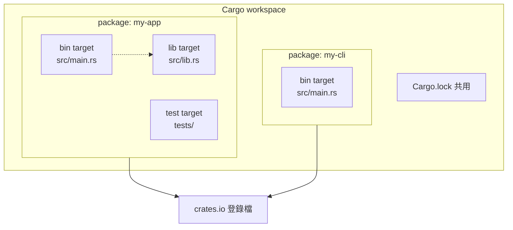

# 1.4 Cargo 套件管理器的基本使用

## Cargo 的概念模型

要正確使用 Cargo，必須先分清楚它管理的幾個層次。最上層是 **package**（套件），它是一個有自己名稱與版本碼的單位，對應到版控中的一個目錄與一個 `Cargo.toml` 檔案。一個 package 可以包含多個 crate。

crate 是編譯的單位，它是一個 library 或一個 executable。Cargo 對 crate 使用者所見的相依項目，稱為 dependency。

在 package 之內，每個可獨立建置的單元稱為 **target**，它有三種型態：`bin` 是執行檔，入口在 `src/main.rs` 或 `src/bin/` 下的每個檔案；`lib` 是函式庫，入口在 `src/lib.rs`；還有 example、test 與 bench 三種特殊 target。

最外層是 **workspace**（工作區），它把多個 package 組織在一起，共用一份 lockfile 與共同的建置設定。



這張圖呈現了幾個重要關係。`my-cli` 這個 package 可以透過路徑相依引用 `my-app` 的 library target，但無法引用它的 binary target，因為執行檔的 `main` 函式不是可被呼叫的介面。同一個 package 內的 binary 與 library 則可以互相引用，構成了「把邏輯放進 library、把呈現放進 binary」的常見專案結構。

這裡有一組容易混淆的詞需要澄清。package 是「打包與發布」的單位，對應到版控中的一個目錄；crate 是「編譯」的單位，一個 package 可以產生多個 crate。dependency 則是 crate 之間的引用關係，Rust 的官方文件特別強調：依賴關係永遠是 crate 對 crate 的，而不是 package 對 package 的。當你看到「某個 crate 依賴 serde」這句話，指的是 crate 層級的關係。

在實際檔案系統上，一個 package 的典型結構如下：

```text
my-app/
├── Cargo.toml        # 套件清單
├── Cargo.lock        # 相依版本鎖定（應提交）
├── .gitignore
├── src/
│   ├── main.rs       # bin target 的入口
│   └── lib.rs        # lib target 的入口
├── tests/
│   └── integration.rs # 整合測試，每個檔案一個 target
├── benches/
│   └── bench.rs      # 基準測試
└── examples/
    └── demo.rs       # 範例程式
```

`src/main.rs` 與 `src/lib.rs` 同時存在時，package 會同時產生一個執行檔與一個函式庫，兩者共用 `src` 下的模組。這個結構在稍大型的專案中非常實用：核心邏輯放在 `lib.rs` 中並撰寫完整的測試，`main.rs` 只負責處理命令列介面與呼叫核心邏輯。

## 五個日常指令

Cargo 的日常指令不多，但每一個都有明確的定位。

`cargo new` 建立新專案，`cargo new --lib` 建立函式庫專案。`cargo build` 編譯專案並把產物放在 `target/debug/`。`cargo run` 編譯並執行，`cargo run --release` 則使用 release profile。`cargo test` 執行測試。`cargo check` 只做型別檢查，不產生可執行檔。

`cargo check` 之所以是日常最常用的指令，是因為它跳過了程式碼生成階段。在大型專案上，`cargo build` 可能需要數十秒到數分鐘，而 `cargo check` 通常只要數秒。它執行的正是編譯器最昂貴的兩個環節：型別檢查與借用檢查，只是不做 MIR 最佳化、不產生 LLVM IR、不呼叫 LLVM 後端。這意味著編譯器能發現的絕大多數錯誤，`cargo check` 都找得到。

```bash
cargo new my-app
cd my-app
cargo check        # 最快的回饋
cargo build       # 產生可執行檔
cargo run         # 編譯並執行
cargo test        # 執行測試
```

另外幾個常被忽略但很有用的選項包括 `cargo build --release`（最佳化建置）、`cargo clean`（清除 `target` 目錄）、`cargo doc --open`（產生並開啟 API 文件）以及 `cargo clippy`（執行 Clippy 靜態檢查）。

`cargo run` 有幾個細節值得留意。若專案有多個 binary target，必須用 `cargo run --bin 執行檔名` 指定，否則 Cargo 會報錯要求你指明。若要傳遞參數給程式本身，分隔符 `--` 是必須的：

```bash
cargo run -- --verbose input.txt
```

`cargo test` 的行為也與直覺略有差異。預設只會執行 library target 與 `tests/` 目錄中的整合測試，執行 `src/` 內以 `#[cfg(test)]` 標記的單元測試時，可以指定過濾字串來縮小範圍：

```bash
cargo test                       # 執行全部測試
cargo test my_func               # 只跑名稱包含 my_func 的測試
cargo test -- --nocapture        # 顯示被捕获的 println! 輸出
cargo test -- --test-threads=1   # 單執行緒執行，觀察輸出順序
```

`--nocapture` 這個選項在除錯測試時特別有用，因為預設情況下 `println!` 的輸出會被測試框架捕获，只在測試失敗時才顯示。

## Cargo.toml 的結構

`Cargo.toml` 是專案的心臟，它使用 TOML 格式，區段以方括號標示：

```toml
[package]
name = "my-app"
version = "0.1.0"
edition = "2021"
authors = ["Your Name <you@example.com>"]
description = "一個範例專案"
license = "MIT"

[dependencies]
serde = { version = "1.0", features = ["derive"] }
serde_json = "1"
anyhow = "1"
tokio = { version = "1", features = ["full"] }

[dev-dependencies]
criterion = "0.5"
pretty_assertions = "1"

[features]
default = ["json"]
json = ["dep:serde_json"]
extra-logging = []

[profile.release]
opt-level = 3
lto = "thin"
codegen-units = 1
panic = "abort"
strip = true
```

`[package]` 區段描述套件本身，`edition` 欄位決定使用哪一版語義規則，`name` 與 `version` 是 crates.io 上的識別碼。

`[dependencies]` 是正式相依套件，`[dev-dependencies]` 只在測試、範例與基準測試時才會被編譯。兩者的區分讓正式建置不必拖著測試專用的重量級相依套件。

`[features]` 定義功能旗標，讓同一份程式碼在不同情境下編譯出不同行為。`default` 特性預設啟用，這裡的 `json` 特性會連帶啟用 `serde_json` 這個相依套件（`dep:` 前綴是 Rust 2021 版次新增的語法，用來明確表示啟用的是相依套件本身而非隱含的特性）。

`[profile.release]` 調整發布版的建置行為，細節會在後面說明。

### Cargo.toml 關鍵欄位速查

| 區段 | 欄位 | 說明 |
|---|---|---|
| `[package]` | `name` | 套件名稱，也是 crates.io 上的識別碼 |
| `[package]` | `version` | 套件版本，遵循語意化版本 |
| `[package]` | `edition` | 語言版次，目前為 2015、2018、2021、2024 |
| `[package]` | `rust-version` | 最低支援的 Rust 版本，影響相依套件的解析 |
| `[package]` | `default-run` | 有多個 binary target 時指定預設執行檔 |
| `[dependencies]` | 版本字串 | 相依套件的版本需求 |
| `[dependencies]` | `path` | 本機路徑相依，用於工作區內的 crate |
| `[dependencies]` | `features` | 啟用此相依套件的哪些特性 |
| `[dependencies]` | `optional` | 是否為可選相依套件 |
| `[features]` | `default` | 預設啟用的特性清單 |
| `[profile.*]` | `opt-level` | 最佳化層級 0 到 3 |
| `[profile.*]` | `lto` | 連結期最佳化策略 |
| `[profile.*]` | `codegen-units` | 程式碼生成的平行單元數 |
| `[profile.*]` | `panic` | panic 策略，`unwind` 或 `abort` |

## 版本語意與 Cargo.lock

Cargo 使用語意化版本（semantic versioning），版本號由三段數字組成：`1.2.3` 代表主版本 1、次版本 2、修訂版本 3。當主版本變更時代表不相容的 API 變更，次版本代表向後相容的新功能，修訂版本代表向後相容的修正。

相依套件宣告版本時使用需求字串，最常見的三種寫法有不同意義：

```toml
[dependencies]
serde = "1.0"      # 相容 1.x 的最新版本，例如 1.0.219
serde = "~1.0"     # 相容 1.0.x 的最新版本，例如 1.0.9，但不含 1.1.0
serde = "=1.0.219" # 精確鎖定 1.0.219
serde = ">=1.0, <2.0"  # 明確的區間
```

`^` 是預設符號，`"1.0"` 等同於 `"^1.0"`，表示「至少 1.0.0，且次版本與主版本相容」——它允許 `1.0.0` 到 `1.999.999` 之間的任何版本，但拒絕 `2.0.0`。這個規則稱為 caret requirement，是 Cargo 預設且最常見的寫法。

`~` 稱為 tilde requirement，允許「左側最後一個非零的數字」以外的位數變動。`~1.0` 允許 `1.0.0` 到 `1.0.999`，但拒絕 `1.1.0`；`~1.2.3` 允許 `1.2.3` 到 `1.2.999`。若寫成 `~1` 則等同於 `^1`，因為 `1` 的左側最後一個非零數字就是主版本。

精確版本 `=` 完全凍結版本，在撰寫教學或重現特定環境時很有用，但一般而言不建議，因為它會阻止任何修訂版式的安全更新。

`Cargo.lock` 記錄了整棵相依樹的實際解析結果，也就是說 `Cargo.toml` 描述的是「我需要什麼範圍的版本」，而 `Cargo.lock` 記錄的是「這次實際用了什麼版本」。它包含每個相依套件的名稱、版本、來源與相依關係的雜湊值。

關於 lockfile 是否該提交進版控，Rust 官方給出的規則很清楚：**應用程式與函式庫都應該提交 lockfile**。這與 npm、RubyGems 等生態的傳統建議不同。理由在於 Cargo 的相依解析是確定性的：同一份 `Cargo.toml` 搭配同一份 `Cargo.lock` 一定會得到相同的建置結果。對函式庫而言，提交的 lockfile 讓 CI 測試能確保在固定的相依組合下運作，同時它不會影響下游使用者，因為下游只會讀取 `Cargo.toml` 中的版本需求。唯一的例外是撰寫教學或範例程式時，人們有時會選擇忽略 lockfile。

lockfile 的另一個作用是安全稽核。每一筆相依記錄都帶有一個雜湊值，用來驗證下載的原始碼確實是 crates.io 上發布的那一份。這是供應鏈安全的第一道防線，防止了中間人攻擊或鏡像站點悄悄塞入惡意程式碼。當 `cargo build` 偵測到雜湊值不符時會直接中止建置。

`cargo update` 用來更新 lockfile 中的版本：

```bash
cargo update                   # 只更新相容範圍內的版本
cargo update -p serde          # 只更新特定套件
cargo update --breaking        # 允許跨主版本更新，可能破壞相容性
```

`--breaking` 選項可能把相依套件推進到不相容的主版本，例如從 `1.x` 跳到 `2.x`，這往往需要修改程式碼。謹慎使用這個選項，並在更新後執行完整測試。

## 管理相依套件的指令

`cargo add` 可以直接加入相依套件並自動更新 `Cargo.toml`：

```bash
cargo add serde --features derive
cargo add anyhow
cargo add tokio --features full
cargo remove anyhow
```

這比手動編輯 `Cargo.toml` 更安全，因為它會自動挑選與既有相依套件相容的版本。

`cargo tree` 顯示相依樹，用來理解「這個套件為什麼被引入」：

```bash
cargo tree
cargo tree -i serde      # 反向查詢：誰依賴了 serde
cargo tree -d             # 顯示重複的多個版本
```

`cargo tree -d` 在維護大型專案時特別有用，它能找出同一個套件的多個版本並存的情況。不同的相依套件若要求不相容的版本，就會出現這種情形，這時通常需要升級某一方或加入版本約束來收斂。

`cargo outdated` 列出相依套件中有新版本可用的項目，它需要安裝額外元件：

```bash
cargo install cargo-outdated
cargo outdated
```

`cargo audit` 則是檢查相依套件是否含有已知安全性漏洞的工具，對於把相依套件帶入正式產品的專案，這一項檢查值得納入持續整合流程。

除了這些內建指令，社群也提供了廣泛的 Cargo 子指令，透過 `cargo install` 安裝：

```bash
cargo install cargo-edit      # cargo add / cargo rm / cargo upgrade
cargo install cargo-watch     # 檔案變動時自動重新編譯
cargo install cargo-llvm-cov  # 測試覆蓋率報告
cargo install bacon           # 背景執行 Cargo 並顯示錯誤
```

`cargo watch` 這類工具解決的是一個很實際的痛點：Rust 的編譯時間較長，開發者往往需要等待。自動重新編譯的工具讓編譯在背景進行，編輯器則同步顯示錯誤，這是把等待時間壓到最低的常見做法。

## 建置產物的目錄結構

所有建置產物都集中在專案根目錄的 `target/` 下，它通常不該被提交進版控（`.gitignore` 預設會忽略它）。

`target/debug/` 存放開發 profile 的產物，`target/release/` 存放發布 profile 的產物。兩者的差異不只在最佳化程度，也在除錯資訊的保留。

`target/debug/deps/` 是核心目錄，存放所有相依套件與專案本身編譯出的物件檔與函式庫，檔名通常帶有雜湊值以避免不同版本互相覆蓋。`target/debug/incremental/` 是增量編譯的快取目錄，儲存中間的查詢結果，讓第二次建置只重新處理受影響的部分。`target/debug/build/` 存放建置腳本的輸出，也就是那些以 `build.rs` 為起點的原生建置流程所產生的東西，例如 `openssl-sys` 編譯 OpenSSL 的結果。

`target/debug/.fingerprint/` 記錄每個 crate 的建置指紋，包含特徵旗標、相依版本與 rustc 版本等資訊。Cargo 依賴這個目錄判斷某個 crate 是否需要重新編譯。若環境中的 rustc 版本或相依版本改變，指紋就會改變，觸發重新建置。

```bash
cargo clean              # 清除整個 target 目錄
cargo clean --release    # 只清除 release 產物
cargo clean -p my-app    # 只清除特定套件的產物
```

`cargo clean` 只會清除建置產物，不會動到原始碼與 lockfile。但在遇到「怎麼重新編譯還是錯」這種難以理解的狀況時，它往往是最快的解法。有些罕見的情況下，過期的指紋記錄會讓 Cargo 誤判某個 crate 不需要重新編譯，清除 `target` 目錄可以強制一切重來。

## Features 與條件編譯

Features 是 Cargo 的編譯期開關機制，讓同一份原始碼在不同情況下編譯出不同的功能組合。宣告 features 的方式如下：

```toml
[features]
default = ["json"]
json = ["dep:serde_json"]
cli = ["dep:clap"]
```

使用 features 有兩種常見情境。對相依套件而言，可以選擇性地啟用對方提供的功能，例如 `tokio = { version = "1", features = ["macros", "rt-multi-thread"] }`，只啟用需要的部分可以顯著減少編譯時間與執行檔體積。

在自己的程式碼中，則用 `#[cfg(feature = "...")]` 屬性進行條件編譯：

```rust
#[cfg(feature = "cli")]
mod cli {
    pub fn run() -> String {
        String::from("CLI 模式")
    }
}

#[cfg(not(feature = "cli"))]
mod cli {
    pub fn run() -> String {
        String::from("函式庫模式")
    }
}

fn main() {
    println!("{}", cli::run());
}
```

`cfg!` 巨集則提供執行期的編譯期常數判斷，寫法是 `cfg!(feature = "cli")`，它會在編譯期求值成 `true` 或 `false`：

```rust
fn main() {
    if cfg!(feature = "cli") {
        println!("以 CLI 模式建置");
    } else {
        println!("以函式庫模式建置");
    }
}
```

兩者的差別在於 `#[cfg]` 會把不符合條件的程式碼整段從編譯單元中移除，因此裡面的程式碼必須能獨立通過編譯；而 `cfg!` 只是一個布林值，兩邊的程式碼都會被編譯進去。

## Profiles 的影響

Cargo 的 profile 控制建置行為，最常用的有兩個：`dev` 對應 `cargo build`，`release` 對應 `cargo build --release`。可以設定 `opt-level` 從 0（不做最佳化）到 3（全力最佳化），`lto` 控制連結期最佳化，`codegen-units` 控制程式碼生成的平行單元數，`panic` 決定 panic 的行為，`strip` 決定是否移除符號表。

```toml
[profile.dev]
opt-level = 0
debug = true
incremental = true

[profile.release]
opt-level = 3
debug = false
lto = "thin"
codegen-units = 1
panic = "abort"
strip = true
```

`lto` 的三種選項是 `"false"`（不做連結期最佳化）、`"thin"`（薄型 LTO，在編譯單元之間做最佳化）與 `true`（完整 LTO，把整個程式當成一個單元最佳化）。完整 LTO 能帶來數個百分點的執行期提升，但編譯時間會顯著增加。

`codegen-units = 1` 讓 LLVM 把整個 crate 當成單一單元最佳化，能提升效能並減少程式碼體積，代價是編譯變慢。反過來，設成 16 或 32 可以加快編譯。

`panic = "abort"` 讓 panic 直接終止行程而不進行堆疊展開，這能減小執行檔體積並略微提升效能，但代價是 `catch_unwind` 無法捕獲 panic。對於伺服器程式，這通常不是好主意，因為單一請求的 panic 不應讓整個行程陪葬。

除了 `dev` 與 `release`，Cargo 還內建了 `test`、`bench` 與 `check` 這幾個隱含的 profile。`test` profile 繼承 `dev` 的設定，`bench` 繼承 `release`，`check` 則繼承 `dev` 但關閉程式碼生成。理解這層繼承關係，可以解釋為什麼 `cargo test --release` 能夠同時做最佳化與測試，而 `cargo check` 永遠不會產生執行檔。

Profiles 也可以自訂名稱，例如為測試環境定義一個 `ci` profile：

```toml
[profile.ci]
inherits = "dev"
opt-level = 1
debug = true
incremental = false
```

用 `cargo build --profile ci` 就能啟用這個 profile。在持續整合環境中，把 `incremental = false` 關掉可以避免快取造成的額外 I/O 與目錄膨脹。

## Workspace

當一個專案包含多個彼此相關的 crate 時，workspace 可以讓它們共用 lockfile 與建置設定：

```toml
[workspace]
members = ["crates/core", "crates/cli", "crates/server"]
resolver = "2"
```

建立 workspace 的典型做法是在根目錄放一份 `Cargo.toml` 宣告成員，每個成員目錄中的 `Cargo.toml` 則使用 `package.workspace = ".."` 指向根目錄。成員之間可以用路徑相依互相引用：

```toml
[dependencies]
my-core = { path = "../core" }
```

執行 `cargo build --workspace` 會一次建置所有成員，而 `cargo build -p my-cli` 只建置指定套件。`cargo test --workspace` 則在所有成員中執行測試。workspace 只有一份 `Cargo.lock`，位於根目錄，這保證了所有成員使用一致的相依版本。

在 workspace 中，路徑相依不需要手動標示版本，因為它們永遠來自本地目錄。只有當這個套件要發布到 crates.io 時，才需要在 `Cargo.toml` 中加上 `version` 欄位。

workspace 也讓相依套件可以只發布一次。在沒有 workspace 的情況下，若某個函式庫被多個應用程式使用，每個應用程式都會各自下載一份該函式庫的相依樹；有了 workspace，整組專案只維護一份 lockfile。

## 離線建置與 vendoring

在無法連線 crates.io 的環境中，`cargo vendor` 可以把相依套件的原始碼複製到專案內的 `vendor/` 目錄：

```bash
cargo vendor
```

執行後 Cargo 會印出一段需要加入 `.cargo/config.toml` 的設定：

```toml
[source.crates-io]
replace-with = "vendored-sources"

[source.vendored-sources]
directory = "vendor"
```

之後就可以完全離線建置：

```bash
cargo build --offline
cargo test --offline
```

`--offline` 這個選項會禁止 Cargo 連線網路，所有相依套件都必須已經在本地快取或 `vendor` 目錄中。它在建置環境檢查中特別有用，可以確保建置確實沒有偷偷下載任何東西。

另一種常見做法是設定 crates.io 的鏡像，適用於需要加速下載或受控管連線的環境：

```toml
# .cargo/config.toml
[source.crates-io]
replace-with = "mirror"

[source.mirror]
registry = "sparse+https://rsproxy.cn/index/"
```

使用 sparse 協定時，Cargo 只下載需要的索引項目而非整份索引，在大型相依樹上能顯著減少流量。

## 常用指令速查表

| 指令 | 作用 | 備註 |
|---|---|---|
| `cargo new` | 建立新專案 | `--lib` 建立函式庫 |
| `cargo build` | 編譯專案 | 產物在 `target/debug/` |
| `cargo build --release` | 以最佳化模式編譯 | 產物在 `target/release/` |
| `cargo run` | 編譯並執行 | `--` 之後的參數傳給程式 |
| `cargo check` | 只做型別與借用檢查 | 日常最常用，速度最快 |
| `cargo test` | 執行測試 | `-- --nocapture` 顯示印出內容 |
| `cargo clippy` | 執行 Clippy 檢查 | 需 `rustup component add clippy` |
| `cargo fmt` | 格式化程式碼 | `--check` 只檢查不修改 |
| `cargo doc --open` | 產生並開啟 API 文件 | 產物在 `target/doc/` |
| `cargo add` | 加入相依套件 | 自動更新 `Cargo.toml` |
| `cargo remove` | 移除相依套件 | 同上 |
| `cargo tree` | 顯示相依樹 | `-i` 反向查詢，`-d` 顯示重複版本 |
| `cargo outdated` | 檢查可更新的相依套件 | 需另外安裝 |
| `cargo audit` | 檢查已知漏洞 | 需另外安裝 |
| `cargo vendor` | 下載相依套件供離線建置 | 搭配 `--offline` 使用 |
| `cargo clean` | 清除建置產物 | 會刪除整個 `target/` |
| `cargo update` | 更新 lockfile 中的相依版本 | `--breaking` 允許跨主版本 |
| `cargo publish` | 發布套件到 crates.io | 需先 `cargo login` |

到這裡，第 1 章的內容已經完成。工具鏈安裝好了，工具鏈元件的分工也清楚了。接下來進入第 2 章，開始正式學習 Rust 的語法基礎：變數與可變性，以及各個基本資料型別。

---

第 2 章將從「變數是預設不可變」這個反直覺的設計談起，逐步建立 Rust 的型別系統觀念。
